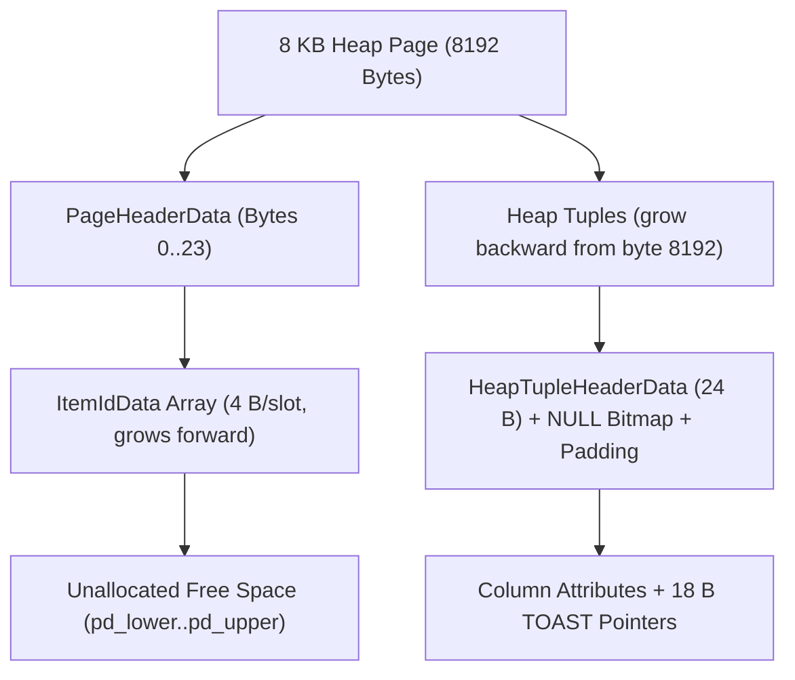
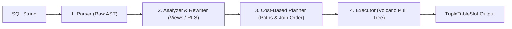
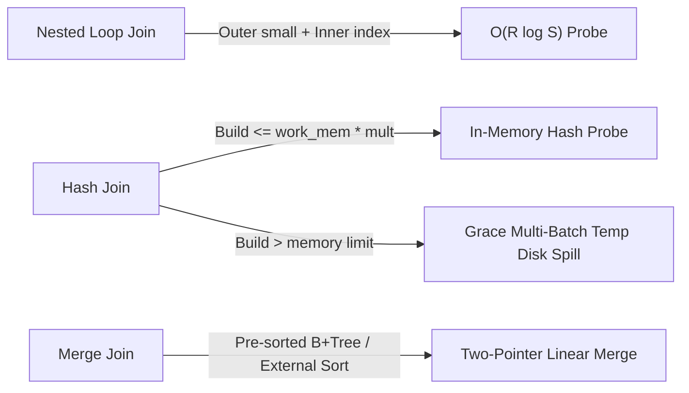
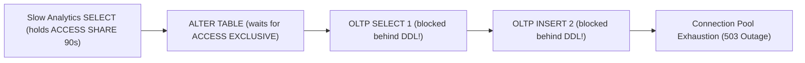

---
tags:
  - software-engineering
  - databases
  - sql
  - relational
  - postgresql
  - query-optimization
created: 2026-01-02
updated: 2026-11-13
status: 🟢
level: mid-to-senior
---
# Relational Databases: Storage Internals, Query Execution & Production Operations

> [!abstract] Vault Navigation
> Foundational relational storage and query execution handbook inside [[Programming/Software Engineering/Database Design/Database Design Complete Guide|Database Design Complete Guide]]. Pairs directly with [[Programming/Software Engineering/Database Design/Normalization|Normalization]], [[Programming/Software Engineering/Database Design/Indexing|Indexing]], [[Programming/Software Engineering/Database Design/Transactions|Transactions]], and [[Programming/Software Engineering/SDLC/Release Engineering & Migrations|Release Engineering & Migrations]].

Relational database management systems evaluate declarative set-theoretic SQL over strictly typed tuples stored inside fixed-size buffer pool pages. Predictable sub-10 ms OLTP tail latency and petabyte-scale reliability require understanding physical heap and B+Tree page byte layouts, CPU alignment padding, out-of-line TOAST storage, query planner selectivity mathematics, physical join operators, connection pool multiplexing mechanics, and FIFO metadata lock queueing during schema migrations.

---

## 1. First-Principles Mechanics & Complete Architecture

### 1.1 PostgreSQL 8 KB Heap Page Anatomy (`BLCKSZ`)

PostgreSQL organizes every table relation as an array of fixed **8,192-byte (8 KB)** heap files segmented into 1 GB physical OS files (`relfilenode`, `relfilenode.1`, ...). The storage engine reads and evicts 8 KB blocks as atomic I/O units inside `shared_buffers`. Each heap page partitions its 8,192 bytes across four regions that grow toward each other from opposite ends of the buffer:



1. **`PageHeaderData` (24 bytes, offsets `0..23`)**:
   - `pd_lsn` (`8 B`, `PageXLogRecPtr`): WAL Log Sequence Number of the last modification to this page. The buffer manager checks `pd_lsn <= flushed_wal_lsn` before flushing a dirty data page to disk (enforcing the Write-Ahead Log protocol).
   - `pd_checksum` (`2 B`): Page-level FNV-1a checksum validated on read when `data_checksums` is enabled.
   - `pd_flags` (`2 B`): Page state hints including `PD_HAS_FREE_LINES`, `PD_PAGE_FULL`, and `PD_ALL_VISIBLE` (synchronized with the Visibility Map).
   - `pd_lower` (`2 B`): Byte offset marking the end of the `ItemIdData` array (starts at `24`).
   - `pd_upper` (`2 B`): Byte offset marking the start of the lowest physical tuple payload (starts at `8192`).
   - `pd_special` (`2 B`): Byte offset marking the start of index-specific trailer data (`8192` on heap pages; holds right/left sibling links on B+Tree pages).
   - `pd_pagesize_version` (`2 B`) and `pd_prune_xid` (`4 B`, oldest unpruned `xmax` hint enabling opportunistic on-read HOT pruning).
2. **`ItemIdData` Line Pointer Array (4 bytes per entry, growing forward)**:
   - Each slot contains `lp_off` (`15 bits`, byte offset to tuple within this page), `lp_flags` (`2 bits`: `LP_UNUSED`, `LP_NORMAL`, `LP_REDIRECT` for HOT chains, `LP_DEAD`), and `lp_len` (`15 bits`, physical tuple length).
   - **Indirection Invariant (`CTID`)**: Every PostgreSQL index entry points to a tuple's logical **`(block_number, line_pointer_index)`** (`ctid`, e.g., `(418, 12)`), never to a raw byte offset inside the page. Consequently, when page-level HOT pruning or `VACUUM` compacts fragmented free space by sliding live tuples toward byte `8192`, PostgreSQL updates only the 15-bit `lp_off` inside the 4-byte `ItemIdData` slot on that single page—avoiding expensive rewrites across every secondary B+Tree index.
3. **Heap Tuple Layout (`HeapTupleHeaderData`, growing backward from byte `8192`)**:
   - Fixed header occupies **23 bytes** rounded to **24 bytes** (`t_xmin` `4 B`, `t_xmax` `4 B`, `t_cid`/`t_xvac` `4 B`, `t_ctid` `6 B`, `t_infomask2` `2 B`, `t_infomask` `2 B`, `t_hoff` `1 B`).
   - If any column in the row is `NULL` (`HEAP_HASNULL` bit set in `t_infomask`), PostgreSQL appends a **NULL bitmap** (`ceil(natts / 8)` bytes) immediately after byte 23. Otherwise, the NULL bitmap takes **0 bytes** (`t_hoff = 24`).
   - User attribute data begins at `t_hoff`, which is always rounded up to an **8-byte `MAXALIGN` boundary** on 64-bit architectures (for instance, a table with 12 columns containing at least one `NULL` needs 23 + 2 = 25 bytes, rounding `t_hoff` up to `32` bytes).

Live heap page internals can be inspected directly in production or staging via the `pageinspect` extension:

```sql
CREATE EXTENSION IF NOT EXISTS pageinspect;

-- Inspect the 24-byte PageHeaderData on block 0 of orders
SELECT lsn, checksum, flags, lower, upper, special, pagesize, prune_xid
FROM page_header(get_raw_page('orders', 0));

-- Inspect line pointers (lp), flags, physical offset/length, and MVCC XIDs
SELECT
    lp,
    lp_off,
    lp_flags,
    lp_len,
    t_xmin,
    t_xmax,
    t_ctid,
    t_hoff,
    to_hex(t_infomask) AS infomask_hex
FROM heap_page_items(get_raw_page('orders', 0))
LIMIT 15;
```

### 1.2 CPU Memory Alignment, Column Ordering & `fillfactor`

PostgreSQL maps C structs over in-memory tuple buffers directly during execution, requiring every attribute's byte offset inside the tuple to be a multiple of its CPU natural alignment (`pg_type.typalign`):
- `'c'` (`1 B`): `BOOLEAN`, `"char"`, short-header `varlena` strings (`<= 126` bytes).
- `'s'` (`2 B`): `SMALLINT` (`INT2`).
- `'i'` (`4 B`): `INTEGER` (`INT4`), `REAL`, `DATE`, `OID`, 4-byte `varlena` headers.
- `'d'` (`8 B`): `BIGINT` (`INT8`), `DOUBLE PRECISION`, `TIMESTAMPTZ`, `NUMERIC` (aligned per header), `UUID` (`16 B` size, `1 B` alignment `'c'` in PostgreSQL!).

> [!warning] Silent Alignment Padding Waste
> Interleaving narrow columns (`BOOLEAN`, `SMALLINT`) ahead of 8-byte columns (`BIGINT`, `TIMESTAMPTZ`) inserts 2 to 7 bytes of dead padding before every 8-byte field. Because PostgreSQL has no logical-vs-physical column separation (`attnum` order equals physical disk order), re-packing columns requires a full table rewrite.

**Exact Byte Calculation Proof (per row, zero NULLs, `t_hoff = 24`):**
- **Naive Declaration Order**: `(is_active BOOLEAN, account_id BIGINT, retry_cnt SMALLINT, created_at TIMESTAMPTZ, is_locked BOOLEAN, amount_cents BIGINT)`:
  - `24 B` header (`0..23`)
  - `is_active` (`1 B` @ `24`) + **`7 B` pad** (`25..31`) -> `account_id` (`8 B` @ `32..39`)
  - `retry_cnt` (`2 B` @ `40..41`) + **`6 B` pad** (`42..47`) -> `created_at` (`8 B` @ `48..55`)
  - `is_locked` (`1 B` @ `56`) + **`7 B` pad** (`57..63`) -> `amount_cents` (`8 B` @ `64..71`)
  - Total tuple size: **72 bytes** + `4 B` line pointer = **76 bytes/row** (`20 B` wasted in padding). At `fillfactor = 100`, an 8 KB page (`8192 - 24 = 8168 B`) stores `floor(8168 / 76) = 107` rows.
- **Descending-Alignment Order**: `(account_id BIGINT, created_at TIMESTAMPTZ, amount_cents BIGINT, retry_cnt SMALLINT, is_active BOOLEAN, is_locked BOOLEAN)`:
  - `24 B` header (`0..23`)
  - `account_id` (`8 B` @ `24..31`), `created_at` (`8 B` @ `32..39`), `amount_cents` (`8 B` @ `40..47`)
  - `retry_cnt` (`2 B` @ `48..49`), `is_active` (`1 B` @ `50`), `is_locked` (`1 B` @ `51`) + **`4 B` tail MAXALIGN pad** (`52..55`)
  - Total tuple size: **56 bytes** + `4 B` line pointer = **60 bytes/row**. An 8 KB page stores `floor(8168 / 60) = 136` rows (**+27% higher tuple density** inside `shared_buffers`, 21% smaller sequential scans, and zero extra hardware).

**Optimal Column Ordering Rule**: Place fixed-width `8 B` columns (`BIGINT`, `TIMESTAMPTZ`, `DOUBLE PRECISION`), then `4 B` columns (`INTEGER`, `DATE`, `REAL`), then `2 B` (`SMALLINT`), then `1 B` (`BOOLEAN`, `UUID`), and finally variable-length `varlena` fields (`TEXT`, `JSONB`, `BYTEA`, `NUMERIC`).

**`fillfactor` Tuning**: Heap tables default to `fillfactor = 100`, packing pages completely during `INSERT` or `COPY`. On tables receiving frequent `UPDATE`s on non-indexed columns, `fillfactor = 100` forces the new version onto a *different* 8 KB page—defeating **HOT (Heap-Only Tuple)** updates and forcing writes into every secondary index. Setting `ALTER TABLE ledger_accounts SET (fillfactor = 75);` reserves 25% of every 8 KB page (~2 KB) for in-page tuple chaining (detailed in [[Programming/Software Engineering/Database Design/Transactions|Transactions]]).

### 1.3 TOAST (The Oversized-Attribute Storage Technique)

PostgreSQL forbids heap tuples from spanning multiple 8 KB pages. When the total uncompressed tuple size exceeds `TOAST_TUPLE_THRESHOLD` (**2,040 bytes**, roughly one-quarter of an 8 KB page so at least 4 tuples fit per page), the tuple toaster iterates across variable-length (`varlena`) columns from largest to smallest until total tuple size drops below `TOAST_TUPLE_TARGET` (2,040 bytes):

1. **Inline Compression (`EXTENDED` / `MAIN`)**: Compresses attributes exceeding `32` bytes using `pglz` (legacy default) or `lz4` (PostgreSQL 14+, substantially faster decompression and lower CPU overhead). If compressed bytes fail to save space (e.g., already-compressed PNG/gzip blobs), compression aborts.
2. **Out-of-Line Chunking (`EXTENDED` / `EXTERNAL`)**: If the tuple remains $> 2,040$ bytes, PostgreSQL splits the column into `~1,996`-byte chunks stored in a dedicated auxiliary relation `pg_toast.pg_toast_<oid>` (`chunk_id OID, chunk_seq INT4, chunk_data BYTEA`) indexed by `(chunk_id, chunk_seq)`. The main heap tuple replaces the payload with an **18-byte `varatt_external` TOAST pointer** (`va_rawsize`, `va_extinfo` including compression method, `va_valueid`, `va_toastrelid`).

| Strategy | Inline Compress? | Out-of-Line Move? | Short-Header Threshold | Production Use Case |
|---|---|---|---|---|
| **`PLAIN`** | No | No | N/A (fixed width) | `BIGINT`, `UUID`, `TIMESTAMPTZ`, small `INT` |
| **`EXTENDED`** *(default)* | Yes | Yes (if tuple $> 2040$ B) | `<= 126 B` uses `1 B` header | `TEXT`, `JSONB`, `ARRAY`, `BYTEA` |
| **`EXTERNAL`** | No | Yes (immediately if $> 2040$ B) | `<= 126 B` uses `1 B` header | Pre-compressed `JPEG`, `zstd`, `gzip`, encrypted blobs (skips wasted CPU compression; enables fast `SUBSTRING` byte-range fetches!) |
| **`MAIN`** | Yes | Last resort only (if still $> 2040$ B) | `<= 126 B` uses `1 B` header | Moderate blobs routinely selected alongside scalar columns |

> [!danger] Hidden Read Amplification of `SELECT *` Across TOASTed Columns
> PostgreSQL loads TOAST chunks **lazily**: if a query projects `SELECT id, status, total_cents FROM orders`, the executor never touches `pg_toast.pg_toast_<oid>`. Conversely, issuing `SELECT * FROM orders` forces an extra B+Tree index probe and random TOAST heap page reads for every matching row whose `payload` was toasted, evicting hot relational pages from `shared_buffers` and multiplying query latency by $5\text{–}30\times$.

### 1.4 MySQL InnoDB 16 KB Clustered B+Tree vs PostgreSQL Heap

Unlike PostgreSQL's unordered heap + `CTID` pointer architecture, **MySQL InnoDB** stores every table inside a **Clustered B+Tree** using **16 KB pages** (`innodb_page_size = 16384`) physically ordered by the Primary Key:

| Storage Dimension | PostgreSQL (Heap + Secondary B+Trees) | MySQL InnoDB (Clustered B+Tree) |
|---|---|---|
| **Page Size (`BLCKSZ`)** | `8 KB` fixed (compile-time) | `16 KB` default (`4/8/16/32/64 KB`) |
| **Table Organization** | Unordered heap array; PK is a separate B+Tree pointing to `(block, offset)` | Live row columns stored directly inside Clustered PK B+Tree leaf pages |
| **PK Lookup Cost** | PK B+Tree traversal $\rightarrow$ 1 random heap page read | Single PK B+Tree traversal retrieves entire row directly at the leaf |
| **Secondary Index Value** | Stores physical `CTID` `(block, offset)` | Stores logical **Primary Key value** (no physical pointer!) |
| **Secondary Index Read Cost** | 1 index lookup $\rightarrow$ 1 heap fetch (or 0 if Index-Only + VM `all-visible`) | **Double B+Tree lookup**: Secondary B+Tree $\rightarrow$ PK value $\rightarrow$ Clustered PK B+Tree |
| **Non-PK `UPDATE` Index Cost** | Appends new tuple; updates **every** index unless HOT applies | Updates leaf row in place (Undo log delta); **zero secondary index writes**! |
| **Missing / Random PK Impact** | PK is optional; random `UUIDv4` fragments PK B+Tree only | Missing PK forces hidden 6 B monotonic `DB_ROW_ID` global mutex; random `UUIDv4` PK fragments **the entire table** via 50%-full leaf splits and bloats every secondary index! |

*(See [[Programming/Software Engineering/Database Design/Indexing|Indexing]] for `UUIDv7` time-ordered B+Tree locality and `INCLUDE` covering optimizations.)*

### 1.5 Query Execution Lifecycle & Cost-Based Optimizer Internals

Every SQL statement traverses a deterministic five-stage execution pipeline inside a PostgreSQL backend process:



1. **Parser**: Lexical scanner (`scan.l`) and Bison grammar (`gram.y`) build a syntax-checked raw parse tree (`RawStmt`). No catalog lookups occur here.
2. **Analyzer (`parse_analyze`)**: Resolves relation names, column types, operators, and permissions against `pg_catalog`, emitting a typed `Query` tree.
3. **Rewriter**: Applies rule transformations from `pg_rewrite`, recursively expanding non-materialized `VIEW`s and injecting Row-Level Security (`RLS`) predicates.
4. **Cost-Based Planner**:
   - Performs expression simplification (`constant folding`, `1 = 1` pruning), subquery flattening (`IN`/`EXISTS` $\rightarrow$ `SEMI JOIN`, `NOT EXISTS` $\rightarrow$ `ANTI JOIN`), and CTE inlining/materialization decisions.
   - Generates alternative physical access paths (`SeqScan`, `IndexScan`, `BitmapHeapScan`, `IndexOnlyScan`) and join trees using dynamic programming up to `join_collapse_limit` (default `8`), falling back to a genetic optimizer (`GEQO`) above `geqo_threshold` (`12`).
   - Scores candidate plans using calibrated cost constants:
     $$\text{Cost} = (\text{seq\_pages} \times \text{seq\_page\_cost}) + (\text{rand\_pages} \times \text{random\_page\_cost}) + (\text{tuples} \times \text{cpu\_tuple\_cost}) + (\text{index\_entries} \times \text{cpu\_index\_tuple\_cost})$$
     *(Note: Default `random_page_cost = 4.0` assumes spinning HDDs; on enterprise NVMe SSDs, set `random_page_cost = 1.1` and `effective_io_concurrency = 200` so the planner stops rejecting valid index scans).*
5. **Volcano Pull-Based Executor**: Each plan node implements `ExecInitNode`, `ExecProcNode` (called recursively top-down; returns a single `TupleTableSlot` per call, enabling pipelining and early termination on `LIMIT`), and `ExecEndNode`.

### 1.6 Planner Statistics, Histograms, MCVs & Correlated Columns (`CREATE STATISTICS`)

`ANALYZE` samples `300 * default_statistics_target` rows (default `100` $\rightarrow$ `30,000` rows via Vitter's reservoir algorithm) and persists column distributions inside `pg_statistic` (exposed via human-readable view `pg_stats`):
- **`null_frac`**: Fraction of `NULL` entries.
- **`n_distinct` (NDV)**: Positive integer for exact distinct count, or negative fraction (`-0.5` means 50% of total table rows are distinct—scaling automatically as the table grows).
- **`most_common_vals` (MCVs) & `most_common_freqs` (MCFs)**: Exact frequencies for skewed top-$K$ values (e.g., `status = 'completed'` = `0.94`).
- **`histogram_bounds`**: Up to `100` equi-depth quantile boundaries covering values *not* in the MCV list, used for range selectivity (`created_at >= ...`).

**The Independence Assumption Collapse**: Without multivariate statistics, the planner assumes columns are statistically independent:
$$P(A \land B) = P(A) \times P(B)$$
Consider a 10,000,000-row `addresses` table where `country = 'US'` has selectivity `0.40` and `state = 'CA'` has selectivity `0.05`, and 100% of `state = 'CA'` rows have `country = 'US'`. Independently, the planner computes `0.40 * 0.05 = 0.02` (`200,000` rows instead of `500,000`), and with 3 correlated columns (`city = 'Los Angeles'`, `postal_code = '90001'`, `state = 'CA'`), estimates plummet to `0.05 * 0.004 * 0.0005 = 1e-7` (**`estimated = 1` row**, when **`actual = 5,000` rows**). That $5{,}000\times$ cardinality underestimation convinces the planner to choose a **Nested Loop Join** over a **Hash Join**, triggering tens of thousands of random inner index lookups.

**Fix — PostgreSQL Extended Multivariate Statistics**:
```sql
CREATE STATISTICS st_addresses_geo (dependencies, ndistinct, mcv)
ON state, city, postal_code
FROM addresses;

ANALYZE addresses;

-- Inspect learned functional dependencies (1.00 = strictly dependent)
SELECT stxname, stxkind, stxddependencies, stxdndistinct
FROM pg_statistic_ext s
JOIN pg_statistic_ext_data d ON d.stxoid = s.oid
WHERE stxname = 'st_addresses_geo';
```

### 1.7 Physical Scan & Join Operators Deep Dive

#### Table Access Paths
1. **`Seq Scan`**: Reads heap pages sequentially (`0..N-1`). Optimal when returning $> 10\text{–}15\%$ of a table or when the entire table fits in a handful of pages (`8 KB` pages avoid random seeks and leverage kernel readahead). Multiple concurrent `Seq Scan`s share buffer reads via **synchronized scans**.
2. **`Index Scan`**: Traverses the B+Tree root $\rightarrow$ leaf, then immediately probes the heap page per matching `CTID`. Optimal for high selectivity ($< 1\text{–}5\%$) or `ORDER BY ... LIMIT N` queries where B+Tree order terminates execution early.
3. **`Bitmap Index Scan` + `Bitmap Heap Scan`**: Scans one or more B+Trees (supporting `BitmapAnd`/`BitmapOr` across independent indexes!), sets matching `(block, offset)` bits inside a `work_mem` TID bitmap, and then reads heap pages in **strict ascending physical block order** (converting random disk I/O into sequential I/O). If the bitmap exceeds `work_mem`, individual tuple bits degrade into **page-level (`lossy`) bits** (`Heap Blocks: exact=1200 lossy=48000`), requiring a `Recheck Cond` CPU filter over every tuple on each lossy block.
4. **`Index-Only Scan`**: Satisfies `SELECT` projections purely from B+Tree leaf entries (`INCLUDE` or key columns). Still checks the **Visibility Map (`all-visible` bit)** per page; stale `VACUUM` leaves `Heap Fetches > 0` (see [[Programming/Software Engineering/Database Design/Indexing|Indexing]]).

#### Physical Join Algorithms



| Operator | CPU / I/O Profile | Join Predicate | Memory Usage (`work_mem`) | Failure Mode |
|---|---|---|---|---|
| **Nested Loop** | $O(\|R\| \cdot \log \|S\|)$ w/ index; $O(\|R\| \cdot \|S\|)$ w/o | Any (`=`, `<`, `>`, `&&`, `LIKE`) | $O(1)$ *(plus `Memoize` cache in PG 14+)* | Cardinality underestimate causes millions of inner probes (`loops=500000`) |
| **Hash Join** | $O(\|R\| + \|S\|)$ | **Equi-joins (`=`) only** | `work_mem * hash_mem_multiplier` (`8 MB` default) | Exceeding memory triggers **Grace Hash Join** multi-batch disk temp spill (`Batches: 32`) |
| **Merge Join** | $O(\|R\| + \|S\|)$ if sorted; $O(N \log N)$ w/ sort | **Equi-joins (`=`)** | External merge sort (`temp_file` spill if > `work_mem`) | Heavy duplicate keys on both inputs cause inner mark/restore rewind loops |

**Grace Hash Join Disk Spill Mechanics**: When PostgreSQL picks `Hash Join`, it hashes the smaller estimated relation (`Build`) into memory capped at `work_mem * hash_mem_multiplier` (`4 MB * 2.0 = 8 MB` default). If actual rows exceed the budget mid-build, PostgreSQL dynamically splits the hash table into $2^k$ partitions (**Batches**), writes overflow partitions for *both* build and probe streams to `base/pgsql_tmp/` temporary disk files, and processes each batch pair sequentially—turning an 8 ms RAM join into a multi-second temp-I/O bottleneck:

```text
->  Hash Join  (cost=18420.00..94110.50 rows=820000 width=48)
               (actual time=312.4..2840.9 rows=845120 loops=1)
      Hash Cond: (o.customer_id = c.id)
      Buffers: shared hit=24110 read=4820, temp read=19420 written=19480
      ->  Seq Scan on orders o  (actual time=0.04..610.2 rows=2400000 loops=1)
      ->  Hash  (actual time=308.1..308.1 rows=845120 loops=1)
            Buckets: 131072  Batches: 16  Memory Usage: 5124kB
            ->  Seq Scan on customers c  (actual time=0.02..165.4 rows=845120 loops=1)
```

Increasing `SET LOCAL work_mem = '64MB';` for that analytical session collapses `Batches: 16` back to `Batches: 1`, eliminating `temp read=19420 written=19480` completely. *(Never set global `work_mem = 256MB` on OLTP primaries: `max_connections * concurrent_sort_hash_nodes * work_mem` triggers Linux OOM killer spikes!)*

---

## 2. Real-World Use Cases & Decision Matrix

Engineering teams frequently misapply relational databases—or replace them prematurely with NoSQL—without quantifying consistency, cardinality, and query-shape boundaries.

### Production Scenarios & Trade-Off Matrix

| Engineering Scenario | Recommended Relational Pattern | Why / Mechanics | When NOT to Use (Switch to Alternative) |
|---|---|---|---|
| **1. Multi-Tenant SaaS Ledger & Order Pipeline** | PostgreSQL with alignment-ordered tables, `BIGINT`/`UUIDv7` keys, composite B+Trees, `NOT VALID` constraints | Strict multi-row ACID integrity, foreign keys, and partial unique indexes prevent silent financial drift | Write ingest exceeds single-primary NVMe IOPS (> 100k sustained writes/sec) -> shard via Citus/Vitess ([[Programming/Software Engineering/Database Design/Sharding\|Sharding]]) |
| **2. Hierarchical Org Charts, BOMs & Permissions** | `WITH RECURSIVE` CTEs with `CYCLE` detection & depth caps | Single round-trip traversal of trees/DAGs up to ~10k nodes with exact transactional consistency | Deep 6+ hop social-graph pathfinding across $10^8+$ edges -> dedicated graph store or materialized closure/adjacency cache |
| **3. Semi-Structured Webhook/Event Metadata** | Hybrid Relational (`id`, `tenant_id`, `status`, `created_at`) + `JSONB` w/ `GIN jsonb_path_ops` | Keeps hot filter keys in compact 8 KB B+Tree columns while absorbing arbitrary tenant payloads without DDL churn | Deep nested arrays updated per element at high frequency -> relational child table or MongoDB Bucket pattern ([[Programming/Software Engineering/Database Design/Data Modeling NoSQL\|Data Modeling NoSQL]]) |
| **4. High-Scale API Pagination (`page 1..50,000`)** | **Keyset (Cursor) Pagination** `(created_at, id) < ($1, $2)` | $O(\log N + K)$ B+Tree index seek regardless of page depth | Arbitrary random page jumping ("jump to page 412") -> restrict UI to Next/Prev cursors or approximate search index |
| **5. High-Concurrency Kubernetes Microservices** | `PgBouncer` (`pool_mode = transaction`, ~40 server conns) + `SET LOCAL` | Multiplexes 2,000+ pod sockets onto ~40 backends, preserving `shared_buffers` and eliminating `ProcArray` contention | Services relying on `LISTEN`/`NOTIFY` or temp tables -> route dedicated worker pool via `session` mode or direct connection |
| **6. Daily Analytics & Multi-Row Window Rollups** | Window Functions (`ROWS BETWEEN`) + `MATERIALIZED` CTEs / CDC Offload | Eliminates $O(N^2)$ self-joins in a single $O(N \log N)$ sort/partition pass | Heavy full-table OLAP scans competing with OLTP buffer cache -> stream via CDC to columnar warehouse ([[Programming/Software Engineering/System Design/ETL\|ETL]]) |

### Detailed Scenario Guidance

1. **When Relational Wins Immediately**: Any domain requiring cross-entity invariants (`balances`, `inventory`, `subscriptions`, `rbac`), ad-hoc multi-predicate reporting (`WHERE tenant_id = $1 AND status IN (...)`), or strict data constraints (`EXCLUDE USING gist` preventing double-booked time ranges).
2. **When Relational Struggles Without Guardrails**: High-churn append-only telemetry at 500k rows/sec (needs `BRIN` + declarative range partitioning or TimescaleDB chunks), ephemeral sub-ms rate limit counters (use Redis/Valkey Lua scripts—see [[Programming/Software Engineering/Database Design/NoSQL|NoSQL]]), or unstructured binary payloads (`> 1 MB`) best offloaded to S3/GCS with only metadata and signed URLs stored in PostgreSQL.

---

## 3. Step-by-Step Practical Application (Production Implementation)

Below is a complete, copy-pasteable production implementation of a multi-tenant commerce ledger and event pipeline demonstrating optimal storage layout, constraints, CTEs, recursive trees, window functions, keyset pagination, idempotent upserts, `MERGE`, JSONB hybrid indexing, and TypeScript query integration.

### 3.1 Production Project Layout

```text
commerce-ledger/
  db/
    migrations/
      001_storage_optimal_schema.sql
      002_safe_not_valid_constraints.sql
    queries/
      analytics_windows.sql
      org_hierarchy_recursive.sql
      keyset_pagination.sql
      upsert_and_merge.sql
  infra/
    pgbouncer.ini
    postgresql.prod.conf
  src/
    db/pool.ts
    repositories/
      orderRepository.ts
      orderRepository.test.ts
```

### 3.2 Alignment-Optimized DDL, Partial Indexes, TOAST & Hybrid JSONB

```sql
-- db/migrations/001_storage_optimal_schema.sql
CREATE EXTENSION IF NOT EXISTS btree_gist;

-- 1. Columns ordered strictly descending by CPU alignment:
--    16B/8B fixed -> 4B -> 2B -> 1B -> variable-length (TEXT, JSONB)
CREATE TABLE org_units (
    id          BIGINT GENERATED ALWAYS AS IDENTITY PRIMARY KEY,
    tenant_id   BIGINT NOT NULL,
    parent_id   BIGINT REFERENCES org_units(id),
    created_at  TIMESTAMPTZ NOT NULL DEFAULT NOW(),
    depth_limit SMALLINT NOT NULL DEFAULT 10,
    is_active   BOOLEAN NOT NULL DEFAULT TRUE,
    unit_name   TEXT NOT NULL
) WITH (fillfactor = 90);

CREATE INDEX idx_org_units_tenant_parent ON org_units (tenant_id, parent_id);

-- 2. Orders ledger: alignment-packed + HOT fillfactor + LZ4 TOAST compression
CREATE TABLE orders (
    id              BIGINT GENERATED ALWAYS AS IDENTITY PRIMARY KEY,
    tenant_id       BIGINT NOT NULL,
    customer_id     BIGINT NOT NULL,
    created_at      TIMESTAMPTZ NOT NULL DEFAULT NOW(),
    updated_at      TIMESTAMPTZ NOT NULL DEFAULT NOW(),
    total_cents     BIGINT NOT NULL,
    tax_cents       BIGINT NOT NULL DEFAULT 0,
    currency_code   CHAR(3) NOT NULL DEFAULT 'USD',
    status          SMALLINT NOT NULL DEFAULT 0, -- 0=pending, 1=settled, 2=refunded
    deleted_at      TIMESTAMPTZ,
    idempotency_key TEXT NOT NULL,
    metadata        JSONB NOT NULL DEFAULT '{}'::jsonb
) WITH (
    fillfactor = 80,
    autovacuum_vacuum_scale_factor = 0.02,
    autovacuum_analyze_scale_factor = 0.01
);

-- Configure LZ4 TOAST compression (PG 14+) for fast payload decompression
ALTER TABLE orders ALTER COLUMN metadata SET COMPRESSION lz4;

-- Partial unique index: guarantees uniqueness only across active (non-deleted) rows
CREATE UNIQUE INDEX uq_orders_tenant_idem_active
ON orders (tenant_id, idempotency_key)
WHERE deleted_at IS NULL;

-- Composite covering index tailored for Keyset Pagination + Index-Only Scans
CREATE INDEX idx_orders_tenant_status_keyset
ON orders (tenant_id, status, created_at DESC, id DESC)
INCLUDE (customer_id, total_cents, currency_code)
WHERE deleted_at IS NULL;

-- Hybrid JSONB indexing: jsonb_path_ops is 2-3x smaller than default jsonb_ops for @>
CREATE INDEX idx_orders_metadata_gin
ON orders USING GIN (metadata jsonb_path_ops)
WHERE deleted_at IS NULL;

-- Expression index for scalar lookups on a hot JSONB field
CREATE INDEX idx_orders_channel_btree
ON orders (tenant_id, (metadata ->> 'channel'))
WHERE deleted_at IS NULL AND (metadata ? 'channel');

-- 3. Non-overlapping room/GPU reservation table enforced natively via GiST Exclusion
CREATE TABLE resource_reservations (
    id          BIGINT GENERATED ALWAYS AS IDENTITY PRIMARY KEY,
    resource_id BIGINT NOT NULL,
    tenant_id   BIGINT NOT NULL,
    slot        TSTZRANGE NOT NULL,
    cancelled_at TIMESTAMPTZ,
    CONSTRAINT excl_no_overlapping_active_slots
        EXCLUDE USING gist (resource_id WITH =, slot WITH &&)
        WHERE (cancelled_at IS NULL)
);
```

```sql
-- db/migrations/002_safe_not_valid_constraints.sql
-- Add non-blocking constraints to an existing populated orders table
SET lock_timeout = '2000ms';
SET statement_timeout = '5000ms';

ALTER TABLE orders
    ADD CONSTRAINT chk_orders_amounts_nonneg
    CHECK (total_cents >= 0 AND tax_cents >= 0) NOT VALID;

-- Validate online under SHARE UPDATE EXCLUSIVE (permits concurrent SELECT/INSERT/UPDATE)
SET lock_timeout = '2000ms';
SET statement_timeout = '0';
ALTER TABLE orders VALIDATE CONSTRAINT chk_orders_amounts_nonneg;
```

### 3.3 CTEs (`MATERIALIZED` vs Inlined) & Recursive Hierarchies With Cycle Guards

PostgreSQL 12+ changed CTE planning semantics fundamentally:
- A non-recursive, side-effect-free CTE referenced **once** is **inlined** into the outer query as a subquery, permitting `WHERE` predicate and `LIMIT` pushdown into indexes.
- A CTE referenced **multiple times** defaults to **`MATERIALIZED`**.
- **Data-modifying CTEs** (`INSERT`/`UPDATE`/`DELETE ... RETURNING`) always execute strictly once and materialize their output.

```sql
-- db/queries/org_hierarchy_recursive.sql
-- 1. Safe Recursive CTE traversing an organization tree with cycle protection (PG 14+ CYCLE)
WITH RECURSIVE org_tree AS (
    -- Anchor member
    SELECT
        id,
        tenant_id,
        parent_id,
        unit_name,
        0 AS depth,
        ARRAY[id] AS path_ids
    FROM org_units
    WHERE tenant_id = $1
      AND id = $2
      AND is_active = TRUE

    UNION ALL

    -- Recursive member: enforces depth guard + manual path array check (portable pre-PG14)
    SELECT
        c.id,
        c.tenant_id,
        c.parent_id,
        c.unit_name,
        p.depth + 1,
        p.path_ids || c.id
    FROM org_units c
    JOIN org_tree p
      ON c.parent_id = p.id
     AND c.tenant_id = p.tenant_id
    WHERE c.is_active = TRUE
      AND p.depth < 12
      AND NOT (c.id = ANY(p.path_ids)) -- Cycle guard prevents infinite loop on dirty graph data
)
-- Alternatively on PG 14+, append: CYCLE id SET is_cycle USING cycle_path
SELECT id, parent_id, unit_name, depth, path_ids
FROM org_tree
ORDER BY path_ids;

-- 2. Writable Data-Modifying CTE: atomic archive-and-purge inside one transaction snapshot
WITH purged_orders AS (
    DELETE FROM orders
    WHERE tenant_id = $1
      AND status = 2
      AND created_at < NOW() - INTERVAL '365 days'
    RETURNING *
)
INSERT INTO orders_archive
SELECT * FROM purged_orders;
```

### 3.4 Window Functions, Logical Execution Order & The `ROWS` vs `RANGE` Trap

SQL evaluates query clauses in strict logical order:
`FROM / JOIN` $\rightarrow$ `WHERE` $\rightarrow$ `GROUP BY` $\rightarrow$ `HAVING` $\rightarrow$ `WINDOW` $\rightarrow$ `SELECT` $\rightarrow$ `DISTINCT` $\rightarrow$ `ORDER BY` $\rightarrow$ `LIMIT`

Because `WHERE` executes **before** `WINDOW`, filtering on `ROW_NUMBER()` or `LAG()` requires wrapping the window calculation in a CTE or subquery. Furthermore, when an `OVER (...)` specification contains `ORDER BY` without an explicit frame clause, the SQL standard defaults to **`RANGE BETWEEN UNBOUNDED PRECEDING AND CURRENT ROW`**, NOT `ROWS`!

- **`RANGE`** treats every row sharing the same `ORDER BY` key (**peers**) as a single atomic group. On duplicate timestamps, a running sum jumps identically across all tied rows, and `LAST_VALUE(col)` returns the last peer up to the current key—never the true partition end.
- **`ROWS`** counts exact physical row offsets deterministically (requiring a unique tiebreaker like `id` in `ORDER BY`).
- **`RANGE BETWEEN INTERVAL '7 days' PRECEDING AND CURRENT ROW`** uses value-based offsets on `TIMESTAMPTZ` / `NUMERIC` columns to compute true time-window rollups even across days with zero transactions!

```sql
-- db/queries/analytics_windows.sql
WITH customer_timeline AS NOT MATERIALIZED (
    SELECT
        id,
        customer_id,
        created_at,
        total_cents,
        -- Strict monotonic rank vs tie-preserving ranks
        ROW_NUMBER() OVER w_cust AS seq_no,
        RANK()       OVER (PARTITION BY customer_id ORDER BY total_cents DESC) AS value_rank,
        DENSE_RANK() OVER (PARTITION BY customer_id ORDER BY total_cents DESC) AS value_dense_rank,
        -- Delta since customer's previous order without an O(N^2) self-join
        created_at - LAG(created_at) OVER w_cust AS time_since_prev_order,
        -- Deterministic physical running balance (ROWS, not default RANGE!)
        SUM(total_cents) OVER (
            PARTITION BY customer_id
            ORDER BY created_at ASC, id ASC
            ROWS BETWEEN UNBOUNDED PRECEDING AND CURRENT ROW
        ) AS running_spend_cents,
        -- True 7-day calendar rolling sum handling gaps cleanly
        SUM(total_cents) OVER (
            PARTITION BY customer_id
            ORDER BY created_at ASC
            RANGE BETWEEN INTERVAL '7 days' PRECEDING AND CURRENT ROW
        ) AS rolling_7d_spend_cents,
        -- Explicit full-partition frame required for LAST_VALUE!
        LAST_VALUE(id) OVER (
            PARTITION BY customer_id
            ORDER BY created_at ASC, id ASC
            ROWS BETWEEN UNBOUNDED PRECEDING AND UNBOUNDED FOLLOWING
        ) AS latest_order_id
    FROM orders
    WHERE tenant_id = $1
      AND status = 1
      AND deleted_at IS NULL
    WINDOW w_cust AS (PARTITION BY customer_id ORDER BY created_at ASC, id ASC)
)
SELECT *
FROM customer_timeline
WHERE seq_no <= 20
ORDER BY customer_id, seq_no;
```

### 3.5 Keyset Pagination, Idempotent Upserts (`ON CONFLICT`) & `MERGE`

`OFFSET 100000 LIMIT 50` forces PostgreSQL to fetch, sort, and discard `100,000` tuples before returning 50 rows ($O(N)$ degradation) and shifts duplicates/skips when rows insert concurrently. **Keyset (cursor) pagination** leverages PostgreSQL row-value tuple comparison `(created_at, id) < ($2, $3)`, which maps directly onto a single B+Tree range seek in `idx_orders_tenant_status_keyset`:

```sql
-- db/queries/keyset_pagination.sql
-- Page 1 (cursor null) vs Page K (pass last row's (created_at, id) as ($2, $3))
SELECT
    id,
    customer_id,
    total_cents,
    currency_code,
    created_at
FROM orders
WHERE tenant_id = $1
  AND status = 1
  AND deleted_at IS NULL
  AND (
      $2::timestamptz IS NULL
      OR (created_at, id) < ($2::timestamptz, $3::bigint)
  )
ORDER BY created_at DESC, id DESC
LIMIT 50;
```

**Atomic Upsert (`ON CONFLICT`) vs SQL `MERGE` (PostgreSQL 15+ / 17+ `RETURNING merge_action()`)**:

```sql
-- db/queries/upsert_and_merge.sql
-- 1. Idempotent upsert matching partial unique index uq_orders_tenant_idem_active
INSERT INTO orders (tenant_id, customer_id, total_cents, currency_code, status, idempotency_key, metadata)
VALUES ($1, $2, $3, $4, 1, $5, $6::jsonb)
ON CONFLICT (tenant_id, idempotency_key) WHERE deleted_at IS NULL
DO UPDATE SET
    metadata   = orders.metadata || EXCLUDED.metadata,
    updated_at = NOW()
WHERE orders.status = 0 -- Conditional guard: skip overwriting already settled orders!
RETURNING id, status, (xmax = 0) AS was_inserted;

-- 2. Staging table batch sync using MERGE (PG 15+, with RETURNING merge_action() in PG 17+)
MERGE INTO orders AS target
USING incoming_order_batch AS src
   ON target.tenant_id = src.tenant_id
  AND target.idempotency_key = src.idempotency_key
  AND target.deleted_at IS NULL
WHEN MATCHED AND src.action = 'refund' AND target.status = 1 THEN
    UPDATE SET status = 2, updated_at = NOW()
WHEN MATCHED AND src.action = 'void' AND target.status = 0 THEN
    UPDATE SET deleted_at = NOW(), updated_at = NOW()
WHEN NOT MATCHED AND src.action = 'create' THEN
    INSERT (tenant_id, customer_id, total_cents, status, idempotency_key)
    VALUES (src.tenant_id, src.customer_id, src.total_cents, 1, src.idempotency_key);
```

### 3.6 TypeScript Repository With Keyset Cursor & PgBouncer Transaction Context

```typescript
// src/db/pool.ts
import { Pool, PoolClient } from "pg";

export const pool = new Pool({
  connectionString: process.env.DATABASE_URL, // points to PgBouncer :6432
  max: 20,                                    // local pod pool; PgBouncer multiplexes onto ~40 PG backends
  idleTimeoutMillis: 30_000,
  connectionTimeoutMillis: 2_000,
});

export async function withTenantTx<T>(
  tenantId: number,
  fn: (client: PoolClient) => Promise<T>
): Promise<T> {
  const client = await pool.connect();
  try {
    await client.query("BEGIN");
    // Mandatory SET LOCAL in PgBouncer transaction mode: auto-reverts at COMMIT/ROLLBACK
    await client.query("SELECT set_config('app.tenant_id', $1, true)", [String(tenantId)]);
    await client.query("SET LOCAL statement_timeout = '3000ms'");
    await client.query("SET LOCAL lock_timeout = '1500ms'");
    const result = await fn(client);
    await client.query("COMMIT");
    return result;
  } catch (err) {
    await client.query("ROLLBACK").catch(() => {});
    throw err;
  } finally {
    client.release();
  }
}
```

```typescript
// src/repositories/orderRepository.ts
import { withTenantTx } from "../db/pool";

export interface OrderSummary {
  id: string;
  customerId: string;
  totalCents: string;
  currencyCode: string;
  createdAt: string;
}

export interface KeysetPage {
  items: OrderSummary[];
  nextCursor: { createdAt: string; id: string } | null;
}

export async function listSettledOrdersPage(
  tenantId: number,
  cursor: { createdAt: string; id: string } | null,
  limit = 50
): Promise<KeysetPage> {
  const safeLimit = Math.min(Math.max(limit, 1), 200);
  return withTenantTx(tenantId, async (client) => {
    const { rows } = await client.query<{
      id: string;
      customer_id: string;
      total_cents: string;
      currency_code: string;
      created_at: Date;
    }>(
      `SELECT id, customer_id, total_cents, currency_code, created_at
       FROM orders
       WHERE tenant_id = $1
         AND status = 1
         AND deleted_at IS NULL
         AND ($2::timestamptz IS NULL OR (created_at, id) < ($2::timestamptz, $3::bigint))
       ORDER BY created_at DESC, id DESC
       LIMIT $4`,
      [tenantId, cursor?.createdAt ?? null, cursor?.id ?? null, safeLimit + 1]
    );

    const hasMore = rows.length > safeLimit;
    const pageRows = hasMore ? rows.slice(0, safeLimit) : rows;
    const last = pageRows[pageRows.length - 1];

    return {
      items: pageRows.map((r) => ({
        id: r.id,
        customerId: r.customer_id,
        totalCents: r.total_cents,
        currencyCode: r.currency_code,
        createdAt: r.created_at.toISOString(),
      })),
      nextCursor: hasMore && last
        ? { createdAt: last.created_at.toISOString(), id: last.id }
        : null,
    };
  });
}

// CROSS JOIN LATERAL: Indexed Top-N-Per-Customer without scanning entire orders history
export async function getTopOrdersForCustomers(
  tenantId: number,
  customerIds: number[],
  perCustomerLimit = 3
): Promise<OrderSummary[]> {
  return withTenantTx(tenantId, async (client) => {
    const { rows } = await client.query<{
      id: string;
      customer_id: string;
      total_cents: string;
      currency_code: string;
      created_at: Date;
    }>(
      `SELECT top_o.id, top_o.customer_id, top_o.total_cents, top_o.currency_code, top_o.created_at
       FROM UNNEST($2::bigint[]) AS c(customer_id)
       CROSS JOIN LATERAL (
           SELECT o.id, o.customer_id, o.total_cents, o.currency_code, o.created_at
           FROM orders o
           WHERE o.tenant_id = $1
             AND o.customer_id = c.customer_id
             AND o.status = 1
             AND o.deleted_at IS NULL
           ORDER BY o.total_cents DESC, o.id DESC
           LIMIT $3
       ) AS top_o`,
      [tenantId, customerIds, perCustomerLimit]
    );
    return rows.map((r) => ({
      id: r.id,
      customerId: r.customer_id,
      totalCents: r.total_cents,
      currencyCode: r.currency_code,
      createdAt: r.created_at.toISOString(),
    }));
  });
}
```

```typescript
// src/repositories/orderRepository.test.ts
import { describe, it, expect, beforeAll, afterAll } from "vitest";
import { pool } from "../db/pool";
import { listSettledOrdersPage } from "./orderRepository";

describe("listSettledOrdersPage keyset pagination", () => {
  const tenantId = 9001;

  beforeAll(async () => {
    await pool.query("DELETE FROM orders WHERE tenant_id = $1", [tenantId]);
    await pool.query(
      `INSERT INTO orders (tenant_id, customer_id, total_cents, status, idempotency_key, created_at)
       VALUES
         ($1, 10, 5000, 1, 'k-1', '2026-11-10T10:00:00Z'),
         ($1, 10, 7500, 1, 'k-2', '2026-11-10T10:00:00Z'), -- Identical timestamp tests id tiebreaker
         ($1, 11, 2500, 1, 'k-3', '2026-11-11T10:00:00Z')`,
      [tenantId]
    );
  });

  afterAll(async () => {
    await pool.query("DELETE FROM orders WHERE tenant_id = $1", [tenantId]);
    await pool.end();
  });

  it("paginates deterministically across tied timestamps without duplicates or skips", async () => {
    const page1 = await listSettledOrdersPage(tenantId, null, 2);
    expect(page1.items).toHaveLength(2);
    expect(page1.nextCursor).not.toBeNull();

    const page2 = await listSettledOrdersPage(tenantId, page1.nextCursor, 2);
    expect(page2.items).toHaveLength(1);
    expect(page2.nextCursor).toBeNull();

    const allIds = [...page1.items, ...page2.items].map((i) => i.id);
    expect(new Set(allIds).size).toBe(3);
  });
});
```

---

## 4. Connection Pooling, Zero-Downtime DDL & Reference Edge Cases

### 4.1 Process-Per-Connection Saturation & `ProcArrayLock`

PostgreSQL spawns a dedicated OS `postgres` worker process for each client TCP socket. Direct-connecting 1,500 Kubernetes pods without a pooler collapses throughput via three internal mechanisms:
1. **Memory Starvation**: Each backend allocates ~5–12 MB of private heap and local catalog/relcache memory; 2,000 idle sessions consume 10–24 GB RAM stolen directly from OS page cache and `shared_buffers`.
2. **OS Context Switch Thrashing**: Having $500+$ runnable backends on 16–32 CPU cores stalls execution inside Linux CFS scheduler preemptions.
3. **`ProcArrayLock` Snapshot Contention**: Every single query under `READ COMMITTED` and every transaction under `REPEATABLE READ` scans the shared `PGPROC` array to construct an MVCC snapshot (`GetSnapshotData()`). Above ~250–500 total backend slots, acquiring and scanning `ProcArray` creates severe $O(N^2)$ CPU spinlock contention across NUMA sockets.

**Active Server Pool Sizing Formula**:
$$\text{Optimal Server Connections} \approx (2 \times \text{CPU Cores}) + \text{Effective NVMe Queue Concurrency}$$
On a 16-vCPU NVMe primary, **35–50 active server connections** maximize transaction throughput. If 60 application pods each maintain `pool_max = 25` directly against PostgreSQL, total backends reach $60 \times 25 = 1{,}500$. Place **PgBouncer** between application pods and PostgreSQL so 2,000+ pod connections multiplex onto `default_pool_size = 40`.

### 4.2 PgBouncer `transaction` Mode Rules & Configuration

| Pooling Mode | Server Backend Assigned For | Multiplexing Ratio | Incompatible PostgreSQL Features |
|---|---|---|---|
| **Session** | Entire client TCP connection | $1:1$ (zero multiplexing) | Safe for all features; fails to reduce idle backend count across many pods |
| **Transaction** *(OLTP standard)* | Single `BEGIN...COMMIT` block | $50:1$ to $200:1$ | Session `SET`, `PREPARE` (pre-1.21), `CREATE TEMP TABLE`, `LISTEN`/`NOTIFY`, `WITH HOLD` cursors, `pg_advisory_lock()` |
| **Statement** | Single SQL statement | Highest | Breaks multi-statement transactions (`BEGIN...COMMIT`); avoid for OLTP |

```ini
; infra/pgbouncer.ini
[databases]
prod_db = host=10.0.10.20 port=5432 dbname=prod_db

[pgbouncer]
listen_addr = 0.0.0.0
listen_port = 6432
auth_type = scram-sha-256
auth_file = /etc/pgbouncer/userlist.txt

pool_mode = transaction
max_client_conn = 3000
default_pool_size = 40
min_pool_size = 10
reserve_pool_size = 10
reserve_pool_timeout = 2

; PgBouncer >= 1.21 protocol-level prepared statement cache across server backends
max_prepared_statements = 200

; Idle & hung query guardrails
server_idle_timeout = 300
query_wait_timeout = 5
client_idle_timeout = 900
server_reset_query = DISCARD ALL
```

```ini
# infra/postgresql.prod.conf (64 GB RAM, 16 vCPU, NVMe SSD OLTP Primary)
max_connections = 120                     # PgBouncer uses ~40; headroom for admin/replication
shared_buffers = 16GB                     # 25% of system RAM for PostgreSQL page cache
effective_cache_size = 48GB               # ~75% RAM hint (shared_buffers + OS page cache)
work_mem = 16MB                           # Per sort/hash operator; raise via SET LOCAL for BI
hash_mem_multiplier = 2.0                 # Hash operators may use up to 32MB before spilling
maintenance_work_mem = 1GB                # Accelerates VACUUM and CREATE INDEX CONCURRENTLY
random_page_cost = 1.1                    # NVMe random I/O cost (never leave at HDD default 4.0!)
effective_io_concurrency = 200            # Parallel async prefetch for Bitmap Heap Scans on NVMe
default_toast_compression = 'lz4'         # Fast out-of-line TOAST compression (PG 14+)
idle_in_transaction_session_timeout = '60s' # Prevent abandoned transactions from pinning MVCC
shared_preload_libraries = 'pg_stat_statements'
```

**Mandatory Transaction-Mode Invariants**:
1. **Prepared Statements**: If running PgBouncer `< 1.21` or `max_prepared_statements = 0`, clients issuing extended-protocol named `PREPARE stmt_1` fail with `ERROR: prepared statement "stmt_1" does not exist` when the next transaction lands on a different backend. Fix by enabling `max_prepared_statements = 200` on PgBouncer `>= 1.21` **or** disabling driver named statements (`prepareThreshold=0` in JDBC, `?pgbouncer=true` in Prisma, `QueryExecModeSimpleProtocol` in `pgx`, `DEALLOCATE ALL` if switching modes).
2. **Tenant Context Leakage**: Never issue session-level `SET search_path = tenant_a;` or `SET statement_timeout = 0;`—they persist on the server backend after `COMMIT` and corrupt the next tenant's transaction. Always use **`SET LOCAL`** or `set_config(..., true)` inside an explicit `BEGIN...COMMIT`.
3. **Session Primitives**: Replace session-level `pg_advisory_lock()` with transaction-scoped `pg_advisory_xact_lock()`. Route background `LISTEN`/`NOTIFY` daemons around PgBouncer (`session` pool or direct port `5432`).

### 4.3 The DDL FIFO Lock Queue Catastrophe & Zero-Downtime Migrations

PostgreSQL queues lock acquisitions strictly in **FIFO order** to prevent writer starvation. Every `SELECT` acquires `ACCESS SHARE` (level 1). Most `ALTER TABLE` statements require **`ACCESS EXCLUSIVE`** (level 8, conflicting with *every* lock mode including `ACCESS SHARE`).



If an analytical `SELECT` runs for 90 seconds, an unbounded `ALTER TABLE` queues behind it waiting for `ACCESS EXCLUSIVE`—and **every incoming OLTP `SELECT`, `INSERT`, and `UPDATE` immediately stalls behind the waiting `ALTER TABLE`**, exhausting PgBouncer/API connection pools within 3 seconds!

**Mandatory Zero-Downtime DDL Rules** *(full Expand-and-Contract workflow in [[Programming/Software Engineering/SDLC/Release Engineering & Migrations|Release Engineering & Migrations]])*:

1. **Always Set `lock_timeout` + `statement_timeout` With Retries**:
   ```sql
   -- Safe lock-bounded DDL execution: fails in 2s instead of cascading a 503 outage
   SET lock_timeout = '2000ms';
   SET statement_timeout = '10000ms';
   ALTER TABLE orders ADD COLUMN discount_cents BIGINT;
   -- Note: ADD COLUMN ... DEFAULT <constant> (non-volatile) is metadata-only instant in PG 11+!
   ```
2. **Never Block Writes Building Indexes**: Always run `CREATE INDEX CONCURRENTLY` and `DROP INDEX CONCURRENTLY` *outside* a transaction block (`BEGIN...COMMIT`). It takes two table scans under `SHARE UPDATE EXCLUSIVE` while permitting concurrent reads and writes. (If interrupted, an `INVALID` index remains—inspect `pg_index.indisvalid` and `DROP INDEX CONCURRENTLY`).
3. **Two-Phase `NOT VALID` Constraint Validation**: Adding a `CHECK` or `FOREIGN KEY` constraint normally scans the entire table while holding `SHARE ROW EXCLUSIVE` (blocking all writes!). Split it into two safe operations:
   ```sql
   -- Step 1: Instant metadata lock (validates NEW writes immediately; skips scanning historical rows)
   SET lock_timeout = '2000ms';
   ALTER TABLE orders
       ADD CONSTRAINT chk_orders_total_nonneg
       CHECK (total_cents >= 0) NOT VALID;

   -- Step 2: Backfill invalid historical rows via keyset batches if any exist, then validate online
   -- Uses SHARE UPDATE EXCLUSIVE: concurrent SELECT/INSERT/UPDATE/DELETE proceed uninterrupted!
   SET lock_timeout = '2000ms';
   SET statement_timeout = '0'; -- Long scan allowed because it does NOT block OLTP traffic
   ALTER TABLE orders VALIDATE CONSTRAINT chk_orders_total_nonneg;
   ```
4. **Never Run `ALTER COLUMN ... TYPE` Directly on Live Tables**: Rewrites the entire heap and every index under `ACCESS EXCLUSIVE`. Instead, add a nullable column $\rightarrow$ dual-write via trigger or app code $\rightarrow$ keyset batch backfill $\rightarrow$ swap reads $\rightarrow$ drop old column.

### 4.4 Subtle PostgreSQL Edge Cases & Gotchas

- **Volatile vs Immutable Defaults**: Adding `ADD COLUMN token UUID DEFAULT gen_random_uuid()` forces an immediate full-table rewrite under `ACCESS EXCLUSIVE` because `gen_random_uuid()` is `VOLATILE` (must evaluate uniquely per existing row). Only constant or `STABLE`/`IMMUTABLE` constant-folded expressions skip the table rewrite in PG 11+.
- **Non-Sargable Expressions Defeating B+Trees**: Writing `WHERE created_at::date = '2026-11-13'` or `WHERE LOWER(email) = $1` skips B+Tree indexes on `created_at` or `email`. Always rewrite as range predicates (`created_at >= '2026-11-13 00:00:00Z' AND created_at < '2026-11-14 00:00:00Z'`) or add matching expression indexes.
- **`NOT IN (subquery)` NULL Trap**: If the inner subquery returns a single `NULL`, `x NOT IN (1, 2, NULL)` evaluates to SQL three-valued `UNKNOWN` (never `TRUE`), returning **0 rows**! Always use `NOT EXISTS (...)` instead, which also executes cleanly as a Hash/Merge `Anti Join`.
- **`COUNT(*)` Performance**: PostgreSQL cannot satisfy `SELECT COUNT(*) FROM huge_table` in $O(1)$ because MVCC visibility differs per concurrent snapshot. Without predicates, it scans the smallest covering index (`Index Only Scan` if Visibility Map is clean) or performs a `Parallel Seq Scan`. Use `pg_class.reltuples` (`SELECT reltuples::bigint FROM pg_class WHERE relname = 'orders'`) for UI approximate counts.

---

## 5. Production Debugging, Profiling & Operations Playbook

### 5.1 Live Telemetry & Bottleneck Queries

```sql
-- 1. Active Queries, Wait Events & Lock Wait Duration
SELECT
    pid,
    usename,
    application_name,
    state,
    wait_event_type,
    wait_event,
    ROUND(EXTRACT(EPOCH FROM (NOW() - xact_start))::numeric, 2) AS xact_sec,
    ROUND(EXTRACT(EPOCH FROM (NOW() - query_start))::numeric, 2) AS query_sec,
    pg_blocking_pids(pid) AS blocked_by,
    LEFT(query, 120) AS query_preview
FROM pg_stat_activity
WHERE state <> 'idle'
  AND pid <> pg_backend_pid()
ORDER BY xact_start ASC NULLS LAST;

-- 2. Top CPU, I/O & Temp-Spill Offenders via pg_stat_statements
SELECT
    queryid,
    calls,
    ROUND(total_exec_time::numeric, 1) AS total_ms,
    ROUND(mean_exec_time::numeric, 2) AS mean_ms,
    rows,
    shared_blks_hit,
    shared_blks_read,
    temp_blks_written,
    LEFT(query, 100) AS sql_text
FROM pg_stat_statements
ORDER BY total_exec_time DESC
LIMIT 20;

-- 3. Lock Queue & Exact Blocking Relationship Details
SELECT
    blocked.pid AS blocked_pid,
    blocked.query AS blocked_query,
    bl_locks.mode AS requested_mode,
    blocker.pid AS blocker_pid,
    blocker.state AS blocker_state,
    blocker.query AS blocker_query,
    NOW() - blocked.query_start AS wait_duration
FROM pg_stat_activity blocked
JOIN pg_locks bl_locks ON bl_locks.pid = blocked.pid AND NOT bl_locks.granted
JOIN pg_stat_activity blocker ON blocker.pid = ANY(pg_blocking_pids(blocked.pid))
ORDER BY wait_duration DESC;

-- 4. Table & Index Cache Hit Ratio + Sequential vs Index Scan Anomaly Check
SELECT
    relname,
    seq_scan,
    seq_tup_read,
    idx_scan,
    idx_tup_fetch,
    pg_size_pretty(pg_total_relation_size(relid)) AS total_size,
    ROUND(100.0 * heap_blks_hit / NULLIF(heap_blks_hit + heap_blks_read, 0), 2) AS heap_hit_pct
FROM pg_stat_user_tables t
JOIN pg_statio_user_tables io USING (relid)
ORDER BY seq_tup_read DESC
LIMIT 15;
```

### 5.2 Symptom $\rightarrow$ Root Cause $\rightarrow$ Fix Playbook

| Production Symptom | Diagnostic Verification (`SQL` / `EXPLAIN`) | Root Cause | Immediate & Structural Remediation |
|---|---|---|---|
| **Sudden 100% API `503` spike during deploy** | `pg_blocking_pids(pid)` shows `ACCESS EXCLUSIVE` lock requester blocking `SELECT`/`INSERT` | Unbounded `ALTER TABLE` stuck behind slow analytical `SELECT` | `SELECT pg_terminate_backend(<ddl_pid>);`; re-run DDL inside `SET lock_timeout = '2s'` retry loop |
| **`p99` latency jumps from 4 ms to 900 ms on PK lookup** | `EXPLAIN (ANALYZE, BUFFERS)` shows huge `shared read` on `SELECT *` | Out-of-line **TOAST** chunk fetches + `pglz` decompression per row | Replace `SELECT *` with explicit scalar column projection; switch column to `COMPRESSION lz4` |
| **Query shifts from 15 ms to 45 s overnight** | `EXPLAIN (ANALYZE, BUFFERS)`: `Nested Loop` w/ `rows=10` estimated, `actual=450000` | Stale `ANALYZE` stats or correlated predicates under Independence Assumption | Run `ANALYZE <table>;`; add `CREATE STATISTICS ... (dependencies, ndistinct, mcv)` on correlated columns |
| **Heavy temp disk usage & `temp_blks_written` spike** | `EXPLAIN (ANALYZE, BUFFERS)`: `Hash Join` `Batches: 32` or `External Merge Disk` | `work_mem` too small for build hash table or sort input | Set session-scoped `SET LOCAL work_mem = '64MB'` or optimize filtering/indexes before the join |
| **PostgreSQL CPU 95% sys time, 400k ctx switches/s** | `SELECT count(*) FROM pg_stat_activity;` $> 400$ active processes | Direct pod connections or oversized `PgBouncer` `default_pool_size` | Deploy `PgBouncer` (`pool_mode = transaction`, `default_pool_size = (2 * cores) + spindles`) |
| **`prepared statement "s_1" does not exist`** | App errors after PgBouncer `transaction` routing switches backends | Protocol prepared statement bound to prior server backend | Enable `max_prepared_statements > 0` on PgBouncer $\ge 1.21$ or disable driver statement caching |

---

## 6. Comprehensive Worked Exercises

### Exercise 1: Heap Page Density, Alignment Padding & TOAST Amplification
A PostgreSQL table `audit_events` receives 200M rows and suffers severe `shared_buffers` thrashing plus 35 ms `p99` latency on a primary-key lookup `SELECT id, event_type, actor_id FROM audit_events WHERE id = $1;`—yet the ORM actually executes `SELECT * FROM audit_events WHERE id = $1;`. The schema is:

```sql
CREATE TABLE audit_events (
    is_processed BOOLEAN NOT NULL,       -- 1 byte
    id           BIGINT PRIMARY KEY,     -- 8 bytes
    retry_count  SMALLINT NOT NULL,      -- 2 bytes
    created_at   TIMESTAMPTZ NOT NULL,   -- 8 bytes
    has_error    BOOLEAN NOT NULL,       -- 1 byte
    actor_id     BIGINT NOT NULL,        -- 8 bytes
    event_type   SMALLINT NOT NULL,      -- 2 bytes
    raw_payload  JSONB NOT NULL          -- avg 6 KB uncompressed, 2.8 KB compressed
);
```

1. Compute the **exact tuple byte size** (including 24-byte `HeapTupleHeaderData` and `MAXALIGN=8` padding) before and after reordering the columns.
2. Calculate the exact heap storage savings across 200M rows and tuples-per-8KB-page increase.
3. Explain why `SELECT *` triggers severe extra random disk I/O even when `id` hits the primary key B+Tree index, and provide the exact fixes.

---

### Solution 1

#### 1. Exact Tuple Byte Size & Alignment Math
On 64-bit PostgreSQL (`MAXALIGN = 8`), each column aligns to a multiple of its natural alignment (`BOOLEAN`: 1B, `SMALLINT`: 2B, `BIGINT`/`TIMESTAMPTZ`: 8B), and total tuple length rounds up to a multiple of 8 bytes. Since all columns are `NOT NULL`, the NULL bitmap takes `0 B` (`t_hoff = 24`).

- **Current Interleaved Layout (`0..23` = 24B `HeapTupleHeaderData`):**
  - `is_processed` (`1 B` @ `24`) $\rightarrow$ **`7 B` pad** (`25..31`)
  - `id` (`8 B` @ `32..39`)
  - `retry_count` (`2 B` @ `40..41`) $\rightarrow$ **`6 B` pad** (`42..47`)
  - `created_at` (`8 B` @ `48..55`)
  - `has_error` (`1 B` @ `56`) $\rightarrow$ **`7 B` pad** (`57..63`)
  - `actor_id` (`8 B` @ `64..71`)
  - `event_type` (`2 B` @ `72..73`)
  - `raw_payload`: compressed size is `2.8 KB > 2,040 B` threshold, so PostgreSQL moves it out-of-line to `pg_toast` and stores an **18-byte `varatt_external` TOAST pointer** (1-byte tag `'c'` alignment at `74..91`).
  - Raw end = byte `92` $\rightarrow$ rounded up to `MAXALIGN = 8` = **96 bytes** (`4 B` tail pad at `92..95`). **24 bytes total wasted in internal + tail padding!**
- **Optimized Descending-Alignment Layout** (`id`, `created_at`, `actor_id`, `retry_count`, `event_type`, `is_processed`, `has_error`, `raw_payload`):
  - Header: `24 B` (`0..23`)
  - `id` (`8 B` @ `24..31`) + `created_at` (`8 B` @ `32..39`) + `actor_id` (`8 B` @ `40..47`)
  - `retry_count` (`2 B` @ `48..49`) + `event_type` (`2 B` @ `50..51`) + `is_processed` (`1 B` @ `52`) + `has_error` (`1 B` @ `53`)
  - `raw_payload` 18-byte TOAST pointer (`1 B` aligned @ `54..71`)
  - Exact size = **72 bytes** (zero wasted padding bytes!).

#### 2. Heap Page Density & Storage Savings
Adding the `4 B` `ItemIdData` line pointer per tuple (`8192 - 24 = 8168` usable bytes/page):
- Before: `floor(8168 / (96 + 4))` = **81 tuples/page**. At 200M rows: `2,469,136` pages $\approx \mathbf{18.84\text{ GB}}$.
- After: `floor(8168 / (72 + 4))` = **107 tuples/page** (+32% higher `shared_buffers` cache density!). At 200M rows: `1,869,159` pages $\approx \mathbf{14.26\text{ GB}}$ (**4.58 GB saved** purely from column ordering!).

#### 3. Eliminating TOAST Read Amplification
1. **Why `SELECT *` Degrades Latency**: Because `raw_payload` exceeds `2,040 B`, it lives in `pg_toast.pg_toast_<oid>` sliced into two `~2 KB` chunks. Issuing `SELECT *` forces PostgreSQL to execute a secondary B+Tree lookup inside `pg_toast`, pull 2 random TOAST heap pages from disk, and run `pglz` CPU decompression on every returned row.
2. **Fixes**:
   - Replace ORM `SELECT *` with explicit column projection (`SELECT id, event_type, actor_id ...`), reducing TOAST reads to **0**.
   - Switch compression to LZ4 (`ALTER TABLE audit_events ALTER COLUMN raw_payload SET COMPRESSION lz4;`) for endpoints that genuinely require `raw_payload`.

---

### Exercise 2: Planner Cardinality Collapse on Correlated Columns (`CREATE STATISTICS`)
An e-commerce API runs the following query against a 20M-row `shipments` table (where `carrier = 'UPS'` accounts for 30% of rows, `service_level = 'UPS_NEXT_DAY'` implies `carrier = 'UPS'` 100% of the time, and `destination_region = 'US_WEST'` covers 25% of rows) joined to `warehouses(id)`:

```sql
EXPLAIN (ANALYZE, BUFFERS)
SELECT s.id, s.tracking_code, w.hub_code
FROM shipments s
JOIN warehouses w ON w.id = s.warehouse_id
WHERE s.carrier = 'UPS'
  AND s.service_level = 'UPS_NEXT_DAY'
  AND s.destination_region = 'US_WEST';
```

Observed `EXPLAIN (ANALYZE, BUFFERS)` output (latency **18,420 ms**):
```text
Nested Loop  (cost=1.14..8420.50 rows=38 width=42)
             (actual time=0.84..18390.12 rows=412000 loops=1)
  Buffers: shared hit=1120400 read=624800
  ->  Index Scan using idx_shipments_service on shipments s
        (cost=0.57..8120.10 rows=38 width=34)
        (actual time=0.41..4210.80 rows=412000 loops=1)
        Index Cond: (service_level = 'UPS_NEXT_DAY')
        Filter: ((carrier = 'UPS') AND (destination_region = 'US_WEST'))
        Rows Removed by Filter: 880000
  ->  Index Scan using warehouses_pkey on warehouses w
        (cost=0.57..7.89 rows=1 width=16)
        (actual time=0.032..0.032 rows=1 loops=412000)
        Index Cond: (id = s.warehouse_id)
```

1. Explain mathematically why the planner estimated `rows=38` instead of `actual=412,000` and why that forced a `Nested Loop` join causing `1,745,200` buffer page accesses.
2. Provide the exact DDL and configuration changes to fix the plan and verify the resulting `EXPLAIN` strategy.

---

### Solution 2

#### 1. Root Cause: Independence Assumption Collapse
Under PostgreSQL's single-column histograms/MCVs, the planner multiplies individual filter selectivities independently:
$$\hat{P}(\text{UPS} \land \text{UPS\_NEXT\_DAY} \land \text{US\_WEST}) = 0.30 \times 0.065 \times 0.25 \approx 0.004875 \quad (\text{or even lower if stale/rare})$$
Because `service_level = 'UPS_NEXT_DAY'` functionally determines `carrier = 'UPS'`, multiplying both selectivities (alongside regional correlation) severely underestimates row count (`rows=38` vs `actual=412,000`, $> 10{,}000\times$ error!).
Believing only 38 rows exit `shipments`, the planner selects `Nested Loop` and runs `412,000` individual B+Tree probes (`loops=412000`) into `warehouses_pkey`, burning `1.74M` page accesses instead of scanning `warehouses` once!

#### 2. Complete Remediation
1. **Create Extended Multivariate Statistics**:
   ```sql
   CREATE STATISTICS st_shipments_carrier_svc_region (dependencies, ndistinct, mcv)
   ON carrier, service_level, destination_region
   FROM shipments;

   ANALYZE shipments;
   ```
   With `mcv` and `dependencies` statistics, the planner learns `P(carrier='UPS' | service_level='UPS_NEXT_DAY') = 1.0` and accurately estimates `rows=412000`.
2. **Add Optimal Composite Index for Selective Filtering**:
   ```sql
   CREATE INDEX CONCURRENTLY idx_shipments_svc_region
   ON shipments (service_level, destination_region)
   INCLUDE (id, tracking_code, warehouse_id);
   ```
3. **Resulting Plan Verification**:
   Once cardinality updates from `38` to `~412,000` and `idx_shipments_svc_region` avoids fetching 880k filtered heap rows, the planner switches the join operator from `Nested Loop` (`loops=412000`) to a single-pass **`Hash Join`** (building a tiny hash table on `warehouses` in `O(|W|)` and streaming `shipments` via `Index-Only Scan` in `O(|S|)`), dropping execution time from **18.4 seconds** to **< 180 ms**.

---

### Exercise 3: Window Frame Peer-Tie Bug, `MATERIALIZED` Fence & Offset Pagination
An analytics endpoint computes per-merchant cumulative revenue, identifies each merchant's latest order ID, and paginates settled orders. Currently, it runs in **14 seconds**, returns **identical cumulative totals on dates with multiple orders**, returns **wrong `latest_order_id` values**, and degrades severely at `OFFSET 50000`:

```sql
WITH recent_orders AS MATERIALIZED (
    SELECT id, merchant_id, amount_cents, created_at
    FROM orders
    WHERE status = 'settled'
)
SELECT
    id,
    merchant_id,
    created_at::date AS order_day,
    amount_cents,
    SUM(amount_cents) OVER (
        PARTITION BY merchant_id
        ORDER BY created_at::date
    ) AS running_total_cents,
    LAST_VALUE(id) OVER (
        PARTITION BY merchant_id
        ORDER BY created_at
    ) AS latest_order_id
FROM recent_orders
WHERE merchant_id = 8812
  AND created_at >= NOW() - INTERVAL '30 days'
ORDER BY created_at DESC, id DESC
LIMIT 50 OFFSET 50000;
```

1. Identify all **four distinct defects** (two semantic window bugs, two performance traps).
2. Write the corrected SQL using explicit `ROWS` frames, proper `NOT MATERIALIZED` pushdown, and keyset cursor pagination.

---

### Solution 3

#### 1. Four Diagnosed Defects
1. **Implicit `RANGE` Frame Corrupts `running_total_cents`**: Omitting the frame specification with `ORDER BY created_at::date` activates the SQL default `RANGE BETWEEN UNBOUNDED PRECEDING AND CURRENT ROW`. All orders on the same `created_at::date` are **peers** and receive the exact same end-of-day sum instead of a row-by-row running total.
2. **`LAST_VALUE` Truncated at `CURRENT ROW`**: Under the default frame (`... AND CURRENT ROW`), `LAST_VALUE(id)` inspects only rows up to the current row (returning the current row's `id` or last peer), never the merchant's actual latest order across the partition.
3. **`AS MATERIALIZED` Fence Blocks Index Pushdown**: Forcing `MATERIALIZED` compels PostgreSQL to scan and materialize *every settled order across all merchants for all time* before applying `WHERE merchant_id = 8812 AND created_at >= ...`.
4. **`OFFSET 50000` Full Sort-and-Discard**: Stepping deep pages via `OFFSET` evaluates and discards 50,000 rows on every request and introduces duplicate/skipped rows if new settled orders arrive mid-pagination.

#### 2. Corrected Query + Keyset Pagination
```sql
-- Compute partition-level window columns safely with predicate pushdown,
-- then apply keyset pagination (cursor = ($last_created_at, $last_id))
WITH recent_orders AS NOT MATERIALIZED (
    SELECT id, merchant_id, amount_cents, created_at
    FROM orders
    WHERE status = 'settled'
),
windowed AS (
    SELECT
        id,
        merchant_id,
        created_at,
        created_at::date AS order_day,
        amount_cents,
        -- Explicit ROWS frame + unique tiebreaker id guarantees deterministic running sum
        SUM(amount_cents) OVER (
            PARTITION BY merchant_id
            ORDER BY created_at ASC, id ASC
            ROWS BETWEEN UNBOUNDED PRECEDING AND CURRENT ROW
        ) AS running_total_cents,
        -- FIRST_VALUE ordered DESC (or LAST_VALUE with UNBOUNDED FOLLOWING) sees full partition
        FIRST_VALUE(id) OVER (
            PARTITION BY merchant_id
            ORDER BY created_at DESC, id DESC
        ) AS latest_order_id
    FROM recent_orders
    WHERE merchant_id = $1
      AND created_at >= NOW() - INTERVAL '30 days'
)
SELECT id, merchant_id, order_day, amount_cents, running_total_cents, latest_order_id
FROM windowed
WHERE ($2::timestamptz IS NULL OR (created_at, id) < ($2::timestamptz, $3::bigint))
ORDER BY created_at DESC, id DESC
LIMIT 50;
```
*(Ensure supporting composite index `(merchant_id, status, created_at DESC, id DESC)` exists so the inner scan fetches strictly the 30-day merchant slice in order.)*

---

### Exercise 4: PgBouncer Transaction-Mode Multi-Tenant Leak & `ProcArray` Saturation
A SaaS API runs 40 Kubernetes pods (each holding a 25-connection pool = 1,000 app sockets) through **PgBouncer (`pool_mode = transaction`, `default_pool_size = 400`)** to a **16-vCPU PostgreSQL 16 NVMe primary** (`max_connections = 500`). Under peak traffic, three incidents occur simultaneously:
- Random application errors: `ERROR: prepared statement "s_4" does not exist`.
- Critical cross-tenant breach: Tenant A intermittently reads rows from Tenant B's schema after executing `SET search_path = tenant_a, public;` prior to queries.
- PostgreSQL host CPU hits 100% kernel system time (`> 400,000` context switches/sec) and `p99` latency jumps from 6 ms to 1,400 ms.

Diagnose all three root causes and provide the exact `pgbouncer.ini`, `postgresql.conf`, and application SQL fixes.

---

### Solution 4

#### 1. Root Cause Analysis
1. **`prepared statement "s_4" does not exist`**: In `transaction` pooling mode, `PREPARE s_4` registers on server backend $B_1$, while the subsequent transaction's `EXECUTE s_4` may be routed to backend $B_2$ which has no `s_4` registered.
2. **Cross-Tenant `search_path` Leak**: Session-level `SET search_path = tenant_a, public;` permanently mutates backend $B_1$ after Tenant A commits (`server_reset_query` does *not* execute between transactions in transaction mode!). When Tenant B's transaction acquires $B_1$ without resetting or scoping `search_path`, unqualified queries resolve directly into `tenant_a`'s tables!
3. **`ProcArray` & Context-Switch Collapse (`default_pool_size = 400` on 16 vCPU)**: Configuring `default_pool_size = 400` defeats multiplexing—400 PostgreSQL worker processes contend over 16 CPU cores ($25:1$ oversubscription), triggering heavy Linux CFS context switching, buffer spinlocks, and $O(N^2)$ `ProcArrayLock` snapshot scan contention.

#### 2. Complete Remediation (`pgbouncer.ini` + SQL)
1. **Correct Pool Sizing & Prepared Statement Support**:
   ```ini
   [pgbouncer]
   pool_mode = transaction
   max_client_conn = 2500
   ; (2 * 16 vCPU) + NVMe queue headroom = 40 active PostgreSQL backends
   default_pool_size = 40
   reserve_pool_size = 8
   reserve_pool_timeout = 2
   ; PgBouncer >= 1.21 tracks and replays prepared statements per backend safely
   max_prepared_statements = 200
   server_reset_query = DISCARD ALL
   ```
   *(If using PgBouncer `< 1.21`, also set `?pgbouncer=true` / `prepareThreshold=0` in the application driver.)*
2. **Strictly Transaction-Scoped Tenant Isolation (`SET LOCAL` + RLS Defense-in-Depth)**:
   ```sql
   BEGIN;
   SET LOCAL search_path = tenant_a, public;
   SELECT set_config('app.tenant_id', 'tenant_a', true);
   -- Queries execute safely; both settings automatically revert upon COMMIT or ROLLBACK!
   SELECT id, balance_cents FROM accounts WHERE id = $1;
   COMMIT;
   ```
   Enable Row-Level Security (`CREATE POLICY tenant_isolation ON accounts USING (tenant_id = current_setting('app.tenant_id')::bigint);`) on shared-table schemas so even an accidental missing `WHERE` clause cannot leak across tenants.

---

### Exercise 5: Zero-Downtime DDL Outage & Safe Constraint Migration
During Tuesday afternoon peak load (8,000 QPS), an engineer runs the following migration script against a 300M-row `payments` table (`320 GB`):

```sql
ALTER TABLE payments ADD COLUMN fee_bps INTEGER NOT NULL DEFAULT 250;
ALTER TABLE payments ADD CONSTRAINT chk_fee_bps_range CHECK (fee_bps BETWEEN 0 AND 10000);
CREATE INDEX idx_payments_merchant_created ON payments (merchant_id, created_at DESC);
```

Within 4 seconds of deploying, **every API read and write (`SELECT`, `INSERT`, `UPDATE`) hangs indefinitely**, PgBouncer client queues overflow, and Kubernetes kills all API pods via readiness probe timeouts.
1. Explain **step-by-step** why the outage occurred (identifying the exact lock mode acquired by each statement and why even simple `SELECT` queries stalled).
2. Rewrite the migration into a completely non-blocking zero-downtime deployment script.

---

### Solution 5

#### 1. Anatomy of the DDL Lock Queue Catastrophe
1. `ALTER TABLE payments ADD COLUMN fee_bps INTEGER NOT NULL DEFAULT 250;` needs **`ACCESS EXCLUSIVE`** (level 8) briefly. Because the constant `DEFAULT 250` is non-volatile (PG 11+), the column addition itself is fast *once* granted—**unless** a 45-second analytical `SELECT` currently holds `ACCESS SHARE`. In PostgreSQL's FIFO lock queue, the pending `ACCESS EXCLUSIVE` request waits behind the slow `SELECT`, and **every subsequent `SELECT` / `INSERT` / `UPDATE` queues behind the waiting `ACCESS EXCLUSIVE`**, causing instant pool exhaustion!
2. Even worse, `ALTER TABLE ... ADD CONSTRAINT ... CHECK (...)` (without `NOT VALID`) holds **`SHARE ROW EXCLUSIVE`** (or `ACCESS EXCLUSIVE` on older checks/combinations) while executing a **full 320 GB sequential scan** over 300M rows—blocking **all `INSERT`/`UPDATE`/`DELETE` writes** for minutes!
3. Finally, `CREATE INDEX` (without `CONCURRENTLY`) acquires **`SHARE`** lock for the entire duration of sorting and writing a 300M-row B+Tree—again blocking **every write** (`ROW EXCLUSIVE`) until index creation finishes!

#### 2. Safe Zero-Downtime Migration Script
```sql
-- Phase 1: Safe lock-bounded column + NOT VALID constraint (milliseconds metadata lock)
-- Run inside a retry wrapper (3-5 attempts with 5s backoff) if lock_timeout triggers
SET lock_timeout = '2000ms';
SET statement_timeout = '5000ms';

ALTER TABLE payments
    ADD COLUMN fee_bps INTEGER NOT NULL DEFAULT 250;

ALTER TABLE payments
    ADD CONSTRAINT chk_fee_bps_range
    CHECK (fee_bps BETWEEN 0 AND 10000) NOT VALID;

-- Phase 2: Online constraint validation (SHARE UPDATE EXCLUSIVE permits reads AND writes!)
SET lock_timeout = '2000ms';
SET statement_timeout = '0'; -- Long scan permitted since OLTP writes are NOT blocked
ALTER TABLE payments VALIDATE CONSTRAINT chk_fee_bps_range;

-- Phase 3: Online non-blocking index build (MUST execute outside BEGIN...COMMIT!)
RESET lock_timeout;
SET statement_timeout = '0';
SET maintenance_work_mem = '1GB'; -- Accelerates B+Tree external sort phase
CREATE INDEX CONCURRENTLY IF NOT EXISTS idx_payments_merchant_created
ON payments (merchant_id, created_at DESC);
```
*(Verify afterward that `SELECT indisvalid FROM pg_index WHERE indexrelid = 'idx_payments_merchant_created'::regclass;` returns `true`; if a build aborted midway, clean up via `DROP INDEX CONCURRENTLY idx_payments_merchant_created;` and retry.)*

---

## Related Notes
- [[Programming/Software Engineering/Database Design/Normalization|Normalization]]
- [[Programming/Software Engineering/Database Design/Indexing|Indexing]]
- [[Programming/Software Engineering/Database Design/Transactions|Transactions]]
- [[Programming/Software Engineering/SDLC/Release Engineering & Migrations|Release Engineering & Migrations]]
- [[Programming/Software Engineering/Database Design/Database Design Complete Guide|Back to Database Design]]
