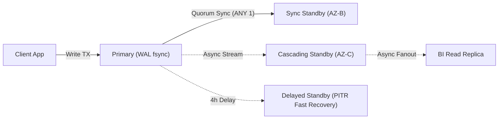

---
tags:
  - software-engineering
  - databases
  - replication
  - high-availability
  - consensus
  - crdt
  - postgresql
created: 2026-11-13
updated: 2026-11-13
status: 🟢
level: mid-to-senior
---
# Database Replication, Consistency, Consensus & Failover

> [!abstract] Vault Navigation
> Log-shipping mechanics, replication lag consistency mitigations, quorum consensus math, split-brain fencing, and PITR disaster recovery inside [[Programming/Software Engineering/Database Design/Database Design Complete Guide|Database Design Complete Guide]]. Pairs closely with [[Programming/Software Engineering/Database Design/Transactions|Transactions]], [[Programming/Software Engineering/Database Design/Sharding|Sharding]], [[Programming/Software Engineering/Database Design/NoSQL|NoSQL]], [[Programming/Software Engineering/System Design/CAP Theorem|CAP Theorem]], and [[Programming/Software Engineering/System Design/Scalability|Scalability]].

Replication scales read throughput, minimizes geographic access latency, and protects durability against availability-zone or hardware failure. Every replication topology trades write latency and operational complexity against **Recovery Point Objective (`RPO`)**, **Recovery Time Objective (`RTO`)**, **non-monotonic stale read anomalies**, and **split-brain corruption** during network partitions.

---

## 1. First-Principles Mechanics & Complete Architecture

### 1.1 Write-Ahead Log (`WAL`) & Binlog Shipping Internals

Replication streams state transitions continuously from an authoritative log to follower replicas. Relational engines differ fundamentally in *what* the replication stream encodes.

#### PostgreSQL Physical WAL (`LSN` & Timeline Branching)
PostgreSQL writes every heap, B+Tree, visibility-map, and CLOG page modification into sequential 16 MB segments inside `pg_wal/`, stamped with a strictly monotonic 64-bit byte offset called the **Log Sequence Number (`LSN` / `XLogRecPtr`)**, rendered in hexadecimal as `high32/low32` (for example, `0/1A4F820`, rolling past `0/FFFFFFFF` to `1/00000000`):
1. **`walsender` & `walreceiver`**: On the Primary, a dedicated `walsender` process streams WAL bytes over TCP directly to each Standby's `walreceiver` process, which flushes them sequentially to the Standby's local `pg_wal/` and feeds the Standby `startup` process applying physical page deltas into `shared_buffers`.
2. **`wal_level`**:
   - `minimal`: Omits bulk-load operations (`COPY`, `CREATE INDEX`), disallowing streaming replicas and PITR backups.
   - `replica` *(default)*: Emits sufficient physical block deltas (plus full-page images when `full_page_writes = on`) for physical streaming replicas and PITR archiving.
   - `logical`: Adds tuple-level metadata (`wal_level = logical`) required for `pgoutput` / Debezium CDC decoding.
3. **Timeline IDs (`TLI`)**: Every newly promoted Primary increments an integer **Timeline ID** (e.g., `Timeline 1 -> Timeline 2`) recorded in `pg_control` and `.history` files (`00000002.history`). Timelines prevent an older demoted Primary on `Timeline 1` from corrupting a cluster now advancing along `Timeline 2`.

#### MySQL InnoDB Redo Log + Binary Log (`Binlog`) & `GTID`
MySQL maintains **two separate durability logs**: the storage-engine **InnoDB Redo Log** (crash recovery of 16 KB pages) and the server-layer **Binary Log (`binlog`)** (replication stream). Setting **`sync_binlog = 1`** and **`innodb_flush_log_at_trx_commit = 1`** engages internal **XA two-phase commit** between InnoDB and the binlog so a crash never leaves a committed InnoDB transaction missing from replication replicas.
- **`STATEMENT` vs `ROW` vs `MIXED`**: `STATEMENT` replicates raw SQL strings—breaking silently whenever queries call non-deterministic functions (`UUID()`, `NOW()`, `RAND()`, or `DELETE ... LIMIT 100` without deterministic `ORDER BY`). Production MySQL mandates **`binlog_format = ROW`** (with `binlog_row_image = MINIMAL` or `FULL`), logging exact pre/post row column images.
- **`GTID` (Global Transaction Identifier)**: Formatted as `source_uuid:transaction_sequence` (e.g., `3E11FA47-71CA-11E1-9E33-C80AA9429562:1-5482`), **GTIDs** eliminate fragile physical `(binlog_file, byte_offset)` tracking during failover—allowing promoted standbys to auto-repoint sibling replicas via `SOURCE_AUTO_POSITION = 1`.

#### Physical Block Streaming vs Logical Row-Change Decoding
| Dimension | Physical WAL Streaming (PG Streaming / Storage Sync) | Logical Replication (`pgoutput` / MySQL `ROW` / Debezium CDC) |
|---|---|---|
| **Payload Unit** | Raw byte-level disk page modifications (`8 KB` offsets) | Decoded row tuples (`INSERT`, `UPDATE`, `DELETE`) ordered at `COMMIT` |
| **Version & Schema Flexibility** | Identical major version & binary architecture required | **Cross-major-version upgrades (`PG 14 -> PG 17`)**, selective tables, extra replica indexes |
| **Target Writability** | Strictly read-only (`Hot Standby`) | Subscriber tables are writable (supports bi-directional / aggregation sinks) |
| **Critical Operational Caveat** | Replicates **everything** including `DROP TABLE` and `TRUNCATE` instantly | Standard PG logical replication **does NOT replicate DDL (`ALTER TABLE`) or `SEQUENCE` increments**; `UPDATE`/`DELETE` require **`REPLICA IDENTITY FULL`** or PK/unique index! |

---

### 1.2 Replication Topologies & Trade-Offs

#### 1. Single-Leader Replication (`Async`, `Semi-Sync`, `Cascading`, `Delayed`)



- **Asynchronous *(Default)***: Primary commits locally (`WAL fsync`) and immediately returns `OK`; WAL ships asynchronously. Gives lowest write latency, **but risks `RPO > 0` data loss** if Primary storage dies permanently before shipping the tail WAL bytes.
- **Synchronous (All Replicas)**: Primary blocks every `COMMIT` until *every* configured standby flushes WAL. Guarantees `RPO = 0`, **but suffers catastrophic availability collapse**: a single standby reboot halts all cluster writes!
- **Quorum Semi-Synchronous *(Production HA Standard)***: PostgreSQL configures `synchronous_standby_names = 'ANY 1 (standby_b, standby_c)'` (`FIRST 1` prioritizes strict order; `ANY 1` accepts whichever healthy standby responds fastest). Primary waits for at least 1 standby before committing—preserving **`RPO = 0` across any single-node or single-AZ loss** while tolerating $N-1$ standby outages without stalling writes.
- **PostgreSQL `synchronous_commit` Per-Transaction Spectrum**:
  - `off`: Skips waiting even for local WAL `fsync` (risks ~600 ms uncommitted window on OS crash; never corrupts heap integrity).
  - `local`: Flushes Primary local WAL only (bypasses sync standby wait for low-value telemetry).
  - `remote_write`: Standby acknowledged receipt into OS page cache (no standby `fsync`).
  - `on` *(default when sync standbys configured)*: Standby **`fsync()`ed WAL to disk** (`RPO = 0`), though replay into MVCC heap pages may trail by milliseconds.
  - `remote_apply`: Standby `fsync()`ed **AND replayed WAL** into live heap pages—providing strict **Read-Your-Own-Writes consistency even when querying the sync standby**, at highest commit latency.
- **Cascading & Delayed Replicas**: Cascading replicas stream WAL from an upstream standby (`S2 -> S3`) so heavy BI/analytics read pools never exhaust Primary network bandwidth or `walsender` CPU. A **Delayed Replica** (`recovery_min_apply_delay = '4h'` in PG; `SOURCE_DELAY = 14400` in MySQL) buffers received WAL safely on disk for 4 hours before replaying—enabling rapid recovery from accidental `DROP TABLE` or un-filtered `DELETE` without restoring multi-terabyte base backups!

#### 2. Multi-Leader (Active-Active) Replication & Conflict Convergence
Multi-leader topologies accept writes simultaneously at leaders in distinct regions (e.g., `us-east` and `eu-west`) or offline-first local edge clients, replicating mutations asynchronously across leaders. Because two leaders return `200 OK` concurrently without cross-region consensus, write conflicts are inevitable:
- **LWW (Last-Write-Wins) Clock-Skew Data Loss**: Ordering conflicting updates by wall-clock `updated_at` silently drops valid concurrent updates whenever **NTP clock skew** drifts across hosts (or leaps backward on VM pause/resume). A logically *older* mutation on a host with a `+150 ms` fast clock permanently overwrites a logically *newer* mutation!
- **CRDTs (Conflict-Free Replicated Data Types)**: State-based (`CvRDT`) or operation-based (`CmRDT`) structures whose `merge(A, B)` operation forms a mathematical **join-semilattice** (**commutative**: $A \sqcup B = B \sqcup A$; **associative**: $(A \sqcup B) \sqcup C = A \sqcup (B \sqcup C)$; **idempotent**: $A \sqcup A = A$). Replicas converge identically regardless of packet reordering, network retries, or duplicate delivery:
  - **`G-Counter` / `PN-Counter`**: Per-region monotonic increment/decrement vectors (`sum(P_i) - sum(N_i)`). Never loses concurrent regional counter updates.
  - **`OR-Set` (Observed-Remove Set)**: Tags every `add(item)` with a unique causal `tag_uuid`; `remove(item)` deletes *only* tags explicitly observed locally prior to removal (`add` wins cleanly over concurrent `remove` of older tags).
- **Operational Transformation (`OT`) vs CRDTs**: Collaborative editors traditionally used **OT** (transforming concurrent character-index edits via a central coordinating server), whereas modern local-first architectures adopt **Sequence CRDTs (`Yjs` / `Automerge`)** using globally unique fractional/causal element IDs that merge purely peer-to-peer without a central ordering authority.
- **Deterministic SQL Conflict Resolution**: When implementing multi-leader row sync in SQL, reject raw wall-clocks (`NOW()`); attach a **Hybrid Logical Clock (`HLC`)** or `(lamport_counter, node_id)` tuple and resolve `ON CONFLICT` deterministically:
  ```sql
  INSERT INTO user_settings (user_id, theme, hlc_physical_ms, hlc_logical, origin_node_id)
  VALUES ($1, $2, $3, $4, $5)
  ON CONFLICT (user_id) DO UPDATE
  SET theme           = EXCLUDED.theme,
      hlc_physical_ms = EXCLUDED.hlc_physical_ms,
      hlc_logical     = EXCLUDED.hlc_logical,
      origin_node_id  = EXCLUDED.origin_node_id
  WHERE (EXCLUDED.hlc_physical_ms, EXCLUDED.hlc_logical, EXCLUDED.origin_node_id)
      > (user_settings.hlc_physical_ms, user_settings.hlc_logical, user_settings.origin_node_id);
  ```

#### 3. Leaderless (Dynamo-Style) Replication & Tunable Quorums
Systems such as **Cassandra**, **ScyllaDB**, and **Riak** eliminate designated leaders: any coordinator sends writes directly to $N$ replica owners and awaits $W$ acknowledgements; reads query $R$ (or $N$) replicas.
- **Quorum Overlap ($W + R > N$)**: By the pigeonhole principle, whenever $W + R > N$, the read set of $R$ nodes and write set of $W$ nodes share **at least one overlapping replica** containing the newest write.
- **Why $W + R > N$ Still Fails Strict Linearizability**:
  1. **Sloppy Quorums & Hinted Handoff**: During a network partition where $< W$ designated home nodes are reachable, a coordinator configured for Sloppy Quorums accepts writes on healthy **fallback nodes** storing a local "hint" to preserve write availability. When a subsequent $R$-read hits the reachable home nodes before Hinted Handoff replays, **zero overlap exists** and stale values return!
  2. **Failed Partial Writes**: If a write succeeds on 1 node out of `W = 2` and fails back to the client, the partial write is **not rolled back**; subsequent reads hitting that 1 node return the unacknowledged write unless Read Repair / anti-entropy runs.
  3. **Concurrent Write Timestamps**: Under LWW clock skew, overlapping reads can observe an older timestamp overwriting a concurrent write.
- **Repair & Causal Ordering**:
  - **Read Repair**: Coordinator compares cell timestamps/digests across $R$ responses and pushes newer values onto stale replicas (only repairs keys actively read!).
  - **Anti-Entropy Merkle Trees**: Replicas build hierarchical cryptographic hash trees (`Merkle Trees`) over key-range buckets, exchanging root/subtree hashes to pinpoint exact mismatched ranges across terabytes in $O(\log K)$ comparisons.
  - **Dotted Version Vectors (`DVVs`)**: Classic Vector Clocks track `[node -> counter]` per *client*, exploding vector size across millions of web clients. **Dotted Version Vectors** track causal history per *server replica* plus a single dot `(server_id, seq)` representing the newest client mutation—bounding metadata strictly to cluster node count $N$ while accurately preserving concurrent siblings without false conflicts.

---

## 2. Real-World Use Cases & Quantitative Topology Selection Matrix

| Workload / Engineering Scenario | Optimal Replication Topology | `RPO` / `RTO` Target | Why Alternatives Fail |
|---|---|---|---|
| **Core Banking / Double-Entry Ledger** | **Single-Leader Semi-Sync (`ANY 1` + `on` or `remote_apply`)** + Patroni `etcd` | `RPO = 0`, `RTO < 30s` | Async risks un-replicated acknowledged deposits; Multi-leader cannot enforce global balance `>= 0` without locks |
| **Read-Heavy SaaS Dashboard (95% Reads)** | **Single-Leader Semi-Sync (HA) + Async Cascading Replicas** + LSN RYOW Router | `RPO = 0` on Primary; replica lag `< 100 ms` | Synchronous `remote_apply` across 10 read replicas destroys primary write throughput |
| **Multi-Region Local-Write Shopping Cart / Notes** | **Multi-Leader (`CRDT OR-Set` / `DVV`)** or Leaderless DynamoDB Global Tables | `RPO ~ seconds` async WAN; `< 15 ms` local write | Single-leader imposes `80–180 ms` cross-ocean RTT on every single user write |
| **Global Edge Telemetry / IoT Ingestion** | **Leaderless (`Cassandra / ScyllaDB`: `N=3, LOCAL_QUORUM`)** | `RPO ~ 0` intra-DC; high write availability | Single-leader hits vertical write ceiling and stalls across AZ network blips |
| **Human-Error Insurance (`DROP TABLE` Guard)** | **Async Delayed Replica (`4h` lag) + Continuous WAL Archiving (`pgBackRest`)** | Recovery in minutes (`RTO < 10m`) | Standard synchronous/async replicas propagate accidental `DROP TABLE` / `DELETE` in milliseconds! |

---

## 3. Step-by-Step Practical Application: Production RYOW + Monotonic Router & CRDT Engine

Routing reads onto asynchronous replicas introduces three subtle user-facing consistency bugs: **Read-Your-Own-Writes (RYOW) violations**, **Monotonic Read time-travel** (refreshing onto an older replica makes comments vanish), and **Consistent Prefix inversions** (reply arrives before parent message).

Below is a complete, production-ready TypeScript implementation solving all three:
1. **64-bit PostgreSQL Hex LSN Parser & Comparator**: Avoids the classic string comparison bug (`"0/10000000" < "0/9FFFFFF"` in ASCII lexicographical order, even though `0x10000000 > 0x9FFFFFF`!).
2. **RYOW + Sticky Monotonic Consistency Router**: Polls replica `pg_last_wal_replay_lsn()`, tracks per-user write LSN watermarks via signed cookies/Redis, pins users consistently to healthy replicas via FNV-1a hashing, and seamlessly falls back to Primary only when the user's pinned replica lags behind their own mutation watermark.
3. **Commutative `PN-Counter` & `OR-Set` CRDT Module**: Guaranteeing mathematical convergence across multi-leader nodes.

### 3.1 Project Structure
```text
replication-router/
├── src/
│   ├── db/
│   │   ├── lsnUtils.ts              # Exact 64-bit PG LSN BigInt parser & comparator
│   │   └── replicationRouter.ts     # Health-polled Primary/Replica pool + RYOW + Sticky routing
│   ├── middleware/
│   │   └── ryowConsistency.ts       # Express/Fastify HTTP watermark middleware
│   ├── crdt/
│   │   ├── hybridLogicalClock.ts    # HLC monotonic causal timestamp tracker
│   │   └── stateCRDTs.ts            # PN-Counter & OR-Set join-semilattice CRDTs
│   └── __tests__/
│       └── replicationRouter.test.ts # Comprehensive Vitest verification suite
```

### 3.2 Exact 64-Bit PostgreSQL LSN Arithmetic & Consistency Router
```typescript
// src/db/lsnUtils.ts

/**
 * Parses PostgreSQL XLogRecPtr string ("high32/low32", e.g., "1/A4F820")
 * into an unsigned 64-bit BigInt for mathematically exact ordering.
 */
export function parsePgLsn(lsn: string): bigint {
  const parts = lsn.trim().split("/");
  if (parts.length !== 2) {
    throw new Error(`Invalid PostgreSQL LSN format: "${lsn}"`);
  }
  const high = BigInt("0x" + parts[0]);
  const low = BigInt("0x" + parts[1]);
  if (high < 0n || low < 0n || low > 0xffffffffn) {
    throw new Error(`Out-of-range PostgreSQL LSN: "${lsn}"`);
  }
  return (high << 32n) | low;
}

export function formatPgLsn(val: bigint): string {
  const high = (val >> 32n).toString(16).toUpperCase();
  const low = (val & 0xffffffffn).toString(16).toUpperCase();
  return `${high}/${low}`;
}

export function comparePgLsn(a: string, b: string): number {
  const av = parsePgLsn(a);
  const bv = parsePgLsn(b);
  if (av === bv) return 0;
  return av > bv ? 1 : -1;
}
```

```typescript
// src/db/replicationRouter.ts
import { comparePgLsn } from "./lsnUtils";

export interface QueryExecutor {
  query<T = Record<string, unknown>>(sql: string, params?: unknown[]): Promise<{ rows: T[] }>;
}

export interface WatermarkStore {
  getMinLsn(userId: string): Promise<string | null>;
  setMinLsn(userId: string, lsn: string, ttlSeconds: number): Promise<void>;
}

export interface ReplicaNode {
  id: string;
  pool: QueryExecutor;
  healthy: boolean;
  replayLsn: string;
}

function fnv1aHash(input: string): number {
  let hash = 0x811c9dc5;
  for (let i = 0; i < input.length; i++) {
    hash ^= input.charCodeAt(i);
    hash = Math.imul(hash, 0x01000193);
  }
  return hash >>> 0;
}

export class ReplicationAwareRouter {
  private readonly replicas: ReplicaNode[];
  private pollTimer: NodeJS.Timeout | null = null;

  constructor(
    private readonly primary: QueryExecutor,
    replicaPools: Array<{ id: string; pool: QueryExecutor }>,
    private readonly watermarkStore: WatermarkStore,
    private readonly watermarkTtlSec = 15
  ) {
    this.replicas = replicaPools.map((r) => ({
      id: r.id,
      pool: r.pool,
      healthy: true,
      replayLsn: "0/0",
    }));
  }

  /**
   * Refreshes replay LSN snapshots every 50 ms off the request critical path.
   */
  startHealthPolling(intervalMs = 50): void {
    if (this.pollTimer) return;
    this.pollTimer = setInterval(() => {
      void this.refreshReplicaWatermarks();
    }, intervalMs);
    this.pollTimer.unref();
  }

  stopHealthPolling(): void {
    if (this.pollTimer) {
      clearInterval(this.pollTimer);
      this.pollTimer = null;
    }
  }

  async refreshReplicaWatermarks(): Promise<void> {
    await Promise.all(
      this.replicas.map(async (rep) => {
        try {
          const { rows } = await rep.pool.query<{ lsn: string | null; in_recovery: boolean }>(
            "SELECT pg_is_in_recovery() AS in_recovery, pg_last_wal_replay_lsn()::text AS lsn"
          );
          if (rows[0]?.in_recovery && rows[0]?.lsn) {
            rep.replayLsn = rows[0].lsn;
            rep.healthy = true;
          } else {
            rep.healthy = false;
          }
        } catch {
          rep.healthy = false;
        }
      })
    );
  }

  /**
   * Executes a write transaction on Primary and captures post-COMMIT WAL LSN
   * so the caller's subsequent reads honor Read-Your-Own-Writes.
   */
  async executeWrite<T>(
    userId: string,
    fn: (primary: QueryExecutor) => Promise<T>
  ): Promise<{ result: T; commitLsn: string }> {
    const result = await fn(this.primary);
    const { rows } = await this.primary.query<{ lsn: string }>(
      "SELECT pg_current_wal_lsn()::text AS lsn"
    );
    const commitLsn = rows[0].lsn;
    await this.watermarkStore.setMinLsn(userId, commitLsn, this.watermarkTtlSec);
    return { result, commitLsn };
  }

  /**
   * Selects read pool honoring BOTH:
   * 1. Monotonic Reads: deterministic FNV-1a user pinning onto a healthy replica.
   * 2. Read-Your-Own-Writes: checks replica.replayLsn >= user's minLsn watermark,
   *    falling back to Primary (or caught-up sibling) only when the pinned replica lags.
   */
  async selectReadPool(userId: string): Promise<{ targetId: string; pool: QueryExecutor }> {
    const minLsn = await this.watermarkStore.getMinLsn(userId);
    const healthyReplicas = this.replicas.filter((r) => r.healthy);

    if (healthyReplicas.length === 0) {
      return { targetId: "primary", pool: this.primary };
    }

    // Sticky deterministic replica selection prevents Monotonic Read regressions
    const stickyIdx = fnv1aHash(userId) % healthyReplicas.length;
    const pinned = healthyReplicas[stickyIdx];

    if (!minLsn || comparePgLsn(pinned.replayLsn, minLsn) >= 0) {
      return { targetId: pinned.id, pool: pinned.pool };
    }

    // Sticky replica is still behind user's recent write: check if another replica caught up
    // (or route straight to Primary to avoid violating RYOW)
    const caughtUp = healthyReplicas.find((r) => comparePgLsn(r.replayLsn, minLsn) >= 0);
    if (caughtUp) {
      return { targetId: caughtUp.id, pool: caughtUp.pool };
    }

    return { targetId: "primary", pool: this.primary };
  }
}
```

### 3.3 HTTP RYOW Middleware (`Redis` + HMAC-Signed Cookie) & Hybrid Logical Clocks (`HLC`)
```typescript
// src/middleware/ryowConsistency.ts
import crypto from "node:crypto";
import type { WatermarkStore } from "../db/replicationRouter";

export interface RedisLike {
  get(key: string): Promise<string | null>;
  set(key: string, val: string, mode: "EX", ttlSec: number): Promise<unknown>;
}

/**
 * Redis-backed RYOW LSN watermark store for cross-device / stateless API pods.
 */
export class RedisWatermarkStore implements WatermarkStore {
  constructor(private readonly redis: RedisLike, private readonly prefix = "ryow:lsn:") {}

  async getMinLsn(userId: string): Promise<string | null> {
    return this.redis.get(`${this.prefix}${userId}`);
  }

  async setMinLsn(userId: string, lsn: string, ttlSeconds: number): Promise<void> {
    await this.redis.set(`${this.prefix}${userId}`, lsn, "EX", ttlSeconds);
  }
}

/**
 * Signed stateless HTTP cookie fallback when Redis is bypassed at the edge.
 * Prevents clients from forging arbitrarily high LSNs to force 100% reads onto Primary!
 */
export function signLsnCookie(lsn: string, expiresAtSec: number, secret: string): string {
  const payload = `${lsn}.${expiresAtSec}`;
  const sig = crypto.createHmac("sha256", secret).update(payload).digest("base64url");
  return `${payload}.${sig}`;
}

export function verifyLsnCookie(cookieVal: string | undefined, secret: string, nowSec = Math.floor(Date.now() / 1000)): string | null {
  if (!cookieVal) return null;
  const parts = cookieVal.split(".");
  if (parts.length !== 3) return null;
  const [lsn, expStr, sig] = parts;
  const exp = Number(expStr);
  if (!Number.isFinite(exp) || exp < nowSec) return null;

  const expectedSig = crypto.createHmac("sha256", secret).update(`${lsn}.${expStr}`).digest("base64url");
  const a = Buffer.from(sig);
  const b = Buffer.from(expectedSig);
  if (a.length !== b.length || !crypto.timingSafeEqual(a, b)) return null;
  return lsn;
}
```

```typescript
// src/crdt/hybridLogicalClock.ts

export interface HlcTimestamp {
  physicalMs: number;
  logical: number;
  nodeId: string;
}

/**
 * Hybrid Logical Clock (HLC): Combines NTP wall-clock time with causal logical counters
 * so causal chains (Consistent Prefix Reads & deterministic multi-leader resolution)
 * never violate happens-before ordering even when host clocks skew backward.
 */
export class HybridLogicalClock {
  private physicalMs = 0;
  private logical = 0;

  constructor(private readonly nodeId: string) {}

  now(wallClockMs = Date.now()): HlcTimestamp {
    const prevPt = this.physicalMs;
    this.physicalMs = Math.max(prevPt, wallClockMs);
    if (this.physicalMs === prevPt) {
      this.logical += 1;
    } else {
      this.logical = 0;
    }
    return { physicalMs: this.physicalMs, logical: this.logical, nodeId: this.nodeId };
  }

  receive(remote: HlcTimestamp, wallClockMs = Date.now()): HlcTimestamp {
    const prevPt = this.physicalMs;
    this.physicalMs = Math.max(prevPt, remote.physicalMs, wallClockMs);

    if (this.physicalMs === prevPt && this.physicalMs === remote.physicalMs) {
      this.logical = Math.max(this.logical, remote.logical) + 1;
    } else if (this.physicalMs === prevPt) {
      this.logical += 1;
    } else if (this.physicalMs === remote.physicalMs) {
      this.logical = remote.logical + 1;
    } else {
      this.logical = 0;
    }

    return { physicalMs: this.physicalMs, logical: this.logical, nodeId: this.nodeId };
  }

  static compare(a: HlcTimestamp, b: HlcTimestamp): number {
    if (a.physicalMs !== b.physicalMs) return a.physicalMs > b.physicalMs ? 1 : -1;
    if (a.logical !== b.logical) return a.logical > b.logical ? 1 : -1;
    if (a.nodeId === b.nodeId) return 0;
    return a.nodeId > b.nodeId ? 1 : -1;
  }
}
```

### 3.4 Commutative State-Based CRDTs (`PN-Counter` & `OR-Set`)
```typescript
// src/crdt/stateCRDTs.ts

/**
 * Positive-Negative Counter CRDT:
 * Preserves all concurrent multi-region increments/decrements without lost updates.
 */
export class PNCounter {
  constructor(
    public readonly p: Record<string, number> = {},
    public readonly n: Record<string, number> = {}
  ) {}

  increment(nodeId: string, delta = 1): void {
    if (delta < 0) throw new Error("Delta must be non-negative");
    this.p[nodeId] = (this.p[nodeId] ?? 0) + delta;
  }

  decrement(nodeId: string, delta = 1): void {
    if (delta < 0) throw new Error("Delta must be non-negative");
    this.n[nodeId] = (this.n[nodeId] ?? 0) + delta;
  }

  value(): number {
    const pos = Object.values(this.p).reduce((a, b) => a + b, 0);
    const neg = Object.values(this.n).reduce((a, b) => a + b, 0);
    return pos - neg;
  }

  /**
   * Join-semilattice merge: element-wise MAX across per-node vectors.
   * Commutative, associative, and idempotent.
   */
  merge(other: PNCounter): PNCounter {
    const mergedP: Record<string, number> = { ...this.p };
    for (const [node, val] of Object.entries(other.p)) {
      mergedP[node] = Math.max(mergedP[node] ?? 0, val);
    }
    const mergedN: Record<string, number> = { ...this.n };
    for (const [node, val] of Object.entries(other.n)) {
      mergedN[node] = Math.max(mergedN[node] ?? 0, val);
    }
    return new PNCounter(mergedP, mergedN);
  }
}

/**
 * Observed-Remove Set (OR-Set) CRDT:
 * Concurrent add(item) on Region A and remove(item) on Region B results in `item`
 * remaining present because Region B only tombstoned previously observed tags!
 */
export class ORSet<T extends string> {
  private readonly adds = new Map<T, Set<string>>();
  private readonly tombstones = new Set<string>();

  add(item: T, uniqueTag: string): void {
    if (!this.adds.has(item)) {
      this.adds.set(item, new Set());
    }
    this.adds.get(item)!.add(uniqueTag);
  }

  remove(item: T): void {
    const existingTags = this.adds.get(item);
    if (!existingTags) return;
    for (const tag of existingTags) {
      this.tombstones.add(tag);
    }
  }

  elements(): T[] {
    const live: T[] = [];
    for (const [item, tags] of this.adds.entries()) {
      const hasLiveTag = [...tags].some((tag) => !this.tombstones.has(tag));
      if (hasLiveTag) live.push(item);
    }
    return live.sort();
  }

  merge(other: ORSet<T>): ORSet<T> {
    const out = new ORSet<T>();
    for (const t of [...this.tombstones, ...other.tombstones]) {
      out.tombstones.add(t);
    }
    for (const src of [this.adds, other.adds]) {
      for (const [item, tags] of src.entries()) {
        for (const tag of tags) {
          out.add(item, tag);
        }
      }
    }
    return out;
  }
}
```

### 3.5 Automated Verification Suite
```typescript
// src/__tests__/replicationRouter.test.ts
import { describe, it, expect } from "vitest";
import { comparePgLsn, parsePgLsn, formatPgLsn } from "../db/lsnUtils";
import { ReplicationAwareRouter, type QueryExecutor, type WatermarkStore } from "../db/replicationRouter";
import { signLsnCookie, verifyLsnCookie } from "../middleware/ryowConsistency";
import { HybridLogicalClock } from "../crdt/hybridLogicalClock";
import { PNCounter, ORSet } from "../crdt/stateCRDTs";

function createMemoryWatermarkStore(): WatermarkStore {
  const map = new Map<string, string>();
  return {
    async getMinLsn(userId) {
      return map.get(userId) ?? null;
    },
    async setMinLsn(userId, lsn) {
      map.set(userId, lsn);
    },
  };
}

describe("PostgreSQL LSN Router & CRDT Convergence", () => {
  it("orders multi-segment hex LSNs accurately past 32-bit boundaries", () => {
    // Naive string compare wrongly says "0/10000000" < "0/9FFFFFF"!
    expect(comparePgLsn("0/10000000", "0/9FFFFFF")).toBe(1);
    expect(comparePgLsn("1/00000001", "0/FFFFFFFF")).toBe(1);
    expect(formatPgLsn(parsePgLsn("2/ABCD1234"))).toBe("2/ABCD1234");
  });

  it("enforces Read-Your-Own-Writes fallback when replicas lag, then restores replica reads", async () => {
    let primaryLsn = "0/1000000";
    let rep1Lsn = "0/0F00000";
    let rep2Lsn = "0/0F00000";

    const primary: QueryExecutor = {
      async query(sql) {
        if (sql.includes("pg_current_wal_lsn")) {
          return { rows: [{ lsn: primaryLsn }] as never };
        }
        primaryLsn = "0/2000000";
        return { rows: [] };
      },
    };
    const replica1: QueryExecutor = {
      async query() {
        return { rows: [{ in_recovery: true, lsn: rep1Lsn }] as never };
      },
    };
    const replica2: QueryExecutor = {
      async query() {
        return { rows: [{ in_recovery: true, lsn: rep2Lsn }] as never };
      },
    };

    const router = new ReplicationAwareRouter(
      primary,
      [
        { id: "rep-1", pool: replica1 },
        { id: "rep-2", pool: replica2 },
      ],
      createMemoryWatermarkStore()
    );
    await router.refreshReplicaWatermarks();

    // User writes -> captures watermark "0/2000000"
    await router.executeWrite("user-42", async (db) => db.query("UPDATE profile SET bio = 'new'"));

    // Both replicas lag at "0/0F00000" -> falls back cleanly to Primary!
    const immediateRead = await router.selectReadPool("user-42");
    expect(immediateRead.targetId).toBe("primary");

    // Replicas catch up -> resumes sticky replica routing deterministically
    rep1Lsn = "0/2000000";
    rep2Lsn = "0/2000000";
    await router.refreshReplicaWatermarks();

    const firstSticky = await router.selectReadPool("user-42");
    const secondSticky = await router.selectReadPool("user-42");
    expect(firstSticky.targetId).not.toBe("primary");
    expect(firstSticky.targetId).toBe(secondSticky.targetId);
  });

  it("merges PNCounter and ORSet commutatively, associatively, and idempotently", () => {
    const us = new PNCounter();
    us.increment("us", 5);
    us.decrement("us", 1);

    const eu = new PNCounter();
    eu.increment("eu", 3);
    eu.decrement("eu", 2);

    // Commutative & idempotent check: (us U eu) U eu == (eu U us)
    const m1 = us.merge(eu).merge(eu);
    const m2 = eu.merge(us);
    expect(m1.value()).toBe(5);
    expect(m2.value()).toBe(5);

    // OR-Set add-wins resolution across concurrent add vs remove
    const cartA = new ORSet<string>();
    cartA.add("sku-1", "tag-a1");
    const cartB = new ORSet<string>().merge(cartA); // Both saw tag-a1

    cartB.remove("sku-1");         // EU deletes old tag-a1
    cartA.add("sku-1", "tag-a2");  // US concurrently re-adds with fresh tag-a2

    expect(cartA.merge(cartB).elements()).toEqual(["sku-1"]);
    expect(cartB.merge(cartA).elements()).toEqual(["sku-1"]);
  });

  it("verifies signed RYOW cookies and preserves HLC causality under backward NTP skew", () => {
    const secret = "prod-hmac-secret-32-bytes";
    const token = signLsnCookie("0/2A00000", 2_000_000_000, secret);
    expect(verifyLsnCookie(token, secret, 1_900_000_000)).toBe("0/2A00000");
    // Forged high LSN fails constant-time HMAC verification
    expect(verifyLsnCookie("0/FFFFFFFF.2000000000." + token.split(".")[2], secret, 1_900_000_000)).toBeNull();

    const leaderA = new HybridLogicalClock("us-east");
    const leaderB = new HybridLogicalClock("eu-west");
    const msg1 = leaderA.now(5_000);
    // Leader B local NTP clock is 500 ms BEHIND Leader A (4500 < 5000)
    const msg2 = leaderB.receive(msg1, 4_500);
    expect(HybridLogicalClock.compare(msg2, msg1)).toBe(1);
  });
});
```

---

## 4. Split-Brain Prevention, Automated Failover & PITR Recovery

### 4.1 Split-Brain Mechanics & Three Mandatory Defenses
In naive active-passive clusters relying solely on Virtual IP (`VIP`) pings or SSH scripts, a transient network partition isolates Primary `P1` from Standby `S2` while `P1` remains reachable by a subset of application servers. `S2` promotes itself (`Timeline 2`), while `P1` continues committing writes on `Timeline 1`—generating colliding auto-increment keys, violating unique invariants, and corrupting balances beyond automated reconciliation (**Split-Brain**).

```mermaid
sequenceDiagram
    participant P1 as "Old Primary (Partitioned)"
    participant Etcd as "3-Node etcd Raft Quorum"
    participant S2 as "Standby -> New Primary"
    participant Store as "Storage / Proxy Fence"
    Note over Etcd: "P1 lease expires (minority); S2 wins Epoch=42"
    P1->>P1: "Fails renew -> Demotes self / Watchdog reset"
    S2->>Store: "Write with Fence Token=42"
    P1->>Store: "Delayed Zombie Write Token=41"
    Store-->>P1: "REJECTED (41 < 42)"
```

1. **Consensus Lease Election (`Patroni` + 3-Node or 5-Node `etcd`/`Consul`)**: Deploy an odd-numbered Raft quorum across distinct Availability Zones (`3` tolerates 1 AZ loss; `5` tolerates 2 AZ losses). `Patroni` on Primary must renew its `etcd` leader key before `ttl` expires. If partitioned into the minority side, renewal fails and `Patroni` proactively **demotes/stops PostgreSQL** (`pg_ctl stop` / read-only) *before* `etcd` grants the leader lease to `S2`.
2. **Linux Hardware/Software Watchdog (`/dev/watchdog`)**: If the Primary OS freezes (kernel OOM thrash or hypervisor CPU pause) so long that `Patroni` cannot even execute `pg_ctl stop`, the kernel watchdog fails to receive periodic heartbeats from `Patroni` and forces an **immediate hard machine reset** prior to lease expiry!
3. **Fencing Tokens**: Every leader election increments a strictly monotonic Raft `Epoch` (`mod_revision`). Storage volumes, distributed locks, or downstream sinks validate `incoming_token >= max_seen_token`, rejecting stale delayed writes from a zombie leader waking up after a pause.

### 4.2 Production `Patroni` Configuration (`patroni.yml`)
```yaml
# /etc/patroni/patroni.yml
scope: prod-orders-pg16
namespace: /service/
name: pg-node-1

restapi:
  listen: 0.0.0.0:8008
  connect_address: 10.0.1.11:8008

etcd3:
  hosts:
    - 10.0.10.11:2379
    - 10.0.20.11:2379
    - 10.0.30.11:2379

bootstrap:
  dcs:
    ttl: 30
    loop_wait: 10
    retry_timeout: 10
    maximum_lag_on_failover: 1048576 # 1 MB max WAL lag allowed to win election (RPO guardrail)
    synchronous_mode: true
    synchronous_mode_strict: false   # Set true ONLY if zero data loss overrides availability when 0 replicas live
    synchronous_node_count: 1
    postgresql:
      use_pg_rewind: true
      parameters:
        wal_level: replica
        wal_log_hints: "on"          # Mandatory for pg_rewind when data_checksums are disabled!
        max_wal_senders: 10
        max_replication_slots: 10
        max_slot_wal_keep_size: "20GB" # Prevents inactive slot from filling Primary disk & crashing cluster!
        hot_standby: "on"
        synchronous_commit: "on"
        archive_mode: "on"
        archive_command: "pgbackrest --stanza=prod-orders archive-push %p"

watchdog:
  mode: required                     # Refuses to start Patroni without kernel /dev/watchdog!
  device: /dev/watchdog
  safety_margin: 5

postgresql:
  listen: 0.0.0.0:5432
  connect_address: 10.0.1.11:5432
  data_dir: /var/lib/postgresql/16/main
  authentication:
    replication:
      username: replicator
      password: "${REPLICATOR_PASSWORD}"
    superuser:
      username: postgres
      password: "${POSTGRES_PASSWORD}"
```

### 4.3 Replication Slot Bloat Outage, `pg_rewind`, & `pgBackRest` PITR Drill
- **Replication Slot Disk-Full Catastrophe**: PostgreSQL physical and logical **Replication Slots** guarantee Primary retains WAL segments until every registered consumer confirms receipt. If an analytics CDC connector or standby dies for 6 hours while Primary writes `10 GB/hour`, `pg_wal/` swells by `60 GB` until Primary hits `100%` disk full and **panics with `PANIC: could not write to log file`**! Always set **`max_slot_wal_keep_size = '20GB'`** (PostgreSQL 13+) so PostgreSQL automatically invalidates catastrophically stalled slots before Primary disk exhausts—trading an eventual `pg_basebackup` on the dead replica over total Primary downtime.
- **Fast Primary Reintegration via `pg_rewind`**: After failover promotes `S2` to `Timeline 2`, old Primary `P1` may hold a few un-replicated local commits on `Timeline 1`. Rather than streaming a multi-terabyte `pg_basebackup`, **`pg_rewind`** scans `P1`'s WAL back to the exact divergence `LSN` and pulls **only** modified 8 KB blocks from `S2` (requires **`wal_log_hints = on`** or `initdb --data-checksums`).
- **WAL Archiving & Point-In-Time Recovery (`pgBackRest`)**:
  Configure `/etc/pgbackrest/pgbackrest.conf` for continuous encrypted S3 WAL archiving and multi-stream parallel backups, then restore cleanly onto a fresh recovery node to exact second `14:22:10 UTC` when a migration script drops a table at `14:22:15 UTC`:

```ini
# /etc/pgbackrest/pgbackrest.conf
[global]
repo1-type=s3
repo1-s3-bucket=prod-pg-wal-archive
repo1-s3-region=us-east-1
repo1-path=/pgbackrest/prod-orders
repo1-retention-full=4
repo1-cipher-type=aes-256-cbc
repo1-cipher-pass=${PGBACKREST_ENCRYPTION_KEY}
process-max=4
compress-type=zst
archive-async=y
spool-path=/var/spool/pgbackrest

[prod-orders]
pg1-path=/var/lib/postgresql/16/main
pg1-port=5432
```

```bash
# 1. Stop PostgreSQL on target recovery host and restore latest base backup + replay archived WAL up to 5s before accident
sudo systemctl stop postgresql
sudo -u postgres pgbackrest --stanza=prod-orders \
  --type=time \
  --target="2026-11-13 14:22:10+00" \
  --target-action=promote \
  --delta restore

# 2. Start PostgreSQL; engine fetches archived WAL via auto-generated restore_command,
#    stops precisely at 14:22:10 UTC, and promotes to a writable Timeline!
sudo systemctl start postgresql
```

---

## 5. Production Debugging, Profiling & Operations Playbook

### 5.1 Live Replication Telemetry Queries
```sql
-- 1. PostgreSQL Primary: Inspect exact byte lag & sync state per replica
SELECT
    client_addr,
    application_name,
    state,
    sync_state,                                                        -- 'quorum', 'sync', 'async'
    pg_wal_lsn_diff(pg_current_wal_lsn(), sent_lsn)   AS send_lag_bytes,
    pg_wal_lsn_diff(sent_lsn, flush_lsn)              AS flush_lag_bytes,
    pg_wal_lsn_diff(pg_current_wal_lsn(), replay_lsn) AS total_replay_lag_bytes,
    write_lag,
    flush_lag,
    replay_lag
FROM pg_stat_replication
ORDER BY total_replay_lag_bytes DESC;

-- 2. PostgreSQL Primary: Detect dead/inactive replication slots retaining pg_wal!
SELECT
    slot_name,
    slot_type,
    active,
    wal_status,                                                        -- 'reserved', 'extended', 'unreserved', 'lost'
    pg_size_pretty(pg_wal_lsn_diff(pg_current_wal_lsn(), restart_lsn)) AS retained_wal_size
FROM pg_replication_slots
ORDER BY pg_wal_lsn_diff(pg_current_wal_lsn(), restart_lsn) DESC;

-- 3. PostgreSQL Standby: Verify receiver connection & apply lag
SELECT status, received_lsn, latest_end_lsn, last_msg_receipt_time
FROM pg_stat_wal_receiver;
```

```bash
# MySQL 8+ Replica Diagnostics:
mysql -e "SHOW REPLICA STATUS\G" | grep -E "Replica_IO_Running|Replica_SQL_Running|Seconds_Behind_Source|Retrieved_Gtid_Set|Executed_Gtid_Set|Last_Error"

# Patroni & etcd Quorum Health:
patronictl -c /etc/patroni/patroni.yml list
etcdctl --endpoints=https://10.0.10.11:2379,https://10.0.20.11:2379,https://10.0.30.11:2379 endpoint status --write-out=table
```

### 5.2 Symptom $\rightarrow$ Root Cause $\rightarrow$ Remediation Matrix

| Observed Production Symptom | Diagnostic Observation | Root Cause | Immediate & Structural Remediation |
|---|---|---|---|
| **User updates record, immediately refreshes, sees stale value** | `total_replay_lag_bytes > 0` on async replica | **Read-Your-Own-Writes (RYOW)** violation hitting async replica | Implement **LSN Watermark Session Token** (`pg_current_wal_lsn` + replica `replay_lsn` comparison) or route post-write reads to Primary for TTL |
| **Comments appear on page load, then vanish on refresh** | Round-robin LB hits healthy `rep-1` then lagging `rep-2` | **Monotonic Reads** violation across unevenly lagging replicas | Switch to **Sticky Deterministic Hashing** (`FNV-1a(userId) % healthyReplicas`) |
| **Primary disk climbs to 98% despite deleting old table rows** | `pg_replication_slots` shows `active = false`, `retained_wal_size = 180 GB` | Disconnected CDC connector or dead standby slot pinning `restart_lsn` | Drop dead slot (`SELECT pg_drop_replication_slot('dead_slot');`); enforce **`max_slot_wal_keep_size = '20GB'`** |
| **Primary `COMMIT` stalls indefinitely across entire app** | `pg_stat_replication` empty or sync standby down while `synchronous_mode_strict = true` | Synchronous standby unreachable and strict mode forbids standalone commit | Recover standby or toggle `synchronous_mode_strict: false` via `patronictl edit-config`; deploy $\ge 2$ sync candidates (`ANY 1`) |
| **Standby read queries fail randomly with `canceling statement due to conflict with recovery`** | Long `SELECT` on replica conflicts with Primary `VACUUM` / `DROP` WAL replay | Standby replayed tuple cleanup (`max_standby_streaming_delay = 30s` exceeded) | Increase `max_standby_streaming_delay = 120s`, move heavy BI scans onto a dedicated analytics replica, or tune `hot_standby_feedback` carefully |

---

## 6. Comprehensive Worked Exercises

### Exercise 1: Diagnosing RYOW & Monotonic Read Failures + Hex LSN Bug
A fintech dashboard runs 1 PostgreSQL Primary and 3 Async Read Replicas (`rep-1` at `0/9FFFF00`, `rep-2` at `0/10000100`, `rep-3` at `0/9000000` behind a round-robin proxy). Two bugs surface:
1. Users edit billing settings (`POST /billing`) and immediately redirect to `GET /billing`, seeing old settings 40% of the time, while refreshing `GET /orders` makes a new order appear and then disappear!
2. An engineer writes a router checking `if (replicaLsn >= userMinLsn)` using standard JavaScript string comparison (`"0/10000100" >= "0/9FFFF00"`), yet it **falsely routes users who wrote at `"0/9FFFF00"` away from a caught-up replica at `"0/10000100"` directly onto Primary!**

Explain both consistency anomalies, prove why the JavaScript string comparison failed, and provide the exact fix.

---

### Solution 1

1. **Consistency Anomalies**:
   - Seeing old billing settings immediately after `POST /billing` is a **Read-Your-Own-Writes (RYOW)** violation caused by round-robin routing onto a lagging async replica (`rep-3`).
   - Seeing an order appear on `rep-2` and disappear on refresh onto `rep-3` is a **Monotonic Reads** violation (time jumping backward across inconsistently lagging replicas).
2. **Why String Comparison Failed**:
   In ASCII lexicographical sorting, character `'1'` (code point 49) is **less than** `'9'` (code point 57). Thus `"0/10000100" < "0/9FFFF00"` evaluates `true` in string comparison even though hexadecimal `0x10000100` (268,435,712) is **100M+ bytes ahead** of `0x9FFFF00` (167,771,904)! Because of this bug, every caught-up replica looked "stale" once WAL crossed the `0x10000000` nibble boundary, slamming Primary with 100% read load!
3. **Production Fix**:
   - Parse both `high32` and `low32` hex segments into **64-bit unsigned `BigInt`** (`(BigInt('0x' + hi) << 32n) | BigInt('0x' + lo)`) before comparing watermarks.
   - Pin user sessions deterministically via `fnv1a(userId) % healthyReplicas.length` to eliminate Monotonic Read regressions.

---

### Exercise 2: Quorum Math, Sloppy Quorums & NTP Clock Skew ($N=5$)
A globally distributed leaderless KV store configures replication factor **$N = 5$**.
1. Compare `Config A (W=3, R=3)`, `Config B (W=4, R=2)`, and `Config C (W=2, R=2)` across overlap guarantee ($W + R > N$), dead-node tolerance for writes, and dead-node tolerance for reads.
2. With `Config A (W=3, R=3)` running **Sloppy Quorums + Hinted Handoff** and **LWW** conflict resolution, trace two concrete failure scenarios where a client still observes stale reads or permanent silent data loss.

---

### Solution 2

1. **Quorum Table ($N = 5$)**:
   | Config | $W + R > N$? | Max Dead Nodes Tolerated (Writes: $N - W$) | Max Dead Nodes Tolerated (Reads: $N - R$) | Guarantee |
   |---|---|---|---|---|
   | **A (`W=3, R=3`)** | Yes ($6 > 5$) | **2** | **2** | Balanced read/write HA + strict home overlap |
   | **B (`W=4, R=2`)** | Yes ($6 > 5$) | **1** | **3** | High read availability; sensitive to >1 dead node on writes |
   | **C (`W=2, R=2`)** | **No** ($4 \le 5$) | **3** | **3** | Eventual consistency only; writes & reads can be totally disjoint! |

2. **Two Failure Scenarios Under `W=3, R=3`**:
   - **Sloppy Quorum Disjointness**: A partition isolates 3 of the 5 designated home nodes (`H1, H2, H3`). To remain write-available, the coordinator fulfills `W=3` using `H4, H5` plus one non-home **fallback node `F1`** storing a hint (**Sloppy Quorum**). If a reader on the other side queries `H1, H2, H3` (`R=3`), none of those 3 nodes hold the new write yet—violating $W+R>N$ freshness!
   - **LWW Silent Data Loss Under NTP Clock Skew**: Client 1 writes `k = "v1"` through Coordinator 1 whose clock drifted `+250 ms` fast (stamped `t = 1000.250`). Client 2 reads `"v1"` and causally updates `k = "v2"` 50 ms later through accurate Coordinator 2 (stamped `t = 1000.050`). Under LWW, `1000.250 > 1000.050`—causing **stale `"v1"` to silently overwrite and permanently delete newer `"v2"`**!

---

### Exercise 3: Split-Brain Forensics & Patroni Fencing Architecture
A legacy 2-node PostgreSQL cluster uses a Keepalived bash script: when Standby misses 3 ICMP pings (3 seconds) from Primary, Standby grabs the `VIP` and runs `pg_ctl promote`. During a brief switch firmware glitch, ICMP packets between `P1` and `S2` drop for 6 seconds while half of the API pods still hold open TCP connections to `P1` and half route via the newly moved `VIP` to `S2`.

1. Trace exactly why this split-brain cannot auto-heal when the switch recovers after 6 seconds.
2. Specify the exact `Patroni` + `etcd` + Watchdog + Proxy topology preventing split-brain permanently.

---

### Solution 3

1. **Irreversible Split-Brain Sequence**:
   At `t = 3s`, `S2` promotes to **Primary (`Timeline 2`)** and accepts writes over the `VIP`. Simultaneously, `P1` remains healthy on `Timeline 1` and continues committing writes from cached pod connections (`t = 3s..6s`). Both primaries allocate identical `BIGINT` primary keys to distinct rows, violate unique constraints independently, and deduct from identical balances. When the switch restores at `t = 6s`, both databases hold **diverged WAL histories**—PostgreSQL streaming replication refuses to attach either node without manual row-by-row reconciliation and data-loss triage (`pg_rewind` discards whichever timeline loses!).
2. **Split-Brain-Proof Architecture**:
   - **3-Node `etcd` Quorum**: Place 3 `etcd` nodes across 3 separate AZs (`quorum = 2`).
   - **Patroni Lease + `watchdog: mode: required`**: Primary `P1` holds a 30s `etcd` leader lease renewed every 10s. Partitioned into the minority, `P1` fails lease renewal and **demotes itself (`pg_ctl stop` / read-only)** *before* `S2` acquires the new lease; `/dev/watchdog` hard-resets `P1` if kernel stalls prevent self-demotion.
   - **Health-Checked Proxy Routing + Fencing**: Configure HAProxy/PgBouncer to route writes exclusively to whichever node returns HTTP `200` on Patroni's `/primary` endpoint (closing active connections on demotion), and attach monotonic `Epoch` fencing tokens on downstream storage/outbox consumers.

---

### Exercise 4: Inactive Replication Slot Disk-Full Crash & `pg_rewind` Recovery
A PostgreSQL 16 primary writes `15 GB/hour` of WAL. An analytics team connects a Debezium logical replication slot (`debezium_analytics`) and shuts down their Kafka Connect cluster for a 10-hour maintenance window without dropping the slot. Eight hours later, **the entire production OLTP PostgreSQL primary crashes** with `PANIC: could not write to file "pg_wal/..." : No space left on device`.

1. Diagnose the exact root cause and write the immediate emergency recovery commands.
2. Specify the PostgreSQL configuration parameter preventing future slot disconnects from taking down the primary, AND explain how `pg_rewind` restores a failed-over old primary without copying the full multi-TB data directory.

---

### Solution 4

1. **Root Cause & Emergency Recovery**:
   - **Root Cause**: Because `debezium_analytics` remained registered in `pg_replication_slots` with `active = false`, PostgreSQL pinned `restart_lsn` 8 hours in the past, retaining $8 \times 15 = 120\text{ GB}$ of old `pg_wal` segments until the root/WAL volume hit `100%` utilization and panicked!
   - **Emergency Fix**: Never manually `rm` files inside `pg_wal/`! Expand the volume (or temporarily relocate a large non-WAL scratch file if free space exists), start PostgreSQL, and immediately drop the stalled slot:
     ```sql
     SELECT pg_drop_replication_slot('debezium_analytics');
     CHECKPOINT; -- Prompts PostgreSQL to recycle unpinned pg_wal segments immediately
     ```
2. **Preventive Guardrail & `pg_rewind` Mechanics**:
   - Set **`max_slot_wal_keep_size = '20GB'`** in `postgresql.conf`. Once a lagging slot pins more than 20 GB of WAL, PostgreSQL marks the slot `wal_status = lost` and recycles old WAL segments cleanly—preserving Primary uptime!
   - **`pg_rewind`**: If a primary crashes/demotes with slight timeline divergence (`Timeline 1` vs promoted `Timeline 2`), running `pg_rewind --target-pgdata=... --source-server=...` requires **`wal_log_hints = on`** (or `data_checksums = on`). It scans the old primary's WAL back to the last common checkpoint before divergence, identifies **only the specific 8 KB blocks modified after divergence**, and overwrites just those blocks from the new primary—rejoining the cluster in minutes instead of hours.

---

### Exercise 5: Multi-Region Active-Active Inventory Conflict (`LWW` vs `PN-Counter` CRDT vs Escrow)
A global e-commerce system deploys Active-Active multi-leader databases in `us-east` and `eu-west` to keep checkout latency `< 20 ms`. `SKU-GPU` has `stock = 1`. At the exact same millisecond:
- A US buyer purchases 1 unit on `us-east` (`stock = 0`).
- An EU buyer purchases 1 unit on `eu-west` (`stock = 0`).

1. Contrast the converged `stock` value under **LWW** vs a **`PN-Counter` CRDT**.
2. Explain why **neither LWW nor `PN-Counter`** prevents overselling 2 items when only 1 exists, and design the **Bounded Escrow Quota** pattern enforcing `stock >= 0` globally with local `< 15 ms` writes.

---

### Solution 5

1. **LWW vs `PN-Counter` Behavior**:
   - **Under LWW**: Both regions compute `0` locally and replicate `{ stock: 0, ts: ... }`. After convergence, `stock = 0`—**losing 1 decrement** mathematically ($1 - 2 = -1$ vanished into `0`) while both checkouts succeeded!
   - **Under `PN-Counter` CRDT**: `P = 1`, `N_us = 1`, `N_eu = 1`. Merging yields `1 - (1 + 1) = -1`. The CRDT accurately preserves the exact mathematical balance (`-1`) with zero lost updates—**yet both customers already received order confirmations before negative stock was detected**!
2. **Enforcing `stock >= 0` Globally (`Escrow / Bounded CRDTs`)**:
   Strict non-negative invariants across active-active asynchronous leaders are impossible without synchronization (CAP/PACELC). To keep checkout `< 15 ms` locally without overselling:
   - **Split Physical Stock into Regional Escrow Pools**: Assign `us_quota = 1, eu_quota = 0` (explicitly partitioning available units).
   - Each region enforces `CHECK (local_available >= 0)` via **local single-region ACID transactions** at `< 10 ms`. `us-east` fulfills the US buyer (`us_quota -> 0`); `eu-west` immediately rejects the EU buyer unless `eu-west` synchronously leases/transfers spare quota from `us-east` first!

---

### Exercise 6: Accidental `DELETE` Without `WHERE` — Delayed Replica vs `pgBackRest` PITR Drill
At `14:30:00 UTC`, an engineer mistakenly executes `DELETE FROM invoices;` (missing `WHERE`) on the Production PostgreSQL Primary (`4 TB` database). Streaming async replicas immediately replay the `DELETE`, wiping 50M rows everywhere—*except* the cluster runs a **Delayed Replica** (`recovery_min_apply_delay = '2h'`) plus continuous WAL archiving via `pgBackRest`.

Compare recovering via the **Delayed Replica** vs running a full **`pgBackRest` PITR restore**, and write out the exact safe recovery sequence using `pgBackRest` up to `14:29:55 UTC`.

---

### Solution 6

#### 1. Delayed Replica vs `pgBackRest` PITR Trade-Off
- **Delayed Replica (`recovery_min_apply_delay = '2h'`)**: Already holds the `4 TB` data files locally and only trails replay by 2 hours (`WAL` up to `14:29:55 UTC` is already streamed on local disk!). Pausing replay (`SELECT pg_wal_replay_pause();`) or configuring `recovery_target_time = '2026-11-13 14:29:55+00'` + promoting takes **seconds to minutes** (`RTO` minimal) rather than downloading `4 TB` from S3! *(Only caveat: if `14:30:00` occurred > 2 hours ago, the delayed replica already applied the `DELETE`, forcing fallback to `pgBackRest` PITR!)*
- **`pgBackRest` PITR**: Works across arbitrary retention windows (days/weeks back) by restoring an earlier S3 base backup + replaying archived WAL segments up to `14:29:55 UTC`.

#### 2. Exact `pgBackRest` Safe Recovery Sequence
```bash
# Step 1: Provision a clean recovery host (NEVER overwrite live Primary directly until data is verified!)
sudo systemctl stop postgresql

# Step 2: Restore base backup and instruct PostgreSQL to stop WAL replay strictly BEFORE the bad DELETE
sudo -u postgres pgbackrest --stanza=prod-core \
  --type=time \
  --target="2026-11-13 14:29:55+00" \
  --target-inclusive=false \
  --target-action=promote \
  restore

# Step 3: Start isolated recovery instance, verify row counts in `invoices`, then dump/merge missing rows back to Primary!
sudo systemctl start postgresql
psql -c "SELECT COUNT(*), MAX(created_at) FROM invoices;"
pg_dump -t invoices --data-only prod_recovery | psql -h prod-primary prod_live
```

---

## Related Notes
- [[Programming/Software Engineering/Database Design/Transactions|Transactions]]
- [[Programming/Software Engineering/Database Design/Sharding|Sharding]]
- [[Programming/Software Engineering/Database Design/NoSQL|NoSQL]]
- [[Programming/Software Engineering/Database Design/Data Modeling NoSQL|Data Modeling NoSQL]]
- [[Programming/Software Engineering/System Design/CAP Theorem|CAP Theorem]]
- [[Programming/Software Engineering/System Design/Scalability|Scalability]]
- [[Programming/Software Engineering/Database Design/Database Design Complete Guide|Back to Database Design]]
