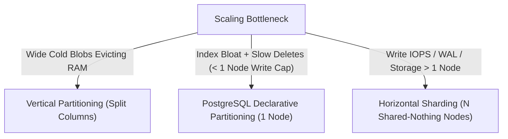
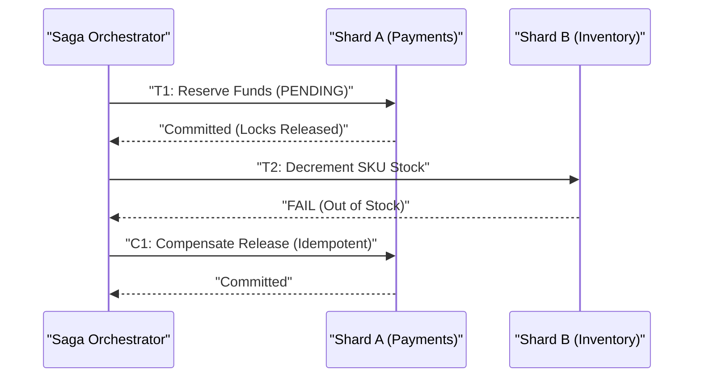
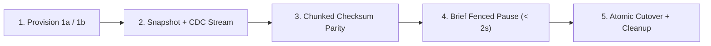

---
tags:
  - software-engineering
  - databases
  - sharding
  - partitioning
  - distributed-systems
  - postgresql
created: 2026-11-13
updated: 2026-11-13
status: 🟢
level: mid-to-senior
---
# Partitioning & Horizontal Sharding

> [!abstract] Vault Navigation
> Single-node table partitioning, shared-nothing horizontal sharding, distributed routing algorithms, global ID generation, and zero-downtime resharding inside [[Programming/Software Engineering/Database Design/Database Design Complete Guide|Database Design Complete Guide]]. Pairs directly with [[Programming/Software Engineering/Database Design/Replication|Replication]], [[Programming/Software Engineering/Database Design/Transactions|Transactions]], [[Programming/Software Engineering/Database Design/Indexing|Indexing]], [[Programming/Software Engineering/Database Design/Data Modeling NoSQL|Data Modeling NoSQL]], and [[Programming/Software Engineering/System Design/Scalability|Scalability]].

Scaling a transactional database beyond a single node's NVMe IOPS, `shared_buffers` RAM, and WAL fsync ceiling proceeds in strict architectural stages: exhaust indexing, connection pooling, read replicas, and **single-node declarative partitioning** before accepting the operational complexity of **multi-node horizontal sharding**. Once data physically splits across shared-nothing nodes, local joins, `UNIQUE` constraints, global sequences, pagination, and ACID transactions break unless explicitly engineered into the shard key, routing topology, and application saga layer.

---

## 1. First-Principles Mechanics & Scaling Topologies

### 1.1 Vertical Partitioning vs Declarative Partitioning vs Physical Sharding



| Strategy | Physical Scope | Bottleneck Eliminated | Cross-Boundary Joins | Write Throughput Scaling |
|---|---|---|---|---|
| **Vertical Partitioning** | Splits columns of 1 logical entity across narrow hot vs wide cold tables/DBs | Eviction of hot columns from `shared_buffers` by wide `TEXT`/`JSONB` blobs | Local `1:1` join or separate service fetch | Only across isolated domain tables |
| **Native Table Partitioning** | Splits 1 logical table into smaller physical child B+Trees/heaps on **1 node** | B+Tree depth/RAM overflow, sequential scan range, and $O(N)$ `DELETE` VACUUM storms | Local single-node ACID joins | **No** (all partitions share 1 primary CPU, RAM, and WAL stream!) |
| **Horizontal Sharding** | Distributes disjoint row subsets across **$N$ independent database primaries** | Single-node write IOPS, aggregate WAL throughput, total NVMe storage, aggregate RAM | Expensive network **scatter-gather** unless co-located | **Yes** (near-linear scaling with $N$ independent primaries) |

### 1.2 PostgreSQL Declarative Partitioning Mechanics (`RANGE`, `LIST`, `HASH`)

PostgreSQL natively partitions tables into independent physical child relations (`pg_inherits`) while presenting a unified logical table to SQL queries:
- **`RANGE`**: Contiguous non-overlapping spans (`created_at`, `invoice_month`, `event_id`). Ideal for time-series and compliance retention.
- **`LIST`**: Explicit discrete values (`region IN ('eu-central', 'us-east')`, `tenant_tier`). Ideal for regional isolation or pinned enterprise tenants.
- **`HASH`**: Distributes uniformly across $M$ buckets via `MODULUS M, REMAINDER r`. Useful on a single node strictly to shrink individual B+Tree index sizes (e.g., keeping each child index inside RAM) or isolate `VACUUM` workers per bucket.

**Critical Invariants & Traps in PostgreSQL Partitioning**:
1. **Primary Key / `UNIQUE` Constraint Rule**: Every `PRIMARY KEY` or `UNIQUE` constraint on a partitioned table **MUST include all partition key columns** (e.g., `PRIMARY KEY (created_at, id)`). PostgreSQL enforces uniqueness strictly per child partition B+Tree rather than maintaining a cross-partition global index.
2. **Static vs Dynamic Partition Pruning (`enable_partition_pruning = on`)**:
   - **Plan-Time (Static) Pruning**: When `WHERE created_at >= '2026-11-01'` uses constants, the planner discards irrelevant partitions before execution.
   - **Execution-Time (Dynamic) Pruning**: When pruning depends on bound parameters (`$1`) or a `Nested Loop` / subquery join key, PostgreSQL prunes child nodes at executor startup (`Subplans Removed: 34` in `EXPLAIN ANALYZE`).
   - **Trap**: Wrapping the partition key in a non-immutable expression (`WHERE DATE(created_at) = '2026-11-13'`) or mismatched types disables pruning completely and scans **all** partitions!
3. **The `DEFAULT` Partition Lock-All Trap**: If a `DEFAULT` partition exists (`CREATE TABLE logs_default PARTITION OF logs DEFAULT;`), attaching a brand-new monthly partition (`logs_2026_12`) forces PostgreSQL to scan `logs_default` under an **`ACCESS EXCLUSIVE` lock on the parent table** to prove no rows matching `2026-12` already slipped into `DEFAULT`! Always pre-create future partitions ahead of time and omit `DEFAULT` (or route out-of-band rows elsewhere).

### 1.3 Physical Sharding Topologies & Routing Layers

Multi-node sharding introduces a routing layer mapping `(table, shard_key) -> physical_shard_primary`:
- **Application-Embedded Router**: Services compute `shardId = route(tenantId)` and pull from per-shard connection pools (`pg.Pool` map). Lowest network hop latency (`0` proxy hops), zero central proxy SPOF, requires synchronized topology config across app instances during resharding.
- **Smart Sharding Proxy (`Vitess` `vtgate` + `vttablet`)**: Presents standard MySQL wire protocol; parses SQL AST, routes single-shard queries directly, executes scatter-gather merges, manages connection pooling, and orchestrates zero-downtime `VReplication` shard splits.
- **Coordinator-Worker Distributed SQL (`Citus` for PostgreSQL)**: Designates a coordinator PostgreSQL node (or any worker via MX mode) storing `pg_dist_shard` placement metadata; rewrites co-located SQL joins into parallel worker sub-queries and replicates reference tables automatically across all workers.

### 1.4 Global Unique ID Generation Internals

Auto-increment `BIGINT` (`IDENTITY`) sequences collide across independent shards unless offset-strided (which breaks on shard addition) or centralized (which becomes a bottleneck). Production sharded clusters choose among three distributed ID architectures:

#### 1. 64-Bit Snowflake ID (Time-Ordered + Embedded Shard Bits)

Fits inside a signed 64-bit SQL `BIGINT` (`8 bytes`, preserving B+Tree density and integer comparison):
- **Bit 63 (1 bit)**: Always `0` (keeps `BIGINT` non-negative).
- **Bits 62–22 (41 bits)**: Milliseconds since custom epoch (~69.7 years before rollover).
- **Bits 21–12 (10 bits)**: Logical shard or worker/datacenter ID (`0..1023`), optionally encoding the **`logical_shard_id`** directly inside every PK for zero-lookup $O(1)$ routing!
- **Bits 11–0 (12 bits)**: Per-millisecond sequence counter (`0..4095`, yielding **4,096,000 IDs/sec per worker**).

**The NTP Clock-Drift Hazard**: If NTP steps the host OS clock backward by 40 ms, a naive Snowflake generator produces **duplicate IDs**! Production generators **must** refuse generation or wait on small backward drift (`<= 5 ms`), and abort or rotate a logical worker/epoch sub-slot on larger backward jumps rather than emitting duplicates.

#### 2. RFC 9562 `UUIDv7` (128-Bit Monotonic Time-Ordered UUID)

Unlike random `UUIDv4` (which triggers 50/50 B+Tree leaf splits and random dirty-page I/O across the entire index), **`UUIDv7`** embeds a 48-bit Unix millisecond timestamp at the most significant bits:
- **Bits 0–47 (48 bits)**: Unix epoch milliseconds.
- **Bits 48–51 (4 bits)**: Version `0111` (`7`).
- **Bits 52–63 (12 bits)**: `rand_a` (or monotonic sub-millisecond counter guaranteeing strict sort order within the same millisecond on one host).
- **Bits 64–65 (2 bits)**: Variant `10`.
- **Bits 66–127 (62 bits)**: Cryptographically random `rand_b`.

Because consecutive `UUIDv7` values share the leading 48-bit timestamp prefix, inserts hit the **rightmost B+Tree leaf page** (~90/10 split efficiency, high buffer-pool hit rate) without needing any coordinator or worker-ID registry!

#### 3. Hi-Lo / Batched Sequence Allocator

Each application node fetches a single sequence increment `nextval('global_batch_seq')` (stride `1,000`) once every 1,000 inserts and allocates `[hi * 1000, hi * 1000 + 999]` purely in local RAM—cutting sequence lock round-trips by $1,000\times$ at the cost of small ID gaps if a pod restarts mid-batch.

---

## 2. Real-World Use Cases & Routing Strategy Decision Matrix

### 2.1 Five Real-World Partitioning & Sharding Scenarios

1. **Compliance Audit Trail & Webhook History (`1.8 TB`, `4,000 writes/sec`, 180-day TTL -> Native `RANGE` Partitioning, DO NOT Shard)**: A single NVMe PostgreSQL primary comfortably sustains 4k writes/sec. Sharding would add distributed operational overhead for zero benefit. Partitioning monthly by `RANGE (created_at)` shrinks active working-set B+Trees to the current month (`~100 GB`) and lets retention drop expired months in $O(1)$ via `DETACH PARTITION CONCURRENTLY` + `DROP TABLE`.
2. **Multi-Tenant B2B SaaS (`18 TB`, `65,000 writes/sec` -> Hash + Directory Override by `tenant_id`)**: 97% of queries filter by `tenant_id` (`organizations`, `users`, `invoices`, `line_items`). Co-locating all tables by `tenant_id` keeps every tenant dashboard, join, and transaction local to **1 shard**, while a thin directory override isolates whale enterprise tenants onto dedicated shards.
3. **Global Consumer Messaging & Social Feed (`80 TB`, `400,000 writes/sec` -> Consistent Hash by `channel_id` / `user_id` + Async GSI)**: Messages co-locate by `channel_id` so fetching the latest 50 messages hits 1 shard cleanly. Global user lookup by `email` or `@handle` routes via a dedicated directory shard `(handle_norm -> user_id, shard_id)`.
4. **High-Frequency IoT Telemetry (`250,000 writes/sec` -> Salted Composite Key `(device_bucket, time_window)`, NEVER Raw Timestamp)**: Sharding by `created_at` concentrates 100% of active writes onto the single newest shard (severe hot-spot!). Sharding by `hash(device_id)`—or `(device_id, day)` salted across `0..N-1`—spreads ingest across all shards while keeping single-device time scans on 1 shard.
5. **Global Healthcare / Fintech Under GDPR & Data Residency (`EU` + `US` + `APAC` -> Geo-Partitioned Directory)**: Legal mandates require EU citizen PII to remain physically inside Frankfurt disks. Encode region inside the routing directory or user ID prefix (`eu_0193...`) so routers never replicate PII across regional borders.

### 2.2 Routing Topology & Strategy Decision Matrix

| Routing Mechanism | Mapping Function | Strengths | Fatal Failure Modes | Best Production Fit |
|---|---|---|---|---|
| **Range-Based** *(with Split Metadata)* | Lookup `(min_key..max_key) -> shard_id` (e.g., CockroachDB/TiKV ranges) | Fast ordered range scans (`BETWEEN`, `ORDER BY`) without scatter-gather | **Monotonic hotspot** unless split ranges rebalance proactively across nodes | Key-ordered distributed KV stores with automated range splitting |
| **Naive Modulo** (`hash(k) % N`) | Remainder division | Zero metadata state; uniform spread | Resizing $N \to N+1$ moves **$\frac{N}{N+1}$ (~80–99%)** of all keys simultaneously! | Fixed static logical shard buckets (`1024` logical shards mapped to physical nodes) |
| **Consistent Hashing (`vNodes`)** | Sorted hash ring $[0, 2^{64}-1]$ with $V=128\text{–}256$ virtual tokens/node | Adding/removing a node moves strictly **$O(1/N)$** keys; supports weighted hardware | Requires tracking ring membership state; minor variance unless $V \ge 100$ | Distributed caches, Dynamo-style KV clusters, dynamic node pools |
| **Jump Consistent Hash** | Stateless iterative jump ($O(\ln N)$ time, 0 bytes RAM) | Perfectly uniform key balance; **zero ring memory**; minimal key movement | Only supports sequential shard IDs `0..N-1`; **cannot remove arbitrary middle shard** | Stateless routing across fixed-stride shards or sharded worker pools |
| **Directory / Lookup Table** | Cached map `entity_id -> physical_shard` (+ default hash fallback) | Supports **zero-downtime whale isolation**, custom geo pinning, and live shard moves | Extra hop (mitigated via cached epoch-versioned map); directory DB must be HA | Multi-tenant SaaS needing whale isolation + flexible rebalancing |

---

## 3. Step-by-Step Practical Application: Schemas, Routers & Resharding Tools

### 3.1 PostgreSQL Declarative Partitioning (`DETACH CONCURRENTLY`)

Never purge tens of millions of historical rows via `DELETE FROM audit_logs WHERE created_at < ...`—that generates massive WAL, dead tuples, and `autovacuum` freezes. Partition by range and detach expired slices online:

```sql
CREATE TABLE audit_logs (
    id         BIGINT NOT NULL,
    tenant_id  BIGINT NOT NULL,
    created_at TIMESTAMPTZ NOT NULL,
    actor_id   BIGINT NOT NULL,
    action     TEXT NOT NULL,
    payload    JSONB NOT NULL DEFAULT '{}'::jsonb,
    -- Partition key MUST be part of PRIMARY KEY / UNIQUE constraints
    PRIMARY KEY (created_at, id)
) PARTITION BY RANGE (created_at);

-- Partition-level indexes propagate automatically to all current and future child partitions!
CREATE INDEX idx_audit_logs_tenant_created ON audit_logs (tenant_id, created_at DESC);

-- Pre-create active and upcoming monthly partitions (avoid DEFAULT partition lock traps!)
CREATE TABLE audit_logs_2026_11 PARTITION OF audit_logs
    FOR VALUES FROM ('2026-11-01 00:00:00Z') TO ('2026-12-01 00:00:00Z');

CREATE TABLE audit_logs_2026_12 PARTITION OF audit_logs
    FOR VALUES FROM ('2026-12-01 00:00:00Z') TO ('2027-01-01 00:00:00Z');

-- Zero-downtime O(1) retention cleanup (PostgreSQL 14+):
-- Phase 1: Marks partition detached under SHARE UPDATE EXCLUSIVE (concurrent reads/writes continue!)
ALTER TABLE audit_logs DETACH PARTITION audit_logs_2025_10 CONCURRENTLY;
-- Phase 2: Archive to S3 via pg_dump/COPY if needed, then reclaim space instantly
DROP TABLE audit_logs_2025_10;
```

### 3.2 Co-Located Multi-Tenant Sharded Schema & Global Email Directory

To keep 98% of OLTP queries and joins strictly inside **1 physical shard**, propagate `tenant_id` into every child table and declare composite primary/foreign keys `(tenant_id, id)`:

```sql
-- Executed identically across EVERY physical shard (or managed via Citus create_distributed_table):
CREATE TABLE tenants (
    tenant_id   BIGINT PRIMARY KEY,
    slug        TEXT NOT NULL,
    plan_tier   TEXT NOT NULL,
    created_at  TIMESTAMPTZ NOT NULL DEFAULT NOW()
);

CREATE TABLE users (
    tenant_id   BIGINT NOT NULL,
    user_id     BIGINT NOT NULL, -- 64-bit Snowflake or embedded-shard ID
    email_norm  TEXT NOT NULL,
    role        TEXT NOT NULL,
    PRIMARY KEY (tenant_id, user_id),
    FOREIGN KEY (tenant_id) REFERENCES tenants(tenant_id)
);

CREATE TABLE invoices (
    tenant_id   BIGINT NOT NULL,
    invoice_id  BIGINT NOT NULL,
    user_id     BIGINT NOT NULL,
    total_cents BIGINT NOT NULL,
    status      TEXT NOT NULL,
    created_at  TIMESTAMPTZ NOT NULL DEFAULT NOW(),
    PRIMARY KEY (tenant_id, invoice_id),
    -- Co-located FK enforces local ACID referential integrity on the exact same shard!
    FOREIGN KEY (tenant_id, user_id) REFERENCES users(tenant_id, user_id)
);

CREATE TABLE invoice_line_items (
    tenant_id    BIGINT NOT NULL,
    line_id      BIGINT NOT NULL,
    invoice_id   BIGINT NOT NULL,
    sku          TEXT NOT NULL,
    amount_cents BIGINT NOT NULL,
    PRIMARY KEY (tenant_id, line_id),
    FOREIGN KEY (tenant_id, invoice_id) REFERENCES invoices(tenant_id, invoice_id)
);

-- Small reference table replicated identically across all shards (zero cross-shard joins!)
CREATE TABLE currencies (
    code          CHAR(3) PRIMARY KEY,
    minor_units   SMALLINT NOT NULL
);

-- Dedicated Global Secondary Index (GSI) shard group sharded by hash(email_norm):
-- Enables 1-hop login routing AND enforces global email uniqueness across all shards!
CREATE TABLE user_email_directory (
    email_norm  TEXT PRIMARY KEY,
    tenant_id   BIGINT NOT NULL,
    user_id     BIGINT NOT NULL,
    created_at  TIMESTAMPTZ NOT NULL DEFAULT NOW()
);
```

### 3.3 Production Global ID Generators (Snowflake w/ Clock-Drift Guard & RFC 9562 UUIDv7)

```typescript
import { randomBytes } from 'node:crypto';

/**
 * 64-bit Snowflake ID Generator:
 * [1 sign=0][41 ms timestamp][10 logicalShardId (0..1023)][12 sequence (0..4095)]
 * Embedding logicalShardId inside bits 12..21 enables O(1) shard routing from PK alone.
 */
export class SnowflakeIdGenerator {
  private static readonly CUSTOM_EPOCH_MS = 1704067200000n; // 2024-01-01T00:00:00Z
  private static readonly SHARD_BITS = 10n;
  private static readonly SEQ_BITS = 12n;
  private static readonly MAX_SHARD_ID = (1n << SnowflakeIdGenerator.SHARD_BITS) - 1n; // 1023
  private static readonly MAX_SEQ = (1n << SnowflakeIdGenerator.SEQ_BITS) - 1n;       // 4095
  private static readonly MAX_BACKWARD_DRIFT_MS = 5n;

  private lastTimestampMs = -1n;
  private sequence = 0n;

  constructor(private readonly logicalShardId: bigint) {
    if (logicalShardId < 0n || logicalShardId > SnowflakeIdGenerator.MAX_SHARD_ID) {
      throw new RangeError(`logicalShardId must be between 0 and ${SnowflakeIdGenerator.MAX_SHARD_ID}`);
    }
  }

  public nextId(): bigint {
    let nowMs = BigInt(Date.now());

    // Guard against NTP backward clock step so duplicate IDs are NEVER emitted
    if (nowMs < this.lastTimestampMs) {
      const drift = this.lastTimestampMs - nowMs;
      if (drift > SnowflakeIdGenerator.MAX_BACKWARD_DRIFT_MS) {
        throw new Error(`Clock moved backwards by ${drift}ms (> ${SnowflakeIdGenerator.MAX_BACKWARD_DRIFT_MS}ms); refusing ID generation`);
      }
      // Spin briefly until clock catches up to lastTimestampMs
      while (nowMs < this.lastTimestampMs) {
        nowMs = BigInt(Date.now());
      }
    }

    if (nowMs === this.lastTimestampMs) {
      this.sequence = (this.sequence + 1n) & SnowflakeIdGenerator.MAX_SEQ;
      if (this.sequence === 0n) {
        // Sequence exhausted 4096 IDs inside 1ms; wait for next millisecond boundary
        while (nowMs <= this.lastTimestampMs) {
          nowMs = BigInt(Date.now());
        }
      }
    } else {
      this.sequence = 0n;
    }

    this.lastTimestampMs = nowMs;
    const elapsed = nowMs - SnowflakeIdGenerator.CUSTOM_EPOCH_MS;

    return (
      (elapsed << (SnowflakeIdGenerator.SHARD_BITS + SnowflakeIdGenerator.SEQ_BITS)) |
      (this.logicalShardId << SnowflakeIdGenerator.SEQ_BITS) |
      this.sequence
    );
  }

  public static extractLogicalShard(id: bigint): number {
    return Number((id >> SnowflakeIdGenerator.SEQ_BITS) & SnowflakeIdGenerator.MAX_SHARD_ID);
  }
}

/**
 * RFC 9562 UUIDv7 Generator with monotonic 12-bit sub-ms counter (rand_a)
 * Preserves B+Tree rightmost page locality without any central sequence coordinator.
 */
export class UuidV7Generator {
  private lastMs = 0n;
  private subMsCounter = 0;

  public nextUuidV7(): string {
    const buf = randomBytes(16);
    const nowMs = BigInt(Date.now());

    if (nowMs <= this.lastMs) {
      // Strictly monotonic even under same-ms bursts or tiny NTP step-backs
      this.subMsCounter = (this.subMsCounter + 1) & 0x0fff;
      if (this.subMsCounter === 0) {
        this.lastMs += 1n; // Advance virtual millisecond on 4096 burst overflow
      }
    } else {
      this.lastMs = nowMs;
      this.subMsCounter = ((buf[6] & 0x0f) << 8) | buf[7]; // Seed random starting counter
    }

    // Bytes 0..5: 48-bit big-endian Unix millisecond timestamp
    buf[0] = Number((this.lastMs >> 40n) & 0xffn);
    buf[1] = Number((this.lastMs >> 32n) & 0xffn);
    buf[2] = Number((this.lastMs >> 24n) & 0xffn);
    buf[3] = Number((this.lastMs >> 16n) & 0xffn);
    buf[4] = Number((this.lastMs >> 8n) & 0xffn);
    buf[5] = Number(this.lastMs & 0xffn);

    // Bytes 6..7: Version 7 (0111) + 12-bit monotonic rand_a counter
    buf[6] = 0x70 | ((this.subMsCounter >> 8) & 0x0f);
    buf[7] = this.subMsCounter & 0xff;

    // Byte 8: RFC 9562 Variant (10xxxxxx)
    buf[8] = (buf[8] & 0x3f) | 0x80;

    const hex = buf.toString('hex');
    return `${hex.slice(0, 8)}-${hex.slice(8, 12)}-${hex.slice(12, 16)}-${hex.slice(16, 20)}-${hex.slice(20)}`;
  }
}

/**
 * 3. Hi-Lo Batch Sequence Allocator:
 * Fetches 1 sequence increment per 1,000 IDs from PostgreSQL (`nextval`), eliminating 99.9% of sequence RTTs.
 */
export class HiLoIdAllocator {
  private currentHi = -1n;
  private currentLo = 0n;

  constructor(
    private readonly loSize: bigint,
    private readonly fetchNextHi: () => Promise<bigint>,
  ) {}

  public async nextId(): Promise<bigint> {
    if (this.currentHi < 0n || this.currentLo >= this.loSize) {
      this.currentHi = await this.fetchNextHi(); // SQL: SELECT nextval('global_hilo_seq')
      this.currentLo = 0n;
    }
    const id = this.currentHi * this.loSize + this.currentLo;
    this.currentLo += 1n;
    return id;
  }
}
```

For pure SQL inserts on PostgreSQL 18+, call built-in **`uuidv7()`** directly as a column default (`id UUID PRIMARY KEY DEFAULT uuidv7()`); on PostgreSQL 14–17 without extensions, embed RFC 9562 UUIDv7 generation cleanly inside SQL:

```sql
CREATE OR REPLACE FUNCTION uuidv7_sql() RETURNS UUID
LANGUAGE sql VOLATILE AS $$
    SELECT encode(
        set_bit(set_bit(
            overlay(uuid_send(gen_random_uuid())
                placing substring(int8send(floor(extract(epoch from clock_timestamp()) * 1000)::bigint) from 3 for 6)
                from 1 for 6),
            52, 1), -- Version 7 bits (0111)
        53, 1)::bytea, 'hex')::uuid;
$$;
```

### 3.4 Production Routing Algorithms: Consistent Hash Ring (`vNodes`) & Jump Consistent Hash

```typescript
import { createHash } from 'node:crypto';

/**
 * 1. Consistent Hash Ring with Virtual Nodes (vNodes):
 * Supports arbitrary physical node addition/removal AND weighted capacity (e.g. 256 vNodes vs 128).
 */
export class ConsistentHashRing {
  private ring: Array<{ hash: bigint; shardId: string }> = [];

  public addNode(shardId: string, virtualNodes = 150): void {
    for (let i = 0; i < virtualNodes; i++) {
      const tokenHash = this.hash64(`${shardId}#vn${i}`);
      this.ring.push({ hash: tokenHash, shardId });
    }
    this.ring.sort((a, b) => (a.hash < b.hash ? -1 : a.hash > b.hash ? 1 : 0));
  }

  public removeNode(shardId: string): void {
    this.ring = this.ring.filter((entry) => entry.shardId !== shardId);
  }

  public getShard(routingKey: string): string {
    if (this.ring.length === 0) throw new Error('ConsistentHashRing has no active shards');
    const keyHash = this.hash64(routingKey);

    // Binary search for first clockwise token >= keyHash
    let lo = 0;
    let hi = this.ring.length - 1;
    let idx = 0;

    while (lo <= hi) {
      const mid = (lo + hi) >>> 1;
      if (this.ring[mid].hash >= keyHash) {
        idx = mid;
        hi = mid - 1;
      } else {
        lo = mid + 1;
      }
    }
    return this.ring[idx].shardId;
  }

  private hash64(input: string): bigint {
    const digest = createHash('sha256').update(input).digest();
    return digest.readBigUInt64BE(0);
  }
}

/**
 * 2. Jump Consistent Hash (Lamping & Veach, 2014):
 * Zero memory, O(ln N) deterministic mapping onto contiguous buckets [0, numBuckets - 1].
 * Constraint: Can only grow/shrink from the tail (bucket N-1); cannot remove arbitrary middle nodes.
 */
export function jumpConsistentHash(key64: bigint, numBuckets: number): number {
  if (numBuckets <= 0) throw new RangeError('numBuckets must be >= 1');
  let k = BigInt.asUintN(64, key64);
  let b = -1n;
  let j = 0n;
  const n = BigInt(numBuckets);

  while (j < n) {
    b = j;
    // 64-bit LCG multiplier from original Lamping & Veach paper: 2862933555777941757
    k = BigInt.asUintN(64, k * 2862933555777941757n + 1n);
    const shift = Number(k >> 33n) + 1;
    j = BigInt(Math.floor((Number(b + 1n) * 2147483648) / shift));
  }
  return Number(b);
}
```

For Go routers (or ultra-low-latency proxy gateways), **Jump Consistent Hash** runs in ~15 ns with zero allocations, while **Google Maglev Hashing** constructs a fixed-size prime lookup table ($M = 65537$) via per-backend cyclic preference permutations so routing executes in **$O(1)$ array lookup time** while preserving minimal key movement on backend churn:

```go
package routing

// JumpConsistentHash maps key uniformly onto [0, numBuckets-1] in O(ln N) with zero RAM.
func JumpConsistentHash(key uint64, numBuckets int) int32 {
	var b int64 = -1
	var j int64
	for j < int64(numBuckets) {
		b = j
		key = key*2862933555777941757 + 1
		j = int64(float64(b+1) * (float64(int64(1)<<31) / float64((key>>33)+1)))
	}
	return int32(b)
}
```

- **When to Prefer `Maglev` over `ConsistentHashRing`**: If a proxy handles 500,000+ lookups/sec across dynamic shard pools, binary-searching a `256 * N`-entry `vNode` ring takes $O(\log(V \cdot N))$ cache-unfriendly pointer hops, whereas Maglev pre-computes a flat `uint16[65537]` array yielding strict **$O(1)$ L1-cache lookup** and even tighter load variance than `vNodes` ($< 1\%$ deviation) when adding or draining arbitrary shards.

### 3.5 Cross-Shard Parallel Keyset Pagination & K-Way Heap Merge

Running `ORDER BY created_at DESC LIMIT 25 OFFSET 10000` across $S=16$ shards requires every shard to scan and return `10,025` rows (`160,400` rows transferred over the network just to discard `160,375`!). Replace `OFFSET` with **per-shard keyset cursor pushdown + K-way priority heap merge**:

```typescript
export interface ShardedItem {
  shardId: number;
  createdAtMs: number;
  id: string;
  payload: Record<string, unknown>;
}

/**
 * Queries S shards in parallel using the identical keyset cursor (createdAtMs, id),
 * then merges strictly K items per shard via a descending max-heap in O(K * log S) time.
 */
export async function fetchCrossShardKeysetPage(
  shardFetchers: Array<(cursor: { createdAtMs: number; id: string } | null, limit: number) => Promise<ShardedItem[]>>,
  cursor: { createdAtMs: number; id: string } | null,
  pageSize = 25,
): Promise<{ items: ShardedItem[]; nextCursor: { createdAtMs: number; id: string } | null }> {
  // Fetch pageSize rows from each shard concurrently
  const perShardPages = await Promise.all(
    shardFetchers.map((fetchShard) => fetchShard(cursor, pageSize)),
  );

  // Track read pointer per shard and select global top items via priority comparison
  const cursors = new Array<number>(perShardPages.length).fill(0);
  const merged: ShardedItem[] = [];

  while (merged.length < pageSize) {
    let bestShard = -1;
    let bestItem: ShardedItem | null = null;

    for (let s = 0; s < perShardPages.length; s++) {
      const idx = cursors[s];
      if (idx >= perShardPages[s].length) continue;
      const candidate = perShardPages[s][idx];

      if (
        !bestItem ||
        candidate.createdAtMs > bestItem.createdAtMs ||
        (candidate.createdAtMs === bestItem.createdAtMs && BigInt(candidate.id) > BigInt(bestItem.id))
      ) {
        bestItem = candidate;
        bestShard = s;
      }
    }

    if (bestShard === -1 || !bestItem) break;
    merged.push(bestItem);
    cursors[bestShard]++;
  }

  const tail = merged.at(-1);
  return {
    items: merged,
    nextCursor: merged.length === pageSize && tail
      ? { createdAtMs: tail.createdAtMs, id: tail.id }
      : null,
  };
}
```

---

## 4. Complete Reference: Distributed Traps, Transactions & Online Resharding

### 4.1 Shard Key Selection Discipline & Tail-Latency Amplification

Sending a scatter-gather query to all $S$ shards exposes every request to the **slowest shard's tail latency**. If a single shard has $p99 = 40\text{ ms}$ (1% probability of exceeding 40 ms), a scatter-gather query touching $S = 32$ independent shards hits a slow shard with probability:
$$P(\ge 1 \text{ slow shard}) = 1 - (1 - 0.01)^{32} \approx \mathbf{27.5\%}$$
Your application's **$p73$** degrades to single-shard $p99$!

**Five-Point Shard Key Checklist**:
1. **High Cardinality**: Key domain must vastly exceed shard count ($|K| \gg S$; never shard by `boolean`, `country` with 5 active countries, or `status`).
2. **Write Uniformity (Zero Monotonic Hot-Spots)**: Never shard by `created_at` or monotonic auto-increment `id` for write-heavy tables—100% of `INSERT`s hit the rightmost shard while $S-1$ shards sit idle.
3. **Entity-Group Co-Location**: Every child table in an aggregate (`orders` -> `order_items` -> `payments`) must embed the identical shard key (`tenant_id` or `account_id`) so joins and foreign keys remain local.
4. **Celebrity / Whale Skew Mitigation**: When `tenant_999` produces $1,000\times$ more traffic than median tenants, consistent hashing alone still forces 100% of `tenant_999` onto 1 shard. Fix via **two layers**:
   - **Directory Isolation**: Pin `tenant_999` onto a dedicated high-spec shard via routing override.
   - **Salted Composite Keys**: Split ultra-massive tenants across $M$ sub-shards via `shard_key = "${tenantId}#${hash(itemId) % M}"` (`M = 8` for `tenant_999`, `M = 1` for regular tenants)—paying $M$-way scatter-gather strictly for that tenant!
5. **Global Uniqueness & Secondary Index Routing**:
   - **Synchronous Directory Shard**: Acquire local ACID uniqueness on `user_email_directory(email_norm PK, tenant_id, user_id)` first before inserting on the tenant shard (paired with Saga compensation on partial failure).
   - **Async CDC GSI**: Stream changes via Debezium/`pgoutput` into a lookup shard when eventual consistency suffices (never rely on async GSIs for strict duplicate prevention!).

### 4.2 Cross-Shard Transactions: `2PC` Blocking Failure vs Orchestrated `Saga`

| Dimension | Two-Phase Commit (`2PC` / `XA`) | Orchestrated `Saga` + Outbox + Semantic Lock |
|---|---|---|
| **Protocol Flow** | Phase 1: `PREPARE TRANSACTION` (flushes WAL + **retains row locks**); Phase 2: `COMMIT PREPARED` | Sequential **local ACID TXs** $T_1, \dots, T_n$; failures trigger idempotent **Compensating Actions** $C_{k-1} \dots C_1$ |
| **Coordinator Crash Impact** | **Blocking Protocol**: If coordinator crashes after Phase 1 `YES`, shards hold exclusive row locks **indefinitely**, causing cascading outage! | **Non-Blocking**: Every local TX commits and releases locks in `< 2 ms`; orchestrator resumes from persistent state log |
| **Isolation Guarantee** | Strict cross-shard **Atomicity + Isolation** | **No Isolation (`I` in ACID)**! Concurrent readers observe intermediate states unless protected by **Semantic Locks** (`status = 'PENDING_CAPTURE'`) |
| **Throughput & Latency** | Low ($2\times$ RTT + $2\times$ `fsync` per shard while holding locks) | High throughput (zero distributed locks across network boundaries) |



**Mandatory Saga Guardrails**: Every forward (`T_k`) and compensating (`C_k`) SQL handler must persist an **idempotency key** (`processed_saga_steps(saga_id, step_name)`) inside the same local transaction so network retries never double-debit or double-refund, and compensating actions must be **commutative/backward-safe** (e.g., if `C1` arrives before a delayed `T1` network retry, record `'ABORTED'` so the stale `T1` rejects rather than reserving funds permanently!).

### 4.3 Online Zero-Downtime Resharding Protocol (`Vitess` / `Citus` / Custom CDC)

Splitting overloaded `Shard 1` into `Shard 1a` and `Shard 1b` without downtime executes across **five strict phases**:



1. **Provision & Schema Mirror**: Provision target shards `1a` and `1b` with identical schema, indexes, and sequences offset/UUIDv7-safe.
2. **Consistent Snapshot + Filtered CDC Catch-Up**: Open a `REPEATABLE READ` snapshot (`pg_create_logical_replication_slot` LSN) to copy initial rows belonging to `1a` and `1b` respectively, then stream ongoing WAL/binlog (`pgoutput` or MySQL `VReplication` row-based binlog) filtered by the target shard key predicate until replication lag drops below `100 ms`.
3. **Zero-Downtime Checksum Verification**: Run non-blocking chunked cryptographic comparisons between `Shard 1` and `1a`/`1b` across primary-key ranges; retry small transient in-flight chunks until 100% parity holds.
4. **Fenced Write Pause (`< 1–2 seconds`)**: Increment the cluster **`topology_epoch`** (or place `Shard 1` splitting key range into read-only/REJECT mode using a fencing token), drain the final `< 100 ms` of CDC WAL events to `1a`/`1b`, and verify final checksum parity at the exact cutover LSN.
5. **Atomic Topology Cutover & Cleanup**: Atomically publish the new shard map (`Shard 1 -> [1a, 1b]`) in `etcd`/Consul/config store, resume live writes directly on `1a`/`1b`, keep reverse CDC active briefly if fast rollback is required, and drop old `Shard 1` data once stable.

#### Production SQL + TypeScript Chunked Backfill Checksum Verifier

```typescript
import { Pool } from 'pg';

/**
 * Verifies row-level cryptographic parity between source shard and split target shards
 * in bounded primary-key chunks before permitting atomic routing cutover.
 */
export async function verifyShardRangeParity(
  sourcePool: Pool,
  targetPool: Pool,
  tableName: string,
  minTenantId: number,
  maxTenantId: number,
  chunkSize = 1000,
): Promise<{ matchedChunks: number; mismatchedRanges: Array<[number, number]> }> {
  const mismatchedRanges: Array<[number, number]> = [];
  let matchedChunks = 0;

  const checksumQuery = `
    SELECT
      COUNT(*)::bigint AS row_count,
      COALESCE(BIT_XOR(hashtextextended(ROW(t.*)::text, 0)), 0)::text AS order_independent_xor
    FROM ${tableName} AS t
    WHERE tenant_id >= $1 AND tenant_id < $2
  `;

  for (let start = minTenantId; start < maxTenantId; start += chunkSize) {
    const end = Math.min(start + chunkSize, maxTenantId);
    const [srcRes, tgtRes] = await Promise.all([
      sourcePool.query<{ row_count: string; order_independent_xor: string }>(checksumQuery, [start, end]),
      targetPool.query<{ row_count: string; order_independent_xor: string }>(checksumQuery, [start, end]),
    ]);

    const src = srcRes.rows[0];
    const tgt = tgtRes.rows[0];
    if (src.row_count !== tgt.row_count || src.order_independent_xor !== tgt.order_independent_xor) {
      mismatchedRanges.push([start, end]);
    } else {
      matchedChunks++;
    }
  }

  return { matchedChunks, mismatchedRanges };
}
```

*(Note why `BIT_XOR(hashtextextended(ROW(t.*)::text, 0))` is superior to `STRING_AGG` or `MD5` over sorted rows: `BIT_XOR` is **commutative and associative**, computing exact row-set digests in $O(N)$ streaming memory without sorting millions of rows!)*

#### Dual-Write + Backfill vs CDC Logical Replication + Topology Fencing

When splitting shards inside the **same engine** (PostgreSQL $\to$ PostgreSQL via PostgreSQL 15+ row-filtered logical replication or Citus, or MySQL $\to$ MySQL via Vitess `VReplication`), **CDC logical replication** avoids application-level dual-write race conditions (lost updates when concurrent requests hit source and target in opposite order!). Application **dual-write** is reserved strictly for heterogeneous cross-engine migrations (e.g., MySQL $\to$ PostgreSQL), where writers write to both stores with an idempotent timestamp/version token, an offline backfill fills missing historical keys (`ON CONFLICT DO NOTHING` / version check), and `verifyShardRangeParity` audits convergence before read/write cutover.

```sql
-- 1. Citus (PostgreSQL Extension): Co-locate tables + rebalance shards online
SELECT create_distributed_table('tenants', 'tenant_id');
SELECT create_distributed_table('invoices', 'tenant_id', colocate_with => 'tenants');
SELECT create_reference_table('currencies');
-- Non-blocking online shard move between worker nodes (uses pg_logical replication under the hood):
SELECT citus_move_shard_placement(102008, 'worker-1', 5432, 'worker-3', 5432);

-- 2. Native PostgreSQL 15+ Row-Filtered Logical Replication for Manual Shard Splitting
-- On source Shard 1: publish ONLY keys destined for target Shard 1a
CREATE PUBLICATION pub_shard_1a
    FOR TABLE tenants WHERE (tenant_id >= 0 AND tenant_id < 500000),
              invoices WHERE (tenant_id >= 0 AND tenant_id < 500000);

-- On target Shard 1a: subscribe (copies snapshot automatically, then streams incremental WAL!)
CREATE SUBSCRIPTION sub_shard_1a
    CONNECTION 'host=shard1-primary dbname=app user=replicator sslmode=verify-full'
    PUBLICATION pub_shard_1a
    WITH (copy_data = true, streaming = on);

-- 3. Topology Epoch Fencing Table (prevents split-brain writes from stale app caches during cutover!)
CREATE TABLE shard_fence_state (
    shard_id         TEXT PRIMARY KEY,
    min_valid_epoch  BIGINT NOT NULL
);

-- Every app mutation verifies caller's cached topology_epoch >= min_valid_epoch inside local TX:
UPDATE shard_fence_state SET min_valid_epoch = 42 WHERE shard_id = 'shard_1'; -- Fences stale pods instantly!
```

In **Vitess**, the equivalent architecture uses a declarative **`VSchema`** (`"invoices": { "column_vindexes": [{ "column": "tenant_id", "name": "xxhash" }] }`) paired with `MoveTables` / `Reshard` workflows (`vtctldclient Reshard --source-shards "0" --target-shards "-80,80-"`), which orchestrate `VReplication`, VDiff row checksums, and atomic `< 1s` `SwitchTraffic` cutover automatically.

---

## 5. Production Debugging, Profiling & Operations Playbook

| Production Symptom | Underlying Root Cause | Exact Diagnostic Command / Query | Production Remediation |
|---|---|---|---|
| **Partitioned query scans all 36 monthly partitions** | Non-sargable partition predicate (`DATE(created_at)`), type mismatch (`TIMESTAMP` vs `TIMESTAMPTZ`), or `enable_partition_pruning = off` | Run `EXPLAIN (ANALYZE, BUFFERS)` and inspect `Subplans Removed` and child `Seq Scan` nodes | Rewrite predicate using half-open range (`created_at >= $1 AND created_at < $2`) with exact column type |
| **Adding new monthly partition freezes all writes** | `DEFAULT` partition exists, forcing `ACCESS EXCLUSIVE` scan across `DEFAULT` | `SELECT pid, mode, relation::regclass FROM pg_locks WHERE NOT granted;` | Pre-create future partitions via cron/pg_partman; migrate out-of-range rows and drop `DEFAULT` partition |
| **Scatter-gather `p99` jumps $10\times$ across 32 shards** | Missing `tenant_id` in query `WHERE` clause or un-colocated table forcing 32-shard fanout | Inspect shard router trace/query metrics for multi-shard broadcast count | Add `tenant_id` to `WHERE` and table PK/schema (`colocate_with`), or replicate static reference tables |
| **One shard hits 100% CPU while 15 siblings sit at 8%** | Celebrity / whale tenant skew or monotonic timestamp shard key | Query per-shard row/QPS breakdown (`SELECT tenant_id, count(*) ...` / proxy per-shard QPS) | Pin whale tenant onto dedicated shard via directory override or split via salted composite key |
| **Popular SKU checkout hangs indefinitely on locks** | Orphaned **`2PC`** prepared transaction holding row locks after coordinator crash | `SELECT gid, prepared, owner, database FROM pg_prepared_xacts;` | Inspect coordinator commit log; resolve via `COMMIT PREPARED` / `ROLLBACK PREPARED` and migrate to Saga |
| **Source shard NVMe fills to 100% during resharding** | Stalled/abandoned CDC logical replication slot retaining `pg_wal` segments | `SELECT slot_name, active, pg_size_pretty(pg_wal_lsn_diff(pg_current_wal_lsn(), restart_lsn)) AS retained_wal FROM pg_replication_slots;` | Set `max_slot_wal_keep_size`, monitor worker lag, and drop dead slots (`pg_drop_replication_slot`) |
| **Duplicate PK collisions after node NTP sync** | Snowflake generator lacked backward clock-drift guard | Inspect ID timestamp bits (`(id >> 22) + epoch`) around NTP step event | Add `MAX_BACKWARD_DRIFT_MS` guard in Snowflake or adopt monotonic **`UUIDv7`** |

---

## 6. Worked Exercises

### Exercise 1: Capacity Sizing Math & Native Partitioning vs Physical Sharding
You run an observability event store on PostgreSQL generating **12,000 inserts/sec** (average row size = 400 B including heap + indexes = 600 B total on disk), retaining **90 days** of live hot data. Single NVMe primary benchmarks cleanly up to **45,000 inserts/sec** and **4 TB** disk before `VACUUM`/backup windows degrade.
1. Compute the daily data growth and 90-day live dataset size.
2. Decide whether this system requires **multi-node physical sharding** today OR **single-node native declarative partitioning**, defending your boundary math.
3. Compute at what sustained write rate or retention window physical horizontal sharding becomes mandatory, and design the partition DDL + retention cleanup command.

---

### Solution 1

#### 1. Capacity & Retention Math
- Daily inserts: $12,000\text{ rows/sec} \times 86,400\text{ sec/day} = 1,036,800,000 \approx \mathbf{1.037\text{ billion rows/day}}$.
- Daily storage (heap + B+Tree indexes @ 600 B/row): $1.037 \times 10^9 \times 600\text{ B} \approx \mathbf{622\text{ GB/day}}$.
- **90-day total storage**: $622\text{ GB/day} \times 90\text{ days} \approx \mathbf{56.0\text{ TB}}$!

#### 2. Architectural Verdict: Physical Sharding IS Mandatory (Storage Ceiling Exceeded!)
Although **12,000 inserts/sec** fits comfortably below the single-node **45,000 inserts/sec** write IOPS ceiling, **56.0 TB exceeds the 4 TB single-node storage/backup threshold by $14\times$**!
- **Sizing Shard Count**: At 4 TB max raw capacity per shard (targeting $\le 70\%$ disk fill = **2.8 TB usable per shard** for compaction/WAL/checkpoint headroom), minimum shard count is:
  $$N_{\text{min}} = \lceil 56.0\text{ TB} / 2.8\text{ TB} \rceil = \mathbf{20\text{ shards}}$$
  Provision **24 or 32 physical shards** (power-of-two virtual shard mapping or 32 logical buckets) **AND** combine each physical shard internally with **daily declarative `RANGE (occurred_at)` partitioning** so expired 90-day partitions drop in $O(1)$ without `VACUUM` storms!

#### 3. Per-Shard Partitioning + Retention DDL

```sql
CREATE TABLE telemetry_events (
    tenant_id   BIGINT NOT NULL,
    event_id    UUID NOT NULL, -- UUIDv7 generated by ingest API
    occurred_at TIMESTAMPTZ NOT NULL,
    metric_name TEXT NOT NULL,
    value       DOUBLE PRECISION NOT NULL,
    PRIMARY KEY (occurred_at, tenant_id, event_id)
) PARTITION BY RANGE (occurred_at);

-- Daily partition on each shard (~20 GB/day/shard) + BRIN on occurred_at
CREATE TABLE telemetry_events_2026_11_13 PARTITION OF telemetry_events
    FOR VALUES FROM ('2026-11-13 00:00:00Z') TO ('2026-11-14 00:00:00Z');

-- O(1) retention cleanup at day 91 on every shard:
ALTER TABLE telemetry_events DETACH PARTITION telemetry_events_2026_08_15 CONCURRENTLY;
DROP TABLE telemetry_events_2026_08_15;
```

---

### Exercise 2: Shard Key & Global Secondary Index Design Across Three Domains
Select the exact **shard key**, **co-location strategy**, and **global lookup index** design for three distinct multi-terabyte systems across 32 shards:
1. **Multi-Tenant B2B ERP**: `tenants`, `users`, `invoices`, `invoice_line_items` (98% tenant-scoped queries; 2% login by globally unique `email`; single shard `p99 = 30 ms`). Compute scatter-gather `p > 30 ms` probability if improperly sharded by `invoice_id`.
2. **Global Consumer Social Graph**: `users`, `posts`, `follows(follower_id, followee_id)`. Users read their home timeline (posts by people they follow) AND view individual user profile feeds.
3. **Connected Vehicle Fleet IoT**: `vehicles`, `gps_pings(vehicle_id, recorded_at, lat, lon)` ingesting 300k pings/sec globally.

---

### Solution 2

1. **Multi-Tenant B2B ERP (`tenant_id`)**:
   - **Shard Key**: Hash-shard all four tables by **`tenant_id`** (`PRIMARY KEY (tenant_id, id)` on child tables so `invoices JOIN invoice_line_items` runs 100% locally in 1 shard).
   - **Why `invoice_id` Fails (Tail-Latency Math)**: Sharding by `invoice_id` turns every tenant invoice dashboard into a 32-shard scatter-gather query. With independent shard `p99 = 30 ms` ($p = 0.01$ slow probability):
     $$P(\text{query} > 30\text{ ms}) = 1 - (1 - 0.01)^{32} \approx \mathbf{27.5\%}$$
     Over 1 in 4 dashboard queries suffers tail-latency slowdown!
   - **Global `email` Login**: Deploy `user_email_directory(email_norm PK, tenant_id, user_id)` sharded by `hash(LOWER(email))`. Registration writes `user_email_directory` first (local ACID PK prevents global duplicate emails), then writes the user to `tenant_id`'s shard (with Saga compensation on failure); login performs 1 hop to directory + 1 hop to tenant shard.
2. **Global Consumer Social Graph (`user_id` + Fan-Out Split)**:
   - **Shard Key**: Co-locate `users` and `posts` by **`author_id`** (`user_id`), enabling $O(1)$ 1-shard profile timeline queries.
   - **Timeline Read Problem**: Reading a home timeline (`WHERE author_id IN (500 followed IDs)`) would fan out to all 32 shards on every scroll. Maintain a materialized `user_timelines` feed sharded by **`follower_id`** (populated asynchronously via fan-out-on-write for regular users, merged on read strictly for mega-celebrities with $> 50\text{k}$ followers; see [[Programming/Software Engineering/System Design/Cases/Twitter Timeline|Twitter Timeline]]).
3. **Connected Vehicle Fleet IoT (`(vehicle_id, day_bucket)` or `hash(vehicle_id)`, NEVER `recorded_at`)**:
   - **Why `recorded_at` Fails**: Sharding by `recorded_at` sends 100% of the 300k pings/sec onto the single newest shard, leaving 31 shards completely idle!
   - **Optimal Shard Key**: Shard by **`hash(vehicle_id)`** (spreading writes uniformly across all 32 shards while keeping any single vehicle's trip trace on 1 shard), paired with **local `RANGE (recorded_at)` partitioning** inside each shard for $O(1)$ 90-day retention drops.

---

### Exercise 3: Consistent Hashing vs Modulo vs Jump Consistent Hash
A cluster stores **120M** keys across **4 nodes** (`N1..N4`) and must scale up to **5 nodes** (`N1..N5`), where `N5` has **$2\times$ RAM and NVMe capacity** compared to `N1..N4`.
1. Compute how many of the 120M keys relocate under naive `hash(k) % N` ($4 \to 5$) vs a **Consistent Hash Ring**.
2. Explain why **Jump Consistent Hash** uses zero memory yet **cannot** replace a Consistent Hash Ring if `N2` later dies permanently or if `N5` needs $2\times$ traffic weight.
3. Show how `vNodes` configure `N5` to absorb proportional $2\times$ capacity cleanly.

---

### Solution 3

#### 1. Key Movement Math ($4 \to 5$ Nodes on 120M Keys)
- **Naive Modulo (`hash % 4` $\to$ `hash % 5`)**: Only keys where `(h % 4) == (h % 5)` stay on the same node index, which holds solely when `h % 20 < 4` ($4 / 20 = 20\%$ stay). Therefore **$80\%$ ($\mathbf{96\text{ million keys}}$)** must migrate across the network simultaneously!
- **Consistent Hash Ring ($4 \to 5$)**: `N5` claims uniformly $\frac{1}{5} = \mathbf{20\%}$ ($\mathbf{24\text{ million keys}}$) distributed proportionally from existing nodes, while the remaining 96M keys stay untouched on their original owners.

#### 2. Jump Consistent Hash Constraints vs Consistent Hash Ring
- **Jump Consistent Hash** maps keys deterministically into contiguous integers `0, 1, ..., N-1`. If middle node **`N2` (index 1)** fails permanently and you shrink `N = 5 -> 4`, Jump Hash assumes node `4` disappeared—forcing you to either leave an empty hole at index `1` or re-map keys unpredictably! Furthermore, Jump Hash assumes uniform bucket weights (`1/N` each), whereas a weighted **Consistent Hash Ring** directly models heterogeneous servers.

#### 3. Proportional Weighting via `vNodes`
Assign **`128` virtual nodes** to `N1..N4` and **`256` virtual nodes** to `N5`:
$$\text{Total vNodes} = (4 \times 128) + 256 = 768 \implies \text{Share}(N_5) = \frac{256}{768} = \mathbf{33.3\%}, \quad \text{Share}(N_{1..4}) = \frac{128}{768} = \mathbf{16.7\%}$$
`N5` automatically absorbs exact $2\times$ key space and traffic proportional to its $2\times$ hardware with low variance ($\sigma \propto 1/\sqrt{V}$).

---

### Exercise 4: Fixing Cross-Shard `OFFSET` Explosion & Celebrity Tenant Skew
A 16-shard multi-tenant analytics dashboard has two simultaneous outages:
1. Users paginating deep event logs execute `SELECT id, occurred_at, msg FROM events ORDER BY occurred_at DESC LIMIT 50 OFFSET 20000;` across all 16 shards, causing API workers to OOM after fetching 320,800 rows per request.
2. Enterprise tenant `tenant_888` generates 22,000 inserts/sec—saturating **Shard 7** at 100% CPU and causing timeout spillover for 400 small co-located tenants on Shard 7.

Design the exact code/routing fixes for both issues.

---

### Solution 4

#### 1. Eliminating Cross-Shard `OFFSET` OOM
Switch from `OFFSET` to **pushdown keyset tuple pagination + K-way merge**:
- Client passes cursor `(lastOccurredAt, lastEventId)`.
- Router sends `WHERE (occurred_at, id) < ($1, $2) ORDER BY occurred_at DESC, id DESC LIMIT 50` in parallel to the target shards (better yet, filter by `tenant_id` so normal queries hit **1 shard** directly!).
- Coordinator merges strictly at most $16 \times 50 = \mathbf{800\text{ rows}}$ via the K-way max-heap algorithm (`fetchCrossShardKeysetPage`), slicing network and RAM footprint by **$400\times$**!

#### 2. Two-Stage Celebrity Skew Remediation (`tenant_888`)
1. **Stage 1 — Immediate Neighbor Isolation (Directory Override)**: Move `tenant_888` via live CDC logical replication onto dedicated **Shard 17** and update the cached routing directory (`tenant_888 -> shard_17`), immediately restoring healthy `p99` for all 400 co-located tenants on Shard 7.
2. **Stage 2 — Salted Sub-Sharding**: If `tenant_888` exceeds even 1 node's write IOPS, configure `subshards = 8` for `tenant_888` in the routing table:
   - Writers route to `consistentHash("888#" + (hash(event_id) % 8))` (`2,750` inserts/sec per shard across 8 shards).
   - Readers for `tenant_888` execute parallel keyset queries strictly across its 8 assigned shards + K-way heap merge, while regular tenants (`subshards = 1`) continue hitting 1 shard in a single hop.

---

### Exercise 5: Snowflake Clock-Rollback Collisions & `UUIDv4` Fragmentation
A distributed billing ledger writes to 16 PostgreSQL shards using random **`UUIDv4`** primary keys on `ledger_entries` (40M rows/shard) and uses a naive 64-bit Snowflake generator for `transactions.id`. Two incidents hit in the same week:
1. After an NTP daemon adjusted system time backward by 35 ms on API pod `worker-04`, two distinct transactions received identical Snowflake IDs and failed primary key constraints.
2. `ledger_entries_pkey` (`UUIDv4`) exhibits 48% leaf-page occupancy, massive WAL `full_page_writes`, and $3\times$ higher NVMe write IOPS than projected.

Diagnose both mechanisms and migrate safely to resilient ID generation.

---

### Solution 5

#### 1. Root Cause Analysis
1. **Snowflake Backward Clock Drift**: Naive Snowflake clears `sequence = 0` whenever `nowMs != lastTimestampMs` (using `!=` instead of strictly `>` or tracking `nowMs < lastTimestampMs`). When NTP stepped the clock back by 35 ms, the pod re-entered an already-used millisecond timestamp with `sequence = 0`, emitting duplicate 64-bit integers!
2. **`UUIDv4` B+Tree Random Split Thrashing**: `UUIDv4` keys are uniformly random across the 128-bit space. Every insert hits a random leaf page across all ~40M rows—evicting cold index pages from `shared_buffers`, triggering constant **50/50 page splits** (~50% empty leaf bloat), and writing full 8 KB WAL images (`full_page_writes`) on every first post-checkpoint split!

#### 2. Remediation
1. **Snowflake NTP Guard**: Update `SnowflakeIdGenerator` to track `lastTimestampMs`: spin-wait if backward drift $\le 5\text{ ms}$, and **throw/abort** (removing the skewed pod from load-balancer readiness until NTP settles) if backward drift $> 5\text{ ms}$, or store a 2-bit rollover/epoch extension counter incremented on drift.
2. **Migrate `ledger_entries.id` to Monotonic `UUIDv7`**: Generate **`UUIDv7` (RFC 9562)** (`UuidV7Generator` with monotonic `rand_a` counter) for all new rows. Because `UUIDv7` keeps the exact same `UUID` column type, zero schema changes are required for existing historical `UUIDv4` rows, while all newly inserted `UUIDv7` rows strike the rightmost B+Tree leaf page (`90/10` packing, hot leaf caching in RAM, and $> 60\%$ lower WAL volume).

---

### Exercise 6: Recovering an Orphaned `2PC` Outage & Executing Zero-Downtime Resharding
1. **Part A**: Your checkout system used `2PC` (`PREPARE TRANSACTION`) across `orders_shard` and `inventory_shard`. The coordinator pod OOM-crashed right after `inventory_shard` voted `YES` in Phase 1 and took 8 minutes to recover. Explain why unrelated shoppers buying the same SKU timed out for 8 minutes, and show the exact PostgreSQL command to inspect orphaned prepared transactions + the Saga alternative.
2. **Part B**: You must split overloaded `Shard 3` (`tenant_id` hash range `[0x4000..0x8000)`) into `Shard 3a` (`[0x4000..0x6000)`) and `Shard 3b` (`[0x6000..0x8000)`) with `< 1 second` write pause. Outline the exact 5-step execution plan and parity check.

---

### Solution 6

#### Part A: `2PC` Lock Outage & Saga Replacement
1. **Why Unrelated Shoppers Timed Out**: During Phase 1 (`PREPARE TRANSACTION 'tx_402'`), `inventory_shard` flushed WAL and **kept exclusive row locks** on the SKU tuple until the Coordinator instructed `COMMIT PREPARED` or `ROLLBACK PREPARED`. Because the Coordinator crashed before Phase 2, `inventory_shard` could not safely abort or commit unilaterally—blocking every incoming checkout touching that SKU for the full 8-minute coordinator downtime.
2. **Inspecting Orphaned Prepared Xacts in PostgreSQL**:
   ```sql
   SELECT transaction, gid, prepared, owner, database
   FROM pg_prepared_xacts
   ORDER BY prepared ASC;
   -- Only after consulting the coordinator transaction log:
   -- COMMIT PREPARED 'tx_402';   OR   ROLLBACK PREPARED 'tx_402';
   ```
3. **Saga Alternative**: Execute `T1` (`orders_shard`: insert `status = 'PENDING_RESERVATION'` + `outbox` row, commit in `< 2 ms`), `T2` (`inventory_shard`: conditional `UPDATE ... WHERE available_qty >= $qty` guarded by `processed_sagas` idempotency key, commit immediately), `T3` (Payment capture w/ idempotency key). On failure, orchestrator runs idempotent compensation `C2` (`available_qty += $qty`, `reserved_qty -= $qty`) and `C1` (`orders.status = 'FAILED'`). Zero distributed row locks ever cross network boundaries.

#### Part B: Five-Phase Zero-Downtime Shard Split (`Shard 3 -> 3a, 3b`)
1. **Provision `3a` & `3b`**: Deploy PostgreSQL nodes `3a` and `3b` with identical DDL and indexes.
2. **Consistent Snapshot + Filtered Logical CDC**: Create logical replication slots (`pgoutput`) on `Shard 3` for `3a` and `3b`; load consistent base snapshot filtered by hash range (`[0x4000..0x6000)` to `3a`, `[0x6000..0x8000)` to `3b`), then stream WAL catch-up until lag `< 50 ms`.
3. **Online Checksum Parity Verification**: Run `verifyShardRangeParity` (`COUNT(*)` + `BIT_XOR(hashtextextended(ROW(t.*)::text, 0))`) across `tenant_id` chunks while traffic stays live until zero mismatches remain.
4. **Fenced Pause (`< 1s`)**: Bump cluster `topology_epoch` placing `[0x4000..0x8000)` briefly into buffered/read-only fence on `Shard 3`, wait `< 50 ms` for CDC LSN drain (`pg_current_wal_lsn() == confirmed_flush_lsn`), and re-verify final chunk checksums.
5. **Atomic Topology Cutover**: Atomically publish `[0x4000..0x6000) -> 3a` and `[0x6000..0x8000) -> 3b` to routers/proxy, resume writes directly onto `3a`/`3b`, and decommission `Shard 3` after the rollback retention window.

---

## Related Notes
- [[Programming/Software Engineering/Database Design/Replication|Replication]]
- [[Programming/Software Engineering/Database Design/Transactions|Transactions]]
- [[Programming/Software Engineering/Database Design/Indexing|Indexing]]
- [[Programming/Software Engineering/Database Design/Normalization|Normalization]]
- [[Programming/Software Engineering/Database Design/Data Modeling NoSQL|Data Modeling NoSQL]]
- [[Programming/Software Engineering/System Design/Scalability|Scalability]]
- [[Programming/Software Engineering/System Design/Cases/Twitter Timeline|Twitter Timeline]]
- [[Programming/Software Engineering/Database Design/Database Design Complete Guide|Back to Database Design]]
