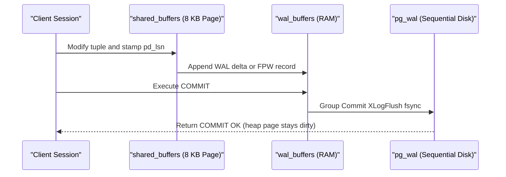
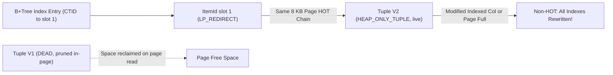
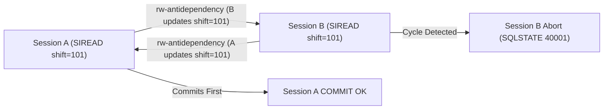

---
tags:
  - software-engineering
  - databases
  - transactions
  - mvcc
  - concurrency
  - acid
  - postgresql
created: 2026-11-13
updated: 2026-11-13
status: 🟢
level: mid-to-senior
---
# Transactions, WAL Crash Recovery, MVCC & Concurrency Control

> [!abstract] Vault Navigation
> Concurrency control, crash recovery, and isolation internals inside [[Programming/Software Engineering/Database Design/Database Design Complete Guide|Database Design Complete Guide]]. Pairs closely with [[Programming/Software Engineering/Database Design/Relational Databases|Relational Databases]], [[Programming/Software Engineering/Database Design/Indexing|Indexing]], [[Programming/Software Engineering/Database Design/Replication|Replication]], and [[Programming/Software Engineering/Database Design/Sharding|Sharding]].

Transactional database engines preserve multi-row state invariants across concurrent client threads and abrupt hardware power loss using two orthogonal subsystems: **Write-Ahead Logging (WAL)** + buffer-pool checkpointing for **Atomicity and Durability**, and **Multi-Version Concurrency Control (MVCC)** + row/predicate locking for **Isolation**. Treating isolation levels as opaque checkboxes leads directly to lost updates, Snapshot Isolation Write Skew, table bloat outages, 32-bit XID wraparound freezes, and lock-convoy saturation.

---

## 1. First-Principles Mechanics & Complete Architecture

### 1.1 Write-Ahead Logging (WAL), `LSN`, Torn Pages & Crash Recovery

Flushing scattered 8 KB heap and B+Tree pages randomly to disk on every `COMMIT` incurs prohibitive IOPS latency and exposes multi-sector disk pages to partial writes during power loss. Relational engines satisfy **Atomicity** and **Durability** through the **Write-Ahead Log (WAL) invariant**:

1. **Log Sequence Number (`LSN`) Ordering**: Every WAL record appended to in-memory `wal_buffers` receives a strictly monotonic 64-bit byte offset (`XLogRecPtr`, formatted as `segment/offset`, e.g., `0/1A4F820`). Every modified 8 KB buffer-pool page records the latest modifying WAL record's `LSN` inside `PageHeaderData.pd_lsn`.
2. **WAL Protocol Rule 1 (Durability at Commit)**: A `COMMIT` cannot acknowledge success to the client until the transaction's `COMMIT` WAL record—and every preceding WAL record for that transaction—is physically durable via `fsync()` (or `fdatasync()` / `open_datasync`) inside `pg_wal/` (`16 MB` sequential files).
3. **WAL Protocol Rule 2 (Steal / No-Force Buffer Policy)**:
   - **No-Force**: At `COMMIT`, modified 8 KB data pages remain dirty inside `shared_buffers` in RAM. Sequential WAL append replaces hundreds of random heap/index writes, while `bgwriter` and `checkpointer` flush dirty pages lazily to data files.
   - **Steal**: If `shared_buffers` runs short on clean frames, the buffer manager may evict a dirty page modified by an *uncommitted* transaction to disk—strictly enforcing `page.pd_lsn <= flushed_wal_lsn` first so the WAL record always lands on disk *before* the dirty data page.



#### Torn 8 KB Pages & `full_page_writes`
Hardware storage controllers and OS kernels flush writes in **512-byte** or **4 KB** physical sectors, whereas PostgreSQL heap and B+Tree pages are **8 KB**. If power fails mid-flush while writing a dirty 8 KB page during a checkpoint, the first 4 KB may reflect post-checkpoint bytes while the second 4 KB still contains stale bytes—creating a corrupt **torn page** that delta WAL records cannot safely repair.

When **`full_page_writes = on`** (mandatory in production), the *first* modification to any buffer page following a checkpoint writes the **entire 8 KB page image** (**Full-Page Image / FPW**) into `pg_wal` (optionally compressed with `wal_compression = lz4` or `zstd`). During crash recovery, PostgreSQL starts from the last valid **`Checkpoint` Redo LSN** recorded in `global/pg_control`, restores torn pages verbatim from FPWs, and replays subsequent WAL records forward (**Redo**). Because PostgreSQL stores both old and new versions in the heap (`xmin`/`xmax`), uncommitted changes lacking a WAL `COMMIT` record are automatically ignored by MVCC visibility checks without requiring a separate ARIES Undo phase (whereas MySQL InnoDB executes ARIES-style Redo forward followed by Undo rollback using Undo Logs).

#### Group Commit & `synchronous_commit` Spectrum
High-throughput OLTP engines amortize physical NVMe `fsync()` latency via **Group Commit**: when multiple backend processes enter `COMMIT` concurrently while one leader backend performs `XLogFlush()`, the leader flushes the shared `wal_buffers` up to the highest pending `LSN`, completing dozens of transactions in a single sequential disk write (tunable further with `commit_delay` microseconds when `commit_siblings` concurrent writers are active).

| `synchronous_commit` Mode | Local WAL `fsync()`? | Synchronous Standby Wait? | Commit Latency | Data Loss Window on Crash |
|---|---|---|---|---|
| **`on`** *(default)* | Yes | Waits for standby WAL `flush` | Local + 1 RTT + standby `fsync` | Zero committed transactions lost |
| **`remote_apply`** | Yes | Waits until standby replays WAL (visible to reads!) | Highest | Zero loss + guarantees immediate Read-Your-Own-Writes on sync standby |
| **`remote_write`** | Yes | Waits until standby OS page cache receives WAL (skips standby `fsync`) | Lower than `on` | Data lost only if primary AND standby lose power simultaneously |
| **`local`** | Yes | Skips standby replication wait | Local NVMe `fsync` only | Zero local loss; async standbys may lag if primary disk dies |
| **`off`** | **No** (async `wal_writer` flushes every `wal_writer_delay`, 200 ms) | No | Lowest ($\sim 0.1\text{ ms}$) | Up to $3 \times \text{wal\_writer\_delay} \approx 600\text{ ms}$ of committed TXs lost on OS crash (never corrupts DB consistency!) |

---

### 1.2 MVCC Under the Hood: PostgreSQL Heap Versioning vs MySQL InnoDB Undo Logs

Both PostgreSQL and MySQL InnoDB ensure **readers never block writers and writers never block readers** for normal queries, but their physical MVCC designs create opposite performance and operational failure profiles.

#### PostgreSQL Tuple Headers, CLOG (`pg_xact`) & Snapshot `xip[]` Mechanics
Every PostgreSQL heap tuple carries transaction visibility metadata directly inside `HeapTupleHeaderData` (`24 B` minimum, as detailed in [[Programming/Software Engineering/Database Design/Relational Databases|Relational Databases]]):
- **`t_xmin`**: 32-bit `TransactionId` (`XID`) of the inserting transaction.
- **`t_xmax`**: `XID` of the deleting/updating transaction (or `0` if live; or a `MultiXactId` when multiple transactions concurrently hold row share locks—flagged in `t_infomask`).
- **`t_cid`**: Command ID (`0, 1, 2...`) within the current transaction so statements inside the same `BEGIN...COMMIT` distinguish earlier vs current changes (preventing Halloween-problem infinite loops during `UPDATE`).
- **`t_ctid`**: Physical `(block_number, offset)` pointing either to itself (latest version) or forward to the next updated tuple version.

When a backend begins a snapshot (`READ COMMITTED`: per statement; `REPEATABLE READ` / `SERIALIZABLE`: once at first query inside `BEGIN`), `GetSnapshotData()` locks `ProcArrayLock` briefly and constructs an MVCC **Snapshot**:
- **`snapshot.xmin`**: Lowest active `XID` currently running across all backends. Every committed `XID < snapshot.xmin` is unconditionally visible as completed.
- **`snapshot.xmax`**: First unassigned `XID` (`latestCompletedXid + 1`). Any `XID >= snapshot.xmax` started *after* this snapshot and is strictly invisible.
- **`snapshot.xip[]`**: Array of in-flight `XID`s currently running between `snapshot.xmin` and `snapshot.xmax`.

**Exact Visibility Check**: A heap tuple is visible to `snapshot` if and only if:
1. `t_xmin` is **committed** (verified via 2-bit status in `pg_xact` CLOG SLRU or cached inside `t_infomask` hint bit `HEAP_XMIN_COMMITTED`) **AND** `(t_xmin < snapshot.xmin OR (t_xmin < snapshot.xmax AND t_xmin NOT IN snapshot.xip[]))` (or `t_xmin == current_txid` and `t_cid < current_cid`).
2. **AND** `t_xmax` is invalid (`0`), aborted (`pg_xact`), or not yet committed relative to `snapshot` (`t_xmax >= snapshot.xmax OR t_xmax IN snapshot.xip[]`).

#### Why `UPDATE` Bloats Every Index & How HOT (Heap-Only Tuple) Prevents It
In PostgreSQL, `UPDATE` logically executes `DELETE` + `INSERT`: it stamps `t_xmax = current_xid` on the old tuple and writes a **brand-new physical tuple** with `t_xmin = current_xid`. Unless an optimization triggers, PostgreSQL **must insert a new entry pointing to the new `CTID` into every single B+Tree, GIN, or GiST index on the table**—causing severe write amplification and index bloat even when updating an unindexed column like `last_seen_at`.



**Heap-Only Tuple (HOT) Conditions**: PostgreSQL bypasses updating *every* index if and only if **both** conditions hold simultaneously:
1. **Zero indexed columns are modified** (including columns referenced inside expression indexes, partial index `WHERE` predicates, or `INCLUDE` covering columns).
2. **Sufficient free space exists on the exact same 8 KB heap page** to place the new tuple version.

When both hold, PostgreSQL flags the old tuple `HEAP_HOT_UPDATED`, flags the new tuple `HEAP_ONLY_TUPLE`, links `old.t_ctid -> new.ctid` inside the same 8 KB page, and leaves **all indexes untouched** pointing at slot 1. Future reads follow the intra-page chain; once `V1` becomes dead to all active snapshots, any ordinary `SELECT` or `UPDATE` performs opportunistic **single-page HOT pruning** in memory—converting slot 1 to `LP_REDIRECT -> V2` and reclaiming `V1`'s bytes immediately without waiting for `autovacuum`! Lowering `fillfactor` (`ALTER TABLE accounts SET (fillfactor = 75);`) guarantees 25% free space per 8 KB page so HOT updates succeed consistently.

#### `autovacuum`, `idle in transaction` Horizon Pins, `pg_repack` & 32-Bit XID Wraparound
When no active snapshot across the primary (nor any `hot_standby_feedback = on` replica or logical replication slot) has `xmin <= dead_tuple.xmax`, the old tuple becomes **globally dead**. Because PostgreSQL never removes dead tuples synchronously at `COMMIT`, **`autovacuum`** workers perform four mandatory duties:
1. **Dead Tuple & Line Pointer Reclamation**: Marks dead tuple bytes reusable in the **Free Space Map (`FSM`)** and removes dead index entries before converting heap `ItemIdData` slots back to `LP_UNUSED` (preventing index pointers from dangling).
2. **Visibility Map (`VM`) Maintenance**: Marks pages containing zero tuples visible to only some transactions as **`all-visible`** (unlocking true zero-heap-fetch `Index-Only Scans`) and **`all-frozen`**.
3. **Statistics Refresh**: Updates `pg_statistic` via `autoanalyze` once modified rows exceed threshold.
4. **Transaction ID Freezing (Anti-Wraparound)**: Stamps old committed `t_xmin` values with `HEAP_XMIN_FROZEN` (`FrozenTransactionId`), making them unconditionally visible forever.

> [!danger] The 32-Bit XID Wraparound Shutdown & `idle in transaction` Horizon Pin
> PostgreSQL `XID`s are 32-bit unsigned integers ($\approx 4.29 \times 10^9$), compared using circular modulo-$2^{31}$ signed arithmetic ($\approx 2.14\text{B}$ transactions in the past vs future). If any live row's `t_xmin` remains unfrozen past $2^{31}$ subsequent write transactions, modulo comparison flips sign and the row **appears to belong to the future—vanishing from all queries (catastrophic data loss)**!
> - **200M XIDs (`autovacuum_freeze_max_age`)**: PostgreSQL launches forced aggressive anti-wraparound vacuums even if `autovacuum = off`, ignoring normal triggers.
> - **3M XIDs before wraparound (`xidStopLimit`)**: PostgreSQL refuses all write commands (`ERROR: database is not accepting commands to avoid wraparound data loss in database "prod"`), forcing emergency single-user mode recovery.
> - **Horizon Pin Catastrophe**: A single abandoned session stuck `idle in transaction` for hours holds an open `backend_xmin`, **globally forbidding `VACUUM` from reclaiming dead tuples OR advancing `relfrozenxid` on ANY table modified after that session started!** Always enforce `idle_in_transaction_session_timeout = '60s'` on OLTP clusters.

**`autovacuum` Tuning on Large Churn Tables**: Default `autovacuum_vacuum_scale_factor = 0.2` (20%) means a 500M-row table waits until **100 million dead tuples** accumulate before vacuuming! Override per high-churn table (`0.01` + higher cost limit so vacuum doesn't fall behind):

```sql
ALTER TABLE wallet_balances SET (
    fillfactor = 75,
    autovacuum_vacuum_scale_factor = 0.01,
    autovacuum_vacuum_threshold = 5000,
    autovacuum_analyze_scale_factor = 0.005,
    autovacuum_vacuum_cost_limit = 2000,
    autovacuum_vacuum_cost_delay = 2
);
```

**Reclaiming Bloated Disk Space (`VACUUM FULL` vs `pg_repack`)**: Standard `VACUUM` leaves OS file size unchanged (except rarely truncating trailing empty pages). Running `VACUUM FULL` rewrites the table into compact pages, returning GBs to the OS—**but holds `ACCESS EXCLUSIVE` lock blocking all reads and writes for hours**. In production, run **`pg_repack`** (`pg_repack -d prod -t wallet_balances -j 4`), which builds a clean shadow table concurrently using snapshot + delta trigger capture, then executes an atomic swap requiring only a millisecond metadata lock!

#### MySQL InnoDB MVCC: In-Place Clustering, Undo Logs & History List Length (HLL)

| MVCC Dimension | PostgreSQL | MySQL InnoDB |
|---|---|---|
| **Where Old Versions Live** | Directly inside main heap 8 KB pages | Inside **Undo Log** (`Rollback Segments` in undo tablespaces) |
| **`UPDATE` Write Path** | Appends new tuple to heap; writes all indexes (unless HOT) | Overwrites live row **in place** in Clustered B+Tree; writes delta to Undo Log; **zero secondary index writes** on non-indexed columns |
| **Hidden Row Metadata** | `t_xmin` (4B), `t_xmax` (4B), `t_ctid` (6B) = 24B header | `DB_TRX_ID` (6B), `DB_ROLL_PTR` (7B pointer to Undo record) |
| **Old Snapshot Read Path** | Scans heap pages directly; skips tuples failing `xmin`/`xmax` | Reads current clustered row; walks `DB_ROLL_PTR` linked chain backward in Undo Log until finding version `< ReadView` |
| **Secondary Index Visibility** | Secondary indexes have **no** MVCC XIDs (relies on heap or Visibility Map) | Leaf pages store `PAGE_MAX_TRX_ID`; if `PAGE_MAX_TRX_ID >= m_up_limit_id`, falls back to Clustered PK + Undo check |
| **Long-Transaction Catastrophe** | Heap/index table bloat + **32-bit XID Wraparound** | **History List Length (HLL)** explosion: InnoDB purge threads cannot truncate Undo segments while any `REPEATABLE READ` ReadView remains open, causing Undo tablespace bloat and severe `SELECT` latency walking million-entry undo chains! |

---

## 2. ANSI Isolation Levels, Formal Anomaly Proofs & Decision Matrix

### 2.1 Concurrency Phenomena Definitions & Reproducible Two-Session SQL Traces

Let concurrent transactions $T_1$ (Session A) and $T_2$ (Session B) execute over table `accounts(id BIGINT PRIMARY KEY, dept TEXT, balance INT)` seeded with `(1, 'eng', 100), (2, 'eng', 100)`:

#### 1. Dirty Read
$T_1$ reads an uncommitted modification made by $T_2$, which subsequently executes `ROLLBACK`.
- **PostgreSQL**: **Impossible** even under `SET TRANSACTION ISOLATION LEVEL READ UNCOMMITTED` (PostgreSQL internally maps `READ UNCOMMITTED` to `READ COMMITTED`).
- **MySQL InnoDB under `READ UNCOMMITTED`**:
  ```sql
  -- Session A (MySQL)                         -- Session B (MySQL)
  SET SESSION TRANSACTION ISOLATION LEVEL READ UNCOMMITTED;
  START TRANSACTION;                           START TRANSACTION;
                                               UPDATE accounts SET balance = 999 WHERE id = 1;
  SELECT balance FROM accounts WHERE id = 1;
  -- Returns 999 (uncommitted dirty state!)
                                               ROLLBACK; -- 999 never actually committed!
  COMMIT;
  ```

#### 2. Non-Repeatable Read (Fuzzy Read)
Within the same transaction, $T_1$ reads row `id = 1` twice and observes two different committed values because $T_2$ committed an `UPDATE` between reads. Reproducible in **PostgreSQL `READ COMMITTED`** (where every SQL statement takes a fresh snapshot):

```sql
-- Session A (PG READ COMMITTED)              -- Session B (PG READ COMMITTED)
BEGIN;                                        BEGIN;
SELECT balance FROM accounts WHERE id = 1;
-- Returns 100
                                              UPDATE accounts SET balance = 250 WHERE id = 1;
                                              COMMIT;
SELECT balance FROM accounts WHERE id = 1;
-- Returns 250! (Different value inside same TX)
COMMIT;
```
*(Under PostgreSQL `REPEATABLE READ`, the second `SELECT` continues returning `100` because the entire transaction shares a single snapshot from its first query.)*

#### 3. Phantom Read
$T_1$ executes a range/predicate query (`WHERE dept = 'eng'`), $T_2$ inserts or deletes a matching row and commits, and $T_1$ re-runs the range query observing newly appearing ("phantom") rows. Reproducible in **PostgreSQL `READ COMMITTED`**, **prevented in PostgreSQL `REPEATABLE READ`** (because Snapshot Isolation freezes the snapshot across `INSERT`/`DELETE` as well—strictly stronger than the SQL-92 standard minimum for `REPEATABLE READ`!).

#### 4. Lost Update (Read-Modify-Write Race vs `EvalPlanQual`)
Two sessions read `balance = 100`, compute `100 + 20` and `100 + 50` in application memory, and write back `120` and `150`:

```sql
-- Session A (PG READ COMMITTED)              -- Session B (PG READ COMMITTED)
BEGIN;                                        BEGIN;
SELECT balance FROM accounts WHERE id = 1;    SELECT balance FROM accounts WHERE id = 1;
-- App A reads 100                            -- App B reads 100
UPDATE accounts SET balance = 120             -- App B computes 150 locally
WHERE id = 1;
COMMIT;
                                              UPDATE accounts SET balance = 150 WHERE id = 1;
                                              COMMIT; -- Session A's +20 is SILENTLY LOST!
```

**PostgreSQL `READ COMMITTED` Atomic `UPDATE` Behavior (`EvalPlanQual`)**: If both sessions execute `UPDATE accounts SET balance = balance + 20 WHERE id = 1;` instead of overwriting a constant, Session B blocks on Session A's row lock until A commits; once A commits `120`, PostgreSQL's `EvalPlanQual` (EPQ) re-fetches the newly committed tuple `120`, re-evaluates the `WHERE` predicate against `120`, and applies `+ 50` to yield **`170`**.
**PostgreSQL `REPEATABLE READ` Behavior**: Under `REPEATABLE READ`, if Session A commits first, Session B immediately aborts on `UPDATE` with **`ERROR: could not serialize access due to concurrent update` (SQLSTATE `40001`)**—preventing Lost Updates automatically via First-Committer-Wins!

#### 5. Write Skew (Full Reproducible PostgreSQL Snapshot Isolation Anomaly)
**Write Skew** occurs when two concurrent transactions under Snapshot Isolation (`REPEATABLE READ`) read an overlapping multi-row invariant, then modify **disjoint** rows so neither triggers a row-level write-write conflict—leaving the committed database in an illegal state!

**Executable Reproduction in PostgreSQL**:
```sql
CREATE TABLE on_call_doctors (
    doctor_id BIGINT PRIMARY KEY,
    shift_id  INT NOT NULL,
    on_call   BOOLEAN NOT NULL
);
INSERT INTO on_call_doctors VALUES (1, 101, true), (2, 101, true);
-- Business invariant: At least 1 doctor MUST remain on_call = true for shift 101.
```

Run these exact interleaved commands across two `psql` terminals under `REPEATABLE READ`:

```sql
-- Session A (Terminal 1)                      -- Session B (Terminal 2)
BEGIN ISOLATION LEVEL REPEATABLE READ;        BEGIN ISOLATION LEVEL REPEATABLE READ;

SELECT COUNT(*) FROM on_call_doctors
WHERE shift_id = 101 AND on_call = true;
-- Returns 2 (>= 2, safe to go off-call)
                                              SELECT COUNT(*) FROM on_call_doctors
                                              WHERE shift_id = 101 AND on_call = true;
                                              -- Returns 2 (>= 2, safe to go off-call!)

UPDATE on_call_doctors
SET on_call = false WHERE doctor_id = 1;
-- Locks doctor_id = 1 only
                                              UPDATE on_call_doctors
                                              SET on_call = false WHERE doctor_id = 2;
                                              -- Locks disjoint doctor_id = 2! Zero conflict!

COMMIT; -- Succeeds!                          COMMIT; -- Succeeds!

-- Verify broken invariant:
SELECT COUNT(*) FROM on_call_doctors WHERE shift_id = 101 AND on_call = true;
-- Returns 0! Both doctors went off call simultaneously!
```

Now reset (`UPDATE on_call_doctors SET on_call = true;`) and execute the exact same sequence using **`BEGIN ISOLATION LEVEL SERIALIZABLE;`**:
- Both sessions acquire `SIREAD` predicate locks over `(shift_id = 101 AND on_call = true)`.
- Session A's `UPDATE` writes what Session B read ($B \xrightarrow{rw} A$ anti-dependency); Session B's `UPDATE` writes what Session A read ($A \xrightarrow{rw} B$ anti-dependency).
- Session A's `COMMIT` succeeds; Session B's `COMMIT` detects the dangerous `rw`-cycle and **aborts immediately**:
  `ERROR: could not serialize access due to read/write dependencies among transactions` (`SQLSTATE 40001`)!

### 2.2 PostgreSQL SSI (`SERIALIZABLE`) vs InnoDB Next-Key Gap Locks

- **PostgreSQL Serializable Snapshot Isolation (SSI)**: Never acquires blocking read locks—readers execute at full Snapshot Isolation speed. Instead, SSI tracks lightweight non-blocking **`SIREAD` predicate locks** in shared memory (escalating dynamically from tuple $\rightarrow$ page $\rightarrow$ relation to bound RAM under `max_pred_locks_per_transaction`). Whenever SSI observes two consecutive `rw-antidependency` edges ($T_1 \xrightarrow{rw} T_2 \xrightarrow{rw} T_3$, where $T_3$ commits first), it aborts one participant with `40001`.



  - **Read-Only Optimization**: `BEGIN ISOLATION LEVEL SERIALIZABLE READ ONLY DEFERRABLE;` waits once at start for a safe snapshot with zero concurrent dangerous writers, then executes long analytical reports with **zero `SIREAD` tracking overhead and zero possibility of serialization abort**.
- **MySQL InnoDB `REPEATABLE READ` + Next-Key Gap Locks**: Plain `SELECT`s use non-locking MVCC Read Views (so **Write Skew still happens in InnoDB `REPEATABLE READ`**!). However, locking reads (`SELECT ... FOR UPDATE`, `UPDATE`, `DELETE`, foreign-key checks) acquire **Next-Key Locks**—a combination of a **Record Lock** on the existing index key *plus* a **Gap Lock** on the open interval `(previous_key, current_key]` before it (preventing phantoms inside locking ranges).
  - **Deadlock Trap in InnoDB**: Gap Locks are mutually compatible (`T1` and `T2` can *both* hold Gap Locks on `(10, 20)` simultaneously!), yet both conflict with **Insert Intention Locks**. Consequently, if `T1` and `T2` both run `SELECT * FROM items WHERE id = 15 FOR UPDATE` (missing row $\rightarrow$ both acquire Gap Lock on `(10, 20)`!) and then both try `INSERT INTO items VALUES (15, ...)`, each blocks on the other's Gap Lock $\rightarrow$ **instant InnoDB deadlock!**

### 2.3 Engine Behavior & Isolation Selection Matrix

| Isolation Level | Dirty Read | Non-Repeatable | Phantom Read | App Read-Modify-Write Lost Update | Write Skew | Primary Production Use Case |
|---|---|---|---|---|---|---|
| **PG `READ COMMITTED`** *(default)* | Prevented | Possible | Possible | **Possible** (safe only w/ `FOR NO KEY UPDATE` or atomic `SET x = x + 1`) | Possible | 95% of OLTP APIs when paired with explicit row locks / atomic CAS |
| **PG `REPEATABLE READ`** | Prevented | Prevented | Prevented | **Prevented** (`40001` error) | **Possible!** | Consistent multi-query read snapshots (`pg_dump`), point-in-time billing reports |
| **MySQL InnoDB `REPEATABLE READ`** | Prevented | Prevented | Prevented (plain MVCC & Next-Key on locks) | **Possible** on plain `SELECT` $\rightarrow$ `UPDATE`! | **Possible!** | Default MySQL OLTP; use `FOR UPDATE` or atomic updates for contested state |
| **PG `SERIALIZABLE` (SSI)** | Prevented | Prevented | Prevented | Prevented | **Prevented** (`40001` abort) | Cross-row/multi-table invariants (`quotas`, `booking rules`, `double-entry ledgers`) w/ retry loop |

---

## 3. Step-by-Step Practical Application (Production Concurrency Patterns)

### 3.1 PostgreSQL Explicit Row Lock Modes & Compatibility Matrix

| SQL Clause | Internal Lock Mode | Blocks `SELECT` (plain)? | Blocks `FOR KEY SHARE` (FK child `INSERT`)? | Blocks `FOR NO KEY UPDATE` / `UPDATE` (non-PK)? | Primary Use Case |
|---|---|---|---|---|---|
| **`FOR UPDATE`** | Exclusive | No | **Yes (blocks FK inserts!)** | **Yes** | Deleting row or mutating Primary/Unique key columns |
| **`FOR NO KEY UPDATE`** | Exclusive (non-key) | No | **No (compatible!)** | **Yes** | **Default for row updates** (`balance`, `status`) so child FKs never block! |
| **`FOR SHARE`** | Shared | No | No | **Yes** | Ensuring parent row isn't updated until TX commits |
| **`FOR KEY SHARE`** | Weak Shared | No | No | No *(blocks `DELETE` / PK update only)* | Acquired automatically by PostgreSQL FK validation on child `INSERT` |
| **`NOWAIT`** modifier | Fail-fast | N/A | N/A | Fails instantly (`55P03`) if row locked | API fail-fast endpoints ("item currently locked by another user") |
| **`SKIP LOCKED`** modifier | Non-blocking skip | N/A | N/A | Skips locked rows atomically | Distributed worker job queues & Transactional Outbox dispatchers |

### 3.2 Transactional Job Queue / Outbox (`FOR UPDATE SKIP LOCKED` + Lease Reaper)

Never use plain `FOR UPDATE` in worker polling loops: 50 workers lock the exact same `LIMIT 20` rows and serialize behind Worker 1. Instead, combine a **partial covering index** + **`FOR UPDATE SKIP LOCKED`** + **Two-Phase Claim-Process-Finalize** (zero external network I/O inside any DB transaction!):

```sql
-- db/migrations/003_outbox_queue.sql
CREATE TABLE outbox_jobs (
    id              BIGINT GENERATED ALWAYS AS IDENTITY PRIMARY KEY,
    topic           TEXT NOT NULL,
    payload         JSONB NOT NULL,
    status          SMALLINT NOT NULL DEFAULT 0, -- 0=queued, 1=processing, 2=done, 3=dead_letter
    attempts        SMALLINT NOT NULL DEFAULT 0,
    max_attempts    SMALLINT NOT NULL DEFAULT 5,
    available_at    TIMESTAMPTZ NOT NULL DEFAULT NOW(),
    lease_expires_at TIMESTAMPTZ,
    locked_by       TEXT,
    created_at      TIMESTAMPTZ NOT NULL DEFAULT NOW()
) WITH (
    fillfactor = 75,
    autovacuum_vacuum_scale_factor = 0.01,
    autovacuum_vacuum_cost_limit = 2000
);

-- Tiny partial index keeping only queued jobs in RAM regardless of 100M historical rows
CREATE INDEX idx_outbox_jobs_ready
ON outbox_jobs (available_at ASC, id ASC)
WHERE status = 0;

-- Secondary partial index for fast stale-lease sweeping
CREATE INDEX idx_outbox_jobs_expired_lease
ON outbox_jobs (lease_expires_at)
WHERE status = 1;
```

**Complete Production TypeScript Outbox Worker + Reaper**:

```typescript
// src/workers/outboxWorker.ts
import { Pool } from "pg";

export interface OutboxJob {
  id: string;
  topic: string;
  payload: Record<string, unknown>;
  attempts: number;
}

export class OutboxWorker {
  constructor(
    private readonly pool: Pool,
    private readonly workerId: string,
    private readonly dispatchFn: (job: OutboxJob) => Promise<void>
  ) {}

  // Phase 1: Claim batch in < 3 ms and immediately COMMIT & release DB connection
  async claimBatch(batchSize = 20, leaseSeconds = 60): Promise<OutboxJob[]> {
    const { rows } = await this.pool.query<OutboxJob>(
      `WITH next_jobs AS (
           SELECT id
           FROM outbox_jobs
           WHERE status = 0
             AND available_at <= NOW()
           ORDER BY available_at ASC, id ASC
           LIMIT $1
           FOR UPDATE SKIP LOCKED
       )
       UPDATE outbox_jobs j
       SET status = 1,
           attempts = j.attempts + 1,
           locked_by = $2,
           lease_expires_at = NOW() + ($3 || ' seconds')::interval
       FROM next_jobs n
       WHERE j.id = n.id
       RETURNING j.id, j.topic, j.payload, j.attempts`,
      [batchSize, this.workerId, leaseSeconds]
    );
    return rows;
  }

  // Phase 2 & 3: External I/O outside transaction, then short finalize/backoff TX
  async pollOnce(): Promise<number> {
    const jobs = await this.claimBatch();
    if (jobs.length === 0) return 0;

    await Promise.all(
      jobs.map(async (job) => {
        try {
          await this.dispatchFn(job); // HTTP / Kafka publish (NO DB transaction held!)
          await this.pool.query(
            `UPDATE outbox_jobs
             SET status = 2, lease_expires_at = NULL
             WHERE id = $1 AND status = 1 AND locked_by = $2`,
            [job.id, this.workerId]
          );
        } catch (_err) {
          // Exponential backoff retry or dead-letter transition
          await this.pool.query(
            `UPDATE outbox_jobs
             SET status = CASE WHEN attempts >= max_attempts THEN 3 ELSE 0 END,
                 available_at = NOW() + (POWER(2, attempts) * INTERVAL '5 seconds'),
                 lease_expires_at = NULL,
                 locked_by = NULL
             WHERE id = $1 AND status = 1 AND locked_by = $2`,
            [job.id, this.workerId]
          );
        }
      })
    );
    return jobs.length;
  }

  // Background reaper: recovers jobs from crashed workers whose lease expired
  async reclaimStaleLeases(): Promise<number> {
    const res = await this.pool.query(
      `UPDATE outbox_jobs
       SET status = CASE WHEN attempts >= max_attempts THEN 3 ELSE 0 END,
           available_at = NOW(),
           lease_expires_at = NULL,
           locked_by = NULL
       WHERE status = 1
         AND lease_expires_at < NOW()`
    );
    return res.rowCount ?? 0;
  }
}
```

### 3.3 Optimistic Concurrency Control (`version` CAS + HTTP `ETag` / `If-Match`)

When multi-step user edits or low-collision updates occur across long human think times, never hold a database lock across API requests. Embed a monotonic `version BIGINT` column mapped directly to HTTP `ETag` / `If-Match` preconditions:

```sql
CREATE TABLE inventory_items (
    sku         TEXT PRIMARY KEY,
    quantity    INTEGER NOT NULL CHECK (quantity >= 0),
    version     BIGINT NOT NULL DEFAULT 1,
    updated_at  TIMESTAMPTZ NOT NULL DEFAULT NOW()
);
```

```typescript
// src/services/inventoryOccService.ts
import { Pool } from "pg";

export class PreconditionFailedError extends Error {
  readonly statusCode = 412;
}

export async function updateInventoryWithETag(
  pool: Pool,
  sku: string,
  expectedEtagVersion: number,
  newQuantity: number
): Promise<{ sku: string; quantity: number; newEtag: string }> {
  const { rows } = await pool.query<{ sku: string; quantity: number; version: string }>(
    `UPDATE inventory_items
     SET quantity   = $1,
         version    = version + 1,
         updated_at = NOW()
     WHERE sku = $2
       AND version = $3
     RETURNING sku, quantity, version`,
    [newQuantity, sku, expectedEtagVersion]
  );

  if (rows.length === 0) {
    throw new PreconditionFailedError(
      `Concurrent modification on SKU ${sku}: expected version ${expectedEtagVersion}`
    );
  }

  return {
    sku: rows[0].sku,
    quantity: rows[0].quantity,
    newEtag: `W/"${rows[0].version}"`,
  };
}
```

```typescript
// src/workers/outboxWorker.test.ts (Vitest concurrency verification)
import { describe, it, expect, beforeEach, afterAll } from "vitest";
import { Pool } from "pg";
import { OutboxWorker } from "./outboxWorker";
import { updateInventoryWithETag, PreconditionFailedError } from "../services/inventoryOccService";

const pool = new Pool({ connectionString: process.env.TEST_DATABASE_URL });

describe("PostgreSQL concurrency primitives", () => {
  beforeEach(async () => {
    await pool.query("TRUNCATE outbox_jobs, inventory_items RESTART IDENTITY");
  });

  afterAll(async () => {
    await pool.end();
  });

  it("claims strictly disjoint batches across parallel SKIP LOCKED workers", async () => {
    await pool.query(
      `INSERT INTO outbox_jobs (topic, payload)
       SELECT 'invoice.send', jsonb_build_object('seq', g)
       FROM generate_series(1, 25) AS g`
    );

    const w1 = new OutboxWorker(pool, "worker-1", async () => {});
    const w2 = new OutboxWorker(pool, "worker-2", async () => {});

    const [batch1, batch2] = await Promise.all([w1.claimBatch(15), w2.claimBatch(15)]);
    const claimedIds = [...batch1, ...batch2].map((j) => j.id);

    expect(batch1.length + batch2.length).toBe(25);
    expect(new Set(claimedIds).size).toBe(25); // Zero duplicate claims
  });

  it("rejects stale ETag version updates with PreconditionFailedError", async () => {
    await pool.query("INSERT INTO inventory_items (sku, quantity, version) VALUES ('GPU-H100', 10, 1)");
    const [first, second] = await Promise.allSettled([
      updateInventoryWithETag(pool, "GPU-H100", 1, 9),
      updateInventoryWithETag(pool, "GPU-H100", 1, 8),
    ]);

    const fulfilled = [first, second].filter((r) => r.status === "fulfilled");
    const rejected = [first, second].filter((r) => r.status === "rejected") as PromiseRejectedResult[];

    expect(fulfilled).toHaveLength(1);
    expect(rejected).toHaveLength(1);
    expect(rejected[0].reason).toBeInstanceOf(PreconditionFailedError);
  });
});
```

### 3.4 Deterministic Lock Ordering, Retry Loops (`40001` / `40P01`) & Idempotent Ledger Transfers

Whenever an endpoint mutates multiple accounts or runs under `SERIALIZABLE` / `REPEATABLE READ`, **two mandatory invariants** prevent deadlocks and transient serialization failures from surfacing as `500` errors:
1. **Strict Global Lock Ordering**: Acquire `FOR NO KEY UPDATE` on all target IDs in ascending order (`ORDER BY id ASC`) in a single query before executing debits/credits—making circular wait-for lock cycles mathematically impossible.
2. **Idempotent Retry Wrapper**: Wrap transaction execution in bounded exponential backoff + jitter retrying exclusively on PostgreSQL `40001` (`serialization_failure`) and `40P01` (`deadlock_detected`).

```go
// pkg/ledger/retry_tx.go (Go + pgx/v5 production retry wrapper & deterministic transfer)
package ledger

import (
	"context"
	"errors"
	"fmt"
	"math/rand/v2"
	"time"

	"github.com/jackc/pgx/v5"
	"github.com/jackc/pgx/v5/pgconn"
	"github.com/jackc/pgx/v5/pgxpool"
)

func isRetryablePgError(err error) bool {
	var pgErr *pgconn.PgError
	if !errors.As(err, &pgErr) {
		return false
	}
	// 40001 = serialization_failure (SSI / REPEATABLE READ conflict)
	// 40P01 = deadlock_detected
	return pgErr.Code == "40001" || pgErr.Code == "40P01"
}

func WithRetryableTx(
	ctx context.Context,
	pool *pgxpool.Pool,
	isoLevel pgx.TxIsoLevel,
	fn func(tx pgx.Tx) error,
) error {
	const maxAttempts = 5
	for attempt := 0; attempt < maxAttempts; attempt++ {
		tx, err := pool.BeginTx(ctx, pgx.TxOptions{IsoLevel: isoLevel})
		if err != nil {
			return err
		}

		// Bound lock wait and query duration inside every pooled transaction
		if _, err = tx.Exec(ctx, "SET LOCAL lock_timeout = '1500ms'; SET LOCAL statement_timeout = '4000ms';"); err == nil {
			err = fn(tx)
			if err == nil {
				err = tx.Commit(ctx)
			}
		}

		if err == nil {
			return nil
		}
		_ = tx.Rollback(ctx)

		if !isRetryablePgError(err) || attempt == maxAttempts-1 {
			return err
		}

		// Truncated exponential backoff with full jitter to desynchronize colliding callers
		baseMs := 15 << attempt // 15ms, 30ms, 60ms, 120ms, 240ms
		jitter := time.Duration(rand.IntN(baseMs)) * time.Millisecond
		select {
		case <-time.After(time.Duration(baseMs)*time.Millisecond + jitter):
		case <-ctx.Done():
			return ctx.Err()
		}
	}
	return fmt.Errorf("exhausted transaction retries")
}

func TransferFundsIdempotent(
	ctx context.Context,
	pool *pgxpool.Pool,
	idempotencyKey string,
	fromAccountID, toAccountID, amountCents int64,
) error {
	if fromAccountID == toAccountID || amountCents <= 0 {
		return fmt.Errorf("invalid transfer parameters")
	}

	return WithRetryableTx(ctx, pool, pgx.ReadCommitted, func(tx pgx.Tx) error {
		// 1. Atomic idempotency guard: if key already committed, exit cleanly without double-debit
		tag, err := tx.Exec(ctx,
			`INSERT INTO transfer_idempotency (idempotency_key, from_account_id, to_account_id, amount_cents)
			 VALUES ($1, $2, $3, $4)
			 ON CONFLICT (idempotency_key) DO NOTHING`,
			idempotencyKey, fromAccountID, toAccountID, amountCents,
		)
		if err != nil {
			return err
		}
		if tag.RowsAffected() == 0 {
			return nil // Already processed identically
		}

		// 2. Deterministic ascending lock order eliminates A->B vs B->A deadlock cycles
		rows, err := tx.Query(ctx,
			`SELECT id, balance_cents
			 FROM accounts
			 WHERE id IN ($1, $2)
			 ORDER BY id ASC
			 FOR NO KEY UPDATE`,
			fromAccountID, toAccountID,
		)
		if err != nil {
			return err
		}
		balances := make(map[int64]int64, 2)
		for rows.Next() {
			var id, bal int64
			if err := rows.Scan(&id, &bal); err != nil {
				rows.Close()
				return err
			}
			balances[id] = bal
		}
		rows.Close()
		if err := rows.Err(); err != nil {
			return err
		}
		if balances[fromAccountID] < amountCents {
			return fmt.Errorf("insufficient balance on account %d", fromAccountID)
		}

		// 3. Apply atomic balance updates
		if _, err := tx.Exec(ctx, `UPDATE accounts SET balance_cents = balance_cents - $1 WHERE id = $2`, amountCents, fromAccountID); err != nil {
			return err
		}
		if _, err := tx.Exec(ctx, `UPDATE accounts SET balance_cents = balance_cents + $1 WHERE id = $2`, amountCents, toAccountID); err != nil {
			return err
		}
		return nil
	})
}
```

### 3.5 Transaction-Scoped Advisory Locks (`pg_advisory_xact_lock`)

When serializing operations on a logical resource key that does **not yet exist** as a table row (e.g., preventing duplicate tenant provisioning or serializing a singleton cron leader), PostgreSQL provides in-memory **Advisory Locks** stored in the shared lock table (`max_locks_per_transaction`):

```sql
BEGIN;
-- Hash arbitrary domain key to 64-bit integer; lock releases automatically at COMMIT/ROLLBACK!
SELECT pg_advisory_xact_lock(hashtextextended('provision:tenant:' || $1::text, 0));

-- Non-blocking variant for distributed cron leader election (returns boolean immediately)
-- SELECT pg_try_advisory_xact_lock(99441122);

INSERT INTO tenant_configs (tenant_id, plan)
VALUES ($1, 'enterprise')
ON CONFLICT (tenant_id) DO NOTHING;
COMMIT;
```

> [!warning] Never Use Session Advisory Locks With PgBouncer Transaction Mode
> Calling `pg_advisory_lock(key)` binds the lock to the **underlying PostgreSQL server backend**, NOT the transaction. Behind PgBouncer `pool_mode = transaction`, another client's subsequent transaction can inherit that locked backend—or `pg_advisory_unlock(key)` will land on a different backend and return `false`, leaking an unreleasable lock until server restart! Always use **`pg_advisory_xact_lock()`** or **`pg_try_advisory_xact_lock()`**.

---

## 4. Subtle Failure Modes, Edge Cases & Concurrency Traps

1. **Subtransaction (`SAVEPOINT`) `SubtransSLRU` Contention Collapse**:
   Every nested `SAVEPOINT` (frequently emitted silently by ORMs wrapping loop iterations in `try/catch` blocks or nested Django `@transaction.atomic` calls) consumes a separate subtransaction `XID`. Each PostgreSQL backend caches at most **64** active subtransaction XIDs inside `PGPROC`. The instant **any single transaction exceeds 64 active subtransactions** (often alongside a long-running read transaction), `GetSnapshotData()` overflows the per-backend cache and forces every concurrent reader across the entire cluster to perform sequential disk/SLRU lookups against `pg_subtrans/` (`SubtransSLRU` LWLock contention)—crashing QPS by $90\%+$! **Fix**: Never run loops of `SAVEPOINT`s; use set-based `INSERT ... ON CONFLICT` or explicit `BEGIN...COMMIT` chunks.
2. **Orphan Replication Slots & `hot_standby_feedback` Starving Vacuum**:
   When a CDC connector (Debezium) or read replica disconnects permanently while leaving a logical/physical **replication slot** active, PostgreSQL retains WAL indefinitely (risking disk full) and, if `catalog_xmin` / `hot_standby_feedback = on` is held, **blocks `autovacuum` from reclaiming dead tuples on the primary**. Monitor `pg_replication_slots.active = false` and configure `max_slot_wal_keep_size` + `max_standby_streaming_delay`.
3. **MultiXact (`pg_multixact`) Exhaustion Under Heavy Parent-Child FK Concurrency**:
   If thousands of concurrent transactions insert child rows referencing the *same* popular parent row (`users.id = 1`), PostgreSQL assigns a shared `MultiXactId` inside `t_xmax` combining all `FOR KEY SHARE` holders. High MultiXact creation rates burn 32-bit MultiXact IDs independently of regular XIDs, requiring aggressive `autovacuum_multixact_freeze_max_age` monitoring (`mxid_age(datminmxid)`).
4. **`READ COMMITTED` `EvalPlanQual` (EPQ) Stale-CTE Surprise**:
   In `WITH locked AS (SELECT id FROM items WHERE status = 'free' LIMIT 1 FOR UPDATE) UPDATE items SET status = 'taken' FROM locked WHERE ...`, if Session A and Session B enter simultaneously, `EvalPlanQual` only re-checks the row inside `UPDATE`, *not* an un-locked `CTE` or subquery evaluated earlier! Always lock inside the inner `SELECT ... FOR UPDATE SKIP LOCKED` CTE directly.

---

## 5. Production Debugging, Profiling & Operations Playbook

### 5.1 Essential Production Diagnostic SQL

```sql
-- 1. Live Lock Wait Tree: Identify exact root blocker PIDs and wait chains
SELECT
    blocked.pid AS blocked_pid,
    blocked.usename,
    NOW() - blocked.query_start AS waiting_for,
    l.locktype || ':' || l.mode AS waiting_lock,
    blocked.query AS blocked_query,
    pg_blocking_pids(blocked.pid) AS blocking_pids,
    blocker.state AS root_blocker_state,
    NOW() - blocker.xact_start AS blocker_xact_age,
    blocker.query AS root_blocker_query
FROM pg_stat_activity blocked
JOIN pg_locks l ON l.pid = blocked.pid AND NOT l.granted
LEFT JOIN pg_stat_activity blocker
       ON blocker.pid = (pg_blocking_pids(blocked.pid))[1]
ORDER BY waiting_for DESC;

-- 2. Horizon-Pinning Culprits: Sessions & Replication Slots Blocking VACUUM
SELECT
    'backend' AS source_type,
    pid::text AS identifier,
    state,
    age(backend_xmin) AS xmin_age,
    NOW() - xact_start AS age,
    LEFT(query, 100) AS detail
FROM pg_stat_activity
WHERE backend_xmin IS NOT NULL
UNION ALL
SELECT
    'replication_slot' AS source_type,
    slot_name AS identifier,
    CASE WHEN active THEN 'active' ELSE 'INACTIVE' END AS state,
    GREATEST(age(xmin), age(catalog_xmin)) AS xmin_age,
    NULL AS age,
    plugin AS detail
FROM pg_replication_slots
WHERE xmin IS NOT NULL OR catalog_xmin IS NOT NULL
ORDER BY xmin_age DESC NULLS LAST;

-- 3. MVCC Bloat, Dead Tuples & HOT Update Ratio per Table
SELECT
    schemaname || '.' || relname AS table_name,
    pg_size_pretty(pg_relation_size(relid)) AS heap_size,
    n_live_tup,
    n_dead_tup,
    ROUND(100.0 * n_dead_tup / NULLIF(n_live_tup + n_dead_tup, 0), 2) AS dead_pct,
    n_tup_upd,
    n_tup_hot_upd,
    ROUND(100.0 * n_tup_hot_upd / NULLIF(n_tup_upd, 0), 2) AS hot_pct,
    last_autovacuum,
    autovacuum_count
FROM pg_stat_user_tables
WHERE n_live_tup + n_dead_tup > 10000
ORDER BY n_dead_tup DESC
LIMIT 20;

-- 4. 32-Bit XID & MultiXact Wraparound Emergency Monitor (Danger > 1.5B, Critical > 1.9B)
SELECT
    datname,
    age(datfrozenxid) AS xid_age,
    2147483647 - age(datfrozenxid) AS xids_remaining_until_shutdown,
    mxid_age(datminmxid) AS multixact_age
FROM pg_database
ORDER BY age(datfrozenxid) DESC;

-- Per-table oldest unfrozen XID inside current database
SELECT
    c.oid::regclass AS table_name,
    age(c.relfrozenxid) AS xid_age,
    mxid_age(c.relminmxid) AS mxid_age,
    pg_size_pretty(pg_total_relation_size(c.oid)) AS total_size
FROM pg_class c
WHERE c.relkind IN ('r', 'm', 't')
ORDER BY age(c.relfrozenxid) DESC
LIMIT 15;
```

**MySQL InnoDB Equivalent Checks**:
```sql
-- Check active long transactions & InnoDB History List Length (HLL) inside InnoDB status
SHOW ENGINE INNODB STATUS\G
-- Look under TRANSACTIONS -> "History list length <N>" (alert if > 100,000; crisis > 1,000,000)

SELECT trx_id, trx_state, trx_started, trx_mysql_thread_id, trx_rows_locked, trx_query
FROM information_schema.innodb_trx
ORDER BY trx_started ASC;
```

### 5.2 Production Symptom $\rightarrow$ Root Cause $\rightarrow$ Fix Matrix

| Symptom | Diagnostic Observation | Root Cause | Immediate & Structural Remediation |
|---|---|---|---|
| **Table size grows $10\times$; `autovacuum` runs endlessly without shrinking dead tuples** | `backend_xmin` or `pg_replication_slots` shows huge `xmin_age` on `idle in transaction` PID | Abandoned transaction pinning global MVCC horizon | Terminate offending PID (`pg_terminate_backend`) or drop dead slot; set `idle_in_transaction_session_timeout = '60s'`; run `pg_repack` |
| **`n_tup_hot_upd` is `0%` on high-UPDATE table** | `pg_stat_user_tables` shows `n_tup_upd` huge, `hot_pct = 0` | Frequently updated column (`updated_at`) is indexed, OR `fillfactor = 100` leaves zero page room | Drop unnecessary index on churn column; set `ALTER TABLE t SET (fillfactor = 75);` + repack |
| **`WARNING: database must be vacuumed within N transactions`** | `age(datfrozenxid) > 1.8B` | Aggressive vacuum blocked by horizon pin, `SubtransSLRU`, or throttled cost limit | Unblock `xmin` pin immediately; run `VACUUM (FREEZE, VERBOSE) <top_relfrozenxid_table>`; raise `autovacuum_vacuum_cost_limit = 3000` |
| **Frequent `40P01: deadlock detected` errors** | Logs show two cycles updating `(A -> B)` vs `(B -> A)` or `FOR UPDATE` vs `FOR KEY SHARE` | Non-deterministic multi-row lock order or `FOR UPDATE` conflicting with child FK `INSERT` | Sort IDs (`ORDER BY id ASC`) before acquiring locks; replace `FOR UPDATE` with `FOR NO KEY UPDATE`; add `40P01` retry |
| **Cluster-wide CPU stall on `LWLock: SubtransSLRU`** | Queries using `SAVEPOINT` loops $> 64$ deep alongside open long snapshot | Backend subtransaction cache overflow (64-slot limit in `PGPROC`) | Eliminate `SAVEPOINT`s inside batch loops; refactor to bulk `ON CONFLICT` or flat transactions |
| **MySQL `SELECT` latency rises monotonically across hours** | `SHOW ENGINE INNODB STATUS` shows `History list length > 2,000,000` | Long open `REPEATABLE READ` transaction blocking InnoDB Undo Purge | Kill stale MySQL connection (`KILL <thread_id>`); cap transaction duration |

---

## 6. Comprehensive Worked Exercises

### Exercise 1: Diagnosing & Fixing a Write Skew Quota Violation
A cloud GPU cluster scheduler uses PostgreSQL. Engineers noticed race conditions under `READ COMMITTED`, so they switched the allocation transaction to **`REPEATABLE READ`** believing Snapshot Isolation prevented all concurrency anomalies. Tenant 9 has a hard quota of **at most 2 active GPUs** (`SUM(gpus_requested) <= 2`), and currently runs 1 job consuming 1 GPU.

Two concurrent API calls arrive simultaneously for Tenant 9 requesting 1 GPU each:

```sql
BEGIN ISOLATION LEVEL REPEATABLE READ;
SELECT COALESCE(SUM(gpus_requested), 0)
FROM gpu_allocations
WHERE tenant_id = 9 AND status = 'active';
-- Both concurrent workers read 1; (1 + 1 <= 2) passes validation!

INSERT INTO gpu_allocations (tenant_id, job_id, gpus_requested, status)
VALUES (9, $job_id, 1, 'active');
COMMIT;
```

After both commit, Tenant 9 consumes **3 GPUs**, violating the hard limit.
1. Explain precisely **why** PostgreSQL `REPEATABLE READ` (Snapshot Isolation) failed to reject the second `COMMIT`.
2. Implement **two distinct production fixes** (Fix A: `SERIALIZABLE` SSI + complete TypeScript retry loop; Fix B: materialized parent lock under `READ COMMITTED`) and compare their concurrency trade-offs.

---

### Solution 1

#### 1. Why `REPEATABLE READ` Failed (Write Skew Across Disjoint `INSERT`s)
Under PostgreSQL `REPEATABLE READ` (Snapshot Isolation), both Worker A and Worker B capture identical snapshots observing 1 row (`sum = 1`). Snapshot Isolation validates **only write-write conflicts on the exact same existing tuple**. Because Worker A inserts a brand-new row `(job_A, 1)` and Worker B inserts a **disjoint** brand-new row `(job_B, 1)`, zero tuple write-write conflict exists—both `COMMIT` cleanly, violating the cross-row `SUM` invariant (**Write Skew**).

#### 2. Two Complete Production Fixes

**Fix A — `SERIALIZABLE` (SSI) + Mandatory Idempotent TypeScript Retry Loop**:
Under `SERIALIZABLE`, both transactions register non-blocking `SIREAD` predicate locks on the index/table slice `(tenant_id = 9 AND status = 'active')`. When both insert into the predicate range read by the other, SSI detects the mutual `rw-antidependency` cycle, allows the first committer to succeed, and aborts the second at `COMMIT` with SQLSTATE **`40001`**.

```typescript
import { Pool } from "pg";

export async function allocateGpuSerializable(
  pool: Pool,
  tenantId: number,
  jobId: string,
  gpusRequested: number
): Promise<boolean> {
  for (let attempt = 0; attempt < 5; attempt++) {
    const client = await pool.connect();
    try {
      await client.query("BEGIN ISOLATION LEVEL SERIALIZABLE");
      const { rows } = await client.query<{ used: string }>(
        `SELECT COALESCE(SUM(gpus_requested), 0) AS used
         FROM gpu_allocations
         WHERE tenant_id = $1 AND status = 'active'`,
        [tenantId]
      );
      if (Number(rows[0].used) + gpusRequested > 2) {
        await client.query("ROLLBACK");
        return false; // Quota exceeded safely
      }
      await client.query(
        `INSERT INTO gpu_allocations (tenant_id, job_id, gpus_requested, status)
         VALUES ($1, $2, $3, 'active')`,
        [tenantId, jobId, gpusRequested]
      );
      await client.query("COMMIT");
      return true;
    } catch (err: unknown) {
      await client.query("ROLLBACK").catch(() => {});
      const pgCode = (err as { code?: string })?.code;
      if (pgCode === "40001" && attempt < 4) {
        await new Promise((r) => setTimeout(r, 10 * 2 ** attempt + Math.random() * 10));
        continue;
      }
      throw err;
    } finally {
      client.release();
    }
  }
  throw new Error("Exhausted serialization retries");
}
```
*(Caveat: Every colliding writer touching `gpu_allocations` must also use `SERIALIZABLE`—mixing `READ COMMITTED` writers bypasses SSI checks!)*

**Fix B — Materialize the Conflict via Parent Row Lock (`READ COMMITTED`)**:
Serialize mutations strictly per `tenant_id` by locking the parent `tenants` row first:
```sql
BEGIN;
SELECT id FROM tenants WHERE id = 9 FOR NO KEY UPDATE; -- Blocks only Tenant 9 concurrent allocations!
SELECT COALESCE(SUM(gpus_requested), 0) FROM gpu_allocations
WHERE tenant_id = 9 AND status = 'active';
-- Proceed only if sum + requested <= 2
INSERT INTO gpu_allocations (tenant_id, job_id, gpus_requested, status)
VALUES (9, $job_id, 1, 'active');
COMMIT;
```
**Trade-Off**: Fix B requires zero application `40001` retry handling and works safely alongside `READ COMMITTED` queries elsewhere while letting Tenants 1..N run completely in parallel; Fix A is cleaner when invariants span arbitrary dynamic predicates lacking a natural parent row.

---

### Exercise 2: Deadlock Cycle Diagnosis (`A <-> B` Transfers & Hidden FK Contention)
A payment microservice encounters intermittent `SQLSTATE 40P01: deadlock detected` failures across two endpoints:
1. **`transferFunds(from, to, amt)`**: Executes `UPDATE accounts SET balance_cents = balance_cents - $1 WHERE id = $2;` then `UPDATE accounts SET balance_cents = balance_cents + $1 WHERE id = $3;`.
2. **`updateUserAndInsertOrder(userId)`**: Path 1 executes `SELECT * FROM users WHERE id = $1 FOR UPDATE;` then updates `users.last_order_at`; concurrently Path 2 inserts into child table `orders(user_id REFERENCES users(id))` then updates `users.tier`.

1. Trace the exact lock-acquisition wait-for cycles causing `40P01` in both scenarios.
2. Rewrite both SQL patterns to eliminate deadlocks permanently.

---

### Solution 2

#### 1. Exact Wait-For Deadlock Cycles
- **Scenario 1 (`transferFunds(10, 20)` vs `transferFunds(20, 10)`)**:
  $T_1$ updates `id = 10` (acquires exclusive tuple lock on row `10`); simultaneously $T_2$ updates `id = 20` (acquires exclusive lock on row `20`). Next, $T_1$ attempts to update `20` (blocks on $T_2$) while $T_2$ attempts to update `10` (blocks on $T_1$). Wait-for cycle $T_1 \rightarrow T_2 \rightarrow T_1$ triggers `deadlock_timeout` (`1s`) $\rightarrow$ PostgreSQL aborts one victim with `40P01`.
- **Scenario 2 (Hidden FK `FOR KEY SHARE` vs `FOR UPDATE` Conflict)**:
  When Path 2 executes `INSERT INTO orders (user_id) VALUES (5)`, PostgreSQL implicitly acquires a **`FOR KEY SHARE`** lock on parent `users.id = 5` to prevent deletion before `orders` commits. Because Path 1 used **`FOR UPDATE`** (which conflicts with `FOR KEY SHARE` because `FOR UPDATE` permits modifying/deleting the PK!), acquiring `orders` + `users` vs `users FOR UPDATE` + child/other locks creates cross-table cycles—and even without a cycle, `FOR UPDATE` needlessly stalls every concurrent child `INSERT`!

#### 2. Deadlock-Free SQL Fixes
1. **Deterministic Ascending Lock Order (`transferFunds`)**:
   ```sql
   BEGIN;
   -- Always lock lower account ID first regardless of transfer direction
   SELECT id, balance_cents
   FROM accounts
   WHERE id IN ($from_id, $to_id)
   ORDER BY id ASC
   FOR NO KEY UPDATE;

   UPDATE accounts SET balance_cents = balance_cents - $amt WHERE id = $from_id;
   UPDATE accounts SET balance_cents = balance_cents + $amt WHERE id = $to_id;
   COMMIT;
   ```
2. **Use `FOR NO KEY UPDATE` for Non-Key Parent Mutations**:
   ```sql
   -- Compatible with child FK INSERT (FOR KEY SHARE)! Zero parent-child lock conflict:
   SELECT id, last_order_at FROM users WHERE id = $1 FOR NO KEY UPDATE;
   UPDATE users SET last_order_at = NOW() WHERE id = $1;
   ```

---

### Exercise 3: MVCC Bloat, Zero HOT Updates, `idle in transaction` & XID Wraparound Crisis
On a PostgreSQL 16 OLTP primary (`autovacuum = on`, default settings), a 40M-row `user_sessions` table undergoes 12,000 `UPDATE user_sessions SET last_seen_at = NOW(), session_meta = $2 WHERE id = $1;` per second (`id` is PK, and a B+Tree index exists on `last_seen_at`). Alerts fire simultaneously:
- Disk footprint inflated from **6 GB to 135 GB** in 48 hours.
- `SELECT n_tup_upd, n_tup_hot_upd FROM pg_stat_user_tables WHERE relname = 'user_sessions';` shows `n_tup_upd = 2,100,000,000`, `n_tup_hot_upd = 0`.
- `SELECT pid, state, age(backend_xmin), NOW() - xact_start FROM pg_stat_activity` reveals a BI Metabase connection stuck `idle in transaction` for 19 hours.
- Logs emit: `WARNING: database "prod" must be vacuumed within 7500000 transactions`.

Diagnose all **three interacting failures** and provide the exact ordered operational recovery sequence.

---

### Solution 3

#### 1. Diagnosis of Three Coupled Failures
1. **Zero HOT Updates (`n_tup_hot_upd = 0`)**: Because `last_seen_at` has an index and is modified on every single `UPDATE`, PostgreSQL is **strictly disqualified** from HOT optimization. Every update appends a new heap tuple AND inserts new leaf entries into *both* the PK index and `last_seen_at` B+Tree, doubling/tripling index bloat even if `fillfactor` were lowered.
2. **19-Hour `idle in transaction` Horizon Pin**: The abandoned BI session pins `global xmin` 19 hours in the past. At 12,000 updates/sec, ~820 million dead tuple versions cannot be removed by `autovacuum` because `dead_tuple.xmax >= pinned_xmin`, growing the table to 135 GB.
3. **Imminent 32-Bit XID Wraparound Freeze**: At 12,000 write XIDs/sec ($\approx 1.03\text{B}$ XIDs/day), `VACUUM` cannot freeze tuples ahead of the pinned horizon or default throttling (`autovacuum_vacuum_cost_limit = 200`), driving `age(datfrozenxid)` dangerously close to the **3M write-shutdown limit**.

#### 2. Exact Recovery Sequence
```sql
-- Step 1: Identify and immediately terminate the horizon-pinning idle transaction
SELECT pid, usename, state, age(backend_xmin), NOW() - xact_start AS age
FROM pg_stat_activity
WHERE backend_xmin IS NOT NULL
ORDER BY age(backend_xmin) DESC LIMIT 5;

SELECT pg_terminate_backend(<offending_pid>);

-- Step 2: Run aggressive non-blocking VACUUM FREEZE immediately to avert wraparound shutdown
VACUUM (FREEZE, VERBOSE, ANALYZE) user_sessions;

-- Step 3: Prevent recurrence globally (kills abandoned idle TXs after 60s)
ALTER SYSTEM SET idle_in_transaction_session_timeout = '60s';
SELECT pg_reload_conf();

-- Step 4: Drop unnecessary churn-column index & enable HOT updates + fast autovacuum
DROP INDEX CONCURRENTLY IF EXISTS idx_user_sessions_last_seen;
ALTER TABLE user_sessions SET (
    fillfactor = 70,
    autovacuum_vacuum_scale_factor = 0.01,
    autovacuum_vacuum_cost_limit = 2500
);
```
**Step 5 (Online Disk Reclamation)**: Reclaim the 129 GB of dead space back to the OS **without blocking production reads/writes** via `pg_repack`:
```bash
pg_repack -h 127.0.0.1 -d prod -t user_sessions -j 4
```

---

### Exercise 4: Worker Queue Lock Convoy & External HTTP I/O Inside Transactions
Ten background invoice workers poll PostgreSQL every 100 ms using:

```sql
BEGIN;
SELECT id, amount_cents
FROM invoices
WHERE state = 'queued'
ORDER BY id ASC
LIMIT 10
FOR UPDATE;
-- Worker calls Stripe HTTP API (400 ms per batch of 10), then runs:
UPDATE invoices SET state = 'charged' WHERE id = ANY($ids);
COMMIT;
```

Scaling from 10 to 100 workers leaves throughput stuck at **25 invoices/sec**, while PgBouncer `default_pool_size` saturates completely. Diagnose **two fatal flaws** and provide the complete corrected SQL + Node/TypeScript workflow.

---

### Solution 4

#### 1. Two Fatal Architectural Flaws
1. **Lock Convoy Under `FOR UPDATE` (Missing `SKIP LOCKED`)**: Every worker queries `ORDER BY id ASC LIMIT 10 FOR UPDATE`, blocking onto the **exact same first 10 rows**. Workers 2–100 sit idle behind Worker 1's lock, serializing 100 pods to 1 effective worker (`10 invoices / 0.4s = 25 invoices/sec`).
2. **External HTTP Call (`400 ms`) Inside Open DB Transaction**: Holding locks and backend pool connections across external Stripe calls reduces connection turnover by $200\times$, saturates poolers, and risks double-charging if Stripe succeeds before DB `COMMIT` fails.

#### 2. Corrected Two-Phase Claim-Process-Finalize Architecture
1. **Phase 1 — Atomic Claim (`< 2 ms`, commits immediately)**:
   ```sql
   WITH claimed AS (
       SELECT id
       FROM invoices
       WHERE state = 'queued'
       ORDER BY id ASC
       LIMIT 10
       FOR UPDATE SKIP LOCKED
   )
   UPDATE invoices i
   SET state = 'processing',
       claimed_at = NOW(),
       lease_expires_at = NOW() + INTERVAL '2 minutes'
   FROM claimed c
   WHERE i.id = c.id
   RETURNING i.id, i.amount_cents;
   ```
2. **Phase 2 — External API Call Outside Transaction**: Invoke Stripe with `idempotencyKey = "invoice-" + id`.
3. **Phase 3 — Short Finalization Transaction (`< 2 ms`)**:
   ```sql
   UPDATE invoices
   SET state = 'charged', charged_at = NOW(), lease_expires_at = NULL
   WHERE id = $1 AND state = 'processing';
   ```
   Pair with a lightweight lease sweeper resetting `state = 'queued'` when `state = 'processing' AND lease_expires_at < NOW()`. Throughput scales linearly to `100 * (10 / 0.4s) = 2,500 invoices/sec` with near-zero DB connection dwell time.

---

### Exercise 5: Subtransaction (`SAVEPOINT`) SLRU Collapse & InnoDB Gap-Lock Deadlocks
1. A high-throughput Python/SQLAlchemy ingestion service executes bulk upserts of 500 items inside a single database transaction by catching `IntegrityError` per row (`with session.begin_nested():` emitting `SAVEPOINT`). Simultaneously, a reporting replica uses `hot_standby_feedback = on` for a 2-hour BI report. Suddenly, **every read query across the entire PostgreSQL primary drops from 2 ms to 850 ms** with `wait_event = SubtransSLRU`. Explain the exact internal failure and fix it.
2. Separately, a MySQL InnoDB (`REPEATABLE READ`) service runs `INSERT ... ON DUPLICATE KEY UPDATE` concurrently across multiple threads on an index gap and observes frequent `Deadlock found when trying to get lock` errors on **non-existent keys**. Explain why InnoDB Next-Key Gap Locks trigger deadlocks even when inserting distinct missing keys, and state two fixes.

---

### Solution 5

#### 1. PostgreSQL `SubtransSLRU` Exhaustion & Fix
- **Root Cause**: Each `with session.begin_nested():` emits a SQL `SAVEPOINT`, allocating a distinct subtransaction `XID` inside the parent transaction. Every backend's `PGPROC` struct caches a maximum of **64 subtransaction IDs** in shared memory. Because the loop emits up to 500 nested savepoints inside one transaction while the replica's `hot_standby_feedback` holds `global xmin` open across the 2-hour report, `GetSnapshotData()` overflows the 64-entry cache and forces **all concurrent backends** to read `pg_subtrans/` SLRU pages under the `SubtransSLRU` lock—causing cluster-wide read latency collapse!
- **Fix**: Remove `begin_nested()` / `SAVEPOINT` from loops completely and replace with a single set-based atomic upsert:
  ```sql
  INSERT INTO ingested_items (external_id, payload)
  SELECT * FROM UNNEST($1::text[], $2::jsonb[])
  ON CONFLICT (external_id) DO UPDATE SET payload = EXCLUDED.payload;
  ```
  Disable `hot_standby_feedback` or route long 2-hour BI reports onto a dedicated non-feedback replica / warehouse.

#### 2. MySQL InnoDB Gap-Lock Deadlock Mechanics & Fixes
- **Root Cause**: Under MySQL InnoDB `REPEATABLE READ`, locking reads/upserts on non-existent or range keys acquire **Gap Locks** covering the open interval `(prev_existing_key, next_existing_key)`. Two transactions $T_1, T_2$ can **both hold compatible Gap Locks** on the same interval `(100, 200)` simultaneously (say checking missing keys `120` and `130`). When both next attempt to insert into that gap, each requests an **Insert Intention Lock**, which **blocks on the other's Gap Lock**: $T_1$ waits for $T_2$'s Gap Lock while $T_2$ waits for $T_1$'s Gap Lock $\rightarrow$ instant deadlock!
- **Fixes**:
  1. Switch InnoDB session/global isolation to **`READ COMMITTED`** (when Gap Locks are unneeded and application uses explicit PK/unique checks or retryable CAS), which **disables Gap Locks** for normal search/index scans (retaining them only for foreign-key and duplicate-key checks).
  2. Keep batch writes sorted deterministically by key and implement a bounded deadlock retry loop (`SQLSTATE 40001` / MySQL error `1213`).

---

## Related Notes
- [[Programming/Software Engineering/Database Design/Relational Databases|Relational Databases]]
- [[Programming/Software Engineering/Database Design/Indexing|Indexing]]
- [[Programming/Software Engineering/Database Design/Replication|Replication]]
- [[Programming/Software Engineering/Database Design/Sharding|Sharding]]
- [[Programming/Software Engineering/Database Design/Database Design Complete Guide|Back to Database Design]]
