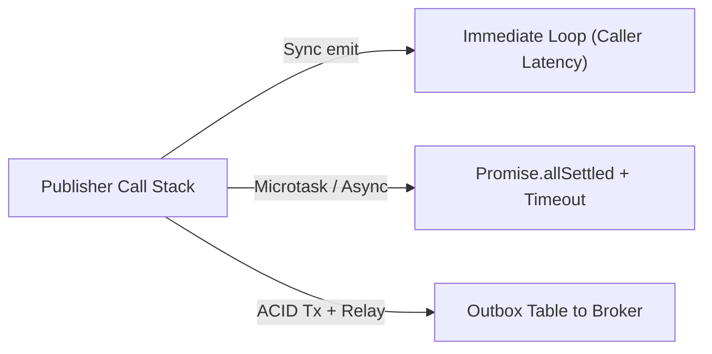
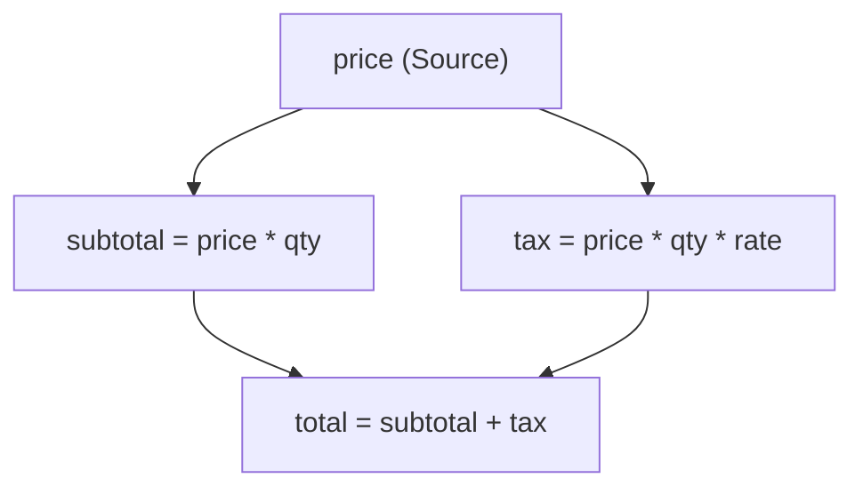

---
tags:
  - software-engineering
  - design-patterns
  - behavioral
created: 2026-01-02
updated: 2026-11-13
status: 🟢
level: mid-to-senior
category: Behavioral
---
# Observer Pattern

> [!abstract] Vault Navigation
> Part of [[Programming/Software Engineering/Design Patterns/Design Patterns Complete Guide|Design Patterns Complete Guide]]. Coordinates event fan-out alongside [[Programming/Software Engineering/Design Patterns/Creational & Behavioral Patterns Catalog#Mediator|Mediator]], bridges in-process notifications to distributed messaging in [[Programming/Software Engineering/Architectural Patterns/Event-Driven Architecture|Event-Driven Architecture]], and integrates with React concurrent rendering via [[Programming/Frontend/React Hooks Guide|React Hooks Guide]].

**Observer** establishes a one-to-many subscription dependency where a **Subject** (publisher or store) maintains a dynamic registry of **Observers** (subscribers) and notifies them automatically when domain events occur or state transitions complete—decoupling event emission from downstream side-effect execution.

---

## 1. First-Principles Mechanics & Complete Architecture

### 1.1 Push vs Pull Mechanics & Dispatch Topologies

At runtime, a Subject owns a hash map keyed by event channel (`Map<EventKey, Set<ListenerRecord>>`) or a single listener `Set<() => void>` for state stores. Every `emit` / `setState` transitions control from the producer into registered callbacks through one of two payload models:

| Dimension | Push Model (`publish(event, payload)`) | Pull Model (`notify(subjectRef)` / `subscribe(() => void)`) |
|---|---|---|
| **Data Flow** | Subject passes an immutable event DTO directly to each handler | Subject emits a minimal change signal; observers call `store.getSnapshot()` or getters |
| **Coupling** | Observers depend only on the event schema—zero reference to Subject internals | Observers retain a handle to Subject; risks circular references and partial reads |
| **Projection Flexibility** | Fixed payload shape; every subscriber receives identical data | Each observer selects only its required state slice (`selector(state)`) |
| **Primary Hazard** | Unbounded heap allocation if immutable event objects queue faster than consumers drain | **Torn reads** if Subject mutates further between listener notifications |

### 1.2 Dispatch Scheduling: Synchronous vs Microtask/Async vs Transactional Outbox

Choosing *when* listeners execute relative to the publisher's call stack determines stack safety, latency coupling, and crash durability:



1. **Synchronous In-Process Dispatch**: `publishSync` iterates a snapshot of registered listeners synchronously on the emitter's V8 call stack.
   - *Invariant*: All listeners observe the world immediately; caller total latency equals $\sum_{i=1}^{N} T_i$.
   - *Hazard*: If Observer A throws synchronously without per-listener `try/catch`, Observers $2..N$ silently never execute. If Observer A re-publishes events forming cycle `A -> B -> A`, the stack overflows unless guarded by an explicit `maxReentrancyDepth` counter.
2. **Microtask & Asynchronous Dispatch**: Deferring via `queueMicrotask` or running async listeners under `Promise.allSettled` decouples publisher return latency from slow I/O subscribers and flattens synchronous re-entrancy chains. Requires per-handler `AbortSignal` timeouts and a Dead Letter Queue (DLQ) sink because unhandled async rejections bypass the publisher's `try/catch`.
3. **Transactional Outbox + Distributed Pub/Sub**: An in-process Observer lives exclusively in volatile RAM. If a service updates PostgreSQL (`UPDATE orders SET status = 'PAID'`) and then calls `eventBus.publishAsync(...)` to notify Billing or Kafka, a `SIGKILL` or network partition between commit and publish drops the event permanently. Cross-service notifications require writing the event row to an `outbox_events` table inside the same ACID transaction (see [[Programming/Software Engineering/Database Design/Transactions|Transactions]] and [[Programming/Software Engineering/System Design/Message Queues|Message Queues]]) and tailing it to Kafka/NATS/SQS.

### 1.3 Type-Safe `EventMap` Inference in TypeScript

Standard Node.js `EventEmitter` accepts untyped string keys and `...args: any[]`. In production TypeScript, constraining a bus with `TMap extends Record<string, unknown>` preserves exact payload types at compile time while erasing the generic inside the backing `Map`:

```typescript
export type EventMap = Record<string, unknown>;

export interface OrderEvents extends EventMap {
  'order.placed': { readonly orderId: string; readonly totalCents: number };
  'order.refunded': { readonly orderId: string; readonly refundId: string };
}
// bus.subscribe('order.placed', (payload) => payload.totalCents)
// Compile-time check: payload is inferred as { orderId: string; totalCents: number }.
```

Because TypeScript function parameters are **contravariant** under `strictFunctionTypes`, a listener `(p: OrderEvents['order.placed']) => void` cannot be directly pushed into `Set<(p: unknown) => void>` without a narrow internal boundary cast (`handler as EventHandler<unknown>`) inside `subscribe()`, where `K extends keyof TMap` guarantees runtime soundness.

### 1.4 Memory Leak Vectors, Bidirectional `AbortSignal` Teardown, and `WeakRef`

In garbage-collected runtimes (V8, JVM, .NET), **a Subject retains strong references to every subscribed closure and its entire lexical scope**. If an ephemeral object—such as an HTTP `ServerResponse` socket, a WebSocket session, or a React component tree—subscribes to a singleton `EventBus` and fails to detach on close/unmount, V8 marks the listener and all captured heap buffers as live in Old Space forever.

Three distinct cleanup mechanisms apply in production:

1. **Deterministic `AbortSignal` Binding (Bidirectional Removal)**:
   Attaching `signal.addEventListener('abort', cleanup, { once: true })` enables one `controller.abort()` call to tear down dozens of listeners simultaneously. **Critical trap**: if the caller invokes `handle.unsubscribe()` *before* a long-lived application-wide `AbortSignal` aborts, failing to call `signal.removeEventListener('abort', cleanup)` causes the long-lived `AbortSignal` to pin the `cleanup` closure, the subscriber bucket, and captured buffers until process exit! Always clean up **both** directions (`bucket.delete(record)` AND `abortSignal?.removeEventListener('abort', cleanup)`).
2. **Explicit Resource Management (`Symbol.dispose`)**:
   Implementing `Disposable` on `SubscriptionHandle` lets scoped tasks declare `using sub = bus.subscribe('tick', fn);`, guaranteeing deterministic cleanup on block exit even when exceptions unwind the stack.
3. **`WeakRef` and `FinalizationRegistry` (Non-Deterministic Cache Observers Only)**:
   `WeakRef<Observer>` allows V8 to collect an unreferenced observer object even while registered, with `FinalizationRegistry` pruning dead buckets afterward. **Never use `WeakRef` for business side effects** (emails, ledger entries, telemetry): ECMAScript specifications do not guarantee *when* or *if* GC finalizers execute before process termination, and closures captured inside inline arrow functions are immediately eligible for collection if no external strong reference holds them!

### 1.5 React `useEffect` Leaks vs `useSyncExternalStore` Concurrent Tearing

Subscribing manually inside `useEffect` with an empty dependency array (`useEffect(() => bus.subscribe('price', (p) => setPrice(p + discount)), [])`) creates two bugs: **stale closures** (capturing the initial `discount` render value forever) and **missing cleanup** if an async initialization resolves after unmount. More fundamentally, in React 18/19 concurrent rendering, external mutable stores read during interrupted renders produce **tearing**—two components in the same commit pass displaying different snapshots of the same store. `React.useSyncExternalStore(subscribe, getSnapshot, getServerSnapshot)` solves tearing by checking snapshot identity synchronously before commit and forcing a synchronous re-render if external mutations occurred mid-yield (see [[Programming/Frontend/React Patterns Guide|React Patterns Guide]]).

### 1.6 The Diamond-Dependency Glitch & Reactive Signal Graphs

Consider a reactive graph where `price` feeds both `subtotal = price * qty` and `tax = subtotal * 0.1`, and `total = subtotal + tax` observes both `subtotal` and `tax`:



Under naive synchronous push Observer, updating `price` fires `subtotal`, which immediately notifies `total` *before* `tax` has recomputed—causing `total` to compute once using **new `subtotal` + stale `tax`** (a **glitch**), and then fire a second time when `tax` updates. Production reactive frameworks eliminate glitches through two architectural strategies:

1. **Coalesced Store Batching (`batch()`)**: Accumulate multiple mutations inside a transaction counter (`batchDepth > 0`) and flush `listeners` once after the outermost `batch` exits.
2. **Mark-Dirty Pull-Push Topological Signals (SolidJS, Angular Signals, Preact Signals)**: Writes propagate a synchronous `DIRTY` state flag downstream without executing derived computations; `total` evaluates lazily only when read or at the end of a topological scheduler pass, guaranteeing it sees synchronized `subtotal` and `tax` versions in a single pass.

### 1.7 Backpressure & Slow-Subscriber Isolation

Standard GoF Observer and Node.js `EventEmitter` are **unbounded push channels with zero backpressure**. If a telemetry source fires $20{,}000\text{ events/sec}$ while an async PostgreSQL listener commits at $200\text{ rows/sec}$, `emit()` returns instantaneously while unresolved `Promise` frames and parameter objects expand V8 heap until an Out-Of-Memory crash. Mitigate overload by:

- Isolating individual subscribers with `Promise.allSettled` and per-handler `AbortSignal` timeouts (`AbortSignal.timeout` / `Promise.race`).
- Routing timed-out or throwing handler deliveries to an explicit **Dead Letter Queue (DLQ)** instead of crashing sibling consumers.
- Replacing `EventEmitter` with bounded `AsyncIterable` / Node.js Streams (`highWaterMark`) or RxJS temporal operators (`switchMap`, `exhaustMap`, `bufferTime`) whenever producer rates can exceed consumer capacity (see [[Programming/Backend/Backend Core (Node, Event Loop, Auth & Concurrency)|Backend Core (Node, Event Loop, Auth & Concurrency)]]).

---

## 2. Real-World Use Cases & Decision Matrix

| Mechanism | Backpressure Control | Glitch Protection | Cancellation / Lifecycle | Latency Coupling | Ideal Production Use Case |
|---|---|---|---|---|---|
| **Typed `DomainEventBus`** | None natively; add bounded queue or DLQ timeout | Batch or single-event push | `AbortSignal` + `Symbol.dispose` | Sync or isolated `Promise.allSettled` | In-process domain notifications, audit logging, cache invalidation |
| **Node.js `EventEmitter`** | None (requires `events.on()` bridge to `AsyncIterable`) | None | `{ signal }` option (Node 15.4+) | Synchronous call stack | Low-level socket/stream lifecycle hooks (`req`, `res`, `ChildProcess`) |
| **Atomic `ReactiveStore` + `useSyncExternalStore`** | Coalesced via `batch()` | **Yes** (single atomic snapshot per flush) | React subscription teardown | Synchronous snapshot read | Shared client state outside React component tree without tearing |
| **Fine-Grained Signals (Solid / Angular)** | Pull-on-read skipping unused derivations | **Yes** (mark-dirty topological propagation) | Reactive effect owner disposal | Synchronous dirty flag, lazy read | High-frequency UI spreadsheets, real-time trading grids |
| **RxJS (`Observable`)** | Temporal operators (`switchMap`, `throttleTime`, `bufferTime`) | Depends on scheduler (`auditTime(0)`) | `Subscription` / `takeUntilDestroyed` | Configurable scheduler | Multi-step async orchestration, race cancellation, WebSocket multiplexing |
| **Transactional Outbox + Kafka/SQS** | Consumer pull offsets + partition lag | Partition-key ordering | Broker consumer group rebalance | Fully decoupled async durability | Cross-microservice workflows requiring crash-safe at-least-once delivery |

---

## 3. Step-by-Step Practical Application: Type-Safe Domain Event Bus & Reactive Store

This complete production implementation provides: (1) a generic `DomainEventBus<TMap>` with bidirectional `AbortSignal` cleanup, `Symbol.dispose`, re-entrancy depth guard, synchronous error isolation, and timeout-protected `publishAsync` with DLQ routing; (2) a glitch-free `ReactiveStore<TState>` with `batch()` coalescing; (3) a React `useSyncExternalStore` selector hook; and (4) an executable test suite including two real V8 GC `WeakRef` memory-leak regression tests.

### 3.1 Production Directory Layout

```text
src/
  events/
    domain-event-bus.ts
  store/
    reactive-store.ts
  react/
    use-store-selector.ts
test/
  events/
    event-bus-and-store.test.ts
```

### 3.2 Type-Safe Domain Event Bus (`AbortSignal`, Error Isolation & DLQ)

#### `src/events/domain-event-bus.ts`

```typescript
export type EventMap = Record<string, unknown>;

export type EventHandler<TPayload> = (
  payload: TPayload,
  context: { readonly event: string; readonly signal: AbortSignal },
) => void | Promise<void>;

export interface SubscribeOptions {
  readonly name?: string;
  readonly signal?: AbortSignal;
  readonly once?: boolean;
}

export interface SubscriptionHandle extends Disposable {
  readonly active: boolean;
  unsubscribe(): void;
}

export interface DeadLetterEntry<TMap extends EventMap, K extends keyof TMap = keyof TMap> {
  readonly event: K;
  readonly payload: TMap[K];
  readonly subscriberName: string;
  readonly reason: 'HANDLER_ERROR' | 'HANDLER_TIMEOUT';
  readonly error: unknown;
  readonly occurredAt: Date;
}

export interface PublishAsyncOptions<TMap extends EventMap> {
  readonly handlerTimeoutMs?: number;
  readonly onDeadLetter?: (entry: DeadLetterEntry<TMap>) => void | Promise<void>;
}

export interface EventBusConfig {
  readonly maxReentrancyDepth?: number;
  readonly onSyncError?: (event: string, subscriberName: string, error: unknown) => void;
}

interface ListenerRecord<TMap extends EventMap> {
  readonly name: string;
  readonly once: boolean;
  readonly fn: EventHandler<unknown>;
  unsubscribe: () => void;
}

export class ReentrancyDepthError extends Error {
  constructor(event: string, maxDepth: number) {
    super(`Event "${event}" exceeded maximum synchronous re-entrancy depth (${maxDepth})`);
    this.name = 'ReentrancyDepthError';
  }
}

export class DomainEventBus<TMap extends EventMap> {
  private readonly listeners = new Map<keyof TMap, Set<ListenerRecord<TMap>>>();
  private readonly maxReentrancyDepth: number;
  private readonly onSyncError: (event: string, subscriberName: string, error: unknown) => void;
  private activeSyncDepth = 0;

  constructor(config?: EventBusConfig) {
    this.maxReentrancyDepth = config?.maxReentrancyDepth ?? 16;
    this.onSyncError = config?.onSyncError ?? (() => {});
  }

  subscribe<K extends keyof TMap & string>(
    event: K,
    handler: EventHandler<TMap[K]>,
    options?: SubscribeOptions,
  ): SubscriptionHandle {
    if (options?.signal?.aborted) {
      return {
        active: false,
        unsubscribe: () => {},
        [Symbol.dispose]: () => {},
      };
    }

    let bucket = this.listeners.get(event);
    if (!bucket) {
      bucket = new Set();
      this.listeners.set(event, bucket);
    }

    let isActive = true;
    const abortSignal = options?.signal;
    const record: ListenerRecord<TMap> = {
      name: options?.name ?? (handler.name || 'anonymous'),
      once: options?.once ?? false,
      fn: handler as EventHandler<unknown>,
      unsubscribe: () => {},
    };

    const cleanup = (): void => {
      if (!isActive) return;
      isActive = false;
      bucket.delete(record);
      if (bucket.size === 0) {
        this.listeners.delete(event);
      }
      // Bidirectional teardown prevents a long-lived AbortSignal from pinning this closure.
      abortSignal?.removeEventListener('abort', cleanup);
    };

    record.unsubscribe = cleanup;
    bucket.add(record);
    abortSignal?.addEventListener('abort', cleanup, { once: true });

    return {
      get active() {
        return isActive;
      },
      unsubscribe: cleanup,
      [Symbol.dispose]: cleanup,
    };
  }

  listenerCount<K extends keyof TMap & string>(event: K): number {
    return this.listeners.get(event)?.size ?? 0;
  }

  publishSync<K extends keyof TMap & string>(event: K, payload: TMap[K]): void {
    if (this.activeSyncDepth >= this.maxReentrancyDepth) {
      throw new ReentrancyDepthError(event, this.maxReentrancyDepth);
    }

    const bucket = this.listeners.get(event);
    if (!bucket || bucket.size === 0) return;

    // Snapshot protects loop integrity if listeners unsubscribe during dispatch.
    const snapshot = [...bucket];
    this.activeSyncDepth += 1;
    try {
      for (const record of snapshot) {
        if (record.once) {
          record.unsubscribe();
        }
        const controller = new AbortController();
        try {
          const result = record.fn(payload, { event, signal: controller.signal });
          if (result instanceof Promise) {
            result.catch((err) => this.onSyncError(event, record.name, err));
          }
        } catch (err) {
          if (err instanceof ReentrancyDepthError) {
            throw err;
          }
          this.onSyncError(event, record.name, err);
        }
      }
    } finally {
      this.activeSyncDepth -= 1;
    }
  }

  async publishAsync<K extends keyof TMap & string>(
    event: K,
    payload: TMap[K],
    options?: PublishAsyncOptions<TMap>,
  ): Promise<{ readonly delivered: number; readonly failed: number }> {
    const bucket = this.listeners.get(event);
    if (!bucket || bucket.size === 0) {
      return { delivered: 0, failed: 0 };
    }

    const snapshot = [...bucket];
    const timeoutMs = options?.handlerTimeoutMs ?? 5_000;
    const onDeadLetter = options?.onDeadLetter;

    const tasks = snapshot.map(async (record): Promise<boolean> => {
      if (record.once) {
        record.unsubscribe();
      }
      const controller = new AbortController();
      let timer: ReturnType<typeof setTimeout> | undefined;
      let timedOut = false;

      const timeoutPromise = new Promise<never>((_, reject) => {
        timer = setTimeout(() => {
          timedOut = true;
          const timeoutErr = new Error(`Subscriber "${record.name}" timed out after ${timeoutMs}ms`);
          controller.abort(timeoutErr);
          reject(timeoutErr);
        }, timeoutMs);
      });

      try {
        await Promise.race([
          Promise.resolve().then(() => record.fn(payload, { event, signal: controller.signal })),
          timeoutPromise,
        ]);
        return true;
      } catch (err) {
        if (onDeadLetter) {
          await onDeadLetter({
            event,
            payload,
            subscriberName: record.name,
            reason: timedOut ? 'HANDLER_TIMEOUT' : 'HANDLER_ERROR',
            error: err,
            occurredAt: new Date(),
          });
        }
        return false;
      } finally {
        if (timer !== undefined) {
          clearTimeout(timer);
        }
      }
    });

    const settled = await Promise.allSettled(tasks);
    let delivered = 0;
    let failed = 0;
    for (const outcome of settled) {
      if (outcome.status === 'fulfilled' && outcome.value) {
        delivered += 1;
      } else {
        failed += 1;
      }
    }
    return { delivered, failed };
  }
}
```

### 3.3 Glitch-Free Reactive Store & React `useSyncExternalStore` Selector Hook

#### `src/store/reactive-store.ts`

```typescript
export type StoreListener = () => void;

export class ReactiveStore<TState> {
  private state: TState;
  private readonly initialState: TState;
  private readonly listeners = new Set<StoreListener>();
  private batchDepth = 0;
  private pendingNotification = false;

  constructor(initialState: TState) {
    this.state = initialState;
    this.initialState = initialState;
  }

  getSnapshot = (): TState => {
    return this.state;
  };

  getServerSnapshot = (): TState => {
    return this.initialState;
  };

  setState(updater: TState | ((prev: TState) => TState)): void {
    const nextState =
      typeof updater === 'function' ? (updater as (prev: TState) => TState)(this.state) : updater;

    if (Object.is(nextState, this.state)) {
      return;
    }
    this.state = nextState;

    if (this.batchDepth > 0) {
      this.pendingNotification = true;
      return;
    }
    this.flushListeners();
  }

  batch(fn: () => void): void {
    this.batchDepth += 1;
    try {
      fn();
    } finally {
      this.batchDepth -= 1;
      if (this.batchDepth === 0 && this.pendingNotification) {
        this.pendingNotification = false;
        this.flushListeners();
      }
    }
  }

  subscribe = (listener: StoreListener): (() => void) => {
    this.listeners.add(listener);
    return () => {
      this.listeners.delete(listener);
    };
  };

  subscribeSelector<TSlice>(
    selector: (state: TState) => TSlice,
    onChange: (nextSlice: TSlice, prevSlice: TSlice) => void,
    equalityFn: (a: TSlice, b: TSlice) => boolean = Object.is,
  ): () => void {
    let lastSlice = selector(this.state);
    return this.subscribe(() => {
      const nextSlice = selector(this.state);
      if (!equalityFn(lastSlice, nextSlice)) {
        const prev = lastSlice;
        lastSlice = nextSlice;
        onChange(nextSlice, prev);
      }
    });
  }

  private flushListeners(): void {
    for (const listener of [...this.listeners]) {
      listener();
    }
  }
}
```

#### `src/react/use-store-selector.ts`

Notice how `useStoreSelector` stabilizes the selected slice via `useRef` and a custom `equalityFn` so deriving inline objects (for example, `s => ({ total: s.qty * s.price })`) does **not** trigger infinite re-render loops inside `useSyncExternalStore`—a notorious React pitfall when `getSnapshot()` allocates new object references on every read.

```typescript
import { useCallback, useRef, useSyncExternalStore } from 'react';
import type { ReactiveStore } from '../store/reactive-store.ts';

export function useStoreSelector<TState, TSlice>(
  store: ReactiveStore<TState>,
  selector: (state: TState) => TSlice,
  equalityFn: (a: TSlice, b: TSlice) => boolean = Object.is,
): TSlice {
  const cacheRef = useRef<{ readonly state: TState; readonly slice: TSlice } | null>(null);

  const getSelectedSnapshot = useCallback((): TSlice => {
    const currentState = store.getSnapshot();
    const cached = cacheRef.current;
    if (cached && Object.is(cached.state, currentState)) {
      return cached.slice;
    }
    const nextSlice = selector(currentState);
    if (cached && equalityFn(cached.slice, nextSlice)) {
      cacheRef.current = { state: currentState, slice: cached.slice };
      return cached.slice;
    }
    cacheRef.current = { state: currentState, slice: nextSlice };
    return nextSlice;
  }, [store, selector, equalityFn]);

  const getServerSelectedSnapshot = useCallback((): TSlice => {
    return selector(store.getServerSnapshot());
  }, [store, selector]);

  return useSyncExternalStore(store.subscribe, getSelectedSnapshot, getServerSelectedSnapshot);
}
```

### 3.4 Complete Test Suite Including Memory-Leak Regression Verification

#### `test/events/event-bus-and-store.test.ts`

```typescript
import { describe, it } from 'node:test';
import assert from 'node:assert/strict';
import v8 from 'node:v8';
import vm from 'node:vm';
import {
  DomainEventBus,
  ReentrancyDepthError,
  type DeadLetterEntry,
} from '../../src/events/domain-event-bus.ts';
import { ReactiveStore } from '../../src/store/reactive-store.ts';

interface OrderEventMap {
  'order.placed': { readonly orderId: string; readonly totalCents: number };
  'order.cancelled': { readonly orderId: string; readonly reason: string };
}

describe('DomainEventBus', () => {
  it('supports snapshot-safe mid-emit unsubscribe and once listeners', () => {
    const bus = new DomainEventBus<OrderEventMap>();
    const seen: string[] = [];

    const handleA = bus.subscribe('order.placed', (payload) => {
      seen.push(`A:${payload.orderId}`);
      handleA.unsubscribe();
    });
    bus.subscribe('order.placed', (payload) => {
      seen.push(`B:${payload.orderId}`);
    });
    bus.subscribe(
      'order.placed',
      (payload) => {
        seen.push(`ONCE:${payload.orderId}`);
      },
      { once: true },
    );

    bus.publishSync('order.placed', { orderId: 'ord_1', totalCents: 1000 });
    bus.publishSync('order.placed', { orderId: 'ord_2', totalCents: 2000 });

    assert.deepEqual(seen, ['A:ord_1', 'B:ord_1', 'ONCE:ord_1', 'B:ord_2']);
    assert.equal(bus.listenerCount('order.placed'), 1);
  });

  it('isolates synchronous subscriber errors and guards against infinite re-entrancy', () => {
    const errors: string[] = [];
    const bus = new DomainEventBus<OrderEventMap>({
      maxReentrancyDepth: 4,
      onSyncError: (event, name, err) => {
        errors.push(`${event}:${name}:${(err as Error).message}`);
      },
    });

    const delivered: string[] = [];
    bus.subscribe(
      'order.placed',
      () => {
        throw new Error('boom');
      },
      { name: 'broken-audit' },
    );
    bus.subscribe(
      'order.placed',
      (p) => {
        delivered.push(p.orderId);
      },
      { name: 'metrics' },
    );

    bus.publishSync('order.placed', { orderId: 'ord_10', totalCents: 500 });
    assert.deepEqual(delivered, ['ord_10']);
    assert.equal(errors[0], 'order.placed:broken-audit:boom');

    const cycleBus = new DomainEventBus<{ ping: number }>({ maxReentrancyDepth: 3 });
    cycleBus.subscribe('ping', (n) => {
      cycleBus.publishSync('ping', n + 1);
    });
    assert.throws(() => cycleBus.publishSync('ping', 1), ReentrancyDepthError);
  });

  it('isolates slow and failing async handlers and routes them to Dead Letter Queue', async () => {
    const bus = new DomainEventBus<OrderEventMap>();
    const dlq: DeadLetterEntry<OrderEventMap>[] = [];
    const okIds: string[] = [];

    bus.subscribe(
      'order.placed',
      async (_payload, { signal }) => {
        await new Promise<void>((resolve) => {
          const t = setTimeout(resolve, 250);
          signal.addEventListener('abort', () => {
            clearTimeout(t);
            resolve();
          });
        });
      },
      { name: 'slow-erp-webhook' },
    );

    bus.subscribe(
      'order.placed',
      async () => {
        throw new Error('SMTP connection refused');
      },
      { name: 'email-receipt' },
    );

    bus.subscribe(
      'order.placed',
      async (payload) => {
        okIds.push(payload.orderId);
      },
      { name: 'analytics-counter' },
    );

    const summary = await bus.publishAsync(
      'order.placed',
      { orderId: 'ord_dlq_1', totalCents: 4200 },
      {
        handlerTimeoutMs: 30,
        onDeadLetter: (entry) => {
          dlq.push(entry);
        },
      },
    );

    assert.deepEqual(summary, { delivered: 1, failed: 2 });
    assert.deepEqual(okIds, ['ord_dlq_1']);
    assert.equal(dlq.length, 2);
    assert.deepEqual(
      dlq.map((d) => [d.subscriberName, d.reason]).sort(),
      [
        ['email-receipt', 'HANDLER_ERROR'],
        ['slow-erp-webhook', 'HANDLER_TIMEOUT'],
      ],
    );
  });

  it('releases captured heap objects when AbortSignal triggers (memory-leak regression test)', async () => {
    v8.setFlagsFromString('--expose_gc');
    const gcFn = vm.runInNewContext('gc') as () => void;

    const bus = new DomainEventBus<OrderEventMap>();
    const controller = new AbortController();

    let payloadRef: WeakRef<Uint8Array>;
    let listenerRef: WeakRef<() => void>;

    (() => {
      const largeClosureBuffer = new Uint8Array(1024 * 1024);
      largeClosureBuffer[0] = 77;
      const fn = () => {
        if (largeClosureBuffer[0] === 999) {
          throw new Error('unreachable');
        }
      };
      payloadRef = new WeakRef(largeClosureBuffer);
      listenerRef = new WeakRef(fn);
      bus.subscribe('order.placed', fn, { signal: controller.signal });
    })();

    assert.equal(bus.listenerCount('order.placed'), 1);
    controller.abort();
    assert.equal(bus.listenerCount('order.placed'), 0);

    for (let i = 0; i < 4; i++) {
      await new Promise((r) => setTimeout(r, 5));
      gcFn();
    }

    assert.equal(listenerRef.deref(), undefined);
    assert.equal(payloadRef.deref(), undefined);
  });

  it('prevents bidirectional retention when manual unsubscribe runs before long-lived AbortSignal aborts', async () => {
    v8.setFlagsFromString('--expose_gc');
    const gcFn = vm.runInNewContext('gc') as () => void;

    const bus = new DomainEventBus<OrderEventMap>();
    const longLivedAppShutdown = new AbortController();

    let payloadRef: WeakRef<Uint8Array>;
    (() => {
      const requestBuf = new Uint8Array(1024 * 1024);
      const handle = bus.subscribe(
        'order.placed',
        () => {
          if (requestBuf[0] === 999) throw new Error('unreachable');
        },
        { signal: longLivedAppShutdown.signal },
      );
      payloadRef = new WeakRef(requestBuf);
      handle.unsubscribe();
    })();

    for (let i = 0; i < 4; i++) {
      await new Promise((r) => setTimeout(r, 5));
      gcFn();
    }

    assert.equal(payloadRef.deref(), undefined);
    assert.equal(longLivedAppShutdown.signal.aborted, false);
  });
});

describe('ReactiveStore glitch-free batching', () => {
  it('coalesces diamond-dependent state mutations into a single notification', () => {
    interface PortfolioState {
      readonly btcUsd: number;
      readonly btcQty: number;
    }

    const store = new ReactiveStore<PortfolioState>({ btcUsd: 50_000, btcQty: 2 });
    const observedTotals: number[] = [];

    store.subscribeSelector(
      (s) => s.btcUsd * s.btcQty,
      (total) => observedTotals.push(total),
    );

    store.batch(() => {
      store.setState((prev) => ({ ...prev, btcUsd: 60_000 }));
      store.setState((prev) => ({ ...prev, btcQty: 3 }));
    });

    assert.deepEqual(observedTotals, [180_000]);
  });
});
```

---

## 4. Complete Construct Reference & Edge Cases

### 4.1 Bridging Push `EventEmitter` into Backpressured `AsyncIterable` (`events.on`)

When integrating legacy push streams or Node `EventEmitter` sources with slow database consumers, Node.js `events.on(emitter, event, { signal })` converts push emissions into a pull-based `AsyncIterableIterator` with cancellation support, allowing explicit micro-batching and backpressure:

```typescript
import { EventEmitter, on } from 'node:events';

export async function consumeWithBatching(
  emitter: EventEmitter,
  batchSize: number,
  flushBatch: (batch: ReadonlyArray<unknown>) => Promise<void>,
  signal: AbortSignal,
): Promise<void> {
  const batch: unknown[] = [];
  try {
    for await (const [eventPayload] of on(emitter, 'telemetry', { signal })) {
      batch.push(eventPayload);
      if (batch.length >= batchSize) {
        const slice = batch.splice(0, batch.length);
        await flushBatch(slice);
      }
    }
  } catch (err) {
    if ((err as { name?: string }).name !== 'AbortError') {
      throw err;
    }
  } finally {
    if (batch.length > 0) {
      await flushBatch(batch);
    }
  }
}
```

### 4.2 `MaxListenersExceededWarning` Mechanics

Node.js sets `EventEmitter.defaultMaxListeners = 10` per event name as an early memory-leak heuristic. Blindly executing `emitter.setMaxListeners(Infinity)` masks unbounded per-request listener accumulation until V8 exhausts heap. Instead, audit whether a single shared listener should multiplex across requests (via `Map<id, res>`), or raise `setMaxListeners(expectedWorkerCount)` explicitly only when the exact cardinality is structurally bounded.

### 4.3 `WeakRef` + `FinalizationRegistry` Cache-Observer Pattern

When maintaining non-essential caches that observe an event source without preventing subscriber eviction:

```typescript
export class WeakCacheObserver<TEvent> {
  private readonly refs = new Set<WeakRef<{ onEvent(e: TEvent): void }>>();
  private readonly registry = new FinalizationRegistry<WeakRef<{ onEvent(e: TEvent): void }>>((ref) => {
    this.refs.delete(ref);
  });

  attach(observer: { onEvent(e: TEvent): void }): void {
    const ref = new WeakRef(observer);
    this.refs.add(ref);
    this.registry.register(observer, ref);
  }

  notify(event: TEvent): void {
    for (const ref of [...this.refs]) {
      const target = ref.deref();
      if (!target) {
        this.refs.delete(ref);
        continue;
      }
      target.onEvent(event);
    }
  }
}
```

### 4.4 Subtle Concurrency & Lifecycle Pitfalls

- **Event Ordering Assumptions Across `publishAsync`**: Using `Promise.allSettled` dispatches subscribers concurrently. Never assume Listener B sees database side effects written by Listener A within the same async `emit`—if strict ordering is required, execute steps sequentially via an application workflow or durable queue consumer.
- **Unchecked `EventTarget` Memory Retention**: Standard browser/Node `EventTarget` wraps callbacks inside internal listener entries; failing to pass `{ signal }` or matching the exact function reference to `removeEventListener` (passing a fresh `.bind(this)` or inline arrow function) silently no-ops removal and leaks the component.
- **Infinite Re-Entrancy Loops**: Listener A reacts to `cart.updated` by publishing `discount.applied`, and Listener B reacts to `discount.applied` by updating the cart (`cart.updated`). Always guard `publishSync` with a strict `maxReentrancyDepth` counter or guard state transitions with idempotent equality (`if (Object.is(nextState, this.state)) return;`).

---

## 5. Production Debugging, Profiling & Operations Playbook

| Symptom | Root Cause | Diagnostic Command / Inspection Method | Concrete Fix |
|---|---|---|---|
| `MaxListenersExceededWarning` followed by OOM crash | Request/socket handlers subscribe to a singleton `EventEmitter` or `DomainEventBus` without detaching on close | Run `node --trace-warnings` or inspect `emitter.listenerCount(event)` metrics over time | Bind `{ signal: ac.signal }` tied to `res.on('close')`, and remove abort listeners on manual teardown |
| Heap grows linearly while `listenerCount` stays constant at `1` | An uncleaned listener or closure array inside a subscriber accumulates references; OR long-lived `AbortSignal` pins removed subscriptions | Capture two V8 heap snapshots via `kill -USR2 <pid>` (`--heapsnapshot-signal=SIGUSR2`) and inspect Retainers in Chrome DevTools | Ensure bidirectional `abortSignal.removeEventListener('abort', cleanup)` and avoid unbounded array caches in listeners |
| `useSyncExternalStore` infinite render error (`The result of getSnapshot should be cached`) | Selector returns a newly allocated `{ ... }` object or `.filter()` array on every `getSnapshot()` call | Inspect React DevTools Profiler commit reasons for `"Hook changed"` loops | Memoize the slice against `Object.is(cached.state, currentState)` + `equalityFn` as in `useStoreSelector` |
| Event loss during container restart or deploy | Side effect was emitted via in-process `DomainEventBus` after DB commit rather than persisted atomically | Compare SQL `orders` row count against downstream consumer event count via SQL audit query | Write critical cross-service events to an `outbox_events` table inside the same DB transaction |
| Async event burst triggers `FATAL ERROR: MarkCompactCollector: young object promotion failed` | Unbounded push producer emits faster than async DB listener settles | Monitor `eventLoopUtilization` and active promise count via `process.getActiveResourcesInfo()` | Replace push `EventEmitter` with bounded `AsyncIterable` / micro-batch consumer or RxJS `exhaustMap`/`bufferTime` |

### Operations & Profiling Commands

```bash
# 1. Execute DomainEventBus + ReactiveStore tests including V8 GC memory-leak verification
node --test test/events/event-bus-and-store.test.ts

# 2. Trace exact stack frame where MaxListenersExceededWarning is triggered
node --trace-warnings dist/server.js

# 3. Trigger live V8 heap snapshots on SIGUSR2 to compare retained listener closures before/after traffic
node --heapsnapshot-signal=SIGUSR2 dist/server.js
# In another shell: send SIGUSR2 twice (baseline + post-traffic), then diff in Chrome DevTools Memory -> Comparison

# 4. Inspect active listener counts across Node EventEmitter instances via Inspector/REPL telemetry
node -e "console.log(process.getActiveResourcesInfo())"
```

---

## 6. Worked Exercises

### Exercise 1: Diagnosing a Node.js SSE Endpoint Heap Leak & `MaxListenersExceededWarning`

Every incoming HTTP `GET /stream` request registers `priceFeed.on('quote', (q) => res.write(formatSse(q)))`. Under production load, Node logs `MaxListenersExceededWarning: Possible EventEmitter memory leak detected. 11 quote listeners added` and eventually OOMs. Explain the full retention chain and write the bounded fix handling both client disconnects and slow TCP backpressure.

### Solution 1

1. **Retention Chain**: `priceFeed` (global singleton) $\rightarrow$ `_events.quote` array $\rightarrow$ inline arrow function closure $\rightarrow$ `res` (`http.ServerResponse`) $\rightarrow$ `net.Socket` + write buffers + request headers. Even after clients disconnect, disconnected sockets remain pinned forever.
2. **Fix**: Bind listener lifetime to an `AbortController` triggered on `res.on('close')`, AND respect `res.write()`'s boolean backpressure signal so slow TCP clients drop/skip stale ticks rather than buffering infinitely in RAM:

```typescript
import type { IncomingMessage, ServerResponse } from 'node:http';
import type { EventEmitter } from 'node:events';

export function handleQuoteStream(
  req: IncomingMessage,
  res: ServerResponse,
  priceFeed: EventEmitter,
): void {
  res.writeHead(200, {
    'Content-Type': 'text/event-stream',
    'Cache-Control': 'no-cache',
    Connection: 'keep-alive',
  });

  const controller = new AbortController();
  let backpressured = false;

  const cleanup = () => controller.abort();
  req.on('close', cleanup);
  res.on('close', cleanup);
  res.on('drain', () => {
    backpressured = false;
  });

  priceFeed.on(
    'quote',
    (quote: unknown) => {
      if (res.writableEnded || backpressured) return;
      const canContinue = res.write(`data: ${JSON.stringify(quote)}\n\n`);
      if (!canContinue) {
        backpressured = true;
      }
    },
    { signal: controller.signal },
  );
}
```

### Exercise 2: Tracing & Fixing Mid-Emit Listener Skipping (`Array.splice` Mutation Bug)

Trace what executes when observers `[A, B, C]` are attached to this Subject, `A.update()` invokes `subject.detach(A)`, and `subject.notify('tick')` runs. Fix the bug cleanly while preserving deterministic semantics.

```typescript
export class BrokenSubject {
  private observers: Array<{ update(v: string): void }> = [];
  attach(o: { update(v: string): void }): void { this.observers.push(o); }
  detach(o: { update(v: string): void }): void {
    const idx = this.observers.indexOf(o);
    if (idx >= 0) this.observers.splice(idx, 1);
  }
  notify(v: string): void {
    for (let i = 0; i < this.observers.length; i++) {
      this.observers[i]?.update(v);
    }
  }
}
```

### Solution 2

1. **Trace**:
   - `i = 0`: `observers[0]` (`A`) runs `update('tick')` and calls `detach(A)`. `splice(0, 1)` mutates `observers` in-place to `[B, C]`.
   - Loop increments `i` to `1`: `observers[1]` is now **`C`**! **`B` shifted left to index `0` and is completely skipped.**
2. **Fix**: Use a `Set` and iterate a shallow snapshot (`[...this.observers]`) so every listener active at the start of `notify()` executes deterministically, or check `this.observers.has(obs)` during iteration if unsubscriptions mid-emit must cancel subsequent listeners in the same wave:

```typescript
export interface TickObserver {
  update(value: string): void;
}

export class SafeSubject {
  private readonly observers = new Set<TickObserver>();

  attach(observer: TickObserver): () => void {
    this.observers.add(observer);
    return () => this.observers.delete(observer);
  }

  notify(value: string): void {
    for (const observer of [...this.observers]) {
      observer.update(value);
    }
  }
}
```

### Exercise 3: Eliminating a Diamond-Dependency Glitch in a Risk Dashboard

A financial dashboard stores `{ btcPriceUsd, btcUnits, riskRateBps }`. Whenever market ticks update both `btcPriceUsd` (from `$50,000` to `$60,000`) and `btcUnits` (from `2` to `3`) sequentially, a subscriber computing `exposure = btcPriceUsd * btcUnits` fires twice—emitting an invalid intermediate exposure of `$120,000` (`60_000 * 2`) before emitting `$180,000` (`60_000 * 3`). Refactor this using `ReactiveStore.batch()` and verify exact listener invocation count.

### Solution 3

Wrap compound domain transitions inside `store.batch(() => { ... })` so `ReactiveStore` sets `pendingNotification = true` during intermediate mutations and invokes listeners exactly once after the atomic update commits:

```typescript
import { ReactiveStore } from '../../src/store/reactive-store.ts';

interface RiskState {
  readonly btcPriceUsd: number;
  readonly btcUnits: number;
}

export function applyAtomicPositionRebalance(
  store: ReactiveStore<RiskState>,
  nextPrice: number,
  nextUnits: number,
): void {
  store.batch(() => {
    store.setState((prev) => ({ ...prev, btcPriceUsd: nextPrice }));
    store.setState((prev) => ({ ...prev, btcUnits: nextUnits }));
  });
}
```

Subscribers registered via `store.subscribeSelector((s) => s.btcPriceUsd * s.btcUnits, ...)` observe `[180_000]` in a single emission with zero intermediate `$120,000` glitch.

### Exercise 4: Fixing OOM in a 20,000 Events/Sec IoT Ingestion Pipeline

An MQTT bridge emits 20,000 sensor readings/sec onto an `EventEmitter`. Its listener runs `await postgres.query('INSERT INTO readings ...', [evt])` taking 5ms per insert (200 rows/sec ceiling). Explain why the Node process OOMs within seconds and implement a bounded micro-batching consumer using `events.on` + backpressure.

### Solution 4

1. **Root Cause**: `EventEmitter.emit()` returns synchronously without awaiting `async` listeners. Every second, `19,800` unresolved `Promise` objects, closure frames, and SQL argument arrays accumulate in memory until V8 exceeds `--max-old-space-size`.
2. **Fix**: Replace unbounded push callbacks with a bounded ring buffer + flush loop (or pause upstream socket consumption when the ring buffer reaches capacity `highWaterMark`):

```typescript
export interface TelemetryReading {
  readonly deviceId: string;
  readonly value: number;
  readonly recordedAtMs: number;
}

export class BoundedTelemetryIngestor {
  private readonly buffer: TelemetryReading[] = [];
  private readonly maxBufferSize: number;
  private readonly batchSize: number;
  private readonly insertBatch: (rows: ReadonlyArray<TelemetryReading>) => Promise<void>;
  private flushing = false;
  public droppedCount = 0;

  constructor(options: {
    readonly maxBufferSize: number;
    readonly batchSize: number;
    readonly insertBatch: (rows: ReadonlyArray<TelemetryReading>) => Promise<void>;
  }) {
    this.maxBufferSize = options.maxBufferSize;
    this.batchSize = options.batchSize;
    this.insertBatch = options.insertBatch;
  }

  enqueue(reading: TelemetryReading): boolean {
    if (this.buffer.length >= this.maxBufferSize) {
      this.droppedCount += 1;
      return false;
    }
    this.buffer.push(reading);
    if (!this.flushing) {
      void this.drain();
    }
    return true;
  }

  private async drain(): Promise<void> {
    this.flushing = true;
    try {
      while (this.buffer.length > 0) {
        const chunk = this.buffer.splice(0, this.batchSize);
        await this.insertBatch(chunk);
      }
    } finally {
      this.flushing = false;
    }
  }
}
```

### Exercise 5: Fixing Bidirectional Memory Retention with Long-Lived `AbortSignal`s

A service creates a single process-wide `shutdownController = new AbortController()` and passes `shutdownController.signal` into thousands of short-lived per-request subscriptions (`bus.subscribe('tick', fn, { signal })`). Even though requests explicitly call `handle.unsubscribe()` at request end, V8 heap grows monotonically over hours. Why?

### Solution 5

1. **Root Cause**: `bus.subscribe` registered `abortSignal.addEventListener('abort', cleanup, { once: true })`, **but `cleanup()` never called `abortSignal.removeEventListener('abort', cleanup)`**! Because `shutdownController.signal` lives for the entire lifetime of the process, its internal listener table retains a strong reference to `cleanup`, which closes over `record` (holding `fn` and the HTTP request scope) until shutdown.
2. **Fix**: Execute bidirectional removal inside `cleanup()`:

```typescript
const cleanup = (): void => {
  bucket.delete(record);
  if (bucket.size === 0) listeners.delete(event);
  abortSignal?.removeEventListener('abort', cleanup);
};
```

### Exercise 6: Eliminating Stale Async Overwrites & React `useEffect` Tear Bugs

A search component runs `useEffect(() => bus.subscribe('query', (q) => fetchResults(q).then(setRows)), [])`. Typing `"re"` (slow 800ms HTTP response) followed by `"react"` (fast 100ms response) briefly renders `"react"` and then overwrites the UI with stale `"re"` rows 700ms later. Fix this race using cancellation (`AbortController`) or RxJS `switchMap`.

### Solution 6

Cancel any superseded in-flight request deterministically whenever a newer query arrives, AND check `signal.aborted` before committing React state:

```typescript
import { DomainEventBus } from '../../src/events/domain-event-bus.ts';

export function bindCancellableSearch<TResult>(
  bus: DomainEventBus<{ 'search.changed': string }>,
  fetcher: (query: string, signal: AbortSignal) => Promise<TResult>,
  render: (result: TResult) => void,
  lifecycleSignal: AbortSignal,
): void {
  let inflight: AbortController | null = null;

  lifecycleSignal.addEventListener(
    'abort',
    () => {
      inflight?.abort('component_unmounted');
      inflight = null;
    },
    { once: true },
  );

  bus.subscribe(
    'search.changed',
    async (query) => {
      inflight?.abort('superseded_by_newer_query');
      const current = new AbortController();
      inflight = current;
      try {
        const data = await fetcher(query, current.signal);
        if (!current.signal.aborted && !lifecycleSignal.aborted) {
          render(data);
        }
      } catch (err) {
        if ((err as { name?: string }).name !== 'AbortError') {
          throw err;
        }
      }
    },
    { signal: lifecycleSignal },
  );
}
```

---

← [[Programming/Software Engineering/Design Patterns/Design Patterns Complete Guide|Back to Design Patterns]]
