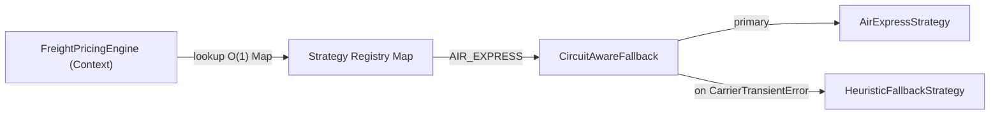

---
tags:
  - software-engineering
  - design-patterns
  - behavioral
created: 2026-01-02
updated: 2026-11-13
status: 🟢
level: mid-to-senior
category: Behavioral
---
# Strategy Pattern

> [!abstract] Vault Navigation
> Part of [[Programming/Software Engineering/Design Patterns/Design Patterns Complete Guide|Design Patterns Complete Guide]]. Primary mechanism for enforcing [[Programming/Software Engineering/SOLID/Open-Closed Principle|Open-Closed Principle]], refactoring `Switch Statements` in [[Programming/Software Engineering/Clean Code/Code Smells|Code Smells]], and wiring multi-provider DI registries in [[Programming/Backend/NestJS Complete Guide|NestJS Complete Guide]].

**Strategy** encapsulates a family of interchangeable policy algorithms behind a uniform contract so a **Context** delegates execution dynamically at runtime—selecting policies by tenant tier, feature flag, or fallback state without conditional branching (`switch` / `if-else` trees) or coupling to concrete algorithm internals.

---

## 1. First-Principles Mechanics & Complete Architecture

### 1.1 Eliminating Branching Explosions via Polymorphic Dispatch

When business rules vary across shipping tiers, discount models, or retry policies, inline `switch (tier)` blocks create **shotgun surgery**: every new tier forces edits inside validation, base rate math, surcharge calculations, and unit tests simultaneously. Strategy extracts each algorithm behind a single typed interface (`FreightRateStrategy`) or function signature (`SurgePricingStrategy`), placing selection in a registry (`ReadonlyMap<ShippingTier, FreightRateStrategy>`) wired at the composition root:



At runtime, adding `RAIL_FREIGHT` requires writing one class or rule entry and registering it in the DI provider array—zero edits inside `FreightPricingEngine`.

### 1.2 Class-Based Strategy vs Function Map vs Data-Driven Rule Table

Classical GoF (written for C++/Java before first-class lambdas) mandated an interface plus a concrete class for every algorithm. Modern TypeScript offers a **three-tier representation spectrum** depending on collaborator dependencies and volatility:

| Representation | Contract & State Model | Memory & V8 Dispatch Profile | When to Choose |
|---|---|---|---|
| **Data-Driven Rule Table** | Pure JSON/DB records (`{ minDemandIndex, multiplier }[]`) evaluated by one monomorphic function | Highest throughput; strictly monomorphic V8 IC, zero closure/instance allocations | Pricing brackets, fee tiers, or commission schedules edited dynamically in Admin UI/DB without deployments |
| **Function / Closure Map** | `Record<Key, Fn>` or `ReadonlyMap<Key, Fn>` with lexical config closure | Minimal boilerplate; direct indirect call without class prototype allocation | Single-operation policies (`surgeStrategies`, `retryPolicyStrategies`, hashing, sorting) |
| **Class-Based Strategy** | Interface with 2+ methods (`supports()`, `quote()`) + constructor-injected collaborators | Supports NestJS/DI tokens, `AbortSignal` HTTP clients, and encapsulated circuit state | Multi-method contracts (`AirExpressStrategy` injecting `LiveCarrierRateClient` + `Logger`) |

### 1.3 Strategy vs State vs Template Method vs Chain of Responsibility

| Pattern | Who Controls Selection / Transition? | Composition Axis | Key Architectural Distinction |
|---|---|---|---|
| **Strategy** | **External caller, request DTO, or runtime config** selects the algorithm | Composition (`Context` $\rightarrow$ `Strategy`) | Algorithms are independent and unaware of sibling strategies |
| **State** | **Current State or Context** transitions internally along a finite-state machine | Composition (`Context` $\rightarrow$ `State` graph) | Models sequential lifecycle transitions (`CLOSED` $\rightarrow$ `OPEN` $\rightarrow$ `HALF_OPEN`), not external choice |
| **Template Method** | **Abstract base class** fixes algorithm skeleton; subclasses override hook steps | Compile-time Inheritance | Locks orthogonal axes into rigid class hierarchies; prefer injecting Strategy callbacks instead |
| **Chain of Responsibility** | **Pipeline of handlers** inspects request and either handles or delegates to `next()` | Linked handler pipeline | Multiple handlers may inspect/transform one request; Strategy typically picks one policy or explicit fallback |

### 1.4 Handling Strategy Context State Safely Under Concurrency

Singleton strategies registered inside a DI container (`Map<ShippingTier, FreightRateStrategy>`) are shared concurrently across thousands of async HTTP requests. **Never store per-request mutable fields (`this.currentOrder`, `this.accumulatedTotal`) on a Strategy instance**: interleaved `await` suspensions corrupt sibling requests.

- Pass all request-scoped inputs via an **immutable input parameter** (`quote(request: QuoteRequest, signal?: AbortSignal)`).
- Only store **process-wide operational state** on a Strategy when deliberately implementing thread-safe telemetry or resilience state (such as `consecutiveFailures` and `openUntilMs` inside `CircuitAwareFallbackFreightStrategy`).

### 1.5 Composite + Strategy Fallback Chains & Error Classification

Combining **Composite** fallback orchestration with **Strategy** lets a `CircuitAwareFallbackFreightStrategy` wrap a primary remote-tariff strategy (`AirExpressStrategy`) alongside a deterministic offline fallback (`HeuristicFallbackFreightStrategy`). **Crucial invariant**: fallback chains must **only** intercept `CarrierTransientError` (carrier timeouts, HTTP 503, network resets). Domain input invariant failures (`InvalidShipmentInputError`, such as shipping cold-chain freight above $+8^\circ\text{C}$) must propagate immediately to the caller—swallowing validation errors into an offline fallback would silently quote illegal shipments!

### 1.6 NestJS Multi-Provider DI `Map<ShippingTier, FreightRateStrategy>`

In NestJS, manually injecting `GroundFreightStrategy`, `AirExpressStrategy`, and `ColdChainFreightStrategy` as separate constructor parameters inside `FreightPricingService` breaks the Open-Closed Principle whenever a fourth tier arrives. Instead, register each strategy as a provider and assemble `ReadonlyMap<ShippingTier, FreightRateStrategy>` inside a custom `useFactory` token (see [[Programming/Backend/NestJS Advanced Guide|NestJS Advanced Guide]]):

```typescript
// Injects all concrete strategies into a single Map token without editing FreightPricingService.
export const FREIGHT_STRATEGY_MAP = Symbol('FREIGHT_STRATEGY_MAP');
```

### 1.7 Config-Driven A/B Rollout Selection & Zero-Allocation Dispatch

1. **Deterministic Cohort Bucketing**: Selecting A/B pricing strategies with `Math.random()` causes a customer's checkout quote to diverge from their final invoice seconds later on retry! Instead, hash `${experimentKey}:${tenantId}` via **32-bit FNV-1a** modulo `100` so every node across the fleet routes a tenant deterministically to `control` or `candidate_v2`, with an instant boolean `enabled` kill-switch.
2. **V8 Allocation & Inline Cache (IC) Mechanics**: Allocating `new ConcreteStrategy(...)` along with nested lookup `Map`s or closures inside hot request paths triggers V8 Young Generation (Scavenger) allocations (~$6\times$ slower in benchmarks when strategies capture non-trivial structures that escape scalar replacement). Pre-instantiating frozen strategy singletons—or collapsing homogeneous tier formulas into a single monomorphic evaluator over a **Data-Driven Rule Table**—keeps V8 Inline Caches monomorphic with zero heap allocation per call.

---

## 2. Real-World Use Cases & Decision Matrix

### 2.1 Concrete Production Scenarios

1. **Multi-Carrier Freight Quoting & Resilience**: Selecting `GROUND`, `AIR_EXPRESS`, or `COLD_CHAIN` volumetric formulas dynamically, isolating live carrier rate API failures behind a `CircuitAwareFallbackFreightStrategy`.
2. **Dynamic Surge & Promotion Rollouts**: Swapping `none`, `tiered_demand`, and `cap_protected` surge algorithms via deterministic tenant bucketing and runtime feature flags without deploying code.
3. **Configurable Retry Backoff Policies**: Injecting `exponential_jitter` (full jitter for shared external APIs to avoid thundering herds), `fixed_interval`, or `no_retry` (for non-idempotent legacy endpoints).
4. **Export Formatters & Compression Pipelines**: Choosing `ZstdStrategy`, `GzipStrategy`, or `ParquetStrategy` based on `Accept-Encoding` or tenant export preferences when each strategy requires distinct worker-pool collaborators.
5. **Authentication & MFA Challenge Verification**: Dispatching `TotpStrategy`, `WebAuthnPasskeyStrategy`, or `OidcSsoStrategy` by organization security policy.

### 2.2 Decision Matrix: Branching vs Strategy Variants vs Rules Engines

| Complexity & Volatility Profile | Recommended Mechanism | Why |
|---|---|---|
| 2–3 static branches internal to one function, no shared extension point | Simple `if / else` or `switch` | Adding interfaces/maps for stable 5-line logic creates needless indirection |
| Numeric fee/tax/surge brackets changed weekly by non-engineers | **Data-Driven Rule Table** (DB/JSON + 1 evaluator) | Zero code deployments required; single monomorphic V8 code path |
| Stateless single-method algorithm selected by key (`hash`, `surge`, `retry`) | **Function / Closure Map** (`satisfies Record<K, Fn>`) | Zero class boilerplate; strict compile-time exhaustiveness checking |
| Multi-method algorithms with injected clients, HTTP calls, or circuit state | **Class-Based Strategy + DI Map** | Clean constructor DI testing, lifecycle state isolation, OCP extensibility |
| Arbitrary user-authored nested boolean expressions (`AND/OR/NOT` ASTs) | Embedded Rules Engine (**CEL** / **OPA Rego**) | Strategy registries do not scale to thousands of tenant-defined custom rule trees |

---

## 3. Step-by-Step Practical Application: Dynamic Freight Rate, Surge Pricing & Retry Policy Engine

This runnable TypeScript subsystem implements: (1) class-based freight strategies (`Ground`, `AirExpress`, `ColdChain`, `HeuristicFallback`), (2) functional + data-driven surge and retry policy registries, (3) `CircuitAwareFallbackFreightStrategy` distinguishing transient carrier outages from domain validation failures, (4) FNV-1a deterministic A/B rollout selector, (5) NestJS `Map<ShippingTier, FreightRateStrategy>` DI module wiring, (6) full Vitest test suite, and (7) V8 dispatch allocation microbenchmark.

### 3.1 Production Directory Layout

```text
src/
  pricing/
    types.ts
    strategies/
      freight-strategies.ts
    policies/
      surge-and-retry.ts
    registry/
      policy-engine.ts
    nestjs/
      pricing.module.ts
test/
  pricing/
    pricing-engine.test.ts
bench/
  dispatch-bench.ts
```

### 3.2 Domain Types & Explicit Error Separation

#### `src/pricing/types.ts`

```typescript
export type ShippingTier = 'GROUND' | 'AIR_EXPRESS' | 'COLD_CHAIN';
export type SurgeRuleKey = 'none' | 'tiered_demand' | 'cap_protected';
export type RetryPolicyKey = 'exponential_jitter' | 'fixed_interval' | 'no_retry';

export interface DimensionsCm {
  readonly lengthCm: number;
  readonly widthCm: number;
  readonly heightCm: number;
}

export interface QuoteRequest {
  readonly shipmentId: string;
  readonly tenantId: string;
  readonly tier: ShippingTier;
  readonly actualWeightKg: number;
  readonly dimensionsCm: DimensionsCm;
  readonly distanceKm: number;
  readonly maxTemperatureC?: number;
  readonly demandIndex: number;
}

export interface FreightQuote {
  readonly tier: ShippingTier;
  readonly strategyId: string;
  readonly baseCostCents: number;
  readonly fuelSurchargeCents: number;
  readonly billableWeightKg: number;
  readonly degraded: boolean;
  readonly fallbackReason?: string;
}

export interface FinalPricingResult {
  readonly quote: FreightQuote;
  readonly surgeMultiplier: number;
  readonly surgeRuleApplied: SurgeRuleKey;
  readonly totalCostCents: number;
  readonly experimentVariant: 'control' | 'candidate_v2';
}

export interface RetryDecision {
  readonly shouldRetry: boolean;
  readonly delayMs: number;
}

export interface RetryPolicyContext {
  readonly attempt: number;
  readonly maxAttempts: number;
  readonly baseDelayMs: number;
  readonly maxDelayMs: number;
  readonly retryableError: boolean;
}

export interface RolloutExperimentConfig {
  readonly experimentKey: string;
  readonly enabled: boolean;
  readonly candidatePercentage: number;
  readonly controlSurgeRule: SurgeRuleKey;
  readonly candidateSurgeRule: SurgeRuleKey;
}

export class InvalidShipmentInputError extends Error {
  readonly code = 'INVALID_SHIPMENT_INPUT' as const;
  constructor(message: string) {
    super(message);
    this.name = 'InvalidShipmentInputError';
  }
}

export class CarrierTransientError extends Error {
  readonly code = 'CARRIER_TRANSIENT_ERROR' as const;
  constructor(message: string, cause?: unknown) {
    super(message, cause !== undefined ? { cause } : undefined);
    this.name = 'CarrierTransientError';
  }
}

export class UnsupportedShippingTierError extends Error {
  readonly code = 'UNSUPPORTED_SHIPPING_TIER' as const;
  constructor(tier: string) {
    super(`No freight pricing strategy registered for tier "${tier}"`);
    this.name = 'UnsupportedShippingTierError';
  }
}
```

### 3.3 Class-Based Freight Strategies

#### `src/pricing/strategies/freight-strategies.ts`

```typescript
import {
  CarrierTransientError,
  InvalidShipmentInputError,
  type FreightQuote,
  type QuoteRequest,
  type ShippingTier,
} from '../types.ts';

export interface FreightRateStrategy {
  readonly tier: ShippingTier;
  readonly strategyId: string;
  quote(request: QuoteRequest, signal?: AbortSignal): Promise<FreightQuote>;
}

export interface LiveCarrierRateClient {
  fetchAirTariff(
    params: { readonly billableWeightKg: number; readonly distanceKm: number },
    signal?: AbortSignal,
  ): Promise<{ readonly ratePerKgCents: number; readonly fuelBps: number }>;
}

export function computeVolumetricWeightKg(request: QuoteRequest, divisor = 5000): number {
  const { lengthCm, widthCm, heightCm } = request.dimensionsCm;
  if (lengthCm <= 0 || widthCm <= 0 || heightCm <= 0 || request.actualWeightKg <= 0) {
    throw new InvalidShipmentInputError('Weight and dimensions must all be strictly positive');
  }
  const volumetric = (lengthCm * widthCm * heightCm) / divisor;
  return Math.max(request.actualWeightKg, Math.ceil(volumetric * 10) / 10);
}

export class GroundFreightStrategy implements FreightRateStrategy {
  readonly tier = 'GROUND' as const;
  readonly strategyId = 'ground-zone-v1';

  async quote(request: QuoteRequest, signal?: AbortSignal): Promise<FreightQuote> {
    if (signal?.aborted) {
      throw new CarrierTransientError('Ground quote aborted', signal.reason);
    }
    const billableWeightKg = computeVolumetricWeightKg(request, 6000);
    const baseCostCents = 850 + Math.round(billableWeightKg * 140) + Math.round(request.distanceKm * 6);
    const fuelSurchargeCents = Math.round(baseCostCents * 0.08);
    return {
      tier: this.tier,
      strategyId: this.strategyId,
      baseCostCents,
      fuelSurchargeCents,
      billableWeightKg,
      degraded: false,
    };
  }
}

export class AirExpressStrategy implements FreightRateStrategy {
  readonly tier = 'AIR_EXPRESS' as const;
  readonly strategyId = 'air-express-live-v1';
  private readonly carrierClient: LiveCarrierRateClient;

  constructor(carrierClient: LiveCarrierRateClient) {
    this.carrierClient = carrierClient;
  }

  async quote(request: QuoteRequest, signal?: AbortSignal): Promise<FreightQuote> {
    const billableWeightKg = computeVolumetricWeightKg(request, 5000);
    try {
      const tariff = await this.carrierClient.fetchAirTariff(
        { billableWeightKg, distanceKm: request.distanceKm },
        signal,
      );
      const baseCostCents = 2400 + Math.round(billableWeightKg * tariff.ratePerKgCents);
      const fuelSurchargeCents = Math.round((baseCostCents * tariff.fuelBps) / 10_000);
      return {
        tier: this.tier,
        strategyId: this.strategyId,
        baseCostCents,
        fuelSurchargeCents,
        billableWeightKg,
        degraded: false,
      };
    } catch (err) {
      if (err instanceof InvalidShipmentInputError) {
        throw err;
      }
      throw new CarrierTransientError('Live air carrier tariff lookup failed', err);
    }
  }
}

export class ColdChainFreightStrategy implements FreightRateStrategy {
  readonly tier = 'COLD_CHAIN' as const;
  readonly strategyId = 'cold-chain-reefer-v1';

  async quote(request: QuoteRequest): Promise<FreightQuote> {
    if (request.maxTemperatureC === undefined || request.maxTemperatureC > 8) {
      throw new InvalidShipmentInputError('Cold chain tier requires maxTemperatureC <= 8 Celsius');
    }
    const billableWeightKg = computeVolumetricWeightKg(request, 5000);
    const thermalSurcharge = request.maxTemperatureC <= -18 ? 4500 : 2500;
    const baseCostCents =
      3800 + thermalSurcharge + Math.round(billableWeightKg * 480) + Math.round(request.distanceKm * 18);
    const fuelSurchargeCents = Math.round(baseCostCents * 0.14);
    return {
      tier: this.tier,
      strategyId: this.strategyId,
      baseCostCents,
      fuelSurchargeCents,
      billableWeightKg,
      degraded: false,
    };
  }
}

export class HeuristicFallbackFreightStrategy implements FreightRateStrategy {
  readonly tier: ShippingTier;
  readonly strategyId = 'heuristic-offline-ratecard-v1';

  constructor(tier: ShippingTier) {
    this.tier = tier;
  }

  async quote(request: QuoteRequest): Promise<FreightQuote> {
    const billableWeightKg = computeVolumetricWeightKg(request, 5000);
    const perKg = this.tier === 'AIR_EXPRESS' ? 620 : this.tier === 'COLD_CHAIN' ? 540 : 160;
    const baseCostCents = 2800 + Math.round(billableWeightKg * perKg) + Math.round(request.distanceKm * 12);
    const fuelSurchargeCents = Math.round(baseCostCents * 0.12);
    return {
      tier: this.tier,
      strategyId: this.strategyId,
      baseCostCents,
      fuelSurchargeCents,
      billableWeightKg,
      degraded: true,
    };
  }
}
```

### 3.4 Functional + Data-Driven Surge & Retry Strategy Registries

#### `src/pricing/policies/surge-and-retry.ts`

```typescript
import type { RetryDecision, RetryPolicyContext, RetryPolicyKey, SurgeRuleKey } from '../types.ts';

export type SurgePricingStrategy = (demandIndex: number) => number;

interface SurgeBracket {
  readonly minDemandIndex: number;
  readonly multiplier: number;
}

const DEMAND_SURGE_TABLE: ReadonlyArray<SurgeBracket> = [
  { minDemandIndex: 3.0, multiplier: 1.85 },
  { minDemandIndex: 2.0, multiplier: 1.45 },
  { minDemandIndex: 1.3, multiplier: 1.2 },
  { minDemandIndex: 0, multiplier: 1.0 },
];

export const surgeStrategies = {
  none: () => 1.0,
  tiered_demand: (demandIndex: number) => {
    for (const bracket of DEMAND_SURGE_TABLE) {
      if (demandIndex >= bracket.minDemandIndex) {
        return bracket.multiplier;
      }
    }
    return 1.0;
  },
  cap_protected: (demandIndex: number) => {
    const raw = demandIndex <= 1.0 ? 1.0 : 1.0 + (demandIndex - 1.0) * 0.35;
    return Math.min(1.5, Math.round(raw * 100) / 100);
  },
} satisfies Record<SurgeRuleKey, SurgePricingStrategy>;

export type RetryPolicyStrategy = (ctx: RetryPolicyContext, rng?: () => number) => RetryDecision;

export const retryPolicyStrategies = {
  no_retry: () => ({ shouldRetry: false, delayMs: 0 }),
  fixed_interval: (ctx) => {
    if (!ctx.retryableError || ctx.attempt >= ctx.maxAttempts) {
      return { shouldRetry: false, delayMs: 0 };
    }
    return { shouldRetry: true, delayMs: Math.min(ctx.baseDelayMs, ctx.maxDelayMs) };
  },
  exponential_jitter: (ctx, rng = Math.random) => {
    if (!ctx.retryableError || ctx.attempt >= ctx.maxAttempts) {
      return { shouldRetry: false, delayMs: 0 };
    }
    const ceiling = Math.min(ctx.maxDelayMs, ctx.baseDelayMs * 2 ** ctx.attempt);
    const delayMs = Math.floor(rng() * ceiling);
    return { shouldRetry: true, delayMs };
  },
} satisfies Record<RetryPolicyKey, RetryPolicyStrategy>;
```

### 3.5 Circuit-Aware Fallback Strategy, A/B Rollout Selector & Pricing Engine

#### `src/pricing/registry/policy-engine.ts`

```typescript
import {
  CarrierTransientError,
  InvalidShipmentInputError,
  UnsupportedShippingTierError,
  type FinalPricingResult,
  type FreightQuote,
  type QuoteRequest,
  type RolloutExperimentConfig,
  type ShippingTier,
} from '../types.ts';
import type { FreightRateStrategy } from '../strategies/freight-strategies.ts';
import { surgeStrategies } from '../policies/surge-and-retry.ts';

export interface CircuitFallbackConfig {
  readonly failureThreshold: number;
  readonly cooldownMs: number;
  readonly nowMs?: () => number;
}

export class CircuitAwareFallbackFreightStrategy implements FreightRateStrategy {
  readonly tier: ShippingTier;
  readonly strategyId: string;
  private readonly primary: FreightRateStrategy;
  private readonly fallback: FreightRateStrategy;
  private readonly failureThreshold: number;
  private readonly cooldownMs: number;
  private readonly nowMs: () => number;

  private consecutiveFailures = 0;
  private openUntilMs = 0;

  constructor(
    primary: FreightRateStrategy,
    fallback: FreightRateStrategy,
    config: CircuitFallbackConfig,
  ) {
    this.tier = primary.tier;
    this.strategyId = `circuit(${primary.strategyId}->${fallback.strategyId})`;
    this.primary = primary;
    this.fallback = fallback;
    this.failureThreshold = config.failureThreshold;
    this.cooldownMs = config.cooldownMs;
    this.nowMs = config.nowMs ?? Date.now;
  }

  async quote(request: QuoteRequest, signal?: AbortSignal): Promise<FreightQuote> {
    const now = this.nowMs();
    if (now < this.openUntilMs) {
      const degradedQuote = await this.fallback.quote(request, signal);
      return { ...degradedQuote, degraded: true, fallbackReason: 'CIRCUIT_OPEN' };
    }

    try {
      const result = await this.primary.quote(request, signal);
      this.consecutiveFailures = 0;
      return result;
    } catch (err) {
      // Domain validation errors must surface to caller, never trip carrier fallback.
      if (err instanceof InvalidShipmentInputError) {
        throw err;
      }
      if (!(err instanceof CarrierTransientError)) {
        throw err;
      }
      this.consecutiveFailures += 1;
      if (this.consecutiveFailures >= this.failureThreshold) {
        this.openUntilMs = now + this.cooldownMs;
      }
      const degradedQuote = await this.fallback.quote(request, signal);
      return {
        ...degradedQuote,
        degraded: true,
        fallbackReason: err.message,
      };
    }
  }
}

export function fnv1aBucket100(input: string): number {
  let hash = 0x811c9dc5;
  for (let i = 0; i < input.length; i += 1) {
    hash ^= input.charCodeAt(i);
    hash = Math.imul(hash, 0x01000193);
  }
  return (hash >>> 0) % 100;
}

export function selectExperimentVariant(
  tenantId: string,
  config: RolloutExperimentConfig,
): { readonly variant: 'control' | 'candidate_v2'; readonly surgeRule: RolloutExperimentConfig['controlSurgeRule'] } {
  if (!config.enabled || config.candidatePercentage <= 0) {
    return { variant: 'control', surgeRule: config.controlSurgeRule };
  }
  const bucket = fnv1aBucket100(`${config.experimentKey}:${tenantId}`);
  if (bucket < config.candidatePercentage) {
    return { variant: 'candidate_v2', surgeRule: config.candidateSurgeRule };
  }
  return { variant: 'control', surgeRule: config.controlSurgeRule };
}

export class FreightPricingEngine {
  private readonly strategyMap: ReadonlyMap<ShippingTier, FreightRateStrategy>;
  private rolloutConfig: RolloutExperimentConfig;

  constructor(
    strategies: ReadonlyArray<FreightRateStrategy>,
    rolloutConfig: RolloutExperimentConfig,
  ) {
    this.strategyMap = new Map(strategies.map((s) => [s.tier, s]));
    this.rolloutConfig = rolloutConfig;
  }

  updateRolloutConfig(next: RolloutExperimentConfig): void {
    this.rolloutConfig = next;
  }

  async calculateFinalQuote(request: QuoteRequest, signal?: AbortSignal): Promise<FinalPricingResult> {
    const strategy = this.strategyMap.get(request.tier);
    if (!strategy) {
      throw new UnsupportedShippingTierError(request.tier);
    }

    const quote = await strategy.quote(request, signal);
    const { variant, surgeRule } = selectExperimentVariant(request.tenantId, this.rolloutConfig);
    const surgeMultiplier = surgeStrategies[surgeRule](request.demandIndex);
    const preSurgeCents = quote.baseCostCents + quote.fuelSurchargeCents;
    const totalCostCents = Math.round(preSurgeCents * surgeMultiplier);

    return {
      quote,
      surgeMultiplier,
      surgeRuleApplied: surgeRule,
      totalCostCents,
      experimentVariant: variant,
    };
  }
}
```

### 3.6 NestJS DI Multi-Provider Map Injection

#### `src/pricing/nestjs/pricing.module.ts`

```typescript
import { Inject, Injectable, Module } from '@nestjs/common';
import type { FreightRateStrategy, LiveCarrierRateClient } from '../strategies/freight-strategies.ts';
import {
  AirExpressStrategy,
  ColdChainFreightStrategy,
  GroundFreightStrategy,
  HeuristicFallbackFreightStrategy,
} from '../strategies/freight-strategies.ts';
import { CircuitAwareFallbackFreightStrategy } from '../registry/policy-engine.ts';
import { UnsupportedShippingTierError, type FreightQuote, type QuoteRequest, type ShippingTier } from '../types.ts';

export const LIVE_CARRIER_CLIENT = Symbol('LIVE_CARRIER_CLIENT');
export const FREIGHT_STRATEGY_MAP = Symbol('FREIGHT_STRATEGY_MAP');
export const RESILIENT_AIR_EXPRESS = Symbol('RESILIENT_AIR_EXPRESS');

@Injectable()
export class FreightPricingService {
  private readonly strategies: ReadonlyMap<ShippingTier, FreightRateStrategy>;

  constructor(
    @Inject(FREIGHT_STRATEGY_MAP)
    strategies: ReadonlyMap<ShippingTier, FreightRateStrategy>,
  ) {
    this.strategies = strategies;
  }

  async quote(request: QuoteRequest, signal?: AbortSignal): Promise<FreightQuote> {
    const strategy = this.strategies.get(request.tier);
    if (!strategy) {
      throw new UnsupportedShippingTierError(request.tier);
    }
    return strategy.quote(request, signal);
  }
}

@Module({
  providers: [
    GroundFreightStrategy,
    ColdChainFreightStrategy,
    {
      provide: RESILIENT_AIR_EXPRESS,
      inject: [LIVE_CARRIER_CLIENT],
      useFactory: (client: LiveCarrierRateClient): FreightRateStrategy =>
        new CircuitAwareFallbackFreightStrategy(
          new AirExpressStrategy(client),
          new HeuristicFallbackFreightStrategy('AIR_EXPRESS'),
          { failureThreshold: 3, cooldownMs: 30_000 },
        ),
    },
    {
      provide: FREIGHT_STRATEGY_MAP,
      inject: [GroundFreightStrategy, RESILIENT_AIR_EXPRESS, ColdChainFreightStrategy],
      useFactory: (
        ...strategies: FreightRateStrategy[]
      ): ReadonlyMap<ShippingTier, FreightRateStrategy> =>
        new Map(strategies.map((strategy) => [strategy.tier, strategy])),
    },
    FreightPricingService,
  ],
  exports: [FreightPricingService],
})
export class FreightPricingModule {}
```

### 3.7 Complete Vitest Suite & Zero-Allocation Dispatch Benchmark

#### `test/pricing/pricing-engine.test.ts`

```typescript
import { describe, it, expect } from 'vitest';
import {
  AirExpressStrategy,
  ColdChainFreightStrategy,
  GroundFreightStrategy,
  HeuristicFallbackFreightStrategy,
} from '../../src/pricing/strategies/freight-strategies.ts';
import { retryPolicyStrategies, surgeStrategies } from '../../src/pricing/policies/surge-and-retry.ts';
import {
  CircuitAwareFallbackFreightStrategy,
  FreightPricingEngine,
  selectExperimentVariant,
} from '../../src/pricing/registry/policy-engine.ts';
import {
  InvalidShipmentInputError,
  type QuoteRequest,
  type RolloutExperimentConfig,
} from '../../src/pricing/types.ts';

function makeRequest(overrides?: Partial<QuoteRequest>): QuoteRequest {
  return {
    shipmentId: 'ship_001',
    tenantId: 'tenant_alpha',
    tier: 'AIR_EXPRESS',
    actualWeightKg: 4,
    dimensionsCm: { lengthCm: 50, widthCm: 40, heightCm: 30 },
    distanceKm: 400,
    demandIndex: 2.5,
    ...overrides,
  };
}

describe('FreightPricingEngine & Strategy Composition', () => {
  it('computes volumetric dimensional weight for AIR_EXPRESS when volume exceeds actual weight', async () => {
    const air = new AirExpressStrategy({
      async fetchAirTariff() {
        return { ratePerKgCents: 500, fuelBps: 1000 };
      },
    });
    // Volumetric weight = (50 * 40 * 30) / 5000 = 12kg > 4kg actual weight.
    const quote = await air.quote(makeRequest());
    expect(quote.billableWeightKg).toBe(12);
    expect(quote.baseCostCents).toBe(2400 + 12 * 500);
    expect(quote.fuelSurchargeCents).toBe(840);
    expect(quote.degraded).toBe(false);
  });

  it('never masks domain validation errors as carrier fallback outages', async () => {
    const coldChainWithFallback = new CircuitAwareFallbackFreightStrategy(
      new ColdChainFreightStrategy(),
      new HeuristicFallbackFreightStrategy('COLD_CHAIN'),
      { failureThreshold: 1, cooldownMs: 10_000 },
    );

    await expect(
      coldChainWithFallback.quote(makeRequest({ tier: 'COLD_CHAIN', maxTemperatureC: 18 })),
    ).rejects.toBeInstanceOf(InvalidShipmentInputError);
  });

  it('trips circuit open after threshold transient errors and recovers after cooldown', async () => {
    let clock = 1_000;
    let shouldFail = true;

    const air = new AirExpressStrategy({
      async fetchAirTariff() {
        if (shouldFail) {
          throw new Error('503 Upstream Carrier Timeout');
        }
        return { ratePerKgCents: 500, fuelBps: 1000 };
      },
    });

    const resilientAir = new CircuitAwareFallbackFreightStrategy(
      air,
      new HeuristicFallbackFreightStrategy('AIR_EXPRESS'),
      { failureThreshold: 2, cooldownMs: 5_000, nowMs: () => clock },
    );

    const first = await resilientAir.quote(makeRequest());
    expect(first.degraded).toBe(true);
    expect(first.strategyId).toBe('heuristic-offline-ratecard-v1');

    const second = await resilientAir.quote(makeRequest());
    expect(second.degraded).toBe(true);

    shouldFail = false;
    const whileOpen = await resilientAir.quote(makeRequest());
    expect(whileOpen.degraded).toBe(true);
    expect(whileOpen.fallbackReason).toBe('CIRCUIT_OPEN');

    clock += 6_000;
    const recovered = await resilientAir.quote(makeRequest());
    expect(recovered.degraded).toBe(false);
    expect(recovered.strategyId).toBe('air-express-live-v1');
  });

  it('assigns deterministic A/B cohorts and applies kill-switch instantly', async () => {
    const rollout: RolloutExperimentConfig = {
      experimentKey: 'surge-v2-2026',
      enabled: true,
      candidatePercentage: 50,
      controlSurgeRule: 'tiered_demand',
      candidateSurgeRule: 'cap_protected',
    };

    const firstPick = selectExperimentVariant('tenant_stable_77', rollout);
    const retryPick = selectExperimentVariant('tenant_stable_77', rollout);
    expect(retryPick).toEqual(firstPick);

    const engine = new FreightPricingEngine(
      [new GroundFreightStrategy(), new ColdChainFreightStrategy()],
      rollout,
    );
    engine.updateRolloutConfig({ ...rollout, enabled: false });
    const killed = await engine.calculateFinalQuote(makeRequest({ tier: 'GROUND', demandIndex: 2.5 }));
    expect(killed.experimentVariant).toBe('control');
    expect(killed.surgeRuleApplied).toBe('tiered_demand');
    expect(killed.surgeMultiplier).toBe(surgeStrategies.tiered_demand(2.5));
  });

  it('enforces bounded full-jitter retry delays and stops at maxAttempts', () => {
    const retry = retryPolicyStrategies.exponential_jitter(
      { attempt: 2, maxAttempts: 4, baseDelayMs: 100, maxDelayMs: 500, retryableError: true },
      () => 0.5,
    );
    expect(retry).toEqual({ shouldRetry: true, delayMs: 200 });

    const exhausted = retryPolicyStrategies.exponential_jitter({
      attempt: 4,
      maxAttempts: 4,
      baseDelayMs: 100,
      maxDelayMs: 500,
      retryableError: true,
    });
    expect(exhausted).toEqual({ shouldRetry: false, delayMs: 0 });
  });
});
```

#### `bench/dispatch-bench.ts`

```typescript
import { performance } from 'node:perf_hooks';
import { pathToFileURL } from 'node:url';

interface DispatchInput {
  readonly tier: 'GROUND' | 'AIR' | 'COLD' | 'RAIL' | 'OCEAN';
  readonly weightKg: number;
  readonly distanceKm: number;
}

interface RateRule {
  readonly baseCents: number;
  readonly perKgCents: number;
  readonly perKmCents: number;
  readonly surchargeCents: number;
}

const RATE_RULES: Record<DispatchInput['tier'], RateRule> = {
  GROUND: { baseCents: 850, perKgCents: 140, perKmCents: 6, surchargeCents: 50 },
  AIR: { baseCents: 2400, perKgCents: 520, perKmCents: 6, surchargeCents: 200 },
  COLD: { baseCents: 3800, perKgCents: 480, perKmCents: 6, surchargeCents: 400 },
  RAIL: { baseCents: 1200, perKgCents: 110, perKmCents: 6, surchargeCents: 75 },
  OCEAN: { baseCents: 600, perKgCents: 65, perKmCents: 6, surchargeCents: 90 },
};

function computeFromRule(rule: RateRule, input: DispatchInput): number {
  return rule.baseCents + input.weightKg * rule.perKgCents + input.distanceKm * rule.perKmCents + rule.surchargeCents;
}

interface Strategy {
  compute(input: DispatchInput): number;
}

const retainedForGcPressure: Strategy[] = new Array(256);

function allocateFactoryStrategy(tier: DispatchInput['tier'], idx: number): Strategy {
  const brackets = new Map<number, number>([[0, 50], [100, 120]]);
  const strat: Strategy = {
    compute(i: DispatchInput): number {
      const rate = tier === 'AIR' ? 520 : tier === 'COLD' ? 480 : 140;
      return 2400 + i.weightKg * rate + i.distanceKm * 6 + (brackets.get(0) ?? 0);
    },
  };
  retainedForGcPressure[idx & 255] = strat;
  return strat;
}

const TIERS: ReadonlyArray<DispatchInput['tier']> = ['GROUND', 'AIR', 'COLD', 'RAIL', 'OCEAN'];

export function runDispatchBenchmark(iterations = 500_000): {
  readonly dataTableMs: number;
  readonly perCallFactoryMs: number;
} {
  const inputs: DispatchInput[] = TIERS.map((tier, idx) => ({
    tier,
    weightKg: 10 + idx,
    distanceKm: 300 + idx * 50,
  }));
  let sink = 0;

  for (let i = 0; i < 10_000; i += 1) {
    const inp = inputs[i % 5]!;
    sink += computeFromRule(RATE_RULES[inp.tier], inp);
    sink += allocateFactoryStrategy(inp.tier, i).compute(inp);
  }

  const t1 = performance.now();
  for (let i = 0; i < iterations; i += 1) {
    const inp = inputs[i % 5]!;
    sink += computeFromRule(RATE_RULES[inp.tier], inp);
  }
  const dataTableMs = performance.now() - t1;

  const t2 = performance.now();
  for (let i = 0; i < iterations; i += 1) {
    const inp = inputs[i % 5]!;
    sink += allocateFactoryStrategy(inp.tier, i).compute(inp);
  }
  const perCallFactoryMs = performance.now() - t2;

  if (sink === 0) throw new Error('Prevent dead-code elimination');
  return { dataTableMs, perCallFactoryMs };
}

if (process.argv[1] && import.meta.url === pathToFileURL(process.argv[1]).href) {
  const res = runDispatchBenchmark(500_000);
  console.log(
    `Pre-allocated Data/Rule Dispatch: ${res.dataTableMs.toFixed(2)}ms | Per-call Strategy+Map alloc: ${res.perCallFactoryMs.toFixed(2)}ms`,
  );
}
```

---

## 4. Complete Framework / Construct Reference & Edge Cases

### 4.1 Compile-Time Exhaustiveness (`satisfies` + `assertNever`)

When adding a new union member (`'RAIL_FREIGHT'`) to `ShippingTier` or `SurgeRuleKey`, compile-time verification prevents runtime `UnsupportedShippingTierError` surprises in production:

- **Object registries**: Annotate with `satisfies Record<SurgeRuleKey, SurgePricingStrategy>` rather than `: Record<SurgeRuleKey, ...>`. Using `satisfies` checks completeness while preserving literal key autocomplete (`typeof surgeStrategies`).
- **Switch-based factories**: Always terminate with `default: return assertNever(tier);` (`function assertNever(x: never): never { throw new Error('Unhandled tier: ' + x); }`).

### 4.2 Combining Strategy with Decorator Cleanly

Do **not** duplicate caching, Prometheus latency timers, or OpenTelemetry spans inside `GroundFreightStrategy`, `AirExpressStrategy`, and `ColdChainFreightStrategy`. Implement one **Decorator** wrapping `FreightRateStrategy` (`MeteredFreightStrategy`) that preserves the interface and attaches spans around `this.inner.quote(request, signal)`—keeping each concrete algorithm pure (see [[Programming/Software Engineering/Design Patterns/Structural Patterns Catalog|Structural Patterns Catalog]]).

### 4.3 Persistence & Serialization Trap

Never attempt to serialize a Strategy instance or closure into Redis, PostgreSQL JSONB, or a message queue (`JSON.stringify(strategy)` drops methods silently). Instead, persist `{ strategyId: quote.strategyId, tier: quote.tier, policyVersion: '2026.11', inputsSnapshot: request }`, and resolve the executable strategy via the registry upon job replay.

---

## 5. Production Debugging, Profiling & Operations Playbook

| Symptom | Root Cause | Diagnostic Command / Telemetry Check | Concrete Fix |
|---|---|---|---|
| Quotes mismatch between cart preview and final checkout payment | A/B strategy selector used `Math.random()` or round-robin pod state instead of deterministic tenant hashing | Compare `pricing.experiment_variant` and `pricing.surge_rule` tags across trace IDs for same `tenantId` | Switch variant assignment to deterministic FNV-1a / SHA-256 hash over `${experimentKey}:${tenantId}` |
| Carrier outages silent or returning wildly inaccurate quotes on invalid shipments | Fallback wrapper caught *all* `Error` types instead of restricting fallback to `CarrierTransientError` | Filter logs for `degraded: true` paired with invalid weight/temperature dimensions | Re-throw `InvalidShipmentInputError` explicitly before incrementing failure counters or falling back |
| Young-generation GC pauses spike during flash sales | Strategy factory instantiates fresh `Map`/closure strategies on every request in a hot pricing loop | Run `node --trace-gc` or inspect V8 CPU/heap profile (`node --prof`) | Move strategy objects into pre-allocated singleton registries or Data-Driven Rule Tables |
| V8 deoptimizes hot dispatch site to megamorphic IC | Invoking 5+ distinct concrete strategy classes with mismatched hidden shapes at one `.quote()` site | Run `node --trace-ic bench/dispatch-bench.ts` and inspect `MEGAMORPHIC` call-site logs | Align field layout across strategy classes or evaluate homogeneous Data-Driven Rule records via one monomorphic function |
| NestJS fails at startup with `Nest can't resolve dependencies of FreightPricingService` | New strategy added to module providers without adding its class token to `FREIGHT_STRATEGY_MAP.inject` | Run NestJS bootstrap check (`pnpm test` or `tsc --noEmit`) | Add strategy token to `inject: [...]` or aggregate via discovery/multi-provider factory |

### Operations & Profiling Commands

```bash
# 1. Run Vitest suite covering Strategy composition, A/B rollout, and circuit fallback
npx vitest run test/pricing/pricing-engine.test.ts

# 2. Run the zero-allocation vs per-call allocation V8 dispatch benchmark
node bench/dispatch-bench.ts

# 3. Inspect V8 Inline Cache (IC) transitions (monomorphic vs megamorphic) on hot strategy dispatch
node --trace-ic bench/dispatch-bench.ts | head -n 40

# 4. Audit A/B experiment quote variance and degraded fallback rate in production SQL/analytics
# SELECT experiment_variant, degraded, COUNT(*), AVG(total_cost_cents)
# FROM freight_quote_audit WHERE created_at > NOW() - INTERVAL '1 hour'
# GROUP BY 1, 2;
```

---

## 6. Worked Exercises

### Exercise 1: Collapsing Over-Engineered 1-Method Strategy Classes

A codebase defines `interface HashAlgorithm { hash(s: string): string }`, `Sha256HashAlgorithm`, `Blake3HashAlgorithm`, and `Argon2HashAlgorithm`—none holding injected services, fields, or lifecycle hooks—plus a 40-line `HashStrategyContext` wrapper class. Simplify this using modern TypeScript idioms while keeping OCP extensibility.

### Solution 1

Replace redundant single-method classes with a typed function registry (`ReadonlyMap<string, HashFn>`):

```typescript
import { createHash } from 'node:crypto';

export type HashFn = (input: string) => string;

export class UnsupportedAlgorithmError extends Error {
  constructor(algorithm: string) {
    super(`Unsupported hash algorithm: "${algorithm}"`);
    this.name = 'UnsupportedAlgorithmError';
  }
}

export const defaultHashRegistry = new Map<string, HashFn>([
  ['sha256', (s) => createHash('sha256').update(s, 'utf8').digest('hex')],
  ['sha512', (s) => createHash('sha512').update(s, 'utf8').digest('hex')],
]);

export function digestWith(
  algorithm: string,
  input: string,
  registry: ReadonlyMap<string, HashFn> = defaultHashRegistry,
): string {
  const fn = registry.get(algorithm);
  if (!fn) {
    throw new UnsupportedAlgorithmError(algorithm);
  }
  return fn(input);
}
```

### Exercise 2: Migrating a Nested `switch` Compression Pipeline to Class Strategies

An archive service contains a `switch (format)` across two distinct operations (`estimateRatio(sample)` and `compress(stream)`), and each algorithm requires injected dependencies (`WorkerPool` and compression `level`). Should this use a plain function map or Class Strategies? Implement the core contract and Context.

### Solution 2

Use **Class-Based Strategies** because each variant encapsulates **two coordinated operations** (`estimateRatio` + `compress`) AND holds **injected collaborators** (`WorkerPool` and configuration):

```typescript
export interface WorkerPool {
  runTask(codec: string, level: number, chunk: Uint8Array): Promise<Uint8Array>;
}

export interface CompressionStrategy {
  readonly format: string;
  estimateRatio(sampleBytes: Uint8Array): number;
  compress(input: ReadableStream<Uint8Array>): ReadableStream<Uint8Array>;
}

export class ZstdCompressionStrategy implements CompressionStrategy {
  readonly format = 'zstd';
  private readonly pool: WorkerPool;
  private readonly level: number;

  constructor(pool: WorkerPool, level: number) {
    this.pool = pool;
    this.level = level;
  }

  estimateRatio(sampleBytes: Uint8Array): number {
    return sampleBytes.byteLength > 4096 ? 0.32 : 0.65;
  }

  compress(input: ReadableStream<Uint8Array>): ReadableStream<Uint8Array> {
    const { pool, level } = this;
    return input.pipeThrough(
      new TransformStream<Uint8Array, Uint8Array>({
        async transform(chunk, controller) {
          const compressed = await pool.runTask('zstd', level, chunk);
          controller.enqueue(compressed);
        },
      }),
    );
  }
}

export class ArchiveExporter {
  private readonly strategies: ReadonlyMap<string, CompressionStrategy>;

  constructor(strategies: ReadonlyArray<CompressionStrategy>) {
    this.strategies = new Map(strategies.map((s) => [s.format, s]));
  }

  exportStream(format: string, data: ReadableStream<Uint8Array>): ReadableStream<Uint8Array> {
    const strategy = this.strategies.get(format);
    if (!strategy) {
      throw new Error(`Unsupported compression format "${format}"`);
    }
    return strategy.compress(data);
  }
}
```

### Exercise 3: Strategy vs State Selection on a Circuit Breaker Lifecycle

A resilience module tracks `CLOSED` (count consecutive failures, transition to `OPEN` after 5 errors), `OPEN` (fail fast for 30s, then transition to `HALF_OPEN`), and `HALF_OPEN` (allow 1 probe request: success $\rightarrow$ `CLOSED`, failure $\rightarrow$ `OPEN`). Should this be modeled as **Strategy** or **State**? Justify structurally.

### Solution 3

Model it with the **State** pattern (or explicit discriminated-union FSM in [[Programming/Software Engineering/Design Patterns/Creational & Behavioral Patterns Catalog#State|State]]):

- Callers never select `breaker.setMode('OPEN')` externally per request. Transitions (`CLOSED` $\rightarrow$ `OPEN` $\rightarrow$ `HALF_OPEN` $\rightarrow$ `CLOSED`) occur **internally and automatically** driven by execution outcomes and elapsed time.
- Strategy models externally chosen interchangeable algorithms that are ignorant of each other; State models an internal lifecycle whose current phase dictates both behavior and valid successor states.

### Exercise 4: Fixing Shared Mutable State Corruption in Concurrent Async Strategies

An engineer implements `DiscountStrategy` as a DI singleton where `applyDiscount()` assigns `this.lastRate = await fetchTenantRate(order.tenantId)` and then multiplies `order.subtotal * this.lastRate` after an intervening `await auditLog.write()`. Under concurrent traffic, Tenant A occasionally receives Tenant B's discount! Diagnose and fix.

### Solution 4

1. **Root Cause**: `this.lastRate` lives on the singleton Strategy instance shared across concurrent `await` frames. While Tenant A suspends on `await auditLog.write()`, Tenant B enters `applyDiscount()`, overwrites `this.lastRate`, and corrupts Tenant A's resumed calculation.
2. **Fix**: Make the Strategy completely stateless on `this`—keep all intermediate values as **stack-local `const` variables** inside `applyDiscount()`:

```typescript
export interface DiscountRateClient {
  fetchTenantRate(tenantId: string, signal?: AbortSignal): Promise<number>;
}

export class ConcurrentSafeDiscountStrategy {
  private readonly rateClient: DiscountRateClient;
  private readonly writeAudit: (tenantId: string, rate: number) => Promise<void>;

  constructor(
    rateClient: DiscountRateClient,
    writeAudit: (tenantId: string, rate: number) => Promise<void>,
  ) {
    this.rateClient = rateClient;
    this.writeAudit = writeAudit;
  }

  async applyDiscountCents(tenantId: string, subtotalCents: number, signal?: AbortSignal): Promise<number> {
    const tenantRate = await this.rateClient.fetchTenantRate(tenantId, signal);
    await this.writeAudit(tenantId, tenantRate);
    return Math.round(subtotalCents * (1 - tenantRate));
  }
}
```

### Exercise 5: Fixing Non-Deterministic A/B Strategy Selection Drift

A checkout team rolls out a `candidate_v2` pricing strategy to 20% of traffic using `Math.random() < 0.2`. Customers complain that refreshing the checkout page or retrying payment occasionally charges a completely different price! Fix the selector cleanly.

### Solution 5

Replace `Math.random()` with a deterministic FNV-1a hash over `${experimentKey}:${tenantId}` (or `${experimentKey}:${orderId}`) modulo `100`, AND record the chosen `experimentVariant` onto the persisted quote entity so invoice finalization reads the locked cohort:

```typescript
import { fnv1aBucket100 } from '../../src/pricing/registry/policy-engine.ts';
import type { SurgeRuleKey } from '../../src/pricing/types.ts';

export function resolveDeterministicCohort(
  experimentKey: string,
  subjectId: string,
  rolloutPercent: number,
  enabled: boolean,
): { readonly variant: 'control' | 'candidate_v2'; readonly rule: SurgeRuleKey } {
  if (!enabled || rolloutPercent <= 0) {
    return { variant: 'control', rule: 'tiered_demand' };
  }
  const bucket = fnv1aBucket100(`${experimentKey}:${subjectId}`);
  return bucket < rolloutPercent
    ? { variant: 'candidate_v2', rule: 'cap_protected' }
    : { variant: 'control', rule: 'tiered_demand' };
}
```

### Exercise 6: Preventing Composite Fallback Strategies From Masking Domain Validation Errors

A `FallbackStrategy` wraps `ColdChainFreightStrategy` and catches `catch (err) { return this.offlineFallback.quote(req); }`. When a client sends `tier: 'COLD_CHAIN'` with invalid `maxTemperatureC: 25` (warm room temperature for frozen biologics), the system silently returns an offline heuristic quote instead of HTTP `400 Bad Request`! Fix this design defect cleanly.

### Solution 6

Separate errors into **non-fallback domain errors** (`InvalidShipmentInputError`) vs **transient infrastructure errors** (`CarrierTransientError`) and filter explicitly inside `catch`:

```typescript
import {
  CarrierTransientError,
  InvalidShipmentInputError,
  type FreightQuote,
  type QuoteRequest,
} from '../../src/pricing/types.ts';
import type { FreightRateStrategy } from '../../src/pricing/strategies/freight-strategies.ts';

export async function quoteWithSafeFallback(
  primary: FreightRateStrategy,
  fallback: FreightRateStrategy,
  request: QuoteRequest,
  signal?: AbortSignal,
): Promise<FreightQuote> {
  try {
    return await primary.quote(request, signal);
  } catch (err) {
    if (err instanceof InvalidShipmentInputError) {
      throw err;
    }
    if (err instanceof CarrierTransientError) {
      const quote = await fallback.quote(request, signal);
      return { ...quote, degraded: true, fallbackReason: err.message };
    }
    throw err;
  }
}
```

---

← [[Programming/Software Engineering/Design Patterns/Design Patterns Complete Guide|Back to Design Patterns]]
