---
tags:
  - software-engineering
  - design-patterns
  - creational
  - behavioral
created: 2026-11-13
updated: 2026-11-13
status: 🟢
level: mid-to-senior
category: Behavioral
---
# Creational & Behavioral Patterns Catalog

> [!abstract] Vault Navigation
> Companion handbook to [[Programming/Software Engineering/Design Patterns/Design Patterns Complete Guide|Design Patterns Complete Guide]] and [[Programming/Software Engineering/Design Patterns/Structural Patterns Catalog|Structural Patterns Catalog]]. Covers the remaining **Creational** (**Abstract Factory, Prototype, Object Pool**) and **Behavioral** (**Chain of Responsibility, Command, Interpreter, Iterator, Mediator, Memento, State, Template Method, Visitor**) patterns with runnable TypeScript implementations, Vitest suites, failure modes, and modern functional/TypeScript alternatives.

---

## Pattern Catalog Architecture & Cross-Reference Matrices

Creational patterns govern **when, where, and how object graphs and external resources enter memory**, decoupling domain policies from concrete constructors, deep initialization costs, and bounded hardware capacities. Behavioral patterns govern **control flow, state transitions, and message dispatch across collaborating components**, replacing tangled conditional branching and $O(N^2)$ peer coupling with explicit, verifiable execution structures.

Every pattern trades **indirection and surface-area symbols** for **extensibility along one specific axis of volatility**. Introducing a pattern without its motivating change axis adds boilerplate without payoff; conversely, omitting the pattern when that axis destabilizes leads to boolean flag soup, memory leaks, reference aliasing bugs, or rigid inheritance coupling.

### Creational Patterns Comparison Matrix

| Pattern | Core Mechanism | Resource & Memory Model | Async Init / Disposal Fit | Primary Failure Mode |
|---|---|---|---|---|
| **Abstract Factory** | Interface pairing mutually compatible product constructors | Allocates fresh family instances per factory invocation | Supports `async create*()` factory methods cleanly | Leaky abstractions exposing vendor-specific methods or errors |
| **Prototype** | Deep `.clone()` or Copy-on-Write from pre-configured registry | Shares frozen templates; clones only mutable state on demand | Synchronous cloning; unsafe for live sockets or file descriptors | Shallow spread aliasing (`{...obj}`) corrupting template state |
| **Object Pool** | Bounded lease/return queue with liveness validation & scrubbing | Reuses pre-allocated heavy connections/isolates up to `maxSize` | Native async `acquire()` + `Symbol.asyncDispose` release | Connection lease leaks causing queue starvation or tenant poisoning |
| [[Programming/Software Engineering/Design Patterns/Creational/Factory Method\|Factory Method]] | Polymorphic creation hook or keyed OCP registry map | Allocates one product type per call; zero family constraint | Idiomatic `static async create()` hides async handshakes | Falling back to large `switch` statements violating OCP |
| [[Programming/Software Engineering/Design Patterns/Creational/Builder\|Builder]] | Multi-step validation accumulating into frozen product | Transient mutable builder discarded after `.build()` | Fluent `.build()` validates cross-field invariants | Returning uncopied internal mutable arrays on `.build()` |
| [[Programming/Software Engineering/Design Patterns/Creational/Singleton\|Singleton]] | Single instance per Composition Root / module scope | Persistent heap retention across process lifetime | Dangerous with lazy module globals; use DI container scope | Hidden global state breaking parallel test isolation |

### Behavioral Patterns Comparison Matrix

| Pattern | Control Flow Topology | Coupling Axis Eliminated | Modern TypeScript / Functional Idiom | Primary Failure Mode |
|---|---|---|---|---|
| **Chain of Responsibility** | Linear short-circuit or bidirectional onion `next()` pipeline | Sender coupled to dynamic ordering of policy checks | HOF middleware composition (`compose([auth, limit, handler])`) | Missing `return` + double `next()` invoking handler twice |
| **Command** | Reified request objects / serializable DTOs + inverse deltas | Invoker coupled to receiver operations & execution timing | Pure action DTOs (`useReducer`, CQRS buses, BullMQ jobs) | Unbounded undo stacks or non-idempotent retried queue commands |
| **Interpreter** | Recursive tree-walk evaluator over domain grammar AST | Hardcoded conditional trees for dynamic user rules | Discriminated union AST + exhaustive `switch` + sandboxing | Prototype pollution or exponential CPU DoS on unguarded ASTs |
| **Iterator** | Pull-based lazy cursor (`next()` / `for await...of`) | Consumer coupled to internal collection or pagination layout | Native `Symbol.iterator` and `AsyncGenerator` streams | Missing `AbortSignal` or `OFFSET` drift during concurrent writes |
| **Mediator** | Star-topology hub routing peer notifications ($O(N)$) | $O(N^2)$ direct peer-to-peer reference mesh | Lifted `useReducer` coordinator or workflow Saga orchestrator | Hub absorbing domain calculations and turning into a God Object |
| **Memento** | Opaque snapshot (`Originator` <-> `Caretaker`) | Caretaker inspecting/mutating internal rollback state | Branded `WeakMap` snapshots or immutable state arrays | Full-document snapshots causing OOM on trivial keystroke edits |
| **State** | Explicit Finite State Machine $(S, \Sigma, \delta, s_0, F)$ | Orthogonal boolean flags (`isPaid && !isCancelled`) | Discriminated union states + pure `transition(state, event)` | Mutating state status fields directly, bypassing transition guards |
| **Template Method** | Fixed algorithm skeleton calling subclass hook overrides | Duplicated orchestration across similar batch pipelines | Strategy hook injection (`runPipeline(raw, hooks)`) | Fragile base class coupling breaking subclasses on hook changes |
| **Visitor** | Double dispatch (`node.accept(v)` -> `v.visitX(this)`) | Operations polluted across closed AST node classes | Tagged discriminated union + `assertNever` exhaustive `switch` | Adding new node classes forces updates across every visitor |
| [[Programming/Software Engineering/Design Patterns/Behavioral/Observer\|Observer]] | Push-based one-to-many subscriber fanout | Subject coupled to dynamic subscriber list | Typed signal emitters + `AbortSignal` / RxJS operators | Forgotten unsubscribe leaks & zero backpressure under bursts |
| [[Programming/Software Engineering/Design Patterns/Behavioral/Strategy\|Strategy]] | Runtime interchangeable algorithm injection | Conditional branching across algorithm variants | Higher-order function records (`Record<Key, Fn>`) | Over-engineering stateless callbacks into boilerplate classes |

---

# Part I: Creational Patterns

## Abstract Factory

### 1. First-Principles Mechanics & Complete Architecture

**Abstract Factory** enforces a **family co-variation invariant** across multiple collaborating product interfaces. When a subsystem requires two or more runtime components that must originate from the same provider ecosystem—such as a cloud object store paired with a cloud job queue and secret vault, or a SQL dialect query generator paired with a connection driver and migration lock—instantiating each component independently allows incompatible pairs (for example, an AWS S3 storage adapter wired alongside an in-memory test queue or GCP Pub/Sub credential token) to compile and crash in production.

Unlike [[Programming/Software Engineering/Design Patterns/Creational/Factory Method|Factory Method]], which abstracts the creation of **one single product type**, Abstract Factory exposes a unified factory contract containing cohesive creation methods for **every product in a compatible family**. Client domain services accept only the abstract factory interface (or the pre-assembled product bundle produced by that factory at the Composition Root) per [[Programming/Software Engineering/SOLID/Dependency Inversion|Dependency Inversion]]. Neither the domain service nor its callers ever import concrete infrastructure classes.

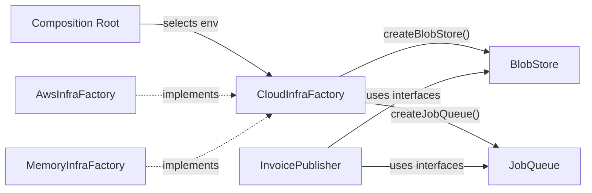

At runtime, concrete factories encapsulate vendor configuration (endpoint URLs, region identifiers, retry policies, cryptographic signers) inside their private fields so product creation remains uniform. Because TypeScript uses structural typing rather than nominal typing, two unrelated product classes sharing method names could accidentally satisfy an interface unless return types carry domain-specific types or branded descriptors; keeping concrete driver classes unexported outside their factory module reinforces compile-time encapsulation.

### 2. Real-World Use Cases & Decision Matrix

| Scenario | Recommended Pattern | Architectural Rationale |
|---|---|---|
| Multi-cloud storage + queue + KMS vault pairing | **Abstract Factory** | Guarantees IAM/region/serialization compatibility across all three cloud SDK primitives |
| Production vs deterministic in-memory test suites | **Abstract Factory** | Swaps the entire external I/O surface (`S3 + SQS` -> `MemoryBlob + MemoryQueue`) with one Composition Root switch |
| Database dialect driver + schema DDL compiler + advisory lock | **Abstract Factory** | Prevents pairing PostgreSQL `pg_advisory_lock` SQL syntax with a SQLite connection driver |
| Single independent storage driver (`BlobStore` only) | **Factory Method** | Only one product varies; an Abstract Factory adds redundant wrapper ceremony |
| $M$ message types across $N$ independent transport drivers | **Bridge** | When the two axes vary independently rather than as locked provider families |

**When NOT to use Abstract Factory**: Do not introduce Abstract Factory when adding a new *product* to the family happens frequently (every new product method added to `CloudInfraFactory` forces edits across every concrete factory implementation, trading extensibility-of-products for extensibility-of-families). Also avoid Abstract Factory if a DI container already wires each concrete adapter directly by environment profile and no cross-product pairing bug can realistically occur.

### 3. Step-by-Step Practical Application

Consider an invoice export pipeline that persists generated PDF bytes to blob storage, publishes a processing message to a queue, and fetches signing keys from a vault. A clean production layout separates contracts, environment factories, domain usage, and Composition Root selection:

```text
src/
  infra/
    infra.contracts.ts
    infra.memory.ts
    infra.aws-sim.ts
    infra.bootstrap.ts
  billing/
    invoice-publisher.ts
tests/
  infra-factory.spec.ts
```

Below is the complete runnable TypeScript implementation with zero stubs:

```typescript
// src/infra/infra.contracts.ts
export class StorageKeyNotFoundError extends Error {
  constructor(public readonly key: string) {
    super(`Blob key not found: ${key}`);
    this.name = 'StorageKeyNotFoundError';
  }
}

export interface BlobObject {
  readonly key: string;
  readonly body: Uint8Array;
  readonly contentType: string;
}

export interface BlobStore {
  put(key: string, body: Uint8Array, contentType: string): Promise<void>;
  get(key: string): Promise<BlobObject>;
}

export interface QueueMessage<TPayload = unknown> {
  readonly messageId: string;
  readonly payload: TPayload;
  readonly enqueuedAtMs: number;
}

export interface JobQueue {
  enqueue<TPayload>(topic: string, payload: TPayload): Promise<string>;
  drain<TPayload>(topic: string): Promise<ReadonlyArray<QueueMessage<TPayload>>>;
}

export interface SecretVault {
  getSigningSecret(secretName: string): Promise<string>;
}

export interface CloudInfraFactory {
  readonly providerName: string;
  createBlobStore(): BlobStore;
  createJobQueue(): JobQueue;
  createSecretVault(): SecretVault;
}
```

```typescript
// src/infra/infra.memory.ts
import {
  BlobObject,
  BlobStore,
  CloudInfraFactory,
  JobQueue,
  QueueMessage,
  SecretVault,
  StorageKeyNotFoundError,
} from './infra.contracts';

class MemoryBlobStore implements BlobStore {
  private readonly store = new Map<string, BlobObject>();

  async put(key: string, body: Uint8Array, contentType: string): Promise<void> {
    // Copy bytes defensively so caller mutations cannot corrupt stored blobs
    this.store.set(key, { key, body: new Uint8Array(body), contentType });
  }

  async get(key: string): Promise<BlobObject> {
    const item = this.store.get(key);
    if (!item) throw new StorageKeyNotFoundError(key);
    return { key: item.key, body: new Uint8Array(item.body), contentType: item.contentType };
  }
}

class MemoryJobQueue implements JobQueue {
  private readonly topics = new Map<string, Array<QueueMessage<unknown>>>();
  private seq = 0;

  async enqueue<TPayload>(topic: string, payload: TPayload): Promise<string> {
    const messageId = `mem-msg-${++this.seq}`;
    const list = this.topics.get(topic) ?? [];
    list.push({
      messageId,
      payload: structuredClone(payload),
      enqueuedAtMs: Date.now(),
    });
    this.topics.set(topic, list);
    return messageId;
  }

  async drain<TPayload>(topic: string): Promise<ReadonlyArray<QueueMessage<TPayload>>> {
    const list = this.topics.get(topic) ?? [];
    this.topics.set(topic, []);
    return list as ReadonlyArray<QueueMessage<TPayload>>;
  }
}

class MemorySecretVault implements SecretVault {
  constructor(private readonly secrets: Readonly<Record<string, string>>) {}

  async getSigningSecret(secretName: string): Promise<string> {
    const val = this.secrets[secretName];
    if (!val) throw new Error(`Missing memory secret: ${secretName}`);
    return val;
  }
}

export class MemoryInfraFactory implements CloudInfraFactory {
  readonly providerName = 'memory';

  constructor(private readonly seededSecrets: Readonly<Record<string, string>>) {}

  createBlobStore(): BlobStore {
    return new MemoryBlobStore();
  }

  createJobQueue(): JobQueue {
    return new MemoryJobQueue();
  }

  createSecretVault(): SecretVault {
    return new MemorySecretVault(this.seededSecrets);
  }
}
```

```typescript
// src/infra/infra.aws-sim.ts
import { createHmac } from 'node:crypto';
import {
  BlobObject,
  BlobStore,
  CloudInfraFactory,
  JobQueue,
  QueueMessage,
  SecretVault,
  StorageKeyNotFoundError,
} from './infra.contracts';

export interface AwsInfraConfig {
  readonly region: string;
  readonly bucketPrefix: string;
  readonly kmsKeyAlias: string;
}

class S3PrefixedBlobStore implements BlobStore {
  private readonly buckets = new Map<string, BlobObject>();

  constructor(private readonly config: AwsInfraConfig) {}

  async put(key: string, body: Uint8Array, contentType: string): Promise<void> {
    const fullKey = `${this.config.region}:${this.config.bucketPrefix}/${key}`;
    this.buckets.set(fullKey, { key: fullKey, body: new Uint8Array(body), contentType });
  }

  async get(key: string): Promise<BlobObject> {
    const fullKey = `${this.config.region}:${this.config.bucketPrefix}/${key}`;
    const found = this.buckets.get(fullKey);
    if (!found) throw new StorageKeyNotFoundError(key);
    return { key, body: new Uint8Array(found.body), contentType: found.contentType };
  }
}

class SqsSignedJobQueue implements JobQueue {
  private readonly queues = new Map<string, Array<QueueMessage<unknown>>>();
  private counter = 0;

  constructor(private readonly config: AwsInfraConfig) {}

  async enqueue<TPayload>(topic: string, payload: TPayload): Promise<string> {
    const messageId = `sqs-${this.config.region}-${++this.counter}`;
    const bucket = this.queues.get(topic) ?? [];
    bucket.push({ messageId, payload: structuredClone(payload), enqueuedAtMs: Date.now() });
    this.queues.set(topic, bucket);
    return messageId;
  }

  async drain<TPayload>(topic: string): Promise<ReadonlyArray<QueueMessage<TPayload>>> {
    const items = this.queues.get(topic) ?? [];
    this.queues.set(topic, []);
    return items as ReadonlyArray<QueueMessage<TPayload>>;
  }
}

class AwsKmsSecretVault implements SecretVault {
  constructor(private readonly config: AwsInfraConfig) {}

  async getSigningSecret(secretName: string): Promise<string> {
    return createHmac('sha256', this.config.kmsKeyAlias)
      .update(`${this.config.region}:${secretName}`)
      .digest('hex');
  }
}

export class AwsInfraFactory implements CloudInfraFactory {
  readonly providerName = 'aws';

  constructor(private readonly config: AwsInfraConfig) {}

  createBlobStore(): BlobStore {
    return new S3PrefixedBlobStore(this.config);
  }

  createJobQueue(): JobQueue {
    return new SqsSignedJobQueue(this.config);
  }

  createSecretVault(): SecretVault {
    return new AwsKmsSecretVault(this.config);
  }
}
```

```typescript
// src/billing/invoice-publisher.ts & src/infra/infra.bootstrap.ts
import { createHmac } from 'node:crypto';
import { BlobStore, CloudInfraFactory, JobQueue, SecretVault } from '../infra/infra.contracts';
import { MemoryInfraFactory } from '../infra/infra.memory';
import { AwsInfraFactory } from '../infra/infra.aws-sim';

export class InvoicePublisher {
  private readonly blobs: BlobStore;
  private readonly queue: JobQueue;
  private readonly vault: SecretVault;

  constructor(factory: CloudInfraFactory) {
    this.blobs = factory.createBlobStore();
    this.queue = factory.createJobQueue();
    this.vault = factory.createSecretVault();
  }

  async publish(invoiceId: string, pdfBytes: Uint8Array): Promise<{ key: string; messageId: string; signature: string }> {
    const key = `invoices/${invoiceId}.pdf`;
    await this.blobs.put(key, pdfBytes, 'application/pdf');
    const secret = await this.vault.getSigningSecret('invoice-hmac');
    const signature = createHmac('sha256', secret).update(pdfBytes).digest('hex');
    const messageId = await this.queue.enqueue('invoice.published', { invoiceId, key, signature });
    return { key, messageId, signature };
  }
}

export function selectInfraFactory(env: 'test' | 'aws'): CloudInfraFactory {
  if (env === 'test') {
    return new MemoryInfraFactory({ 'invoice-hmac': 'test-only-hmac-key-2026' });
  }
  return new AwsInfraFactory({
    region: 'us-east-1',
    bucketPrefix: 'prod-billing-artifacts',
    kmsKeyAlias: 'alias/billing-signing-v2',
  });
}
```

```typescript
// tests/infra-factory.spec.ts
import { describe, expect, it } from 'vitest';
import { CloudInfraFactory, StorageKeyNotFoundError } from '../src/infra/infra.contracts';
import { InvoicePublisher, selectInfraFactory } from '../src/billing/invoice-publisher';

function runInfraContractSuite(name: string, createFactory: () => CloudInfraFactory): void {
  describe(`CloudInfraFactory Contract: ${name}`, () => {
    it('stores and retrieves isolated blob bytes and throws domain error on missing key', async () => {
      const factory = createFactory();
      const blobs = factory.createBlobStore();
      const payload = new Uint8Array([10, 20, 30]);

      await blobs.put('doc/a.bin', payload, 'application/octet-stream');
      payload[0] = 255; // Mutate caller buffer after put()

      const stored = await blobs.get('doc/a.bin');
      expect(Array.from(stored.body)).toEqual([10, 20, 30]);
      await expect(blobs.get('doc/missing.bin')).rejects.toBeInstanceOf(StorageKeyNotFoundError);
    });

    it('publishes signed invoice artifacts coherently through domain service', async () => {
      const factory = createFactory();
      const publisher = new InvoicePublisher(factory);
      const pdfBytes = new TextEncoder().encode('%PDF-1.7 sample');

      const result = await publisher.publish('inv-9001', pdfBytes);
      expect(result.key).toBe('invoices/inv-9001.pdf');
      expect(result.signature).toHaveLength(64);
      expect(result.messageId.length).toBeGreaterThan(0);
    });
  });
}

runInfraContractSuite('memory', () => selectInfraFactory('test'));
runInfraContractSuite('aws', () => selectInfraFactory('aws'));
```

### 4. Modern Idioms, Failure Modes & Framework Sightings

- **Functional Factory Records**: In TypeScript without IoC decorators, an Abstract Factory rarely requires `class ... implements` boilerplate. Returning a plain frozen object literal (`export function createMemoryInfra(): CloudInfraFactory { ... }`) removes `this`-binding hazards and simplifies partial dependency overrides in unit tests.
- **Framework Sightings**: NestJS `DynamicModule` providers (`StorageModule.forRootAsync({ useFactory: ... })` from [[Programming/Backend/NestJS Complete Guide|NestJS Complete Guide]]) act as an Abstract Factory registering cohesive client instances (`S3Client`, `SQSClient`) behind module-exported injection tokens. React Context providers exposing `{ Modal, Button, DatePicker }` for web vs native renderers implement the exact same family contract.
- **Failure Modes**:
  1. *Leaky Vendor Exceptions*: If `S3PrefixedBlobStore` throws raw `@aws-sdk/client-s3` `NoSuchKey` while `MemoryBlobStore` throws `StorageKeyNotFoundError`, callers catching `StorageKeyNotFoundError` break in production. Always translate vendor errors at the product implementation boundary (combining Abstract Factory with [[Programming/Software Engineering/Design Patterns/Structural/Adapter|Adapter]]).
  2. *Async Factory Initialization Trap*: Returning unauthenticated clients from synchronous `createBlobStore()` forces lazy connect logic on every method call. When product setup requires network discovery or OIDC token exchange, make the factory bootstrap method asynchronous (`static async initialize(): Promise<CloudInfraFactory>`).

---

## Prototype

### 1. First-Principles Mechanics & Complete Architecture

**Prototype** creates new configured object instances by **cloning a canonical template instance** rather than re-running expensive parsing, AST compilation, or multi-field construction pipelines from scratch. In JavaScript and TypeScript, object cloning exposes subtle memory-aliasing, prototype-chain stripping, and serialization traps that routinely cause cross-request state corruption in production.

Understanding copy semantics requires inspecting how V8 allocates object references on the heap:

| Copy Mechanism | Nested Object / Array Safety | `Date`, `Map`, `Set`, `RegExp`, `Uint8Array` | Cyclic References | Preserves Class Prototype & Methods |
|---|---|---|---|---|
| **Object Spread / `Object.assign`** | **Unsafe** (shallow pointer copy only) | Aliased references | Shallow only | **No** (produces plain `Object`) |
| **`JSON.parse(JSON.stringify(x))`** | Deep copy for JSON primitives | **Broken** (`Date` -> string; `Map`/`Set` -> `{}`; `BigInt` throws) | **Throws `TypeError`** | **No** |
| **`structuredClone(x)`** | Deep copy | **Full fidelity** | **Supported** | **No** (strips class methods & private `#fields`) |
| **Custom `clone()` Method** | Deep copy when implemented recursively | Explicit copy constructors (`new Map(this.m)`) | Requires `WeakMap` visited cache | **Yes** (retains exact class & methods) |
| **Copy-on-Write (CoW)** | $O(1)$ read sharing; clones branch only on first mutation | Delegated to structural clone on write | Managed per immutable node | Configurable wrapper |

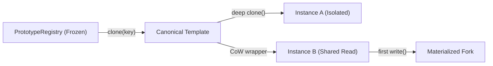

A **Prototype Registry** stores named, deeply frozen templates initialized once at startup. Every `.spawn(key, patch)` call clones the template cleanly so caller mutations never pollute the registry or sibling instances. When templates hold large read-mostly trees (for example, 10,000-rule tenant configurations where 95% of runs modify only 2 fields), **Copy-on-Write (CoW)** defers cloning until the first write access, cutting memory allocation latency from $O(N)$ to $O(1)$ on read-only paths.

### 2. Real-World Use Cases & Decision Matrix

| Scenario | Approach | Engineering Justification |
|---|---|---|
| Domain entities with class methods (`WorkflowTemplate`, AST nodes) | **Custom `Cloneable<T>` + Registry** | `structuredClone` strips prototype methods and throws on functions or private `#fields` |
| Plain JSON/Map/Set state snapshots across workers | **`structuredClone(payload)`** | Native C++ traversal handles cycles, `Uint8Array`, `Map`, `Set`, and `Date` cleanly |
| Large read-mostly config trees patched sparsely per tenant | **Copy-on-Write (`CowBox`)** | Avoids full tree traversal until a caller invokes `.mutate()` |
| Simple flat DTOs (`{ host, port, tls }`) | **Object Spread (`{ ...defaults, ...opts }`)** | Zero nested objects exist; custom Prototype adds unnecessary complexity |

**When NOT to use Prototype**: Never attempt to clone objects owning operating-system handles (open TCP sockets, PostgreSQL transactions, `AbortController`, mutex locks, or `WeakMap` caches). Separate serializable configuration state (cloned via Prototype) from live runtime handles (managed by [[Programming/Software Engineering/Design Patterns/Creational & Behavioral Patterns Catalog#Object Pool|Object Pool]] or Factory).

### 3. Step-by-Step Practical Application

This production example builds a `WorkflowTemplate` class holding nested `Map`, `Set`, `Date`, and `Array` structures, a deeply frozen `PrototypeRegistry` preventing accidental template mutation, and a generic `CowConfigBox<T>` providing Copy-on-Write isolation for heavy plain configurations.

```typescript
// src/prototype/workflow-template.ts
export interface Cloneable<T> {
  clone(): T;
}

export interface RetryConfig {
  maxAttempts: number;
  backoffMs: number;
  retryableCodes: Set<number>;
}

export class WorkflowTemplate implements Cloneable<WorkflowTemplate> {
  public readonly steps: string[];
  public readonly headers: Map<string, string>;
  public readonly retry: RetryConfig;
  public readonly createdAt: Date;

  constructor(
    public readonly templateId: string,
    steps: ReadonlyArray<string>,
    headers: ReadonlyMap<string, string>,
    retry: { maxAttempts: number; backoffMs: number; retryableCodes: Iterable<number> },
    createdAt: Date = new Date()
  ) {
    this.steps = [...steps];
    this.headers = new Map(headers);
    this.retry = {
      maxAttempts: retry.maxAttempts,
      backoffMs: retry.backoffMs,
      retryableCodes: new Set(retry.retryableCodes),
    };
    this.createdAt = new Date(createdAt.getTime());
  }

  describe(): string {
    return `${this.templateId}[${this.steps.join('->')}]`;
  }

  clone(): WorkflowTemplate {
    return new WorkflowTemplate(
      this.templateId,
      this.steps,
      this.headers,
      this.retry,
      this.createdAt
    );
  }
}

export function deepFreeze<T>(value: T): T {
  if (value === null || typeof value !== 'object') return value;
  if (value instanceof Map || value instanceof Set || value instanceof Date) {
    return Object.freeze(value);
  }
  Object.freeze(value);
  for (const prop of Object.values(value as Record<string, unknown>)) {
    deepFreeze(prop);
  }
  return value;
}

export class PrototypeRegistry<T extends Cloneable<T>> {
  private readonly prototypes = new Map<string, T>();

  register(key: string, prototype: T): void {
    // Store an isolated frozen copy so external mutations after register() cannot corrupt the catalog
    const isolated = deepFreeze(prototype.clone());
    this.prototypes.set(key, isolated);
  }

  spawn(key: string, configure?: (instance: T) => void): T {
    const proto = this.prototypes.get(key);
    if (!proto) throw new Error(`Unknown prototype key: ${key}`);
    const instance = proto.clone();
    configure?.(instance);
    return instance;
  }
}

export class CowConfigBox<T extends object> {
  private sharedRef: T;
  private copied = false;

  constructor(frozenBase: T) {
    this.sharedRef = frozenBase;
  }

  read(): Readonly<T> {
    return this.sharedRef;
  }

  isDetached(): boolean {
    return this.copied;
  }

  mutate(updater: (draft: T) => void): T {
    if (!this.copied) {
      this.sharedRef = structuredClone(this.sharedRef);
      this.copied = true;
    }
    updater(this.sharedRef);
    return this.sharedRef;
  }
}
```

```typescript
// tests/prototype.spec.ts
import { describe, expect, it } from 'vitest';
import { CowConfigBox, deepFreeze, PrototypeRegistry, WorkflowTemplate } from '../src/prototype/workflow-template';

describe('Prototype Registry & Copy-on-Write', () => {
  it('isolates nested arrays, maps, sets, and dates across spawned instances while preserving methods', () => {
    const registry = new PrototypeRegistry<WorkflowTemplate>();
    const canonical = new WorkflowTemplate(
      'checkout-v1',
      ['validate', 'charge'],
      new Map([['x-region', 'us-east']]),
      { maxAttempts: 3, backoffMs: 200, retryableCodes: [502, 503] },
      new Date('2026-01-01T00:00:00Z')
    );

    registry.register('checkout', canonical);
    // Mutating caller's original instance after register() must not affect registry
    canonical.steps.push('post-register-pollution');

    const tenantA = registry.spawn('checkout', (wf) => {
      wf.steps.push('audit-eu');
      wf.headers.set('x-region', 'eu-west');
      wf.retry.retryableCodes.add(504);
      wf.createdAt.setUTCFullYear(2027);
    });

    const tenantB = registry.spawn('checkout');

    expect(tenantA.describe()).toBe('checkout-v1[validate->charge->audit-eu]');
    expect(tenantB.describe()).toBe('checkout-v1[validate->charge]');
    expect(tenantB.headers.get('x-region')).toBe('us-east');
    expect(tenantB.retry.retryableCodes.has(504)).toBe(false);
    expect(tenantB.createdAt.getUTCFullYear()).toBe(2026);
  });

  it('demonstrates structuredClone stripping class methods vs custom clone()', () => {
    const tpl = new WorkflowTemplate(
      'etl',
      ['extract'],
      new Map(),
      { maxAttempts: 1, backoffMs: 50, retryableCodes: [500] }
    );
    const rawCloned = structuredClone(tpl) as unknown as WorkflowTemplate;
    expect(typeof rawCloned.describe).toBe('undefined');
    expect(typeof tpl.clone().describe).toBe('function');
  });

  it('defers deep cloning in CowConfigBox until first write mutation', () => {
    const base = deepFreeze({
      flags: { darkMode: false },
      limits: [10, 20],
    });

    const readOnlyView = new CowConfigBox(base);
    expect(readOnlyView.read()).toBe(base); // O(1) shared reference
    expect(readOnlyView.isDetached()).toBe(false);

    readOnlyView.mutate((draft) => {
      draft.flags.darkMode = true;
      draft.limits.push(30);
    });

    expect(readOnlyView.isDetached()).toBe(true);
    expect(readOnlyView.read().flags.darkMode).toBe(true);
    expect(base.flags.darkMode).toBe(false);
    expect(base.limits).toEqual([10, 20]);
  });
});
```

### 4. Modern Idioms, Failure Modes & Framework Sightings

- **Immutable State & Immer**: In Redux/Zustand stores and React hooks, structural sharing via `immer` `produce(baseState, draft => { ... })` automates Copy-on-Write across deeply nested trees without manual `.clone()` boilerplate.
- **Test Fixture Builders**: Libraries and teams combine Prototype defaults with partial overrides (`makeUser(overrides?: Partial<User>) => structuredClone({ ...defaultUser, ...overrides })`) to avoid brittle shared global test fixtures.
- **Failure Modes**:
  1. *Hidden Shallow Aliases*: Calling `Object.freeze(canonical)` shallowly leaves nested arrays (`canonical.steps`) mutable! Notice `deepFreeze` above freezes nested objects, while `Map.prototype.set` / `Set.prototype.add` ignore `Object.freeze` in JavaScript because collection slots live internally rather than as own properties—cloning *before* storing and handing out clones on every `.spawn()` is mandatory protection!
  2. *`#private` Field Crash*: TypeScript/ECMAScript private fields (`#secret`) are inaccessible to `structuredClone()` and external reflection; always write explicit `.clone()` methods on classes containing private state.

---

## Object Pool

### 1. First-Principles Mechanics & Complete Architecture

While the original 1994 Gang of Four catalog listed five Creational patterns, modern backend runtimes and compute systems depend critically on a sixth Creational pattern: **Object Pool**. Object Pool bounds the maximum number of expensive, stateful, or rate-limited resources (PostgreSQL TCP/TLS connections, V8 `worker_threads`, WASM sandboxes, Playwright browser contexts, GPU memory buffers) and **amortizes initialization latency** across thousands of short-lived requests by leasing and recycling verified instances.

A production-grade pool enforces five strict invariants:
1. **Bounded Capacity (`maxSize`)**: Never allocate unbounded resources under traffic spikes; excess callers wait in a FIFO queue with an explicit deadline (`acquireTimeoutMs`) and `AbortSignal` support.
2. **Pre-Lease & Return Health Verification**: Stale TCP sockets closed by firewalls or idle timeouts (`FIN`/`RST`) must be detected via `validate(item)` and evicted rather than handed to callers.
3. **State Scrubbing (`reset`)**: Resources returning to the pool must clear residual transaction state, temporary variables, or tenant context before another caller leases them.
4. **Deterministic Lease Release**: Callers must never rely on garbage collection; release happens deterministically via an RAII `use(fn)` wrapper or TC39 `Symbol.asyncDispose` (`await using lease = await pool.acquireLease()`).
5. **Bounded Lifetime (`maxAgeMs`)**: Even healthy connections are rotated periodically to respect DNS TTL updates, TLS credential rotations, and memory fragmentation limits.

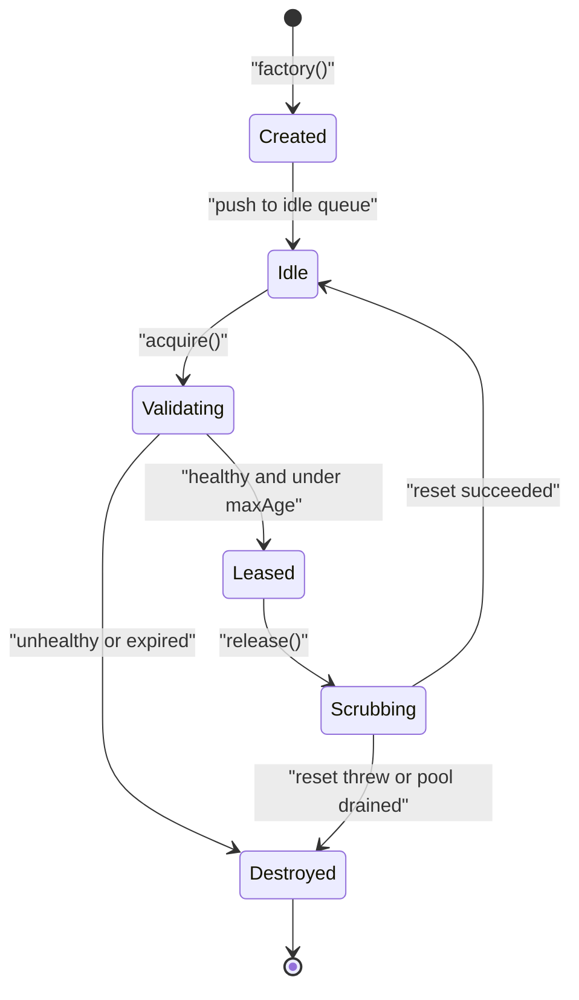

### 2. Real-World Use Cases & Decision Matrix

| Workload | Use Object Pool? | Engineering Reasoning |
|---|---|---|
| PostgreSQL / Redis / gRPC TLS connections | **Yes** | TCP + TLS handshake + auth costs 10–80ms and DB `max_connections` is strictly bounded |
| Node.js `worker_threads` or WASM VM isolates | **Yes** | Booting a V8 isolate takes 20–50ms and tens of MiB; pools enforce CPU core concurrency limits |
| Plain JavaScript DTOs / AST nodes / small buffers | **No (Anti-Pattern)** | V8's nursery (Scavenger GC) allocates short-lived objects via bump pointer in ~5ns; pooling forces promotion to Old Space and degrades GC write-barrier throughput |
| Stateless HTTP `fetch` client wrapper | **No** | Use underlying `undici.Pool` socket pooling; the wrapper object itself is trivially cheap |

### 3. Step-by-Step Practical Application

Below is a complete, production-ready `BoundedObjectPool<T>` supporting asynchronous factory creation, `validate`, `reset`, `destroy`, `maxSize`, `maxAgeMs`, `acquireTimeoutMs`, `AbortSignal` queue cancellation, `Symbol.asyncDispose` RAII leases, and live pool metrics.

```typescript
// src/pool/bounded-object-pool.ts
export class PoolAcquireTimeoutError extends Error {
  constructor(timeoutMs: number) {
    super(`Timed out waiting for pooled resource after ${timeoutMs}ms`);
    this.name = 'PoolAcquireTimeoutError';
  }
}

export class PoolClosedError extends Error {
  constructor() {
    super('Object pool has been drained and closed');
    this.name = 'PoolClosedError';
  }
}

export interface PoolConfig<T> {
  readonly maxSize: number;
  readonly acquireTimeoutMs: number;
  readonly maxAgeMs: number;
  readonly create: () => Promise<T>;
  readonly validate: (resource: T) => Promise<boolean>;
  readonly reset?: (resource: T) => Promise<void>;
  readonly destroy: (resource: T) => Promise<void>;
}

interface PoolEntry<T> {
  readonly resource: T;
  readonly createdAtMs: number;
}

interface Waiter<T> {
  readonly resolve: (entry: PoolEntry<T>) => void;
  readonly reject: (err: Error) => void;
  readonly timer: ReturnType<typeof setTimeout>;
  cleanupAbort: () => void;
}

export interface PoolLease<T> extends AsyncDisposable {
  readonly resource: T;
  release(): Promise<void>;
}

export interface PoolMetrics {
  readonly totalAllocated: number;
  readonly idle: number;
  readonly leased: number;
  readonly waiting: number;
  readonly evicted: number;
}

export class BoundedObjectPool<T> {
  private readonly idleQueue: Array<PoolEntry<T>> = [];
  private readonly activeLeases = new Map<T, PoolEntry<T>>();
  private readonly waitQueue: Array<Waiter<T>> = [];
  private pendingCreations = 0;
  private evictedCount = 0;
  private closed = false;

  constructor(private readonly config: PoolConfig<T>) {
    if (config.maxSize < 1) throw new RangeError('maxSize must be >= 1');
    if (config.acquireTimeoutMs < 1) throw new RangeError('acquireTimeoutMs must be >= 1');
  }

  getMetrics(): PoolMetrics {
    return {
      totalAllocated: this.idleQueue.length + this.activeLeases.size + this.pendingCreations,
      idle: this.idleQueue.length,
      leased: this.activeLeases.size,
      waiting: this.waitQueue.length,
      evicted: this.evictedCount,
    };
  }

  async use<R>(fn: (resource: T) => Promise<R>, signal?: AbortSignal): Promise<R> {
    const lease = await this.acquireLease(signal);
    try {
      return await fn(lease.resource);
    } finally {
      await lease.release();
    }
  }

  async acquireLease(signal?: AbortSignal): Promise<PoolLease<T>> {
    const entry = await this.acquireEntry(signal);
    let released = false;

    const release = async (): Promise<void> => {
      if (released) return;
      released = true;
      await this.releaseEntry(entry);
    };

    return {
      resource: entry.resource,
      release,
      [Symbol.asyncDispose]: release,
    };
  }

  private async acquireEntry(signal?: AbortSignal): Promise<PoolEntry<T>> {
    if (this.closed) throw new PoolClosedError();
    if (signal?.aborted) throw new Error('Pool acquire aborted before enqueue');

    // 1. Try existing idle resources, evicting expired or unhealthy entries
    while (this.idleQueue.length > 0) {
      const candidate = this.idleQueue.pop()!;
      if (await this.isUsable(candidate)) {
        this.activeLeases.set(candidate.resource, candidate);
        return candidate;
      }
      await this.evict(candidate);
    }

    // 2. Allocate fresh resource if under capacity ceiling
    const inFlight = this.idleQueue.length + this.activeLeases.size + this.pendingCreations;
    if (inFlight < this.config.maxSize) {
      this.pendingCreations++;
      try {
        const resource = await this.config.create();
        const entry: PoolEntry<T> = { resource, createdAtMs: Date.now() };
        this.activeLeases.set(resource, entry);
        return entry;
      } finally {
        this.pendingCreations--;
      }
    }

    // 3. Otherwise wait in bounded FIFO queue with timeout + AbortSignal cancellation
    return new Promise<PoolEntry<T>>((resolve, reject) => {
      const waiter: Waiter<T> = {
        resolve,
        reject,
        timer: setTimeout(() => {
          this.removeWaiter(waiter);
          reject(new PoolAcquireTimeoutError(this.config.acquireTimeoutMs));
        }, this.config.acquireTimeoutMs),
        cleanupAbort: () => {},
      };

      if (signal) {
        const onAbort = () => {
          this.removeWaiter(waiter);
          reject(new Error('Pool acquire aborted while waiting'));
        };
        signal.addEventListener('abort', onAbort, { once: true });
        waiter.cleanupAbort = () => signal.removeEventListener('abort', onAbort);
      }

      this.waitQueue.push(waiter);
    });
  }

  private async releaseEntry(entry: PoolEntry<T>): Promise<void> {
    this.activeLeases.delete(entry.resource);

    if (this.closed) {
      await this.evict(entry);
      return;
    }

    try {
      await this.config.reset?.(entry.resource);
    } catch {
      await this.evict(entry);
      await this.replenishWaiterIfNeeded();
      return;
    }

    if (!(await this.isUsable(entry))) {
      await this.evict(entry);
      await this.replenishWaiterIfNeeded();
      return;
    }

    const nextWaiter = this.waitQueue.shift();
    if (nextWaiter) {
      clearTimeout(nextWaiter.timer);
      nextWaiter.cleanupAbort();
      this.activeLeases.set(entry.resource, entry);
      nextWaiter.resolve(entry);
      return;
    }

    this.idleQueue.push(entry);
  }

  private async replenishWaiterIfNeeded(): Promise<void> {
    if (this.closed || this.waitQueue.length === 0) return;
    const total = this.idleQueue.length + this.activeLeases.size + this.pendingCreations;
    if (total >= this.config.maxSize) return;

    const waiter = this.waitQueue.shift();
    if (!waiter) return;

    clearTimeout(waiter.timer);
    waiter.cleanupAbort();
    this.pendingCreations++;
    try {
      const resource = await this.config.create();
      const entry: PoolEntry<T> = { resource, createdAtMs: Date.now() };
      this.activeLeases.set(resource, entry);
      waiter.resolve(entry);
    } catch (err) {
      waiter.reject(err instanceof Error ? err : new Error(String(err)));
    } finally {
      this.pendingCreations--;
    }
  }

  private removeWaiter(target: Waiter<T>): void {
    const idx = this.waitQueue.indexOf(target);
    if (idx !== -1) this.waitQueue.splice(idx, 1);
    clearTimeout(target.timer);
    target.cleanupAbort();
  }

  private async isUsable(entry: PoolEntry<T>): Promise<boolean> {
    if (Date.now() - entry.createdAtMs > this.config.maxAgeMs) return false;
    try {
      return await this.config.validate(entry.resource);
    } catch {
      return false;
    }
  }

  private async evict(entry: PoolEntry<T>): Promise<void> {
    this.evictedCount++;
    try {
      await this.config.destroy(entry.resource);
    } catch {
      // Suppress destroy failure after eviction accounting so pool capacity cannot leak
    }
  }

  async drain(): Promise<void> {
    this.closed = true;
    while (this.waitQueue.length > 0) {
      const waiter = this.waitQueue.shift()!;
      clearTimeout(waiter.timer);
      waiter.cleanupAbort();
      waiter.reject(new PoolClosedError());
    }
    const toDestroy = this.idleQueue.splice(0, this.idleQueue.length);
    await Promise.all(toDestroy.map((entry) => this.evict(entry)));
  }
}
```

```typescript
// tests/object-pool.spec.ts
import { describe, expect, it } from 'vitest';
import { BoundedObjectPool, PoolAcquireTimeoutError } from '../src/pool/bounded-object-pool';

interface FakeConn {
  readonly id: number;
  healthy: boolean;
  dirtySessionVar: string | null;
}

describe('BoundedObjectPool', () => {
  it('enforces maxSize ceiling and wakes queued callers in FIFO order', async () => {
    let seq = 0;
    const pool = new BoundedObjectPool<FakeConn>({
      maxSize: 2,
      acquireTimeoutMs: 250,
      maxAgeMs: 60_000,
      create: async () => ({ id: ++seq, healthy: true, dirtySessionVar: null }),
      validate: async (c) => c.healthy,
      reset: async (c) => {
        c.dirtySessionVar = null;
      },
      destroy: async () => {},
    });

    const order: number[] = [];
    const tasks = [1, 2, 3, 4].map((n) =>
      pool.use(async (conn) => {
        conn.dirtySessionVar = `tenant-${n}`;
        order.push(n);
        await new Promise((r) => setTimeout(r, 25));
        return conn.id;
      })
    );

    const ids = await Promise.all(tasks);
    expect(order).toEqual([1, 2, 3, 4]);
    expect(Math.max(...ids)).toBe(2); // Never allocated > maxSize=2 connections
    expect(pool.getMetrics().idle).toBe(2);
    await pool.drain();
  });

  it('rejects on acquireTimeoutMs and replaces unhealthy evicted connections cleanly', async () => {
    let seq = 0;
    const destroyed: number[] = [];
    const pool = new BoundedObjectPool<FakeConn>({
      maxSize: 1,
      acquireTimeoutMs: 40,
      maxAgeMs: 60_000,
      create: async () => ({ id: ++seq, healthy: true, dirtySessionVar: null }),
      validate: async (c) => c.healthy,
      destroy: async (c) => {
        destroyed.push(c.id);
      },
    });

    const lease1 = await pool.acquireLease();
    await expect(pool.acquireLease()).rejects.toBeInstanceOf(PoolAcquireTimeoutError);

    // Poison connection 1 before release so pool must evict & replace it
    lease1.resource.healthy = false;
    await lease1.release();

    const lease2 = await pool.acquireLease();
    expect(lease2.resource.id).toBe(2);
    expect(destroyed).toEqual([1]);
    await lease2.release();
    await pool.drain();
  });

  it('cancels queued waiter immediately when AbortSignal triggers', async () => {
    let seq = 0;
    const pool = new BoundedObjectPool<FakeConn>({
      maxSize: 1,
      acquireTimeoutMs: 1_000,
      maxAgeMs: 60_000,
      create: async () => ({ id: ++seq, healthy: true, dirtySessionVar: null }),
      validate: async (c) => c.healthy,
      destroy: async () => {},
    });

    const held = await pool.acquireLease();
    const ac = new AbortController();
    const pending = pool.acquireLease(ac.signal);
    ac.abort();

    await expect(pending).rejects.toThrow('aborted');
    expect(pool.getMetrics().waiting).toBe(0);
    await held.release();
    await pool.drain();
  });
});
```

### 4. Failure Modes & Framework Sightings

- **Framework Sightings**: `pg.Pool` (`node-postgres`), Node.js `undici.Pool` for HTTP/1.1 persistent keep-alive sockets, `piscina` for bounded `worker_threads`, and Prisma / PgBouncer transaction poolers all implement variants of `BoundedObjectPool`.
- **Production Failure Modes**:
  1. *Forgotten `release()` Starvation*: Returning raw resources without `try { ... } finally { release(); }` or `await using` permanently reduces effective `maxSize` on every thrown exception until the entire API stalls with `PoolAcquireTimeoutError`.
  2. *Cross-Tenant State Poisoning*: Calling `BEGIN` or `SET LOCAL role = 'tenant_a'` on a pooled PostgreSQL client and returning it without `ROLLBACK; RESET ALL;` leaks tenant privileges to the next caller.
  3. *Synchronized `maxAgeMs` Thundering Herd*: If 50 connections boot simultaneously at process startup with an identical `maxAgeMs = 3_600_000`, all 50 expire at the same second one hour later, saturating the database TLS handshake queue. Add random jitter (`maxAgeMs * (0.85 + Math.random() * 0.3)`) in production pools.

---
# Part II: Behavioral Patterns

## Chain of Responsibility

### 1. First-Principles Mechanics & Complete Architecture

**Chain of Responsibility** decouples a request sender from the ordered sequence of handlers that validate, enrich, transform, audit, or short-circuit that request. Rather than hardcoding nested `if/else` conditionals inside one monolithic controller method, each stage encapsulates a single policy responsibility and holds a continuation hook (`next()`) pointing to the remaining pipeline.

Production Node.js and TypeScript frameworks implement two distinct topologies:
1. **Linear Short-Circuit Chain**: Handlers inspect a payload sequentially; the first handler matching a condition handles it and exits (or delegates forward until exhausted). Common in alert escalation and support ticket routing.
2. **Bidirectional Onion Middleware Pipeline**: Each middleware executes **pre-processing logic**, invokes `await next()`, and resumes **post-processing logic** after all downstream handlers unwind—forming a nested call stack around the terminal route handler. This allows an outer `ErrorBoundaryMiddleware` to wrap downstream `try { await next(); } catch (err) { ... }` and an outer `TimingMiddleware` to measure total downstream latency across the full request lifecycle.

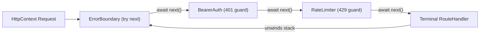

Two critical invariants prevent subtle production corruption:
- **Single-Dispatch `next()` Guard**: Inside `composeMiddleware()`, tracking the highest dispatched index (`if (i <= index) throw new Error('next() called multiple times')`) catches bugs where a middleware forgets `return` after short-circuiting and accidentally runs downstream route logic twice.
- **Terminal Fallback Handler**: Pipelines must end with an explicit terminal handler (`404 Not Found` or `UnhandledRequestError`) so an un-intercepted request never silently falls off the end with an empty `200 OK` response.

### 2. Real-World Use Cases & Decision Matrix

| Scenario | Recommended Topology | Architectural Rationale |
|---|---|---|
| HTTP/GraphQL auth, CORS, rate-limiting, logging, error mapping | **Onion `async (ctx, next)` Pipeline** | Outer layers wrap downstream execution cleanly for timing, telemetry spans, and centralized error serialization |
| Multi-stage payment fraud screening (`Velocity -> Sanctions -> ManualReview`) | **Short-Circuit Policy Chain** | Rejecting on high-confidence fraud stops downstream paid third-party KYC API calls immediately |
| Cross-cutting behavior wrapping one fixed domain interface (`HttpClient.send`) | [[Programming/Software Engineering/Design Patterns/Structural Patterns Catalog#Decorator\|Decorator]] | Use Decorator when stacking wrappers permanently around one method signature; use CoR when handlers dynamically short-circuit or route variable HTTP/command pipelines |
| Dynamic runtime single-algorithm dispatch by key | [[Programming/Software Engineering/Design Patterns/Behavioral/Strategy\|Strategy]] | Strategy selects **one** handler by key ($O(1)$ lookup); CoR traverses **many** handlers conditionally |

**When NOT to use Chain of Responsibility**: Avoid CoR when every step must execute unconditionally in a trivial sequential script (`parse(); validate(); save();`) where straight-line function calls read clearly without continuation callbacks, or when complex branching graphs require a finite state machine rather than linear traversal.

### 3. Step-by-Step Practical Application

Below is a complete, dependency-free production onion middleware engine (`composeMiddleware`) paired with error boundary, bearer authentication, sliding-window rate limiting, and terminal fallback handlers, plus a full Vitest test suite.

```typescript
// src/cor/middleware-pipeline.ts
export interface HttpRequest {
  readonly method: string;
  readonly path: string;
  readonly clientIp: string;
  readonly headers: Readonly<Record<string, string | undefined>>;
  readonly body?: unknown;
}

export interface HttpContext {
  readonly req: HttpRequest;
  readonly state: {
    userId?: string;
    traceLog: string[];
  };
  status: number;
  responseBody: unknown;
}

export type NextFn = () => Promise<void>;
export type Middleware = (ctx: HttpContext, next: NextFn) => Promise<void>;

export class DoubleNextInvocationError extends Error {
  constructor(index: number) {
    super(`Middleware at index ${index} invoked next() multiple times`);
    this.name = 'DoubleNextInvocationError';
  }
}

export function composeMiddleware(middlewares: ReadonlyArray<Middleware>): (ctx: HttpContext) => Promise<void> {
  return async (ctx: HttpContext): Promise<void> => {
    let lastDispatchedIndex = -1;

    async function dispatch(index: number): Promise<void> {
      if (index <= lastDispatchedIndex) {
        throw new DoubleNextInvocationError(index - 1);
      }
      lastDispatchedIndex = index;
      const fn = middlewares[index];
      if (!fn) return;
      await fn(ctx, () => dispatch(index + 1));
    }

    await dispatch(0);
  };
}

export const errorBoundaryMiddleware: Middleware = async (ctx, next) => {
  ctx.state.traceLog.push('error:enter');
  try {
    await next();
  } catch (err) {
    ctx.status = 500;
    ctx.responseBody = {
      error: 'INTERNAL_SERVER_ERROR',
      message: err instanceof Error ? err.message : 'Unknown failure',
    };
  } finally {
    ctx.state.traceLog.push('error:exit');
  }
};

export function createBearerAuthMiddleware(validTokens: ReadonlyMap<string, string>): Middleware {
  return async (ctx, next) => {
    ctx.state.traceLog.push('auth:enter');
    const authHeader = ctx.req.headers['authorization'];
    const token = authHeader?.startsWith('Bearer ') ? authHeader.slice(7).trim() : '';
    const userId = validTokens.get(token);

    if (!userId) {
      ctx.status = 401;
      ctx.responseBody = { error: 'UNAUTHORIZED' };
      ctx.state.traceLog.push('auth:rejected');
      return; // Critical: short-circuit without calling next()
    }

    ctx.state.userId = userId;
    await next();
    ctx.state.traceLog.push('auth:exit');
  };
}

export function createRateLimitMiddleware(maxRequests: number, windowMs: number, nowFn: () => number = Date.now): Middleware {
  const hitsByIp = new Map<string, number[]>();

  return async (ctx, next) => {
    ctx.state.traceLog.push('ratelimit:enter');
    const now = nowFn();
    const cutoff = now - windowMs;
    const recent = (hitsByIp.get(ctx.req.clientIp) ?? []).filter((ts) => ts > cutoff);

    if (recent.length >= maxRequests) {
      ctx.status = 429;
      ctx.responseBody = { error: 'RATE_LIMITED', retryAfterMs: windowMs };
      ctx.state.traceLog.push('ratelimit:rejected');
      return;
    }

    recent.push(now);
    hitsByIp.set(ctx.req.clientIp, recent);
    await next();
    ctx.state.traceLog.push('ratelimit:exit');
  };
}

export const terminalNotFoundMiddleware: Middleware = async (ctx) => {
  ctx.state.traceLog.push('terminal:404');
  ctx.status = 404;
  ctx.responseBody = { error: 'NOT_FOUND', path: ctx.req.path };
};
```

```typescript
// tests/chain-of-responsibility.spec.ts
import { describe, expect, it } from 'vitest';
import {
  composeMiddleware,
  createBearerAuthMiddleware,
  createRateLimitMiddleware,
  DoubleNextInvocationError,
  errorBoundaryMiddleware,
  HttpContext,
  Middleware,
  terminalNotFoundMiddleware,
} from '../src/cor/middleware-pipeline';

function makeContext(overrides: Partial<HttpContext['req']> = {}): HttpContext {
  return {
    req: {
      method: 'POST',
      path: '/v1/orders',
      clientIp: '10.0.0.8',
      headers: { authorization: 'Bearer tok-alice' },
      ...overrides,
    },
    state: { traceLog: [] },
    status: 0,
    responseBody: null,
  };
}

describe('Chain of Responsibility Onion Pipeline', () => {
  it('executes enter and exit phases in strict LIFO onion order', async () => {
    const tokens = new Map([['tok-alice', 'user-1']]);
    const routeHandler: Middleware = async (ctx) => {
      ctx.state.traceLog.push('handler');
      ctx.status = 201;
      ctx.responseBody = { createdBy: ctx.state.userId };
    };

    const run = composeMiddleware([
      errorBoundaryMiddleware,
      createBearerAuthMiddleware(tokens),
      createRateLimitMiddleware(5, 60_000),
      routeHandler,
      terminalNotFoundMiddleware,
    ]);

    const ctx = makeContext();
    await run(ctx);

    expect(ctx.status).toBe(201);
    expect(ctx.responseBody).toEqual({ createdBy: 'user-1' });
    expect(ctx.state.traceLog).toEqual([
      'error:enter',
      'auth:enter',
      'ratelimit:enter',
      'handler',
      'ratelimit:exit',
      'auth:exit',
      'error:exit',
    ]);
  });

  it('short-circuits on failed authentication without invoking downstream handlers', async () => {
    let handlerCalled = false;
    const run = composeMiddleware([
      errorBoundaryMiddleware,
      createBearerAuthMiddleware(new Map([['tok-alice', 'user-1']])),
      async () => {
        handlerCalled = true;
      },
    ]);

    const ctx = makeContext({ headers: { authorization: 'Bearer invalid' } });
    await run(ctx);

    expect(handlerCalled).toBe(false);
    expect(ctx.status).toBe(401);
    expect(ctx.state.traceLog).toEqual(['error:enter', 'auth:enter', 'auth:rejected', 'error:exit']);
  });

  it('catches downstream errors inside errorBoundary and blocks double next() calls', async () => {
    const buggyDoubleNext: Middleware = async (_ctx, next) => {
      await next();
      await next();
    };

    const guardedRun = composeMiddleware([buggyDoubleNext, async (ctx) => { ctx.status = 200; }]);
    await expect(guardedRun(makeContext())).rejects.toBeInstanceOf(DoubleNextInvocationError);

    const boundedRun = composeMiddleware([
      errorBoundaryMiddleware,
      async () => {
        throw new Error('Database timeout');
      },
    ]);
    const ctx = makeContext();
    await boundedRun(ctx);
    expect(ctx.status).toBe(500);
    expect(ctx.responseBody).toEqual({ error: 'INTERNAL_SERVER_ERROR', message: 'Database timeout' });
  });
});
```

### 4. Modern Idioms, Failure Modes & Framework Sightings

- **Framework Sightings**: Express `(req, res, next)` implements a callback-based linear chain (wrapping response completion requires monkey-patching `res.end`), whereas Koa and Hono implement the true `async (ctx, next)` onion stack shown above. NestJS splits Chain of Responsibility across specialized lifecycle stages (`Middleware -> Guards -> Interceptors (RxJS Observable) -> Pipes -> Route -> ExceptionFilters`), covered in [[Programming/Backend/NestJS Complete Guide|NestJS Complete Guide]]. Redux `applyMiddleware` builds a synchronous onion chain around `store.dispatch(action)`.
- **Failure Modes**:
  1. *Missing `return` After Short-Circuit*: Writing `res.status(401).json(...); next();` instead of `return res.status(401)...;` triggers downstream DB writes after returning an unauthorized error and crashes Node with `ERR_HTTP_HEADERS_SENT`.
  2. *Missing `await` on `next()`*: Writing `next();` without `await` causes outer error boundaries and `try/finally` timing middlewares to unwind **before** downstream async route handlers settle, swallowing rejected promises as unhandled rejections and logging `0.2ms` response times!

---

## Command

### 1. First-Principles Mechanics & Complete Architecture

**Command** transforms a method invocation (target receiver, action name, parameters, and inverse rollback payload) into a **first-class immutable object or serializable DTO**. Decoupling the **Invoker** (UI toolbar, keyboard shortcut router, cron scheduler, queue worker) from the **Receiver** (domain aggregate or storage engine) unlocks four foundational capabilities:
1. **Deterministic Undo/Redo**: By storing an inverse operation (`undo()`) alongside `execute()`, a `CommandHistory` maintains two stacks (`undoStack`, `redoStack`). Whenever a user runs a *new* command after undoing steps, `redoStack` **must be cleared** (`redoStack.length = 0`) to preserve a linear timeline free of ghost branches.
2. **Atomic Macro Batching**: Composite `MacroCommand` groups multiple sub-commands into a single undoable step. If step $k$ throws during `execute()`, the macro **rolls back steps $k-1 \dots 0$ in reverse order** so partial mutations never leak.
3. **Serializable Job Queues & Outbox**: When commands cross process boundaries (`{ commandId, type, idempotencyKey, payload }`), they become durable queue messages supporting retries, backoff delays, and Dead-Letter Queue (DLQ) inspection.
4. **Audit Trails & Replay**: Every executed command records actor, timestamp, and before/after intent for regulatory compliance or [[Programming/Software Engineering/Architectural Patterns/Event Sourcing|Event Sourcing]] / [[Programming/Software Engineering/Architectural Patterns/CQRS|CQRS]] command buses.

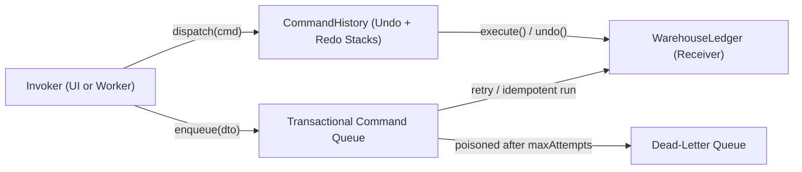

### 2. Real-World Use Cases & Decision Matrix

| Scenario | Variant | Engineering Rationale |
|---|---|---|
| Text/CAD/spreadsheet local edits with 10,000+ undo steps | **Inverse-Delta Reversible Command** | Stores tiny before/after deltas (~64 bytes) rather than copying megabytes of document state per keystroke |
| Multi-step non-invertible pixel/audio filter pipeline | [[Programming/Software Engineering/Design Patterns/Creational & Behavioral Patterns Catalog#Memento\|Memento Snapshot]] | Gaussian blur or lossy compression lacks an algebraic inverse; restore prior snapshots instead |
| Background email, billing capture, webhook delivery | **Serializable Command DTO + Worker Queue** | Survives process restarts across BullMQ/SQS with idempotency deduplication and DLQ recovery |
| Simple synchronous method call never queued or undone | **Direct Function Call** | Creating a `Command` class for a trivial getter or fire-and-forget helper adds needless indirection |

### 3. Step-by-Step Practical Application

This module implements both halves of production Command design: (a) a bounded `CommandHistory` with atomic `MacroCommand` rollback over a `WarehouseLedger` receiver, and (b) a `TransactionalCommandQueue` supporting idempotency keys, retry limits, and DLQ routing.

```typescript
// src/command/command-system.ts
export interface ReversibleCommand {
  readonly name: string;
  execute(): void;
  undo(): void;
}

export class InsufficientStockError extends Error {
  constructor(sku: string, available: number, requested: number) {
    super(`Insufficient stock for ${sku}: available=${available}, requested=${requested}`);
    this.name = 'InsufficientStockError';
  }
}

export class WarehouseLedger {
  private readonly balances = new Map<string, number>();

  getStock(sku: string): number {
    return this.balances.get(sku) ?? 0;
  }

  adjust(sku: string, delta: number): number {
    const current = this.getStock(sku);
    const next = current + delta;
    if (next < 0) {
      throw new InsufficientStockError(sku, current, -delta);
    }
    this.balances.set(sku, next);
    return next;
  }
}

export class AdjustInventoryCommand implements ReversibleCommand {
  readonly name = 'AdjustInventory';

  constructor(
    private readonly ledger: WarehouseLedger,
    private readonly sku: string,
    private readonly delta: number
  ) {}

  execute(): void {
    this.ledger.adjust(this.sku, this.delta);
  }

  undo(): void {
    this.ledger.adjust(this.sku, -this.delta);
  }
}

export class MacroCommand implements ReversibleCommand {
  constructor(
    public readonly name: string,
    private readonly commands: ReadonlyArray<ReversibleCommand>
  ) {}

  execute(): void {
    const executed: ReversibleCommand[] = [];
    try {
      for (const cmd of this.commands) {
        cmd.execute();
        executed.push(cmd);
      }
    } catch (err) {
      // Atomic rollback of already-succeeded sub-commands in strict reverse order
      for (let i = executed.length - 1; i >= 0; i--) {
        executed[i]!.undo();
      }
      throw err;
    }
  }

  undo(): void {
    for (let i = this.commands.length - 1; i >= 0; i--) {
      this.commands[i]!.undo();
    }
  }
}

export class CommandHistory {
  private readonly undoStack: ReversibleCommand[] = [];
  private readonly redoStack: ReversibleCommand[] = [];

  constructor(private readonly maxHistory: number = 100) {
    if (maxHistory < 1) throw new RangeError('maxHistory must be >= 1');
  }

  run(command: ReversibleCommand): void {
    command.execute();
    this.undoStack.push(command);
    if (this.undoStack.length > this.maxHistory) {
      this.undoStack.shift(); // Evict oldest entry to bound heap usage
    }
    this.redoStack.length = 0; // Invalidate divergent redo branch
  }

  undo(): boolean {
    const command = this.undoStack.pop();
    if (!command) return false;
    command.undo();
    this.redoStack.push(command);
    return true;
  }

  redo(): boolean {
    const command = this.redoStack.pop();
    if (!command) return false;
    command.execute();
    this.undoStack.push(command);
    return true;
  }

  sizes(): { undo: number; redo: number } {
    return { undo: this.undoStack.length, redo: this.redoStack.length };
  }
}

export interface CommandJobDto<TPayload = unknown> {
  readonly id: string;
  readonly type: string;
  readonly idempotencyKey: string;
  readonly payload: TPayload;
  attempts: number;
}

export interface DeadLetterEntry {
  readonly job: CommandJobDto;
  readonly lastError: string;
}

export class TransactionalCommandQueue {
  private readonly pending: CommandJobDto[] = [];
  private readonly processedKeys = new Set<string>();
  private readonly deadLetters: DeadLetterEntry[] = [];
  private readonly handlers = new Map<string, (payload: unknown) => Promise<void>>();

  constructor(private readonly maxAttempts: number = 3) {}

  registerHandler<TPayload>(type: string, handler: (payload: TPayload) => Promise<void>): void {
    this.handlers.set(type, handler as (payload: unknown) => Promise<void>);
  }

  enqueue<TPayload>(job: Omit<CommandJobDto<TPayload>, 'attempts'>): void {
    this.pending.push({ ...job, payload: structuredClone(job.payload), attempts: 0 });
  }

  async drainAll(): Promise<{ executed: number; skippedDuplicates: number; deadLettered: number }> {
    let executed = 0;
    let skippedDuplicates = 0;
    let deadLettered = 0;

    while (this.pending.length > 0) {
      const job = this.pending.shift()!;
      if (this.processedKeys.has(job.idempotencyKey)) {
        skippedDuplicates++;
        continue;
      }

      const handler = this.handlers.get(job.type);
      if (!handler) {
        this.deadLetters.push({ job, lastError: `No handler registered for ${job.type}` });
        deadLettered++;
        continue;
      }

      job.attempts++;
      try {
        await handler(job.payload);
        this.processedKeys.add(job.idempotencyKey);
        executed++;
      } catch (err) {
        if (job.attempts < this.maxAttempts) {
          this.pending.push(job);
        } else {
          this.deadLetters.push({
            job,
            lastError: err instanceof Error ? err.message : String(err),
          });
          deadLettered++;
        }
      }
    }

    return { executed, skippedDuplicates, deadLettered };
  }

  getDeadLetters(): ReadonlyArray<DeadLetterEntry> {
    return this.deadLetters;
  }
}
```

```typescript
// tests/command.spec.ts
import { describe, expect, it } from 'vitest';
import {
  AdjustInventoryCommand,
  CommandHistory,
  InsufficientStockError,
  MacroCommand,
  TransactionalCommandQueue,
  WarehouseLedger,
} from '../src/command/command-system';

describe('Command History, Macro Rollback & Transactional Queue', () => {
  it('supports undo/redo, invalidates redo branch on new command, and enforces maxHistory', () => {
    const ledger = new WarehouseLedger();
    const history = new CommandHistory(2);

    history.run(new AdjustInventoryCommand(ledger, 'SKU-A', 10));
    history.run(new AdjustInventoryCommand(ledger, 'SKU-A', 5));
    history.run(new AdjustInventoryCommand(ledger, 'SKU-A', 3)); // Evicts +10 entry from stack

    expect(ledger.getStock('SKU-A')).toBe(18);
    expect(history.sizes()).toEqual({ undo: 2, redo: 0 });

    expect(history.undo()).toBe(true);
    expect(ledger.getStock('SKU-A')).toBe(15);

    // Running a new action must wipe redoStack (+3 is discarded)
    history.run(new AdjustInventoryCommand(ledger, 'SKU-A', 2));
    expect(history.sizes()).toEqual({ undo: 2, redo: 0 });
    expect(history.redo()).toBe(false);
    expect(ledger.getStock('SKU-A')).toBe(17);
  });

  it('rolls back earlier sub-commands atomically when a MacroCommand fails mid-batch', () => {
    const ledger = new WarehouseLedger();
    const history = new CommandHistory();
    history.run(new AdjustInventoryCommand(ledger, 'SKU-1', 10));
    history.run(new AdjustInventoryCommand(ledger, 'SKU-2', 2));

    const transferBatch = new MacroCommand('TransferBundle', [
      new AdjustInventoryCommand(ledger, 'SKU-1', -4), // Succeeds
      new AdjustInventoryCommand(ledger, 'SKU-2', -5), // Fails: only 2 available
    ]);

    expect(() => history.run(transferBatch)).toThrow(InsufficientStockError);
    // SKU-1 must remain untouched at 10 thanks to atomic reverse rollback!
    expect(ledger.getStock('SKU-1')).toBe(10);
    expect(ledger.getStock('SKU-2')).toBe(2);
  });

  it('deduplicates idempotent jobs, retries transient failures, and routes poisoned messages to DLQ', async () => {
    const queue = new TransactionalCommandQueue(2);
    let chargeCalls = 0;

    queue.registerHandler<{ orderId: string; failAlways?: boolean }>('CapturePayment', async (payload) => {
      if (payload.failAlways) throw new Error('Card declined permanently');
      chargeCalls++;
    });

    queue.enqueue({ id: 'j1', type: 'CapturePayment', idempotencyKey: 'idem-1', payload: { orderId: 'o1' } });
    queue.enqueue({ id: 'j2', type: 'CapturePayment', idempotencyKey: 'idem-1', payload: { orderId: 'o1' } });
    queue.enqueue({
      id: 'j3',
      type: 'CapturePayment',
      idempotencyKey: 'idem-2',
      payload: { orderId: 'o2', failAlways: true },
    });

    const summary = await queue.drainAll();
    expect(summary).toEqual({ executed: 1, skippedDuplicates: 1, deadLettered: 1 });
    expect(chargeCalls).toBe(1);
    expect(queue.getDeadLetters()[0]?.job.id).toBe('j3');
  });
});
```

### 4. Modern Idioms, Failure Modes & Framework Sightings

- **Framework Sightings**: Redux `Action` (`{ type: 'CART/ADD_ITEM', sku }`) is a serializable Command DTO interpreted by pure reducer functions. React's `useReducer` follows the identical pattern locally. NestJS `@nestjs/cqrs` dispatches typed Command classes through `CommandBus.execute(new CreateOrderCommand(...))` to registered `@CommandHandler` services.
- **Failure Modes**:
  1. *Floating-Point Drift on Inverse Undo*: Executing `price *= 1.15` followed by `price /= 1.15` accumulates IEEE-754 rounding drift over repeated undo/redo cycles. Store integer minor units (cents) or snapshot the exact pre-execution scalar field (`prevValue`) before mutating!
  2. *Aliased Mutable Payloads*: Enqueuing `{ items: cartArray }` without cloning allows caller code to mutate `cartArray` while the command waits in an in-memory queue. Always `structuredClone` or freeze command payloads at construction time.

---

## Interpreter

### 1. First-Principles Mechanics & Complete Architecture

**Interpreter** represents expressions of a small domain-specific language (DSL) as an **Abstract Syntax Tree (AST)** and evaluates that AST recursively against a scoped runtime **Environment**. Rather than building unsafe dynamic code strings passed to `eval()` or `new Function()` (which expose arbitrary remote code execution vulnerabilities inside Node.js or browser origins), an Interpreter parses untrusted user rule strings into a **closed, finite grammar** of validated operations.

A clean production Interpreter separates three distinct compiler phases:
1. **Lexer (Tokenizer)**: Scans raw characters into typed tokens (`IDENT`, `STRING`, `NUMBER`, `OP`, `AND`, `OR`, `NOT`, `LPAREN`, `RPAREN`, `EOF`) while tracking exact character offsets for syntax diagnostics.
2. **Recursive Descent Parser**: Converts the linear token stream into a structured AST enforcing standard precedence rules (`NOT` binds tightest $\rightarrow$ comparisons `==`, `!=`, `>=`, `<=` $\rightarrow$ `AND` $\rightarrow$ `OR` weakest) and balanced parentheses.
3. **Bounded Evaluator**: Walks the AST recursively with explicit **maximum recursion depth** and **total AST node count** limits, and performs **own-property-only lookups (`Object.hasOwn`)** so payloads referencing `constructor`, `__proto__`, or `toString` can never escape onto `Object.prototype`.

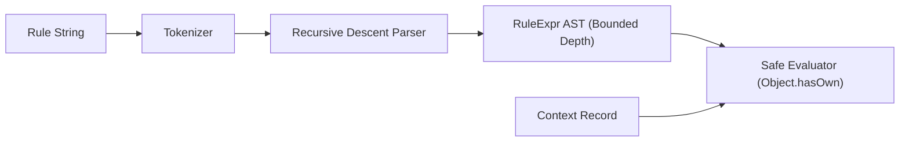

### 2. Real-World Use Cases & Decision Matrix

| Scenario | Recommended Tooling | Architectural Rationale |
|---|---|---|
| Feature-flag targeting, notification routing, saved search filters (< 15 AST node kinds) | **Custom Interpreter (TS Discriminated Union AST)** | Zero external runtime dependencies; deterministic performance; trivially serializable to JSON/SQL |
| Arbitrary user-authored formulas, nested loops, maps, or multi-type expressions (> 15 node kinds) | **CEL (Common Expression Language) / OPA Rego / QuickJS WASM** | Maintaining a custom type checker, standard library, and compiler passes beyond ~15 AST constructs wastes engineering effort |
| Dynamic untrusted rule execution via `new Function(...)` or `vm.runInNewContext` | **Never Use for Untrusted Input** | `new Function` allows RCE; Node's `vm` module explicitly warns it is **not** a security sandbox |

### 3. Step-by-Step Practical Application

Classical GoF wrote one OOP class per grammar rule (`AndExpression`, `OrExpression`, `TerminalExpression`). In modern TypeScript, a **tagged discriminated union AST** paired with a recursive descent parser and bounded `switch` evaluator cuts boilerplate by 70% while guaranteeing compile-time exhaustiveness.

```typescript
// src/interpreter/rule-engine.ts
export type RuleExpr =
  | { readonly kind: 'COMPARE'; readonly field: string; readonly op: '==' | '!=' | '>=' | '<='; readonly value: string | number }
  | { readonly kind: 'AND'; readonly left: RuleExpr; readonly right: RuleExpr }
  | { readonly kind: 'OR'; readonly left: RuleExpr; readonly right: RuleExpr }
  | { readonly kind: 'NOT'; readonly inner: RuleExpr };

export class RuleSyntaxError extends Error {
  constructor(message: string, public readonly offset: number) {
    super(`${message} at offset ${offset}`);
    this.name = 'RuleSyntaxError';
  }
}

export class RuleComplexityError extends Error {
  constructor(message: string) {
    super(message);
    this.name = 'RuleComplexityError';
  }
}

type Token =
  | { kind: 'IDENT'; value: string; offset: number }
  | { kind: 'STRING'; value: string; offset: number }
  | { kind: 'NUMBER'; value: number; offset: number }
  | { kind: 'OP'; value: '==' | '!=' | '>=' | '<='; offset: number }
  | { kind: 'AND'; offset: number }
  | { kind: 'OR'; offset: number }
  | { kind: 'NOT'; offset: number }
  | { kind: 'LPAREN'; offset: number }
  | { kind: 'RPAREN'; offset: number }
  | { kind: 'EOF'; offset: number };

const FORBIDDEN_FIELDS = new Set(['__proto__', 'constructor', 'prototype']);

export function tokenizeRule(input: string): Token[] {
  const tokens: Token[] = [];
  let i = 0;

  while (i < input.length) {
    const ch = input[i]!;
    if (/\s/.test(ch)) {
      i++;
      continue;
    }
    if (ch === '(') {
      tokens.push({ kind: 'LPAREN', offset: i++ });
      continue;
    }
    if (ch === ')') {
      tokens.push({ kind: 'RPAREN', offset: i++ });
      continue;
    }

    const twoChar = input.slice(i, i + 2);
    if (twoChar === '==' || twoChar === '!=' || twoChar === '>=' || twoChar === '<=') {
      tokens.push({ kind: 'OP', value: twoChar, offset: i });
      i += 2;
      continue;
    }
    if (twoChar === '&&') {
      tokens.push({ kind: 'AND', offset: i });
      i += 2;
      continue;
    }
    if (twoChar === '||') {
      tokens.push({ kind: 'OR', offset: i });
      i += 2;
      continue;
    }
    if (ch === '!') {
      tokens.push({ kind: 'NOT', offset: i++ });
      continue;
    }

    if (ch === '"') {
      const start = i++;
      let buf = '';
      while (i < input.length && input[i] !== '"') {
        buf += input[i++];
      }
      if (input[i] !== '"') throw new RuleSyntaxError('Unterminated string literal', start);
      i++;
      tokens.push({ kind: 'STRING', value: buf, offset: start });
      continue;
    }

    if (/[0-9]/.test(ch) || (ch === '-' && /[0-9]/.test(input[i + 1] ?? ''))) {
      const start = i++;
      while (i < input.length && /[0-9.]/.test(input[i]!)) i++;
      const num = Number(input.slice(start, i));
      if (!Number.isFinite(num)) throw new RuleSyntaxError('Invalid number literal', start);
      tokens.push({ kind: 'NUMBER', value: num, offset: start });
      continue;
    }

    if (/[A-Za-z_]/.test(ch)) {
      const start = i++;
      while (i < input.length && /[A-Za-z0-9_.]/.test(input[i]!)) i++;
      const word = input.slice(start, i);
      if (word === 'AND') tokens.push({ kind: 'AND', offset: start });
      else if (word === 'OR') tokens.push({ kind: 'OR', offset: start });
      else if (word === 'NOT') tokens.push({ kind: 'NOT', offset: start });
      else tokens.push({ kind: 'IDENT', value: word, offset: start });
      continue;
    }

    throw new RuleSyntaxError(`Unexpected character '${ch}'`, i);
  }

  tokens.push({ kind: 'EOF', offset: input.length });
  return tokens;
}

export function parseRule(input: string, limits: { maxNodes?: number; maxDepth?: number } = {}): RuleExpr {
  const maxNodes = limits.maxNodes ?? 128;
  const maxDepth = limits.maxDepth ?? 16;
  const tokens = tokenizeRule(input);
  let pos = 0;
  let nodeCount = 0;

  const peek = (): Token => tokens[pos]!;
  const consume = (): Token => tokens[pos++]!;

  function countNode(depth: number): void {
    nodeCount++;
    if (nodeCount > maxNodes) throw new RuleComplexityError(`AST exceeds maxNodes=${maxNodes}`);
    if (depth > maxDepth) throw new RuleComplexityError(`AST exceeds maxDepth=${maxDepth}`);
  }

  function parseOr(depth: number): RuleExpr {
    let left = parseAnd(depth);
    while (peek().kind === 'OR') {
      consume();
      countNode(depth);
      const right = parseAnd(depth);
      left = { kind: 'OR', left, right };
    }
    return left;
  }

  function parseAnd(depth: number): RuleExpr {
    let left = parseUnary(depth);
    while (peek().kind === 'AND') {
      consume();
      countNode(depth);
      const right = parseUnary(depth);
      left = { kind: 'AND', left, right };
    }
    return left;
  }

  function parseUnary(depth: number): RuleExpr {
    if (peek().kind === 'NOT') {
      consume();
      countNode(depth + 1);
      return { kind: 'NOT', inner: parseUnary(depth + 1) };
    }
    return parsePrimary(depth);
  }

  function parsePrimary(depth: number): RuleExpr {
    const tok = peek();
    if (tok.kind === 'LPAREN') {
      consume();
      const inner = parseOr(depth + 1);
      const close = peek();
      if (close.kind !== 'RPAREN') throw new RuleSyntaxError('Expected closing parenthesis', close.offset);
      consume();
      return inner;
    }

    if (tok.kind !== 'IDENT') {
      throw new RuleSyntaxError(`Expected field identifier, got ${tok.kind}`, tok.offset);
    }
    consume();
    if (FORBIDDEN_FIELDS.has(tok.value) || tok.value.split('.').some((part) => FORBIDDEN_FIELDS.has(part))) {
      throw new RuleSyntaxError(`Forbidden prototype field '${tok.value}'`, tok.offset);
    }

    const opTok = peek();
    if (opTok.kind !== 'OP') {
      throw new RuleSyntaxError(`Expected comparison operator after '${tok.value}'`, opTok.offset);
    }
    consume();

    const valTok = peek();
    if (valTok.kind !== 'STRING' && valTok.kind !== 'NUMBER') {
      throw new RuleSyntaxError('Expected string or numeric literal', valTok.offset);
    }
    consume();
    countNode(depth);

    return { kind: 'COMPARE', field: tok.value, op: opTok.value, value: valTok.value };
  }

  const ast = parseOr(1);
  const trailing = peek();
  if (trailing.kind !== 'EOF') {
    throw new RuleSyntaxError(`Unexpected trailing token ${trailing.kind}`, trailing.offset);
  }
  return ast;
}

function readOwnPath(record: Readonly<Record<string, unknown>>, dottedField: string): unknown {
  let cursor: unknown = record;
  for (const segment of dottedField.split('.')) {
    if (FORBIDDEN_FIELDS.has(segment)) return undefined;
    if (cursor === null || typeof cursor !== 'object' || !Object.hasOwn(cursor, segment)) {
      return undefined;
    }
    cursor = (cursor as Record<string, unknown>)[segment];
  }
  return cursor;
}

export function evaluateRule(expr: RuleExpr, record: Readonly<Record<string, unknown>>): boolean {
  switch (expr.kind) {
    case 'AND':
      return evaluateRule(expr.left, record) && evaluateRule(expr.right, record);
    case 'OR':
      return evaluateRule(expr.left, record) || evaluateRule(expr.right, record);
    case 'NOT':
      return !evaluateRule(expr.inner, record);
    case 'COMPARE': {
      const actual = readOwnPath(record, expr.field);
      switch (expr.op) {
        case '==':
          return actual === expr.value;
        case '!=':
          return actual !== expr.value;
        case '>=':
          return typeof actual === 'number' && typeof expr.value === 'number' && actual >= expr.value;
        case '<=':
          return typeof actual === 'number' && typeof expr.value === 'number' && actual <= expr.value;
      }
    }
  }
}
```

```typescript
// tests/interpreter.spec.ts
import { describe, expect, it } from 'vitest';
import { evaluateRule, parseRule, RuleComplexityError, RuleSyntaxError } from '../src/interpreter/rule-engine';

describe('Rule AST Interpreter', () => {
  it('enforces operator precedence (NOT > AND > OR) and parenthesized grouping', () => {
    const ast = parseRule('country == "CA" OR (plan == "enterprise" AND NOT seats <= 4)');

    expect(evaluateRule(ast, { country: 'CA', plan: 'free', seats: 1 })).toBe(true);
    expect(evaluateRule(ast, { country: 'US', plan: 'enterprise', seats: 10 })).toBe(true);
    expect(evaluateRule(ast, { country: 'US', plan: 'enterprise', seats: 4 })).toBe(false);
  });

  it('rejects prototype pollution paths, syntax errors, and excessive AST nesting', () => {
    expect(() => parseRule('__proto__.polluted == "yes"')).toThrow(RuleSyntaxError);
    expect(() => parseRule('plan == "pro" )')).toThrow(RuleSyntaxError);
    expect(() => parseRule('((((a == 1))))', { maxDepth: 3 })).toThrow(RuleComplexityError);
  });
});
```

### 4. Modern Idioms & Failure Modes

- **Compile-Once, Evaluate-Many**: Never re-run `parseRule(dslString)` inside a hot request loop over 100,000 events. Parse the DSL string once when the rule configuration loads, cache the immutable `RuleExpr` AST, and run `evaluateRule(ast, event)` directly (or compile the validated AST down to a parameterized SQL `WHERE` clause).
- **Failure Modes**: Unbounded recursive descent on 10,000 nested `((((...))))` throws `RangeError: Maximum call stack size exceeded` unless `maxDepth` aborts parsing early, and naive `obj[field]` lookups expose inherited `Object.prototype` keys (`constructor`, `toString`) unless restricted with `Object.hasOwn`.

---
## Iterator

### 1. First-Principles Mechanics & Complete Architecture

**Iterator** decouples sequential traversal logic from an aggregate's internal storage layout (B-tree pages, adjacency lists, chunked database tables, or cursor-paginated HTTP endpoints) behind a uniform pull-based protocol. In modern JavaScript and TypeScript, this protocol is built directly into the runtime via `[Symbol.iterator]()` (synchronous) and `[Symbol.asyncIterator]()` (asynchronous), powered ergonomically by `function*` and `async function*` generators.

Understanding pull mechanics explains why `AsyncGenerator` eliminates whole classes of server memory crashes:
1. **Pull-Based Backpressure**: Unlike push-based `EventEmitter` ([[Programming/Software Engineering/Design Patterns/Behavioral/Observer|Observer]]), an `AsyncGenerator` suspends execution at every `yield item` until the downstream `for await (const item of stream)` loop finishes processing the current item and calls `.next()`. Memory stays strictly $O(\text{pageSize})$ regardless of whether the remote table contains $10^4$ or $10^8$ rows.
2. **Deterministic Early Termination (`finally` Guarantee)**: If a consumer executes `break` or `return` inside `for await`, the JavaScript engine automatically calls `iterator.return()`, unwinding the generator's active `try { ... } finally { ... }` block so database cursors close, `AbortController` listeners detach, and subsequent API pages are **never fetched**.
3. **Keyset Cursor Pagination vs `OFFSET` Drift**: Never build database or API iterators using SQL `OFFSET N LIMIT K`. Concurrent inserts shift row positions between pages (causing duplicate reads or skipped records), and PostgreSQL still scans and discards $N$ index tuples per page ($O(N^2)$ total work). Always pass an opaque **keyset cursor** (`(created_at, id) > ($1, $2)`).

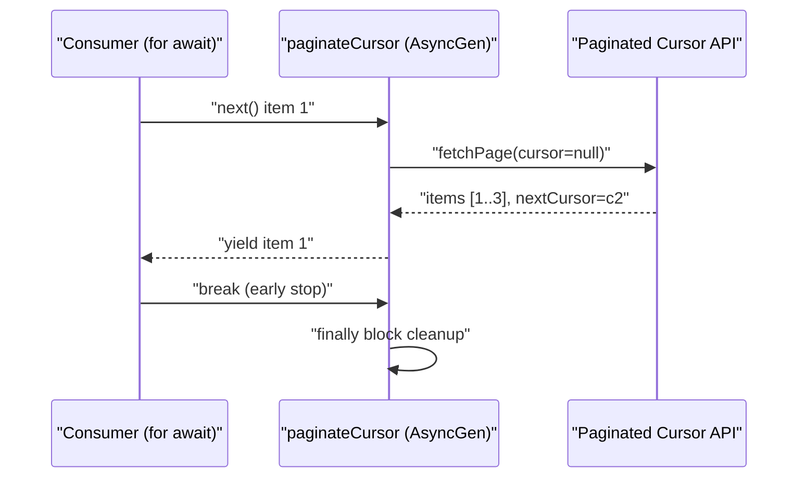

### 2. Real-World Use Cases & Decision Matrix

| Scenario | Recommended Mechanism | Architectural Rationale |
|---|---|---|
| Exporting $10^7$ DB rows or paginated REST/GraphQL API records | **`AsyncGenerator` + Keyset Cursor** | Streams in constant $O(1)$ page RAM; respects slow downstream writers; cancels pending pages on `break` |
| High-throughput binary chunk streaming with byte-level `highWaterMark` | **Node.js `stream.Readable` / `pipeline()`** | Native `Buffer` pooling, backpressure `highWaterMark`, and Web Streams interop |
| Real-time multi-subscriber broadcast events | [[Programming/Software Engineering/Design Patterns/Behavioral/Observer\|Observer / RxJS]] | Single-consumer pull iterators cannot fan out live hot events independently to $N$ concurrent consumers without buffering |
| Small fixed in-memory arrays (< 10,000 items) | **Standard `Array` / `.map()` / `.filter()`** | Zero generator state-machine allocation overhead; faster V8 JIT optimization |

### 3. Step-by-Step Practical Application

The implementation below provides a fault-tolerant `paginateCursor<TPage, TItem>()` `AsyncGenerator` featuring `AbortSignal` propagation, transient error retries per page, duplicate-cursor infinite-loop protection, guaranteed `finally` cleanup telemetry, and reusable lazy combinators (`takeAsync`, `batchAsync`).

```typescript
// src/iterator/cursor-paginator.ts
export interface CursorPage<TItem> {
  readonly items: ReadonlyArray<TItem>;
  readonly nextCursor?: string | null;
}

export interface PaginateOptions<TItem> {
  readonly fetchPage: (cursor: string | undefined, signal: AbortSignal) => Promise<CursorPage<TItem>>;
  readonly maxRetriesPerPage?: number;
  readonly signal?: AbortSignal;
  readonly onClose?: (stats: { pagesFetched: number; itemsYielded: number; aborted: boolean }) => void;
}

export class CursorLoopError extends Error {
  constructor(cursor: string) {
    super(`Pagination stalled: duplicate nextCursor '${cursor}' returned`);
    this.name = 'CursorLoopError';
  }
}

export async function* paginateCursor<TItem>(options: PaginateOptions<TItem>): AsyncGenerator<TItem, void, void> {
  const maxRetries = options.maxRetriesPerPage ?? 2;
  const localController = new AbortController();

  const onParentAbort = () => localController.abort(options.signal?.reason);
  if (options.signal?.aborted) {
    localController.abort(options.signal.reason);
  } else {
    options.signal?.addEventListener('abort', onParentAbort, { once: true });
  }

  let cursor: string | undefined = undefined;
  const seenCursors = new Set<string>();
  let pagesFetched = 0;
  let itemsYielded = 0;

  try {
    while (!localController.signal.aborted) {
      let page: CursorPage<TItem> | undefined;
      let attempt = 0;

      while (true) {
        try {
          page = await options.fetchPage(cursor, localController.signal);
          break;
        } catch (err) {
          if (localController.signal.aborted || attempt >= maxRetries) {
            throw err;
          }
          attempt++;
        }
      }

      pagesFetched++;
      for (const item of page.items) {
        if (localController.signal.aborted) return;
        itemsYielded++;
        yield item;
      }

      if (!page.nextCursor) {
        return;
      }
      if (seenCursors.has(page.nextCursor)) {
        throw new CursorLoopError(page.nextCursor);
      }
      seenCursors.add(page.nextCursor);
      cursor = page.nextCursor;
    }
  } finally {
    options.signal?.removeEventListener('abort', onParentAbort);
    options.onClose?.({
      pagesFetched,
      itemsYielded,
      aborted: localController.signal.aborted,
    });
  }
}

export async function* takeAsync<T>(source: AsyncIterable<T>, limit: number): AsyncGenerator<T, void, void> {
  if (limit <= 0) return;
  let count = 0;
  for await (const item of source) {
    yield item;
    count++;
    if (count >= limit) return;
  }
}

export async function* batchAsync<T>(source: AsyncIterable<T>, batchSize: number): AsyncGenerator<T[], void, void> {
  if (batchSize < 1) throw new RangeError('batchSize must be >= 1');
  let buffer: T[] = [];
  for await (const item of source) {
    buffer.push(item);
    if (buffer.length >= batchSize) {
      yield buffer;
      buffer = [];
    }
  }
  if (buffer.length > 0) {
    yield buffer;
  }
}
```

```typescript
// tests/iterator.spec.ts
import { describe, expect, it } from 'vitest';
import { batchAsync, CursorLoopError, paginateCursor, takeAsync } from '../src/iterator/cursor-paginator';

describe('AsyncGenerator Cursor Iterator', () => {
  it('fetches pages lazily, stops immediately on early break, and runs finally cleanup', async () => {
    let apiCalls = 0;
    let closedStats: { pagesFetched: number; itemsYielded: number; aborted: boolean } | undefined;

    const stream = paginateCursor<number>({
      fetchPage: async (cursor) => {
        apiCalls++;
        if (!cursor) return { items: [1, 2, 3, 4], nextCursor: 'p2' };
        if (cursor === 'p2') return { items: [5, 6, 7, 8], nextCursor: 'p3' };
        return { items: [9, 10], nextCursor: null };
      },
      onClose: (stats) => {
        closedStats = stats;
      },
    });

    const firstThree: number[] = [];
    for await (const item of takeAsync(stream, 3)) {
      firstThree.push(item);
    }

    expect(firstThree).toEqual([1, 2, 3]);
    expect(apiCalls).toBe(1); // Never fetched page 2 or 3!
    expect(closedStats).toEqual({ pagesFetched: 1, itemsYielded: 3, aborted: false });
  });

  it('retries transient page errors, batches across page boundaries, and blocks cursor loops', async () => {
    let transientAttempt = 0;
    const stream = paginateCursor<string>({
      maxRetriesPerPage: 1,
      fetchPage: async (cursor) => {
        if (cursor === 'p2' && transientAttempt === 0) {
          transientAttempt++;
          throw new Error('503 Upstream timeout');
        }
        if (!cursor) return { items: ['a', 'b'], nextCursor: 'p2' };
        return { items: ['c', 'd', 'e'], nextCursor: null };
      },
    });

    const batches: string[][] = [];
    for await (const chunk of batchAsync(stream, 2)) {
      batches.push(chunk);
    }
    expect(batches).toEqual([['a', 'b'], ['c', 'd'], ['e']]);

    const cyclicStream = paginateCursor<string>({
      fetchPage: async () => ({ items: ['x'], nextCursor: 'stuck-cursor' }),
    });

    await expect(async () => {
      for await (const _item of cyclicStream) {
        // Consume until duplicate cursor error triggers
      }
    }).rejects.toBeInstanceOf(CursorLoopError);
  });
});
```

### 4. Modern Idioms, Failure Modes & Framework Sightings

- **Framework Sightings**: Node.js `Readable.from(paginateCursor(...))` turns any `AsyncGenerator` directly into a standard Node stream compatible with `stream/promises` `pipeline()` and HTTP chunked downloads. Drizzle, Prisma, and PostgreSQL `pg-cursor` stream large exports via async iteration. ES2025 Iterator Helpers (`Iterator.prototype.map`, `.filter`, `.take`) bring lazy chaining directly onto synchronous `[Symbol.iterator]` values without intermediate array allocations.
- **Failure Modes**:
  1. *Stuck Pagination Cursor*: Broken upstream APIs occasionally echo the input `nextCursor` on the last page; without a `seenCursors` guard, an ETL worker spins infinitely incurring API rate-limit bans.
  2. *Leaked DB Cursors When Wrapping Generators*: Manually calling `.next()` without `for await` or calling `.return()` when exiting early skips the generator's `finally` block! Always consume custom iterators with `for...of` / `for await...of` or explicit `try { ... } finally { await iter.return?.(); }`.

---

## Mediator

### 1. First-Principles Mechanics & Complete Architecture

**Mediator** replaces a direct $N$-to-$N$ dependency mesh among collaborating components ($N(N-1)/2$ coupling edges) with an $O(N)$ star topology routed through a single coordinating hub. Instead of `ShippingSelector` calling `AddressInput.disable()` and `TaxBanner.recalculate()` and `SubmitButton.revalidate()` directly, every peer (**Colleague**) only emits semantic events (`colleague.notify('changed')`) to its `Mediator` and obeys commands issued back by the `Mediator`.

Two engineering invariants distinguish clean Mediators from unmaintainable **God Objects**:
1. **Routing Over Calculation**: The Mediator coordinates *who reacts to whom* and synchronizes cross-peer state, while delegating domain rules (tax percentages, coupon eligibility math) to pure domain policies or injected services.
2. **Re-Entrancy Loop Guard**: When the Mediator programmatically updates Peer B (`addressInput.setEnabled(false)`), Peer B must **not** fire a fresh user-change event back into the Mediator; even with defensive peers, guarding the Mediator with a re-entrancy lock or coalescing dispatch prevents infinite ping-pong recursion.

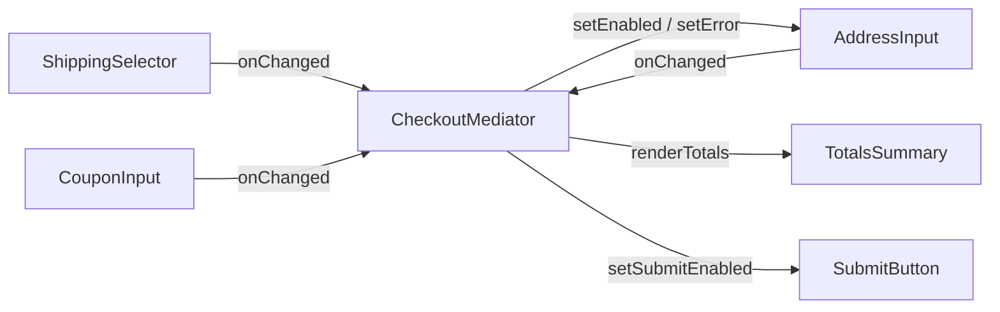

### 2. Real-World Use Cases & Decision Matrix

| Scenario | Recommended Pattern | Architectural Rationale |
|---|---|---|
| Interdependent UI checkout/wizard form fields (`Shipping`, `Coupon`, `Tax`, `Submit`) | **Mediator** | Eliminates circular widget imports; centralizes validation gating in one testable class |
| Distributed multi-service workflow (`ReserveInventory -> ChargeCard -> ShipOrder`) | **Saga Orchestrator (Distributed Mediator)** | Avoids hidden event choreography deadlocks across microservices |
| One source broadcasting telemetry to unknown independent listeners | [[Programming/Software Engineering/Design Patterns/Behavioral/Observer\|Observer]] | Listeners are decoupled and do **not** coordinate back with each other through complex cross-rules |
| Independent step-by-step wizard state transitions | [[Programming/Software Engineering/Design Patterns/Creational & Behavioral Patterns Catalog#State\|State]] | Combine State (lifecycle phase) with Mediator (coordinating field dependencies within a phase) |

### 3. Step-by-Step Practical Application

The following TypeScript implementation wires five checkout colleagues through `CheckoutMediator` with zero peer-to-peer references, explicit pure pricing calculation delegation, and a re-entrancy guard preventing cascade feedback loops.

```typescript
// src/mediator/checkout-mediator.ts
export type ShippingMode = 'DELIVERY' | 'PICKUP';

export type CheckoutEvent =
  | { readonly type: 'SHIPPING_CHANGED'; readonly mode: ShippingMode }
  | { readonly type: 'ADDRESS_CHANGED'; readonly postalCode: string }
  | { readonly type: 'COUPON_CHANGED'; readonly code: string }
  | { readonly type: 'CART_UPDATED'; readonly subtotalCents: number };

export interface MediatorHub {
  notify(event: CheckoutEvent): void;
}

export class ShippingSelector {
  private mode: ShippingMode = 'DELIVERY';
  constructor(private readonly hub: MediatorHub) {}

  getMode(): ShippingMode {
    return this.mode;
  }

  select(mode: ShippingMode): void {
    this.mode = mode;
    this.hub.notify({ type: 'SHIPPING_CHANGED', mode });
  }
}

export class AddressInput {
  private postalCode = '';
  private enabled = true;
  private validationError: string | null = null;

  constructor(private readonly hub: MediatorHub) {}

  setPostalCode(code: string): void {
    this.postalCode = code.trim();
    this.hub.notify({ type: 'ADDRESS_CHANGED', postalCode: this.postalCode });
  }

  getPostalCode(): string {
    return this.postalCode;
  }

  setEnabled(enabled: boolean): void {
    this.enabled = enabled;
    if (!enabled) this.validationError = null;
  }

  isEnabled(): boolean {
    return this.enabled;
  }

  setError(error: string | null): void {
    this.validationError = error;
  }

  getError(): string | null {
    return this.validationError;
  }
}

export class CouponInput {
  private code = '';
  private error: string | null = null;

  constructor(private readonly hub: MediatorHub) {}

  applyCode(code: string): void {
    this.code = code.trim().toUpperCase();
    this.hub.notify({ type: 'COUPON_CHANGED', code: this.code });
  }

  getCode(): string {
    return this.code;
  }

  setError(error: string | null): void {
    this.error = error;
  }

  getError(): string | null {
    return this.error;
  }
}

export interface PriceSummary {
  readonly subtotalCents: number;
  readonly shippingCents: number;
  readonly discountCents: number;
  readonly totalCents: number;
}

export class TotalsSummary {
  private summary: PriceSummary = {
    subtotalCents: 0,
    shippingCents: 0,
    discountCents: 0,
    totalCents: 0,
  };

  update(summary: PriceSummary): void {
    this.summary = summary;
  }

  read(): PriceSummary {
    return this.summary;
  }
}

export class SubmitButton {
  private enabled = false;

  setEnabled(enabled: boolean): void {
    this.enabled = enabled;
  }

  isEnabled(): boolean {
    return this.enabled;
  }
}

const VALID_COUPONS: Readonly<Record<string, number>> = {
  SAVE10: 0.1,
  VIP20: 0.2,
};

export class CheckoutMediator implements MediatorHub {
  private subtotalCents = 0;
  private isCoordinating = false;
  public readonly shipping: ShippingSelector;
  public readonly address: AddressInput;
  public readonly coupon: CouponInput;
  public readonly totals: TotalsSummary;
  public readonly submit: SubmitButton;

  constructor(initialSubtotalCents: number) {
    this.subtotalCents = initialSubtotalCents;
    this.shipping = new ShippingSelector(this);
    this.address = new AddressInput(this);
    this.coupon = new CouponInput(this);
    this.totals = new TotalsSummary();
    this.submit = new SubmitButton();
    this.reconcile();
  }

  notify(event: CheckoutEvent): void {
    if (this.isCoordinating) return;
    this.isCoordinating = true;
    try {
      if (event.type === 'CART_UPDATED') {
        this.subtotalCents = event.subtotalCents;
      }
      this.reconcile();
    } finally {
      this.isCoordinating = false;
    }
  }

  private reconcile(): void {
    const mode = this.shipping.getMode();
    const needsAddress = mode === 'DELIVERY';
    this.address.setEnabled(needsAddress);

    let addressValid = true;
    if (needsAddress) {
      const zipValid = /^\d{5}$/.test(this.address.getPostalCode());
      this.address.setError(zipValid ? null : '5-digit postal code required');
      addressValid = zipValid;
    }

    const code = this.coupon.getCode();
    let discountRate = 0;
    let couponValid = true;
    if (code.length > 0) {
      const rate = VALID_COUPONS[code];
      if (rate === undefined) {
        this.coupon.setError(`Unknown coupon '${code}'`);
        couponValid = false;
      } else {
        this.coupon.setError(null);
        discountRate = rate;
      }
    } else {
      this.coupon.setError(null);
    }

    const shippingCents = needsAddress ? 1_200 : 0;
    const discountCents = Math.round(this.subtotalCents * discountRate);
    const totalCents = Math.max(0, this.subtotalCents - discountCents + shippingCents);

    this.totals.update({
      subtotalCents: this.subtotalCents,
      shippingCents,
      discountCents,
      totalCents,
    });

    this.submit.setEnabled(this.subtotalCents > 0 && addressValid && couponValid);
  }
}
```

```typescript
// tests/mediator.spec.ts
import { describe, expect, it } from 'vitest';
import { CheckoutMediator } from '../src/mediator/checkout-mediator';

describe('CheckoutMediator Coordination', () => {
  it('disables address validation, removes shipping fee, and enables submit on PICKUP', () => {
    const med = new CheckoutMediator(10_000);
    expect(med.submit.isEnabled()).toBe(false);
    expect(med.address.getError()).toBe('5-digit postal code required');

    med.shipping.select('PICKUP');
    expect(med.address.isEnabled()).toBe(false);
    expect(med.address.getError()).toBeNull();
    expect(med.totals.read()).toEqual({
      subtotalCents: 10_000,
      shippingCents: 0,
      discountCents: 0,
      totalCents: 10_000,
    });
    expect(med.submit.isEnabled()).toBe(true);
  });

  it('coordinates coupon discounts and blocks submission on invalid coupon codes', () => {
    const med = new CheckoutMediator(10_000);
    med.address.setPostalCode('94107');
    med.coupon.applyCode('BADCODE');
    expect(med.coupon.getError()).toBe("Unknown coupon 'BADCODE'");
    expect(med.submit.isEnabled()).toBe(false);

    med.coupon.applyCode('vip20');
    expect(med.coupon.getError()).toBeNull();
    expect(med.totals.read()).toEqual({
      subtotalCents: 10_000,
      shippingCents: 1_200,
      discountCents: 2_000,
      totalCents: 9_200,
    });
    expect(med.submit.isEnabled()).toBe(true);
  });
});
```

### 4. Modern Idioms & Failure Modes

- **Framework Sightings**: In React ([[Programming/Frontend/React Patterns Guide|React Patterns Guide]]), lifting shared sibling state up to a parent component + `useReducer` acts as a declarative Mediator where child inputs emit actions (`dispatch({ type: 'COUPON_CHANGED', code })`) without referencing sibling refs. On the backend, MediatR (.NET) and NestJS CQRS `CommandBus` mediate request handlers so HTTP controllers never wire directly to cross-module internals.
- **Failure Modes**: Allowing `CheckoutMediator` to import database repositories, payment HTTP clients, and formatting helpers turns it into an untestable God Object. Keep coordination rules pure and synchronous (`reconcile()`), or push external side effects behind explicit returned effects.

---

## Memento

### 1. First-Principles Mechanics & Complete Architecture

**Memento** captures an object's internal state at a point in time so an external **Caretaker** (undo manager, wizard navigation stack, transaction savepoint registry) can restore that state later **without breaking encapsulation** or gaining read/write visibility into the originator's private fields.

Three strictly isolated roles define the pattern:
1. **Originator**: Owns private domain state, constructs a frozen snapshot wrapped in an opaque **Memento** handle (`save()`), and restores itself exclusively from a Memento it created (`restore(memento)`).
2. **Memento**: An opaque token whose internal snapshot is inaccessible to outside callers. In TypeScript, combining a **nominal `unique symbol` brand** with a **module-private `WeakMap<DraftMemento, Snapshot>`** enforces opacity both at compile time AND at JavaScript runtime (`Object.keys(memento)` is empty, and Caretakers cannot tamper with properties!).
3. **Caretaker**: Stores ordered or named Memento tokens in a bounded stack or history timeline and hands them back to the Originator on rollback—never reading, parsing, or mutating their contents.

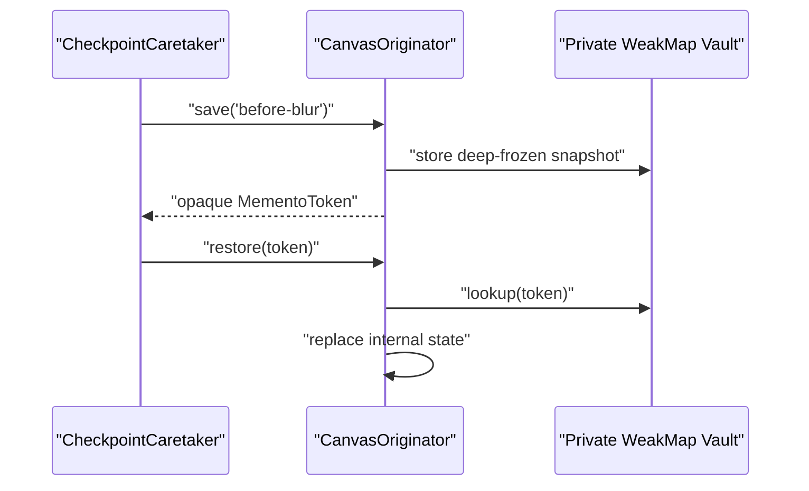

### 2. Real-World Use Cases & Decision Matrix

| Scenario | Command Delta vs Memento | Engineering Rationale |
|---|---|---|
| Multi-field wizard form cancellation (`Cancel` reverts 18 edited fields) | **Memento** | Simpler than tracking 18 field-level inverse commands; state size is tiny (< 5 KB) |
| Non-invertible transformations (image convolution blur, lossy compression, RNG shuffle) | **Memento** | No algebraic inverse exists; prior pixel/matrix snapshot is mandatory |
| Large 500,000-cell spreadsheet single-cell keystrokes | **[[Programming/Software Engineering/Design Patterns/Creational & Behavioral Patterns Catalog#Command\|Command (Inverse Delta)]]** | Full Mementos waste tens of megabytes per keystroke; delta commands use < 100 bytes |
| Persistent cross-restart time-travel across browser sessions | **Immutable JSON State + Schema Versioning** | `WeakMap`-backed opaque tokens cannot serialize to `localStorage`; serialize explicit versioned DTOs instead |

### 3. Step-by-Step Practical Application

This production example demonstrates a `CanvasDraftOriginator` backed by a **private `WeakMap` snapshot vault** (preventing any external runtime tampering or cross-originator spoofing) paired with a bounded `CheckpointCaretaker` supporting sequential undo and named savepoints.

```typescript
// src/memento/canvas-memento.ts
export interface DraftMemento {
  readonly createdAtMs: number;
  readonly label?: string;
}

interface InternalCanvasState {
  readonly layers: ReadonlyArray<{ readonly id: string; readonly opacity: number; readonly pixels: ReadonlyArray<number> }>;
  readonly activeLayerId: string;
}

// Module-private WeakMap ensures Caretakers have ZERO runtime read/write access to snapshots
const SNAPSHOT_VAULT = new WeakMap<DraftMemento, { readonly owner: CanvasDraftOriginator; readonly state: InternalCanvasState }>();

export class InvalidMementoError extends Error {
  constructor() {
    super('Memento token is invalid or belongs to a different originator instance');
    this.name = 'InvalidMementoError';
  }
}

export class CanvasDraftOriginator {
  private layers: Array<{ id: string; opacity: number; pixels: number[] }> = [
    { id: 'bg', opacity: 100, pixels: [255, 255, 255] },
  ];
  private activeLayerId = 'bg';

  addLayer(id: string, pixels: ReadonlyArray<number>): void {
    this.layers.push({ id, opacity: 100, pixels: [...pixels] });
    this.activeLayerId = id;
  }

  applyLossyBlurPass(layerId: string): void {
    const layer = this.layers.find((l) => l.id === layerId);
    if (!layer) throw new Error(`Layer not found: ${layerId}`);
    // Non-invertible rounding lossy average across channels
    const avg = Math.floor(layer.pixels.reduce((sum, v) => sum + v, 0) / Math.max(1, layer.pixels.length));
    layer.pixels = layer.pixels.map(() => avg);
  }

  setOpacity(layerId: string, opacity: number): void {
    const layer = this.layers.find((l) => l.id === layerId);
    if (!layer) throw new Error(`Layer not found: ${layerId}`);
    layer.opacity = opacity;
  }

  getSummary(): { activeLayerId: string; layers: ReadonlyArray<{ id: string; opacity: number; pixels: number[] }> } {
    return {
      activeLayerId: this.activeLayerId,
      layers: this.layers.map((l) => ({ id: l.id, opacity: l.opacity, pixels: [...l.pixels] })),
    };
  }

  save(label?: string): DraftMemento {
    const token: DraftMemento = Object.freeze({ createdAtMs: Date.now(), label });
    const frozenSnapshot: InternalCanvasState = Object.freeze({
      activeLayerId: this.activeLayerId,
      layers: Object.freeze(
        this.layers.map((l) =>
          Object.freeze({
            id: l.id,
            opacity: l.opacity,
            pixels: Object.freeze([...l.pixels]),
          })
        )
      ),
    });
    SNAPSHOT_VAULT.set(token, { owner: this, state: frozenSnapshot });
    return token;
  }

  restore(memento: DraftMemento): void {
    const record = SNAPSHOT_VAULT.get(memento);
    if (!record || record.owner !== this) {
      throw new InvalidMementoError();
    }
    this.activeLayerId = record.state.activeLayerId;
    this.layers = record.state.layers.map((l) => ({
      id: l.id,
      opacity: l.opacity,
      pixels: [...l.pixels],
    }));
  }
}

export class CheckpointCaretaker {
  private readonly stack: DraftMemento[] = [];
  private readonly named = new Map<string, DraftMemento>();

  constructor(
    private readonly originator: CanvasDraftOriginator,
    private readonly maxCheckpoints: number = 25
  ) {
    if (maxCheckpoints < 1) throw new RangeError('maxCheckpoints must be >= 1');
  }

  checkpoint(label?: string): DraftMemento {
    const token = this.originator.save(label);
    this.stack.push(token);
    if (this.stack.length > this.maxCheckpoints) {
      this.stack.shift();
    }
    if (label) {
      this.named.set(label, token);
    }
    return token;
  }

  undo(): boolean {
    const token = this.stack.pop();
    if (!token) return false;
    this.originator.restore(token);
    return true;
  }

  restoreNamed(label: string): void {
    const token = this.named.get(label);
    if (!token) throw new Error(`Savepoint not found: ${label}`);
    this.originator.restore(token);
  }

  historyCount(): number {
    return this.stack.length;
  }
}
```

```typescript
// tests/memento.spec.ts
import { describe, expect, it } from 'vitest';
import { CanvasDraftOriginator, CheckpointCaretaker, InvalidMementoError } from '../src/memento/canvas-memento';

describe('Memento Opaque Snapshot & Caretaker', () => {
  it('reverts lossy blur mutations cleanly while hiding snapshot internals from Caretaker', () => {
    const canvas = new CanvasDraftOriginator();
    const caretaker = new CheckpointCaretaker(canvas, 3);

    canvas.addLayer('hero', [10, 40, 100]);
    const token = caretaker.checkpoint('pre-blur');

    // Runtime opacity: Caretaker cannot inspect or mutate layer pixel arrays via token
    expect(Object.keys(token)).toEqual(['createdAtMs', 'label']);
    expect((token as unknown as Record<string, unknown>)['layers']).toBeUndefined();

    canvas.applyLossyBlurPass('hero');
    canvas.setOpacity('hero', 45);
    expect(canvas.getSummary().layers[1]?.pixels).toEqual([50, 50, 50]);

    caretaker.restoreNamed('pre-blur');
    expect(canvas.getSummary().layers[1]).toEqual({ id: 'hero', opacity: 100, pixels: [10, 40, 100] });
  });

  it('bounds checkpoint stack memory and rejects cross-originator mementos', () => {
    const canvasA = new CanvasDraftOriginator();
    const canvasB = new CanvasDraftOriginator();
    const caretaker = new CheckpointCaretaker(canvasA, 2);

    const foreignToken = canvasB.save();
    expect(() => canvasA.restore(foreignToken)).toThrow(InvalidMementoError);

    caretaker.checkpoint('s1');
    caretaker.checkpoint('s2');
    caretaker.checkpoint('s3');
    expect(caretaker.historyCount()).toBe(2);
  });
});
```

### 4. Modern Idioms & Failure Modes

- **Garbage Collection Bonus**: Storing snapshots inside a `WeakMap` keyed by the `DraftMemento` token ensures that as soon as `CheckpointCaretaker` evicts an old token from its bounded stack (`this.stack.shift()`), the snapshot entry becomes immediately eligible for V8 garbage collection without manual `.delete()` bookkeeping.
- **Failure Modes**:
  1. *Shallow Snapshot Aliasing*: Saving `{ layers: this.layers }` without deep copying the array and nested layer objects causes mutations on `this.layers` after `save()` to silently overwrite historical checkpoints!
  2. *Unbounded Snapshot Bloat*: Taking a full Memento on every `mousemove` brush stroke exhausts browser tab RAM within seconds; coalesce rapid gestures (checkpoint on `pointerdown`/`pointerup` only) and enforce `maxCheckpoints`.

---
## State

### 1. First-Principles Mechanics & Complete Architecture

**State** models an object's lifecycle as an explicit **Finite State Machine (FSM)** $(S, \Sigma, \delta, s_0, F)$ where behavior and valid state transitions depend directly on the active state $s \in S$ and incoming event $\sigma \in \Sigma$. Production bugs routinely originate from **boolean flag soup**: tracking four orthogonal flags (`isAuthorized`, `isCaptured`, `isCancelled`, `isRefunded`) creates $2^4 = 16$ possible runtime combinations when only 5 domain states are legal—making impossible states like `{ isCancelled: true, isCaptured: true }` representable and forcing defensive `if (!isCancelled && !isRefunded && ...)` guards across dozens of files.

Replacing boolean flags with an explicit State model enforces two structural guarantees:
1. **Make Illegal States Unrepresentable**: In a **Discriminated-Union FSM**, each variant owns **only** the data fields guaranteed to exist in that state (`authorizationId` does not even exist on `DRAFT`; `refundId` exists only on `REFUNDED`). TypeScript narrows types statically inside every transition branch.
2. **Explicit Transition Table $\delta(s, \sigma)$**: Every state mutation passes through a centralized transition function that rejects illegal state/event pairs immediately (`IllegalStateTransitionError`) instead of silently corrupting fields.

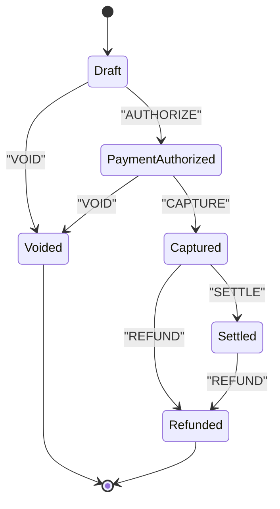

| Implementation Style | Mechanics | Ideal Fit | Trade-Off |
|---|---|---|---|
| **Discriminated Union + Pure Reducer** | `(state, event) => { nextState, effects }` | React/Redux UIs, serverless APIs, Event Sourcing, DB JSON/column rows | Pure & trivially testable; callers execute returned side effects in an imperative shell |
| **GoF Polymorphic State Classes** | Context delegates every method to active `StateHandler` object | Stateful in-memory engines where each state exposes 4+ methods with distinct DI clients | High class count; awkward to serialize directly to SQL rows |
| **Statecharts (XState v5)** | Hierarchical nested states, parallel regions, timers, invoked actors | Complex multi-step UI wizards, hardware protocols, long-lived workflow orchestration | Adds library DSL dependency; overkill for simple 4-state DB rows |

### 2. Real-World Use Cases & Decision Matrix

- **Order & Payment Lifecycles**: Prevent capturing a voided authorization, refunding an uncaptured draft, or double-charging an already settled invoice.
- **Subscription & Trial Billing**: Isolate `TRIALING`, `ACTIVE`, `PAST_DUE`, `PAUSED`, and `CANCELLED` transitions cleanly with guaranteed `paymentMethodId` presence on billable states.
- **UI Async Data Fetching**: Replace `{ isLoading, isError, data }` booleans with `'IDLE' | 'LOADING' | 'ERROR' | 'READY'` so stale errors never render simultaneously alongside fresh data.
- **When NOT to use State**: Do not build an explicit FSM class hierarchy for a simple 2-state toggle (`enabled: boolean`) or pure CRUD records lacking lifecycle constraints.

### 3. Step-by-Step Practical Application

The implementation below demonstrates a production-grade **Order & Payment Lifecycle FSM** structured via **Functional Core, Imperative Shell**: `transitionOrder()` validates transitions purely, narrows state payloads at compile time, enforces `assertNever` exhaustiveness, and emits typed side-effect descriptors (`OrderEffect`) rather than performing network I/O inside state logic. A companion GoF `StateHandler` interface follows to illustrate when polymorphic class dispatch fits.

```typescript
// src/state/order-fsm.ts
export type OrderState =
  | { readonly status: 'DRAFT'; readonly orderId: string; readonly amountCents: number }
  | {
      readonly status: 'PAYMENT_AUTHORIZED';
      readonly orderId: string;
      readonly amountCents: number;
      readonly authorizationId: string;
    }
  | {
      readonly status: 'CAPTURED';
      readonly orderId: string;
      readonly amountCents: number;
      readonly authorizationId: string;
      readonly captureId: string;
    }
  | {
      readonly status: 'SETTLED';
      readonly orderId: string;
      readonly amountCents: number;
      readonly captureId: string;
      readonly settlementBatchId: string;
    }
  | { readonly status: 'VOIDED'; readonly orderId: string; readonly reason: string }
  | {
      readonly status: 'REFUNDED';
      readonly orderId: string;
      readonly captureId: string;
      readonly refundId: string;
    };

export type OrderEvent =
  | { readonly type: 'AUTHORIZE'; readonly authorizationId: string }
  | { readonly type: 'CAPTURE'; readonly captureId: string }
  | { readonly type: 'SETTLE'; readonly settlementBatchId: string }
  | { readonly type: 'VOID'; readonly reason: string }
  | { readonly type: 'REFUND'; readonly refundId: string };

export type OrderEffect =
  | { readonly kind: 'EMIT_AUDIT'; readonly orderId: string; readonly transition: string }
  | { readonly kind: 'NOTIFY_CUSTOMER_RECEIPT'; readonly orderId: string; readonly captureId: string }
  | { readonly kind: 'ISSUE_GATEWAY_REFUND'; readonly captureId: string; readonly refundId: string };

export class IllegalStateTransitionError extends Error {
  constructor(public readonly fromStatus: OrderState['status'], public readonly eventType: OrderEvent['type']) {
    super(`Illegal order transition: cannot apply '${eventType}' while in status '${fromStatus}'`);
    this.name = 'IllegalStateTransitionError';
  }
}

function assertNever(value: never): never {
  throw new Error(`Unhandled FSM state branch: ${JSON.stringify(value)}`);
}

export function transitionOrder(
  state: OrderState,
  event: OrderEvent
): { readonly state: OrderState; readonly effects: ReadonlyArray<OrderEffect> } {
  switch (state.status) {
    case 'DRAFT': {
      if (event.type === 'AUTHORIZE') {
        return {
          state: {
            status: 'PAYMENT_AUTHORIZED',
            orderId: state.orderId,
            amountCents: state.amountCents,
            authorizationId: event.authorizationId,
          },
          effects: [{ kind: 'EMIT_AUDIT', orderId: state.orderId, transition: 'DRAFT->PAYMENT_AUTHORIZED' }],
        };
      }
      if (event.type === 'VOID') {
        return {
          state: { status: 'VOIDED', orderId: state.orderId, reason: event.reason },
          effects: [{ kind: 'EMIT_AUDIT', orderId: state.orderId, transition: 'DRAFT->VOIDED' }],
        };
      }
      throw new IllegalStateTransitionError(state.status, event.type);
    }

    case 'PAYMENT_AUTHORIZED': {
      if (event.type === 'CAPTURE') {
        return {
          state: {
            status: 'CAPTURED',
            orderId: state.orderId,
            amountCents: state.amountCents,
            authorizationId: state.authorizationId,
            captureId: event.captureId,
          },
          effects: [
            { kind: 'EMIT_AUDIT', orderId: state.orderId, transition: 'PAYMENT_AUTHORIZED->CAPTURED' },
            { kind: 'NOTIFY_CUSTOMER_RECEIPT', orderId: state.orderId, captureId: event.captureId },
          ],
        };
      }
      if (event.type === 'VOID') {
        return {
          state: { status: 'VOIDED', orderId: state.orderId, reason: event.reason },
          effects: [{ kind: 'EMIT_AUDIT', orderId: state.orderId, transition: 'PAYMENT_AUTHORIZED->VOIDED' }],
        };
      }
      throw new IllegalStateTransitionError(state.status, event.type);
    }

    case 'CAPTURED': {
      if (event.type === 'SETTLE') {
        return {
          state: {
            status: 'SETTLED',
            orderId: state.orderId,
            amountCents: state.amountCents,
            captureId: state.captureId,
            settlementBatchId: event.settlementBatchId,
          },
          effects: [{ kind: 'EMIT_AUDIT', orderId: state.orderId, transition: 'CAPTURED->SETTLED' }],
        };
      }
      if (event.type === 'REFUND') {
        return {
          state: {
            status: 'REFUNDED',
            orderId: state.orderId,
            captureId: state.captureId,
            refundId: event.refundId,
          },
          effects: [
            { kind: 'ISSUE_GATEWAY_REFUND', captureId: state.captureId, refundId: event.refundId },
            { kind: 'EMIT_AUDIT', orderId: state.orderId, transition: 'CAPTURED->REFUNDED' },
          ],
        };
      }
      throw new IllegalStateTransitionError(state.status, event.type);
    }

    case 'SETTLED': {
      if (event.type === 'REFUND') {
        return {
          state: {
            status: 'REFUNDED',
            orderId: state.orderId,
            captureId: state.captureId,
            refundId: event.refundId,
          },
          effects: [
            { kind: 'ISSUE_GATEWAY_REFUND', captureId: state.captureId, refundId: event.refundId },
            { kind: 'EMIT_AUDIT', orderId: state.orderId, transition: 'SETTLED->REFUNDED' },
          ],
        };
      }
      throw new IllegalStateTransitionError(state.status, event.type);
    }

    case 'VOIDED':
    case 'REFUNDED':
      throw new IllegalStateTransitionError(state.status, event.type);

    default:
      return assertNever(state);
  }
}

// Classical GoF State Class alternative when each state has distinct polymorphic methods:
export interface TcpConnectionState {
  send(bytes: Uint8Array): void;
  close(): TcpConnectionState;
}
```

```typescript
// tests/state.spec.ts
import { describe, expect, it } from 'vitest';
import { IllegalStateTransitionError, OrderState, transitionOrder } from '../src/state/order-fsm';

describe('Order Lifecycle Discriminated-Union FSM', () => {
  it('progresses cleanly through DRAFT -> PAYMENT_AUTHORIZED -> CAPTURED -> SETTLED and REFUNDED', () => {
    const draft: OrderState = { status: 'DRAFT', orderId: 'ord-42', amountCents: 4_500 };

    const s1 = transitionOrder(draft, { type: 'AUTHORIZE', authorizationId: 'auth-1' });
    expect(s1.state.status).toBe('PAYMENT_AUTHORIZED');

    const s2 = transitionOrder(s1.state, { type: 'CAPTURE', captureId: 'cap-1' });
    expect(s2.state.status).toBe('CAPTURED');
    expect(s2.effects.map((e) => e.kind)).toEqual(['EMIT_AUDIT', 'NOTIFY_CUSTOMER_RECEIPT']);

    const s3 = transitionOrder(s2.state, { type: 'SETTLE', settlementBatchId: 'batch-99' });
    expect(s3.state.status).toBe('SETTLED');

    const s4 = transitionOrder(s3.state, { type: 'REFUND', refundId: 'ref-7' });
    expect(s4.state.status).toBe('REFUNDED');
    if (s4.state.status === 'REFUNDED') {
      expect(s4.state.captureId).toBe('cap-1');
      expect(s4.state.refundId).toBe('ref-7');
    }
  });

  it('rejects illegal transitions on terminal or premature states', () => {
    const draft: OrderState = { status: 'DRAFT', orderId: 'ord-99', amountCents: 1_000 };
    expect(() => transitionOrder(draft, { type: 'REFUND', refundId: 'ref-1' })).toThrow(IllegalStateTransitionError);

    const voided = transitionOrder(draft, { type: 'VOID', reason: 'customer_abandoned' }).state;
    expect(() => transitionOrder(voided, { type: 'AUTHORIZE', authorizationId: 'auth-2' })).toThrow(
      IllegalStateTransitionError
    );
  });
});
```

### 4. Failure Modes & Framework Sightings

- **Framework Sightings**: **XState v5** models actor-backed statecharts with visual verification; **Stripe PaymentIntents** expose an explicit FSM (`requires_payment_method -> requires_confirmation -> processing -> succeeded / canceled`); React `useReducer` eliminates boolean async-flag bugs via tagged union states.
- **Database TOCTOU Concurrency Failure**: In distributed APIs, loading `order.status === 'PAYMENT_AUTHORIZED'`, running `transitionOrder()`, and saving `UPDATE orders SET status = 'CAPTURED'` **without optimistic locking** lets two concurrent retry webhooks both capture the order! Always pair FSM transitions with atomic compare-and-swap SQL updates (`UPDATE orders SET status = $next, version = version + 1 WHERE id = $id AND status = $expectedFrom AND version = $expectedVersion`) and check `rowCount === 1` ([[Programming/Software Engineering/Database Design/Transactions|Transactions]]).

---

## Template Method

### 1. First-Principles Mechanics & Complete Architecture

**Template Method** defines an invariant execution skeleton inside a base operation—enforcing strict step ordering, error boundaries, timing telemetry, and chunking—while deferring customized steps to abstract hooks or optional overridable callbacks. This applies the **Hollywood Principle** (*"Don't call us; we'll call you"*): the framework/orchestrator drives control flow and invokes domain hooks only at predetermined extension points.

However, classical GoF Template Method relies on **implementation inheritance** (`abstract class`), which introduces the **Fragile Base Class Problem**:
- Subclasses depend implicitly on when and how protected base fields mutate across steps.
- Multiple orthogonal hook variations (for example, `CsvExtractor` $\times$ `PostgresLoader` vs `JsonExtractor` $\times$ `WarehouseLoader`) trigger inheritance explosion unless decomposed.
- Testing one step in isolation forces instantiating the entire abstract parent hierarchy.

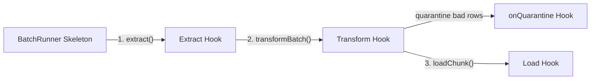

Modern TypeScript retains Template Method's **Inversion of Control skeleton** while swapping subclass inheritance for **Strategy / Callback Hook Composition** (`runEtlPipeline(hooks, options)`), keeping orchestration centralized without inheritance lock-in.

### 2. Real-World Use Cases & Decision Matrix

| Scenario | Inheritance Template Method vs Compositional Hooks | Architectural Rationale |
|---|---|---|
| Shared internal multi-step Batch ETL runner (`extract -> validate/quarantine -> chunk -> load`) | **Compositional Hook Object (`runEtlPipeline`)** | Steps are injected as pure/async functions, independently testable and dynamically combinable |
| Framework-enforced lifecycle interface (`React.Component`, NestJS `OnModuleInit`, `abc.ABC`) | **Interface / Abstract Base Hook** | Single-root framework contracts benefit from uniform method names and optional default hooks |
| Completely unrelated algorithms sharing zero orchestration structure | [[Programming/Software Engineering/Design Patterns/Behavioral/Strategy\|Strategy]] | No fixed skeleton exists to justify a template orchestrator |

### 3. Step-by-Step Practical Application

Both approaches appear below for a **Batch ETL Job Runner** supporting chunked batching, malformed-row quarantine without failing valid rows, and cancellation via `AbortSignal`: first the classical `abstract class` Template Method, then the zero-inheritance Compositional Hook pipeline.

```typescript
// src/template-method/batch-etl.ts
export interface QuarantineRecord<TRaw> {
  readonly raw: TRaw;
  readonly error: string;
}

export interface EtlSummary<TRaw> {
  readonly processedCount: number;
  readonly loadedBatches: number;
  readonly quarantined: ReadonlyArray<QuarantineRecord<TRaw>>;
}

// 1. Classical Inheritance Template Method
export abstract class AbstractBatchEtlJob<TRaw, TClean> {
  // Template skeleton method: orchestrates exact invariant sequence
  async run(batchSize: number, signal?: AbortSignal): Promise<EtlSummary<TRaw>> {
    if (batchSize < 1) throw new RangeError('batchSize must be >= 1');
    const rawItems = await this.extract(signal);
    const cleaned: TClean[] = [];
    const quarantined: QuarantineRecord<TRaw>[] = [];

    for (const raw of rawItems) {
      if (signal?.aborted) break;
      try {
        if (this.shouldInclude(raw)) {
          cleaned.push(this.transform(raw));
        }
      } catch (err) {
        const record: QuarantineRecord<TRaw> = {
          raw,
          error: err instanceof Error ? err.message : String(err),
        };
        quarantined.push(record);
        await this.onRowQuarantined(record);
      }
    }

    let loadedBatches = 0;
    for (let i = 0; i < cleaned.length; i += batchSize) {
      if (signal?.aborted) break;
      const chunk = cleaned.slice(i, i + batchSize);
      await this.loadChunk(chunk);
      loadedBatches++;
    }

    await this.onCompleted({ processedCount: cleaned.length, loadedBatches, quarantined });
    return { processedCount: cleaned.length, loadedBatches, quarantined };
  }

  protected abstract extract(signal?: AbortSignal): Promise<ReadonlyArray<TRaw>>;
  protected shouldInclude(_raw: TRaw): boolean {
    return true; // Optional hook with sensible default
  }
  protected abstract transform(raw: TRaw): TClean;
  protected abstract loadChunk(chunk: ReadonlyArray<TClean>): Promise<void>;
  protected async onRowQuarantined(_record: QuarantineRecord<TRaw>): Promise<void> {}
  protected async onCompleted(_summary: EtlSummary<TRaw>): Promise<void> {}
}

// 2. Modern Compositional Hook Pipeline (Preferred over inheritance in TypeScript)
export interface EtlPipelineHooks<TRaw, TClean> {
  readonly extract: (signal?: AbortSignal) => Promise<ReadonlyArray<TRaw>>;
  readonly shouldInclude?: (raw: TRaw) => boolean;
  readonly transform: (raw: TRaw) => TClean;
  readonly loadChunk: (chunk: ReadonlyArray<TClean>) => Promise<void>;
  readonly onRowQuarantined?: (record: QuarantineRecord<TRaw>) => Promise<void> | void;
}

export async function runEtlPipeline<TRaw, TClean>(
  hooks: EtlPipelineHooks<TRaw, TClean>,
  options: { readonly batchSize: number; readonly signal?: AbortSignal }
): Promise<EtlSummary<TRaw>> {
  if (options.batchSize < 1) throw new RangeError('batchSize must be >= 1');
  const rawItems = await hooks.extract(options.signal);
  const cleaned: TClean[] = [];
  const quarantined: QuarantineRecord<TRaw>[] = [];

  for (const raw of rawItems) {
    if (options.signal?.aborted) break;
    try {
      if (hooks.shouldInclude ? hooks.shouldInclude(raw) : true) {
        cleaned.push(hooks.transform(raw));
      }
    } catch (err) {
      const record: QuarantineRecord<TRaw> = {
        raw,
        error: err instanceof Error ? err.message : String(err),
      };
      quarantined.push(record);
      await hooks.onRowQuarantined?.(record);
    }
  }

  let loadedBatches = 0;
  for (let i = 0; i < cleaned.length; i += options.batchSize) {
    if (options.signal?.aborted) break;
    await hooks.loadChunk(cleaned.slice(i, i + options.batchSize));
    loadedBatches++;
  }

  return { processedCount: cleaned.length, loadedBatches, quarantined };
}
```

```typescript
// tests/template-method.spec.ts
import { describe, expect, it } from 'vitest';
import { AbstractBatchEtlJob, runEtlPipeline } from '../src/template-method/batch-etl';

class CsvOrderEtl extends AbstractBatchEtlJob<string, { id: string; cents: number }> {
  public readonly loadedChunks: Array<ReadonlyArray<{ id: string; cents: number }>> = [];
  public readonly quarantineAlerts: string[] = [];

  constructor(private readonly lines: ReadonlyArray<string>) {
    super();
  }

  protected async extract(): Promise<ReadonlyArray<string>> {
    return this.lines;
  }

  protected override shouldInclude(raw: string): boolean {
    return raw.trim().length > 0 && !raw.startsWith('#');
  }

  protected transform(raw: string): { id: string; cents: number } {
    const [id, rawAmount] = raw.split(',');
    const cents = Number(rawAmount);
    if (!id || !Number.isInteger(cents) || cents <= 0) {
      throw new Error(`Invalid CSV row: ${raw}`);
    }
    return { id, cents };
  }

  protected async loadChunk(chunk: ReadonlyArray<{ id: string; cents: number }>): Promise<void> {
    this.loadedChunks.push(chunk);
  }

  protected override async onRowQuarantined(record: { raw: string; error: string }): Promise<void> {
    this.quarantineAlerts.push(record.raw);
  }
}

describe('Template Method vs Compositional ETL Pipeline', () => {
  const sampleLines = ['# header', 'o1,500', 'bad-row', 'o2,1200', 'o3,300', ''];

  it('executes invariant template steps while quarantining invalid rows', async () => {
    const job = new CsvOrderEtl(sampleLines);
    const summary = await job.run(2);

    expect(summary.processedCount).toBe(3);
    expect(summary.loadedBatches).toBe(2);
    expect(job.loadedChunks).toEqual([
      [{ id: 'o1', cents: 500 }, { id: 'o2', cents: 1200 }],
      [{ id: 'o3', cents: 300 }],
    ]);
    expect(job.quarantineAlerts).toEqual(['bad-row']);
  });

  it('achieves identical skeleton behavior via compositional hook injection without inheritance', async () => {
    const loaded: Array<ReadonlyArray<{ id: string; cents: number }>> = [];
    const summary = await runEtlPipeline<string, { id: string; cents: number }>(
      {
        extract: async () => sampleLines,
        shouldInclude: (raw) => raw.trim().length > 0 && !raw.startsWith('#'),
        transform: (raw) => {
          const [id, rawAmount] = raw.split(',');
          const cents = Number(rawAmount);
          if (!id || !Number.isInteger(cents) || cents <= 0) throw new Error(`Bad row: ${raw}`);
          return { id, cents };
        },
        loadChunk: async (chunk) => {
          loaded.push(chunk);
        },
      },
      { batchSize: 2 }
    );

    expect(summary.processedCount).toBe(3);
    expect(summary.loadedBatches).toBe(2);
    expect(summary.quarantined.map((q) => q.raw)).toEqual(['bad-row']);
    expect(loaded).toHaveLength(2);
  });
});
```

### 4. Failure Modes & Framework Sightings

- **Framework Sightings**: Vitest/Jest test lifecycle hooks (`beforeAll -> beforeEach -> test -> afterEach`), NestJS lifecycle interfaces (`onModuleInit`, `onApplicationShutdown`), and Python's `abc.ABC` (`unittest.TestCase.setUp` / `tearDown`) all execute user-provided hooks inside a fixed framework skeleton.
- **Failure Modes**: Subclasses accidentally overriding `run()` itself (bypassing quarantine and chunking invariants), or storing transient batch state on mutable `this` properties that leaks across consecutive `job.run()` calls. TypeScript compositional hooks (`runEtlPipeline`) prevent subclasses from overriding the skeleton and keep per-run variables lexically scoped!

---

## Visitor

### 1. First-Principles Mechanics & Complete Architecture

**Visitor** resolves **The Expression Problem** along the **operations axis**: given a fixed, heterogeneous set of data/AST node types, Visitor lets engineers add arbitrary new operations (evaluation, pretty-printing, tax computation, SQL compilation, static linting) **without modifying the node classes themselves**.

In single-dispatch object-oriented languages (Java, C#, TypeScript classes), calling an overloaded `visitor.visit(node)` resolves `node`'s type **statically at compile time** using the variable's declared interface (`PricingNode`), not its runtime concrete class (`BundleNode`). Classical GoF Visitor solves this via **Double Dispatch**:
1. **First Dispatch**: The caller invokes `node.accept(visitor)`, resolving the concrete runtime class of `node` (for example, `BundleNode`) via vtable dispatch #1.
2. **Second Dispatch**: Inside `BundleNode.accept(visitor)`, `this` has static type `BundleNode`, so `visitor.visitBundle(this)` resolves the concrete `visitor` implementation via vtable dispatch #2.

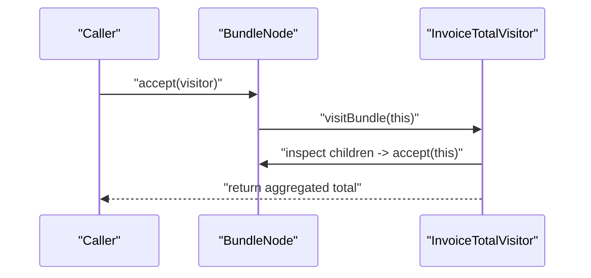

### 2. Double Dispatch vs TypeScript Discriminated Union Exhaustiveness

In modern TypeScript, Kotlin (`sealed class`), and Rust (`enum`), tagged discriminated unions paired with an exhaustive `switch` (`assertNever(node)`) deliver **identical operation extensibility and compile-time completeness checking without `accept()` double-dispatch boilerplate**!

| Dimension | Classical Double-Dispatch Visitor (OOP Classes) | Discriminated Union + Exhaustive `switch` (TS / Rust / Kotlin) |
|---|---|---|
| **Adding a new operation** | Add one new `Visitor` class implementing `visit*` methods | Add one pure function `op(node)` switching on `node.kind` |
| **Adding a new node type** | Compile error across every `Visitor` class until updated | Compile error via `assertNever(node)` across every `switch` |
| **Boilerplate & Indirection** | High (`accept()` + `Visitor` interface + `visitX()` methods) | Minimal (plain immutable data objects + pure functions) |
| **Serialization (JSON / Worker)** | Poor (class instances lose prototype methods across JSON) | Native JSON serializable AST structures |
| **When Classical Visitor Wins** | External OOP class hierarchies lacking discriminant tags (or Java/C# without exhaustive `switch` patterns) | Default choice in idiomatic TypeScript/Rust/Kotlin codebases |

### 3. Step-by-Step Practical Application

The module below implements a heterogeneous billing/pricing AST (containing flat fees, tiered usage rates, and recursive discount bundles) **both ways**—first via Classical OOP Double Dispatch (`PricingVisitor<R>`), then via an idiomatic TypeScript Discriminated Union (`PricingAst`)—and verifies exact parity in Vitest.

```typescript
// src/visitor/pricing-ast.ts
// === Approach A: Classical OOP Double-Dispatch Visitor ===
export interface PricingVisitor<R> {
  visitFlatFee(node: FlatFeeNode): R;
  visitUsageTier(node: UsageTierNode): R;
  visitBundle(node: BundleNode): R;
}

export interface VisitablePricingNode {
  accept<R>(visitor: PricingVisitor<R>): R;
}

export class FlatFeeNode implements VisitablePricingNode {
  constructor(
    public readonly label: string,
    public readonly amountCents: number,
    public readonly taxable: boolean
  ) {}

  accept<R>(visitor: PricingVisitor<R>): R {
    return visitor.visitFlatFee(this);
  }
}

export class UsageTierNode implements VisitablePricingNode {
  constructor(
    public readonly metric: string,
    public readonly units: number,
    public readonly ratePerUnitCents: number
  ) {}

  accept<R>(visitor: PricingVisitor<R>): R {
    return visitor.visitUsageTier(this);
  }
}

export class BundleNode implements VisitablePricingNode {
  constructor(
    public readonly name: string,
    public readonly discountRate: number,
    public readonly children: ReadonlyArray<VisitablePricingNode>
  ) {}

  accept<R>(visitor: PricingVisitor<R>): R {
    return visitor.visitBundle(this);
  }
}

export class TotalCentsVisitor implements PricingVisitor<number> {
  visitFlatFee(node: FlatFeeNode): number {
    return node.amountCents;
  }

  visitUsageTier(node: UsageTierNode): number {
    return Math.round(node.units * node.ratePerUnitCents);
  }

  visitBundle(node: BundleNode): number {
    const subtotal = node.children.reduce((sum, child) => sum + child.accept(this), 0);
    return Math.round(subtotal * (1 - node.discountRate));
  }
}

export class TaxableCentsVisitor implements PricingVisitor<number> {
  visitFlatFee(node: FlatFeeNode): number {
    return node.taxable ? node.amountCents : 0;
  }

  visitUsageTier(node: UsageTierNode): number {
    return Math.round(node.units * node.ratePerUnitCents);
  }

  visitBundle(node: BundleNode): number {
    const taxableSubtotal = node.children.reduce((sum, child) => sum + child.accept(this), 0);
    return Math.round(taxableSubtotal * (1 - node.discountRate));
  }
}

// === Approach B: Modern TypeScript Discriminated Union + Exhaustive Switch ===
export type PricingExpr =
  | { readonly kind: 'FLAT_FEE'; readonly label: string; readonly amountCents: number; readonly taxable: boolean }
  | { readonly kind: 'USAGE_TIER'; readonly metric: string; readonly units: number; readonly ratePerUnitCents: number }
  | { readonly kind: 'BUNDLE'; readonly name: string; readonly discountRate: number; readonly children: ReadonlyArray<PricingExpr> };

function assertNeverPricing(x: never): never {
  throw new Error(`Unhandled pricing AST node: ${JSON.stringify(x)}`);
}

export function evaluateTotalCents(expr: PricingExpr): number {
  switch (expr.kind) {
    case 'FLAT_FEE':
      return expr.amountCents;
    case 'USAGE_TIER':
      return Math.round(expr.units * expr.ratePerUnitCents);
    case 'BUNDLE': {
      const subtotal = expr.children.reduce((sum, child) => sum + evaluateTotalCents(child), 0);
      return Math.round(subtotal * (1 - expr.discountRate));
    }
    default:
      return assertNeverPricing(expr);
  }
}

export function evaluateTaxableCents(expr: PricingExpr): number {
  switch (expr.kind) {
    case 'FLAT_FEE':
      return expr.taxable ? expr.amountCents : 0;
    case 'USAGE_TIER':
      return Math.round(expr.units * expr.ratePerUnitCents);
    case 'BUNDLE': {
      const subtotal = expr.children.reduce((sum, child) => sum + evaluateTaxableCents(child), 0);
      return Math.round(subtotal * (1 - expr.discountRate));
    }
    default:
      return assertNeverPricing(expr);
  }
}
```

```typescript
// tests/visitor.spec.ts
import { describe, expect, it } from 'vitest';
import {
  BundleNode,
  evaluateTaxableCents,
  evaluateTotalCents,
  FlatFeeNode,
  PricingExpr,
  TaxableCentsVisitor,
  TotalCentsVisitor,
  UsageTierNode,
} from '../src/visitor/pricing-ast';

describe('Visitor Double Dispatch vs Discriminated Union Exhaustive Switch', () => {
  it('produces identical total and taxable calculations across nested pricing bundles', () => {
    const oopTree = new BundleNode('enterprise-pack', 0.1, [
      new FlatFeeNode('base-platform', 10_000, true),
      new FlatFeeNode('charity-passthrough', 2_000, false),
      new UsageTierNode('api-calls-1k', 50, 40),
    ]);

    const unionTree: PricingExpr = {
      kind: 'BUNDLE',
      name: 'enterprise-pack',
      discountRate: 0.1,
      children: [
        { kind: 'FLAT_FEE', label: 'base-platform', amountCents: 10_000, taxable: true },
        { kind: 'FLAT_FEE', label: 'charity-passthrough', amountCents: 2_000, taxable: false },
        { kind: 'USAGE_TIER', metric: 'api-calls-1k', units: 50, ratePerUnitCents: 40 },
      ],
    };

    // Total = (10000 + 2000 + 2000) * 0.9 = 12600; Taxable = (10000 + 2000) * 0.9 = 10800
    expect(oopTree.accept(new TotalCentsVisitor())).toBe(12_600);
    expect(evaluateTotalCents(unionTree)).toBe(12_600);

    expect(oopTree.accept(new TaxableCentsVisitor())).toBe(10_800);
    expect(evaluateTaxableCents(unionTree)).toBe(10_800);
  });
});
```

### 4. Failure Modes & Framework Sightings

- **Framework Sightings**: Babel (`@babel/traverse`), ESLint custom lint rules (`Identifier(node) { ... }`), and the TypeScript Compiler API (`ts.forEachChild`) implement AST visitors over source syntax trees.
- **Failure Modes**:
  1. *Cyclic Graph Infinite Recursion*: Traversing an AST or object graph containing back-edges (`parent` pointers) inside a naive Visitor triggers `RangeError: Maximum call stack size exceeded` unless guarded with a `WeakSet<object>` visited tracker.
  2. *Volatile Node Hierarchy*: If product requirements add new node classes every sprint while operations rarely change, Visitor flips the cost equation backward—every new node forces edits to every Visitor class. Prefer standard polymorphic methods on nodes when types change often and operations stay fixed.

---

## Dedicated Behavioral Pattern Cross-Links (`Observer` & `Strategy`)

The remaining two GoF Behavioral patterns live in dedicated deep-dive notes with full runtime hazard analyses:
- **[[Programming/Software Engineering/Design Patterns/Behavioral/Observer|Observer Pattern]]**: Covers push vs pull models, `AbortSignal` memory-leak prevention, snapshot iteration safety, diamond-dependency glitches, and backpressure escalation from `EventEmitter` to RxJS and `AsyncIterable` (**contrast with Mediator**: Observer fans out to unknown independent listeners, whereas Mediator centralizes interdependent peer rules; **contrast with Iterator**: Observer pushes events without consumer pacing, whereas Iterator yields lazily on consumer pull).
- **[[Programming/Software Engineering/Design Patterns/Behavioral/Strategy|Strategy Pattern]]**: Covers higher-order function `Record<Key, Fn>` strategies vs DI-injected strategy classes (**contrast with Template Method**: Strategy replaces whole interchangeable algorithms or callback steps via composition, whereas Template Method fixes an invariant multi-step skeleton; **contrast with State**: Strategy lets the caller choose *how* an operation computes independently of lifecycle history, whereas State encapsulates *when* transitions and behaviors are permitted).

---
# Part III: Cross-Pattern Composition Architectures

Real production subsystems rarely deploy a single Gang of Four pattern in isolation. Senior architectures compose Creational, Structural, and Behavioral patterns so each layer enforces one clear invariant boundary without bleeding complexity into adjacent layers.

## Audited Financial Transfer & Ledger Engine

Consider an internal multi-currency ledger transfer service requiring:
1. **Policy Screening Pipeline (`Chain of Responsibility`)**: Idempotency deduplication, actor authorization, and velocity fraud checks execute before touching account balances.
2. **Dynamic Fee & Compliance Rule Evaluation (`Interpreter` + `Visitor`)**: Ops teams update risk/fee predicates (`amountCents >= 100000 AND tier == "STANDARD"`) without redeploying application binaries.
3. **Lifecycle State Integrity (`State`)**: A transfer transitions strictly through `INITIATED -> AUTHORIZED -> SETTLED` or `INITIATED/AUTHORIZED -> ROLLED_BACK`.
4. **Atomic Compensation (`Command` + `Memento`)**: Before applying debits and credits, `ExecuteTransferCommand` captures an opaque `LedgerMemento` snapshot so any downstream gateway settlement error reverts all ledger balances deterministically.

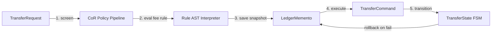

```typescript
// src/composition/transfer-engine.ts
import { evaluateRule, parseRule, RuleExpr } from '../interpreter/rule-engine';
import { composeMiddleware, Middleware } from '../cor/middleware-pipeline';

export type TransferState =
  | { readonly status: 'INITIATED'; readonly transferId: string }
  | { readonly status: 'AUTHORIZED'; readonly transferId: string; readonly feeCents: number }
  | { readonly status: 'SETTLED'; readonly transferId: string; readonly feeCents: number; readonly ledgerSeq: number }
  | { readonly status: 'ROLLED_BACK'; readonly transferId: string; readonly reason: string };

export interface LedgerMemento {
  readonly createdAtMs: number;
}

const LEDGER_VAULT = new WeakMap<LedgerMemento, ReadonlyMap<string, number>>();

export class LedgerAccountBook {
  private readonly balances = new Map<string, number>();

  seed(accountId: string, balanceCents: number): void {
    this.balances.set(accountId, balanceCents);
  }

  getBalance(accountId: string): number {
    return this.balances.get(accountId) ?? 0;
  }

  transfer(fromId: string, toId: string, amountCents: number, feeCents: number): void {
    const fromBal = this.getBalance(fromId);
    const totalDebit = amountCents + feeCents;
    if (amountCents <= 0) throw new RangeError('amountCents must be positive');
    if (fromBal < totalDebit) throw new Error(`Insufficient funds on ${fromId}`);
    this.balances.set(fromId, fromBal - totalDebit);
    this.balances.set(toId, this.getBalance(toId) + amountCents);
    this.balances.set('fee-revenue', this.getBalance('fee-revenue') + feeCents);
  }

  saveMemento(): LedgerMemento {
    const token: LedgerMemento = Object.freeze({ createdAtMs: Date.now() });
    LEDGER_VAULT.set(token, new Map(this.balances));
    return token;
  }

  restoreMemento(token: LedgerMemento): void {
    const snapshot = LEDGER_VAULT.get(token);
    if (!snapshot) throw new Error('Invalid LedgerMemento');
    this.balances.clear();
    for (const [k, v] of snapshot.entries()) {
      this.balances.set(k, v);
    }
  }
}

export interface TransferRequest {
  readonly transferId: string;
  readonly idempotencyKey: string;
  readonly fromAccount: string;
  readonly toAccount: string;
  readonly amountCents: number;
  readonly actorTier: 'STANDARD' | 'VIP';
  readonly actorRole: 'USER' | 'ADMIN';
}

export interface TransferContext {
  readonly req: TransferRequest;
  readonly ledger: LedgerAccountBook;
  state: TransferState;
  rejectedReason?: string;
}

export class AuditedTransferEngine {
  private readonly processedKeys = new Set<string>();
  private readonly highFeeRule: RuleExpr;
  private ledgerSeq = 0;

  constructor(
    private readonly ledger: LedgerAccountBook,
    private readonly externalSettlement: (transferId: string) => Promise<void>,
    highFeeRuleDsl: string = 'amountCents >= 50000 AND actorTier == "STANDARD"'
  ) {
    this.highFeeRule = parseRule(highFeeRuleDsl);
  }

  async submit(req: TransferRequest): Promise<TransferState> {
    const ctx: TransferContext = {
      req,
      ledger: this.ledger,
      state: { status: 'INITIATED', transferId: req.transferId },
    };

    const idempotencyGate: Middleware = async (httpCtx, next) => {
      if (this.processedKeys.has(req.idempotencyKey)) {
        ctx.rejectedReason = 'DUPLICATE_IDEMPOTENCY_KEY';
        ctx.state = { status: 'ROLLED_BACK', transferId: req.transferId, reason: 'Duplicate request' };
        return;
      }
      await next();
    };

    const rbacGate: Middleware = async (_httpCtx, next) => {
      if (req.actorRole !== 'ADMIN' && req.amountCents > 500_000) {
        ctx.rejectedReason = 'LIMIT_EXCEEDED';
        ctx.state = { status: 'ROLLED_BACK', transferId: req.transferId, reason: 'Exceeds standard user limit' };
        return;
      }
      await next();
    };

    const executeTransfer: Middleware = async () => {
      const feeApplies = evaluateRule(this.highFeeRule, {
        amountCents: req.amountCents,
        actorTier: req.actorTier,
      });
      const feeCents = feeApplies ? 250 : 0;

      ctx.state = { status: 'AUTHORIZED', transferId: req.transferId, feeCents };
      const preSnapshot = this.ledger.saveMemento();

      try {
        this.ledger.transfer(req.fromAccount, req.toAccount, req.amountCents, feeCents);
        await this.externalSettlement(req.transferId);
        this.processedKeys.add(req.idempotencyKey);
        ctx.state = {
          status: 'SETTLED',
          transferId: req.transferId,
          feeCents,
          ledgerSeq: ++this.ledgerSeq,
        };
      } catch (err) {
        // Atomic rollback via Memento guarantees zero partial debits on external failure
        this.ledger.restoreMemento(preSnapshot);
        ctx.state = {
          status: 'ROLLED_BACK',
          transferId: req.transferId,
          reason: err instanceof Error ? err.message : 'Settlement error',
        };
      }
    };

    const pipeline = composeMiddleware([idempotencyGate, rbacGate, executeTransfer]);
    await pipeline({
      req: { method: 'POST', path: '/transfers', clientIp: '127.0.0.1', headers: {} },
      state: { traceLog: [] },
      status: 200,
      responseBody: null,
    });

    return ctx.state;
  }
}
```

```typescript
// tests/transfer-engine.spec.ts
import { describe, expect, it } from 'vitest';
import { AuditedTransferEngine, LedgerAccountBook } from '../src/composition/transfer-engine';

describe('Cross-Pattern Audited Transfer Engine', () => {
  it('applies dynamic fee AST, prevents duplicates via CoR, and restores Memento on settlement error', async () => {
    const ledger = new LedgerAccountBook();
    ledger.seed('acct-alice', 100_000);
    ledger.seed('acct-bob', 0);

    let shouldFailGateway = false;
    const engine = new AuditedTransferEngine(ledger, async () => {
      if (shouldFailGateway) throw new Error('Clearinghouse unavailable');
    });

    // 1. Standard tier >= 50,000 triggers 250-cent fee via Interpreter
    const settled = await engine.submit({
      transferId: 'tx-1',
      idempotencyKey: 'key-1',
      fromAccount: 'acct-alice',
      toAccount: 'acct-bob',
      amountCents: 60_000,
      actorTier: 'STANDARD',
      actorRole: 'USER',
    });
    expect(settled).toEqual({ status: 'SETTLED', transferId: 'tx-1', feeCents: 250, ledgerSeq: 1 });
    expect(ledger.getBalance('acct-alice')).toBe(39_750);
    expect(ledger.getBalance('acct-bob')).toBe(60_000);
    expect(ledger.getBalance('fee-revenue')).toBe(250);

    // 2. Gateway crash restores pre-transfer Memento atomically
    shouldFailGateway = true;
    const rolledBack = await engine.submit({
      transferId: 'tx-2',
      idempotencyKey: 'key-2',
      fromAccount: 'acct-alice',
      toAccount: 'acct-bob',
      amountCents: 10_000,
      actorTier: 'VIP',
      actorRole: 'USER',
    });
    expect(rolledBack.status).toBe('ROLLED_BACK');
    expect(ledger.getBalance('acct-alice')).toBe(39_750);
    expect(ledger.getBalance('acct-bob')).toBe(60_000);
  });
});
```

---

# Part IV: Worked Exercises

## Worked Exercises

### Exercise 1: Undo/Redo Document Editor with Macro Batching & Memento Checkpoints
Design a `DocumentEditor` combining **Command** (character-range inverse-delta edits `InsertTextCommand`, `DeleteTextCommand`, and atomic `MacroCommand`) with **Memento** (`saveCheckpoint()` / `restoreCheckpoint()`) for non-invertible operations (such as `normalizeWhitespace()` collapsing arbitrary runs of spaces into single spaces).
1. Explain mathematically why keystroke edits use Command deltas while `normalizeWhitespace()` uses Memento.
2. Implement `DocumentEditor`, `InsertTextCommand`, `DeleteTextCommand`, `EditorHistory`, and opaque `EditorMemento`, ensuring `MacroCommand` rolls back partial edits if an index is out of bounds and `EditorHistory` enforces `maxHistory`.
3. Write Vitest assertions covering undo/redo, redo-stack invalidation, macro rollback, and Memento restoration.

### Solution 1

1. **Algorithmic & Memory Justification**: Inserting 5 characters into a 10 MB text document only needs `{ pos, text }` (~32 bytes) to undo via deletion—storing 500 keystroke Mementos would consume 5 GB of RAM. Conversely, `normalizeWhitespace()` is **non-invertible** (collapsing `"a   b  c"` into `"a b c"` erases original spacing counts), so capturing an opaque pre-transform Memento makes rollback exact.
2. **Complete Implementation & Tests**:

```typescript
// src/exercises/ex1-editor.ts
export interface EditorCommand {
  execute(): void;
  undo(): void;
}

export interface EditorMemento {
  readonly timestampMs: number;
}

const EDITOR_SNAPSHOTS = new WeakMap<EditorMemento, { readonly owner: DocumentEditor; readonly text: string }>();

export class DocumentEditor {
  private text = '';

  getText(): string {
    return this.text;
  }

  insertAt(index: number, fragment: string): void {
    if (index < 0 || index > this.text.length) {
      throw new RangeError(`Insert index ${index} out of bounds [0, ${this.text.length}]`);
    }
    this.text = this.text.slice(0, index) + fragment + this.text.slice(index);
  }

  deleteRange(index: number, length: number): string {
    if (index < 0 || length < 0 || index + length > this.text.length) {
      throw new RangeError(`Delete range [${index}, ${index + length}) out of bounds`);
    }
    const removed = this.text.slice(index, index + length);
    this.text = this.text.slice(0, index) + this.text.slice(index + length);
    return removed;
  }

  normalizeWhitespace(): void {
    this.text = this.text.replace(/[ \t]+/g, ' ').trim();
  }

  saveCheckpoint(): EditorMemento {
    const token: EditorMemento = Object.freeze({ timestampMs: Date.now() });
    EDITOR_SNAPSHOTS.set(token, { owner: this, text: this.text });
    return token;
  }

  restoreCheckpoint(token: EditorMemento): void {
    const snap = EDITOR_SNAPSHOTS.get(token);
    if (!snap || snap.owner !== this) throw new Error('Invalid editor memento');
    this.text = snap.text;
  }
}

export class InsertTextCommand implements EditorCommand {
  constructor(
    private readonly editor: DocumentEditor,
    private readonly index: number,
    private readonly fragment: string
  ) {}

  execute(): void {
    this.editor.insertAt(this.index, this.fragment);
  }

  undo(): void {
    this.editor.deleteRange(this.index, this.fragment.length);
  }
}

export class DeleteTextCommand implements EditorCommand {
  private deletedFragment = '';

  constructor(
    private readonly editor: DocumentEditor,
    private readonly index: number,
    private readonly length: number
  ) {}

  execute(): void {
    this.deletedFragment = this.editor.deleteRange(this.index, this.length);
  }

  undo(): void {
    this.editor.insertAt(this.index, this.deletedFragment);
  }
}

export class NormalizeWithMementoCommand implements EditorCommand {
  private before?: EditorMemento;

  constructor(private readonly editor: DocumentEditor) {}

  execute(): void {
    this.before = this.editor.saveCheckpoint();
    this.editor.normalizeWhitespace();
  }

  undo(): void {
    if (!this.before) throw new Error('Cannot undo before execute');
    this.editor.restoreCheckpoint(this.before);
  }
}

export class BatchEditorMacro implements EditorCommand {
  constructor(private readonly steps: ReadonlyArray<EditorCommand>) {}

  execute(): void {
    const completed: EditorCommand[] = [];
    try {
      for (const step of this.steps) {
        step.execute();
        completed.push(step);
      }
    } catch (err) {
      for (let i = completed.length - 1; i >= 0; i--) {
        completed[i]!.undo();
      }
      throw err;
    }
  }

  undo(): void {
    for (let i = this.steps.length - 1; i >= 0; i--) {
      this.steps[i]!.undo();
    }
  }
}

export class EditorHistory {
  private readonly undoStack: EditorCommand[] = [];
  private readonly redoStack: EditorCommand[] = [];

  constructor(private readonly maxEntries: number = 50) {}

  apply(cmd: EditorCommand): void {
    cmd.execute();
    this.undoStack.push(cmd);
    if (this.undoStack.length > this.maxEntries) this.undoStack.shift();
    this.redoStack.length = 0;
  }

  undo(): boolean {
    const cmd = this.undoStack.pop();
    if (!cmd) return false;
    cmd.undo();
    this.redoStack.push(cmd);
    return true;
  }

  redo(): boolean {
    const cmd = this.redoStack.pop();
    if (!cmd) return false;
    cmd.execute();
    this.undoStack.push(cmd);
    return true;
  }
}
```

```typescript
// tests/ex1-editor.spec.ts
import { describe, expect, it } from 'vitest';
import {
  BatchEditorMacro,
  DeleteTextCommand,
  DocumentEditor,
  EditorHistory,
  InsertTextCommand,
  NormalizeWithMementoCommand,
} from '../src/exercises/ex1-editor';

describe('Exercise 1: Hybrid Command + Memento DocumentEditor', () => {
  it('undoes/redoes deltas and non-invertible whitespace normalization while rolling back failed macros', () => {
    const editor = new DocumentEditor();
    const history = new EditorHistory(10);

    history.apply(new InsertTextCommand(editor, 0, '  hello    world  '));
    history.apply(new NormalizeWithMementoCommand(editor));
    expect(editor.getText()).toBe('hello world');

    history.undo();
    expect(editor.getText()).toBe('  hello    world  ');
    history.redo();
    expect(editor.getText()).toBe('hello world');

    const badMacro = new BatchEditorMacro([
      new DeleteTextCommand(editor, 0, 6), // Removes 'hello '
      new InsertTextCommand(editor, 999, 'boom'), // Throws RangeError
    ]);
    expect(() => history.apply(badMacro)).toThrow(RangeError);
    expect(editor.getText()).toBe('hello world'); // Atomically rolled back!
  });
});
```

---

### Exercise 2: Fault-Tolerant Async API Cursor `AsyncIterable` Iterator
Implement a reusable `AuditEventStream` class implementing `AsyncIterable<AuditLogEntry>` over a cursor-paginated HTTP client (`fetchLogs(cursor, signal)`). Requirements:
1. Must work directly with `for await (const log of new AuditEventStream(...))`.
2. Must accept an optional `maxItems` limit and `AbortSignal`.
3. Must retry transient `503` failures up to `maxRetries`, detect duplicate terminal cursors, and guarantee zero extra API requests once the consumer breaks early.

### Solution 2

```typescript
// src/exercises/ex2-cursor-iterable.ts
export interface AuditLogEntry {
  readonly id: string;
  readonly action: string;
}

export interface AuditPageResponse {
  readonly entries: ReadonlyArray<AuditLogEntry>;
  readonly nextCursor: string | null;
}

export class AuditEventStream implements AsyncIterable<AuditLogEntry> {
  constructor(
    private readonly fetchPage: (cursor: string | null, signal: AbortSignal) => Promise<AuditPageResponse>,
    private readonly options: { readonly maxItems?: number; readonly maxRetries?: number; readonly signal?: AbortSignal } = {}
  ) {}

  async *[Symbol.asyncIterator](): AsyncIterator<AuditLogEntry> {
    const maxItems = this.options.maxItems ?? Number.POSITIVE_INFINITY;
    const maxRetries = this.options.maxRetries ?? 2;
    const controller = new AbortController();
    const abortFromParent = () => controller.abort(this.options.signal?.reason);

    if (this.options.signal?.aborted) {
      controller.abort(this.options.signal.reason);
      return;
    }
    this.options.signal?.addEventListener('abort', abortFromParent, { once: true });

    let cursor: string | null = null;
    const seen = new Set<string>();
    let emitted = 0;

    try {
      while (!controller.signal.aborted && emitted < maxItems) {
        let attempt = 0;
        let page: AuditPageResponse;
        while (true) {
          try {
            page = await this.fetchPage(cursor, controller.signal);
            break;
          } catch (err) {
            if (controller.signal.aborted || attempt >= maxRetries) throw err;
            attempt++;
          }
        }

        for (const entry of page.entries) {
          if (controller.signal.aborted || emitted >= maxItems) return;
          emitted++;
          yield entry;
        }

        if (!page.nextCursor) return;
        if (seen.has(page.nextCursor)) {
          throw new Error(`Infinite cursor loop detected on '${page.nextCursor}'`);
        }
        seen.add(page.nextCursor);
        cursor = page.nextCursor;
      }
    } finally {
      this.options.signal?.removeEventListener('abort', abortFromParent);
    }
  }
}
```

```typescript
// tests/ex2-cursor-iterable.spec.ts
import { describe, expect, it } from 'vitest';
import { AuditEventStream } from '../src/exercises/ex2-cursor-iterable';

describe('Exercise 2: AuditEventStream AsyncIterable', () => {
  it('streams lazily with retry recovery and stops fetching on early break', async () => {
    let calls = 0;
    let failedOnce = false;

    const stream = new AuditEventStream(
      async (cursor) => {
        calls++;
        if (cursor === 'c1' && !failedOnce) {
          failedOnce = true;
          throw new Error('503 Busy');
        }
        if (cursor === null) {
          return {
            entries: [{ id: '1', action: 'LOGIN' }, { id: '2', action: 'READ' }],
            nextCursor: 'c1',
          };
        }
        return {
          entries: [{ id: '3', action: 'WRITE' }, { id: '4', action: 'LOGOUT' }],
          nextCursor: 'c2',
        };
      },
      { maxRetries: 1 }
    );

    const collected: string[] = [];
    for await (const item of stream) {
      collected.push(item.id);
      if (collected.length === 3) break;
    }

    expect(collected).toEqual(['1', '2', '3']);
    expect(calls).toBe(3); // Page 1 (1) + Page 2 fail (1) + Page 2 retry (1); Page 3 never called
  });
});
```

---

### Exercise 3: Type-Safe Order Fulfillment FSM (Eliminating Boolean Soup)
Refactor this bug-prone fulfillment model:
```typescript
class LegacyFulfillment {
  isPaid = false;
  isPacked = false;
  isShipped = false;
  isDelivered = false;
  isCancelled = false;
  trackingNumber?: string;
}
```
Design a TypeScript Discriminated-Union FSM enforcing:
1. Valid forward transitions `PAID -> PACKED -> SHIPPED -> DELIVERED`.
2. Cancellation allowed ONLY from `PAID` or `PACKED` (never after `SHIPPED` or `DELIVERED`!).
3. `trackingNumber` and `carrier` exist statically ONLY in `SHIPPED` and `DELIVERED` states.
4. Optimistic `version` increment on every transition to protect SQL updates against concurrent webhook races.

### Solution 3

```typescript
// src/exercises/ex3-fulfillment-fsm.ts
export type FulfillmentState =
  | { readonly kind: 'PAID'; readonly orderId: string; readonly version: number }
  | { readonly kind: 'PACKED'; readonly orderId: string; readonly version: number; readonly packageWeightGrams: number }
  | {
      readonly kind: 'SHIPPED';
      readonly orderId: string;
      readonly version: number;
      readonly carrier: string;
      readonly trackingNumber: string;
    }
  | {
      readonly kind: 'DELIVERED';
      readonly orderId: string;
      readonly version: number;
      readonly carrier: string;
      readonly trackingNumber: string;
      readonly deliveredAtMs: number;
    }
  | { readonly kind: 'CANCELLED'; readonly orderId: string; readonly version: number; readonly reason: string };

export type FulfillmentEvent =
  | { readonly type: 'PACK'; readonly packageWeightGrams: number }
  | { readonly type: 'SHIP'; readonly carrier: string; readonly trackingNumber: string }
  | { readonly type: 'MARK_DELIVERED'; readonly deliveredAtMs: number }
  | { readonly type: 'CANCEL'; readonly reason: string };

export class FulfillmentTransitionError extends Error {
  constructor(from: FulfillmentState['kind'], event: FulfillmentEvent['type']) {
    super(`Cannot apply '${event}' when fulfillment is '${from}'`);
    this.name = 'FulfillmentTransitionError';
  }
}

export function transitionFulfillment(state: FulfillmentState, event: FulfillmentEvent): FulfillmentState {
  const nextVersion = state.version + 1;
  switch (state.kind) {
    case 'PAID':
      if (event.type === 'PACK') {
        if (event.packageWeightGrams <= 0) throw new RangeError('Weight must be positive');
        return { kind: 'PACKED', orderId: state.orderId, version: nextVersion, packageWeightGrams: event.packageWeightGrams };
      }
      if (event.type === 'CANCEL') {
        return { kind: 'CANCELLED', orderId: state.orderId, version: nextVersion, reason: event.reason };
      }
      throw new FulfillmentTransitionError(state.kind, event.type);

    case 'PACKED':
      if (event.type === 'SHIP') {
        if (!event.trackingNumber.trim()) throw new Error('Tracking number required');
        return {
          kind: 'SHIPPED',
          orderId: state.orderId,
          version: nextVersion,
          carrier: event.carrier,
          trackingNumber: event.trackingNumber,
        };
      }
      if (event.type === 'CANCEL') {
        return { kind: 'CANCELLED', orderId: state.orderId, version: nextVersion, reason: event.reason };
      }
      throw new FulfillmentTransitionError(state.kind, event.type);

    case 'SHIPPED':
      if (event.type === 'MARK_DELIVERED') {
        return {
          kind: 'DELIVERED',
          orderId: state.orderId,
          version: nextVersion,
          carrier: state.carrier,
          trackingNumber: state.trackingNumber,
          deliveredAtMs: event.deliveredAtMs,
        };
      }
      throw new FulfillmentTransitionError(state.kind, event.type);

    case 'DELIVERED':
    case 'CANCELLED':
      throw new FulfillmentTransitionError(state.kind, event.type);
  }
}
```

```typescript
// tests/ex3-fulfillment-fsm.spec.ts
import { describe, expect, it } from 'vitest';
import { FulfillmentState, FulfillmentTransitionError, transitionFulfillment } from '../src/exercises/ex3-fulfillment-fsm';

describe('Exercise 3: Type-Safe Fulfillment FSM', () => {
  it('increments optimistic version along valid edges and forbids cancellation after shipping', () => {
    let state: FulfillmentState = { kind: 'PAID', orderId: 'ord-7', version: 1 };
    state = transitionFulfillment(state, { type: 'PACK', packageWeightGrams: 1_200 });
    state = transitionFulfillment(state, { type: 'SHIP', carrier: 'DHL', trackingNumber: 'DHL-991' });

    expect(state.version).toBe(3);
    if (state.kind === 'SHIPPED') {
      expect(state.trackingNumber).toBe('DHL-991');
    }

    expect(() => transitionFulfillment(state, { type: 'CANCEL', reason: 'too-late' })).toThrow(
      FulfillmentTransitionError
    );

    const delivered = transitionFulfillment(state, { type: 'MARK_DELIVERED', deliveredAtMs: 1_700_000_000_000 });
    expect(delivered.kind).toBe('DELIVERED');
    expect(delivered.version).toBe(4);
  });
});
```

---

### Exercise 4: Rule AST Interpreter with Static Schema Validation & Pretty-Printer Visitor
Given the `RuleExpr` AST from the Interpreter section, implement two compile-time AST passes using the Visitor / exhaustive-switch pattern:
1. `validateRuleSchema(ast, schema)` returning a list of type/field errors (rejecting unknown fields or numeric `>=` operators applied against `'string'` schema fields) **before** evaluating against live traffic.
2. `formatRuleAst(ast)` pretty-printing a normalized canonical DSL string cleanly.

### Solution 4

```typescript
// src/exercises/ex4-ast-passes.ts
import { RuleExpr } from '../interpreter/rule-engine';

export type FieldSchema = Readonly<Record<string, 'string' | 'number'>>;

function assertNeverRule(x: never): never {
  throw new Error(`Unhandled RuleExpr node: ${JSON.stringify(x)}`);
}

export function validateRuleSchema(expr: RuleExpr, schema: FieldSchema): string[] {
  switch (expr.kind) {
    case 'AND':
    case 'OR':
      return [...validateRuleSchema(expr.left, schema), ...validateRuleSchema(expr.right, schema)];
    case 'NOT':
      return validateRuleSchema(expr.inner, schema);
    case 'COMPARE': {
      const expectedType = schema[expr.field];
      if (!expectedType) {
        return [`Unknown field '${expr.field}'`];
      }
      if ((expr.op === '>=' || expr.op === '<=') && expectedType !== 'number') {
        return [`Operator '${expr.op}' requires numeric field, but '${expr.field}' is '${expectedType}'`];
      }
      if (typeof expr.value !== expectedType) {
        return [`Type mismatch on '${expr.field}': expected ${expectedType}, got ${typeof expr.value}`];
      }
      return [];
    }
    default:
      return assertNeverRule(expr);
  }
}

export function formatRuleAst(expr: RuleExpr): string {
  switch (expr.kind) {
    case 'COMPARE': {
      const literal = typeof expr.value === 'string' ? `"${expr.value}"` : String(expr.value);
      return `${expr.field} ${expr.op} ${literal}`;
    }
    case 'NOT':
      return `NOT (${formatRuleAst(expr.inner)})`;
    case 'AND':
      return `(${formatRuleAst(expr.left)} AND ${formatRuleAst(expr.right)})`;
    case 'OR':
      return `(${formatRuleAst(expr.left)} OR ${formatRuleAst(expr.right)})`;
    default:
      return assertNeverRule(expr);
  }
}
```

```typescript
// tests/ex4-ast-passes.spec.ts
import { describe, expect, it } from 'vitest';
import { parseRule } from '../src/interpreter/rule-engine';
import { formatRuleAst, validateRuleSchema } from '../src/exercises/ex4-ast-passes';

describe('Exercise 4: Rule AST Static Validator & Formatter Passes', () => {
  it('catches unknown fields and operator/type mismatches statically before execution', () => {
    const schema = { country: 'string', seats: 'number' } as const;

    const badAst = parseRule('country >= 5 AND missingField == "x"');
    expect(validateRuleSchema(badAst, schema)).toEqual([
      "Operator '>=' requires numeric field, but 'country' is 'string'",
      "Unknown field 'missingField'",
    ]);

    const goodAst = parseRule('country == "US" AND NOT seats <= 3');
    expect(validateRuleSchema(goodAst, schema)).toEqual([]);
    expect(formatRuleAst(goodAst)).toBe('(country == "US" AND NOT (seats <= 3))');
  });
});
```

---

### Exercise 5: Diagnosing & Hardening a Broken Connection Object Pool
Audit this broken pool snippet causing production outages:
```typescript
class BrokenPool<T> {
  private idle: T[] = [];
  private count = 0;
  constructor(private max: number, private factory: () => Promise<T>) {}
  async acquire(): Promise<T> {
    if (this.idle.length > 0) return this.idle.pop()!;
    if (this.count < this.max) { this.count++; return await this.factory(); }
    throw new Error('Full');
  }
  release(item: T) { this.idle.push(item); }
}
```
1. List four distinct production failure modes in `BrokenPool`.
2. Wrap or replace it using `BoundedObjectPool` configured with transaction scrubbing (`ROLLBACK; RESET ALL`), socket health validation (`ping()`), FIFO queuing with timeout, and `Symbol.asyncDispose` leak immunity.

### Solution 5

1. **Four Production Failure Modes in `BrokenPool`**:
   - *Capacity Leak on Factory Error*: `this.count++` runs *before* `await this.factory()`. If `factory()` rejects during a transient DB restart, `this.count` permanently increments while returning nothing, shrinking effective pool capacity to zero!
   - *No Wait Queue / Immediate Load Shedding*: Concurrent requests when `count === max` throw `'Full'` immediately instead of queuing briefly up to `acquireTimeoutMs`.
   - *Dead Connection Reuse*: `acquire()` returns `idle.pop()` blindly without `validate()` health checks—handing closed TCP sockets (`ECONNRESET`) to application queries.
   - *Cross-Tenant State Poisoning & Double-Release*: No `reset()` scrubs dirty session variables or uncommitted transactions, and calling `release(item)` twice pushes duplicate references of the *same* connection into `idle`, causing two concurrent queries to interleave protocol bytes on one TCP socket!
2. **Hardened Implementation & Tests**:

```typescript
// tests/ex5-hardened-db-pool.spec.ts
import { describe, expect, it } from 'vitest';
import { BoundedObjectPool } from '../src/pool/bounded-object-pool';

interface SimulatedDbClient {
  readonly id: number;
  connected: boolean;
  inTransaction: boolean;
  executedQueries: string[];
}

describe('Exercise 5: Hardened Connection Object Pool', () => {
  it('scrubs uncommitted transactions, evicts dead connections, and prevents double-release corruption', async () => {
    let nextId = 0;
    let failFirstConnect = true;

    const pool = new BoundedObjectPool<SimulatedDbClient>({
      maxSize: 1,
      acquireTimeoutMs: 150,
      maxAgeMs: 60_000,
      create: async () => {
        if (failFirstConnect) {
          failFirstConnect = false;
          throw new Error('Transient TCP SYN timeout');
        }
        return { id: ++nextId, connected: true, inTransaction: false, executedQueries: [] };
      },
      validate: async (client) => client.connected,
      reset: async (client) => {
        if (client.inTransaction) {
          client.executedQueries.push('ROLLBACK');
          client.inTransaction = false;
        }
      },
      destroy: async (client) => {
        client.connected = false;
      },
    });

    // 1. Transient factory failure must NOT leak capacity slot
    await expect(pool.acquireLease()).rejects.toThrow('Transient TCP SYN timeout');
    expect(pool.getMetrics().totalAllocated).toBe(0);

    // 2. Lease, leave dirty transaction, and double-release safely
    const lease = await pool.acquireLease();
    lease.resource.inTransaction = true;
    await lease.release();
    await lease.release(); // Idempotent second release must not duplicate idle entry

    expect(pool.getMetrics().idle).toBe(1);
    const nextLease = await pool.acquireLease();
    expect(nextLease.resource.inTransaction).toBe(false);
    expect(nextLease.resource.executedQueries).toContain('ROLLBACK');
    await nextLease.release();
    await pool.drain();
  });
});
```

---

### Exercise 6: Diagnosing Cross-Tenant Shallow Cloning, Double-`next()` Middleware & Tightly Coupled Form Peers
Inspect this buggy multi-tenant checkout subsystem:
```typescript
const baseTenantConfig = { shippingFee: 1000, allowedPromoCodes: ['WELCOME10'], flags: { expressEnabled: true } };
function cloneTenantConfig() { return { ...baseTenantConfig }; }

const validateAuth = async (ctx: any, next: () => Promise<void>) => {
  if (!ctx.authorized) { ctx.status = 401; next(); }
  await next();
};
```
1. Identify the two critical bugs above and explain what fails in production.
2. Integrate `PrototypeRegistry`, `composeMiddleware` (with `i <= index` double-`next()` guard), and `CheckoutMediator` to process a tenant-specific checkout safely, and prove the fix in Vitest.

### Solution 6

1. **Root-Cause Diagnosis**:
   - *Shallow-Clone Tenant Leakage*: `{ ...baseTenantConfig }` leaves `allowedPromoCodes` (array) and `flags` (nested object) aliased to `baseTenantConfig`. When Tenant A pushes `'VIP50'` into `allowedPromoCodes`, Tenant B silently receives Tenant A's private VIP promo code!
   - *Double-`next()` Authorization Bypass*: Missing `return` after `ctx.status = 401; next();` causes `validateAuth` to call `next()` **twice**, executing downstream payment capture twice even for unauthorized requests.
2. **Integrated Fix & Vitest Suite**:

```typescript
// src/exercises/ex6-tenant-checkout.ts
import { Cloneable, PrototypeRegistry } from '../prototype/workflow-template';
import { composeMiddleware, HttpContext, Middleware } from '../cor/middleware-pipeline';
import { CheckoutMediator } from '../mediator/checkout-mediator';

export class TenantCheckoutTemplate implements Cloneable<TenantCheckoutTemplate> {
  public readonly allowedPromoCodes: Set<string>;
  public readonly flags: { expressEnabled: boolean; defaultSubtotalCents: number };

  constructor(
    public readonly tenantId: string,
    allowedPromoCodes: Iterable<string>,
    flags: { expressEnabled: boolean; defaultSubtotalCents: number }
  ) {
    this.allowedPromoCodes = new Set(allowedPromoCodes);
    this.flags = { ...flags };
  }

  clone(): TenantCheckoutTemplate {
    return new TenantCheckoutTemplate(this.tenantId, this.allowedPromoCodes, this.flags);
  }
}

export async function runTenantCheckoutEndpoint(
  registry: PrototypeRegistry<TenantCheckoutTemplate>,
  tenantKey: string,
  authorized: boolean,
  promoCode: string
): Promise<{ status: number; body: unknown }> {
  const ctx: HttpContext = {
    req: { method: 'POST', path: '/checkout', clientIp: '127.0.0.1', headers: authorized ? { authorization: 'ok' } : {} },
    state: { traceLog: [] },
    status: 0,
    responseBody: null,
  };

  const authMiddleware: Middleware = async (c, next) => {
    if (!c.req.headers['authorization']) {
      c.status = 401;
      c.responseBody = { error: 'UNAUTHORIZED' };
      return; // Explicit short-circuit prevents double-next execution
    }
    await next();
  };

  const checkoutHandler: Middleware = async (c) => {
    const config = registry.spawn(tenantKey);
    const mediator = new CheckoutMediator(config.flags.defaultSubtotalCents);
    mediator.shipping.select('PICKUP');
    if (promoCode && config.allowedPromoCodes.has(promoCode)) {
      mediator.coupon.applyCode(promoCode);
    }
    c.status = 200;
    c.responseBody = {
      tenant: config.tenantId,
      totals: mediator.totals.read(),
      submittable: mediator.submit.isEnabled(),
    };
  };

  const runner = composeMiddleware([authMiddleware, checkoutHandler]);
  await runner(ctx);
  return { status: ctx.status, body: ctx.responseBody };
}
```

```typescript
// tests/ex6-tenant-checkout.spec.ts
import { describe, expect, it } from 'vitest';
import { PrototypeRegistry } from '../src/prototype/workflow-template';
import { runTenantCheckoutEndpoint, TenantCheckoutTemplate } from '../src/exercises/ex6-tenant-checkout';

describe('Exercise 6: Integrated Tenant Checkout Architecture', () => {
  it('isolates cloned tenant rules, blocks unauthorized requests once, and coordinates totals via Mediator', async () => {
    const registry = new PrototypeRegistry<TenantCheckoutTemplate>();
    registry.register('retail-default', new TenantCheckoutTemplate('base', ['SAVE10'], { expressEnabled: true, defaultSubtotalCents: 10_000 }));

    // Mutate one spawned template and verify registry baseline remains untouched
    const vipTenant = registry.spawn('retail-default', (tpl) => {
      tpl.allowedPromoCodes.add('VIP20');
    });
    expect(vipTenant.allowedPromoCodes.has('VIP20')).toBe(true);

    const unauthorized = await runTenantCheckoutEndpoint(registry, 'retail-default', false, 'VIP20');
    expect(unauthorized).toEqual({ status: 401, body: { error: 'UNAUTHORIZED' } });

    const baselineRes = await runTenantCheckoutEndpoint(registry, 'retail-default', true, 'VIP20');
    expect(baselineRes.status).toBe(200);
    // VIP20 was NOT leaked into retail-default, so total remains 10,000 (0 discount)
    expect((baselineRes.body as { totals: { totalCents: number } }).totals.totalCents).toBe(10_000);
  });
});
```

---

## Related Notes

- [[Programming/Software Engineering/Design Patterns/Design Patterns Complete Guide|Design Patterns Complete Guide]]
- [[Programming/Software Engineering/Design Patterns/Structural Patterns Catalog|Structural Patterns Catalog]]
- [[Programming/Software Engineering/Design Patterns/Creational/Factory Method|Factory Method]]
- [[Programming/Software Engineering/Design Patterns/Creational/Builder|Builder]]
- [[Programming/Software Engineering/Design Patterns/Creational/Singleton|Singleton]]
- [[Programming/Software Engineering/Design Patterns/Behavioral/Observer|Observer]]
- [[Programming/Software Engineering/Design Patterns/Behavioral/Strategy|Strategy]]
- [[Programming/Software Engineering/Architectural Patterns/CQRS|CQRS]]
- [[Programming/Software Engineering/Architectural Patterns/Event Sourcing|Event Sourcing]]

---

← [[Programming/Software Engineering/Design Patterns/Design Patterns Complete Guide|Back to Design Patterns]]
