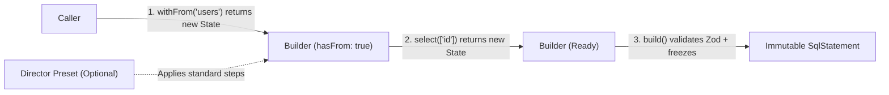
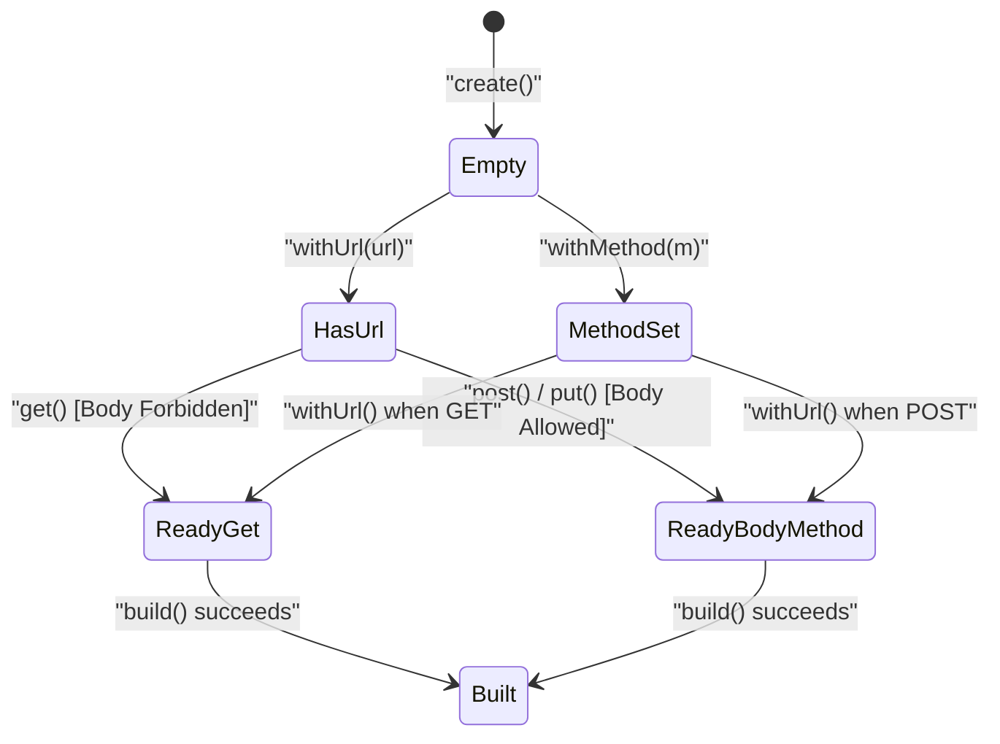

---
tags:
  - software-engineering
  - design-patterns
  - creational
created: 2026-01-02
updated: 2026-11-13
status: 🟢
level: mid-to-senior
category: Creational
---
# Builder Pattern

> [!abstract] Vault Navigation
> Part of [[Programming/Software Engineering/Design Patterns/Design Patterns Complete Guide|Design Patterns Complete Guide]]. Enforces invariant construction alongside [[Programming/Software Engineering/Clean Code/Classes, Objects & Formatting|Classes, Objects & Formatting]], bridges static safety with runtime validation from [[Programming/Software Engineering/Clean Code/Error Handling|Error Handling]], and protects data boundaries tested in [[Programming/Software Engineering/Testing/Unit Testing|Unit Testing]].

**Builder** separates the incremental assembly and invariant validation of a complex product from its final immutable representation—eliminating telescoping constructors, invalid half-initialized states, mutable aliasing leaks, and unsafe string concatenation. In TypeScript and systems languages, combining **copy-on-write immutability** with **compile-time phantom type-state (`this`-parameter constraints)** turns missing required steps and illegal method combinations into **zero-runtime-cost compiler errors** rather than production exceptions.



---

## 1. First-Principles Mechanics & Complete Architecture

### 1.1 Telescoping Constructors vs Options Objects vs Fluent Builders

Why do direct multi-argument constructors break down as object configuration grows?

1. **Telescoping Constructors & Positional Ambiguity**: A signature `new HttpClient(baseUrl, timeoutMs, retries, maxRedirects, keepAlive, rejectUnauthorized)` exposes adjacent parameters of identical primitive types (`number`, `boolean`). Swapping `timeoutMs` and `retries` (`new HttpClient(url, 3, 5000)`) passes static type checking silently and ships a broken 3 ms network timeout to production.
2. **Sparse Optional Placeholders**: Callers customizing only the sixth parameter must pass `undefined` across preceding optional slots (`new HttpClient(url, undefined, undefined, undefined, false)`), coupling every call site to constructor parameter ordering.
3. **Options Objects Solve Flat DTOs**: In TypeScript, Python (keyword args), and Go (struct literals), an options object (`createRetryPolicy({ maxAttempts: 5, jitter: true })`) solves flat optional configuration in ~15 lines with zero Builder boilerplate.
4. **Where Options Objects Stop Scaling**: Plain options objects cannot model **order-dependent or multi-stage pipelines** (e.g., incrementally appending `WHERE` predicates across repository helper functions), **conditional method legality** (disallowing `.jsonBody()` on a `GET` request), or **compile-time structural guarantees across asynchronous/chained accumulation**.

### 1.2 Compile-Time Type-State (Phantom Types) Mechanics in TypeScript

Standard fluent builders defer validation until runtime inside `.build()`: if a developer omits `.from('users')` or `.where(...)`, the TypeScript compiler emits zero warnings and the bug waits until a runtime code path hits `.build()`.

**Phantom Type Builders** encode construction progress inside a generic type parameter (`State`) that exists **strictly at compile time** and compiles down to zero bytes of JavaScript overhead:



Two complementary mechanisms drive TypeScript type-state enforcement:

1. **Object Bitmask State (`State extends BuildState`) + `this` Parameter Constraints**:
   - Each setter returns a builder type with its corresponding phantom flag flipped to `true`: `Builder<Omit<State, 'hasUrl'> & { hasUrl: true }>`.
   - `.build(this: Builder<{ hasUrl: true; hasMethod: true }>): Product` declares an explicit TypeScript `this` parameter. Calling `.build()` on `Builder<{ hasUrl: true; hasMethod: false }>` fails compilation with `TS2684: The 'this' context of type ... is not assignable to method's 'this' of type ...`.
   - Callers can supply required steps in **any order** (`withUrl().withMethod()` or `withMethod().withUrl()`), unlike rigid sequential step wizards.
2. **Method-Specific Capability Constraints**:
   - `.jsonBody(payload)` declares `this: HttpRequestBuilder<{ hasUrl: boolean; method: 'POST' | 'PUT' | 'PATCH' }>`. Attempting `HttpRequestBuilder.create().get().withUrl(...).jsonBody(...)` produces a compile error immediately because `'GET'` does not satisfy the `this` constraint!

### 1.3 Copy-on-Write Immutability vs Mutable `return this` Aliasing

Classical GoF builders mutate internal fields and execute `return this`. In real TypeScript applications, teams extract shared "base builders" for reuse across services and tests:

```typescript
// Dangerous mutable fluent builder:
const baseReq = createBaseRequest().withHeader('X-Tenant', 'acme');
const reqA = baseReq.withHeader('X-Trace', 'trace-1').build();
const reqB = baseReq.withHeader('X-Trace', 'trace-2').build();
// Bug: reqA received BOTH trace headers (and shares the same mutable header object)!
```

Making every fluent step **copy-on-write** (cloning internal arrays/maps/state into a new builder instance via a private copy constructor) guarantees **referential transparency**: branching `baseReq` creates independent execution forks while `.build()` freezes deep copies (`Object.freeze([...arr])`, `new Map(entries)`) so post-build mutation cannot corrupt built artifacts.

### 1.4 SQL Injection Mechanics: Syntax Identifiers vs Parameterized Values

A Query Builder generates structured SQL dynamically, making it a prime SQL injection boundary if designed naively:
- **Runtime Values (`WHERE`, `LIMIT`, `OFFSET`, `INSERT` values)**: Must **never** be string-interpolated into `sql`. Values belong in a separate `readonly params: readonly unknown[]` array referenced by positional placeholders (`$1, $2, ...` for PostgreSQL or `?` for SQLite/MySQL). Even a hostile string `"'; DROP TABLE users; --"` passed to `.where('email', '=', input)` remains inert data inside `params[0]`.
- **SQL Identifiers (table names, column names, `ORDER BY` targets)**: Database drivers **cannot** parameterize column or table identifiers via `$1` (`ORDER BY $1` sorts by the constant string literal `'created_at'`, NOT the column!). Therefore, every table name, column name, and sort direction entering a Query Builder must pass strict **allowlist regex / schema validation** and dialect-safe identifier quoting (`"column_name"` with doubled internal quotes rejected outright).

---

## 2. Real-World Use Cases & Decision Matrix

| Scenario | Recommended Variant | Why It Works | When NOT to Use / Alternative |
|---|---|---|---|
| **Dynamic SQL / Repository Query Composition** | **Immutable Phantom-Type Query Builder + Zod + Param Binding** | Prevents missing `FROM`/`WHERE` on `DELETE`, isolates branched queries safely, guarantees `$1..$n` parameterization | Do not use a dynamic query builder for static single-table CRUD queries—write explicit parameterized SQL directly |
| **Typed Outbound HTTP Request Composer** | **Phantom-Type `HttpRequestBuilder` + Zod + Presets (Director)** | Enforces URL + method at compile time, forbids `.jsonBody()` on `GET`/`HEAD`, validates SSRF-safe HTTPS URLs, freezes headers | Do not wrap simple one-off `fetch(url)` calls in 80 lines of Builder classes |
| **Test Data Fixtures (`UserBuilder` / Test Data Builder)** | **Copy-on-Write Fluent Builder with Valid Defaults** | Tests start from valid minimal defaults and override only scenario-relevant fields (`withSuspendedAccount()`) | Do not mutate a shared global fixture builder across parallel `it.concurrent()` tests |
| **Complex SDK / Retry / TLS Client Config** | **Options Object + Zod Schema** (or Builder only if step-order/aliasing required) | Zero class ceremony in TypeScript/Python; `.parse()` validates cross-field invariants cleanly | Do not write a verbose Java-style Fluent Builder for flat 4-field configuration objects |
| **Cross-Field Semantic & Untrusted JSON Assembly** | **Zod Schema Validation Inside `.build()` + Phantom State** | Phantom types prove step presence statically; Zod proves runtime value bounds (`limit <= 100`, URL protocol) | Never rely on phantom types alone for untrusted API inputs (`JSON.parse` erases type safety at runtime) |

---

## 3. Step-by-Step Practical Application: Type-Safe Parameterized SQL Query & HTTP Request Builder

This complete multi-file production subsystem implements:
1. **Identifier Security Guard** rejecting non-alphanumeric / injection-laden SQL table and column identifiers.
2. **Immutable Copy-on-Write `SelectQueryBuilder<State>`** enforcing compile-time `.from()` + `.select()` presence via phantom types, strict `$1, $2` parameterization, dynamic `WHERE IN (...)` expansion (including safe empty-array `1 = 0` handling), `ORDER BY` validation, and Zod pagination bounds (`limit` 1..1000, `offset` >= 0).
3. **Immutable Phantom-Type `DeleteQueryBuilder<State>`** making unfiltered `DELETE FROM table` a compile-time TypeScript error unless `.allowFullTableDelete()` is explicitly invoked.
4. **Immutable Phantom-Type `HttpRequestBuilder<State>`** enforcing `url` + `method` at compile time, forbidding `.jsonBody()` on `GET`/`HEAD`, enforcing Zod HTTPS/port/header hygiene, plus reusable Director preset functions.
5. **Vitest Test Suite** verifying compile-time type rejection (`@ts-expect-error` assertions checked by `tsc --noEmit`), SQL injection resistance, builder aliasing isolation, post-build freeze guarantees, and runtime Zod enforcement.

### 3.1 Production Directory Layout

```text
src/
  sql/
    types.ts
    identifier-guard.ts
    select-query-builder.ts
    delete-query-builder.ts
  http/
    http-request-builder.ts
    request-presets.ts
tests/
  builders.test.ts
```

### 3.2 SQL Contracts & Identifier Injection Guard (`src/sql/types.ts`, `src/sql/identifier-guard.ts`)

```typescript
// src/sql/types.ts
export type ComparisonOperator = '=' | '!=' | '<' | '<=' | '>' | '>=' | 'ILIKE';
export type SortDirection = 'ASC' | 'DESC';

export interface SqlStatement {
  readonly sql: string;
  readonly params: ReadonlyArray<unknown>;
}

export interface WhereClauseNode {
  readonly kind: 'comparison' | 'in';
  readonly column: string;
  readonly operator?: ComparisonOperator;
  readonly values: ReadonlyArray<unknown>;
}

export interface OrderByNode {
  readonly column: string;
  readonly direction: SortDirection;
}

export class InvalidSqlIdentifierError extends Error {
  constructor(
    public readonly identifier: string,
    reason: string,
  ) {
    super(`Invalid SQL identifier "${identifier}": ${reason}`);
    this.name = 'InvalidSqlIdentifierError';
  }
}

export class QueryValidationError extends Error {
  constructor(message: string) {
    super(message);
    this.name = 'QueryValidationError';
  }
}
```

```typescript
// src/sql/identifier-guard.ts
import { InvalidSqlIdentifierError } from './types.js';

const IDENTIFIER_SEGMENT_PATTERN = /^[a-zA-Z_][a-zA-Z0-9_]{0,62}$/;

const RESERVED_KEYWORDS = new Set([
  'SELECT',
  'DELETE',
  'DROP',
  'INSERT',
  'UPDATE',
  'UNION',
  'ALTER',
  'TRUNCATE',
  'EXEC',
  'WHERE',
  'FROM',
]);

/**
 * Validates and quotes a SQL table or column identifier (optionally qualified as "schema.table"
 * or "table.column") to prevent second-order SQL injection via dynamic identifier names.
 */
export function quoteSqlIdentifier(rawIdentifier: string): string {
  const trimmed = rawIdentifier.trim();
  if (trimmed.length === 0) {
    throw new InvalidSqlIdentifierError(rawIdentifier, 'Identifier cannot be empty');
  }

  const segments = trimmed.split('.');
  if (segments.length > 2) {
    throw new InvalidSqlIdentifierError(
      rawIdentifier,
      'At most two dot-separated segments (table.column) are permitted',
    );
  }

  const quotedSegments = segments.map((segment) => {
    if (!IDENTIFIER_SEGMENT_PATTERN.test(segment)) {
      throw new InvalidSqlIdentifierError(
        rawIdentifier,
        `Segment "${segment}" contains illegal characters`,
      );
    }
    if (RESERVED_KEYWORDS.has(segment.toUpperCase())) {
      throw new InvalidSqlIdentifierError(
        rawIdentifier,
        `Segment "${segment}" cannot match a SQL keyword`,
      );
    }
    return `"${segment}"`;
  });

  return quotedSegments.join('.');
}
```

### 3.3 Immutable Phantom-Type `SelectQueryBuilder` (`src/sql/select-query-builder.ts`)

```typescript
// src/sql/select-query-builder.ts
import { z } from 'zod';
import { quoteSqlIdentifier } from './identifier-guard.js';
import {
  QueryValidationError,
  type ComparisonOperator,
  type OrderByNode,
  type SortDirection,
  type SqlStatement,
  type WhereClauseNode,
} from './types.js';

export interface SelectBuildState {
  readonly hasFrom: boolean;
  readonly hasColumns: boolean;
}

const INITIAL_SELECT_STATE = {
  hasFrom: false,
  hasColumns: false,
} as const;

type InitialSelectState = typeof INITIAL_SELECT_STATE;

const paginationSchema = z.object({
  limit: z.number().int().min(1).max(1_000).optional(),
  offset: z.number().int().min(0).max(1_000_000).optional(),
});

interface SelectDraft {
  readonly table: string | null;
  readonly columns: ReadonlyArray<string>;
  readonly wheres: ReadonlyArray<WhereClauseNode>;
  readonly orderBys: ReadonlyArray<OrderByNode>;
  readonly limit?: number;
  readonly offset?: number;
}

export class SelectQueryBuilder<State extends SelectBuildState = InitialSelectState> {
  // Anchors phantom generic in TypeScript's structural type checker with 0 runtime bytes
  declare private readonly __state: State;

  private constructor(private readonly draft: SelectDraft) {}

  static create(): SelectQueryBuilder<InitialSelectState> {
    return new SelectQueryBuilder<InitialSelectState>({
      table: null,
      columns: [],
      wheres: [],
      orderBys: [],
    });
  }

  from(
    table: string,
  ): SelectQueryBuilder<Omit<State, 'hasFrom'> & { readonly hasFrom: true }> {
    const safeTable = quoteSqlIdentifier(table);
    return new SelectQueryBuilder({
      ...this.draft,
      table: safeTable,
    });
  }

  select(
    columns: ReadonlyArray<string>,
  ): SelectQueryBuilder<Omit<State, 'hasColumns'> & { readonly hasColumns: true }> {
    if (columns.length === 0) {
      throw new QueryValidationError('select() requires at least one column');
    }
    const safeColumns = columns.map((col) => quoteSqlIdentifier(col));
    return new SelectQueryBuilder({
      ...this.draft,
      columns: [...this.draft.columns, ...safeColumns],
    });
  }

  where(
    column: string,
    operator: ComparisonOperator,
    value: unknown,
  ): SelectQueryBuilder<State> {
    if (value === undefined) {
      throw new QueryValidationError(
        `Undefined parameter passed for WHERE column "${column}"`,
      );
    }
    const safeCol = quoteSqlIdentifier(column);
    return new SelectQueryBuilder<State>({
      ...this.draft,
      wheres: [
        ...this.draft.wheres,
        { kind: 'comparison', column: safeCol, operator, values: [value] },
      ],
    });
  }

  whereIn(column: string, values: ReadonlyArray<unknown>): SelectQueryBuilder<State> {
    const safeCol = quoteSqlIdentifier(column);
    return new SelectQueryBuilder<State>({
      ...this.draft,
      wheres: [
        ...this.draft.wheres,
        { kind: 'in', column: safeCol, values: [...values] },
      ],
    });
  }

  orderBy(
    column: string,
    direction: SortDirection = 'ASC',
  ): SelectQueryBuilder<State> {
    const safeCol = quoteSqlIdentifier(column);
    if (direction !== 'ASC' && direction !== 'DESC') {
      throw new QueryValidationError(`Invalid sort direction: ${String(direction)}`);
    }
    return new SelectQueryBuilder<State>({
      ...this.draft,
      orderBys: [...this.draft.orderBys, { column: safeCol, direction }],
    });
  }

  limit(value: number): SelectQueryBuilder<State> {
    return new SelectQueryBuilder<State>({
      ...this.draft,
      limit: value,
    });
  }

  offset(value: number): SelectQueryBuilder<State> {
    return new SelectQueryBuilder<State>({
      ...this.draft,
      offset: value,
    });
  }

  /**
   * Compile-time guarantee: callable ONLY when both hasFrom: true AND hasColumns: true.
   */
  build(
    this: SelectQueryBuilder<{ readonly hasFrom: true; readonly hasColumns: true }>,
  ): SqlStatement {
    const parsedBounds = paginationSchema.safeParse({
      limit: this.draft.limit,
      offset: this.draft.offset,
    });
    if (!parsedBounds.success) {
      const msg = parsedBounds.error.issues
        .map((i) => `${i.path.join('.')}: ${i.message}`)
        .join('; ');
      throw new QueryValidationError(`Pagination bounds invalid: ${msg}`);
    }

    const params: unknown[] = [];
    const parts: string[] = [
      `SELECT ${this.draft.columns.join(', ')} FROM ${this.draft.table!}`,
    ];

    if (this.draft.wheres.length > 0) {
      const predicates = this.draft.wheres.map((node) => {
        if (node.kind === 'comparison') {
          params.push(node.values[0]);
          return `${node.column} ${node.operator} $${params.length}`;
        }
        // Empty IN () is a SQL syntax error; emit deterministic false predicate
        if (node.values.length === 0) {
          return '1 = 0';
        }
        const placeholders = node.values.map((v) => {
          params.push(v);
          return `$${params.length}`;
        });
        return `${node.column} IN (${placeholders.join(', ')})`;
      });
      parts.push(`WHERE ${predicates.join(' AND ')}`);
    }

    if (this.draft.orderBys.length > 0) {
      const orders = this.draft.orderBys.map((o) => `${o.column} ${o.direction}`);
      parts.push(`ORDER BY ${orders.join(', ')}`);
    }

    if (parsedBounds.data.limit !== undefined) {
      params.push(parsedBounds.data.limit);
      parts.push(`LIMIT $${params.length}`);
    }

    if (parsedBounds.data.offset !== undefined) {
      params.push(parsedBounds.data.offset);
      parts.push(`OFFSET $${params.length}`);
    }

    return Object.freeze({
      sql: parts.join(' '),
      params: Object.freeze([...params]),
    });
  }
}
```

### 3.4 Compile-Time Safe `DeleteQueryBuilder` (`src/sql/delete-query-builder.ts`)

```typescript
// src/sql/delete-query-builder.ts
import { quoteSqlIdentifier } from './identifier-guard.js';
import {
  QueryValidationError,
  type ComparisonOperator,
  type SqlStatement,
  type WhereClauseNode,
} from './types.js';

export interface DeleteBuildState {
  readonly hasTable: boolean;
  readonly hasGuard: boolean;
}

interface DeleteDraft {
  readonly table: string | null;
  readonly wheres: ReadonlyArray<WhereClauseNode>;
  readonly allowUnfiltered: boolean;
}

export class DeleteQueryBuilder<
  State extends DeleteBuildState = { hasTable: false; hasGuard: false },
> {
  declare private readonly __state: State;

  private constructor(private readonly draft: DeleteDraft) {}

  static create(): DeleteQueryBuilder<{
    readonly hasTable: false;
    readonly hasGuard: false;
  }> {
    return new DeleteQueryBuilder({
      table: null,
      wheres: [],
      allowUnfiltered: false,
    });
  }

  from(
    table: string,
  ): DeleteQueryBuilder<Omit<State, 'hasTable'> & { readonly hasTable: true }> {
    return new DeleteQueryBuilder({
      ...this.draft,
      table: quoteSqlIdentifier(table),
    });
  }

  where(
    column: string,
    operator: ComparisonOperator,
    value: unknown,
  ): DeleteQueryBuilder<Omit<State, 'hasGuard'> & { readonly hasGuard: true }> {
    if (value === undefined) {
      throw new QueryValidationError(`Undefined DELETE predicate value for "${column}"`);
    }
    return new DeleteQueryBuilder({
      ...this.draft,
      wheres: [
        ...this.draft.wheres,
        {
          kind: 'comparison',
          column: quoteSqlIdentifier(column),
          operator,
          values: [value],
        },
      ],
    });
  }

  allowFullTableDelete(): DeleteQueryBuilder<
    Omit<State, 'hasGuard'> & { readonly hasGuard: true }
  > {
    return new DeleteQueryBuilder({
      ...this.draft,
      allowUnfiltered: true,
    });
  }

  build(
    this: DeleteQueryBuilder<{ readonly hasTable: true; readonly hasGuard: true }>,
  ): SqlStatement {
    const params: unknown[] = [];
    const base = `DELETE FROM ${this.draft.table!}`;
    if (this.draft.wheres.length === 0) {
      if (!this.draft.allowUnfiltered) {
        throw new QueryValidationError('Unfiltered DELETE requires explicit override');
      }
      return Object.freeze({ sql: base, params: Object.freeze([]) });
    }

    const clauses = this.draft.wheres.map((w) => {
      params.push(w.values[0]);
      return `${w.column} ${w.operator} $${params.length}`;
    });

    return Object.freeze({
      sql: `${base} WHERE ${clauses.join(' AND ')}`,
      params: Object.freeze([...params]),
    });
  }
}
```

### 3.5 Phantom-Type `HttpRequestBuilder` & Director Presets (`src/http/`)

Notice how `HttpRequestBuilder` tracks **both** `hasUrl: boolean` AND the HTTP method literal `'UNSET' | 'GET' | 'HEAD' | 'POST' | 'PUT' | 'PATCH' | 'DELETE'`. Calling `.jsonBody()` compiles **only** when `method` is `'POST' | 'PUT' | 'PATCH'`, preventing HTTP protocol violations at compile time!

```typescript
// src/http/http-request-builder.ts
import { z } from 'zod';

export type BodylessMethod = 'GET' | 'HEAD' | 'DELETE';
export type BodyMethod = 'POST' | 'PUT' | 'PATCH';
export type HttpMethod = BodylessMethod | BodyMethod;

export interface HttpRequestState {
  readonly hasUrl: boolean;
  readonly method: HttpMethod | 'UNSET';
}

export interface BuiltHttpRequest {
  readonly url: string;
  readonly method: HttpMethod;
  readonly headers: Readonly<Record<string, string>>;
  readonly body: string | null;
  readonly timeoutMs: number;
  readonly signal?: AbortSignal;
}

const httpPolicySchema = z.object({
  url: z
    .string()
    .url()
    .refine((u) => u.startsWith('https://'), {
      message: 'Production requests must use https:// scheme',
    }),
  timeoutMs: z.number().int().min(100).max(60_000),
  headers: z.record(
    z.string().regex(/^[a-zA-Z0-9-]+$/, 'Invalid header name'),
    z.string().refine((val) => !/[\r\n]/.test(val), 'CRLF header injection forbidden'),
  ),
});

interface HttpDraft {
  readonly url: string | null;
  readonly method: HttpMethod | 'UNSET';
  readonly queryParams: ReadonlyArray<readonly [string, string]>;
  readonly headers: ReadonlyMap<string, string>;
  readonly body: string | null;
  readonly timeoutMs: number;
  readonly signal?: AbortSignal;
  readonly allowInsecureHttp: boolean;
}

export class HttpRequestBuilder<
  State extends HttpRequestState = { hasUrl: false; method: 'UNSET' },
> {
  declare private readonly __state: State;

  private constructor(private readonly draft: HttpDraft) {}

  static create(): HttpRequestBuilder<{
    readonly hasUrl: false;
    readonly method: 'UNSET';
  }> {
    return new HttpRequestBuilder({
      url: null,
      method: 'UNSET',
      queryParams: [],
      headers: new Map(),
      body: null,
      timeoutMs: 5_000,
      allowInsecureHttp: false,
    });
  }

  withUrl(
    rawUrl: string,
  ): HttpRequestBuilder<Omit<State, 'hasUrl'> & { readonly hasUrl: true }> {
    return new HttpRequestBuilder({
      ...this.draft,
      url: rawUrl,
    });
  }

  get(): HttpRequestBuilder<Omit<State, 'method'> & { readonly method: 'GET' }> {
    return new HttpRequestBuilder({ ...this.draft, method: 'GET', body: null });
  }

  head(): HttpRequestBuilder<Omit<State, 'method'> & { readonly method: 'HEAD' }> {
    return new HttpRequestBuilder({ ...this.draft, method: 'HEAD', body: null });
  }

  delete(): HttpRequestBuilder<Omit<State, 'method'> & { readonly method: 'DELETE' }> {
    return new HttpRequestBuilder({ ...this.draft, method: 'DELETE', body: null });
  }

  post(): HttpRequestBuilder<Omit<State, 'method'> & { readonly method: 'POST' }> {
    return new HttpRequestBuilder({ ...this.draft, method: 'POST' });
  }

  put(): HttpRequestBuilder<Omit<State, 'method'> & { readonly method: 'PUT' }> {
    return new HttpRequestBuilder({ ...this.draft, method: 'PUT' });
  }

  patch(): HttpRequestBuilder<Omit<State, 'method'> & { readonly method: 'PATCH' }> {
    return new HttpRequestBuilder({ ...this.draft, method: 'PATCH' });
  }

  withQueryParam(
    key: string,
    value: string | number | boolean,
  ): HttpRequestBuilder<State> {
    return new HttpRequestBuilder<State>({
      ...this.draft,
      queryParams: [...this.draft.queryParams, [key, String(value)]],
    });
  }

  withHeader(name: string, value: string): HttpRequestBuilder<State> {
    const nextHeaders = new Map(this.draft.headers);
    nextHeaders.set(name.toLowerCase(), value);
    return new HttpRequestBuilder<State>({
      ...this.draft,
      headers: nextHeaders,
    });
  }

  withTimeoutMs(timeoutMs: number): HttpRequestBuilder<State> {
    return new HttpRequestBuilder<State>({
      ...this.draft,
      timeoutMs,
    });
  }

  withSignal(signal: AbortSignal): HttpRequestBuilder<State> {
    return new HttpRequestBuilder<State>({
      ...this.draft,
      signal,
    });
  }

  allowLocalInsecureHttp(): HttpRequestBuilder<State> {
    return new HttpRequestBuilder<State>({
      ...this.draft,
      allowInsecureHttp: true,
    });
  }

  /**
   * Compile-time constraint: JSON payloads are legal ONLY for POST, PUT, or PATCH.
   */
  jsonBody<TPayload>(
    this: HttpRequestBuilder<{ readonly hasUrl: State['hasUrl']; readonly method: BodyMethod }>,
    payload: TPayload,
  ): HttpRequestBuilder<State> {
    const nextHeaders = new Map(this.draft.headers);
    nextHeaders.set('content-type', 'application/json');
    return new HttpRequestBuilder<State>({
      ...this.draft,
      headers: nextHeaders,
      body: JSON.stringify(payload),
    });
  }

  build(
    this: HttpRequestBuilder<{ readonly hasUrl: true; readonly method: HttpMethod }>,
  ): BuiltHttpRequest {
    const parsedUrl = new URL(this.draft.url!);
    for (const [k, v] of this.draft.queryParams) {
      parsedUrl.searchParams.append(k, v);
    }

    const headersRecord: Record<string, string> = {};
    for (const [k, v] of this.draft.headers.entries()) {
      headersRecord[k] = v;
    }

    const schema = this.draft.allowInsecureHttp
      ? httpPolicySchema.extend({
          url: z.string().url(),
        })
      : httpPolicySchema;

    const validated = schema.parse({
      url: parsedUrl.toString(),
      timeoutMs: this.draft.timeoutMs,
      headers: headersRecord,
    });

    return Object.freeze({
      url: validated.url,
      method: this.draft.method as HttpMethod,
      headers: Object.freeze({ ...validated.headers }),
      body: this.draft.body,
      timeoutMs: validated.timeoutMs,
      signal: this.draft.signal,
    });
  }
}
```

```typescript
// src/http/request-presets.ts
import type { HttpRequestBuilder, HttpRequestState } from './http-request-builder.js';

/**
 * Functional Director / Preset helpers that compose standard cross-cutting headers
 * onto any immutable HttpRequestBuilder without losing compile-time State tracking.
 */
export function withBearerJsonDefaults<S extends HttpRequestState>(
  builder: HttpRequestBuilder<S>,
  bearerToken: string,
  correlationId: string,
): HttpRequestBuilder<S> {
  return builder
    .withHeader('authorization', `Bearer ${bearerToken}`)
    .withHeader('accept', 'application/json')
    .withHeader('x-correlation-id', correlationId)
    .withTimeoutMs(8_000);
}
```

### 3.6 Execution & Security Vitest Suite (`tests/builders.test.ts`)

```typescript
// tests/builders.test.ts
import { describe, expect, it } from 'vitest';
import { SelectQueryBuilder } from '../src/sql/select-query-builder.js';
import { DeleteQueryBuilder } from '../src/sql/delete-query-builder.js';
import {
  InvalidSqlIdentifierError,
  QueryValidationError,
} from '../src/sql/types.js';
import { HttpRequestBuilder } from '../src/http/http-request-builder.js';
import { withBearerJsonDefaults } from '../src/http/request-presets.js';

describe('Type-Safe Parameterized SQL & HTTP Builders', () => {
  it('binds hostile SQL injection payloads strictly into positional params without interpolation', () => {
    const hostileInput = "admin' OR '1'='1'; DROP TABLE users; --";

    const stmt = SelectQueryBuilder.create()
      .from('users')
      .select(['id', 'email', 'role'])
      .where('email', '=', hostileInput)
      .whereIn('status', ['ACTIVE', "PENDING'; --"])
      .orderBy('created_at', 'DESC')
      .limit(25)
      .offset(50)
      .build();

    expect(stmt.sql).toBe(
      'SELECT "id", "email", "role" FROM "users" ' +
        'WHERE "email" = $1 AND "status" IN ($2, $3) ' +
        'ORDER BY "created_at" DESC LIMIT $4 OFFSET $5',
    );
    expect(stmt.params).toEqual([hostileInput, 'ACTIVE', "PENDING'; --", 25, 50]);
    expect(stmt.sql).not.toContain('DROP TABLE');
  });

  it('rejects identifier SQL injection attempts in table, select, and orderBy names', () => {
    expect(() =>
      SelectQueryBuilder.create().from('users; DROP TABLE orders;--'),
    ).toThrow(InvalidSqlIdentifierError);

    expect(() =>
      SelectQueryBuilder.create()
        .from('users')
        .select(['id'])
        .orderBy('created_at DESC; --'),
    ).toThrow(InvalidSqlIdentifierError);
  });

  it('compiles empty whereIn() safely into "1 = 0" instead of invalid SQL "IN ()"', () => {
    const stmt = SelectQueryBuilder.create()
      .from('invoices')
      .select(['id'])
      .whereIn('tenant_id', [])
      .build();

    expect(stmt.sql).toBe('SELECT "id" FROM "invoices" WHERE 1 = 0');
    expect(stmt.params).toEqual([]);
  });

  it('prevents builder aliasing when branching a shared base query and freezes output', () => {
    const base = SelectQueryBuilder.create()
      .from('orders')
      .select(['id', 'total_cents'])
      .where('tenant_id', '=', 't-100');

    const paidQuery = base.where('status', '=', 'PAID').limit(10).build();
    const openQuery = base.where('status', '=', 'OPEN').limit(20).build();

    expect(paidQuery.params).toEqual(['t-100', 'PAID', 10]);
    expect(openQuery.params).toEqual(['t-100', 'OPEN', 20]);
    expect(Object.isFrozen(paidQuery)).toBe(true);
    expect(Object.isFrozen(paidQuery.params)).toBe(true);
  });

  it('enforces DeleteQueryBuilder filter or explicit override at compile time and runtime', () => {
    const safeDelete = DeleteQueryBuilder.create()
      .from('sessions')
      .where('expired_at', '<', '2026-01-01')
      .build();

    expect(safeDelete.sql).toBe('DELETE FROM "sessions" WHERE "expired_at" < $1');
    expect(safeDelete.params).toEqual(['2026-01-01']);

    const fullDelete = DeleteQueryBuilder.create()
      .from('temp_cache')
      .allowFullTableDelete()
      .build();

    expect(fullDelete.sql).toBe('DELETE FROM "temp_cache"');
    expect(fullDelete.params).toEqual([]);
  });

  it('enforces compile-time phantom constraints via @ts-expect-error verification', () => {
    // @ts-expect-error Cannot call build() before select()
    const missingCols = () => SelectQueryBuilder.create().from('users').build();
    expect(typeof missingCols).toBe('function');

    // @ts-expect-error Cannot call build() on DeleteQueryBuilder without where() or allowFullTableDelete()
    const missingWhere = () => DeleteQueryBuilder.create().from('users').build();
    expect(typeof missingWhere).toBe('function');

    const getReq = HttpRequestBuilder.create()
      .withUrl('https://api.example.com/items')
      .get();
    // @ts-expect-error Cannot call jsonBody() on a GET request
    const invalidGetBody = () => getReq.jsonBody({ bad: true });
    expect(typeof invalidGetBody).toBe('function');
  });

  it('builds immutable HTTPS POST request with Director presets and blocks CRLF header injection', () => {
    const base = withBearerJsonDefaults(
      HttpRequestBuilder.create(),
      'tok_abc_123',
      'corr-99',
    );

    const request = base
      .withUrl('https://api.example.com/v1/payments')
      .withQueryParam('dryRun', false)
      .post()
      .jsonBody({ amountCents: 4900 })
      .build();

    expect(request.method).toBe('POST');
    expect(request.url).toBe('https://api.example.com/v1/payments?dryRun=false');
    expect(request.headers['authorization']).toBe('Bearer tok_abc_123');
    expect(request.headers['content-type']).toBe('application/json');
    expect(request.body).toBe('{"amountCents":4900}');
    expect(Object.isFrozen(request.headers)).toBe(true);

    // Runtime Zod validation blocks plain HTTP unless explicitly opted in and blocks CRLF headers
    expect(() =>
      HttpRequestBuilder.create()
        .withUrl('http://internal.service.local/secret')
        .get()
        .build(),
    ).toThrow();

    expect(() =>
      HttpRequestBuilder.create()
        .withUrl('https://api.example.com/v1/test')
        .get()
        .withHeader('x-custom', 'ok\r\nEvil-Header: injected')
        .build(),
    ).toThrow();
  });

  it('validates pagination bounds via Zod on SelectQueryBuilder.build()', () => {
    expect(() =>
      SelectQueryBuilder.create()
        .from('events')
        .select(['id'])
        .limit(999_999)
        .build(),
    ).toThrow(QueryValidationError);
  });
});
```

---

## 4. Complete Construct Reference & Production Edge Cases

### 4.1 Unordered Phantom State vs Sequential Step Interfaces

TypeScript supports two distinct compile-time step architectures:

| Architecture | Mechanism | Step Order | Code Size | Best Fit |
|---|---|---|---|---|
| **Phantom Bitmask State** | Single generic class `Builder<State>` with `this`-parameter constraints on `.build()` | **Any order** (`withUrl().post()` or `post().withUrl()`) | Compact (1 class) | Config/query/HTTP builders where required properties are independent |
| **Sequential Step Interfaces** | Separate interfaces `HostStep -> PortStep -> FinalStep` returned sequentially | **Strictly ordered** (`withHost()` MUST precede `withPort()`) | Verbose (1 interface per step) | Strict wizard workflows, cryptographic protocol handshakes, pipeline DSLs |

### 4.2 TypeScript Type-Level Pitfalls

1. **Anchoring Unreferenced Phantom Generics (`declare private readonly __state: State`)**: Because TypeScript uses a **structural type system**, if a generic parameter `State` is not referenced by at least one instance property, TypeScript's structural variance checker treats `Builder<{ hasFrom: false }>` as assignable to `Builder<{ hasFrom: true }>`—silently allowing `.build()` to compile even when required steps are missing! Adding `declare private readonly __state: State;` anchors the phantom type structurally inside the class while emitting **zero bytes** into compiled JavaScript output.
2. **Returning `Builder<State>` vs Returning `this` in Optional Setters**: Notice in `SelectQueryBuilder` above:
   - Required-step setters (`from()`, `select()`) return `SelectQueryBuilder<Omit<State, 'hasFrom'> & { readonly hasFrom: true }>`.
   - Optional setters (`where()`, `limit()`, `withHeader()`) return `SelectQueryBuilder<State>` (preserving whichever phantom flags the caller has already unlocked without resetting `hasFrom` back to `boolean` or introducing unsafe `as this` casts).
3. **`Omit<State, K>` Distribution Over Union States**: If `State` ever becomes a union type (`StateA | StateB`), `Omit<State, K>` distributes across the union and may widen literal flags unless typed carefully. Keep `State` as a single flat `interface` of literal fields (`boolean` or literal method union) and constrain `this` parameters with exact object literals.
4. **Private Fields Across Generic Instantiations**: TypeScript treats `private readonly draft` identically across differing generic instantiations of the *same* class, so `new SelectQueryBuilder<NextState>(...)` compiles cleanly inside the class body, whereas casting external objects fails.

### 4.3 Performance Trade-Off: Copy-on-Write Allocation in Tight Loops

Cloning arrays and `Map` objects on every fluent call allocates intermediate objects on V8's Young Generation (Scavenger heap). For application-level SQL queries (2–15 builder steps per request) or HTTP request construction, allocation cost is microseconds and completely negligible relative to network I/O. However, inside tight AST evaluators or binary packet encoders generating $10^6+$ objects/sec:
- Prefer **internal mutable array builders** wrapped inside a single function call, or expose an explicit `.reset()` pooling pattern rather than per-step copy-on-write cloning.

### 4.4 Cross-Language Equivalents: Rust Typestate, Java Step Builder, Python Pydantic

- **Rust (Zero-Cost Typestate)**: Uses zero-sized marker structs (`struct Unset; struct Set; struct RequestBuilder<UrlState, MethodState> { ... PhantomData<(UrlState, MethodState)> }`). Rust enforces step completeness via `impl RequestBuilder<Set, Set> { pub fn build(self) -> Request }` with move semantics (`self`) guaranteeing single-use consumption and zero heap cloning.
- **Java (Step Builder Pattern)**: Because Java lacks `this`-parameter method constraints on generic interfaces, compile-time step safety is implemented via chained interfaces (`UrlStep -> MethodStep -> BuildStep`) or Lombok `@Builder` (which generates runtime checks unless wrapped with step interfaces).
- **Python**: Python relies on `pydantic.BaseModel` (`model_validate`, `frozen=True`) for options-like construction and fluent builders returning `Self` for query DSLs; Mypy/Pyright do not enforce `this`-parameter constraints cleanly across arbitrary flag subsets, so runtime assertions + Pydantic validators carry invariant enforcement.

---

## 5. Production Debugging, Profiling & Operations Playbook

| Production Symptom | Root Cause Mechanism | Diagnostic Command / Inspection | Verified Fix |
|---|---|---|---|
| **TypeScript `TS2684` (`The 'this' context of type ... is not assignable`) on `.build()`** | Caller omitted a required builder step (e.g., `.select()` or `.where()`) or invoked `.jsonBody()` on `GET` | Run `npx tsc --noEmit` and inspect the missing phantom flag in the compiler diagnostic | Supply the missing step (`.select(...)`) or switch HTTP method (`.post()`) |
| **Sibling queries/requests unexpectedly inherit filters or headers from earlier calls** | Mutable fluent builder (`this.filters.push(...)`) shared across branched base preset | Search builder methods for in-place `push`, `set`, or direct `return this` mutation | Convert fluent setters to copy-on-write (`new Builder({ ...this.draft })`) and `Object.freeze()` output |
| **PostgreSQL SQL syntax error near `IN ()` when user passes empty ID array** | Dynamic `whereIn('id', ids)` generated `WHERE id IN ()` for `ids.length === 0` | Inspect slow/failed query logs in `pg_stat_statements` or Postgres error logs (`ERROR: syntax error at or near ")"`) | Short-circuit empty `whereIn()` arrays to emit deterministic `1 = 0` with zero params |
| **Dynamic `ORDER BY` ignores parameter or allows SQL injection** | Developer attempted `ORDER BY $1` (sorts by constant literal!) or interpolated raw query param `?sort=` | Run `EXPLAIN (ANALYZE, BUFFERS) ...` and inspect raw SQL string emitted by `.build()` | Validate `sort` column against explicit domain allowlist + `quoteSqlIdentifier()` |
| **External caller mutates `request.headers` or `stmt.params` after `.build()`** | Builder copied array/object references directly into product without defensive cloning or `Object.freeze` | Inspect built object with `Object.isFrozen(product.params)` in unit tests | Clone internal collections (`[...arr]`, `{ ...obj }`) and call `Object.freeze()` recursively |

---

## 6. Worked Exercises

### Exercise 1: Fixing a Builder Aliasing & Array Reference Mutation Leak
Identify two distinct bugs in the `EmailBuilder` below when reused across notifications, and refactor to make it immutable and aliasing-safe:

```typescript
class EmailBuilder {
  private to: string[] = [];
  private subject = '';

  addRecipient(addr: string): this {
    this.to.push(addr);
    return this;
  }
  setSubject(s: string): this {
    this.subject = s;
    return this;
  }
  build() {
    return { to: this.to, subject: this.subject };
  }
}

const base = new EmailBuilder().setSubject('Invoice');
const emailA = base.addRecipient('alice@a.com').build();
const emailB = base.addRecipient('bob@b.com').build();
```

### Solution 1
1. **Bug 1 (Shared Builder State Aliasing)**: `base.addRecipient('alice@a.com')` mutates `base.to` in place, so `emailB` receives `['alice@a.com', 'bob@b.com']` instead of only `['bob@b.com']`.
2. **Bug 2 (Post-Build Reference Leak)**: `build()` returns `to: this.to` directly—`emailA.to` and `emailB.to` reference the exact same array instance in memory, so mutating `emailA.to` or calling `addRecipient()` later retroactively alters `emailA`.
3. **Fix (Copy-on-Write + Defensive Freeze)**:

```typescript
export interface EmailPayload {
  readonly to: ReadonlyArray<string>;
  readonly subject: string;
}

export class SafeEmailBuilder {
  private constructor(
    private readonly to: ReadonlyArray<string> = [],
    private readonly subject: string = '',
  ) {}

  static create(): SafeEmailBuilder {
    return new SafeEmailBuilder();
  }

  addRecipient(addr: string): SafeEmailBuilder {
    return new SafeEmailBuilder([...this.to, addr], this.subject);
  }

  setSubject(subject: string): SafeEmailBuilder {
    return new SafeEmailBuilder(this.to, subject);
  }

  build(): EmailPayload {
    if (this.to.length === 0) {
      throw new Error('At least one recipient is required');
    }
    return Object.freeze({
      to: Object.freeze([...this.to]),
      subject: this.subject,
    });
  }
}
```

---

### Exercise 2: Compile-Time Guard on `DeleteQueryBuilder`
A junior engineer shipped `DeleteQueryBuilder.create().from('users').build()`, which compiled to `DELETE FROM users` **without a `WHERE` clause** and wiped a staging database. Show the exact TypeScript phantom-type signature design that prevents `.build()` from compiling unless `.where(...)` or `.allowFullTableDelete()` was invoked.

### Solution 2
Track `{ readonly hasTable: boolean; readonly hasGuard: boolean }` in the generic type parameter:
- `from(table)` flips `hasTable` to `true` while preserving `hasGuard`.
- `where(col, op, val)` flips `hasGuard` to `true`.
- `allowFullTableDelete()` explicitly flips `hasGuard` to `true` for intentional full-table wipes.
- `build(this: DeleteQueryBuilder<{ readonly hasTable: true; readonly hasGuard: true }>)` rejects any call where `hasGuard` is `false` at compile time (`TS2684`).

---

### Exercise 3: Builder vs Options Object Decision (`RetryPolicy`)
Compare implementing `RetryPolicy` (`maxAttempts`, `initialDelayMs`, `maxDelayMs`, `backoffFactor`, `jitter`) as a 70-line Fluent Builder class versus a TypeScript Options Object factory with Zod validation. Implement the cleaner production solution.

### Solution 3
For flat configuration structs without sequential steps or conditional method constraints, an **Options Object + Zod Schema** eliminates boilerplate while enforcing cross-field invariants (`initialDelayMs <= maxDelayMs`):

```typescript
import { z } from 'zod';

const retryPolicySchema = z
  .object({
    maxAttempts: z.number().int().min(1).max(20).default(3),
    initialDelayMs: z.number().int().min(10).max(30_000).default(100),
    maxDelayMs: z.number().int().min(10).max(120_000).default(10_000),
    backoffFactor: z.number().min(1).max(10).default(2),
    jitter: z.boolean().default(true),
  })
  .refine((cfg) => cfg.initialDelayMs <= cfg.maxDelayMs, {
    message: 'initialDelayMs cannot exceed maxDelayMs',
    path: ['initialDelayMs'],
  });

export type RetryPolicy = Readonly<z.infer<typeof retryPolicySchema>>;

export function createRetryPolicy(
  input: Partial<z.input<typeof retryPolicySchema>> = {},
): RetryPolicy {
  return Object.freeze(retryPolicySchema.parse(input));
}
```

---

### Exercise 4: Closing a Dynamic `ORDER BY` & `WHERE IN` SQL Injection Vulnerability
Review the code snippet below and identify **three distinct bugs/vulnerabilities**, then write the corrected parameterized implementation:

```typescript
function buildSearch(table: string, ids: string[], sortBy: string) {
  const inClause = ids.map((id) => `'${id}'`).join(',');
  return `SELECT * FROM ${table} WHERE id IN (${inClause}) ORDER BY ${sortBy}`;
}
```

### Solution 4
1. **Vulnerability 1 (Value SQL Injection)**: `ids.map(id => `'${id}'`)` interpolates raw strings directly into SQL. Passing `["1') OR 1=1 --"]` breaks out of quotes and dumps or modifies data.
2. **Vulnerability 2 (Identifier SQL Injection)**: Both `table` and `sortBy` are interpolated directly without allowlisting (`sortBy = "id; DROP TABLE users;--"`).
3. **Bug 3 (Empty Array Syntax Crash)**: If `ids` is `[]`, `WHERE id IN ()` throws a PostgreSQL/MySQL SQL syntax error.
4. **Fix**: Allowlist `table` and `sortBy` against domain-specific sets (or strict `quoteSqlIdentifier`), bind every `id` as `$1..$n`, and short-circuit `ids.length === 0` to `1 = 0`:

```typescript
const ALLOWED_SORT_COLUMNS = new Set(['id', 'created_at', 'total_cents']);

export function buildSafeOrderSearch(
  ids: ReadonlyArray<string>,
  sortBy: string,
): { readonly sql: string; readonly params: ReadonlyArray<string> } {
  if (!ALLOWED_SORT_COLUMNS.has(sortBy)) {
    throw new Error(`Disallowed sort column: ${sortBy}`);
  }
  if (ids.length === 0) {
    return Object.freeze({
      sql: `SELECT "id", "created_at", "total_cents" FROM "orders" WHERE 1 = 0 ORDER BY "${sortBy}" ASC`,
      params: Object.freeze([]),
    });
  }
  const placeholders = ids.map((_, idx) => `$${idx + 1}`).join(', ');
  return Object.freeze({
    sql: `SELECT "id", "created_at", "total_cents" FROM "orders" WHERE "id" IN (${placeholders}) ORDER BY "${sortBy}" ASC`,
    params: Object.freeze([...ids]),
  });
}
```

---

### Exercise 5: Preventing Illegal HTTP Method/Body Combinations at Compile Time
Your team's `HttpClient` sends `fetch(url, { method: 'GET', body })`, causing Node.js `undici` / `fetch()` to throw `TypeError: Request with GET/HEAD method cannot have body` in production. Show how to use phantom type-state on an immutable builder so calling `.jsonBody(...)` after `.get()` or `.head()` fails TypeScript compilation.

### Solution 5
Track `method` as a literal type inside `HttpRequestState` (`'UNSET' | 'GET' | 'HEAD' | 'DELETE' | 'POST' | 'PUT' | 'PATCH'`), and restrict `.jsonBody` with a `this` parameter constraint:

```typescript
type BodyCapableMethod = 'POST' | 'PUT' | 'PATCH';

export class MethodGuardedRequestBuilder<
  TMethod extends 'UNSET' | 'GET' | 'HEAD' | BodyCapableMethod = 'UNSET',
> {
  private constructor(
    private readonly method: TMethod,
    private readonly payload: string | null = null,
  ) {}

  static create(): MethodGuardedRequestBuilder<'UNSET'> {
    return new MethodGuardedRequestBuilder('UNSET');
  }

  get(): MethodGuardedRequestBuilder<'GET'> {
    return new MethodGuardedRequestBuilder('GET', null);
  }

  post(): MethodGuardedRequestBuilder<'POST'> {
    return new MethodGuardedRequestBuilder('POST', this.payload);
  }

  jsonBody<T>(
    this: MethodGuardedRequestBuilder<BodyCapableMethod>,
    data: T,
  ): MethodGuardedRequestBuilder<BodyCapableMethod> {
    return new MethodGuardedRequestBuilder(this.method, JSON.stringify(data));
  }
}

// Compiles cleanly:
const validPost = MethodGuardedRequestBuilder.create().post().jsonBody({ ok: true });
// Type error if uncommented:
// MethodGuardedRequestBuilder.create().get().jsonBody({ ok: true });
```

---

### Exercise 6: Bridging Static Phantom Types With Untrusted Runtime JSON Config
A multi-tenant API accepts raw JSON webhooks `{ endpoint, headers, retries }` from a PostgreSQL table and constructs an `HttpRequestBuilder`. Why do phantom types alone fail to protect this boundary, and how do you pair Zod with a phantom-typed Builder without duplicating validation rules?

### Solution 6
1. **Why Phantom Types Alone Fail**: Phantom generics are erased during TypeScript compilation (`tsc` strips types completely). Calling `builder.withUrl(untrustedJson.endpoint)` satisfies the TypeScript compiler if `untrustedJson` was typed via `as WebhookConfig`, allowing `http://169.254.169.254/latest/meta-data` (SSRF) or invalid header CRLF characters to reach runtime execution.
2. **Fix**: Define **one single source of truth** Zod schema inside the Builder (or shared domain schema module) invoked inside `.build()`, and create a typed hydration adapter function (`buildFromPersistedWebhook`) that parses raw JSON with Zod *before* driving the phantom-typed builder steps:

```typescript
import { z } from 'zod';
import { HttpRequestBuilder, type BuiltHttpRequest } from '../src/http/http-request-builder.js';

const persistedWebhookSchema = z.object({
  endpoint: z.string().url(),
  headers: z.record(z.string(), z.string()).default({}),
  payload: z.record(z.string(), z.unknown()),
});

export function buildWebhookRequestFromJson(rawRecord: unknown): BuiltHttpRequest {
  const parsed = persistedWebhookSchema.parse(rawRecord);
  let builder = HttpRequestBuilder.create().withUrl(parsed.endpoint).post();

  for (const [key, value] of Object.entries(parsed.headers)) {
    builder = builder.withHeader(key, value);
  }

  // Reuses HttpRequestBuilder.build()'s HTTPS + CRLF + timeout Zod checks directly
  return builder.jsonBody(parsed.payload).build();
}
```

---

← [[Programming/Software Engineering/Design Patterns/Design Patterns Complete Guide|Back to Design Patterns]]
