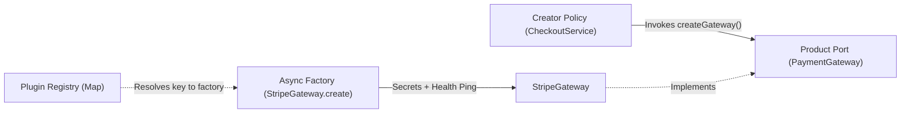
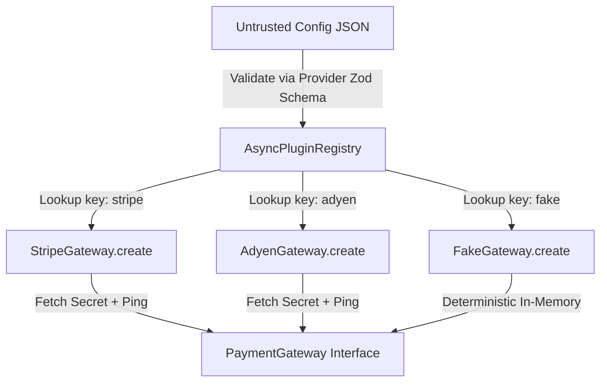

---
tags:
  - software-engineering
  - design-patterns
  - creational
created: 2026-01-02
updated: 2026-11-13
status: 🟢
level: mid-to-senior
category: Creational
---
# Factory Method Pattern

> [!abstract] Vault Navigation
> Part of [[Programming/Software Engineering/Design Patterns/Design Patterns Complete Guide|Design Patterns Complete Guide]]. Directly enforces [[Programming/Software Engineering/SOLID/Open-Closed Principle|Open-Closed Principle]] and [[Programming/Software Engineering/SOLID/Dependency Inversion|Dependency Inversion]], complements [[Programming/Software Engineering/Design Patterns/Creational & Behavioral Patterns Catalog#Abstract Factory|Abstract Factory]], and underpins async provider wiring in [[Programming/Backend/NestJS Complete Guide|NestJS Complete Guide]].

**Factory Method** decouples object creation from object consumption by defining a creation contract—either an overridable method on a base policy class, a typed creation callback, or an extensible registry entry—so high-level business orchestration depends strictly on an abstract `Product` interface rather than concrete `new ConcreteProduct()` expressions. Eliminating direct `new` invocations breaks compile-time coupling to vendor SDKs, enables asynchronous resource initialization (`static async create()`), and allows runtime substitution of production adapters, proxies, or deterministic test doubles without modifying orchestration code.



---

## 1. First-Principles Mechanics & Complete Architecture

### 1.1 Why `new ConcreteClass()` Is a Tight Coupling Primitive

Calling `new StripeGateway(apiKey)` directly inside a domain service (`CheckoutService`) binds the caller along **four independent axes** at once:

1. **Static Module & Bundle Coupling**: The TypeScript/ESM `import { StripeGateway } from './stripe-gateway'` edge forces the bundler (Webpack, Vite, esbuild) and Node.js module loader to evaluate `stripe-gateway.ts` and every transitive third-party dependency it imports (`stripe`, HTTP agents, crypto shims), even when a tenant uses Adyen or an Edge worker executes in sandbox mode.
2. **Identity & Allocation Lock-In**: The `new` operator always allocates a fresh instance of that exact class prototype. A constructor cannot return a cached/pooled handle, a dynamic subtype selected from configuration, a fallback stub, or a [[Programming/Software Engineering/Design Patterns/Structural Patterns Catalog#Proxy|Proxy]] wrapper adding circuit breaking.
3. **Synchronous Execution Restriction**: In ECMAScript, Java, C#, Go, and C++, constructors must initialize and return synchronously (`return this` semantics in JS constructors cannot yield a `Promise<this>` without violating class type expectations). Real infrastructure adapters—payment SDKs fetching KMS/Secrets Manager credentials, AMQP channels asserting queues, or database pools completing TLS handshakes—require asynchronous I/O before the instance is valid.
4. **Error-Channel Rigidity**: Constructors cannot return a typed `Result<T, E>` union cleanly; failing invariant checks inside `constructor` forces throwing exceptions or leaving a partially initialized object in memory.

### 1.2 Creational Spectrum: Static Creation vs Simple Factory vs Factory Method vs Abstract Factory

| Pattern | Core Mechanism | Open-Closed? | Async Support | Best Engineering Fit |
|---|---|---|---|---|
| **Static Creation Method** | `Money.fromCents(500)` or `StripeClient.create(cfg)` on one concrete class | No (bound to single class) | **Yes** (`static async create()`) | Named self-documenting constructors, invariant checks, async initialization of a single adapter |
| **Simple Factory** | Standalone `createGateway(type)` function containing a `switch` | No (new providers edit `switch`) | Conditional (`async` function) | Internal wiring inside a single Composition Root when provider count is small and static |
| **Factory Method (Classical GoF)** | Base class workflow calls `protected abstract createProduct()` overridden by subclasses | **Yes** | Via `protected abstract createProduct(): Promise<Product>` | Framework template lifecycles (`BatchImporter`, `BaseController`) owning shared pre/post steps |
| **OCP Plugin Registry Factory** | Generic `Map<string, Registration>` combining schema validation + creator callback | **Yes** | **Yes** (native async registry) | Multi-provider SaaS integrations (payments, webhooks, notifications, LLM providers) with isolated bundles |
| **Abstract Factory** | Interface constructing coherent **families** of mutually compatible products | **Yes** | **Yes** | Multi-cloud infrastructure suites (`BlobStore` + `Queue` + `SecretVault` per AWS/GCP/LocalStack) |

### 1.3 Classical Inheritance Hook vs Modern OCP Plugin Registry

In classical object-oriented textbooks, Factory Method relies on inheritance: a `BatchImporter` abstract class executes `import()`, calls `this.createParser()`, and delegates concrete instantiation to `CsvBatchImporter` or `ParquetBatchImporter`.

In modern TypeScript, Go, and NestJS codebases, deep inheritance hierarchies create brittle coupling between parent and child state. Instead, the factory hook is inverted into **composition**: high-level policies accept a typed `Factory<TConfig, TProduct>` or resolve products through a **zero-`switch` Plugin Registry**.



Zero-`switch` registries invert source-code dependencies completely:
- The registry module imports **only** the `Product` interface and Zod schema primitives—never `StripeGateway` or `SendGridTransport`.
- Each provider module exports a self-contained registration bundle (`configSchema` + `create()`).
- Composition Roots import and register **only** the providers deployed in that binary or environment, preserving full bundler tree-shaking and eliminating cross-team merge conflicts on a shared `switch` statement.

### 1.4 Async Factory Lifecycle Invariants (`static async create()`)

Never call an unawaited `this.connect()` inside a constructor. Doing so creates a race window where the caller holds a constructed reference whose internal client socket is still `null`, while network rejections inside `init()` fire as unhandled promise rejections.

An async factory replaces public `new` with:
1. A `private constructor(deps)` accepting **already-resolved, verified dependencies** (secrets, open TLS client, validated config).
2. A `public static async create(cfg, ctx)` method that fetches secrets, opens connections, executes a health ping, cleans up any partially opened sockets if a later initialization step fails, and only then invokes `new ConcreteProduct(...)`.

---

## 2. Real-World Use Cases & Decision Matrix

| Scenario | Recommended Variant | Why It Works | When NOT to Use / Alternative |
|---|---|---|---|
| **Multi-Tenant Payment Gateway Routing** (`stripe`, `adyen`, `fake`) | **OCP Async Plugin Registry + Zod Config Validation** | Tenants configure active gateway in DB JSON; registry validates schema per provider, fetches secrets asynchronously, and pins health checks | Do not use a static `switch` factory—every new regional PSP causes merge conflicts and bloats Edge bundles |
| **Multi-Channel Notification Dispatch** (`sendgrid`, `ses`, `console`) | **OCP Registry + NestJS `useFactory` DynamicModule** | Switches between real SMTP/API providers in production and in-memory/console transports in local/CI environments | Do not inject raw `SendGridClient` directly into `OrderService` |
| **Async Broker / Search Client Boot** (`AmqpConsumer`, `OpenSearchClient`) | **Async Static Factory (`static async create()`)** | Guarantees TCP connection, TLS auth, and queue assertion succeed before any `.consume()` or `.search()` call is reachable | Do not initialize socket lazily inside constructor via unawaited `this.init()` |
| **Framework Document / File Ingestion Pipeline** | **Classical Subclass Factory Method** | Base `BatchImporter` enforces checksum check, metrics timer, and transaction commit around `createParser()` | Do not force inheritance when the base class has no shared lifecycle logic—pass a parser callback instead |
| **Cross-Cloud Storage + Queue + KMS Suite** | **Abstract Factory** | Guarantees `S3BlobStore` is paired with `SqsQueue` and `AwsKms` rather than accidentally mixing AWS and GCP drivers | Do not use single standalone Factory Methods when 3+ products must match the same cloud vendor |

---

## 3. Step-by-Step Practical Application: Multi-Provider Notification & Payment Gateway Factory Subsystem

This complete production implementation builds a type-safe, Open-Closed **Payment Gateway & Notification Transport Factory Subsystem** featuring:
- Domain interfaces (`PaymentGateway`, `NotificationTransport`, `SecretVault`) and explicit initialization errors.
- Discriminated TypeScript configuration types paired with per-plugin **Zod** runtime schemas so untrusted JSON config from databases or environment variables is parsed strictly.
- A generic **Async Plugin Registry** (`AsyncPluginRegistry`) supporting timeout-bounded `AbortSignal` initialization, automatic health checks (`verifyHealth()`), and automatic fallback to deterministic fake providers in test/sandbox modes.
- Full **NestJS `DynamicModule`** integration using async `useFactory` dynamic providers with clean shutdown hooks (`OnModuleDestroy`).
- A complete **Vitest** test suite verifying Zod schema errors, async secret injection, health-ping failure aborting creation, fallback fake registration, and Open-Closed extensibility.

### 3.1 Production Directory Layout

```text
src/
  domain/
    ports.ts
    schemas.ts
  factories/
    plugin-registry.ts
  providers/
    stripe-gateway.ts
    adyen-gateway.ts
    fake-gateway.ts
    sendgrid-transport.ts
    ses-transport.ts
    console-transport.ts
  bootstrap/
    register-gateways.ts
  nestjs/
    gateway.module.ts
tests/
  gateway-factory.test.ts
```

### 3.2 Domain Ports & Errors (`src/domain/ports.ts`)

```typescript
// src/domain/ports.ts
export interface ChargeRequest {
  readonly idempotencyKey: string;
  readonly amountCents: number;
  readonly currency: 'USD' | 'EUR' | 'GBP';
  readonly customerToken: string;
}

export interface ChargeReceipt {
  readonly provider: string;
  readonly transactionId: string;
  readonly authorizedCents: number;
}

export interface PaymentGateway {
  readonly providerName: string;
  charge(request: ChargeRequest, signal?: AbortSignal): Promise<ChargeReceipt>;
  verifyHealth(signal?: AbortSignal): Promise<boolean>;
  dispose(): Promise<void>;
}

export interface NotificationMessage {
  readonly to: string;
  readonly subject: string;
  readonly bodyText: string;
  readonly correlationId: string;
}

export interface NotificationReceipt {
  readonly channel: string;
  readonly messageId: string;
}

export interface NotificationTransport {
  readonly channelName: string;
  send(message: NotificationMessage, signal?: AbortSignal): Promise<NotificationReceipt>;
  verifyHealth(signal?: AbortSignal): Promise<boolean>;
  dispose(): Promise<void>;
}

export interface SecretVault {
  getSecret(secretName: string, signal?: AbortSignal): Promise<string>;
}

export interface FactoryContext {
  readonly secrets: SecretVault;
  readonly signal?: AbortSignal;
}

export class UnknownProviderError extends Error {
  constructor(
    public readonly registryName: string,
    public readonly providerKey: string,
  ) {
    super(`Unknown provider "${providerKey}" in registry "${registryName}"`);
    this.name = 'UnknownProviderError';
  }
}

export class ProviderConfigurationError extends Error {
  constructor(
    public readonly providerKey: string,
    public readonly details: string,
  ) {
    super(`Invalid configuration for provider "${providerKey}": ${details}`);
    this.name = 'ProviderConfigurationError';
  }
}

export class ProviderHealthCheckError extends Error {
  constructor(
    public readonly providerKey: string,
    reason: string,
  ) {
    super(`Health verification failed during initialization of "${providerKey}": ${reason}`);
    this.name = 'ProviderHealthCheckError';
  }
}
```

### 3.3 Discriminated Config Types & Zod Schemas (`src/domain/schemas.ts`)

```typescript
// src/domain/schemas.ts
import { z } from 'zod';

export const stripeConfigSchema = z.object({
  provider: z.literal('stripe'),
  apiKeySecretName: z.string().min(3),
  webhookSecretName: z.string().min(3),
  apiVersion: z.string().regex(/^\d{4}-\d{2}-\d{2}$/),
  timeoutMs: z.number().int().min(500).max(30_000).default(5_000),
});

export const adyenConfigSchema = z.object({
  provider: z.literal('adyen'),
  merchantAccount: z.string().min(2),
  apiKeySecretName: z.string().min(3),
  environment: z.enum(['test', 'live']),
  timeoutMs: z.number().int().min(500).max(30_000).default(6_000),
});

export const fakeGatewayConfigSchema = z.object({
  provider: z.literal('fake-payment'),
  simulateDeclinePrefix: z.string().optional(),
  artificialLatencyMs: z.number().int().min(0).max(5_000).default(0),
});

export const paymentProviderConfigSchema = z.discriminatedUnion('provider', [
  stripeConfigSchema,
  adyenConfigSchema,
  fakeGatewayConfigSchema,
]);

export type StripeConfig = z.infer<typeof stripeConfigSchema>;
export type AdyenConfig = z.infer<typeof adyenConfigSchema>;
export type FakeGatewayConfig = z.infer<typeof fakeGatewayConfigSchema>;
export type PaymentProviderConfig = z.infer<typeof paymentProviderConfigSchema>;

export const sendgridConfigSchema = z.object({
  channel: z.literal('sendgrid'),
  apiKeySecretName: z.string().min(3),
  fromAddress: z.string().email(),
  sandboxMode: z.boolean().default(false),
});

export const sesConfigSchema = z.object({
  channel: z.literal('ses'),
  region: z.string().regex(/^[a-z]{2}-[a-z]+-\d$/),
  accessKeySecretName: z.string().min(3),
  fromAddress: z.string().email(),
});

export const consoleNotifyConfigSchema = z.object({
  channel: z.literal('console-notify'),
  fromAddress: z.string().email().default('noreply@sandbox.local'),
});

export const notificationProviderConfigSchema = z.discriminatedUnion('channel', [
  sendgridConfigSchema,
  sesConfigSchema,
  consoleNotifyConfigSchema,
]);

export type SendGridConfig = z.infer<typeof sendgridConfigSchema>;
export type SesConfig = z.infer<typeof sesConfigSchema>;
export type ConsoleNotifyConfig = z.infer<typeof consoleNotifyConfigSchema>;
export type NotificationProviderConfig = z.infer<typeof notificationProviderConfigSchema>;
```

### 3.4 Generic Open-Closed Async Plugin Registry (`src/factories/plugin-registry.ts`)

Notice how the registry knows **zero** concrete provider classes. It stores `(schema, create)` descriptors keyed by provider identifier, validates arbitrary JSON configs at runtime, creates the product asynchronously, runs `verifyHealth()`, and calls `dispose()` if health verification throws—preventing half-initialized sockets from leaking.

```typescript
// src/factories/plugin-registry.ts
import type { z } from 'zod';
import {
  ProviderConfigurationError,
  ProviderHealthCheckError,
  UnknownProviderError,
  type FactoryContext,
} from '../domain/ports.js';

export interface HealthManagedProduct {
  verifyHealth(signal?: AbortSignal): Promise<boolean>;
  dispose(): Promise<void>;
}

export interface PluginDescriptor<TConfig, TProduct extends HealthManagedProduct> {
  readonly schema: z.ZodType<TConfig>;
  readonly create: (config: TConfig, ctx: FactoryContext) => Promise<TProduct>;
}

export interface CreateOptions {
  readonly skipHealthCheck?: boolean;
  readonly fallbackKey?: string;
  readonly fallbackConfig?: unknown;
}

export class AsyncPluginRegistry<TProduct extends HealthManagedProduct> {
  private readonly descriptors = new Map<string, PluginDescriptor<unknown, TProduct>>();

  constructor(private readonly registryName: string) {}

  register<TConfig>(
    key: string,
    descriptor: PluginDescriptor<TConfig, TProduct>,
  ): this {
    if (this.descriptors.has(key)) {
      throw new Error(
        `Provider "${key}" is already registered in "${this.registryName}"`,
      );
    }
    this.descriptors.set(key, descriptor as PluginDescriptor<unknown, TProduct>);
    return this;
  }

  has(key: string): boolean {
    return this.descriptors.has(key);
  }

  registeredKeys(): ReadonlyArray<string> {
    return [...this.descriptors.keys()];
  }

  async create(
    key: string,
    rawConfig: unknown,
    ctx: FactoryContext,
    options: CreateOptions = {},
  ): Promise<TProduct> {
    if (ctx.signal?.aborted) {
      throw ctx.signal.reason ?? new Error(`Factory creation aborted for "${key}"`);
    }

    const descriptor = this.descriptors.get(key);
    if (!descriptor) {
      if (options.fallbackKey && this.descriptors.has(options.fallbackKey)) {
        return this.create(
          options.fallbackKey,
          options.fallbackConfig ?? rawConfig,
          ctx,
          { skipHealthCheck: options.skipHealthCheck },
        );
      }
      throw new UnknownProviderError(this.registryName, key);
    }

    const parsed = descriptor.schema.safeParse(rawConfig);
    if (!parsed.success) {
      const formatted = parsed.error.issues
        .map((issue) => `${issue.path.join('.') || '<root>'}: ${issue.message}`)
        .join('; ');
      throw new ProviderConfigurationError(key, formatted);
    }

    const instance = await descriptor.create(parsed.data, ctx);

    if (!options.skipHealthCheck) {
      let healthy = false;
      try {
        healthy = await instance.verifyHealth(ctx.signal);
      } catch (err: unknown) {
        await instance.dispose();
        const msg = err instanceof Error ? err.message : String(err);
        throw new ProviderHealthCheckError(key, msg);
      }

      if (!healthy) {
        await instance.dispose();
        throw new ProviderHealthCheckError(key, 'verifyHealth() returned false');
      }
    }

    return instance;
  }
}
```

### 3.5 Concrete Payment & Notification Products (`src/providers/`)

Each provider hides its `constructor` (`private constructor`) and exposes a `static async create(...)` factory method that performs async secret resolution and pre-flight validation.

```typescript
// src/providers/stripe-gateway.ts
import type {
  ChargeReceipt,
  ChargeRequest,
  FactoryContext,
  PaymentGateway,
} from '../domain/ports.js';
import type { StripeConfig } from '../domain/schemas.js';

export interface StripeApiTransport {
  ping(apiKey: string, signal?: AbortSignal): Promise<boolean>;
  createCharge(params: {
    apiKey: string;
    apiVersion: string;
    timeoutMs: number;
    amountCents: number;
    currency: string;
    source: string;
    idempotencyKey: string;
  }): Promise<{ id: string }>;
}

export class StripeGateway implements PaymentGateway {
  readonly providerName = 'stripe';
  private disposed = false;

  private constructor(
    private readonly config: StripeConfig,
    private readonly apiKey: string,
    private readonly webhookSecret: string,
    private readonly transport: StripeApiTransport,
  ) {}

  static async create(
    config: StripeConfig,
    ctx: FactoryContext,
    transportOverride?: StripeApiTransport,
  ): Promise<StripeGateway> {
    const [apiKey, webhookSecret] = await Promise.all([
      ctx.secrets.getSecret(config.apiKeySecretName, ctx.signal),
      ctx.secrets.getSecret(config.webhookSecretName, ctx.signal),
    ]);

    if (!apiKey.startsWith('sk_')) {
      throw new Error('Stripe API secret must start with "sk_"');
    }

    const transport: StripeApiTransport = transportOverride ?? {
      async ping(key: string) {
        return key.length > 10;
      },
      async createCharge(params) {
        return { id: `ch_${params.apiVersion}_${params.idempotencyKey.slice(0, 12)}` };
      },
    };

    return new StripeGateway(config, apiKey, webhookSecret, transport);
  }

  async verifyHealth(signal?: AbortSignal): Promise<boolean> {
    if (this.disposed) {
      return false;
    }
    return this.transport.ping(this.apiKey, signal);
  }

  async charge(request: ChargeRequest): Promise<ChargeReceipt> {
    if (this.disposed) {
      throw new Error('StripeGateway has been disposed');
    }
    const result = await this.transport.createCharge({
      apiKey: this.apiKey,
      apiVersion: this.config.apiVersion,
      timeoutMs: this.config.timeoutMs,
      amountCents: request.amountCents,
      currency: request.currency.toLowerCase(),
      source: request.customerToken,
      idempotencyKey: request.idempotencyKey,
    });
    return {
      provider: this.providerName,
      transactionId: result.id,
      authorizedCents: request.amountCents,
    };
  }

  getWebhookFingerprint(): string {
    return `wh_${this.webhookSecret.slice(-4)}`;
  }

  async dispose(): Promise<void> {
    this.disposed = true;
  }
}
```

```typescript
// src/providers/adyen-gateway.ts
import type {
  ChargeReceipt,
  ChargeRequest,
  FactoryContext,
  PaymentGateway,
} from '../domain/ports.js';
import type { AdyenConfig } from '../domain/schemas.js';

export class AdyenGateway implements PaymentGateway {
  readonly providerName = 'adyen';
  private active = true;

  private constructor(
    private readonly config: AdyenConfig,
    private readonly apiKey: string,
  ) {}

  static async create(
    config: AdyenConfig,
    ctx: FactoryContext,
  ): Promise<AdyenGateway> {
    const apiKey = await ctx.secrets.getSecret(config.apiKeySecretName, ctx.signal);
    if (apiKey.trim().length === 0) {
      throw new Error('Adyen API key cannot be empty');
    }
    return new AdyenGateway(config, apiKey);
  }

  async verifyHealth(): Promise<boolean> {
    return (
      this.active &&
      this.config.merchantAccount.length > 0 &&
      this.apiKey.length > 0
    );
  }

  async charge(request: ChargeRequest): Promise<ChargeReceipt> {
    if (!this.active) {
      throw new Error('AdyenGateway is disposed');
    }
    return {
      provider: this.providerName,
      transactionId: `adyen_${this.config.environment}_${request.idempotencyKey}`,
      authorizedCents: request.amountCents,
    };
  }

  async dispose(): Promise<void> {
    this.active = false;
  }
}
```

```typescript
// src/providers/fake-gateway.ts
import type {
  ChargeReceipt,
  ChargeRequest,
  PaymentGateway,
} from '../domain/ports.js';
import type { FakeGatewayConfig } from '../domain/schemas.js';

export class FakePaymentGateway implements PaymentGateway {
  readonly providerName = 'fake-payment';
  readonly recordedCharges: ChargeRequest[] = [];
  private disposed = false;

  private constructor(private readonly config: FakeGatewayConfig) {}

  static async create(config: FakeGatewayConfig): Promise<FakePaymentGateway> {
    return new FakePaymentGateway(config);
  }

  async verifyHealth(): Promise<boolean> {
    return !this.disposed;
  }

  async charge(request: ChargeRequest): Promise<ChargeReceipt> {
    if (this.config.artificialLatencyMs > 0) {
      await new Promise((r) => setTimeout(r, this.config.artificialLatencyMs));
    }
    if (
      this.config.simulateDeclinePrefix &&
      request.customerToken.startsWith(this.config.simulateDeclinePrefix)
    ) {
      throw new Error(`Simulated card decline for token: ${request.customerToken}`);
    }
    this.recordedCharges.push(request);
    return {
      provider: this.providerName,
      transactionId: `fake_tx_${this.recordedCharges.length}`,
      authorizedCents: request.amountCents,
    };
  }

  async dispose(): Promise<void> {
    this.disposed = true;
  }
}
```

```typescript
// src/providers/sendgrid-transport.ts
import type {
  FactoryContext,
  NotificationMessage,
  NotificationReceipt,
  NotificationTransport,
} from '../domain/ports.js';
import type { SendGridConfig } from '../domain/schemas.js';

export class SendGridTransport implements NotificationTransport {
  readonly channelName = 'sendgrid';
  private closed = false;

  private constructor(
    private readonly config: SendGridConfig,
    private readonly apiKey: string,
  ) {}

  static async create(
    config: SendGridConfig,
    ctx: FactoryContext,
  ): Promise<SendGridTransport> {
    const apiKey = await ctx.secrets.getSecret(config.apiKeySecretName, ctx.signal);
    if (!apiKey.startsWith('SG.')) {
      throw new Error('SendGrid API key must start with "SG."');
    }
    return new SendGridTransport(config, apiKey);
  }

  async verifyHealth(): Promise<boolean> {
    return !this.closed && this.apiKey.length > 5;
  }

  async send(message: NotificationMessage): Promise<NotificationReceipt> {
    if (this.closed) {
      throw new Error('SendGridTransport closed');
    }
    return {
      channel: this.channelName,
      messageId: `sg_${this.config.sandboxMode ? 'sandbox_' : ''}${message.correlationId}`,
    };
  }

  async dispose(): Promise<void> {
    this.closed = true;
  }
}
```

```typescript
// src/providers/ses-transport.ts
import type {
  FactoryContext,
  NotificationMessage,
  NotificationReceipt,
  NotificationTransport,
} from '../domain/ports.js';
import type { SesConfig } from '../domain/schemas.js';

export class SesTransport implements NotificationTransport {
  readonly channelName = 'ses';
  private closed = false;

  private constructor(
    private readonly config: SesConfig,
    private readonly accessKey: string,
  ) {}

  static async create(
    config: SesConfig,
    ctx: FactoryContext,
  ): Promise<SesTransport> {
    const accessKey = await ctx.secrets.getSecret(
      config.accessKeySecretName,
      ctx.signal,
    );
    return new SesTransport(config, accessKey);
  }

  async verifyHealth(): Promise<boolean> {
    return !this.closed && this.accessKey.length > 0;
  }

  async send(message: NotificationMessage): Promise<NotificationReceipt> {
    return {
      channel: this.channelName,
      messageId: `ses_${this.config.region}_${message.correlationId}`,
    };
  }

  async dispose(): Promise<void> {
    this.closed = true;
  }
}
```

```typescript
// src/providers/console-transport.ts
import type {
  NotificationMessage,
  NotificationReceipt,
  NotificationTransport,
} from '../domain/ports.js';
import type { ConsoleNotifyConfig } from '../domain/schemas.js';

export class ConsoleNotificationTransport implements NotificationTransport {
  readonly channelName = 'console-notify';
  readonly sentMessages: NotificationMessage[] = [];

  private constructor(private readonly config: ConsoleNotifyConfig) {}

  static async create(
    config: ConsoleNotifyConfig,
  ): Promise<ConsoleNotificationTransport> {
    return new ConsoleNotificationTransport(config);
  }

  async verifyHealth(): Promise<boolean> {
    return this.config.fromAddress.includes('@');
  }

  async send(message: NotificationMessage): Promise<NotificationReceipt> {
    this.sentMessages.push(message);
    return {
      channel: this.channelName,
      messageId: `console_${this.sentMessages.length}`,
    };
  }

  async dispose(): Promise<void> {
    this.sentMessages.length = 0;
  }
}
```

### 3.6 Composition Root Registration & NestJS Dynamic `useFactory` Module

```typescript
// src/bootstrap/register-gateways.ts
import type { PaymentGateway, NotificationTransport } from '../domain/ports.js';
import {
  adyenConfigSchema,
  consoleNotifyConfigSchema,
  fakeGatewayConfigSchema,
  sendgridConfigSchema,
  sesConfigSchema,
  stripeConfigSchema,
} from '../domain/schemas.js';
import { AsyncPluginRegistry } from '../factories/plugin-registry.js';
import { AdyenGateway } from '../providers/adyen-gateway.js';
import { ConsoleNotificationTransport } from '../providers/console-transport.js';
import { FakePaymentGateway } from '../providers/fake-gateway.js';
import { SendGridTransport } from '../providers/sendgrid-transport.js';
import { SesTransport } from '../providers/ses-transport.js';
import { StripeGateway, type StripeApiTransport } from '../providers/stripe-gateway.js';

export interface RegistryWiringOptions {
  readonly includeFakeProviders?: boolean;
  readonly stripeTransportOverride?: StripeApiTransport;
}

export function buildPaymentGatewayRegistry(
  options: RegistryWiringOptions = {},
): AsyncPluginRegistry<PaymentGateway> {
  const registry = new AsyncPluginRegistry<PaymentGateway>('payment-gateways')
    .register('stripe', {
      schema: stripeConfigSchema,
      create: (cfg, ctx) =>
        StripeGateway.create(cfg, ctx, options.stripeTransportOverride),
    })
    .register('adyen', {
      schema: adyenConfigSchema,
      create: (cfg, ctx) => AdyenGateway.create(cfg, ctx),
    });

  if (options.includeFakeProviders) {
    registry.register('fake-payment', {
      schema: fakeGatewayConfigSchema,
      create: (cfg) => FakePaymentGateway.create(cfg),
    });
  }

  return registry;
}

export function buildNotificationRegistry(
  options: Pick<RegistryWiringOptions, 'includeFakeProviders'> = {},
): AsyncPluginRegistry<NotificationTransport> {
  const registry = new AsyncPluginRegistry<NotificationTransport>(
    'notification-transports',
  )
    .register('sendgrid', {
      schema: sendgridConfigSchema,
      create: (cfg, ctx) => SendGridTransport.create(cfg, ctx),
    })
    .register('ses', {
      schema: sesConfigSchema,
      create: (cfg, ctx) => SesTransport.create(cfg, ctx),
    });

  if (options.includeFakeProviders) {
    registry.register('console-notify', {
      schema: consoleNotifyConfigSchema,
      create: (cfg) => ConsoleNotificationTransport.create(cfg),
    });
  }

  return registry;
}
```

```typescript
// src/nestjs/gateway.module.ts
import {
  Inject,
  Module,
  type DynamicModule,
  type OnModuleDestroy,
} from '@nestjs/common';
import type {
  NotificationTransport,
  PaymentGateway,
  SecretVault,
} from '../domain/ports.js';
import {
  buildNotificationRegistry,
  buildPaymentGatewayRegistry,
} from '../bootstrap/register-gateways.js';

export const SECRET_VAULT = Symbol('SECRET_VAULT');
export const GATEWAY_RAW_CONFIG = Symbol('GATEWAY_RAW_CONFIG');
export const PAYMENT_GATEWAY = Symbol('PAYMENT_GATEWAY');
export const NOTIFICATION_TRANSPORT = Symbol('NOTIFICATION_TRANSPORT');

export interface GatewayModuleBootConfig {
  readonly useFakeFallbacks: boolean;
  readonly paymentProviderKey: string;
  readonly paymentConfig: unknown;
  readonly notificationChannelKey: string;
  readonly notificationConfig: unknown;
}

@Module({})
export class GatewayModule implements OnModuleDestroy {
  constructor(
    @Inject(PAYMENT_GATEWAY) private readonly gateway: PaymentGateway,
    @Inject(NOTIFICATION_TRANSPORT)
    private readonly notifier: NotificationTransport,
  ) {}

  static registerAsync(
    bootConfig: GatewayModuleBootConfig,
    secretVault: SecretVault,
  ): DynamicModule {
    return {
      module: GatewayModule,
      providers: [
        { provide: SECRET_VAULT, useValue: secretVault },
        { provide: GATEWAY_RAW_CONFIG, useValue: bootConfig },
        {
          provide: PAYMENT_GATEWAY,
          inject: [SECRET_VAULT, GATEWAY_RAW_CONFIG],
          useFactory: async (
            secrets: SecretVault,
            cfg: GatewayModuleBootConfig,
          ): Promise<PaymentGateway> => {
            const registry = buildPaymentGatewayRegistry({
              includeFakeProviders: cfg.useFakeFallbacks,
            });
            return registry.create(
              cfg.paymentProviderKey,
              cfg.paymentConfig,
              { secrets },
              cfg.useFakeFallbacks
                ? {
                    fallbackKey: 'fake-payment',
                    fallbackConfig: { provider: 'fake-payment' },
                  }
                : undefined,
            );
          },
        },
        {
          provide: NOTIFICATION_TRANSPORT,
          inject: [SECRET_VAULT, GATEWAY_RAW_CONFIG],
          useFactory: async (
            secrets: SecretVault,
            cfg: GatewayModuleBootConfig,
          ): Promise<NotificationTransport> => {
            const registry = buildNotificationRegistry({
              includeFakeProviders: cfg.useFakeFallbacks,
            });
            return registry.create(
              cfg.notificationChannelKey,
              cfg.notificationConfig,
              { secrets },
              cfg.useFakeFallbacks
                ? {
                    fallbackKey: 'console-notify',
                    fallbackConfig: { channel: 'console-notify' },
                  }
                : undefined,
            );
          },
        },
      ],
      exports: [PAYMENT_GATEWAY, NOTIFICATION_TRANSPORT],
    };
  }

  async onModuleDestroy(): Promise<void> {
    await Promise.all([this.gateway.dispose(), this.notifier.dispose()]);
  }
}
```

### 3.7 Complete Vitest Suite (`tests/gateway-factory.test.ts`)

```typescript
// tests/gateway-factory.test.ts
import { describe, expect, it, vi } from 'vitest';
import { z } from 'zod';
import {
  ProviderConfigurationError,
  ProviderHealthCheckError,
  UnknownProviderError,
  type SecretVault,
} from '../src/domain/ports.js';
import {
  buildNotificationRegistry,
  buildPaymentGatewayRegistry,
} from '../src/bootstrap/register-gateways.js';

function createStubVault(entries: Record<string, string>): SecretVault {
  return {
    async getSecret(name: string) {
      const val = entries[name];
      if (!val) {
        throw new Error(`Missing secret: ${name}`);
      }
      return val;
    },
  };
}

describe('Notification & Payment Gateway Async Factory Registry', () => {
  it('constructs StripeGateway asynchronously with resolved secrets and health verification', async () => {
    const vault = createStubVault({
      STRIPE_API_KEY: 'sk_live_verified_key_123',
      STRIPE_WH_SECRET: 'whsec_secret_9988',
    });
    const pingSpy = vi.fn(async () => true);

    const registry = buildPaymentGatewayRegistry({
      stripeTransportOverride: {
        ping: pingSpy,
        async createCharge(p) {
          return { id: `ch_${p.idempotencyKey}` };
        },
      },
    });

    const gateway = await registry.create(
      'stripe',
      {
        provider: 'stripe',
        apiKeySecretName: 'STRIPE_API_KEY',
        webhookSecretName: 'STRIPE_WH_SECRET',
        apiVersion: '2026-01-15',
      },
      { secrets: vault },
    );

    expect(pingSpy).toHaveBeenCalledTimes(1);
    const receipt = await gateway.charge({
      idempotencyKey: 'idem-001',
      amountCents: 2500,
      currency: 'USD',
      customerToken: 'tok_visa',
    });
    expect(receipt.transactionId).toBe('ch_idem-001');
  });

  it('rejects malformed configuration via Zod before resolving secrets or opening sockets', async () => {
    const getSecretSpy = vi.fn(async () => 'sk_test_1234567890');
    const registry = buildPaymentGatewayRegistry();

    await expect(
      registry.create(
        'stripe',
        {
          provider: 'stripe',
          apiKeySecretName: 'STRIPE_KEY',
          webhookSecretName: 'STRIPE_WH',
          apiVersion: 'invalid-date', // Fails regex validation
        },
        { secrets: { getSecret: getSecretSpy } },
      ),
    ).rejects.toThrow(ProviderConfigurationError);

    expect(getSecretSpy).not.toHaveBeenCalled();
  });

  it('aborts construction and disposes gateway when health ping fails', async () => {
    const vault = createStubVault({
      STRIPE_API_KEY: 'sk_live_verified_key_123',
      STRIPE_WH_SECRET: 'whsec_secret_9988',
    });
    const registry = buildPaymentGatewayRegistry({
      stripeTransportOverride: {
        async ping() {
          return false;
        },
        async createCharge() {
          throw new Error('should not charge');
        },
      },
    });

    await expect(
      registry.create(
        'stripe',
        {
          provider: 'stripe',
          apiKeySecretName: 'STRIPE_API_KEY',
          webhookSecretName: 'STRIPE_WH_SECRET',
          apiVersion: '2026-01-15',
        },
        { secrets: vault },
      ),
    ).rejects.toThrow(ProviderHealthCheckError);
  });

  it('falls back to fake gateway in sandbox mode when configured, and throws UnknownProviderError in strict prod mode', async () => {
    const vault = createStubVault({});
    const strictProdRegistry = buildPaymentGatewayRegistry({
      includeFakeProviders: false,
    });

    await expect(
      strictProdRegistry.create('nonexistent-psp', {}, { secrets: vault }),
    ).rejects.toThrow(UnknownProviderError);

    const sandboxRegistry = buildPaymentGatewayRegistry({
      includeFakeProviders: true,
    });
    const fallbackGateway = await sandboxRegistry.create(
      'nonexistent-psp',
      {},
      { secrets: vault },
      {
        fallbackKey: 'fake-payment',
        fallbackConfig: { provider: 'fake-payment' },
      },
    );

    expect(fallbackGateway.providerName).toBe('fake-payment');
    const receipt = await fallbackGateway.charge({
      idempotencyKey: 'sandbox-1',
      amountCents: 1000,
      currency: 'EUR',
      customerToken: 'tok_test',
    });
    expect(receipt.transactionId).toBe('fake_tx_1');
  });

  it('supports Open-Closed addition of a new custom provider without editing existing registry code', async () => {
    const vault = createStubVault({});
    const registry = buildNotificationRegistry({ includeFakeProviders: true });

    const webhookSchema = z.object({
      channel: z.literal('slack-webhook'),
      url: z.string().url(),
    });

    registry.register('slack-webhook', {
      schema: webhookSchema,
      create: async (cfg) => ({
        channelName: 'slack-webhook',
        async verifyHealth() {
          return cfg.url.startsWith('https://');
        },
        async send(msg) {
          return { channel: 'slack-webhook', messageId: `slack_${msg.correlationId}` };
        },
        async dispose() {},
      }),
    });

    const notifier = await registry.create(
      'slack-webhook',
      { channel: 'slack-webhook', url: 'https://hooks.slack.com/services/T0/B0/XX' },
      { secrets: vault },
    );

    const receipt = await notifier.send({
      to: '#alerts',
      subject: 'Deploy',
      bodyText: 'Build green',
      correlationId: 'corr-42',
    });
    expect(receipt).toEqual({ channel: 'slack-webhook', messageId: 'slack_corr-42' });
  });

  it('aborts factory creation cleanly when AbortSignal is already cancelled', async () => {
    const controller = new AbortController();
    controller.abort(new Error('Bootstrap shutdown requested'));
    const registry = buildPaymentGatewayRegistry({ includeFakeProviders: true });

    await expect(
      registry.create(
        'fake-payment',
        { provider: 'fake-payment' },
        { secrets: createStubVault({}), signal: controller.signal },
      ),
    ).rejects.toThrow('Bootstrap shutdown requested');
  });
});
```

---

## 4. Complete Construct Reference & Production Edge Cases

### 4.1 Base-Constructor Virtual Method Trap (Half-Constructed Product)

In classical inheritance-based Factory Method (`abstract class Creator`), **never** call `this.createProduct()` inside the base `constructor()`. In JavaScript/TypeScript (with ES2022 `useDefineForClassFields: true`), subclass field initializers execute *after* `super()` completes:

```typescript
abstract class BrokenCreator {
  protected readonly product: string;
  constructor() {
    this.product = this.createProduct(); // Runs BEFORE subclass fields initialize!
  }
  protected abstract createProduct(): string;
}

class CustomCreator extends BrokenCreator {
  private readonly prefix = 'prod-'; // Still undefined during super()!
  protected createProduct(): string {
    return `${this.prefix}gateway`; // Returns "undefinedgateway"!
  }
}
```

In Java and C#, similar dispatch happens: in Java, the method sees uninitialized default fields (`null`/`0`); in C++, virtual dispatch inside a constructor does not even bind to the derived class override, throwing a pure virtual call crash. Always defer `createProduct()` until an explicit post-construction lifecycle method (`initialize()` or a static async factory).

### 4.2 Barrel-File Re-Exports Defeating Tree-Shaking

Refactoring a 200-line `switch` factory into an OCP `AsyncPluginRegistry` fails to reduce Edge/Lambda cold-start bundle size if all concrete providers are re-exported from a single `src/providers/index.ts` barrel file imported by your composition root. Modern bundlers cannot eliminate side-effecting module graphs referenced through wildcard barrel imports.

**Rule**: Keep `AsyncPluginRegistry` in its own leaf module (`src/factories/plugin-registry.ts`), keep each provider in an isolated module (`src/providers/stripe-gateway.ts`), and let each microservice entry point import **only** the specific provider modules it actually registers.

### 4.3 Partial-Resource Leak During Multi-Step Async Initialization

When `static async create()` executes multiple sequential I/O allocations (Step 1: open TCP socket; Step 2: subscribe to topic; Step 3: health ping), a failure in Step 2 or Step 3 without an explicit `try / catch` cleanup leaks Step 1's socket forever:

```typescript
static async create(url: string): Promise<BrokerClient> {
  const connection = await openTcpSocket(url);
  try {
    const channel = await connection.openChannel();
    await channel.ping();
    return new BrokerClient(connection, channel);
  } catch (err) {
    await connection.close(); // Mandatory rollback on partial init failure!
    throw err;
  }
}
```

### 4.4 Language Comparisons: Go & Python

- **Go**: Go avoids class inheritance completely. Factory Method takes the form of typed constructor functions (`type GatewayFactory func(ctx context.Context, cfg json.RawMessage) (PaymentGateway, error)`) stored in a `map[string]GatewayFactory` protected by a `sync.RWMutex` or built once at startup, paired with functional options (`WithTimeout(...)`).
- **Python**: Python uses `@classmethod` (`async def create(cls, config) -> Self`) for async static creation and `dict[str, Callable[..., GatewayProtocol]]` registries checked via `typing.Protocol` and `pydantic.BaseModel.model_validate(...)` (exact equivalent of Zod schema validation per plugin).

---

## 5. Production Debugging, Profiling & Operations Playbook

| Production Symptom | Root Cause Mechanism | Diagnostic Command / Inspection | Verified Fix |
|---|---|---|---|
| **Edge / Serverless bundle still exceeds 5 MB after switching to Registry Factory** | Top-level barrel `src/providers/index.ts` or static import pulls unused heavy vendor SDKs | `npx esbuild src/handler.ts --bundle --metafile=meta.json` and inspect `meta.json` inputs for vendor SDK paths | Remove barrel imports; register providers per entry point via explicit direct module imports |
| **NestJS hangs at startup or crashes silently on boot** | Async `useFactory` awaiting an unreachable external KMS / DB without `AbortSignal` or `connectTimeoutMs` | Inspect NestJS startup timeline (`Logger.overrideLogger(['debug'])`) + check open sockets via `lsof -i` | Wrap `useFactory` secret fetch & health ping with `AbortSignal.timeout(5000)` and clean error logging |
| **Subtle `undefined` property on product built inside base class `constructor()`** | Base constructor invoked overridable `this.createProduct()` before ES2022 subclass fields ran | Check `tsconfig.json` `useDefineForClassFields` and move `createProduct()` out of `constructor()` | Move creation into an async `init()` hook or static factory method |
| **Runtime `TypeError: Cannot read properties of undefined` inside Stripe/Webhook adapter** | Unvalidated `process.env` or tenant JSON passed into factory without runtime schema validation | Run Zod `safeParse()` on raw provider payload and log `parsed.error.issues` | Validate every provider payload against its registered Zod schema before calling `.create()` |
| **Leaked file descriptors after failed provider startup retries** | Step 2 (`ping()`) failed inside `static async create()` without closing Step 1's connection | Monitor `process.getActiveResourcesInfo()` in Node.js or `netstat -an` for `CLOSE_WAIT` / `ESTABLISHED` sockets | Wrap post-connect initialization steps in `try / catch` calling `await instance.dispose()` on failure |

---

## 6. Worked Exercises

### Exercise 1: Eliminating a Merge-Conflict `switch` Factory
A `WebhookSerializerFactory.create(format)` has grown into a 220-line `switch` statement importing 12 partner formats (`stripe`, `shopify`, `slack`, `github`, etc.). Every partner integration team edits the same factory file, causing constant merge conflicts and bundling all 12 dependencies even inside single-partner microservices. Refactor using an OCP Registry Factory.

### Solution 1
Invert registration so the factory holds zero static imports of concrete serializers; each microservice Composition Root registers only the partner modules it deploys:

```typescript
export interface DomainEvent {
  readonly id: string;
  readonly type: string;
  readonly payload: Record<string, unknown>;
}

export interface WebhookSerializer {
  serialize(event: DomainEvent): string;
}

export class SerializerFactory {
  private readonly creators = new Map<string, () => WebhookSerializer>();

  register(partner: string, creator: () => WebhookSerializer): this {
    if (this.creators.has(partner)) {
      throw new Error(`Duplicate serializer registration for partner: ${partner}`);
    }
    this.creators.set(partner, creator);
    return this;
  }

  create(partner: string): WebhookSerializer {
    const creator = this.creators.get(partner);
    if (!creator) {
      throw new Error(`Unsupported webhook partner: ${partner}`);
    }
    return creator();
  }
}
```

---

### Exercise 2: Fixing an Async Constructor Race Condition
Diagnose why `await client.query(...)` intermittently throws `TypeError: Cannot read properties of null (reading 'exec')` in production and fix it using the Async Factory pattern:

```typescript
class SearchClient {
  private conn: { exec(q: string): Promise<string[]> } | null = null;
  constructor(url: string) {
    void this.init(url);
  }
  private async init(url: string) {
    this.conn = await connectTcp(url);
  }
  async query(q: string) {
    return this.conn!.exec(q);
  }
}
```

### Solution 2
1. **Root Cause**: `new SearchClient(url)` returns synchronously while `this.init(url)` is suspended awaiting the TCP handshake. Any caller calling `client.query(...)` immediately after construction dereferences `this.conn === null`. Furthermore, suppressing the promise with `void` swallows initialization failures until an unhandled rejection or null dereference occurs later.
2. **Fix**: Make the constructor `private` accepting a non-null connected `Socket`, and expose `static async connect(url)` that awaits TCP connection and verifies readiness before returning an instance:

```typescript
interface SocketHandle {
  exec(q: string): Promise<string[]>;
  close(): Promise<void>;
}

declare function connectTcp(url: string): Promise<SocketHandle>;

export class SearchClient {
  private constructor(private readonly conn: SocketHandle) {}

  static async connect(url: string): Promise<SearchClient> {
    const conn = await connectTcp(url);
    return new SearchClient(conn);
  }

  async query(q: string): Promise<string[]> {
    return this.conn.exec(q);
  }

  async close(): Promise<void> {
    await this.conn.close();
  }
}
```

---

### Exercise 3: Selecting Between Creational Pattern Variants
Match each engineering requirement to **Static Creation Method**, **Factory Method**, **OCP Registry Factory**, or **Abstract Factory**, and justify the architectural reason:
1. Provide `Color.fromHex('#FF00AA')` and `Color.fromRgb(255, 0, 170)` returning normalized immutable RGBA value objects.
2. Let a multi-tenant infrastructure platform swap coherent suites `(BlobStore, QueueClient, SecretVault)` across AWS, GCP, and LocalStack without cross-cloud mismatches.
3. Route webhook parsers dynamically across 18 tenant-configured formats loaded from PostgreSQL JSON without rebuilding a central `switch` statement.

### Solution 3
1. **Static Creation Method**: Self-documenting named conversions producing a single concrete value object while preserving invariant normalization.
2. **Abstract Factory**: Creates a coherent **family** of mutually compatible infrastructure adapters so an AWS `QueueClient` is never accidentally paired with a GCP `SecretVault`.
3. **OCP Registry Factory**: Decouples dynamic runtime lookup keys from concrete imports, validates untrusted tenant JSON via schema per plugin, and allows adding format #19 without editing existing factory code.

---

### Exercise 4: Eliminating a Barrel-File Tree-Shaking Leak
A team refactored their `NotificationFactory` `switch` statement into a `Map`-based `Registry` inside `src/factories/registry.ts`, but their AWS Lambda bundle analyzer still shows the full `aws-sdk` and `twilio` packages inside a lightweight email-only function (`src/lambdas/send-welcome-email.ts`), which imports `{ registerSes }` from `src/providers/index.ts`. Diagnose and fix.

### Solution 4
1. **Root Cause**: `src/providers/index.ts` re-exports `SesTransport`, `SendGridTransport`, and `TwilioTransport`. Even though `send-welcome-email.ts` only invokes `registerSes`, importing the barrel file causes the bundler to evaluate all sibling provider modules and pull `twilio` into the bundle graph whenever modules contain top-level wrappers or complex class metadata.
2. **Fix**: Delete the provider barrel `src/providers/index.ts` (or forbid importing from it in Lambda targets via ESLint `no-restricted-imports`), and import each provider directly by leaf module path (`import { SesTransport } from '../providers/ses-transport.js'`).

---

### Exercise 5: Converting a Synchronous NestJS `useClass` Gateway to Async `useFactory`
A NestJS module currently registers `{ provide: PAYMENT_GATEWAY, useClass: StripeGateway }`, and `StripeGateway`'s constructor reads `process.env.STRIPE_API_KEY` synchronously. Security audits now mandate fetching `STRIPE_API_KEY` asynchronously from AWS Secrets Manager at boot and failing startup if `verifyHealth()` returns `false`. Show the refactored NestJS `FactoryProvider`.

### Solution 5
Replace `useClass` with an `async useFactory` provider injecting `SecretVault` (and `ConfigService`), invoking `StripeGateway.create(...)`, and verifying health before NestJS accepts incoming HTTP traffic:

```typescript
import { Module, type Provider } from '@nestjs/common';
import type { PaymentGateway, SecretVault } from '../domain/ports.js';
import { StripeGateway } from '../providers/stripe-gateway.js';

export const PAYMENT_GATEWAY_TOKEN = Symbol('PAYMENT_GATEWAY_TOKEN');
export const VAULT_TOKEN = Symbol('VAULT_TOKEN');

export const stripeGatewayProvider: Provider = {
  provide: PAYMENT_GATEWAY_TOKEN,
  inject: [VAULT_TOKEN],
  useFactory: async (secrets: SecretVault): Promise<PaymentGateway> => {
    const gateway = await StripeGateway.create(
      {
        provider: 'stripe',
        apiKeySecretName: 'prod/stripe/api-key',
        webhookSecretName: 'prod/stripe/wh-secret',
        apiVersion: '2026-01-15',
        timeoutMs: 5_000,
      },
      { secrets, signal: AbortSignal.timeout(5_000) },
    );

    const healthy = await gateway.verifyHealth(AbortSignal.timeout(3_000));
    if (!healthy) {
      await gateway.dispose();
      throw new Error('StripeGateway health check failed during NestJS bootstrap');
    }

    return gateway;
  },
};

@Module({
  providers: [stripeGatewayProvider],
  exports: [PAYMENT_GATEWAY_TOKEN],
})
export class StripeBillingModule {}
```

---

### Exercise 6: Fixing Base-Constructor Virtual Method Execution
Identify why `new S3Exporter('us-east-1').run()` logs `"Connecting bucket in region: undefined"` in TypeScript when `tsconfig.json` has `"target": "ES2022"`, and fix the lifecycle design:

```typescript
abstract class BaseExporter {
  protected readonly client: string;
  constructor() {
    this.client = this.createClient();
  }
  protected abstract createClient(): string;
  run() {
    return this.client;
  }
}

class S3Exporter extends BaseExporter {
  constructor(private readonly region: string) {
    super();
  }
  protected createClient(): string {
    return `Connecting bucket in region: ${this.region}`;
  }
}
```

### Solution 6
1. **Root Cause**: Under ES2022 parameter property / class field initialization semantics, `this.region` is assigned **after** `super()` finishes executing. Because `BaseExporter.constructor()` calls `this.createClient()` inside `super()`, `this.region` is still `undefined` when `S3Exporter.createClient()` runs.
2. **Fix**: Never invoke overridable factory methods from inside a constructor. Either inject the `clientFactory: () => string` into `BaseExporter` or construct `S3Exporter` lazily inside `run()` / an explicit `static async create()` factory:

```typescript
export abstract class SafeBaseExporter {
  private cachedClient: string | null = null;

  protected abstract createClient(): string;

  protected getClient(): string {
    if (this.cachedClient === null) {
      this.cachedClient = this.createClient();
    }
    return this.cachedClient;
  }

  run(): string {
    return this.getClient();
  }
}

export class SafeS3Exporter extends SafeBaseExporter {
  constructor(private readonly region: string) {
    super();
  }

  protected createClient(): string {
    return `Connecting bucket in region: ${this.region}`;
  }
}
```

---

← [[Programming/Software Engineering/Design Patterns/Design Patterns Complete Guide|Back to Design Patterns]]
