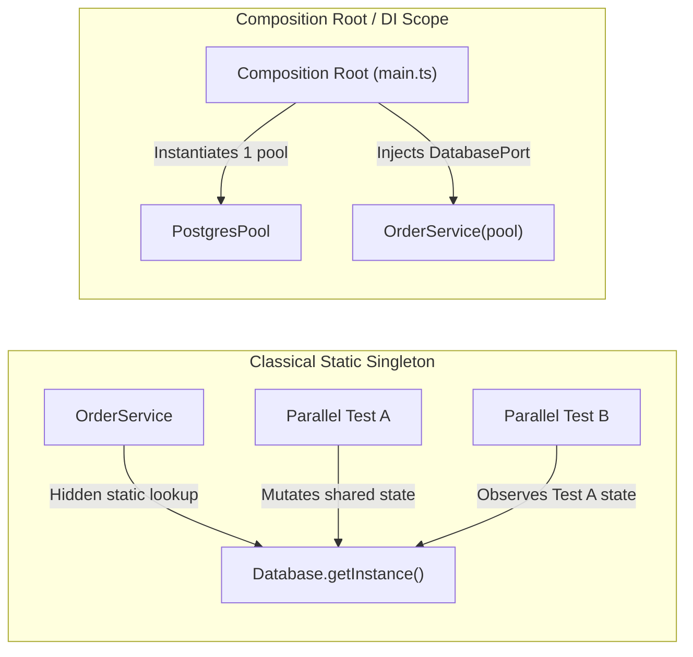
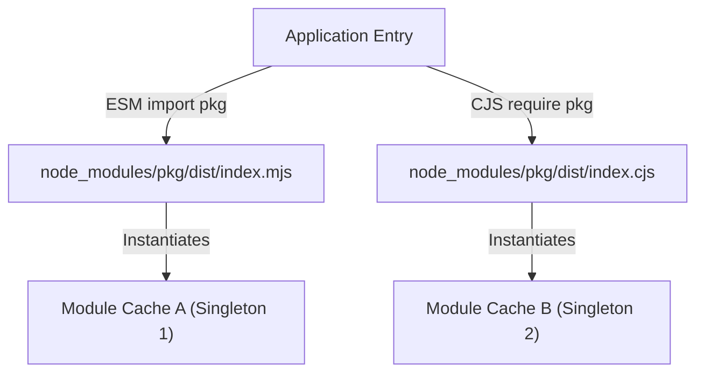
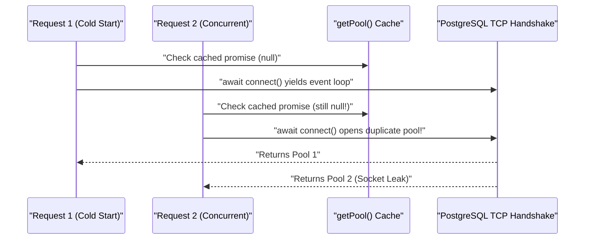

---
tags:
  - software-engineering
  - design-patterns
  - creational
created: 2026-01-02
updated: 2026-11-13
status: 🟢
level: mid-to-senior
category: Creational
---
# Singleton Pattern

> [!abstract] Vault Navigation
> Part of [[Programming/Software Engineering/Design Patterns/Design Patterns Complete Guide|Design Patterns Complete Guide]]. Directly contrasts with [[Programming/Software Engineering/SOLID/Dependency Inversion|Dependency Inversion]], [[Programming/Software Engineering/SOLID/Single Responsibility|Single Responsibility]], and [[Programming/Software Engineering/Clean Code/Code Smells|Code Smells]], and informs container scoping in [[Programming/Backend/NestJS Complete Guide|NestJS Complete Guide]] and [[Programming/Frontend/Next.js Complete Guide|Next.js Complete Guide]].

The classical Gang of Four **Singleton** restricts instantiation of a class to a single object in memory and exposes a global static accessor (`ClassName.getInstance()`). In modern production engineering, **classical static `getInstance()` is an architectural anti-pattern** because it fuses two unrelated responsibilities—**instance cardinality** (how many instances exist) and **global reachability** (where callers obtain a reference)—inside the concrete class itself. The legitimate operational goal of Singleton (sharing one connection pool, telemetry exporter, or OS lock handle across a process) is achieved cleanly through **Composition Root instantiation** or **Dependency Injection (DI) container singleton scope** (`Scope.DEFAULT`), never through hidden static globals.



---

## 1. First-Principles Mechanics & Complete Architecture

### 1.1 Separating Cardinality From Global Reachability

At the runtime level, enforcing "one instance per process" is an **allocation lifetime policy**. Exposing `static getInstance()` is a **visibility and dependency-acquisition mechanism**. When a domain class embeds both mechanisms, three architectural invariants break simultaneously:

1. **Broken Dependency Signatures (Hidden Coupling)**: A function signature `chargeOrder(orderId: string)` gives no indication that execution opens a socket via `LedgerDb.getInstance()` or writes to disk via `AuditLog.getInstance()`. Static analysis, tree-shaking, and code review cannot determine I/O boundaries without grepping transitive call trees.
2. **Violation of [[Programming/Software Engineering/SOLID/Single Responsibility|Single Responsibility]] and [[Programming/Software Engineering/SOLID/Dependency Inversion|Dependency Inversion]]**: The class controls both domain behavior (executing queries, emitting spans) and global process caching. Callers depend directly on a concrete class name rather than an interface, making substitution (`PostgresPool` -> `InMemoryTestPool` or tenant-partitioned `ReadReplicaPool`) impossible without global monkeypatching.
3. **Lifetime Lock-In**: Requirements frequently shift from "one per process" to "one per tenant", "one per shard", or "one per request transaction". When hundreds of call sites hardcode `ConfigRegistry.getInstance()`, changing cardinality forces a repository-wide refactor. When instances are passed via constructors from a Composition Root, shifting from singleton to per-tenant pooling touches only the wiring module.

### 1.2 Classical Singleton vs Accidental Globals vs DI Singletons

| Mechanism | Cardinality Guarantee | Visibility Scope | Replacement / Testing Model | Primary Failure Mode |
|---|---|---|---|---|
| **Classical GoF `getInstance()`** | Class-level `private static` pointer | Process-global (any file can import and call) | Requires module mocking or static reset hooks | Hidden coupling, test-order pollution, DIP violation |
| **Bare Global (`globalThis.db`)** | None (any script can overwrite property) | Realm-global (shared across chunks in same V8 isolate) | Fragile global mutation (`beforeEach` cleanup) | Uncontrolled re-assignment, type erasure, race writes |
| **ES Module / CJS Export** | Once per **resolved module URL / realpath** | Explicit ESM `import` graph | `vi.mock()` or factory re-export | Dual-package hazard, monorepo symlink splits, HMR leaks |
| **DI Container (`Scope.DEFAULT`)** | Once per **container instance** | Constructor injection via token/interface | `Test.createTestingModule()` creates isolated container | Scope bubbling from `REQUEST`-scoped dependencies |
| **Composition Root Share** | Once per `bootstrap()` invocation | Explicit parameter graph from `main.ts` | Construct fresh object graph per `it()` test | Manual wiring boilerplate without a DI container |

### 1.3 Module-Cache Mechanics in Node.js (CJS & ESM)

JavaScript developers frequently export a live instance directly from a file (`export const db = new Pool(...)`) and assume the runtime guarantees a process-wide singleton. In reality, Node.js, Webpack, Vite, and TypeScript toolchains provide **per-module-evaluation caching**, which breaks under three real-world module-resolution conditions:



1. **The Dual-Package Hazard (CJS + ESM)**: When a library publishes both CommonJS (`dist/index.cjs`) and ES Module (`dist/index.mjs`) entry points in `package.json` `exports`, Node.js loads them into two separate caches (`require.cache` keyed by filesystem path vs the ESM Module Map keyed by `file://` URL). If one dependency calls `require('metrics-sdk')` and application code uses `import ... from 'metrics-sdk'`, the SDK initializes **twice**. Registered metrics or database clients exist in Cache A while readers query Cache B.
2. **Monorepo Duplicate Resolution & Symlinks**: In `pnpm`, `yarn`, or `npm` workspaces, if Workspace A depends on `cache-client@^1.2.0` and Workspace B resolves `cache-client@^1.3.0` (or peer-dependency splits create two virtual store entries under `node_modules/.pnpm`), Node resolves two distinct absolute paths on disk. Similarly, running Node with `--preserve-symlinks` causes a symlinked path and its `realpath` target to cache separately.
3. **Bundler Chunk Splitting & Next.js Dev HMR**: In Next.js development mode (`next dev`), Hot Module Replacement (HMR) invalidates and re-evaluates module graphs on file saves. If a module executes `export const prisma = new PrismaClient()` at top level, every edit to an upstream API route creates a fresh `PrismaClient` (and a new underlying PostgreSQL TCP pool) while the previous module instance remains alive in memory until GC—quickly exhausting PostgreSQL `max_connections`.

### 1.4 Multi-Threaded Memory Models vs Node.js Event Loop Races

In pre-emptive multi-threaded languages (Java, C++, C#, Go, Rust), lazy initialization introduces CPU cache-coherency and instruction-reordering hazards. In single-threaded JavaScript/Node.js, synchronous lazy initialization has no data race, **but `async` initialization across `await` boundaries still has a critical concurrency race**.



If `getPool()` awaits `createPool()` before assigning the result variable, concurrent cold-start requests interleave during the microtask suspension and spawn duplicate pools. Storing the **in-flight `Promise`** synchronously before any `await` collapses concurrent callers onto a single initialization task (singleflight pattern).

---

## 2. Real-World Use Cases & Decision Matrix

| Engineering Scenario | Recommended Mechanism | Why / Mechanics | Anti-Pattern Alternative to Avoid |
|---|---|---|---|
| **PostgreSQL / Redis Connection Pool** | Composition Root + `globalThis` `Symbol.for` HMR guard in dev | Limits OS TCP sockets/file descriptors per process; survives Next.js HMR reloads without leaking pools | Top-level `new Pool()` without HMR guard or `Pool.getInstance()` inside repositories |
| **OpenTelemetry Tracer / Metrics Registry** | Process-wide API + explicit SDK `NodeSDK` initialization in `main.ts` | Telemetry instrumentation libraries hook into one active `TracerProvider` per runtime isolate | Initializing multiple `MeterProvider` instances across nested packages |
| **NestJS Domain Service (`BillingService`)** | NestJS `Scope.DEFAULT` DI provider | One instance per NestJS container; zero boilerplate; isolated per test module | Adding `static instance` inside `BillingService` bypassing NestJS IoC |
| **Read-Only Hardware / File Lock Handle** | OS-enforced lock (`flock`) wrapped in single owner service injected from root | Physical OS resource cannot be safely multiplexed across uncoordinated instances | Unsynchronized static helper classes writing to the same file descriptor |
| **Per-Request Auth / Tenant Context** | `AsyncLocalStorage` (Node) or NestJS `Scope.REQUEST` / explicit `Context` param | Request state varies concurrently across interleaved async calls | Storing `currentUser` on a singleton class field (cross-tenant data leak!) |
| **In-Memory Feature Flag / Rate Limiter** | Container-scoped service implementing `RateLimiterPort` | Production shares one token-bucket store; unit tests construct fresh isolated stores per test | Static global `Map` mutating across concurrent Vitest/Jest test cases |

### 2.1 When NOT to Use Singleton Semantics

1. **Any Mutable Per-User or Per-Request State**: Storing `tenantId`, `correlationId`, `currentTransaction`, or an active user locale on a singleton instance in an async backend causes cross-request data corruption whenever two requests interleave across an `await`. Use explicit parameter passing or Node.js `node:async_hooks` `AsyncLocalStorage`.
2. **Stateless Utility Grouping**: Classes containing only pure functions (`MathUtils`, `DateFormatter`) do not benefit from Singleton machinery; export pure ES module functions directly.
3. **Horizontal Scale Expectations**: An in-process singleton guarantees at most one instance **per OS process (or V8 worker isolate)**, never across a Kubernetes ReplicaSet, cluster workers (`node:cluster`), or AWS Lambda microVMs. Shared cluster-wide state (distributed locks, session stores, idempotency keys) requires Redis, PostgreSQL advisory locks, or consensus coordination—not a process singleton.

---

## 3. Step-by-Step Practical Application

This production reference implements a complete, decoupled connection-pool and application-wiring subsystem supporting:
1. An HMR-safe, symbol-keyed `globalThis` guard for Next.js / Vite development mode with explicit production isolation.
2. An async singleflight pool initializer with transient-failure recovery and `SIGTERM`/`SIGINT` graceful drain.
3. A comparison between an ES Module singleton, a pure TypeScript Composition Root container, and a NestJS `Scope.DEFAULT` module.
4. A Vitest test harness proving full parallel test isolation with zero global state leakage.

### 3.1 Production Directory Layout

```text
src/
  infra/
    hmr-singleton.ts
    db-pool-manager.ts
    esm-singleton-comparison.ts
  domain/
    order-repository.port.ts
    order.service.ts
  composition/
    app-container.ts
    main.ts
  nestjs/
    database.module.ts
tests/
  container-isolation.test.ts
```

### 3.2 HMR-Safe `globalThis` Registry (`src/infra/hmr-singleton.ts`)

Using `Symbol.for(...)` creates a deterministic, collision-resistant slot on `globalThis` that survives Vite/Next.js module re-evaluations in development while keeping production environments cleanly scoped to explicit Composition Root lifecycles.

```typescript
// src/infra/hmr-singleton.ts
export interface HmrSingletonOptions {
  readonly env?: string;
}

/**
 * Retains a single resource instance across Hot Module Replacement (HMR) reloads
 * in development without polluting production container lifecycles.
 */
export function resolveHmrSingleton<T>(
  globalKey: string,
  factory: () => T,
  options: HmrSingletonOptions = {},
): T {
  const env = options.env ?? process.env.NODE_ENV ?? 'development';
  const symbolKey = Symbol.for(globalKey);
  const store = globalThis as Record<symbol, unknown>;

  if (env === 'production' || env === 'test') {
    // In production and test suites, never share stale instances via globalThis;
    // Composition Root / test containers own exact lifecycle boundaries.
    return factory();
  }

  const existing = store[symbolKey] as T | undefined;
  if (existing !== undefined) {
    return existing;
  }

  const created = factory();
  store[symbolKey] = created;
  return created;
}

export function clearHmrSingletonForDevReset(globalKey: string): void {
  const symbolKey = Symbol.for(globalKey);
  const store = globalThis as Record<symbol, unknown>;
  delete store[symbolKey];
}
```

### 3.3 Async Singleflight Connection Pool Manager (`src/infra/db-pool-manager.ts`)

Notice two critical invariants:
1. Concurrent cold-start callers invoke `getPool()` and share the exact same `Promise<PoolHandle>`, stored **synchronously** before any `await`.
2. If initial connection fails (e.g., transient DNS or database warmup error), `.catch()` clears `inFlightInit` so subsequent callers can retry instead of caching a permanently rejected Promise.

```typescript
// src/infra/db-pool-manager.ts
import { resolveHmrSingleton } from './hmr-singleton.js';

export interface QueryResult<TRow> {
  readonly rows: ReadonlyArray<TRow>;
  readonly rowCount: number;
}

export interface DatabaseClient {
  query<TRow = Record<string, unknown>>(
    sql: string,
    params?: ReadonlyArray<unknown>,
  ): Promise<QueryResult<TRow>>;
  ping(): Promise<boolean>;
  close(): Promise<void>;
}

export interface PoolConfig {
  readonly connectionString: string;
  readonly maxConnections: number;
  readonly connectTimeoutMs: number;
}

export type PoolDriverFactory = (config: PoolConfig) => Promise<DatabaseClient>;

export class ManagedPoolProvider implements DatabaseClient {
  private activeClient: DatabaseClient | null = null;
  private inFlightInit: Promise<DatabaseClient> | null = null;
  private closed = false;

  constructor(
    private readonly config: PoolConfig,
    private readonly driverFactory: PoolDriverFactory,
  ) {}

  async getOrConnect(): Promise<DatabaseClient> {
    if (this.closed) {
      throw new Error('ManagedPoolProvider has already been shut down');
    }
    if (this.activeClient) {
      return this.activeClient;
    }
    if (!this.inFlightInit) {
      this.inFlightInit = this.driverFactory(this.config)
        .then(async (client) => {
          const healthy = await client.ping();
          if (!healthy) {
            await client.close();
            throw new Error('Initial database health ping returned false');
          }
          this.activeClient = client;
          return client;
        })
        .catch((err: unknown) => {
          // Clear inFlightInit on failure so transient network errors can recover
          this.inFlightInit = null;
          throw err;
        });
    }
    return this.inFlightInit;
  }

  async query<TRow = Record<string, unknown>>(
    sql: string,
    params: ReadonlyArray<unknown> = [],
  ): Promise<QueryResult<TRow>> {
    const client = await this.getOrConnect();
    return client.query<TRow>(sql, params);
  }

  async ping(): Promise<boolean> {
    if (!this.activeClient) {
      return false;
    }
    return this.activeClient.ping();
  }

  async close(): Promise<void> {
    this.closed = true;
    const pending = this.inFlightInit;
    this.inFlightInit = null;

    if (this.activeClient) {
      const client = this.activeClient;
      this.activeClient = null;
      await client.close();
      return;
    }

    if (pending) {
      try {
        const resolved = await pending;
        await resolved.close();
      } catch {
        // Ignore initialization error during shutdown drain
      }
    }
  }
}

export function createNextJsSafeDbPool(
  config: PoolConfig,
  driverFactory: PoolDriverFactory,
): ManagedPoolProvider {
  return resolveHmrSingleton('app.infra.postgres.pool.v1', () => {
    return new ManagedPoolProvider(config, driverFactory);
  });
}
```

### 3.4 Domain Port & Service With Explicit Injection (`src/domain/`)

Contrast this with classical `getInstance()`: `OrderService` declares its dependency on `OrderRepository` purely via an interface, never referencing `ManagedPoolProvider`, `globalThis`, or any static registry.

```typescript
// src/domain/order-repository.port.ts
export interface OrderRecord {
  readonly id: string;
  readonly tenantId: string;
  readonly totalCents: number;
  readonly status: 'PENDING' | 'PAID';
}

export interface OrderRepository {
  findById(orderId: string): Promise<OrderRecord | null>;
  markPaid(orderId: string): Promise<void>;
}
```

```typescript
// src/domain/order.service.ts
import type { OrderRecord, OrderRepository } from './order-repository.port.js';
import type { DatabaseClient } from '../infra/db-pool-manager.js';

export class PostgresOrderRepository implements OrderRepository {
  constructor(private readonly db: DatabaseClient) {}

  async findById(orderId: string): Promise<OrderRecord | null> {
    const res = await this.db.query<OrderRecord>(
      'SELECT id, tenant_id AS "tenantId", total_cents AS "totalCents", status FROM orders WHERE id = $1',
      [orderId],
    );
    return res.rows[0] ?? null;
  }

  async markPaid(orderId: string): Promise<void> {
    await this.db.query("UPDATE orders SET status = 'PAID' WHERE id = $1", [orderId]);
  }
}

export interface AuditSink {
  record(eventName: string, metadata: Record<string, string>): Promise<void>;
}

export class OrderService {
  constructor(
    private readonly orders: OrderRepository,
    private readonly audit: AuditSink,
  ) {}

  async captureOrder(orderId: string): Promise<OrderRecord> {
    const order = await this.orders.findById(orderId);
    if (!order) {
      throw new Error(`Order not found: ${orderId}`);
    }
    if (order.status === 'PAID') {
      return order;
    }

    await this.orders.markPaid(orderId);
    await this.audit.record('order.captured', {
      orderId: order.id,
      tenantId: order.tenantId,
    });

    return { ...order, status: 'PAID' };
  }
}
```

### 3.5 ES Module Singleton vs Composition Root vs NestJS `Scope.DEFAULT`

Comparing an ES Module singleton side-by-side against explicit Composition Root sharing and NestJS `Scope.DEFAULT` highlights why container-scoped wiring avoids dual-package and test-pollution hazards while keeping lifecycle shutdown deterministic (`SIGTERM`/`SIGINT`).

```typescript
// src/infra/esm-singleton-comparison.ts
import {
  ManagedPoolProvider,
  type DatabaseClient,
  type PoolConfig,
  type PoolDriverFactory,
} from './db-pool-manager.js';

/**
 * ES Module Singleton: evaluated once per resolved module URL.
 * Caveats:
 *  1) Dual CJS/ESM imports or duplicate monorepo package versions allocate two pools.
 *  2) Tests importing this module share one mutable pool instance across suites.
 *  3) Cannot inject dynamic per-container fakes without module-level mocking (vi.mock).
 */
export function buildModuleScopedPool(
  config: PoolConfig,
  driverFactory: PoolDriverFactory,
): DatabaseClient {
  return new ManagedPoolProvider(config, driverFactory);
}

export const defaultConfig: PoolConfig = {
  connectionString: process.env.DATABASE_URL ?? 'postgres://localhost:5432/app',
  maxConnections: 10,
  connectTimeoutMs: 2_000,
};

// Top-level ES module export shares one instance per module evaluation
export const esmSharedPool = buildModuleScopedPool(defaultConfig, async () => {
  throw new Error('Supply concrete driver adapter in production runtime');
});
```

```typescript
// src/composition/app-container.ts
import {
  ManagedPoolProvider,
  type DatabaseClient,
  type PoolConfig,
  type PoolDriverFactory,
} from '../infra/db-pool-manager.js';
import {
  OrderService,
  PostgresOrderRepository,
  type AuditSink,
} from '../domain/order.service.js';
import type { OrderRepository } from '../domain/order-repository.port.js';

export interface AppDependencies {
  readonly db: DatabaseClient;
  readonly orderRepo: OrderRepository;
  readonly auditSink: AuditSink;
  readonly orderService: OrderService;
}

export interface AppContainer extends AppDependencies {
  shutdown(): Promise<void>;
}

export interface ContainerOverrides {
  readonly db?: DatabaseClient;
  readonly orderRepo?: OrderRepository;
  readonly auditSink?: AuditSink;
  readonly driverFactory?: PoolDriverFactory;
}

/**
 * Creates a self-contained dependency graph.
 * Calling createAppContainer() once in main.ts gives process-singleton behavior;
 * calling it once per unit test guarantees zero shared state across tests.
 */
export function createAppContainer(
  poolConfig: PoolConfig,
  overrides: ContainerOverrides = {},
): AppContainer {
  const defaultFactory: PoolDriverFactory = async () => {
    throw new Error('Production PoolDriverFactory must be supplied in runtime wiring');
  };

  const db =
    overrides.db ??
    new ManagedPoolProvider(poolConfig, overrides.driverFactory ?? defaultFactory);

  const orderRepo = overrides.orderRepo ?? new PostgresOrderRepository(db);
  const auditSink: AuditSink = overrides.auditSink ?? {
    async record(eventName, metadata) {
      process.stdout.write(JSON.stringify({ eventName, metadata }) + '\n');
    },
  };
  const orderService = new OrderService(orderRepo, auditSink);

  return {
    db,
    orderRepo,
    auditSink,
    orderService,
    async shutdown() {
      await db.close();
    },
  };
}
```

```typescript
// src/composition/main.ts
import { createAppContainer } from './app-container.js';
import type { DatabaseClient, PoolConfig } from '../infra/db-pool-manager.js';

export async function bootstrap(
  config: PoolConfig,
  connectDriver: () => Promise<DatabaseClient>,
): Promise<void> {
  const container = createAppContainer(config, {
    driverFactory: async () => connectDriver(),
  });

  await container.db.query('SELECT 1');

  const handleShutdown = async (signal: string): Promise<void> => {
    process.stderr.write(`Received ${signal}; draining database pool\n`);
    await container.shutdown();
    process.exit(0);
  };

  process.once('SIGTERM', () => void handleShutdown('SIGTERM'));
  process.once('SIGINT', () => void handleShutdown('SIGINT'));
}
```

```typescript
// src/nestjs/database.module.ts
import {
  Global,
  Inject,
  Module,
  Scope,
  type DynamicModule,
  type OnModuleDestroy,
} from '@nestjs/common';
import {
  ManagedPoolProvider,
  type DatabaseClient,
  type PoolConfig,
  type PoolDriverFactory,
} from '../infra/db-pool-manager.js';
import {
  OrderService,
  PostgresOrderRepository,
  type AuditSink,
} from '../domain/order.service.js';
import type { OrderRepository } from '../domain/order-repository.port.js';

export const DATABASE_CLIENT = Symbol('DATABASE_CLIENT');
export const ORDER_REPOSITORY = Symbol('ORDER_REPOSITORY');
export const AUDIT_SINK = Symbol('AUDIT_SINK');

@Global()
@Module({})
export class DatabaseModule implements OnModuleDestroy {
  constructor(@Inject(DATABASE_CLIENT) private readonly db: DatabaseClient) {}

  static forRoot(
    config: PoolConfig,
    driverFactory: PoolDriverFactory,
  ): DynamicModule {
    return {
      module: DatabaseModule,
      providers: [
        {
          provide: DATABASE_CLIENT,
          scope: Scope.DEFAULT, // Explicit container-scoped singleton (default in NestJS)
          useFactory: async () => {
            const pool = new ManagedPoolProvider(config, driverFactory);
            await pool.getOrConnect();
            return pool;
          },
        },
        {
          provide: ORDER_REPOSITORY,
          scope: Scope.DEFAULT,
          inject: [DATABASE_CLIENT],
          useFactory: (db: DatabaseClient) => new PostgresOrderRepository(db),
        },
        {
          provide: AUDIT_SINK,
          scope: Scope.DEFAULT,
          useValue: {
            async record(eventName: string, metadata: Record<string, string>) {
              process.stdout.write(JSON.stringify({ eventName, metadata }) + '\n');
            },
          },
        },
        {
          provide: OrderService,
          scope: Scope.DEFAULT,
          inject: [ORDER_REPOSITORY, AUDIT_SINK],
          useFactory: (repo: OrderRepository, audit: AuditSink) =>
            new OrderService(repo, audit),
        },
      ],
      exports: [DATABASE_CLIENT, ORDER_REPOSITORY, OrderService],
    };
  }

  async onModuleDestroy(): Promise<void> {
    await this.db.close();
  }
}
```

### 3.6 Parallel-Safe Vitest Isolation Harness (`tests/container-isolation.test.ts`)

This test suite exercises concurrent async initialization (`Promise.all` singleflight), transient failure recovery, HMR `globalThis` behavior across `NODE_ENV` modes, and independent parallel containers without monkeypatching globals.

```typescript
// tests/container-isolation.test.ts
import { describe, expect, it, vi } from 'vitest';
import {
  ManagedPoolProvider,
  type DatabaseClient,
  type PoolConfig,
} from '../src/infra/db-pool-manager.js';
import {
  clearHmrSingletonForDevReset,
  resolveHmrSingleton,
} from '../src/infra/hmr-singleton.js';
import { createAppContainer } from '../src/composition/app-container.js';
import type { OrderRecord, OrderRepository } from '../src/domain/order-repository.port.js';

const testPoolConfig: PoolConfig = {
  connectionString: 'postgres://localhost:5432/app_test',
  maxConnections: 5,
  connectTimeoutMs: 1000,
};

function createInMemoryOrderRepo(seed: OrderRecord[]): OrderRepository {
  const store = new Map(seed.map((row) => [row.id, { ...row }]));
  return {
    async findById(orderId) {
      const hit = store.get(orderId);
      return hit ? { ...hit } : null;
    },
    async markPaid(orderId) {
      const existing = store.get(orderId);
      if (existing) {
        store.set(orderId, { ...existing, status: 'PAID' });
      }
    },
  };
}

describe('Singleton Lifecycle & Test Container Isolation', () => {
  it('collapses 25 concurrent cold-start callers onto a single driver connection', async () => {
    let connectCount = 0;
    const closeSpy = vi.fn(async () => {});

    const driverFactory = async (): Promise<DatabaseClient> => {
      connectCount += 1;
      await new Promise((r) => setTimeout(r, 15));
      return {
        async query() {
          return { rows: [], rowCount: 0 };
        },
        async ping() {
          return true;
        },
        close: closeSpy,
      };
    };

    const provider = new ManagedPoolProvider(testPoolConfig, driverFactory);

    const clients = await Promise.all(
      Array.from({ length: 25 }, () => provider.getOrConnect()),
    );

    expect(connectCount).toBe(1);
    expect(new Set(clients).size).toBe(1);

    await provider.close();
    expect(closeSpy).toHaveBeenCalledTimes(1);
  });

  it('clears cached in-flight promise on transient failure so subsequent calls recover', async () => {
    let attempt = 0;
    const provider = new ManagedPoolProvider(testPoolConfig, async () => {
      attempt += 1;
      if (attempt === 1) {
        throw new Error('ECONNREFUSED');
      }
      return {
        async query() {
          return { rows: [], rowCount: 0 };
        },
        async ping() {
          return true;
        },
        async close() {},
      };
    });

    await expect(provider.getOrConnect()).rejects.toThrow('ECONNREFUSED');
    const recovered = await provider.getOrConnect();
    expect(await recovered.ping()).toBe(true);
    expect(attempt).toBe(2);
  });

  it('preserves instance in development HMR while isolating test and production modes', () => {
    const key = 'test.hmr.pool.singleton';
    clearHmrSingletonForDevReset(key);

    const devA = resolveHmrSingleton(key, () => ({ id: Math.random() }), {
      env: 'development',
    });
    const devB = resolveHmrSingleton(key, () => ({ id: Math.random() }), {
      env: 'development',
    });
    expect(devA).toBe(devB);

    const testA = resolveHmrSingleton(key, () => ({ id: Math.random() }), {
      env: 'test',
    });
    const testB = resolveHmrSingleton(key, () => ({ id: Math.random() }), {
      env: 'test',
    });
    expect(testA).not.toBe(testB);

    clearHmrSingletonForDevReset(key);
  });

  it.concurrent('isolates parallel test containers without global audit or DB pollution', async () => {
    const eventsA: string[] = [];
    const containerA = createAppContainer(testPoolConfig, {
      orderRepo: createInMemoryOrderRepo([
        { id: 'ord-1', tenantId: 't-alpha', totalCents: 4500, status: 'PENDING' },
      ]),
      auditSink: {
        async record(evt, meta) {
          eventsA.push(`${evt}:${meta.orderId}`);
        },
      },
    });

    const eventsB: string[] = [];
    const containerB = createAppContainer(testPoolConfig, {
      orderRepo: createInMemoryOrderRepo([
        { id: 'ord-1', tenantId: 't-beta', totalCents: 9900, status: 'PENDING' },
      ]),
      auditSink: {
        async record(evt, meta) {
          eventsB.push(`${evt}:${meta.orderId}`);
        },
      },
    });

    const [resA, resB] = await Promise.all([
      containerA.orderService.captureOrder('ord-1'),
      containerB.orderService.captureOrder('ord-1'),
    ]);

    expect(resA.tenantId).toBe('t-alpha');
    expect(resB.tenantId).toBe('t-beta');
    expect(eventsA).toEqual(['order.captured:ord-1']);
    expect(eventsB).toEqual(['order.captured:ord-1']);
  });
});
```

---

## 4. Complete Construct Reference & Production Edge Cases

### 4.1 Thread-Safe Initialization Across Systems Languages

When writing multi-threaded runtimes (Go, Rust, C++, Java), never rely on unguarded lazy assignment.

#### Go (`sync.Once` & Go 1.21+ `sync.OnceValue`)
Under the hood, Go's `sync.Once` reads an atomic `done uint32` flag (`atomic.LoadUint32`) for the zero-lock fast path. Only when `done == 0` does it acquire an internal `sync.Mutex`, re-check `done`, execute `f()`, and write `atomic.StoreUint32(&o.done, 1)` inside a `defer`—guaranteeing a happens-before memory barrier across goroutines even if `f()` panics (note: if `f()` panics, `done` still becomes `1`, so `sync.Once` does NOT retry!).

```go
package db

import (
	"context"
	"sync"
)

type Pool struct{ dsn string }

func OpenPool(ctx context.Context, dsn string) (*Pool, error) {
	return &Pool{dsn: dsn}, nil
}

// Idiomatic Go 1.21+ lazy initialization with error caching
func NewLazyPool(dsn string) func(context.Context) (*Pool, error) {
	var (
		once sync.Once
		pool *Pool
		err  error
	)
	return func(ctx context.Context) (*Pool, error) {
		once.Do(func() {
			pool, err = OpenPool(ctx, dsn)
		})
		return pool, err
	}
}
```

#### Java, C++, and Rust Safe Idioms

| Language | Unsafe Naive Pattern | Safe Idiom & Memory Guarantee |
|---|---|---|
| **Java** | `if (inst == null) synchronized { ... }` without `volatile` | `private static class Holder { static final Config I = new Config(); }` (JVM class-init lock) OR `enum Singleton { INSTANCE; }` (also serialization-proof and reflection-proof) |
| **C++11+** | Manual pointer DCL without `std::atomic` barriers | Function-local `static Config instance;` ("Meyers Singleton", guaranteed thread-safe by C++11 §6.7) or `std::call_once(flag, init)` |
| **Rust** | `static mut INSTANCE: Option<Pool>` (`unsafe` UB) | `static POOL: std::sync::OnceLock<Pool> = OnceLock::new();` or `std::sync::LazyLock<T>` (Rust 1.80+) |

### 4.2 Double-Checked Locking Instruction Reordering Mechanics

Why does un-fenced DCL fail even when the constructor runs inside a `synchronized` block or `std::mutex`?

1. Allocation compiles into three hardware steps: (a) allocate raw heap bytes `ptr`, (b) write field defaults inside the constructor at `ptr`, (c) store `ptr` into the shared `instance` variable.
2. Optimizing compilers and weakly ordered CPUs (ARM64, POWER, and even store-buffer reordering under compiler rewrites on x86) are allowed to reorder step (c) before step (b) because, within the single writing thread inside the lock, both orders produce the same result.
3. A mutex unlock guarantees visibility **only to another thread that acquires the same mutex**. A reader thread executing the unlocked outer `if (instance == null)` check skips the mutex, reads the non-null `ptr` stored early in step (c), and dereferences uninitialized or zeroed memory fields.
4. Adding `volatile` (Java 5+ JSR-133) or `std::atomic<T*>` with `memory_order_acquire` on the outer read and `memory_order_release` on the inner write emits hardware memory barriers preventing stores from reordering past the release publication.

### 4.3 NestJS IoC Singleton Traps: Module Duplication & Scope Bubbling

NestJS registers providers as `Scope.DEFAULT` (one instance per NestJS application context). Two common misconfigurations silently destroy that guarantee:

1. **Re-Providing Instead of Importing**: If `FeatureAModule` and `FeatureBModule` both list `providers: [AuditService]` rather than importing a shared `AuditModule` that exports `AuditService`, NestJS creates **two distinct `AuditService` instances**, each with its own internal buffer or database connection. Always export shared singletons from a dedicated module (or mark the infrastructure module `@Global()`).
2. **Scope Bubbling (`Scope.REQUEST` Contagion)**: If `OrderService` (`Scope.DEFAULT`) injects `TenantContext` marked `@Injectable({ scope: Scope.REQUEST })`, NestJS automatically promotes `OrderService`—and every controller or upstream service injecting `OrderService`—to `Scope.REQUEST`. Instead of creating 1 `OrderService` at boot, the runtime allocates a brand-new `OrderService` graph on **every incoming HTTP request**, causing severe GC pressure and breaking any in-memory caching inside `OrderService`. Use `ClsService` / `AsyncLocalStorage` for per-request tenant metadata so services remain `Scope.DEFAULT`.

### 4.4 Serialization, Cloning, and Cross-Isolate Destruction

A singleton class invariant holds **only within a single runtime heap and constructor pathway**:
- **Serialization**: In Java (`Serializable`), `ObjectInputStream.readObject()` allocates a new instance bypassing the constructor unless `private Object readResolve() { return INSTANCE; }` is defined (which is why Joshua Bloch's `enum` singleton is preferred). In JavaScript/Node.js, `JSON.parse(JSON.stringify(singleton))` or `structuredClone()` strips methods/private fields and produces a distinct plain object.
- **Worker Threads & Clusters**: Spawning `new Worker(...)` in Node.js creates an independent V8 isolate with its own module cache and its own `globalThis`. Never assume a process singleton coordinates state across `worker_threads` or PM2 cluster processes; use `MessagePort`, shared Redis, or SQL locks.

---

## 5. Production Debugging, Profiling & Operations Playbook

| Production Symptom | Underlying Mechanism | Diagnostic Command / Query | Verified Fix |
|---|---|---|---|
| **PostgreSQL `FATAL: remaining connection slots` in Next.js Dev** | Dev HMR re-evaluates module exporting `new Pool()` or `new PrismaClient()` on every code edit | `SELECT pid, usename, application_name, state, count(*) OVER() FROM pg_stat_activity WHERE datname = current_database();` | Wrap client creation with `Symbol.for` `globalThis` guard when `NODE_ENV === 'development'`; reuse existing instance |
| **Registered metrics/config missing in half of routes (Node.js)** | Dual-package hazard (CJS + ESM loaded) or duplicate `node_modules` versions in monorepo | `node -e "console.log(Object.keys(require.cache).filter(k => k.includes('your-pkg')))"` and `pnpm why your-pkg` | Deduplicate version in lockfile (`pnpm dedupe`), expose pure ESM or pure CJS entry, or anchor shared registry with `Symbol.for` |
| **Intermittent 500 `pool initialized twice` on cold serverless burst** | Two concurrent requests await `connect()` before module variable is assigned | Add trace log inside constructor + `ab -n 20 -c 20 http://localhost:3000/api/health` | Cache the `Promise<Client>` synchronously before `await`; clear variable inside `.catch()` |
| **NestJS p99 latency spike + high heap GC after auth refactor** | Injecting `Scope.REQUEST` provider into `Scope.DEFAULT` services triggered scope bubbling | Inspect startup logs or heap snapshot (`node --heap-prof`) for per-request service allocations | Keep services `Scope.DEFAULT`; store request correlation/tenant ID in `AsyncLocalStorage` (`nestjs-cls`) |
| **Vitest tests pass singly (`vitest run a.test.ts`) but fail together** | Shared mutable module-level array/Map or `Singleton.getInstance()` retains state across tests | Run `npx vitest run --sequence.shuffle` to expose order-dependent global state leaks | Remove `getInstance()`; construct fresh container per test via `createAppContainer()` |

---

## 6. Worked Exercises

### Exercise 1: Debugging Duplicate Pool Exhaustion on Serverless Cold Start
An AWS Lambda / Node.js worker exports `async function getCacheClient()` using `if (!client) { client = await Redis.connect(...); }`. Under a burst of 30 concurrent invocations hitting an async startup handler inside the same worker process, telemetry shows 30 open TCP sockets to Redis instead of 1, and a transient DNS glitch permanently bricks the worker with cached unhandled rejections. Diagnose and fix.

### Solution 1
1. **Root Cause**: `await Redis.connect(...)` suspends execution while `client` is still `null`. All 30 concurrent callers evaluate `if (!client)` as true before the first handshake resolves, opening 30 TCP sockets and leaking 29 orphaned clients. Furthermore, caching an unguarded rejected promise without clearing it prevents recovery after a transient DNS failure.
2. **Fix**: Cache the **`Promise<RedisClient>`** synchronously before any `await`, and clear it in `.catch()` so transient boot failures remain retryable:

```typescript
interface RedisClient {
  ping(): Promise<string>;
  quit(): Promise<void>;
}

declare const Redis: { connect(url: string): Promise<RedisClient> };

let clientPromise: Promise<RedisClient> | null = null;

export function getCacheClient(url: string): Promise<RedisClient> {
  if (!clientPromise) {
    clientPromise = Redis.connect(url).catch((err: unknown) => {
      clientPromise = null;
      throw err;
    });
  }
  return clientPromise;
}
```

---

### Exercise 2: Explaining Double-Checked Locking Memory-Reordering Corruption
During a systems design review, an engineer writes Double-Checked Locking in Java/C++ **without** `volatile` or `std::atomic` and argues: "It is thread-safe because the constructor runs inside the `synchronized` / mutex block." Explain the exact compiler and CPU memory-model mechanics that break this code, and show the corrected Java and C++ implementations.

### Solution 2
Mutex acquisition and release establish a happens-before memory barrier **only between threads that acquire the same lock**. Thread B executing the outer unlocked `if (instance == null)` read does **not** synchronize with Thread A's lock release. Because the compiler and CPU can reorder instructions inside the locked block so the allocated heap pointer is stored into `instance` *before* the constructor finishes writing object fields to main memory/cache, Thread B observes `instance != null`, skips the mutex, and reads partially initialized or zeroed fields.

Fixed Java (Initialization-on-Demand Holder idiom — zero explicit locking overhead, guaranteed by JLS §12.4.2 class initialization lock):

```java
public final class ConfigRegistry {
  private final String region;

  private ConfigRegistry() {
    this.region = System.getenv("APP_REGION");
  }

  private static final class Holder {
    static final ConfigRegistry INSTANCE = new ConfigRegistry();
  }

  public static ConfigRegistry getInstance() {
    return Holder.INSTANCE;
  }

  public String region() {
    return region;
  }
}
```

Fixed C++11+ (Meyers Singleton — C++11 §6.7 guarantees concurrent calls block until the function-local static initializer completes):

```cpp
class ConfigRegistry {
 public:
  static ConfigRegistry& instance() {
    static ConfigRegistry inst;
    return inst;
  }
  ConfigRegistry(const ConfigRegistry&) = delete;
  ConfigRegistry& operator=(const ConfigRegistry&) = delete;

 private:
  ConfigRegistry() = default;
};
```

---

### Exercise 3: Refactoring `AuditLogger.getInstance()` Out of Domain Services
A `PaymentService` calls `AuditLogger.getInstance().record(tx)` directly inside `charge()`, causing unit tests to attempt filesystem writes to `/var/log/audit.log` and fail inside read-only CI containers. Refactor using Dependency Inversion and Composition Root lifetime sharing.

### Solution 3
1. Extract an interface `AuditSink` owned by the domain/application boundary.
2. Inject `AuditSink` through `PaymentService`'s constructor rather than calling static globals inside `charge()`.
3. Construct one shared `FileAuditSink` instance inside `main.ts` (Composition Root) for production, and inject an `InMemoryAuditSink` in unit tests.

```typescript
export interface AuditEvent {
  readonly txId: string;
  readonly amountCents: number;
}

export interface AuditSink {
  record(event: AuditEvent): Promise<void>;
}

export class PaymentService {
  constructor(private readonly audit: AuditSink) {}

  async charge(txId: string, amountCents: number): Promise<void> {
    if (amountCents <= 0) {
      throw new RangeError('amountCents must be positive');
    }
    await this.audit.record({ txId, amountCents });
  }
}

export class InMemoryAuditSink implements AuditSink {
  readonly events: AuditEvent[] = [];
  async record(event: AuditEvent): Promise<void> {
    this.events.push(event);
  }
}
```

---

### Exercise 4: Diagnosing a Monorepo Dual-Package Split Singleton
A Turborepo monorepo shares `@acme/metrics`, which exports `export const registry = new MetricsRegistry()`. `apps/api` (ESM) imports `@acme/metrics` and registers `http_requests_total`, while a legacy internal library `packages/auth-cjs` (CommonJS) requires `@acme/metrics` and increments `auth_failures_total`. Scraping `/metrics` in `apps/api` never shows `auth_failures_total`. Explain why and provide two architectural fixes.

### Solution 4
1. **Root Cause (Dual-Package Hazard)**: `@acme/metrics` exposes both `import` (`.mjs`) and `require` (`.cjs`) conditions in `package.json`. Node.js evaluates `dist/index.mjs` inside the ESM Module Map (creating `MetricsRegistry` #1) and `dist/index.cjs` inside CJS `require.cache` (creating `MetricsRegistry` #2). Both modules hold independent instances in memory.
2. **Fix A (Preferred — Composition Root Injection)**: Do not export a module-level mutable `registry` singleton at all. Export the `MetricsRegistry` class, instantiate **one** registry in `apps/api/src/main.ts`, and inject that instance into `createAuthPlugin({ metrics: registry })`.
3. **Fix B (Single-Runtime Entry + Symbol Anchor)**: If a shared global registry facade is unavoidable across CJS/ESM third-party plugins (similar to OpenTelemetry's `@opentelemetry/api`), anchor the underlying registry instance via `Symbol.for('@acme/metrics.registry.v1')` on `globalThis` with version compatibility checks, or wrap the CJS entry as a thin re-export of a shared CJS singleton loaded via `createRequire`.

---

### Exercise 5: Fixing NestJS `Scope.DEFAULT` Silent Downgrade (Scope Bubbling)
After a developer marks `RequestUserProvider` with `@Injectable({ scope: Scope.REQUEST })` and injects it into `PricingService`, Kubernetes pod CPU and memory churn double and an in-memory pricing lookup table inside `PricingService` resets to empty on every API call. Diagnose why and refactor without switching `PricingService` back to a static global.

### Solution 5
1. **Root Cause**: NestJS propagates the tightest dependency lifetime **upward**. Because `PricingService` (implicitly `Scope.DEFAULT`) injects `RequestUserProvider` (`Scope.REQUEST`), NestJS silently upgrades `PricingService`—and any controller injecting `PricingService`—to `Scope.REQUEST`. Every HTTP request instantiates a fresh `PricingService`, discarding its in-memory price cache and increasing GC allocations.
2. **Fix**: Decouple per-request metadata from object lifetime using Node's `AsyncLocalStorage`, keeping `PricingService` strictly `Scope.DEFAULT` while still reading per-request tenant context safely across `await` boundaries:

```typescript
import { AsyncLocalStorage } from 'node:async_hooks';
import { Injectable } from '@nestjs/common';

export interface RequestContext {
  readonly tenantId: string;
  readonly requestId: string;
}

@Injectable()
export class RequestContextStore {
  private readonly als = new AsyncLocalStorage<RequestContext>();

  run<T>(ctx: RequestContext, fn: () => T): T {
    return this.als.run(ctx, fn);
  }

  getTenantId(): string {
    const store = this.als.getStore();
    if (!store) {
      throw new Error('RequestContextStore accessed outside active request scope');
    }
    return store.tenantId;
  }
}

@Injectable()
export class PricingService {
  // Remains Scope.DEFAULT: cache persists across requests!
  private readonly tierMultiplierCache = new Map<string, number>();

  constructor(private readonly reqStore: RequestContextStore) {}

  getMultiplier(): number {
    const tenantId = this.reqStore.getTenantId();
    const cached = this.tierMultiplierCache.get(tenantId);
    if (cached !== undefined) {
      return cached;
    }
    const computed = tenantId.startsWith('enterprise-') ? 0.8 : 1.0;
    this.tierMultiplierCache.set(tenantId, computed);
    return computed;
  }
}
```

---

### Exercise 6: Eliminating Parallel Test Pollution in a Rate-Limiter Singleton
Two separate Vitest test files import `import { RateLimiter } from '../src/rate-limiter'`, which uses `RateLimiter.getInstance()` backed by a `private buckets = new Map<string, number>()`. When tests run with `--no-file-parallelism`, everything passes; under default Vitest worker scheduling or `it.concurrent`, `test-b` fails with `429 Too Many Requests` for IP `'10.0.0.1'` exhausted in `test-a`. Refactor `RateLimiter` and its tests for safe parallel execution.

### Solution 6
1. **Root Cause**: `RateLimiter.getInstance()` shares one mutable `Map` across all concurrent tests running in the same worker process. Even adding `beforeEach(() => RateLimiter.resetForTests())` fails under `it.concurrent`, because Test A's `resetForTests()` wipes Test B's active bucket mid-execution.
2. **Fix**: Remove `static getInstance()`, accept an injected `Clock` (`() => number`) and an optional external `BucketStore` (or construct an independent `RateLimiter` per Composition Root / per test), ensuring zero cross-test state sharing:

```typescript
export interface RateLimiterPort {
  allow(key: string): boolean;
}

export class SlidingWindowRateLimiter implements RateLimiterPort {
  private readonly hits = new Map<string, number[]>();

  constructor(
    private readonly limit: number,
    private readonly windowMs: number,
    private readonly now: () => number = () => Date.now(),
  ) {}

  allow(key: string): boolean {
    const cutoff = this.now() - this.windowMs;
    const recent = (this.hits.get(key) ?? []).filter((ts) => ts > cutoff);
    if (recent.length >= this.limit) {
      this.hits.set(key, recent);
      return false;
    }
    recent.push(this.now());
    this.hits.set(key, recent);
    return true;
  }
}

// Each concurrent test creates its own isolated RateLimiter instance + virtual clock:
export function createDeterministicTestLimiter(limit: number, windowMs: number) {
  let fakeNow = 1_700_000_000_000;
  const limiter = new SlidingWindowRateLimiter(limit, windowMs, () => fakeNow);
  return {
    limiter,
    advanceMs(ms: number) {
      fakeNow += ms;
    },
  };
}
```

---

← [[Programming/Software Engineering/Design Patterns/Design Patterns Complete Guide|Back to Design Patterns]]
