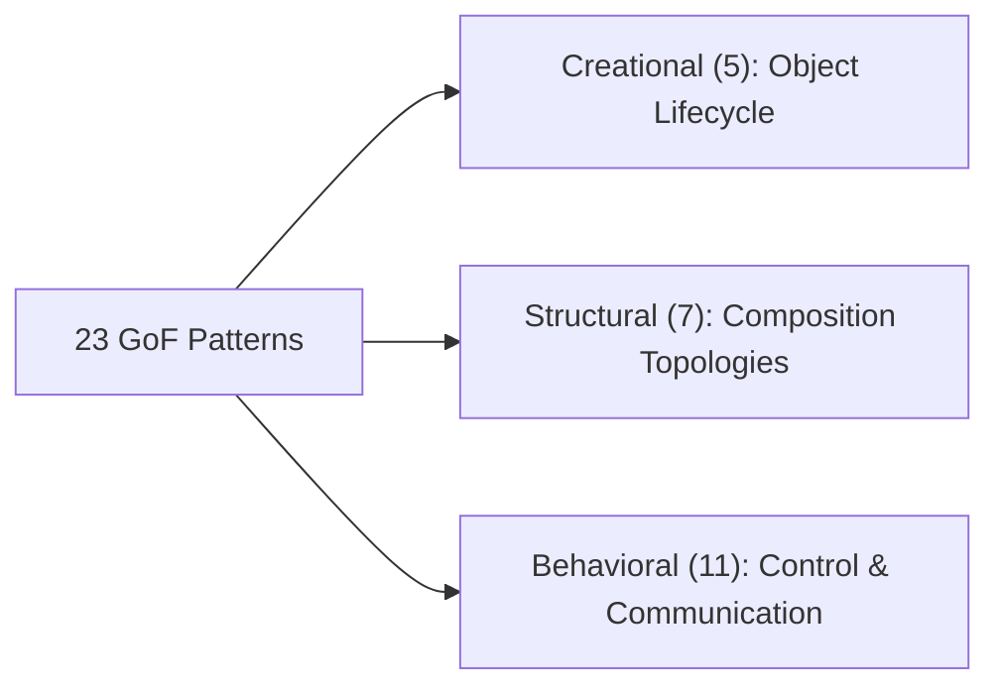

---
tags:
  - software-engineering
  - design-patterns
  - dashboard
created: 2026-01-02
updated: 2026-11-13
status: 🟢
level: mid-to-senior
---
# Design Patterns Complete Guide

> [!abstract] Vault Navigation
> Complete 23-pattern Gang of Four (GoF) index within [[Programming/Software Engineering/Software Engineering Roadmap|Software Engineering Roadmap]]. Directly applies [[Programming/Software Engineering/SOLID/SOLID Principles Complete Guide|SOLID Principles Complete Guide]] and guides [[Programming/Software Engineering/Refactoring/Refactoring Complete Guide|Refactoring Complete Guide]].

Design patterns are **reusable structural and behavioral topologies** that decouple volatile axes of change under specific constraints. Every pattern trades **indirection and class/type count** for **extensibility or encapsulation**—applying a pattern without its motivating change axis introduces unnecessary complexity.

---

## Companion Catalogs & Deep-Dive Notes

- [[Programming/Software Engineering/Design Patterns/Structural Patterns Catalog|Structural Patterns Catalog]] — Deep dive on **Decorator, Facade, Proxy, Composite, Bridge, and Flyweight**.
- [[Programming/Software Engineering/Design Patterns/Creational & Behavioral Patterns Catalog|Creational & Behavioral Patterns Catalog]] — Deep dive on **Abstract Factory, Prototype, Command, State, Template Method, Iterator, Chain of Responsibility, Mediator, Memento, Visitor, and Interpreter**.

---

## Complete 23 GoF Pattern Matrix

### 1. Creational Patterns (5)
*Control object instantiation, initialization invariants, and lifecycle decoupling.*

| Pattern | Core Intent | Modern Alternative / Guardrail | Status |
|---|---|---|---|
| [[Programming/Software Engineering/Design Patterns/Creational/Singleton\|Singleton]] | Restrict instantiation to one shared instance | Prefer DI Singleton scope in Composition Root; avoid global `getInstance()` | 🟢 |
| [[Programming/Software Engineering/Design Patterns/Creational/Factory Method\|Factory Method]] | Defer concrete instantiation to subclasses or factories | Use OCP Registry Maps or `static async create()` for async init | 🟢 |
| [[Programming/Software Engineering/Design Patterns/Creational & Behavioral Patterns Catalog#Abstract Factory\|Abstract Factory]] | Create families of mutually compatible products | Inject environment-scoped factory interfaces (`AwsInfraFactory`) | 🟢 |
| [[Programming/Software Engineering/Design Patterns/Creational/Builder\|Builder]] | Separate multi-step construction & validation from product | Options objects for simple DTOs; phantom types for step enforcement | 🟢 |
| [[Programming/Software Engineering/Design Patterns/Creational & Behavioral Patterns Catalog#Prototype\|Prototype]] | Clone pre-configured instances cleanly | `structuredClone()` for JSON/collections; explicit `.clone()` for methods | 🟢 |

### 2. Structural Patterns (7)
*Compose objects and modules across interface boundaries.*

| Pattern | Core Intent | Modern Alternative / Guardrail | Status |
|---|---|---|---|
| [[Programming/Software Engineering/Design Patterns/Structural/Adapter\|Adapter]] | Bridge incompatible interfaces (Anti-Corruption Layer) | Translate schemas, async paradigms, AND vendor error types | 🟢 |
| [[Programming/Software Engineering/Design Patterns/Structural Patterns Catalog#Decorator\|Decorator]] | Stack cross-cutting behavior preserving interface | Higher-order function wrappers (`withRetry(withTimeout(fetch))`) | 🟢 |
| [[Programming/Software Engineering/Design Patterns/Structural Patterns Catalog#Facade\|Facade]] | Expose coarse-grained unified API over subsystem | Keep subsystem accessible; prevent Facade from becoming God Class | 🟢 |
| [[Programming/Software Engineering/Design Patterns/Structural Patterns Catalog#Proxy\|Proxy]] | Control access, lazy-init, or cache behind same interface | Protection/Caching proxies; beware ES6 `Proxy` `this`-slot caveats | 🟢 |
| [[Programming/Software Engineering/Design Patterns/Structural Patterns Catalog#Composite\|Composite]] | Treat part-whole trees uniformly via single interface | Keep `add`/`remove` off leaf contracts (ISP) | 🟢 |
| [[Programming/Software Engineering/Design Patterns/Structural Patterns Catalog#Bridge\|Bridge]] | Decouple abstraction hierarchy from implementation driver | Collapses $M \times N$ inheritance explosion to $M + N$ | 🟢 |
| [[Programming/Software Engineering/Design Patterns/Structural Patterns Catalog#Flyweight\|Flyweight]] | Share immutable intrinsic state across $10^5$+ instances | Strictly freeze intrinsic state; store extrinsic coords externally | 🟢 |

### 3. Behavioral Patterns (11)
*Coordinate algorithms, state transitions, and message passing.*

| Pattern | Core Intent | Modern Alternative / Guardrail | Status |
|---|---|---|---|
| [[Programming/Software Engineering/Design Patterns/Behavioral/Strategy\|Strategy]] | Swap interchangeable algorithms dynamically | Function/closure `Record<Key, Fn>` when stateless; classes when injecting DI | 🟢 |
| [[Programming/Software Engineering/Design Patterns/Behavioral/Observer\|Observer]] | One-to-many event subscription & notification | Always bind `AbortSignal`/unsubscribe; use streams/RxJS for backpressure | 🟢 |
| [[Programming/Software Engineering/Design Patterns/Creational & Behavioral Patterns Catalog#Command\|Command]] | Reify requests for undo, audit, retries, and queues | Serializable job DTOs + inverse delta commands | 🟢 |
| [[Programming/Software Engineering/Design Patterns/Creational & Behavioral Patterns Catalog#State\|State]] | Encapsulate FSM transitions, eliminate boolean soup | TypeScript discriminated unions + exhaustive state transitions | 🟢 |
| [[Programming/Software Engineering/Design Patterns/Creational & Behavioral Patterns Catalog#Template Method\|Template Method]] | Fix algorithm skeleton in base class, override hooks | Prefer Strategy callback injection over inheritance coupling | 🟢 |
| [[Programming/Software Engineering/Design Patterns/Creational & Behavioral Patterns Catalog#Iterator\|Iterator]] | Traverse aggregates sequentially without leaking layout | Native `Symbol.iterator` and `AsyncGenerator` lazy pagination | 🟢 |
| [[Programming/Software Engineering/Design Patterns/Creational & Behavioral Patterns Catalog#Chain of Responsibility\|Chain of Responsibility]] | Pass requests through sequential handler pipeline | Express/Koa/Hono `next()` onion middleware composition | 🟢 |
| [[Programming/Software Engineering/Design Patterns/Creational & Behavioral Patterns Catalog#Mediator\|Mediator]] | Centralize $N$-to-$N$ peer coordination via single hub | Keep business logic out of Mediator to avoid God Object | 🟢 |
| [[Programming/Software Engineering/Design Patterns/Creational & Behavioral Patterns Catalog#Memento\|Memento]] | Capture opaque state snapshots for rollback | Best for non-invertible edits; Command deltas save RAM on large docs | 🟢 |
| [[Programming/Software Engineering/Design Patterns/Creational & Behavioral Patterns Catalog#Visitor\|Visitor]] | Add new operations to fixed AST via double dispatch | Tagged discriminated unions + exhaustive `switch` (`assertNever`) | 🟢 |
| [[Programming/Software Engineering/Design Patterns/Creational & Behavioral Patterns Catalog#Interpreter\|Interpreter]] | AST evaluator for small domain-specific grammars | Cap at small DSLs ($<15$ nodes); embed CEL/Rego for general rules | 🟢 |

---

## Rapid Pattern Selection Matrix

| Concrete Engineering Problem | Recommended Pattern | Watch Out For |
|---|---|---|
| Vendor SDK schema + exceptions polluting domain code | **Adapter** (ACL) | Mapping only happy paths while leaking vendor exceptions |
| Adding retries, timeouts, and tracing around transport | **Decorator** | Wrong wrapping order (`Cache` inside/outside `Retry`) |
| $M$ message types $\times$ $N$ delivery drivers exploding | **Bridge** | Over-engineering when only 1 axis ever changes |
| Eliminating 4 conflicting `isPaid`/`isCancelled` booleans | **State** (Discriminated Union FSM) | Allowing illegal state transitions outside transition functions |
| Unbounded `EventEmitter` OOM under fast burst load | **Observer** $\rightarrow$ **RxJS / `AsyncIterable`** | Missing `AbortSignal` teardown causing heap leaks |
| Compiling safe multi-step config with required fields | **Builder** (Phantom Types) | Shared mutable reference leaks on `.build()` |

---

## Related Notes

- [[Programming/Software Engineering/SOLID/SOLID Principles Complete Guide|SOLID Principles Complete Guide]]
- [[Programming/Software Engineering/Clean Code/Code Smells|Code Smells]]
- [[Programming/Software Engineering/Refactoring/Refactoring Complete Guide|Refactoring Complete Guide]]
- [[Programming/Software Engineering/Clean Architecture/Clean Architecture Complete Guide|Clean Architecture Complete Guide]]

---

← [[Programming/Software Engineering/Software Engineering Roadmap|Back to Software Engineering]]
