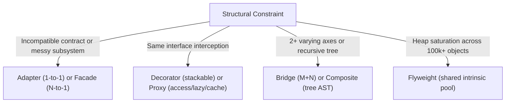
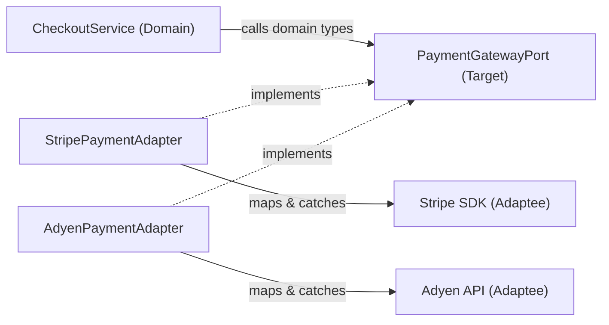
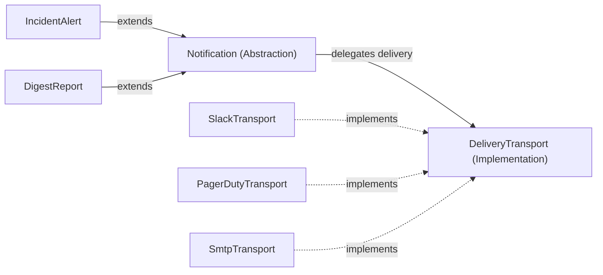
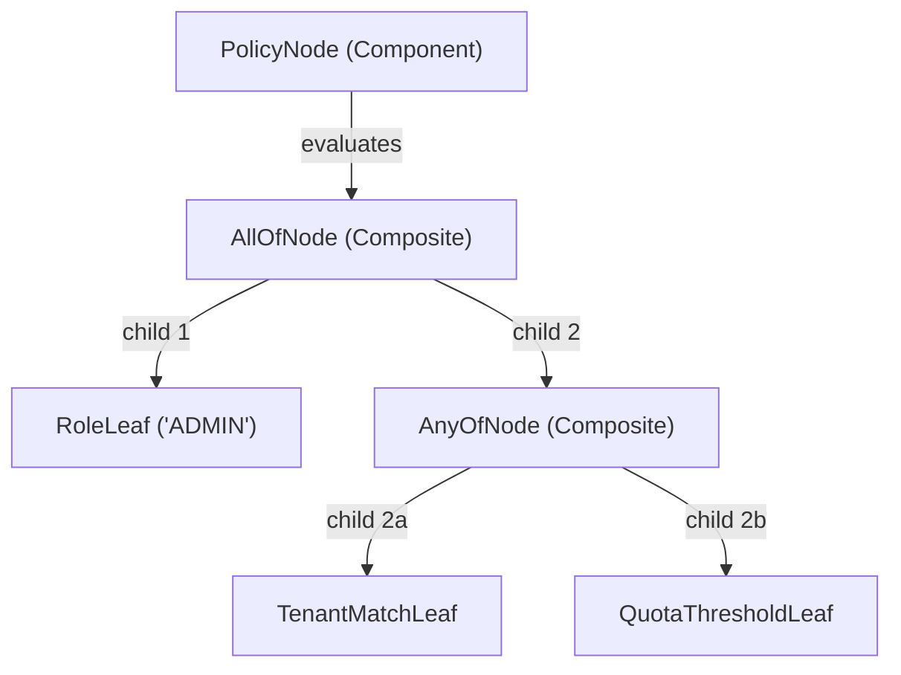
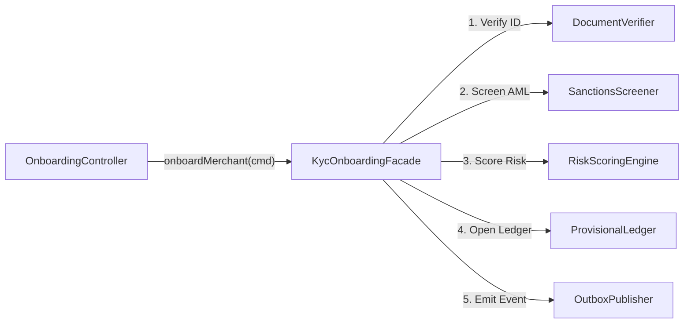
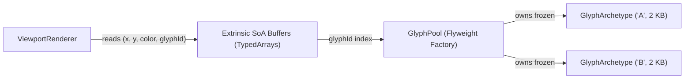
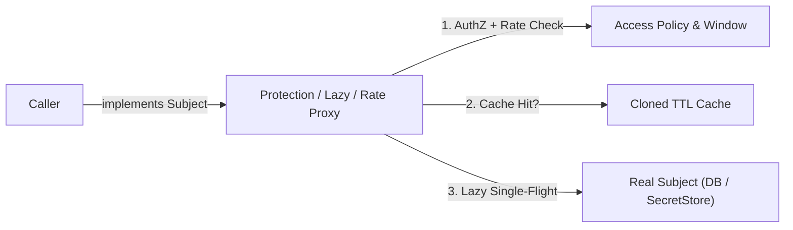

---
tags:
  - software-engineering
  - design-patterns
  - structural
created: 2026-11-13
updated: 2026-11-13
status: 🟢
level: mid-to-senior
category: Structural
---
# Structural Patterns Catalog

> [!abstract] Vault Navigation
> Exhaustive companion handbook to [[Programming/Software Engineering/Design Patterns/Design Patterns Complete Guide|Design Patterns Complete Guide]], [[Programming/Software Engineering/Design Patterns/Structural/Adapter|Adapter Pattern]], and [[Programming/Software Engineering/Design Patterns/Creational & Behavioral Patterns Catalog|Creational & Behavioral Patterns Catalog]]. Directly operationalizes [[Programming/Software Engineering/SOLID/SOLID Principles Complete Guide|SOLID Principles Complete Guide]], [[Programming/Software Engineering/Architectural Patterns/Hexagonal Architecture|Hexagonal Architecture]], and [[Programming/Software Engineering/Clean Architecture/Clean Architecture Complete Guide|Clean Architecture Complete Guide]].

## First-Principles Mechanics of Structural Composition

Structural design patterns govern how types, modules, and runtime object graphs are wired together across architectural boundaries. Whereas inheritance locks method dispatch tables (`vtable` or JavaScript prototype chains) statically at class declaration time, structural patterns assemble runtime object graphs via **pointer delegation** and **interface contracts**. This shift replaces compile-time class multiplication with dynamic, inspectable object topologies.

At the V8/TypeScript execution boundary, every structural pattern manipulates one or more of four fundamental engineering axes:

1. **Interface Boundary Translation (`Adapter`, `Facade`)**: Converts an incompatible external contract or multi-class subsystem choreography into an explicit boundary contract owned by the caller.
2. **Axis Decoupling (`Bridge`)**: Separates two orthogonal hierarchies (`Abstraction` and `Implementation`) via composition so adding a variant on either axis costs $O(1)$ classes rather than $O(M \times N)$ subclasses.
3. **Transparent Pipeline Interception (`Decorator`, `Proxy`)**: Preserves the target's exact interface (`implements Target`) while interposing execution logic before, after, or instead of delegating to the inner object.
4. **Graph Topology & Heap Layout (`Composite`, `Flyweight`)**: Controls recursive tree traversal (`Composite`) or deduplicates shared immutable state into arena pools paired with compact extrinsic typed buffers (`Flyweight`).



### Runtime & Type-System Mechanics in TypeScript / V8

- **Structural Typing Hazard**: TypeScript's type system is structural, not nominal. If `Subject` and `Proxy` share identical method shapes without a branded tag or private field, TypeScript treats a naked `Subject` as assignable where a `ProtectionProxy` was explicitly expected. Branded types (`declare const __brand: unique symbol`) or distinct constructor tokens prevent callers from accidentally bypassing proxies at dependency-injection boundaries.
- **Hidden Class (Map) Stability**: In V8, `Decorator` chains and `Flyweight` pools should always initialize fields in identical constructor order (`this.inner`, `this.ttlMs`) so TurboFan inline caches (`ICs`) stay monomorphic. Dynamically assigning optional properties after construction or mutating object shapes transitions V8 hidden classes into slow dictionary-mode lookups.
- **Stack Frame & Allocation Cost**: Wrapping an I/O port in 5 decorators adds 5 promise microtask frames per call—negligible ($< 5\text{ }\mu\text{s}$) next to a $20\text{ ms}$ HTTP round-trip, yet fatal inside a $10^7\text{ ops/sec}$ parser loop. Structural indirection must match the latency budget of the boundary it protects.
- **Interface Preservation vs Interface Mutation**: Notice the fundamental split across the 7 GoF structural patterns: **Adapter** and **Facade** *transform* the contract shape seen by callers; **Decorator** and **Proxy** *preserve* the exact contract shape so wrappers remain transparently substitutable (`LSP`); **Bridge** *splits* a hierarchy into two orthogonal contracts; **Composite** *unifies* leaf and container behind one recursive contract; **Flyweight** *splits* state storage across shared intrinsic pools and compact extrinsic buffers.

---

## Master Structural Pattern Comparison & Decision Matrix

| Pattern | Core Intent | Interface Altered? | Coupling Effect | Allocation / CPU Profile | Modern TypeScript Alternative | Primary Failure Mode |
|---|---|---|---|---|---|---|
| **Adapter** | Translate incompatible API, schema, paradigm, or errors | **Yes** (fits existing Target port) | Decouples domain from vendor SDKs via [[Programming/Software Engineering/SOLID/Dependency Inversion\|DIP]] | 1 thin wrapper object; translation overhead proportional to payload size | Narrow translation functions (`toDomainError`, `AsyncGenerator` adapters) | **Leaky Adapter**: vendor exceptions or nullable fields escaping boundary |
| **Bridge** | Decouple abstraction semantics from delivery/platform driver | **Separates 2 hierarchies** | Collapses $M \times N$ inheritance into $M + N$ modules | 1 extra pointer hop (`this.driver.send(...)`) | Injecting a driver record/interface into pure domain classes or functions | Over-engineering when only 1 axis ever varies in practice |
| **Composite** | Represent recursive part-whole trees under one contract | **Uniform leaf & node contract** | Eliminates caller `if (node.isGroup)` branching | Tree node objects; depth-bounded recursion stack | Discriminated union AST + exhaustive `switch` (`assertNever`) | **Cycle stack overflow** or violating [[Programming/Software Engineering/SOLID/Interface Segregation Principle\|ISP]] on leaves |
| **Decorator** | Stack orthogonal cross-cutting behavior dynamically | **No** (preserves exact interface) | Adds features without editing core implementation ([[Programming/Software Engineering/SOLID/Open-Closed Principle\|OCP]]) | $D$ wrapper objects + $D$ async frames per call | Higher-order function pipeline (`pipe(withRetry, withTimeout)(transport)`) | **Wrong stack order** (`Cache` outside `Auth` or `Retry` inside `Timeout`) |
| **Facade** | Expose coarse-grained workflow API over multi-module subsystem | **Yes** (new simplified surface) | Shields callers from subsystem choreography and order invariants | Zero extra per-call allocations if stateless | Plain service module function orchestrating injected ports | **God Facade**: absorbing domain business rules and blocking subsystem access |
| **Flyweight** | Share immutable intrinsic payloads across $10^5$–$10^7$ entities | **Externalizes state** | Separates static shared definitions from compact extrinsic buffers | Reduces heap $10\times$–$200\times$ using pooled objects + TypedArrays | Immutable lookup `Map` + Structure-of-Arrays (`Float32Array`, `Uint16Array`) | **Mutating intrinsic state** or unbounded pool memory leak |
| **Proxy** | Intercept access for lazy init, RBAC, caching, or rate limits | **No** (preserves exact interface) | Enforces non-functional access invariants transparently | 1 surrogate allocation (or ES6 `Proxy` trap overhead $\sim 5\times$–$20\times$) | Closures, `WeakMap` metadata guards, or explicit ES6 `new Proxy` | **V8 `this`-slot crashes** (`Map`/`#private`) or stale shared-reference caches |

---

## Adapter

### 1. First-Principles Mechanics & Dependency Graph

An **Adapter** implements a domain-owned **Target** interface while holding a private reference to an incompatible **Adaptee** (a third-party SDK, legacy callback library, SOAP client, or external microservice). Unlike naive wrapper classes that simply forward renamed method calls, a production Object Adapter acts as a complete **Anti-Corruption Layer (ACL)** as defined in [[Programming/Software Engineering/DDD/Domain-Driven Design Complete Guide|Domain-Driven Design Complete Guide]].



Inside a production TypeScript service, the Adapter executes four boundary transformations:

1. **Contract & Unit Normalization**: Converts vendor representations (`amount: 1050` cents vs `amount: { value: 1050, currency: 'JPY' }` where JPY is zero-decimal, vs decimal dollar strings `'10.50'`) into canonical domain value objects (`Money`) before crossing into core domain policies.
2. **Error Contract Isolation**: Catches vendor-thrown errors (`StripeCardError`, HTTP `429`, socket `ECONNRESET`) inside the adapter and converts them into a closed domain `Result<T, PaymentDomainError>` union or domain error hierarchy preserving `{ cause }` for trace logs. Domain callers never `import` vendor error classes.
3. **Concurrency & Cancellation Propagation**: Translates standard `AbortSignal` timeouts into vendor-specific cancellation flags or request aborts, while registering `{ once: true }` listeners—or removing listeners in the completion callback—so long-lived shared `AbortSignal` instances never accumulate dangling closure references.
4. **Paradigm Bridging**: Converts legacy error-first callbacks, SOAP XML streams, or page-number REST APIs into idiomatic `Promise` or `AsyncIterable` streams with deterministic backpressure. When an `AsyncGenerator` consumer executes `break` or throws early, the runtime invokes `.return()` on the generator, halting subsequent page fetches immediately after the yielded slice.

### 2. Concrete Production Use Cases & When NOT to Use

**Production Use Cases**:

1. **Multi-PSP Payment Normalization (`Stripe` + `Adyen` + `MercadoPago`)**: Normalizes divergent currency exponent rules (2-decimal `USD` vs 0-decimal `JPY` vs 3-decimal `BHD`), status state machines (`requires_capture` vs `Authorised`), and rate-limit error payloads behind one `PaymentGatewayPort`.
2. **Legacy Callback / XML-SOAP Wrapping**: Adapts Node-style `(err, data) => void` vendor SDKs or mainframe SOAP wrappers into cancellation-aware `Promise<Result<T, E>>` functions.
3. **Paginated REST API to `AsyncGenerator` Stream**: Converts cursor/offset REST endpoints (`GET /v1/events?cursor=...`) into lazy `AsyncIterable<Event>` streams so downstream ETL pipelines process millions of records in constant $O(\text{pageSize})$ memory.
4. **Database Driver Normalization During Migration**: Implements a Two-Way Adapter during Strangler Fig migrations so legacy callers reading `LegacyAccountDto` and new services consuming `AccountAggregate` read from the same underlying repository safely.

**When NOT to Use**:

- **Internal Code Under Your Full Control**: If you own both the caller and the callee within the same bounded context, refactor the interface directly instead of maintaining adapter boilerplate indefinitely.
- **Leaking Vendor Types Through Generic `Record<string, unknown>`**: An adapter that passes raw vendor metadata blobs directly to domain rules creates an illusion of decoupling while still breaking whenever the vendor changes field names.
- **Ultra-Hot Serialization Loops**: Wrapping millions of per-frame geometry structs in allocating object adapters inside tight parsers creates severe GC pressure; write direct zero-allocation decoders instead.

### 3. Complete Runnable TypeScript Implementation + Unit Tests

The following self-contained module implements a multi-provider payment Anti-Corruption Layer (`Stripe` + `Adyen`) plus a paginated ledger `AsyncGenerator` adapter, followed by executable `node:test` assertions.

```typescript
import test from 'node:test';
import assert from 'node:assert/strict';

// === Domain-Owned Contracts (Zero Vendor Coupling) ===

export type CurrencyCode = 'USD' | 'EUR' | 'JPY';

export interface Money {
  readonly amountMinor: number; // Minor units: 1050 USD = $10.50; 1050 JPY = ¥1050
  readonly currency: CurrencyCode;
}

export type NormalizedPaymentStatus = 'AUTHORIZED' | 'CAPTURED' | 'REQUIRES_ACTION' | 'FAILED';

export interface ChargeRequest {
  readonly idempotencyKey: string;
  readonly customerId: string;
  readonly money: Money;
  readonly paymentToken: string;
}

export interface ChargeReceipt {
  readonly provider: 'stripe' | 'adyen';
  readonly providerTxId: string;
  readonly status: NormalizedPaymentStatus;
  readonly authorizedMinor: number;
  readonly currency: CurrencyCode;
}

export type PaymentDomainError =
  | { readonly code: 'CARD_DECLINED'; readonly retryable: false; readonly reason: string; readonly cause?: unknown }
  | { readonly code: 'RATE_LIMITED'; readonly retryable: true; readonly retryAfterMs: number; readonly cause?: unknown }
  | { readonly code: 'PROVIDER_TIMEOUT'; readonly retryable: true; readonly cause?: unknown }
  | { readonly code: 'CANCELLED'; readonly retryable: false; readonly cause?: unknown }
  | { readonly code: 'INVALID_RESPONSE'; readonly retryable: false; readonly cause?: unknown };

export type Result<T, E> =
  | { readonly ok: true; readonly value: T }
  | { readonly ok: false; readonly error: E };

export const ok = <T>(value: T): Result<T, never> => ({ ok: true, value });
export const err = <E>(error: E): Result<never, E> => ({ ok: false, error });

export interface PaymentGatewayPort {
  authorize(req: ChargeRequest, signal?: AbortSignal): Promise<Result<ChargeReceipt, PaymentDomainError>>;
}

// === Incompatible Vendor SDK 1: Stripe-style Adaptee ===

export class StripeVendorError extends Error {
  readonly type: 'card_error' | 'rate_limit_error' | 'api_connection_error';
  readonly decline_code?: string;
  readonly retryAfterSec?: number;
  constructor(
    type: 'card_error' | 'rate_limit_error' | 'api_connection_error',
    message: string,
    declineCode?: string,
    retryAfterSec?: number
  ) {
    super(message);
    this.name = 'StripeVendorError';
    this.type = type;
    this.decline_code = declineCode;
    this.retryAfterSec = retryAfterSec;
  }
}

export interface StripeSdkClient {
  paymentIntents: {
    create(
      params: { amount: number; currency: string; payment_method: string; capture_method: 'manual' },
      opts: { idempotencyKey: string; signal?: AbortSignal }
    ): Promise<{ id: string; status: 'requires_capture' | 'succeeded' | 'requires_action'; amount: number; currency: string }>;
  };
}

// === Incompatible Vendor SDK 2: Adyen-style Adaptee ===

export interface AdyenSdkClient {
  payments(
    payload: {
      reference: string;
      shopperReference: string;
      amount: { value: number; currency: string };
      paymentMethod: { encryptedToken: string };
      manualCapture: boolean;
    },
    signal?: AbortSignal
  ): Promise<{ pspReference: string; resultCode: 'Authorised' | 'RedirectShopper' | 'Refused'; refusalReason?: string; amount: { value: number; currency: string } }>;
}

// === Currency Exponent Helper ===

const CURRENCY_DECIMALS: Record<CurrencyCode, number> = {
  USD: 2,
  EUR: 2,
  JPY: 0,
};

function assertValidMoney(money: Money): void {
  if (!Number.isSafeInteger(money.amountMinor) || money.amountMinor <= 0) {
    throw new RangeError(`amountMinor must be a positive safe integer, received ${money.amountMinor}`);
  }
  if (!(money.currency in CURRENCY_DECIMALS)) {
    throw new RangeError(`Unsupported currency: ${money.currency}`);
  }
}

// === Object Adapter 1: Stripe Anti-Corruption Layer ===

export class StripePaymentAdapter implements PaymentGatewayPort {
  private readonly sdk: StripeSdkClient;

  constructor(sdk: StripeSdkClient) {
    this.sdk = sdk;
  }

  async authorize(req: ChargeRequest, signal?: AbortSignal): Promise<Result<ChargeReceipt, PaymentDomainError>> {
    if (signal?.aborted) {
      return err({ code: 'CANCELLED', retryable: false, cause: signal.reason });
    }
    assertValidMoney(req.money);

    try {
      const intent = await this.sdk.paymentIntents.create(
        {
          amount: req.money.amountMinor,
          currency: req.money.currency.toLowerCase(),
          payment_method: req.paymentToken,
          capture_method: 'manual',
        },
        { idempotencyKey: req.idempotencyKey, signal }
      );

      const statusMap: Record<'requires_capture' | 'succeeded' | 'requires_action', NormalizedPaymentStatus> = {
        requires_capture: 'AUTHORIZED',
        succeeded: 'CAPTURED',
        requires_action: 'REQUIRES_ACTION',
      };

      return ok({
        provider: 'stripe',
        providerTxId: intent.id,
        status: statusMap[intent.status],
        authorizedMinor: intent.amount,
        currency: req.money.currency,
      });
    } catch (cause) {
      return err(this.mapStripeError(cause, signal));
    }
  }

  private mapStripeError(cause: unknown, signal?: AbortSignal): PaymentDomainError {
    if (signal?.aborted) {
      return { code: 'CANCELLED', retryable: false, cause };
    }
    if (cause instanceof StripeVendorError) {
      if (cause.type === 'card_error') {
        return { code: 'CARD_DECLINED', retryable: false, reason: cause.decline_code ?? cause.message, cause };
      }
      if (cause.type === 'rate_limit_error') {
        return { code: 'RATE_LIMITED', retryable: true, retryAfterMs: (cause.retryAfterSec ?? 2) * 1000, cause };
      }
      return { code: 'PROVIDER_TIMEOUT', retryable: true, cause };
    }
    return { code: 'PROVIDER_TIMEOUT', retryable: true, cause };
  }
}

// === Object Adapter 2: Adyen Anti-Corruption Layer ===

export class AdyenPaymentAdapter implements PaymentGatewayPort {
  private readonly sdk: AdyenSdkClient;

  constructor(sdk: AdyenSdkClient) {
    this.sdk = sdk;
  }

  async authorize(req: ChargeRequest, signal?: AbortSignal): Promise<Result<ChargeReceipt, PaymentDomainError>> {
    if (signal?.aborted) {
      return err({ code: 'CANCELLED', retryable: false, cause: signal.reason });
    }
    assertValidMoney(req.money);

    try {
      const res = await this.sdk.payments(
        {
          reference: req.idempotencyKey,
          shopperReference: req.customerId,
          amount: { value: req.money.amountMinor, currency: req.money.currency },
          paymentMethod: { encryptedToken: req.paymentToken },
          manualCapture: true,
        },
        signal
      );

      if (res.resultCode === 'Refused') {
        return err({
          code: 'CARD_DECLINED',
          retryable: false,
          reason: res.refusalReason ?? 'adyen_refused',
        });
      }

      const status: NormalizedPaymentStatus =
        res.resultCode === 'Authorised' ? 'AUTHORIZED' : 'REQUIRES_ACTION';

      return ok({
        provider: 'adyen',
        providerTxId: res.pspReference,
        status,
        authorizedMinor: res.amount.value,
        currency: req.money.currency,
      });
    } catch (cause) {
      if (signal?.aborted) {
        return err({ code: 'CANCELLED', retryable: false, cause });
      }
      return err({ code: 'PROVIDER_TIMEOUT', retryable: true, cause });
    }
  }
}

// === Paradigm Adapter: Offset-Paginated Legacy Ledger -> AsyncIterable ===

export interface LegacySettlementRow {
  readonly tx_ref: string;
  readonly net_cents: number;
}

export interface LegacySettlementApi {
  fetchPage(page: number, limit: number): Promise<{ rows: LegacySettlementRow[]; nextPage: number | null }>;
}

export interface SettlementEntry {
  readonly txRef: string;
  readonly netMinor: number;
}

export class SettlementStreamAdapter implements AsyncIterable<SettlementEntry> {
  private readonly api: LegacySettlementApi;
  private readonly pageSize: number;

  constructor(api: LegacySettlementApi, pageSize = 50) {
    this.api = api;
    this.pageSize = pageSize;
  }

  async *[Symbol.asyncIterator](): AsyncIterator<SettlementEntry> {
    let page: number | null = 1;
    while (page !== null) {
      const batch = await this.api.fetchPage(page, this.pageSize);
      for (const row of batch.rows) {
        yield { txRef: row.tx_ref, netMinor: row.net_cents };
      }
      page = batch.nextPage;
    }
  }
}

// === Unit Tests ===

test('StripePaymentAdapter normalizes JPY zero-decimal minor units and isolates card decline errors', async () => {
  const mockStripe: StripeSdkClient = {
    paymentIntents: {
      async create(params) {
        if (params.payment_method === 'tok_decline') {
          throw new StripeVendorError('card_error', 'Declined', 'insufficient_funds');
        }
        assert.equal(params.currency, 'jpy');
        assert.equal(params.amount, 5000);
        return { id: 'pi_123', status: 'requires_capture', amount: params.amount, currency: params.currency };
      },
    },
  };

  const gateway: PaymentGatewayPort = new StripePaymentAdapter(mockStripe);

  const success = await gateway.authorize({
    idempotencyKey: 'idem-1',
    customerId: 'cust-9',
    money: { amountMinor: 5000, currency: 'JPY' },
    paymentToken: 'tok_ok',
  });
  assert.equal(success.ok, true);
  if (success.ok) {
    assert.equal(success.value.status, 'AUTHORIZED');
    assert.equal(success.value.authorizedMinor, 5000);
  }

  const declined = await gateway.authorize({
    idempotencyKey: 'idem-2',
    customerId: 'cust-9',
    money: { amountMinor: 5000, currency: 'JPY' },
    paymentToken: 'tok_decline',
  });
  assert.equal(declined.ok, false);
  if (!declined.ok) {
    assert.equal(declined.error.code, 'CARD_DECLINED');
    assert.equal(declined.error.retryable, false);
  }
});

test('AdyenPaymentAdapter normalizes Authorised and Refused responses identically to PaymentGatewayPort', async () => {
  const mockAdyen: AdyenSdkClient = {
    async payments(payload) {
      if (payload.paymentMethod.encryptedToken === 'tok_bad') {
        return { pspReference: 'psp_0', resultCode: 'Refused', refusalReason: 'FRAUD', amount: payload.amount };
      }
      return { pspReference: 'psp_88', resultCode: 'Authorised', amount: payload.amount };
    },
  };

  const gateway: PaymentGatewayPort = new AdyenPaymentAdapter(mockAdyen);
  const res = await gateway.authorize({
    idempotencyKey: 'idem-3',
    customerId: 'cust-2',
    money: { amountMinor: 2599, currency: 'USD' },
    paymentToken: 'tok_ok',
  });
  assert.equal(res.ok, true);
  if (res.ok) {
    assert.equal(res.value.provider, 'adyen');
    assert.equal(res.value.status, 'AUTHORIZED');
  }
});

test('SettlementStreamAdapter yields lazily and stops fetching pages when consumer breaks early', async () => {
  let fetchedPages = 0;
  const legacyApi: LegacySettlementApi = {
    async fetchPage(page) {
      fetchedPages += 1;
      if (page === 1) return { rows: [{ tx_ref: 'a', net_cents: 100 }, { tx_ref: 'b', net_cents: 200 }], nextPage: 2 };
      return { rows: [{ tx_ref: 'c', net_cents: 300 }], nextPage: null };
    },
  };

  const stream = new SettlementStreamAdapter(legacyApi, 2);
  const collected: SettlementEntry[] = [];
  for await (const item of stream) {
    collected.push(item);
    if (collected.length === 2) break;
  }

  assert.equal(fetchedPages, 1);
  assert.equal(collected.length, 2);
});
```

### 4. Framework & Ecosystem Equivalents

- **React & Next.js**: Custom hooks (`useFormFieldAdapter`, `useRouterAdapter`) adapt external browser/library APIs (`React Hook Form`, `TanStack Table`, `next/navigation`) into domain-stable prop surfaces so UI components remain testable without mocking framework globals; see [[Programming/Frontend/React Patterns Guide|React Patterns Guide]] and [[Programming/Frontend/Next.js Complete Guide|Next.js Complete Guide]].
- **NestJS**: Custom DI providers (`{ provide: PAYMENT_GATEWAY_PORT, useClass: StripePaymentAdapter }`) wire infrastructure adapters behind domain tokens in feature modules without leaking Nest HTTP exceptions into core services; see [[Programming/Backend/NestJS Complete Guide|NestJS Complete Guide]].
- **Node.js Core**: `util.promisify`, `stream.Readable.from(asyncIterable)`, and Web `ReadableStream` bridges adapt Node error-first callback APIs and legacy `EventEmitter` streams into modern `AsyncIterable` pipelines; see [[Programming/Backend/Backend Core (Node, Event Loop, Auth & Concurrency)|Backend Core]].
- **ORMs (Prisma / TypeORM)**: Repository classes implementing domain `OrderRepository` interfaces adapt generated Prisma delegates (`prisma.order`) or TypeORM `EntityManager` rows into immutable domain aggregates while mapping `P2002` / SQLSTATE `23505` unique-constraint errors into domain `DuplicateOrderError`.

---

## Bridge

### 1. First-Principles Mechanics & Dependency Graph

**Bridge** splits a monolithic inheritance hierarchy along two orthogonal axes of change into an **Abstraction** (high-level policy, orchestration, or semantic domain concept) and an **Implementation** (low-level platform, storage driver, or transport API) linked via composition. Whereas an Adapter is applied *retroactively* to reconcile mismatched existing interfaces, Bridge is designed *upfront* when two independent dimensions both expand over time.

Without Bridge, $M$ semantic abstractions crossed with $N$ delivery drivers require $M \times N$ concrete subclasses (`UrgentSlackAlert`, `UrgentPagerDutyAlert`, `DigestSlackAlert`, `DigestPagerDutyAlert`). Bridge isolates the cross-product behind a single reference pointer (`protected readonly transport: DeliveryTransport`), collapsing $M \times N$ subclasses into $M + N$ independent classes.



At runtime, the Abstraction owns domain semantics (severity escalation, SLA deadlines, batching rules, deduplication keys), builds a normalized intermediate `NotificationEnvelope`, and invokes the Implementation interface (`DeliveryTransport.deliver()`), which handles transport-specific protocol framing, capability limits, and API authentication.

#### Capability Negotiation vs Lowest-Common-Denominator Trap

A common Bridge failure occurs when transports differ sharply in formatting support (Slack rich blocks vs PagerDuty 1,024-character summaries vs plain-text SMTP bodies). Lowering the Abstraction to the weakest transport strips away rich metadata everywhere; conversely, leaking Slack-specific block schemas into `IncidentAlert` re-couples both axes. Exposing declarative `TransportCapabilities` on the Implementation interface allows the transport driver to truncate or render structured fields cleanly while returning explicit telemetry (`truncated: true`) in the `DeliveryReceipt`.

### 2. Concrete Production Use Cases & When NOT to Use

**Production Use Cases**:

1. **Multi-Channel Alerting & Notification Engine**: Separates notification semantics (`IncidentAlert`, `SecurityAuditNotice`, `WeeklyDigestReport`) from channel drivers (`Slack`, `PagerDuty`, `SMTP`, `Microsoft Teams`). Adding `DiscordTransport` works immediately across every existing alert class.
2. **Cross-Cloud Blob & Compute Abstractions**: Decouples high-level archival workflows (`ImmutableComplianceArchive`, `StreamingMediaAsset`) from cloud storage drivers (`S3StorageDriver`, `GcsStorageDriver`, `LocalDiskDriver`).
3. **Report Export Engine (Domain Reports $\times$ Output Formatters)**: Separates domain report semantics (`TaxComplianceReport`, `CohortRetentionReport`) from rendering engines (`CsvRenderer`, `ParquetRenderer`, `PdfRenderer`).
4. **Multi-Database Query / Persistence Drivers**: Separates logical repository queries (`CustomerSegmentQuery`, `BillingExportQuery`) from engine dialects (`PostgresDriver`, `ClickHouseDriver`, `SqliteTestDriver`).

**When NOT to Use**:

- **Single Axis of Variation**: If you have 5 alert types that will only ever send through Slack, or 1 alert format targeting 4 channels, a single Strategy interface suffices—adding an abstraction class hierarchy introduces unnecessary indirection.
- **Incompatible Driver Capabilities Cannot Share One Protocol**: If one driver requires interactive multi-turn handshakes while another is fire-and-forget UDP, forcing both behind a naive shared `Transport` interface creates bloated capability flags and `UnsupportedOperationError` branches.

### 3. Complete Runnable TypeScript Implementation + Unit Tests

This implementation models an extensible Notification Bridge separating `NotificationAbstraction` (`IncidentAlert`, `SecurityAuditNotice`, `DigestReport`) from `DeliveryTransport` (`SlackWebhookTransport`, `PagerDutyTransport`, `SmtpEmailTransport`) with explicit transport capability negotiation.

```typescript
import test from 'node:test';
import assert from 'node:assert/strict';

// === Implementation Hierarchy (Platform / Transport Axis) ===

export type Severity = 'INFO' | 'WARNING' | 'CRITICAL';

export interface NotificationEnvelope {
  readonly dedupKey: string;
  readonly severity: Severity;
  readonly title: string;
  readonly summary: string;
  readonly fields: ReadonlyArray<{ readonly label: string; readonly value: string }>;
  readonly timestampIso: string;
}

export interface TransportCapabilities {
  readonly maxSummaryChars: number;
  readonly supportsStructuredFields: boolean;
  readonly supportsDeduplication: boolean;
}

export interface DeliveryReceipt {
  readonly transport: string;
  readonly externalMessageId: string;
  readonly truncated: boolean;
}

export interface DeliveryTransport {
  readonly name: string;
  readonly capabilities: TransportCapabilities;
  deliver(envelope: NotificationEnvelope): Promise<DeliveryReceipt>;
}

export class SlackWebhookTransport implements DeliveryTransport {
  readonly name = 'slack';
  readonly capabilities: TransportCapabilities = {
    maxSummaryChars: 3000,
    supportsStructuredFields: true,
    supportsDeduplication: false,
  };
  private readonly sentPayloads: Array<Record<string, unknown>> = [];
  private readonly channel: string;

  constructor(channel: string) {
    this.channel = channel;
  }

  async deliver(envelope: NotificationEnvelope): Promise<DeliveryReceipt> {
    const truncated = envelope.summary.length > this.capabilities.maxSummaryChars;
    const text = truncated
      ? `${envelope.summary.slice(0, this.capabilities.maxSummaryChars - 3)}...`
      : envelope.summary;

    const blockPayload = {
      channel: this.channel,
      header: `[${envelope.severity}] ${envelope.title}`,
      text,
      fields: envelope.fields.map((f) => `*${f.label}*: ${f.value}`),
    };
    this.sentPayloads.push(blockPayload);

    return {
      transport: this.name,
      externalMessageId: `slack-${this.sentPayloads.length}`,
      truncated,
    };
  }

  getSentPayloads(): ReadonlyArray<Record<string, unknown>> {
    return this.sentPayloads;
  }
}

export class PagerDutyTransport implements DeliveryTransport {
  readonly name = 'pagerduty';
  readonly capabilities: TransportCapabilities = {
    maxSummaryChars: 1024,
    supportsStructuredFields: true,
    supportsDeduplication: true,
  };
  private readonly triggeredIncidents: Array<{ dedupKey: string; severity: string; summary: string }> = [];
  private readonly routingKey: string;

  constructor(routingKey: string) {
    this.routingKey = routingKey;
  }

  async deliver(envelope: NotificationEnvelope): Promise<DeliveryReceipt> {
    const pdSeverity = envelope.severity === 'CRITICAL' ? 'critical' : envelope.severity === 'WARNING' ? 'warning' : 'info';
    const truncated = envelope.summary.length > this.capabilities.maxSummaryChars;
    const summary = truncated
      ? `${envelope.summary.slice(0, this.capabilities.maxSummaryChars - 3)}...`
      : envelope.summary;

    this.triggeredIncidents.push({
      dedupKey: `${this.routingKey}:${envelope.dedupKey}`,
      severity: pdSeverity,
      summary: `${envelope.title}: ${summary}`,
    });

    return {
      transport: this.name,
      externalMessageId: `pd-${envelope.dedupKey}`,
      truncated,
    };
  }

  getTriggeredIncidents(): ReadonlyArray<{ dedupKey: string; severity: string; summary: string }> {
    return this.triggeredIncidents;
  }
}

export class SmtpEmailTransport implements DeliveryTransport {
  readonly name = 'smtp';
  readonly capabilities: TransportCapabilities = {
    maxSummaryChars: 64_000,
    supportsStructuredFields: false,
    supportsDeduplication: false,
  };
  private readonly outbox: Array<{ to: string; subject: string; body: string }> = [];
  private readonly recipient: string;

  constructor(recipient: string) {
    this.recipient = recipient;
  }

  async deliver(envelope: NotificationEnvelope): Promise<DeliveryReceipt> {
    const fieldLines = envelope.fields.map((f) => `${f.label}: ${f.value}`).join('\n');
    const body = fieldLines ? `${envelope.summary}\n\n${fieldLines}` : envelope.summary;
    this.outbox.push({
      to: this.recipient,
      subject: `[${envelope.severity}] ${envelope.title}`,
      body,
    });
    return {
      transport: this.name,
      externalMessageId: `smtp-${this.outbox.length}`,
      truncated: false,
    };
  }

  getOutbox(): ReadonlyArray<{ to: string; subject: string; body: string }> {
    return this.outbox;
  }
}

// === Abstraction Hierarchy (Domain Notification Axis) ===

export abstract class NotificationAbstraction {
  protected readonly transport: DeliveryTransport;

  constructor(transport: DeliveryTransport) {
    this.transport = transport;
  }

  abstract dispatch(): Promise<DeliveryReceipt>;
}

export class IncidentAlert extends NotificationAbstraction {
  private readonly service: string;
  private readonly p99Ms: number;
  private readonly budgetMs: number;

  constructor(transport: DeliveryTransport, service: string, p99Ms: number, budgetMs: number) {
    super(transport);
    this.service = service;
    this.p99Ms = p99Ms;
    this.budgetMs = budgetMs;
  }

  async dispatch(): Promise<DeliveryReceipt> {
    const ratio = this.p99Ms / Math.max(1, this.budgetMs);
    const severity: Severity = ratio >= 2 ? 'CRITICAL' : 'WARNING';

    return this.transport.deliver({
      dedupKey: `sla-breach:${this.service}`,
      severity,
      title: `Latency SLA Breach (${this.service})`,
      summary: `Service ${this.service} p99 latency reached ${this.p99Ms}ms against ${this.budgetMs}ms budget.`,
      fields: [
        { label: 'Service', value: this.service },
        { label: 'Observed p99', value: `${this.p99Ms}ms` },
        { label: 'SLO Budget', value: `${this.budgetMs}ms` },
      ],
      timestampIso: new Date().toISOString(),
    });
  }
}

export class DigestReport extends NotificationAbstraction {
  private readonly windowLabel: string;
  private readonly metrics: ReadonlyArray<{ readonly metric: string; readonly value: string }>;

  constructor(
    transport: DeliveryTransport,
    windowLabel: string,
    metrics: ReadonlyArray<{ readonly metric: string; readonly value: string }>
  ) {
    super(transport);
    this.windowLabel = windowLabel;
    this.metrics = metrics;
  }

  async dispatch(): Promise<DeliveryReceipt> {
    const bulletSummary = this.metrics.map((m) => `- ${m.metric}: ${m.value}`).join('\n');
    return this.transport.deliver({
      dedupKey: `digest:${this.windowLabel}`,
      severity: 'INFO',
      title: `Operational Digest (${this.windowLabel})`,
      summary: `Aggregated telemetry metrics:\n${bulletSummary}`,
      fields: this.metrics.map((m) => ({ label: m.metric, value: m.value })),
      timestampIso: new Date().toISOString(),
    });
  }
}

export class SecurityAuditNotice extends NotificationAbstraction {
  private readonly actorId: string;
  private readonly action: string;
  private readonly sourceIp: string;

  constructor(transport: DeliveryTransport, actorId: string, action: string, sourceIp: string) {
    super(transport);
    this.actorId = actorId;
    this.action = action;
    this.sourceIp = sourceIp;
  }

  async dispatch(): Promise<DeliveryReceipt> {
    return this.transport.deliver({
      dedupKey: `sec:${this.actorId}:${this.action}`,
      severity: 'CRITICAL',
      title: `Privileged Audit Event: ${this.action}`,
      summary: `Actor ${this.actorId} executed ${this.action} from IP ${this.sourceIp}.`,
      fields: [
        { label: 'Actor', value: this.actorId },
        { label: 'Source IP', value: this.sourceIp },
      ],
      timestampIso: new Date().toISOString(),
    });
  }
}

// === Unit Tests ===

test('Bridge composes 3 abstractions x 3 transports without combinatorial subclasses (3 + 3)', async () => {
  const slack = new SlackWebhookTransport('#ops-alerts');
  const pagerDuty = new PagerDutyTransport('rk-prod-99');
  const smtp = new SmtpEmailTransport('sec-team@corp.example');

  const incidentToPd = new IncidentAlert(pagerDuty, 'checkout-api', 1200, 300);
  const digestToSlack = new DigestReport(slack, '2026-11-13', [
    { metric: 'Requests', value: '12.4M' },
    { metric: 'Error Rate', value: '0.02%' },
  ]);
  const secToSmtp = new SecurityAuditNotice(smtp, 'usr_admin', 'KMS_KEY_EXPORT', '198.51.100.7');

  const [r1, r2, r3] = await Promise.all([
    incidentToPd.dispatch(),
    digestToSlack.dispatch(),
    secToSmtp.dispatch(),
  ]);

  assert.equal(r1.transport, 'pagerduty');
  assert.equal(pagerDuty.getTriggeredIncidents()[0]?.severity, 'critical');
  assert.equal(r2.transport, 'slack');
  assert.equal(slack.getSentPayloads().length, 1);
  assert.equal(r3.transport, 'smtp');
  assert.match(smtp.getOutbox()[0]?.body ?? '', /KMS_KEY_EXPORT/);
});

test('Bridge transport capability limits safely truncate oversized summaries without changing abstractions', async () => {
  const pd = new PagerDutyTransport('rk-1');
  const hugeServiceName = 'svc-'.repeat(400);
  const alert = new IncidentAlert(pd, hugeServiceName, 800, 100);

  const receipt = await alert.dispatch();
  assert.equal(receipt.truncated, true);
  assert.ok((pd.getTriggeredIncidents()[0]?.summary.length ?? 0) <= hugeServiceName.length + 1100);
});
```

### 4. Framework & Ecosystem Equivalents

- **React**: Separating headless state-machine hooks (`useCombobox`, `useDialog`, `useTable` from Radix/TanStack Table) from styling/DOM renderers (`TailwindRenderer`, `MaterialRenderer`) is a functional Bridge: $M$ accessible interaction behaviors compose freely with $N$ design systems without $M \times N$ component duplication; see [[Programming/Frontend/React Patterns Guide|React Patterns Guide]].
- **Next.js**: Server Components executing domain queries (`OrdersQueryView`) bridged onto injected `CacheStore` / `SessionTransport` implementations across Edge vs Node runtimes without changing page semantics.
- **NestJS**: Abstract repository/service classes injecting abstract storage/queue tokens (`@Inject(QUEUE_DRIVER)`) so business orchestrators run over `BullMqDriver`, `SqsDriver`, or `InMemoryDriver` identically; see [[Programming/Backend/NestJS Advanced Guide|NestJS Advanced Guide]].
- **Node.js & ORMs**: Knex/Prisma/Drizzle separate high-level query builders (abstraction) from dialect drivers (`pg`, `mysql2`, `better-sqlite3`, `libsql` implementation).

---

## Composite

### 1. First-Principles Mechanics & Dependency Graph

**Composite** organizes objects into recursive **part-whole trees** where primitive **Leaf** nodes and container **Composite** nodes implement a single uniform **Component** interface. Callers evaluate, serialize, render, or aggregate the root node without checking whether a given reference is a single item or a nested subtree of arbitrary depth.



Two architectural invariants determine whether a Composite implementation remains safe in production:

1. **Interface Segregation Between Leaf and Container**: Never place `addChild()`, `removeChild()`, or `getChildren()` on the base `Component` interface if leaves cannot contain children. Doing so violates [[Programming/Software Engineering/SOLID/Interface Segregation Principle|Interface Segregation Principle]] and [[Programming/Software Engineering/SOLID/Liskov Substitution Principle|Liskov Substitution Principle]], forcing leaves to throw `UnsupportedOperationError`. Keep child management exclusively on composite container classes (or immutable constructor arrays).
2. **Graph Integrity & Stack Safety**: Although Composite models a **Directed Acyclic Tree**, mutable `addChild(node)` methods or deserialized JSON rule definitions can introduce cycles (`A -> B -> A`) or malicious 5,000-level nesting. Production evaluators must track the active recursion stack via a `Set<PolicyNode>` (adding on entry, deleting in `finally` so shared DAG diamond nodes remain valid!) combined with a bounded `MAX_AST_DEPTH` check to fail deterministically with `PolicyCycleError` or `MaxPolicyDepthError` instead of crashing V8 with `RangeError: Maximum call stack size exceeded`.
3. **Short-Circuit Explainability Alignment**: When `explain()` generates audit diagnostics for denied authorization requests, its traversal must mirror `evaluate()`'s short-circuit semantics exactly; otherwise an audit log may claim a later branch failed when runtime evaluation aborted earlier on `TenantMatchLeaf`.

### 2. Concrete Production Use Cases & When NOT to Use

**Production Use Cases**:

1. **ABAC / RBAC Policy Engine & Rule ASTs**: Evaluates boolean authorization trees (`AllOf`, `AnyOf`, `Not`, `RoleLeaf`, `TenantMatchLeaf`, `IpCidrLeaf`) with short-circuit execution and structured explainability traces (`EvaluationTrace`) showing the exact branch that denied access.
2. **Search Query & Filter ASTs**: Translates uniform filter trees (`AndFilter`, `OrFilter`, `EqFilter`, `RangeFilter`) into parameterized SQL `WHERE` clauses, Elasticsearch DSL, or in-memory array predicates.
3. **File System, Menu, and Organization Hierarchies**: Computes recursive disk usage, ACL inheritance, or cost-center rollups across departments, teams, and individual contributors.
4. **UI Layout & Scene Graph Trees**: Renders nested panels, grids, and leaf widgets where `measureLayout(bounds)` propagates constraints top-down and aggregates bounding boxes bottom-up.

**When NOT to Use**:

- **Flat Collections Without Nesting**: If items only ever have 1 level of grouping (`Category -> Item[]`), a tree AST adds recursive indirection with zero benefit over a `Map<CategoryId, Item[]>`.
- **Operations Vary Widely Across Node Types**: When every operation requires checking `if (node instanceof LeafA)` rather than uniform delegation, combine a discriminated union AST with an explicit `Visitor` or exhaustive `switch` (`assertNever`) rather than forcing dissimilar nodes into one bloated Component contract.
- **Unbounded Cyclic Graphs**: Arbitrary social graphs or dependency DAGs with shared diamonds and cycles require explicit graph traversal (`BFS`/`DFS` with `visited` sets) rather than pure tree recursion.

### 3. Complete Runnable TypeScript Implementation + Unit Tests

The following module implements a production ABAC Policy Composite AST featuring ISP-clean interfaces, cycle protection on both `addChild()` and `explain()`, max-depth guards, short-circuit evaluation, and structured diagnostic traces.

```typescript
import test from 'node:test';
import assert from 'node:assert/strict';

// === Domain Request Context & Explainability Trace ===

export interface AccessContext {
  readonly actorId: string;
  readonly tenantId: string;
  readonly resourceTenantId: string;
  readonly roles: ReadonlySet<string>;
  readonly monthlyApiCalls: number;
  readonly requestHourUtc: number;
}

export interface EvaluationTrace {
  readonly nodeName: string;
  readonly passed: boolean;
  readonly reason: string;
  readonly children?: ReadonlyArray<EvaluationTrace>;
}

export class PolicyCycleError extends Error {
  constructor(nodeName: string) {
    super(`Cycle detected in PolicyNode AST at "${nodeName}"`);
    this.name = 'PolicyCycleError';
  }
}

export class MaxPolicyDepthError extends Error {
  constructor(maxDepth: number) {
    super(`Policy AST exceeded maximum evaluation depth of ${maxDepth}`);
    this.name = 'MaxPolicyDepthError';
  }
}

// === ISP-Clean Component Contract (No add/remove pollution on Leaves) ===

export interface PolicyNode {
  readonly name: string;
  evaluate(ctx: AccessContext, activePath?: Set<PolicyNode>, depth?: number): boolean;
  explain(ctx: AccessContext, activePath?: Set<PolicyNode>, depth?: number): EvaluationTrace;
}

const MAX_AST_DEPTH = 32;

function enterNode(
  node: PolicyNode,
  activePath: Set<PolicyNode>,
  depth: number
): void {
  if (depth > MAX_AST_DEPTH) {
    throw new MaxPolicyDepthError(MAX_AST_DEPTH);
  }
  if (activePath.has(node)) {
    throw new PolicyCycleError(node.name);
  }
  activePath.add(node);
}

// === Leaf Implementations ===

export class RoleLeaf implements PolicyNode {
  readonly name: string;
  private readonly requiredRole: string;

  constructor(requiredRole: string) {
    this.requiredRole = requiredRole;
    this.name = `Role(${requiredRole})`;
  }

  evaluate(ctx: AccessContext, activePath = new Set<PolicyNode>(), depth = 0): boolean {
    enterNode(this, activePath, depth);
    try {
      return ctx.roles.has(this.requiredRole);
    } finally {
      activePath.delete(this);
    }
  }

  explain(ctx: AccessContext, activePath = new Set<PolicyNode>(), depth = 0): EvaluationTrace {
    const passed = this.evaluate(ctx, activePath, depth);
    return {
      nodeName: this.name,
      passed,
      reason: passed ? `Actor holds role ${this.requiredRole}` : `Missing required role ${this.requiredRole}`,
    };
  }
}

export class TenantMatchLeaf implements PolicyNode {
  readonly name = 'TenantMatch';

  evaluate(ctx: AccessContext, activePath = new Set<PolicyNode>(), depth = 0): boolean {
    enterNode(this, activePath, depth);
    try {
      return ctx.tenantId === ctx.resourceTenantId;
    } finally {
      activePath.delete(this);
    }
  }

  explain(ctx: AccessContext, activePath = new Set<PolicyNode>(), depth = 0): EvaluationTrace {
    const passed = this.evaluate(ctx, activePath, depth);
    return {
      nodeName: this.name,
      passed,
      reason: passed
        ? `Tenant ${ctx.tenantId} matches resource tenant`
        : `Cross-tenant denial: actor=${ctx.tenantId}, resource=${ctx.resourceTenantId}`,
    };
  }
}

export class QuotaThresholdLeaf implements PolicyNode {
  readonly name: string;
  private readonly maxCalls: number;

  constructor(maxCalls: number) {
    this.maxCalls = maxCalls;
    this.name = `Quota(<=${maxCalls})`;
  }

  evaluate(ctx: AccessContext, activePath = new Set<PolicyNode>(), depth = 0): boolean {
    enterNode(this, activePath, depth);
    try {
      return ctx.monthlyApiCalls <= this.maxCalls;
    } finally {
      activePath.delete(this);
    }
  }

  explain(ctx: AccessContext, activePath = new Set<PolicyNode>(), depth = 0): EvaluationTrace {
    const passed = this.evaluate(ctx, activePath, depth);
    return {
      nodeName: this.name,
      passed,
      reason: `Usage ${ctx.monthlyApiCalls} / limit ${this.maxCalls}`,
    };
  }
}

export class BusinessHoursLeaf implements PolicyNode {
  readonly name: string;
  private readonly startHourUtc: number;
  private readonly endHourUtc: number;

  constructor(startHourUtc: number, endHourUtc: number) {
    this.startHourUtc = startHourUtc;
    this.endHourUtc = endHourUtc;
    this.name = `UtcWindow(${startHourUtc}-${endHourUtc})`;
  }

  evaluate(ctx: AccessContext, activePath = new Set<PolicyNode>(), depth = 0): boolean {
    enterNode(this, activePath, depth);
    try {
      return ctx.requestHourUtc >= this.startHourUtc && ctx.requestHourUtc < this.endHourUtc;
    } finally {
      activePath.delete(this);
    }
  }

  explain(ctx: AccessContext, activePath = new Set<PolicyNode>(), depth = 0): EvaluationTrace {
    const passed = this.evaluate(ctx, activePath, depth);
    return {
      nodeName: this.name,
      passed,
      reason: `UTC hour ${ctx.requestHourUtc} inside [${this.startHourUtc}, ${this.endHourUtc}): ${passed}`,
    };
  }
}

// === Composite Container Base (Child Management + Cycle Prevention) ===

export abstract class CompositePolicyNode implements PolicyNode {
  readonly name: string;
  protected readonly children: PolicyNode[] = [];

  constructor(name: string, initialChildren: ReadonlyArray<PolicyNode> = []) {
    this.name = name;
    for (const child of initialChildren) {
      this.addChild(child);
    }
  }

  addChild(child: PolicyNode): this {
    if (child === this || this.containsReference(child, new Set())) {
      throw new PolicyCycleError(child.name);
    }
    this.children.push(child);
    return this;
  }

  getChildren(): ReadonlyArray<PolicyNode> {
    return this.children;
  }

  private containsReference(node: PolicyNode, visited: Set<PolicyNode>): boolean {
    if (visited.has(node)) return false;
    visited.add(node);
    if (node instanceof CompositePolicyNode) {
      for (const grandChild of node.children) {
        if (grandChild === this || this.containsReference(grandChild, visited)) {
          return true;
        }
      }
    }
    return false;
  }

  abstract evaluate(ctx: AccessContext, activePath?: Set<PolicyNode>, depth?: number): boolean;
  abstract explain(ctx: AccessContext, activePath?: Set<PolicyNode>, depth?: number): EvaluationTrace;
}

export class AllOfNode extends CompositePolicyNode {
  constructor(name = 'AllOf', initialChildren: ReadonlyArray<PolicyNode> = []) {
    super(name, initialChildren);
  }

  evaluate(ctx: AccessContext, activePath = new Set<PolicyNode>(), depth = 0): boolean {
    enterNode(this, activePath, depth);
    try {
      for (const child of this.children) {
        if (!child.evaluate(ctx, activePath, depth + 1)) {
          return false; // Short-circuit on first failure
        }
      }
      return true;
    } finally {
      activePath.delete(this);
    }
  }

  explain(ctx: AccessContext, activePath = new Set<PolicyNode>(), depth = 0): EvaluationTrace {
    enterNode(this, activePath, depth);
    try {
      const childTraces: EvaluationTrace[] = [];
      let allPassed = true;
      for (const child of this.children) {
        const trace = child.explain(ctx, activePath, depth + 1);
        childTraces.push(trace);
        if (!trace.passed) {
          allPassed = false;
          break; // Short-circuit trace preserves exact runtime evaluation path
        }
      }
      return {
        nodeName: this.name,
        passed: allPassed,
        reason: allPassed ? 'All child policies satisfied' : 'Failed at least one required child policy',
        children: childTraces,
      };
    } finally {
      activePath.delete(this);
    }
  }
}

export class AnyOfNode extends CompositePolicyNode {
  constructor(name = 'AnyOf', initialChildren: ReadonlyArray<PolicyNode> = []) {
    super(name, initialChildren);
  }

  evaluate(ctx: AccessContext, activePath = new Set<PolicyNode>(), depth = 0): boolean {
    enterNode(this, activePath, depth);
    try {
      for (const child of this.children) {
        if (child.evaluate(ctx, activePath, depth + 1)) {
          return true; // Short-circuit on first match
        }
      }
      return false;
    } finally {
      activePath.delete(this);
    }
  }

  explain(ctx: AccessContext, activePath = new Set<PolicyNode>(), depth = 0): EvaluationTrace {
    enterNode(this, activePath, depth);
    try {
      const childTraces: EvaluationTrace[] = [];
      let anyPassed = false;
      for (const child of this.children) {
        const trace = child.explain(ctx, activePath, depth + 1);
        childTraces.push(trace);
        if (trace.passed) {
          anyPassed = true;
          break;
        }
      }
      return {
        nodeName: this.name,
        passed: anyPassed,
        reason: anyPassed ? 'Matched at least one child policy' : 'No child policy matched',
        children: childTraces,
      };
    } finally {
      activePath.delete(this);
    }
  }
}

export class NotNode implements PolicyNode {
  readonly name: string;
  private readonly inner: PolicyNode;

  constructor(inner: PolicyNode) {
    this.inner = inner;
    this.name = `Not(${inner.name})`;
  }

  evaluate(ctx: AccessContext, activePath = new Set<PolicyNode>(), depth = 0): boolean {
    enterNode(this, activePath, depth);
    try {
      return !this.inner.evaluate(ctx, activePath, depth + 1);
    } finally {
      activePath.delete(this);
    }
  }

  explain(ctx: AccessContext, activePath = new Set<PolicyNode>(), depth = 0): EvaluationTrace {
    enterNode(this, activePath, depth);
    try {
      const child = this.inner.explain(ctx, activePath, depth + 1);
      return {
        nodeName: this.name,
        passed: !child.passed,
        reason: !child.passed ? 'Negated child returned false' : 'Negated child returned true',
        children: [child],
      };
    } finally {
      activePath.delete(this);
    }
  }
}

// === Unit Tests ===

test('Composite PolicyNode evaluates nested ABAC tree uniformly with explainability', () => {
  const publishPolicy = new AllOfNode('PublishInvoicePolicy', [
    new TenantMatchLeaf(),
    new AnyOfNode('PrivilegedOrWithinQuota', [
      new RoleLeaf('FINANCE_ADMIN'),
      new AllOfNode('StandardEditorLimits', [
        new RoleLeaf('EDITOR'),
        new QuotaThresholdLeaf(1000),
        new BusinessHoursLeaf(8, 20),
      ]),
    ]),
    new NotNode(new RoleLeaf('SUSPENDED')),
  ]);

  const validEditor: AccessContext = {
    actorId: 'u1',
    tenantId: 't-acme',
    resourceTenantId: 't-acme',
    roles: new Set(['EDITOR']),
    monthlyApiCalls: 420,
    requestHourUtc: 14,
  };
  assert.equal(publishPolicy.evaluate(validEditor), true);

  const crossTenantAdmin: AccessContext = {
    actorId: 'u2',
    tenantId: 't-other',
    resourceTenantId: 't-acme',
    roles: new Set(['FINANCE_ADMIN']),
    monthlyApiCalls: 10,
    requestHourUtc: 14,
  };
  const trace = publishPolicy.explain(crossTenantAdmin);
  assert.equal(trace.passed, false);
  assert.equal(trace.children?.length, 1); // Short-circuited on TenantMatch!
  assert.equal(trace.children?.[0]?.nodeName, 'TenantMatch');
});

test('CompositePolicyNode blocks cycles eagerly on addChild and at runtime', () => {
  const root = new AllOfNode('Root');
  const branch = new AnyOfNode('Branch');
  root.addChild(branch);

  assert.throws(() => branch.addChild(root), PolicyCycleError);
});
```

### 4. Framework & Ecosystem Equivalents

- **React**: Recursive tree components (`<MenuTree node={node} />`) and React's own Virtual DOM / Fiber tree (`ReactNode = ReactElement | string | number | ReactNode[]`) implement Composite directly—`<Fragment>` and `<Panel>` contain arbitrary nested components rendered uniformly by `beginWork()`; see [[Programming/Frontend/React Complete Guide|React Complete Guide]].
- **NestJS**: Hierarchical module dependency graphs (`ModuleRef`) and composite authorization decorators/guards combining multiple `CanActivate` predicates (`AND` / `OR` policy evaluators with CASL AST rules); see [[Programming/Backend/NestJS Advanced Guide|NestJS Advanced Guide]].
- **Node.js Core**: TypeScript Compiler AST (`ts.Node` -> `ts.SourceFile` / `ts.Block` / `ts.Identifier`) and CSS/HTML DOM trees (`HTMLElement` containing `Element | Text` nodes).
- **ORMs (Prisma / TypeORM)**: Nested `AND` / `OR` / `NOT` query filter objects (`where: { AND: [{ status: 'PAID' }, { OR: [{ total: { gte: 100 } }] }] }`) compiled recursively into parameterized SQL ASTs.

---

## Decorator

### 1. First-Principles Mechanics & Dependency Graph

**Decorator** dynamically attaches orthogonal responsibilities (retries, timeouts, caching, telemetry, token injection, compression) to an object by wrapping it inside another object that **implements the exact same interface**. Rather than modifying the core class or subclassing every feature combination ($2^K$ explosion across $K$ features), callers stack decorator wrappers at runtime around a core implementation.


Execution flows through the wrapper stack in **onion order**:

1. **Inbound Path (Outer $\rightarrow$ Inner)**: Outer decorators inspect/modify request inputs, open spans, check caches, or acquire rate-limit tokens before calling `this.inner.send(req)`.
2. **Core Execution**: The innermost leaf executes actual network I/O or business logic.
3. **Outbound Path (Inner $\rightarrow$ Outer)**: Return values and thrown exceptions unwind back out through each decorator's `try / catch / finally` block, enabling response caching, backoff retries, and metric latency recording.

Because every decorator executes sequentially along this onion call path, **stacking order changes program semantics**:
- `Retry(Timeout(Core))` gives **each** attempt its own 2-second timeout budget, whereas `Timeout(Retry(Core))` enforces a strict **total wall-clock deadline** across all retries combined. Placing both (`Deadline -> Retry -> AttemptTimeout -> Core`) protects against both single hung sockets and unbounded retry stalls.
- `Cache(Auth(Core))` risks serving cached authenticated responses to another tenant unless cache keys explicitly scope `tenantId` and actor role hashes, whereas placing `SingleFlightAuth` outside `ResponseCache` guarantees authorization precedes cache lookup.
- **Single-Flight Token Coalescing & Stream Cloning**: Under high concurrency, if 100 parallel requests observe a `401` simultaneously, a naive `AuthDecorator` fires 100 `/oauth/token` calls and invalidates freshly minted refresh tokens. Storing an in-flight `Promise<string> | null` cleared inside `.finally()` serializes the refresh to a single network call. Likewise, caching or retrying Web Fetch `Request`/`Response` bodies requires `.clone()` before each write or attempt because `ReadableStream` bodies lock once consumed.

### 2. Concrete Production Use Cases & When NOT to Use

**Production Use Cases**:

1. **Composable HTTP / gRPC Transport Pipelines**: Stacks OpenTelemetry tracing, single-flight OAuth token refresh, exponential backoff retries with `Retry-After`, per-attempt timeouts, and idempotent `GET` caching over a minimal `fetch` wrapper.
2. **Stream Compression, Encryption & Checksum Pipelines**: Wraps byte streams in `GzipTransform` -> `AesGcmEncryptTransform` -> `Sha256DigestTransform` dynamically based on storage policy.
3. **Repository Observability & Audit Logging**: Wraps domain repositories with structured slow-query timing and mutation audit trail decorators without polluting SQL queries.
4. **Feature-Flagged Validation & Rate Shaping**: Dynamically inserts schema-validation or shadow-read comparison decorators per tenant or environment in the DI container.

**When NOT to Use**:

- **Need to Inspect or Mutate the Inner Object's Private Internals**: Decorators only see the public interface. If a feature requires internal SQL AST access or changing method signatures, modify the core class or use an Adapter/Strategy.
- **Identity Equality Assumptions (`obj === originalRef`)**: A decorated object is a new wrapper reference (`WeakMap` keys keyed by original object identity will miss).
- **Tight CPU Inner Loops**: Stacking 6 virtual/async wrapper layers on a $10^7\text{ ops/sec}$ parser or math kernel adds pointer indirection and promise microtask allocations per call.

### 3. Complete Runnable TypeScript Implementation + Unit Tests

The following module builds a production-grade `HttpClient` Decorator stack featuring:
- `TelemetryDecorator` injecting W3C `traceparent` headers and recording spans
- `RetryDecorator` with exponential backoff, jitter, `Retry-After` handling, and request cloning
- `SingleFlightAuthDecorator` refreshing expired bearer tokens once across concurrent `401` responses
- `TimeoutDecorator` composing `AbortSignal.any`
- `ResponseCacheDecorator` cloning `Response` streams cleanly and scoping keys by tenant/actor

```typescript
import test from 'node:test';
import assert from 'node:assert/strict';

// === Shared Component Contract ===

export interface HttpRequest {
  readonly method: 'GET' | 'POST' | 'PUT' | 'DELETE';
  readonly url: string;
  readonly headers: Record<string, string>;
  readonly body?: string;
  readonly signal?: AbortSignal;
  readonly context?: { readonly tenantId?: string };
}

export interface HttpResponse {
  readonly status: number;
  readonly headers: Record<string, string>;
  readonly bodyText: string;
  clone(): HttpResponse;
}

export interface HttpClient {
  send(req: HttpRequest): Promise<HttpResponse>;
}

export function createResponse(
  status: number,
  bodyText: string,
  headers: Record<string, string> = {}
): HttpResponse {
  return {
    status,
    headers: { ...headers },
    bodyText,
    clone() {
      return createResponse(status, bodyText, headers);
    },
  };
}

// === Decorator 1: Telemetry & Trace Propagation ===

export interface RecordedSpan {
  readonly traceId: string;
  readonly method: string;
  readonly url: string;
  readonly status?: number;
  readonly error?: string;
  readonly durationMs: number;
}

export class TelemetryDecorator implements HttpClient {
  private readonly inner: HttpClient;
  private readonly spans: RecordedSpan[];
  private readonly nextId: () => string;

  constructor(inner: HttpClient, spans: RecordedSpan[], nextId: () => string) {
    this.inner = inner;
    this.spans = spans;
    this.nextId = nextId;
  }

  async send(req: HttpRequest): Promise<HttpResponse> {
    const traceId = this.nextId();
    const start = performance.now();
    const tracedReq: HttpRequest = {
      ...req,
      headers: {
        ...req.headers,
        traceparent: `00-${traceId}-0000000000000001-01`,
      },
    };

    try {
      const res = await this.inner.send(tracedReq);
      this.spans.push({
        traceId,
        method: req.method,
        url: req.url,
        status: res.status,
        durationMs: performance.now() - start,
      });
      return res;
    } catch (err) {
      this.spans.push({
        traceId,
        method: req.method,
        url: req.url,
        error: err instanceof Error ? err.message : String(err),
        durationMs: performance.now() - start,
      });
      throw err;
    }
  }
}

// === Decorator 2: Per-Attempt Timeout ===

export class TimeoutDecorator implements HttpClient {
  private readonly inner: HttpClient;
  private readonly timeoutMs: number;

  constructor(inner: HttpClient, timeoutMs: number) {
    this.inner = inner;
    this.timeoutMs = timeoutMs;
  }

  async send(req: HttpRequest): Promise<HttpResponse> {
    const timeoutSignal = AbortSignal.timeout(this.timeoutMs);
    const combinedSignal = req.signal
      ? AbortSignal.any([req.signal, timeoutSignal])
      : timeoutSignal;

    return this.inner.send({ ...req, signal: combinedSignal });
  }
}

// === Decorator 3: Exponential Backoff Retry (Idempotent + 429/5xx Aware) ===

export interface RetryOptions {
  readonly maxAttempts: number;
  readonly baseDelayMs: number;
  readonly sleep?: (ms: number, signal?: AbortSignal) => Promise<void>;
}

const defaultSleep = (ms: number, signal?: AbortSignal): Promise<void> =>
  new Promise((resolve, reject) => {
    if (signal?.aborted) return reject(signal.reason);
    const timer = setTimeout(resolve, ms);
    signal?.addEventListener(
      'abort',
      () => {
        clearTimeout(timer);
        reject(signal.reason);
      },
      { once: true }
    );
  });

export class RetryDecorator implements HttpClient {
  private readonly inner: HttpClient;
  private readonly maxAttempts: number;
  private readonly baseDelayMs: number;
  private readonly sleep: (ms: number, signal?: AbortSignal) => Promise<void>;

  constructor(inner: HttpClient, opts: RetryOptions) {
    this.inner = inner;
    this.maxAttempts = opts.maxAttempts;
    this.baseDelayMs = opts.baseDelayMs;
    this.sleep = opts.sleep ?? defaultSleep;
  }

  async send(req: HttpRequest): Promise<HttpResponse> {
    let lastError: unknown;

    for (let attempt = 1; attempt <= this.maxAttempts; attempt++) {
      try {
        const res = await this.inner.send(req);
        const retryableStatus = res.status === 429 || res.status >= 500;
        if (!retryableStatus || attempt === this.maxAttempts) {
          return res;
        }
        const retryAfterHeader = res.headers['retry-after'];
        const retryAfterMs = retryAfterHeader ? Number(retryAfterHeader) * 1000 : NaN;
        const backoffMs = Number.isFinite(retryAfterMs)
          ? retryAfterMs
          : this.baseDelayMs * 2 ** (attempt - 1);
        await this.sleep(backoffMs, req.signal);
      } catch (err) {
        lastError = err;
        if (req.signal?.aborted || attempt === this.maxAttempts) {
          throw err;
        }
        await this.sleep(this.baseDelayMs * 2 ** (attempt - 1), req.signal);
      }
    }

    throw lastError ?? new Error('Exhausted HTTP retries');
  }
}

// === Decorator 4: Single-Flight OAuth Bearer Token Refresh ===

export interface TokenProvider {
  getAccessToken(forceRefresh?: boolean): Promise<string>;
}

export class SingleFlightAuthDecorator implements HttpClient {
  private readonly inner: HttpClient;
  private readonly tokenProvider: TokenProvider;
  private refreshInFlight: Promise<string> | null = null;

  constructor(inner: HttpClient, tokenProvider: TokenProvider) {
    this.inner = inner;
    this.tokenProvider = tokenProvider;
  }

  async send(req: HttpRequest): Promise<HttpResponse> {
    const token = await this.tokenProvider.getAccessToken(false);
    const firstResponse = await this.inner.send({
      ...req,
      headers: { ...req.headers, authorization: `Bearer ${token}` },
    });

    if (firstResponse.status !== 401) {
      return firstResponse;
    }

    const freshToken = await this.refreshTokenOnce();
    return this.inner.send({
      ...req,
      headers: { ...req.headers, authorization: `Bearer ${freshToken}` },
    });
  }

  private async refreshTokenOnce(): Promise<string> {
    if (!this.refreshInFlight) {
      this.refreshInFlight = this.tokenProvider
        .getAccessToken(true)
        .finally(() => {
          this.refreshInFlight = null;
        });
    }
    return this.refreshInFlight;
  }
}

// === Decorator 5: Tenant-Scoped Idempotent GET Response Cache ===

export class ResponseCacheDecorator implements HttpClient {
  private readonly inner: HttpClient;
  private readonly ttlMs: number;
  private readonly nowMs: () => number;
  private readonly cache = new Map<string, { readonly response: HttpResponse; readonly expiresAt: number }>();

  constructor(inner: HttpClient, ttlMs: number, nowMs: () => number = () => Date.now()) {
    this.inner = inner;
    this.ttlMs = ttlMs;
    this.nowMs = nowMs;
  }

  async send(req: HttpRequest): Promise<HttpResponse> {
    if (req.method !== 'GET') {
      return this.inner.send(req);
    }
    const tenantScope = req.context?.tenantId ?? 'public';
    const key = `${tenantScope}:${req.method}:${req.url}`;
    const hit = this.cache.get(key);
    if (hit && hit.expiresAt > this.nowMs()) {
      return hit.response.clone();
    }

    const fresh = await this.inner.send(req);
    if (fresh.status === 200) {
      this.cache.set(key, { response: fresh.clone(), expiresAt: this.nowMs() + this.ttlMs });
    }
    return fresh;
  }
}

// === Unit Tests ===

test('Decorator stack handles transient 503 retries, single-flight 401 refresh, and tenant-scoped caching', async () => {
  let activeToken = 'expired-token';
  let refreshCalls = 0;
  let transportCalls = 0;

  const tokenProvider: TokenProvider = {
    async getAccessToken(forceRefresh = false) {
      if (forceRefresh) {
        refreshCalls += 1;
        await Promise.resolve();
        activeToken = `fresh-token-${refreshCalls}`;
      }
      return activeToken;
    },
  };

  const mockTransport: HttpClient = {
    async send(req) {
      transportCalls += 1;
      assert.ok(req.headers.traceparent?.startsWith('00-'));
      if (req.headers.authorization !== 'Bearer fresh-token-1') {
        return createResponse(401, 'Unauthorized');
      }
      if (transportCalls === 3) {
        return createResponse(503, 'Upstream Busy');
      }
      const tenant = req.context?.tenantId ?? 'none';
      return createResponse(200, JSON.stringify({ tenant, ok: true }));
    },
  };

  const spans: RecordedSpan[] = [];
  let seq = 0;

  // Optimal composition (outer -> inner):
  // Telemetry -> Retry -> SingleFlightAuth -> ResponseCache (tenant-scoped) -> Timeout -> Core
  const client: HttpClient = new TelemetryDecorator(
    new RetryDecorator(
      new SingleFlightAuthDecorator(
        new ResponseCacheDecorator(
          new TimeoutDecorator(mockTransport, 1_000),
          10_000
        ),
        tokenProvider
      ),
      { maxAttempts: 3, baseDelayMs: 1, sleep: async () => {} }
    ),
    spans,
    () => `trace-${++seq}`
  );

  // Two concurrent requests hit expired token -> only ONE refresh happens!
  const [r1, r2] = await Promise.all([
    client.send({ method: 'GET', url: '/v1/me', headers: {}, context: { tenantId: 't1' } }),
    client.send({ method: 'GET', url: '/v1/me', headers: {}, context: { tenantId: 't2' } }),
  ]);

  assert.equal(refreshCalls, 1);
  assert.equal(r1.status, 200);
  assert.equal(r2.status, 200);
  assert.match(r1.bodyText, /"tenant":"t1"/);
  assert.match(r2.bodyText, /"tenant":"t2"/);
  assert.equal(spans.length, 2);

  // Subsequent tenant-1 GET hits cache without touching mockTransport
  const callsBeforeCacheHit = transportCalls;
  const cached = await client.send({ method: 'GET', url: '/v1/me', headers: {}, context: { tenantId: 't1' } });
  assert.equal(cached.status, 200);
  assert.equal(transportCalls, callsBeforeCacheHit);
});
```

### 4. Framework & Ecosystem Equivalents

- **React**: Higher-Order Components (`withErrorBoundary(withTelemetry(Component))`) and custom composition hooks wrap components/handlers preserving props contracts; see [[Programming/Frontend/React Patterns Guide|React Patterns Guide]].
- **Next.js**: Route Handler middleware wrappers (`withAuth(withRateLimit(POST))`) decorate NextRequest handlers cleanly with zero shared global state.
- **NestJS**: `@UseInterceptors(LoggingInterceptor, CacheInterceptor, TimeoutInterceptor)` executes an RxJS `CallHandler` onion pipeline around controller methods, preserving exact return observables; see [[Programming/Backend/NestJS Complete Guide|NestJS Complete Guide]].
- **Node.js Core**: `stream.Transform` duplex streams (`zlib.createGzip()`, `crypto.createCipheriv()`) decorate raw byte streams via `.pipe()` / `stream.pipeline()`.
- **ORMs**: Prisma Client Extensions (`prisma.$extends({ query: { ... } })`) decorate model query methods uniformly for soft-deletes, PII redaction, and slow-query instrumentation.

---

## Facade

### 1. First-Principles Mechanics & Dependency Graph

**Facade** defines a coarse-grained, workflow-oriented API over a multi-component subsystem whose low-level call sequence, ordering invariants, and error compensation rules would otherwise leak into every external caller. Rather than forcing controllers, CLI commands, or background workers to manually coordinate five services and remember rollback order, the Facade orchestrates that sequence in one bounded place.



A well-bounded Facade adheres to three strict production invariants:

1. **Choreography Without Business Logic Bloat**: A Facade coordinates *sequence*, *idempotency*, and *compensating rollbacks* across subsystem collaborators; core domain invariants (such as AML scoring thresholds or ledger balance equations) must remain inside their owning services rather than migrating into a monolithic "God Facade."
2. **LIFO Compensating Rollback Stack**: When step 4 (`ProvisionalLedger.createAccount`) succeeds and step 5 (`OutboxPublisher.enqueue`) throws, the Facade must unwind previously committed mutations in strict reverse acquisition order (`voidAccount` -> `releaseLock`), wrapping each compensation step in its own `try/catch` so one compensation failure does not abort remaining compensations or mask the root error.
3. **Non-Exclusive Access**: Subsystems remain public and independently injectable for advanced callers that legitimately need granular control (e.g., an internal compliance replay job calling `SanctionsScreener` directly).

### 2. Concrete Production Use Cases & When NOT to Use

**Production Use Cases**:

1. **Multi-Subsystem Saga & Onboarding Orchestrators**: Coordinates KYC verification, sanctions screening, risk scoring, provisional ledger creation, audit log persistence, and transactional outbox event emission with ordered compensating rollbacks on failure.
2. **Checkout & Order Fulfillment Pipelines**: Sequences inventory reservation, payment authorization, tax finalization, invoice persistence, and outbox publishing behind one `CheckoutFacade.placeOrder()` call.
3. **Media / Document Processing Pipelines**: Hides FFMPEG transcoding, thumbnail extraction, EXIF stripping, S3 multipart upload, and metadata indexing behind `MediaIngestFacade.ingestUpload()`.
4. **Test Harness & SDK Ergonomics**: Wraps verbose low-level client setup (TLS cert loading, connection pooling, schema registration) inside one `createAnalyticsClient(config)` entrypoint.

**When NOT to Use**:

- **Simple Pass-Through Wrapper Over 1 Service**: Wrapping `UserRepo.findById()` in `UserFacade.findById()` adds pointless boilerplate.
- **Absorbing Domain Rules**: If `KycOnboardingFacade` grows past 400 lines with `if/else` underwriting formulas, extract domain services—you have built anemic services coupled by a God Class.
- **Need to Extend Behavior Dynamically Per Step**: If callers must swap individual intermediate algorithms dynamically at runtime, pair a Facade with [[Programming/Software Engineering/Design Patterns/Behavioral/Strategy|Strategy]] or [[Programming/Software Engineering/Design Patterns/Structural Patterns Catalog#Decorator|Decorator]] instead of hardcoding branches inside the Facade.

### 3. Complete Runnable TypeScript Implementation + Unit Tests

The following module implements `KycOnboardingFacade` coordinating five subsystems with idempotency key deduplication and a deterministic LIFO compensating rollback stack when mid-workflow failures occur.

```typescript
import test from 'node:test';
import assert from 'node:assert/strict';

// === Subsystem Contracts ===

export interface OnboardMerchantCommand {
  readonly idempotencyKey: string;
  readonly merchantId: string;
  readonly countryCode: string;
  readonly documentId: string;
  readonly annualVolumeUsd: number;
}

export interface OnboardingReceipt {
  readonly onboardingId: string;
  readonly merchantId: string;
  readonly ledgerAccountId: string;
  readonly riskTier: 'LOW' | 'MEDIUM';
  readonly replayed: boolean;
}

export class ComplianceRejectedError extends Error {
  readonly reasonCode: string;
  constructor(reasonCode: string, message: string) {
    super(message);
    this.name = 'ComplianceRejectedError';
    this.reasonCode = reasonCode;
  }
}

export interface DocumentVerifier {
  verifyAndLock(merchantId: string, documentId: string): Promise<{ verificationToken: string }>;
  releaseLock(verificationToken: string): Promise<void>;
}

export interface SanctionsScreener {
  screen(merchantId: string, countryCode: string): Promise<{ cleared: boolean; hitReason?: string }>;
}

export interface RiskScoringEngine {
  evaluate(annualVolumeUsd: number, countryCode: string): Promise<{ tier: 'LOW' | 'MEDIUM' | 'HIGH' }>;
}

export interface ProvisionalLedger {
  createAccount(merchantId: string, tier: 'LOW' | 'MEDIUM'): Promise<{ accountId: string }>;
  voidAccount(accountId: string): Promise<void>;
}

export interface OutboxPublisher {
  enqueue(topic: string, payload: Record<string, unknown>): Promise<void>;
}

// === Facade Implementation (Idempotency + LIFO Compensation Stack) ===

export class KycOnboardingFacade {
  private readonly docs: DocumentVerifier;
  private readonly sanctions: SanctionsScreener;
  private readonly risk: RiskScoringEngine;
  private readonly ledger: ProvisionalLedger;
  private readonly outbox: OutboxPublisher;
  private readonly completedByKey = new Map<string, OnboardingReceipt>();

  constructor(deps: {
    docs: DocumentVerifier;
    sanctions: SanctionsScreener;
    risk: RiskScoringEngine;
    ledger: ProvisionalLedger;
    outbox: OutboxPublisher;
  }) {
    this.docs = deps.docs;
    this.sanctions = deps.sanctions;
    this.risk = deps.risk;
    this.ledger = deps.ledger;
    this.outbox = deps.outbox;
  }

  async onboardMerchant(cmd: OnboardMerchantCommand): Promise<OnboardingReceipt> {
    const existing = this.completedByKey.get(cmd.idempotencyKey);
    if (existing) {
      return { ...existing, replayed: true };
    }

    const compensations: Array<() => Promise<void>> = [];

    try {
      const { verificationToken } = await this.docs.verifyAndLock(cmd.merchantId, cmd.documentId);
      compensations.push(() => this.docs.releaseLock(verificationToken));

      const screening = await this.sanctions.screen(cmd.merchantId, cmd.countryCode);
      if (!screening.cleared) {
        throw new ComplianceRejectedError('SANCTIONS_HIT', screening.hitReason ?? 'Sanctions list match');
      }

      const { tier } = await this.risk.evaluate(cmd.annualVolumeUsd, cmd.countryCode);
      if (tier === 'HIGH') {
        throw new ComplianceRejectedError('RISK_TOO_HIGH', 'Merchant exceeds automated onboarding threshold');
      }

      const { accountId } = await this.ledger.createAccount(cmd.merchantId, tier);
      compensations.push(() => this.ledger.voidAccount(accountId));

      const onboardingId = `kyc_${cmd.merchantId}_${cmd.idempotencyKey}`;
      await this.outbox.enqueue('MerchantOnboarded', {
        onboardingId,
        merchantId: cmd.merchantId,
        ledgerAccountId: accountId,
        riskTier: tier,
      });

      const receipt: OnboardingReceipt = {
        onboardingId,
        merchantId: cmd.merchantId,
        ledgerAccountId: accountId,
        riskTier: tier,
        replayed: false,
      };
      this.completedByKey.set(cmd.idempotencyKey, receipt);
      return receipt;
    } catch (err) {
      // Execute compensations in strict reverse order (LIFO)
      for (let i = compensations.length - 1; i >= 0; i--) {
        try {
          await compensations[i]!();
        } catch {
          // Compensation failures must be logged/alerted without masking primary failure
        }
      }
      throw err;
    }
  }
}

// === Unit Tests ===

test('KycOnboardingFacade executes full workflow and replays idempotent commands safely', async () => {
  const events: string[] = [];
  const facade = new KycOnboardingFacade({
    docs: {
      async verifyAndLock(merchantId) {
        events.push(`doc:lock:${merchantId}`);
        return { verificationToken: 'vt-1' };
      },
      async releaseLock(token) {
        events.push(`doc:release:${token}`);
      },
    },
    sanctions: {
      async screen() {
        events.push('sanctions:ok');
        return { cleared: true };
      },
    },
    risk: {
      async evaluate() {
        events.push('risk:low');
        return { tier: 'LOW' };
      },
    },
    ledger: {
      async createAccount(merchantId) {
        events.push(`ledger:create:${merchantId}`);
        return { accountId: 'acc-77' };
      },
      async voidAccount(accountId) {
        events.push(`ledger:void:${accountId}`);
      },
    },
    outbox: {
      async enqueue(topic) {
        events.push(`outbox:${topic}`);
      },
    },
  });

  const first = await facade.onboardMerchant({
    idempotencyKey: 'key-1',
    merchantId: 'm-10',
    countryCode: 'US',
    documentId: 'doc-9',
    annualVolumeUsd: 120_000,
  });
  assert.equal(first.replayed, false);
  assert.equal(first.ledgerAccountId, 'acc-77');

  const replay = await facade.onboardMerchant({
    idempotencyKey: 'key-1',
    merchantId: 'm-10',
    countryCode: 'US',
    documentId: 'doc-9',
    annualVolumeUsd: 120_000,
  });
  assert.equal(replay.replayed, true);
  assert.equal(events.length, 5);
});

test('KycOnboardingFacade runs LIFO compensating rollbacks when outbox publish fails after ledger creation', async () => {
  const rollbackOrder: string[] = [];

  const facade = new KycOnboardingFacade({
    docs: {
      async verifyAndLock() {
        return { verificationToken: 'vt-99' };
      },
      async releaseLock(token) {
        rollbackOrder.push(`release:${token}`);
      },
    },
    sanctions: {
      async screen() {
        return { cleared: true };
      },
    },
    risk: {
      async evaluate() {
        return { tier: 'MEDIUM' };
      },
    },
    ledger: {
      async createAccount() {
        return { accountId: 'acc-fail' };
      },
      async voidAccount(accountId) {
        rollbackOrder.push(`void:${accountId}`);
      },
    },
    outbox: {
      async enqueue() {
        throw new Error('Outbox PostgreSQL write timeout');
      },
    },
  });

  await assert.rejects(
    () =>
      facade.onboardMerchant({
        idempotencyKey: 'key-fail',
        merchantId: 'm-fail',
        countryCode: 'DE',
        documentId: 'doc-fail',
        annualVolumeUsd: 50_000,
      }),
    /Outbox PostgreSQL write timeout/
  );

  assert.deepEqual(rollbackOrder, ['void:acc-fail', 'release:vt-99']);
});
```

### 4. Framework & Ecosystem Equivalents

- **React**: Feature-level custom hooks (`useCheckoutFlow()`) and Portal/ErrorBoundary composition wrap state selectors, mutation calls, optimistic cache updates, and toast notifications into one ergonomic hook API for presentational components; see [[Programming/Frontend/React Patterns Guide|React Patterns Guide]].
- **Next.js**: Server Actions (`'use server'`) act as RPC facades orchestrating session verification, Zod input parsing, database transactions, and `revalidateTag()` calls behind one callable function; see [[Programming/Frontend/Next.js Complete Guide|Next.js Complete Guide]].
- **NestJS**: Application-layer Feature Modules export a primary Application Service (`CheckoutFacade`) while keeping domain sub-services (`InventoryService`, `LedgerService`) registered cleanly inside the module graph; see [[Programming/Backend/NestJS Complete Guide|NestJS Complete Guide]].
- **Node.js & ORMs**: `crypto.subtle` / `node:fs/promises` simplify OpenSSL/libuv C++ bindings; Prisma's `$transaction(async (tx) => ...)` serves as a clean Unit-of-Work facade over connection acquisition, `BEGIN`, `COMMIT`, and `ROLLBACK`.

---

## Flyweight

### 1. First-Principles Mechanics & Memory Architecture

**Flyweight** compresses heap utilization by 10x–200x when a runtime must track $10^5$–$10^7$ logically distinct entities sharing repetitive invariant payloads. Rather than storing heavy textures, font glyph bitmaps, syntax token descriptors, or map tile geometries inside every entity instance, Flyweight splits state into two strictly segregated categories:

1. **Intrinsic State (Shared & Strictly Immutable)**: Heavy, context-independent attributes (`Uint8Array` raster bitmaps, SVG path commands, font ascent/descent metrics, biome shader descriptors) stored once per unique archetype in a central `FlyweightPool`. Beware that JavaScript's `Object.freeze()` is shallow and does **not** lock indices inside a nested `Uint8Array` or `Array` property—defensive copying inside the constructor plus exposing read-only accessors (`readMeshByteLength()`) prevents caller mutation across shared entries.
2. **Extrinsic State (Caller-Owned & Compact)**: Per-instance coordinates, color tint, scale, or visibility stored externally—ideally packed into **Structure-of-Arrays (SoA)** V8 `TypedArray` buffers (`Float32Array`, `Uint16Array`, `Uint32Array`). Packing extrinsic fields into contiguous typed buffers eliminates V8 per-object heap headers (24–48 bytes each) and keeps hot viewport scans inside L1/L2 CPU cache lines.
3. **Bounded Pool Lifetime**: When intrinsic keys derive from dynamic user inputs rather than a small fixed vocabulary, store pool entries via `WeakRef<Flyweight>` paired with a `FinalizationRegistry` cleanup callback (or bounded LRU eviction) so unreferenced flyweights can be reclaimed by GC.



### 2. Concrete Production Use Cases & When NOT to Use

**Production Use Cases**:

1. **Web Code Editors & Rich Document Renderers**: Renders $5{,}000{,}000+$ syntax-highlighted characters by sharing ~600 `(char, tokenType)` font/glyph archetypes and storing positions in compact line-offset arrays plus `Uint16Array` token IDs.
2. **Geospatial Vector Tiles & Game Particle Systems**: Renders hundreds of thousands of map markers, trees, or rain particles sharing 20–50 sprite meshes while packing `(x, y, rotation, scale)` in contiguous `Float32Array` buffers ready for WebGL upload.
3. **V8 String Interning & Compiler AST Symbol Tables**: Reuses canonical `Symbol` / `Token` descriptors across multi-megabyte ASTs rather than duplicating lexical metadata on every AST node.
4. **Rule-Engine & Feature-Flag Snapshot Deduplication**: Deduplicates identical 50 KB tenant rule configurations across 100,000 tenant sessions using content-addressed SHA-256 keys (`FlyweightPool`) so memory scales with *unique configurations*, not active tenants.

**When NOT to Use**:

- **Low Cardinality ($< 10{,}000$ Entities) or Small Objects**: Pooling adds map lookup overhead and code complexity; if objects fit in $< 5\text{ MB}$ total, keep straightforward immutable domain objects.
- **Unbounded Unique Keys (No Sharing Ratio)**: If every entity has unique intrinsic state (e.g., unique user-uploaded UUID images), a Flyweight pool achieves a 0% hit rate and leaks RAM indefinitely unless backed by an LRU cache or `WeakRef` + `FinalizationRegistry`.
- **Per-Instance Mutability Needs**: If callers frequently mutate attributes that were misclassified as intrinsic, one mutation corrupts thousands of unrelated entities simultaneously.

### 3. Complete Runnable TypeScript Implementation + Memory Benchmark & Unit Tests

The following module implements a high-density `GeoTileEngine` using strictly frozen intrinsic `TileArchetypeFlyweight` instances pooled by key, paired with packed Structure-of-Arrays extrinsic `TypedArray` storage—plus a direct quantitative V8 heap/byte comparison across $150{,}000$ features.

```typescript
import test from 'node:test';
import assert from 'node:assert/strict';

// === Intrinsic Flyweight (Strictly Immutable & Shared) ===

export interface TileArchetypeProps {
  readonly kind: string;
  readonly zoomLevel: number;
  readonly vectorMeshBytes: Uint8Array; // Heavy shared geometry payload (e.g. 2,048 bytes)
  readonly collisionRadius: number;
}

export class TileArchetypeFlyweight {
  readonly id: number;
  readonly kind: string;
  readonly zoomLevel: number;
  readonly collisionRadius: number;
  private readonly meshCopy: Uint8Array;

  constructor(id: number, props: TileArchetypeProps) {
    this.id = id;
    this.kind = props.kind;
    this.zoomLevel = props.zoomLevel;
    this.collisionRadius = props.collisionRadius;
    this.meshCopy = new Uint8Array(props.vectorMeshBytes);
    Object.freeze(this);
  }

  readMeshByteLength(): number {
    return this.meshCopy.byteLength;
  }

  renderAt(x: number, y: number, packedRgba: number): string {
    return `${this.kind}@(${x.toFixed(1)},${y.toFixed(1)})#${packedRgba.toString(16)}`;
  }
}

// === Flyweight Factory Pool (Bounded & Deduplicated) ===

export class TileArchetypePool {
  private readonly byKey = new Map<string, TileArchetypeFlyweight>();
  private readonly byId: TileArchetypeFlyweight[] = [];

  getOrCreate(
    kind: string,
    zoomLevel: number,
    buildMesh: () => Uint8Array,
    collisionRadius: number
  ): TileArchetypeFlyweight {
    const key = `${kind}:${zoomLevel}`;
    const existing = this.byKey.get(key);
    if (existing) return existing;

    const id = this.byId.length;
    if (id > 65_535) {
      throw new RangeError('TileArchetypePool exceeded Uint16 capacity (65,535 archetypes)');
    }
    const flyweight = new TileArchetypeFlyweight(id, {
      kind,
      zoomLevel,
      vectorMeshBytes: buildMesh(),
      collisionRadius,
    });
    this.byKey.set(key, flyweight);
    this.byId.push(flyweight);
    return flyweight;
  }

  getById(id: number): TileArchetypeFlyweight {
    const fw = this.byId[id];
    if (!fw) throw new RangeError(`Unknown archetype id ${id}`);
    return fw;
  }

  get uniqueCount(): number {
    return this.byId.length;
  }
}

// === Extrinsic State Store (Structure of Arrays using TypedArrays) ===

export class PackedTileLayer {
  readonly capacity: number;
  private readonly pool: TileArchetypePool;
  private readonly archetypeIds: Uint16Array; // 2 bytes/item
  private readonly posX: Float32Array;        // 4 bytes/item
  private readonly posY: Float32Array;        // 4 bytes/item
  private readonly colors: Uint32Array;       // 4 bytes/item
  private count = 0;

  constructor(capacity: number, pool: TileArchetypePool) {
    this.capacity = capacity;
    this.pool = pool;
    this.archetypeIds = new Uint16Array(capacity);
    this.posX = new Float32Array(capacity);
    this.posY = new Float32Array(capacity);
    this.colors = new Uint32Array(capacity);
  }

  addFeature(archetype: TileArchetypeFlyweight, x: number, y: number, packedRgba: number): void {
    if (this.count >= this.capacity) {
      throw new RangeError('PackedTileLayer capacity exceeded');
    }
    const idx = this.count++;
    this.archetypeIds[idx] = archetype.id;
    this.posX[idx] = x;
    this.posY[idx] = y;
    this.colors[idx] = packedRgba;
  }

  renderFeature(index: number): string {
    if (index < 0 || index >= this.count) {
      throw new RangeError(`Feature index ${index} out of bounds`);
    }
    const archetype = this.pool.getById(this.archetypeIds[index]!);
    return archetype.renderAt(this.posX[index]!, this.posY[index]!, this.colors[index]!);
  }

  get size(): number {
    return this.count;
  }

  computeTotalByteFootprint(): number {
    const extrinsicBytes =
      this.archetypeIds.byteLength +
      this.posX.byteLength +
      this.posY.byteLength +
      this.colors.byteLength;
    let intrinsicBytes = 0;
    for (let i = 0; i < this.pool.uniqueCount; i++) {
      intrinsicBytes += this.pool.getById(i).readMeshByteLength() + 64; // object overhead estimate
    }
    return extrinsicBytes + intrinsicBytes;
  }
}

// === Unit Tests & Quantitative Memory Benchmark ===

test('Flyweight enforces shared intrinsic immutability and reduces memory footprint by >99% across 150,000 items', () => {
  const pool = new TileArchetypePool();
  const FEATURE_COUNT = 150_000;
  const MESH_BYTES = 2_048; // 2 KB geometry per feature if unshared
  const layer = new PackedTileLayer(FEATURE_COUNT, pool);

  const kinds = ['oak-tree', 'pine-tree', 'highway-shield', 'bus-stop', 'hydrant', 'river-bend'];
  const archetypes = kinds.map((k) =>
    pool.getOrCreate(k, 14, () => new Uint8Array(MESH_BYTES).fill(7), 3.5)
  );

  // Confirm pool deduplicates identical keys and freezes flyweight properties
  const duplicateRef = pool.getOrCreate('oak-tree', 14, () => new Uint8Array(MESH_BYTES), 3.5);
  assert.equal(duplicateRef, archetypes[0]);
  assert.equal(Object.isFrozen(duplicateRef), true);
  assert.equal(pool.uniqueCount, 6);

  for (let i = 0; i < FEATURE_COUNT; i++) {
    const arch = archetypes[i % archetypes.length]!;
    layer.addFeature(arch, (i % 1000) * 1.5, Math.floor(i / 1000) * 2.0, 0xff3366ff);
  }

  assert.equal(layer.size, FEATURE_COUNT);
  assert.match(layer.renderFeature(0), /^oak-tree@\(0\.0,0\.0\)#ff3366ff$/);

  const flyweightTotalBytes = layer.computeTotalByteFootprint();
  const naiveUnsharedBytes = FEATURE_COUNT * (MESH_BYTES + 64); // ~316.8 MB naive

  // Extrinsic: 150,000 * 14 B = 2.1 MB + Intrinsic: 6 * 2,112 B = 12.6 KB -> ~2.11 MB total
  assert.ok(flyweightTotalBytes < 2_200_000, `Expected <2.2MB, got ${flyweightTotalBytes}`);
  const savingsRatio = 1 - flyweightTotalBytes / naiveUnsharedBytes;
  assert.ok(savingsRatio > 0.99, `Expected >99% memory savings, got ${(savingsRatio * 100).toFixed(2)}%`);
});
```

### 4. Framework & Ecosystem Equivalents

- **React**: Virtualized tables and lists (`@tanstack/react-virtual`) keep only ~30 visible DOM rows mounted while backing $100{,}000+$ rows with compact flat arrays and shared row-renderer components; see [[Programming/Frontend/React Patterns Guide|React Patterns Guide]].
- **V8 / Node.js Core**: V8's string interning table, `Map` hidden-class descriptor arrays (`Shape`/`Map` pointers shared across all instances of a class), and `Buffer.subarray()` zero-copy slice views sharing one underlying `ArrayBuffer`.
- **Canvas / WebGL / Three.js**: `InstancedMesh` uploads one geometry + material Flyweight to the GPU and streams a single extrinsic `Matrix4` instance buffer for $10^5$ draws in one GPU call.
- **ORMs & Databases**: Normalized lookup/dimension tables (`countries`, `currencies`, `plan_tiers`) referenced by 2-byte `SMALLINT` foreign keys across billion-row fact tables rather than duplicating string payloads per row.

---

## Proxy

### 1. First-Principles Mechanics & Dependency Graph

**Proxy** places a surrogate object implementing the **exact same interface** as a target **Subject** in front of callers to intercept and control *lifecycle*, *access*, *caching*, *rate limits*, or *remote marshaling* transparently. Whereas **Decorator** focuses on modularly stacking optional cross-cutting behaviors (`Retry(Metrics(Client))`), **Proxy** controls access *to* or lifecycle *of* a specific target resource—often owning or lazily instantiating that target itself.



Four canonical Proxy roles solve distinct systems problems:

1. **Virtual (Lazy) Proxy**: Defers allocating expensive resources (ML weights, TLS database pools, multi-megabyte parsers) until the first real invocation, using a **single-flight shared promise** so concurrent cold callers never trigger duplicate initialization.
2. **Protection Proxy**: Enforces capability/tenant checks before forwarding to the real Subject, rejecting unauthorized calls at the boundary.
3. **Caching Proxy**: Intercepts deterministic reads and returns deep-cloned (`structuredClone`) or frozen snapshots so one caller mutating a returned array cannot poison the shared cache for subsequent callers.
4. **Smart Reference / ES6 `Proxy` Guard**: Tracks reference lifetimes, applies sliding-window rate limits via `WeakMap`, or instruments dynamic property access.

> [!warning] V8 Internal Slot & `this`-Binding Trap in ES6 `Proxy`
> Built-in JS classes (`Map`, `Set`, `Date`, `WeakMap`) and ES2022 `#privateFields` store state inside **V8 internal slots** checked strictly against the `this` receiver. Writing `Reflect.get(target, prop, receiver)` inside an ES6 `Proxy` trap passes the proxy as `this` when calling `map.get()`, throwing `TypeError: Method Map.prototype.get called on incompatible receiver [object Proxy]`. Always bind function properties or forward `Reflect.get(target, prop, target)` when the target uses private slots or built-in collections!

### 2. Concrete Production Use Cases & When NOT to Use

**Production Use Cases**:

1. **Lazy Database Pool / ML Model Loader**: Starts the HTTP server in `< 200 ms` and lazily initializes the heavy vector index or connection pool once upon first request, coalescing parallel arrivals via single-flight promises.
2. **Tenant-Isolated Secret & Document Protection Proxy**: Validates JWT tenant ownership and ABAC scopes (`secrets:read:${id}`) plus read-through TTL caching with cloned snapshots.
3. **Dynamic Sliding-Window Rate-Limiting / Observability ES6 Proxy**: Wraps client objects with per-method rate limiting stored in an external `WeakMap` so no extra enumerable fields pollute the proxied target.
4. **Remote gRPC / Worker-Thread RPC Stub**: Presents local async method signatures that marshal arguments across IPC/HTTP2 frames transparently.

**When NOT to Use**:

- **Hot CPU Paths With ES6 `new Proxy(...)`**: Native ES6 `Proxy` traps disable V8 inline caches (`ICs`) and incur ~5x–20x slower property dispatch than direct class proxies—never wrap hot tight-loop math objects or large array elements in ES6 `Proxy`.
- **Transparent Network RPC Fallacy**: Hiding remote network calls behind synchronous-looking property access (`user.profile.address.city` triggering hidden `N+1` lazy SQL queries inside an ORM) destroys latency predictability and causes cascading `N+1` database outages.

### 3. Complete Runnable TypeScript Implementation + Unit Tests

The following module provides three production-grade proxies: (1) a Virtual Single-Flight Lazy Pool Proxy, (2) a Protection + Cloned Caching Proxy preventing shared-reference poisoning, and (3) a Private-Slot-Safe ES6 `Proxy` rate-limiter backed by `WeakMap`.

```typescript
import test from 'node:test';
import assert from 'node:assert/strict';

// === 1. Virtual (Lazy) Single-Flight Initialization Proxy ===

export interface EmbeddingEngine {
  embed(text: string): Promise<number[]>;
  dispose(): Promise<void>;
}

export class HeavyEmbeddingEngine implements EmbeddingEngine {
  private readonly weights = new Float32Array(1024);

  constructor() {
    this.weights.fill(0.5);
  }

  async embed(text: string): Promise<number[]> {
    return [text.length * this.weights[0]!, text.charCodeAt(0) || 0];
  }

  async dispose(): Promise<void> {
    this.weights.fill(0);
  }
}

export class LazySingleFlightEngineProxy implements EmbeddingEngine {
  private readonly loader: () => Promise<EmbeddingEngine>;
  private initPromise: Promise<EmbeddingEngine> | null = null;
  private instance: EmbeddingEngine | null = null;
  private disposed = false;

  constructor(loader: () => Promise<EmbeddingEngine>) {
    this.loader = loader;
  }

  private async getInstance(): Promise<EmbeddingEngine> {
    if (this.disposed) {
      throw new Error('EmbeddingEngine proxy has been disposed');
    }
    if (this.instance) return this.instance;
    if (!this.initPromise) {
      this.initPromise = this.loader()
        .then((engine) => {
          this.instance = engine;
          return engine;
        })
        .catch((err) => {
          this.initPromise = null; // Allow retry after transient init failure
          throw err;
        });
    }
    return this.initPromise;
  }

  async embed(text: string): Promise<number[]> {
    const engine = await this.getInstance();
    return engine.embed(text);
  }

  async dispose(): Promise<void> {
    this.disposed = true;
    const target = this.instance ?? (this.initPromise ? await this.initPromise.catch(() => null) : null);
    if (target) {
      await target.dispose();
    }
    this.instance = null;
    this.initPromise = null;
  }
}

// === 2. Protection + Cloned Read-Through Caching Proxy ===

export interface TenantConfig {
  readonly tenantId: string;
  readonly allowedOrigins: string[];
  readonly maxQps: number;
}

export interface Principal {
  readonly actorId: string;
  readonly tenantId: string;
  readonly scopes: ReadonlySet<string>;
}

export interface TenantConfigStore {
  getConfig(actor: Principal, tenantId: string): Promise<TenantConfig>;
}

export class ForbiddenAccessError extends Error {
  constructor(message: string) {
    super(message);
    this.name = 'ForbiddenAccessError';
  }
}

export class ProtectedCachedConfigProxy implements TenantConfigStore {
  private readonly realStore: TenantConfigStore;
  private readonly ttlMs: number;
  private readonly nowMs: () => number;
  private readonly cache = new Map<string, { readonly value: TenantConfig; readonly expiresAt: number }>();

  constructor(realStore: TenantConfigStore, ttlMs = 30_000, nowMs: () => number = () => Date.now()) {
    this.realStore = realStore;
    this.ttlMs = ttlMs;
    this.nowMs = nowMs;
  }

  async getConfig(actor: Principal, tenantId: string): Promise<TenantConfig> {
    if (actor.tenantId !== tenantId && !actor.scopes.has('platform:admin')) {
      throw new ForbiddenAccessError(`Actor ${actor.actorId} cannot read config for tenant ${tenantId}`);
    }
    if (!actor.scopes.has('config:read')) {
      throw new ForbiddenAccessError(`Missing config:read scope`);
    }

    const cached = this.cache.get(tenantId);
    if (cached && cached.expiresAt > this.nowMs()) {
      // Return a deep clone so caller mutations NEVER poison cached state
      return structuredClone(cached.value);
    }

    const fresh = await this.realStore.getConfig(actor, tenantId);
    this.cache.set(tenantId, { value: structuredClone(fresh), expiresAt: this.nowMs() + this.ttlMs });
    return structuredClone(fresh);
  }
}

// === 3. ES6 Proxy + WeakMap Rate Limiter (Private-Slot Safe) ===

export class RateLimitExceededError extends Error {
  constructor(methodName: string, limit: number) {
    super(`Rate limit exceeded for ${methodName}: max ${limit} calls per window`);
    this.name = 'RateLimitExceededError';
  }
}

export class InternalVaultClient {
  #secrets = new Map<string, string>([['api-key', 'sk_live_999']]);

  readSecret(key: string): string | undefined {
    return this.#secrets.get(key);
  }
}

const rateBuckets = new WeakMap<object, Map<string | symbol, number[]>>();

export function createRateLimitedProxy<T extends object>(
  target: T,
  maxCallsPerWindow: number,
  windowMs: number,
  nowMs: () => number = () => Date.now()
): T {
  rateBuckets.set(target, new Map());

  return new Proxy(target, {
    get(orig, prop) {
      const value = Reflect.get(orig, prop, orig); // Use 'orig' receiver to preserve #private and Map internal slots!
      if (typeof value !== 'function') {
        return value;
      }

      return function (this: unknown, ...args: unknown[]) {
        const buckets = rateBuckets.get(orig)!;
        const now = nowMs();
        const history = (buckets.get(prop) ?? []).filter((ts) => now - ts < windowMs);
        if (history.length >= maxCallsPerWindow) {
          throw new RateLimitExceededError(String(prop), maxCallsPerWindow);
        }
        history.push(now);
        buckets.set(prop, history);
        // Bind `this` to `orig` whenever caller invoked through the proxy
        const receiver = this === undefined || typeof this === 'object' ? orig : this;
        return Reflect.apply(value, receiver, args);
      };
    },
  });
}

// === Unit Tests ===

test('LazySingleFlightEngineProxy coalesces concurrent cold calls into a single loader invocation', async () => {
  let loadCount = 0;
  const proxy = new LazySingleFlightEngineProxy(async () => {
    loadCount += 1;
    await Promise.resolve();
    return new HeavyEmbeddingEngine();
  });

  const [v1, v2, v3] = await Promise.all([
    proxy.embed('hello'),
    proxy.embed('world'),
    proxy.embed('proxy'),
  ]);

  assert.equal(loadCount, 1);
  assert.equal(v1[0], 2.5);
  assert.equal(v2[0], 2.5);
  assert.equal(v3[0], 2.5);
  await proxy.dispose();
});

test('ProtectedCachedConfigProxy enforces RBAC and clones cached snapshots to prevent caller poisoning', async () => {
  let backendReads = 0;
  const store: TenantConfigStore = {
    async getConfig(_actor, tenantId) {
      backendReads += 1;
      return { tenantId, allowedOrigins: ['https://app.example'], maxQps: 100 };
    },
  };

  const proxy = new ProtectedCachedConfigProxy(store, 60_000);
  const actor: Principal = { actorId: 'u1', tenantId: 't1', scopes: new Set(['config:read']) };
  const intruder: Principal = { actorId: 'u2', tenantId: 't2', scopes: new Set(['config:read']) };

  await assert.rejects(() => proxy.getConfig(intruder, 't1'), ForbiddenAccessError);

  const cfgA = await proxy.getConfig(actor, 't1');
  cfgA.allowedOrigins.push('https://evil.attacker'); // Caller mutates returned array

  const cfgB = await proxy.getConfig(actor, 't1');
  assert.deepEqual(cfgB.allowedOrigins, ['https://app.example']); // Cached copy stays intact!
  assert.equal(backendReads, 1);
});

test('ES6 RateLimitProxy preserves #privateFields and Map internal slots while enforcing window quota', () => {
  let fakeNow = 1_000;
  const client = createRateLimitedProxy(new InternalVaultClient(), 2, 500, () => fakeNow);

  assert.equal(client.readSecret('api-key'), 'sk_live_999');
  assert.equal(client.readSecret('api-key'), 'sk_live_999');
  assert.throws(() => client.readSecret('api-key'), RateLimitExceededError);

  fakeNow = 1_600; // Window advanced past 500ms
  assert.equal(client.readSecret('api-key'), 'sk_live_999');
});
```

### 4. Framework & Ecosystem Equivalents

- **React & Next.js**: `React.lazy(() => import(...))` + `<Suspense>` acts as a Virtual Lazy Proxy deferring bundle evaluation; Next.js `middleware.ts` operates as an Edge Protection & Routing Proxy intercepting requests before route handlers execute; see [[Programming/Frontend/Next.js Complete Guide|Next.js Complete Guide]].
- **NestJS**: Guards (`CanActivate`) act as Protection Proxies ahead of controller execution; `LazyModuleLoader` acts as a Virtual Proxy for heavy rarely-invoked feature modules; see [[Programming/Backend/NestJS Complete Guide|NestJS Complete Guide]].
- **Node.js Core**: Native `Proxy` + `Reflect` (backing MobX/Vue 3 reactive stores) and `http-proxy` / reverse proxy pools; see [[Programming/Software Engineering/System Design/Rate Limiting|Rate Limiting]] and [[Programming/Software Engineering/System Design/Caching|Caching]].
- **ORMs**: TypeORM lazy relation promises (`order.items: Promise<Item[]>`) and Prisma lazy-connected client engines (`$connect()` triggered on first query).

---

## Production Debugging & Anti-Pattern Playbook

Use this diagnostic runbook when structural indirection causes runtime outages, memory pressure, subtle security leaks, or stack overflows in production Node.js / TypeScript services.

| Pattern | Production Symptom | Root Cause | Diagnostic Telemetry / Inspection | Concrete Engineering Fix |
|---|---|---|---|---|
| **Decorator** | Cross-tenant data leak (`200 OK` returning another customer's profile) or `401` retry storm | `ResponseCacheDecorator` wrapped outside `AuthDecorator` without tenant key scoping; or `Auth` wrapped inside `Retry` without single-flight refresh | Compare OpenTelemetry span hierarchy (`cache.hit` span lacking child `auth.verify` span); inspect cache keys in Redis/heap | Place `Telemetry -> Retry -> SingleFlightAuth -> Cache(tenant-scoped) -> Timeout -> Core`; include `tenantId` + `actorRolesHash` in cache key and clone responses |
| **Decorator** | `TypeError: Body is unusable` or `ReadableStream is locked` on second retry | `RetryDecorator` reused the same `Request` / `Response` object across attempts after its Web `ReadableStream` body was consumed | Check error stack trace inside `undici`/`fetch` retry loop; inspect `req.bodyUsed` | Call `req.clone()` (or buffer request payload into `Uint8Array`) before each attempt inside `RetryDecorator`, and `res.clone()` before inserting into cache |
| **Proxy** | `TypeError: Method Map.prototype.get called on incompatible receiver [object Proxy]` or `Cannot read private member #pool` | ES6 `new Proxy(target, handler)` called `Reflect.get(target, prop, receiver)` passing `receiver` (the proxy) as `this` to built-in slots or `#privateFields` | Capture V8 stack trace at `get` trap; reproduce with `node --inspect` checking `receiver === proxy` vs `orig` | Use `Reflect.get(orig, prop, orig)` and bind method invocation receiver to `orig` when calling methods that touch `#private` or V8 internal slots |
| **Proxy** | `N+1` database query saturation (`500+` queries per HTTP request) | ORM virtual lazy-loading proxy fires hidden SQL `SELECT` statements synchronously-looking inside `for (const order of orders) { await order.items; }` | Enable slow-query log (`log_min_duration_statement = 10ms`) or OpenTelemetry DB span count per request | Remove transparent lazy-load proxies across entity relations; replace with explicit DataLoader batching or SQL `JOIN` / `WHERE IN` queries |
| **Composite** | `RangeError: Maximum call stack size exceeded` crashing V8 worker process | Deserialized or mutably linked `CompositeNode` created a cycle (`A -> B -> A`) or exceeded V8 stack limit (~10,000 frames) | Inspect `err.stack` repeating `AllOfNode.evaluate` frames; capture rule JSON payload triggering crash | Track active traversal path via `Set<Node>` + enforce `MAX_AST_DEPTH` (e.g., 32–64) and cycle rejection inside `addChild()` |
| **Adapter** | Checkout service crashing with `Unhandled StripeCardError` after migrating half of traffic to Adyen | Adapter normalized happy-path payloads only and allowed vendor SDK exception classes and float currency amounts to escape the ACL | Grep domain modules (`rg "from 'stripe'" src/domain`); inspect unhandled exception telemetry `err.constructor.name` | Catch ALL vendor SDK and transport errors inside the Adapter and translate to `Result<T, DomainError>` with `{ cause }`; represent money strictly as safe integer minor units |
| **Facade** | Single `OrderFacade.ts` exceeding 3,000 lines and blocking microservice extraction | Facade absorbed tax formulas, fraud thresholds, and SQL queries instead of delegating to bounded domain services | Inspect fan-out dependency count (`madge --circular src/`) and lines-per-method cyclomatic complexity | Keep Facade strictly as an orchestration + rollback coordinator; move calculation rules back into owning domain entities and domain services |
| **Flyweight** | All map markers turn red when one marker flashes; or Node RSS climbs monotonically until OOM | Mutable array/object stored inside shared intrinsic Flyweight; or `FlyweightPool` caches unbounded dynamic keys (`UUID`) without eviction | Take two V8 heap snapshots (`--heapsnapshot-signal=SIGUSR2`) and compare `Map` entry count growth under `Retained Size` | Call `Object.freeze()` recursively on intrinsic flyweights, store mutable state exclusively in external TypedArrays, and bound pools via LRU or `WeakRef` + `FinalizationRegistry` |

### Quick V8 Profiling & Structural Verification Commands

```bash
# 1. Inspect hidden-class deoptimizations (e.g. polymorphic Decorator shapes or ES6 Proxy slow paths)
node --trace-deopt --trace-ic dist/http-pipeline.benchmark.js | grep -E "Proxy|Decorator"

# 2. Measure exact V8 heap retention before/after Flyweight pooling
node --expose-gc -e "
  global.gc();
  const before = process.memoryUsage().heapUsed;
  // instantiate packed TypedArray layer here
  global.gc();
  console.log({ deltaMB: ((process.memoryUsage().heapUsed - before) / 1048576).toFixed(2) });
"

# 3. Detect circular dependencies introduced by bloated Facades or Composite modules
npx madge --circular --extensions ts src/
```

---

## Worked Exercises

### Exercise 1: Isolating Legacy Shipping Carrier SDKs Behind an Anti-Corruption Adapter

A logistics platform integrates two incompatible shipping providers directly inside `OrderDispatchService`:
- `LegacyFedExSoapSdk` uses error-first callbacks `(err, xmlRes) => void`, accepts weight in **pounds as floats** (`2.5`), and throws `FedExSoapFault` when rate-limited (`faultCode: 'RATE_99'`).
- `DhlRestSdk` returns Promises with `snake_case` fields (`estimated_delivery_days`, `total_price_cents`), charges in integer cents, and rejects with `{ statusCode: 429, retry_after_sec: 4 }`.
- Callers also need to stream multi-page tracking checkpoints using `for await (const event of port.trackShipment(...))` without buffering every checkpoint page into memory.

Design and implement the domain-owned `CarrierRatePort`, normalize weights into integer grams (`weightGrams`), isolate all vendor error semantics into `Result<T, CarrierError>`, and wrap DHL's offset-paginated tracking API (`fetchTrackingPage(trackingId, page)`) inside an `AsyncIterable` adapter. Include `node:test` verification.

### Solution 1

```typescript
import test from 'node:test';
import assert from 'node:assert/strict';

// === Domain-Owned Target Contracts ===

export interface RateQuoteRequest {
  readonly originPostal: string;
  readonly destinationPostal: string;
  readonly weightGrams: number; // Strictly integer grams in domain core
}

export interface RateQuote {
  readonly carrier: 'fedex' | 'dhl';
  readonly priceCents: number;
  readonly transitDays: number;
}

export interface TrackingCheckpoint {
  readonly timestampIso: string;
  readonly location: string;
  readonly status: 'PICKED_UP' | 'IN_TRANSIT' | 'DELIVERED';
}

export type CarrierError =
  | { readonly code: 'INVALID_WEIGHT'; readonly retryable: false; readonly cause?: unknown }
  | { readonly code: 'RATE_LIMITED'; readonly retryable: true; readonly retryAfterMs: number; readonly cause?: unknown }
  | { readonly code: 'CARRIER_UNAVAILABLE'; readonly retryable: true; readonly cause?: unknown }
  | { readonly code: 'CANCELLED'; readonly retryable: false; readonly cause?: unknown };

export type CarrierResult<T> =
  | { readonly ok: true; readonly value: T }
  | { readonly ok: false; readonly error: CarrierError };

export interface CarrierPort {
  quoteRate(req: RateQuoteRequest, signal?: AbortSignal): Promise<CarrierResult<RateQuote>>;
  streamTracking(trackingId: string, signal?: AbortSignal): AsyncIterable<TrackingCheckpoint>;
}

// === Incompatible Vendor SDKs (Adaptees) ===

export class FedExSoapFault extends Error {
  readonly faultCode: string;
  constructor(faultCode: string, message: string) {
    super(message);
    this.name = 'FedExSoapFault';
    this.faultCode = faultCode;
  }
}

export interface LegacyFedExSoapSdk {
  requestRate(
    input: { weightLbs: number; fromZip: string; toZip: string },
    cb: (err: Error | null, res?: { totalUsd: number; etaDays: number }) => void
  ): void;
  getEvents(trackingNo: string): Promise<Array<{ at: string; hub: string; code: 'PU' | 'IT' | 'DL' }>>;
}

export interface DhlRestSdk {
  postQuote(body: { origin: string; dest: string; grams: number }, signal?: AbortSignal): Promise<{
    total_price_cents: number;
    estimated_delivery_days: number;
  }>;
  fetchTrackingPage(
    trackingId: string,
    page: number,
    signal?: AbortSignal
  ): Promise<{ events: Array<{ occurred_at: string; city: string; state: string }>; next_page: number | null }>;
}

// === Adapters ===

const GRAMS_PER_POUND = 453.59237;

export class FedExCarrierAdapter implements CarrierPort {
  private readonly sdk: LegacyFedExSoapSdk;

  constructor(sdk: LegacyFedExSoapSdk) {
    this.sdk = sdk;
  }

  async quoteRate(req: RateQuoteRequest, signal?: AbortSignal): Promise<CarrierResult<RateQuote>> {
    if (signal?.aborted) return { ok: false, error: { code: 'CANCELLED', retryable: false, cause: signal.reason } };
    if (!Number.isSafeInteger(req.weightGrams) || req.weightGrams <= 0) {
      return { ok: false, error: { code: 'INVALID_WEIGHT', retryable: false } };
    }

    try {
      const weightLbs = Number((req.weightGrams / GRAMS_PER_POUND).toFixed(4));
      const res = await new Promise<{ totalUsd: number; etaDays: number }>((resolve, reject) => {
        const onAbort = () => reject(signal?.reason ?? new Error('Aborted'));
        signal?.addEventListener('abort', onAbort, { once: true });
        this.sdk.requestRate(
          { weightLbs, fromZip: req.originPostal, toZip: req.destinationPostal },
          (err, data) => {
            signal?.removeEventListener('abort', onAbort);
            if (err) reject(err);
            else resolve(data!);
          }
        );
      });

      return {
        ok: true,
        value: {
          carrier: 'fedex',
          priceCents: Math.round(res.totalUsd * 100),
          transitDays: res.etaDays,
        },
      };
    } catch (cause) {
      if (signal?.aborted) return { ok: false, error: { code: 'CANCELLED', retryable: false, cause } };
      if (cause instanceof FedExSoapFault && cause.faultCode === 'RATE_99') {
        return { ok: false, error: { code: 'RATE_LIMITED', retryable: true, retryAfterMs: 5_000, cause } };
      }
      return { ok: false, error: { code: 'CARRIER_UNAVAILABLE', retryable: true, cause } };
    }
  }

  async *streamTracking(trackingId: string, signal?: AbortSignal): AsyncIterable<TrackingCheckpoint> {
    if (signal?.aborted) return;
    const rawEvents = await this.sdk.getEvents(trackingId);
    const mapCode: Record<'PU' | 'IT' | 'DL', TrackingCheckpoint['status']> = {
      PU: 'PICKED_UP',
      IT: 'IN_TRANSIT',
      DL: 'DELIVERED',
    };
    for (const ev of rawEvents) {
      if (signal?.aborted) return;
      yield { timestampIso: ev.at, location: ev.hub, status: mapCode[ev.code] };
    }
  }
}

export class DhlCarrierAdapter implements CarrierPort {
  private readonly sdk: DhlRestSdk;

  constructor(sdk: DhlRestSdk) {
    this.sdk = sdk;
  }

  async quoteRate(req: RateQuoteRequest, signal?: AbortSignal): Promise<CarrierResult<RateQuote>> {
    if (signal?.aborted) return { ok: false, error: { code: 'CANCELLED', retryable: false, cause: signal.reason } };
    if (!Number.isSafeInteger(req.weightGrams) || req.weightGrams <= 0) {
      return { ok: false, error: { code: 'INVALID_WEIGHT', retryable: false } };
    }

    try {
      const res = await this.sdk.postQuote(
        { origin: req.originPostal, dest: req.destinationPostal, grams: req.weightGrams },
        signal
      );
      return {
        ok: true,
        value: {
          carrier: 'dhl',
          priceCents: res.total_price_cents,
          transitDays: res.estimated_delivery_days,
        },
      };
    } catch (cause) {
      if (signal?.aborted) return { ok: false, error: { code: 'CANCELLED', retryable: false, cause } };
      const maybeRateLimit = cause as { statusCode?: number; retry_after_sec?: number };
      if (maybeRateLimit?.statusCode === 429) {
        return {
          ok: false,
          error: {
            code: 'RATE_LIMITED',
            retryable: true,
            retryAfterMs: (maybeRateLimit.retry_after_sec ?? 2) * 1000,
            cause,
          },
        };
      }
      return { ok: false, error: { code: 'CARRIER_UNAVAILABLE', retryable: true, cause } };
    }
  }

  async *streamTracking(trackingId: string, signal?: AbortSignal): AsyncIterable<TrackingCheckpoint> {
    let page: number | null = 1;
    while (page !== null && !signal?.aborted) {
      const batch = await this.sdk.fetchTrackingPage(trackingId, page, signal);
      for (const ev of batch.events) {
        yield {
          timestampIso: ev.occurred_at,
          location: ev.city,
          status: ev.state === 'delivered' ? 'DELIVERED' : ev.state === 'picked_up' ? 'PICKED_UP' : 'IN_TRANSIT',
        };
      }
      page = batch.next_page;
    }
  }
}

test('Exercise 1: Carrier adapters isolate vendor faults, normalize currency/units, and stream tracking lazily', async () => {
  const fedex = new FedExCarrierAdapter({
    requestRate(input, cb) {
      if (input.toZip === 'RATE_ERR') cb(new FedExSoapFault('RATE_99', 'Throttled'));
      else cb(null, { totalUsd: 18.45, etaDays: 2 });
    },
    async getEvents() {
      return [{ at: '2026-11-13T10:00:00Z', hub: 'MEM', code: 'PU' }];
    },
  });

  const okQuote = await fedex.quoteRate({ originPostal: '10001', destinationPostal: '94105', weightGrams: 1000 });
  assert.equal(okQuote.ok, true);
  if (okQuote.ok) assert.equal(okQuote.value.priceCents, 1845);

  const throttled = await fedex.quoteRate({ originPostal: '10001', destinationPostal: 'RATE_ERR', weightGrams: 1000 });
  assert.equal(throttled.ok, false);
  if (!throttled.ok) {
    assert.equal(throttled.error.code, 'RATE_LIMITED');
    assert.equal(throttled.error.retryAfterMs, 5000);
  }
});
```

---

### Exercise 2: Collapsing a 4x4 Reporting Matrix With Bridge

An analytics service currently maintains 16 concrete classes crossing 4 report types (`DailyRevenueReport`, `ComplianceAuditReport`, `CohortRetentionReport`, `FraudSummaryReport`) with 4 serialization + storage combinations (`CsvS3`, `CsvSftp`, `PdfS3`, `PdfEmail`). Product now requires adding `Parquet` format and `GcsStorage` backend—which would expand inheritance to $4 \times 6 = 24$ classes (or $4 \times 3 \times 3 = 36$ across report $\times$ format $\times$ storage).

1. Compute the exact class count under naive inheritance vs a double-Bridge (`ReportAbstraction` $\rightarrow$ `ReportSerializer` + `ArtifactSink`).
2. Implement the refactored Bridge architecture in TypeScript supporting `ParquetSerializer` and `GcsArtifactSink` cleanly, with `node:test` verification.

### Solution 2

- **Class Count Comparison**:
  - Naive $3$-axis inheritance (`4 Reports × 3 Formats × 3 Backends`): **$36$ classes** (adding `Parquet` + `Gcs` requires creating $20$ new combinations).
  - Double **Bridge** (`4 Reports + 3 Format Serializers + 3 Storage Sinks`): **$10$ classes** (adding `Parquet` + `Gcs` adds exactly **$2$ classes** and works across all $4$ report types immediately).

```typescript
import test from 'node:test';
import assert from 'node:assert/strict';

export interface TabularDataset {
  readonly reportName: string;
  readonly columns: ReadonlyArray<string>;
  readonly rows: ReadonlyArray<ReadonlyArray<string | number>>;
}

// === Bridge Axis 2: Format Serialization ===

export interface ReportSerializer {
  readonly extension: string;
  readonly mimeType: string;
  serialize(dataset: TabularDataset): Uint8Array;
}

export class CsvSerializer implements ReportSerializer {
  readonly extension = 'csv';
  readonly mimeType = 'text/csv';

  serialize(dataset: TabularDataset): Uint8Array {
    const lines = [
      dataset.columns.join(','),
      ...dataset.rows.map((r) => r.map((cell) => JSON.stringify(String(cell))).join(',')),
    ];
    return new TextEncoder().encode(lines.join('\n'));
  }
}

export class ParquetSerializer implements ReportSerializer {
  readonly extension = 'parquet';
  readonly mimeType = 'application/vnd.apache.parquet';

  serialize(dataset: TabularDataset): Uint8Array {
    // Simplified columnar magic-header envelope representing Parquet framing
    const payload = JSON.stringify({ schema: dataset.columns, rowCount: dataset.rows.length, rows: dataset.rows });
    return new TextEncoder().encode(`PAR1:${payload}:PAR1`);
  }
}

// === Bridge Axis 3: Artifact Storage Sink ===

export interface ArtifactReceipt {
  readonly uri: string;
  readonly bytesWritten: number;
  readonly contentType: string;
}

export interface ArtifactSink {
  write(objectKey: string, payload: Uint8Array, contentType: string): Promise<ArtifactReceipt>;
}

export class GcsArtifactSink implements ArtifactSink {
  private readonly bucket: string;
  readonly uploaded = new Map<string, Uint8Array>();

  constructor(bucket: string) {
    this.bucket = bucket;
  }

  async write(objectKey: string, payload: Uint8Array, contentType: string): Promise<ArtifactReceipt> {
    this.uploaded.set(objectKey, payload);
    return {
      uri: `gs://${this.bucket}/${objectKey}`,
      bytesWritten: payload.byteLength,
      contentType,
    };
  }
}

// === Bridge Axis 1: Report Abstraction ===

export abstract class ReportAbstraction {
  protected readonly serializer: ReportSerializer;
  protected readonly sink: ArtifactSink;

  constructor(serializer: ReportSerializer, sink: ArtifactSink) {
    this.serializer = serializer;
    this.sink = sink;
  }

  protected abstract buildDataset(): TabularDataset;

  async publish(prefix: string): Promise<ArtifactReceipt> {
    const dataset = this.buildDataset();
    const bytes = this.serializer.serialize(dataset);
    const key = `${prefix}/${dataset.reportName}.${this.serializer.extension}`;
    return this.sink.write(key, bytes, this.serializer.mimeType);
  }
}

export class DailyRevenueReport extends ReportAbstraction {
  private readonly entries: ReadonlyArray<{ readonly date: string; readonly netCents: number }>;

  constructor(
    serializer: ReportSerializer,
    sink: ArtifactSink,
    entries: ReadonlyArray<{ readonly date: string; readonly netCents: number }>
  ) {
    super(serializer, sink);
    this.entries = entries;
  }

  protected buildDataset(): TabularDataset {
    return {
      reportName: 'daily-revenue',
      columns: ['date', 'net_cents'],
      rows: this.entries.map((e) => [e.date, e.netCents]),
    };
  }
}

test('Exercise 2: Double Bridge publishes DailyRevenueReport to Parquet + GCS without combinatorial classes', async () => {
  const gcs = new GcsArtifactSink('prod-analytics');
  const report = new DailyRevenueReport(new ParquetSerializer(), gcs, [
    { date: '2026-11-12', netCents: 420_000 },
    { date: '2026-11-13', netCents: 515_500 },
  ]);

  const receipt = await report.publish('exports/2026-11');
  assert.equal(receipt.uri, 'gs://prod-analytics/exports/2026-11/daily-revenue.parquet');
  assert.equal(receipt.contentType, 'application/vnd.apache.parquet');
  assert.ok(receipt.bytesWritten > 20);
});
```

---

### Exercise 3: E-Commerce Promotion Rule AST Composite With Cycle Safety

An e-commerce checkout engine evaluates nested promotional eligibility trees saved by merchandisers:
- Eligibility: `(CustomerTier IN ['GOLD', 'PLATINUM'] OR CartTotalCents >= 15000) AND CategoryItemCount('electronics') >= 1 AND NOT HasCouponConflict('BLACK_FRIDAY')`.
- Implement an ISP-clean `PromoRuleNode` Composite AST supporting `AllOfPromo`, `AnyOfPromo`, `NotPromo`, and immutable leaves (`CustomerTierLeaf`, `CartTotalGteLeaf`, `CategoryCountGteLeaf`, `CouponActiveLeaf`) with cycle protection on container mutation (`addChild`) and short-circuit explainability returning the exact failure reason.

### Solution 3

```typescript
import test from 'node:test';
import assert from 'node:assert/strict';

export interface CheckoutSnapshot {
  readonly customerTier: 'BRONZE' | 'SILVER' | 'GOLD' | 'PLATINUM';
  readonly cartTotalCents: number;
  readonly categoryCounts: Readonly<Record<string, number>>;
  readonly activeCoupons: ReadonlySet<string>;
}

export interface PromoExplainNode {
  readonly label: string;
  readonly matched: boolean;
  readonly detail: string;
  readonly children?: ReadonlyArray<PromoExplainNode>;
}

export interface PromoRuleNode {
  readonly label: string;
  matches(cart: CheckoutSnapshot, active?: Set<PromoRuleNode>): boolean;
  explain(cart: CheckoutSnapshot, active?: Set<PromoRuleNode>): PromoExplainNode;
}

export class PromoCycleError extends Error {
  constructor(label: string) {
    super(`Cyclic promotion rule detected at ${label}`);
    this.name = 'PromoCycleError';
  }
}

// === Immutable Leaves (ISP: zero child-mutation methods) ===

export class CustomerTierLeaf implements PromoRuleNode {
  readonly label: string;
  private readonly tiers: ReadonlySet<CheckoutSnapshot['customerTier']>;

  constructor(tiers: ReadonlyArray<CheckoutSnapshot['customerTier']>) {
    this.tiers = new Set(tiers);
    this.label = `TierIn(${[...tiers].join(',')})`;
  }

  matches(cart: CheckoutSnapshot): boolean {
    return this.tiers.has(cart.customerTier);
  }

  explain(cart: CheckoutSnapshot): PromoExplainNode {
    const matched = this.matches(cart);
    return { label: this.label, matched, detail: `customerTier=${cart.customerTier}` };
  }
}

export class CartTotalGteLeaf implements PromoRuleNode {
  readonly label: string;
  private readonly minCents: number;

  constructor(minCents: number) {
    this.minCents = minCents;
    this.label = `CartTotal>=${minCents}`;
  }

  matches(cart: CheckoutSnapshot): boolean {
    return cart.cartTotalCents >= this.minCents;
  }

  explain(cart: CheckoutSnapshot): PromoExplainNode {
    const matched = this.matches(cart);
    return { label: this.label, matched, detail: `cartTotalCents=${cart.cartTotalCents}` };
  }
}

export class CategoryCountGteLeaf implements PromoRuleNode {
  readonly label: string;
  private readonly category: string;
  private readonly minCount: number;

  constructor(category: string, minCount: number) {
    this.category = category;
    this.minCount = minCount;
    this.label = `Category(${category})>=${minCount}`;
  }

  matches(cart: CheckoutSnapshot): boolean {
    return (cart.categoryCounts[this.category] ?? 0) >= this.minCount;
  }

  explain(cart: CheckoutSnapshot): PromoExplainNode {
    const count = cart.categoryCounts[this.category] ?? 0;
    return { label: this.label, matched: count >= this.minCount, detail: `${this.category}Count=${count}` };
  }
}

export class CouponActiveLeaf implements PromoRuleNode {
  readonly label: string;
  private readonly couponCode: string;

  constructor(couponCode: string) {
    this.couponCode = couponCode;
    this.label = `Coupon(${couponCode})`;
  }

  matches(cart: CheckoutSnapshot): boolean {
    return cart.activeCoupons.has(this.couponCode);
  }

  explain(cart: CheckoutSnapshot): PromoExplainNode {
    const matched = this.matches(cart);
    return { label: this.label, matched, detail: `hasCoupon=${matched}` };
  }
}

// === Composite Containers ===

abstract class CompositePromoContainer implements PromoRuleNode {
  readonly label: string;
  protected readonly children: PromoRuleNode[] = [];

  constructor(label: string, initial: ReadonlyArray<PromoRuleNode> = []) {
    this.label = label;
    for (const c of initial) this.addChild(c);
  }

  addChild(node: PromoRuleNode): this {
    if (node === this || this.reachesSelf(node, new Set())) {
      throw new PromoCycleError(node.label);
    }
    this.children.push(node);
    return this;
  }

  private reachesSelf(node: PromoRuleNode, seen: Set<PromoRuleNode>): boolean {
    if (seen.has(node)) return false;
    seen.add(node);
    if (node instanceof CompositePromoContainer) {
      for (const child of node.children) {
        if (child === this || this.reachesSelf(child, seen)) return true;
      }
    }
    return false;
  }

  abstract matches(cart: CheckoutSnapshot, active?: Set<PromoRuleNode>): boolean;
  abstract explain(cart: CheckoutSnapshot, active?: Set<PromoRuleNode>): PromoExplainNode;
}

export class AllOfPromo extends CompositePromoContainer {
  matches(cart: CheckoutSnapshot, active = new Set<PromoRuleNode>()): boolean {
    if (active.has(this)) throw new PromoCycleError(this.label);
    active.add(this);
    try {
      return this.children.every((c) => c.matches(cart, active));
    } finally {
      active.delete(this);
    }
  }

  explain(cart: CheckoutSnapshot, active = new Set<PromoRuleNode>()): PromoExplainNode {
    if (active.has(this)) throw new PromoCycleError(this.label);
    active.add(this);
    try {
      const childNodes: PromoExplainNode[] = [];
      let matched = true;
      for (const c of this.children) {
        const res = c.explain(cart, active);
        childNodes.push(res);
        if (!res.matched) {
          matched = false;
          break;
        }
      }
      return { label: this.label, matched, detail: matched ? 'all matched' : 'short-circuited false', children: childNodes };
    } finally {
      active.delete(this);
    }
  }
}

export class AnyOfPromo extends CompositePromoContainer {
  matches(cart: CheckoutSnapshot, active = new Set<PromoRuleNode>()): boolean {
    if (active.has(this)) throw new PromoCycleError(this.label);
    active.add(this);
    try {
      return this.children.some((c) => c.matches(cart, active));
    } finally {
      active.delete(this);
    }
  }

  explain(cart: CheckoutSnapshot, active = new Set<PromoRuleNode>()): PromoExplainNode {
    if (active.has(this)) throw new PromoCycleError(this.label);
    active.add(this);
    try {
      const childNodes: PromoExplainNode[] = [];
      let matched = false;
      for (const c of this.children) {
        const res = c.explain(cart, active);
        childNodes.push(res);
        if (res.matched) {
          matched = true;
          break;
        }
      }
      return { label: this.label, matched, detail: matched ? 'short-circuited true' : 'none matched', children: childNodes };
    } finally {
      active.delete(this);
    }
  }
}

export class NotPromo implements PromoRuleNode {
  readonly label: string;
  private readonly inner: PromoRuleNode;

  constructor(inner: PromoRuleNode) {
    this.inner = inner;
    this.label = `Not(${inner.label})`;
  }

  matches(cart: CheckoutSnapshot, active = new Set<PromoRuleNode>()): boolean {
    if (active.has(this)) throw new PromoCycleError(this.label);
    active.add(this);
    try {
      return !this.inner.matches(cart, active);
    } finally {
      active.delete(this);
    }
  }

  explain(cart: CheckoutSnapshot, active = new Set<PromoRuleNode>()): PromoExplainNode {
    if (active.has(this)) throw new PromoCycleError(this.label);
    active.add(this);
    try {
      const child = this.inner.explain(cart, active);
      return { label: this.label, matched: !child.matched, detail: 'negated', children: [child] };
    } finally {
      active.delete(this);
    }
  }
}

test('Exercise 3: Promotion AST evaluates nested boolean eligibility and rejects cyclic attachments', () => {
  const promo = new AllOfPromo('BundleDeal', [
    new AnyOfPromo('VipOrHighCart', [new CustomerTierLeaf(['GOLD', 'PLATINUM']), new CartTotalGteLeaf(15_000)]),
    new CategoryCountGteLeaf('electronics', 1),
    new NotPromo(new CouponActiveLeaf('BLACK_FRIDAY')),
  ]);

  assert.equal(
    promo.matches({
      customerTier: 'SILVER',
      cartTotalCents: 18_000,
      categoryCounts: { electronics: 2 },
      activeCoupons: new Set(),
    }),
    true
  );

  const rejectedExplain = promo.explain({
    customerTier: 'SILVER',
    cartTotalCents: 18_000,
    categoryCounts: { electronics: 1 },
    activeCoupons: new Set(['BLACK_FRIDAY']),
  });
  assert.equal(rejectedExplain.matched, false);
  assert.equal(rejectedExplain.children?.[2]?.label, 'Not(Coupon(BLACK_FRIDAY))');

  const a = new AllOfPromo('A');
  const b = new AnyOfPromo('B');
  a.addChild(b);
  assert.throws(() => b.addChild(a), PromoCycleError);
});
```

---

### Exercise 4: Debugging & Fixing a Misordered Decorator Client Incident

A production incident report shows three simultaneous defects in an internal SDK configured as:

`new CacheDecorator(new AuthDecorator(new RetryDecorator(new TimeoutDecorator(fetchCore, 3000), 3)))`

1. **Defect A (Cross-Tenant Cache Leak)**: Tenant B occasionally receives Tenant A's `GET /v1/account/limits` response.
2. **Defect B (401 Retry Storm)**: When an OAuth bearer token expires mid-minute, 50 concurrent requests each trigger 3 retries (`150` upstream `401` rejections) and 50 parallel `/oauth/token` refresh calls.
3. **Defect C (Uncapped Total Latency)**: A single slow endpoint causes `3 attempts x 3,000 ms + backoff = 12+ seconds` before returning to the gateway, blowing the caller's 5-second SLA.

Diagnose each ordering/design flaw, compute the exact fixed wrapping topology (including outer total deadline vs inner per-attempt timeout), and write a TypeScript test proving all three defects are resolved.

### Solution 4

- **Root Cause Analysis**:
  - **Defect A**: `CacheDecorator` sat *outside* `AuthDecorator` using only `req.url` as key—so after Tenant A cached `GET /v1/account/limits`, Tenant B hit the cache before authentication/tenant-scoping ran.
  - **Defect B**: `AuthDecorator` sat *outside* `RetryDecorator` (and lacked single-flight locking). A `401` response from `RetryDecorator` returned down to `AuthDecorator` only *after* `RetryDecorator` uselessly retried the expired token 3 times, or conversely forced parallel refreshes without deduplication.
  - **Defect C**: Having only a per-attempt `TimeoutDecorator` inside `RetryDecorator` does not bound total wall-clock latency across attempts + backoff sleeps.
- **Fixed Wrapping Stack (Outer $\rightarrow$ Inner)**:
  1. `TotalDeadlineDecorator` (outer wall-clock SLA cap, e.g., `5,000 ms`)
  2. `RetryDecorator` (retries transient `429`/`5xx` and network errors within remaining deadline)
  3. `SingleFlightAuthDecorator` (refreshes expired token at most once concurrently and retries the `401` attempt cleanly)
  4. `ResponseCacheDecorator` (keys strictly by `${tenantId}:${method}:${url}` and clones stored responses)
  5. `AttemptTimeoutDecorator` (per-attempt timeout e.g., `1,500 ms` composed via `AbortSignal.any`)
  6. `CoreTransport`

```typescript
import test from 'node:test';
import assert from 'node:assert/strict';

interface Req {
  readonly url: string;
  readonly tenantId: string;
  readonly headers: Record<string, string>;
  readonly signal?: AbortSignal;
}

interface Res {
  readonly status: number;
  readonly body: string;
}

interface Client {
  send(req: Req): Promise<Res>;
}

class DeadlineDecorator implements Client {
  private readonly inner: Client;
  private readonly maxMs: number;
  constructor(inner: Client, maxMs: number) {
    this.inner = inner;
    this.maxMs = maxMs;
  }
  send(req: Req): Promise<Res> {
    const cap = AbortSignal.timeout(this.maxMs);
    const signal = req.signal ? AbortSignal.any([req.signal, cap]) : cap;
    return this.inner.send({ ...req, signal });
  }
}

class FixedRetryDecorator implements Client {
  private readonly inner: Client;
  private readonly maxAttempts: number;
  constructor(inner: Client, maxAttempts: number) {
    this.inner = inner;
    this.maxAttempts = maxAttempts;
  }
  async send(req: Req): Promise<Res> {
    for (let i = 1; i <= this.maxAttempts; i++) {
      if (req.signal?.aborted) throw req.signal.reason;
      const res = await this.inner.send(req);
      if (res.status < 500 || i === this.maxAttempts) return res;
    }
    throw new Error('Unreachable');
  }
}

class FixedSingleFlightAuthDecorator implements Client {
  private readonly inner: Client;
  private readonly getToken: (force: boolean) => Promise<string>;
  private inflight: Promise<string> | null = null;
  constructor(inner: Client, getToken: (force: boolean) => Promise<string>) {
    this.inner = inner;
    this.getToken = getToken;
  }
  async send(req: Req): Promise<Res> {
    const tok = await this.getToken(false);
    const first = await this.inner.send({ ...req, headers: { ...req.headers, auth: tok } });
    if (first.status !== 401) return first;
    if (!this.inflight) {
      this.inflight = this.getToken(true).finally(() => {
        this.inflight = null;
      });
    }
    const fresh = await this.inflight;
    return this.inner.send({ ...req, headers: { ...req.headers, auth: fresh } });
  }
}

class TenantCacheDecorator implements Client {
  private readonly inner: Client;
  private readonly store = new Map<string, Res>();
  constructor(inner: Client) {
    this.inner = inner;
  }
  async send(req: Req): Promise<Res> {
    const key = `${req.tenantId}:${req.url}`;
    const cached = this.store.get(key);
    if (cached) return { ...cached };
    const fresh = await this.inner.send(req);
    if (fresh.status === 200) this.store.set(key, { ...fresh });
    return fresh;
  }
}

test('Exercise 4: Fixed Decorator stack eliminates cross-tenant cache leaks and 401 refresh storms', async () => {
  let token = 'stale';
  let refreshCount = 0;
  let coreCalls = 0;

  const core: Client = {
    async send(req) {
      coreCalls += 1;
      if (req.headers.auth !== 'fresh-1') return { status: 401, body: 'unauthorized' };
      return { status: 200, body: `limits-for-${req.tenantId}` };
    },
  };

  const client = new DeadlineDecorator(
    new FixedRetryDecorator(
      new FixedSingleFlightAuthDecorator(
        new TenantCacheDecorator(core),
        async (force) => {
          if (force) {
            refreshCount += 1;
            await Promise.resolve();
            token = `fresh-${refreshCount}`;
          }
          return token;
        }
      ),
      3
    ),
    5_000
  );

  const [resA, resB] = await Promise.all([
    client.send({ url: '/v1/account/limits', tenantId: 'tenant-A', headers: {} }),
    client.send({ url: '/v1/account/limits', tenantId: 'tenant-B', headers: {} }),
  ]);

  assert.equal(refreshCount, 1);
  assert.equal(resA.body, 'limits-for-tenant-A');
  assert.equal(resB.body, 'limits-for-tenant-B');

  // Verify Tenant A cache hit does not return Tenant B data and performs 0 core calls
  const callsNow = coreCalls;
  const cachedA = await client.send({ url: '/v1/account/limits', tenantId: 'tenant-A', headers: {} });
  assert.equal(cachedA.body, 'limits-for-tenant-A');
  assert.equal(coreCalls, callsNow);
});
```

---

### Exercise 5: Flyweight Vector-Tile Memory Budget & SoA Pool Implementation

A browser-based geospatial renderer loads $500{,}000$ map POI markers drawn from $24$ icon archetypes (`cafe`, `hospital`, `subway`, etc.).
- Naive per-marker object layout: `{ id: string, iconKind: string, svgPathBuffer: Uint8Array(1536), anchorMeta: { dx, dy, hitBox }, lat: number, lng: number, tintRgba: number }`. Including V8 object headers (~48 B per object + sub-object + `Uint8Array` wrapper ~88 B), each naive marker consumes approximately **$1{,}720\text{ bytes}$**.
1. Calculate naive heap memory vs a **Flyweight + Structure-of-Arrays (`Float64Array` lat/lng + `Uint8Array` archetype ID + `Uint32Array` tint)** design.
2. Implement the complete Flyweight pool + `GeoMarkerLayer` with `node:test` verification proving **>98% memory savings**.

### Solution 5

1. **Memory Budget Derivation**:
   - **Naive**: $500{,}000 \times 1{,}720\text{ B} = \mathbf{860\text{ MB}}$ (triggers tab crash / severe GC pauses on 32-bit/mobile browsers).
   - **Flyweight + SoA TypedArrays**:
     - Shared intrinsic pool ($24$ archetypes $\times \sim 1{,}700\text{ B}$): **$\approx 40.8\text{ KB}$**.
     - Extrinsic TypedArrays per $500{,}000$ items:
       - `lat`: `Float64Array` ($8\text{ B}$) = $4.0\text{ MB}$
       - `lng`: `Float64Array` ($8\text{ B}$) = $4.0\text{ MB}$
       - `archetypeId`: `Uint8Array` ($1\text{ B}$, fits up to 256 archetypes) = $0.5\text{ MB}$
       - `tintRgba`: `Uint32Array` ($4\text{ B}$) = $2.0\text{ MB}$
     - Total extrinsic: $21\text{ B} \times 500{,}000 = \mathbf{10.5\text{ MB}}$.
     - Grand total: **$\approx 10.54\text{ MB}$** (**$81.6\times$ reduction**, **$98.77\%$ memory savings**).

```typescript
import test from 'node:test';
import assert from 'node:assert/strict';

export class MarkerArchetype {
  readonly id: number;
  readonly kind: string;
  readonly svgBytes: Uint8Array;

  constructor(id: number, kind: string, svgBytes: Uint8Array) {
    this.id = id;
    this.kind = kind;
    this.svgBytes = new Uint8Array(svgBytes);
    Object.freeze(this);
  }
}

export class MarkerArchetypePool {
  private readonly map = new Map<string, MarkerArchetype>();
  private readonly list: MarkerArchetype[] = [];

  get(kind: string, buildSvg: () => Uint8Array): MarkerArchetype {
    const hit = this.map.get(kind);
    if (hit) return hit;
    if (this.list.length >= 256) throw new RangeError('Uint8 archetype cap (256) reached');
    const created = new MarkerArchetype(this.list.length, kind, buildSvg());
    this.map.set(kind, created);
    this.list.push(created);
    return created;
  }

  getById(id: number): MarkerArchetype {
    const item = this.list[id];
    if (!item) throw new RangeError(`Missing archetype ${id}`);
    return item;
  }

  get uniqueCount(): number {
    return this.list.length;
  }
}

export class GeoMarkerLayer {
  private readonly pool: MarkerArchetypePool;
  private readonly lat: Float64Array;
  private readonly lng: Float64Array;
  private readonly archIds: Uint8Array;
  private readonly tints: Uint32Array;
  private count = 0;

  constructor(capacity: number, pool: MarkerArchetypePool) {
    this.pool = pool;
    this.lat = new Float64Array(capacity);
    this.lng = new Float64Array(capacity);
    this.archIds = new Uint8Array(capacity);
    this.tints = new Uint32Array(capacity);
  }

  push(kind: string, buildSvg: () => Uint8Array, lat: number, lng: number, tintRgba: number): void {
    const idx = this.count++;
    const arch = this.pool.get(kind, buildSvg);
    this.archIds[idx] = arch.id;
    this.lat[idx] = lat;
    this.lng[idx] = lng;
    this.tints[idx] = tintRgba;
  }

  describe(idx: number): string {
    const arch = this.pool.getById(this.archIds[idx]!);
    return `${arch.kind}@${this.lat[idx]!.toFixed(2)},${this.lng[idx]!.toFixed(2)}#${this.tints[idx]!.toString(16)}`;
  }

  totalAllocatedBytes(): number {
    let intrinsic = 0;
    for (let i = 0; i < this.pool.uniqueCount; i++) {
      intrinsic += this.pool.getById(i).svgBytes.byteLength + 160;
    }
    return (
      intrinsic +
      this.lat.byteLength +
      this.lng.byteLength +
      this.archIds.byteLength +
      this.tints.byteLength
    );
  }
}

test('Exercise 5: Flyweight SoA engine stores 500,000 markers in ~10.5 MB (>98% savings vs 860 MB)', () => {
  const COUNT = 500_000;
  const pool = new MarkerArchetypePool();
  const layer = new GeoMarkerLayer(COUNT, pool);
  const sampleKinds = Array.from({ length: 24 }, (_, i) => `poi-kind-${i}`);
  const buildSvg = () => new Uint8Array(1536).fill(1);

  for (let i = 0; i < COUNT; i++) {
    layer.push(sampleKinds[i % 24]!, buildSvg, 37.77 + (i % 100) * 0.001, -122.41, 0x112233ff);
  }

  assert.equal(pool.uniqueCount, 24);
  assert.match(layer.describe(0), /^poi-kind-0@37\.77,-122\.41#112233ff$/);

  const flyweightBytes = layer.totalAllocatedBytes();
  const naiveBytes = COUNT * 1720;
  assert.ok(flyweightBytes < 11_000_000, `Expected <11MB, got ${flyweightBytes}`);
  assert.ok(1 - flyweightBytes / naiveBytes > 0.98);
});
```

---

### Exercise 6: Multi-Pattern AI Inference Gateway SDK Client

Architect and implement an enterprise TypeScript `InferenceGateway` SDK combining four structural patterns cleanly:
1. **Virtual Lazy Proxy**: Defers heavy mTLS cert + tokenizer warmup until the first `generate()` call using single-flight initialization.
2. **Protection + Cloned Caching Proxy**: Enforces tenant model entitlement (`tenant.allowedModels.has(model)`) and returns cloned cached completions for deterministic `temperature === 0` prompts keyed by `(tenantId, model, prompt)`.
3. **Decorator Pipeline**: Stacks retry + latency telemetry outside the transport boundary.
4. **Facade**: Exposes a clean high-level `generateStructuredJson<T>(ctx, model, prompt, validate)` method handling schema parsing and error wrapping without leaking internal proxy/decorator wiring to callers.

### Solution 6

```typescript
import test from 'node:test';
import assert from 'node:assert/strict';

export interface TenantPrincipal {
  readonly tenantId: string;
  readonly allowedModels: ReadonlySet<string>;
}

export interface GenerateInput {
  readonly model: string;
  readonly prompt: string;
  readonly temperature: number;
}

export interface GenerateOutput {
  readonly text: string;
  readonly tokensUsed: number;
}

export interface InferenceEngine {
  generate(principal: TenantPrincipal, input: GenerateInput): Promise<GenerateOutput>;
}

// === 1. Virtual Single-Flight Lazy Proxy ===

export class LazyTokenizerEngineProxy implements InferenceEngine {
  private readonly boot: () => Promise<InferenceEngine>;
  private pendingBoot: Promise<InferenceEngine> | null = null;
  private ready: InferenceEngine | null = null;

  constructor(boot: () => Promise<InferenceEngine>) {
    this.boot = boot;
  }

  async generate(principal: TenantPrincipal, input: GenerateInput): Promise<GenerateOutput> {
    if (!this.ready) {
      if (!this.pendingBoot) {
        this.pendingBoot = this.boot().then((eng) => {
          this.ready = eng;
          return eng;
        });
      }
      await this.pendingBoot;
    }
    return this.ready!.generate(principal, input);
  }
}

// === 2. Protection + Cloned Deterministic Cache Proxy ===

export class ModelEntitlementError extends Error {
  constructor(tenantId: string, model: string) {
    super(`Tenant ${tenantId} lacks entitlement for model ${model}`);
    this.name = 'ModelEntitlementError';
  }
}

export class ProtectedCachedEngineProxy implements InferenceEngine {
  private readonly inner: InferenceEngine;
  private readonly cache = new Map<string, GenerateOutput>();

  constructor(inner: InferenceEngine) {
    this.inner = inner;
  }

  async generate(principal: TenantPrincipal, input: GenerateInput): Promise<GenerateOutput> {
    if (!principal.allowedModels.has(input.model)) {
      throw new ModelEntitlementError(principal.tenantId, input.model);
    }
    if (input.temperature === 0) {
      const key = `${principal.tenantId}:${input.model}:${input.prompt}`;
      const hit = this.cache.get(key);
      if (hit) return structuredClone(hit);
      const fresh = await this.inner.generate(principal, input);
      this.cache.set(key, structuredClone(fresh));
      return structuredClone(fresh);
    }
    return this.inner.generate(principal, input);
  }
}

// === 3. Decorator (Retry + Metrics) ===

export class RetryingMetricsEngineDecorator implements InferenceEngine {
  private readonly inner: InferenceEngine;
  private readonly maxAttempts: number;
  readonly metrics: Array<{ readonly model: string; readonly attempt: number; readonly ok: boolean }> = [];

  constructor(inner: InferenceEngine, maxAttempts = 2) {
    this.inner = inner;
    this.maxAttempts = maxAttempts;
  }

  async generate(principal: TenantPrincipal, input: GenerateInput): Promise<GenerateOutput> {
    let lastErr: unknown;
    for (let attempt = 1; attempt <= this.maxAttempts; attempt++) {
      try {
        const out = await this.inner.generate(principal, input);
        this.metrics.push({ model: input.model, attempt, ok: true });
        return out;
      } catch (err) {
        lastErr = err;
        this.metrics.push({ model: input.model, attempt, ok: false });
        if (err instanceof ModelEntitlementError) throw err; // Never retry auth denial!
      }
    }
    throw lastErr;
  }
}

// === 4. Facade (High-Level Typed JSON Workflow) ===

export class InferenceGatewayFacade {
  private readonly engine: InferenceEngine;

  constructor(engine: InferenceEngine) {
    this.engine = engine;
  }

  async generateStructuredJson<T>(
    principal: TenantPrincipal,
    model: string,
    prompt: string,
    validate: (raw: unknown) => T
  ): Promise<T> {
    const res = await this.engine.generate(principal, { model, prompt, temperature: 0 });
    const parsed: unknown = JSON.parse(res.text);
    return validate(parsed);
  }
}

test('Exercise 6: Multi-pattern InferenceGateway composes Lazy Proxy + RBAC/Cache Proxy + Retry Decorator + Facade', async () => {
  let bootCalls = 0;
  let coreCalls = 0;

  const lazyEngine = new LazyTokenizerEngineProxy(async () => {
    bootCalls += 1;
    return {
      async generate(_principal, input) {
        coreCalls += 1;
        if (coreCalls === 1) throw new Error('Transient GPU node preemption');
        return { text: JSON.stringify({ answer: input.prompt.toUpperCase() }), tokensUsed: 12 };
      },
    };
  });

  const guarded = new ProtectedCachedEngineProxy(lazyEngine);
  const decorated = new RetryingMetricsEngineDecorator(guarded, 2);
  const gateway = new InferenceGatewayFacade(decorated);

  const tenantA: TenantPrincipal = { tenantId: 't-alpha', allowedModels: new Set(['fast-json']) };
  const tenantUnauthorized: TenantPrincipal = { tenantId: 't-beta', allowedModels: new Set() };

  // Unauthorized fails immediately without booting engine or retrying!
  await assert.rejects(
    () => gateway.generateStructuredJson(tenantUnauthorized, 'fast-json', 'ping', (x) => x),
    ModelEntitlementError
  );
  assert.equal(bootCalls, 0);

  // Authorized request triggers lazy single boot, retries transient failure once, then caches deterministic result
  const parseAnswer = (raw: unknown): { answer: string } => {
    if (typeof raw === 'object' && raw !== null && 'answer' in raw && typeof raw.answer === 'string') {
      return { answer: raw.answer };
    }
    throw new Error('Invalid JSON schema');
  };

  const first = await gateway.generateStructuredJson(tenantA, 'fast-json', 'hello', parseAnswer);
  const second = await gateway.generateStructuredJson(tenantA, 'fast-json', 'hello', parseAnswer);

  assert.equal(bootCalls, 1);
  assert.equal(coreCalls, 2); // 1 transient failure + 1 success; second call served from cache
  assert.equal(first.answer, 'HELLO');
  assert.equal(second.answer, 'HELLO');
  assert.equal(decorated.metrics.length, 4);
});
```

---

## Related Notes

- [[Programming/Software Engineering/Design Patterns/Design Patterns Complete Guide|Design Patterns Complete Guide]]
- [[Programming/Software Engineering/Design Patterns/Structural/Adapter|Adapter Pattern]]
- [[Programming/Software Engineering/Design Patterns/Creational & Behavioral Patterns Catalog|Creational & Behavioral Patterns Catalog]]
- [[Programming/Software Engineering/SOLID/SOLID Principles Complete Guide|SOLID Principles Complete Guide]]
- [[Programming/Software Engineering/Architectural Patterns/Hexagonal Architecture|Hexagonal Architecture]]
- [[Programming/Software Engineering/Testing/Mocking|Mocking]] & [[Programming/Software Engineering/Testing/Unit Testing|Unit Testing]]
- [[Programming/Backend/NestJS Advanced Guide|NestJS Advanced Guide]] & [[Programming/Frontend/React Patterns Guide|React Patterns Guide]]

← [[Programming/Software Engineering/Design Patterns/Design Patterns Complete Guide|Back to Design Patterns]]
