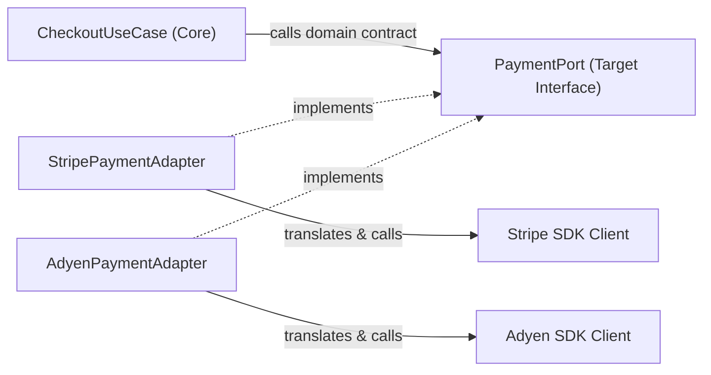
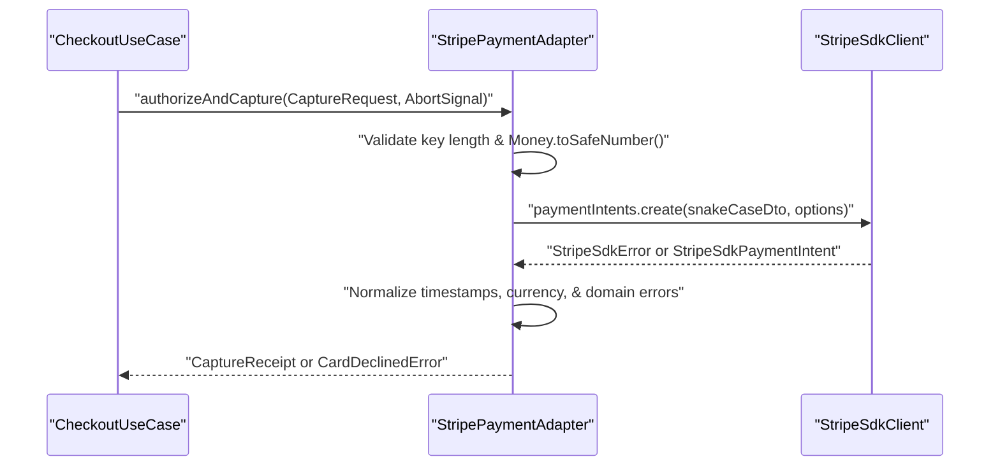

---
tags:
  - software-engineering
  - design-patterns
  - structural
created: 2026-01-02
updated: 2026-11-13
status: 🟢
level: mid-to-senior
category: Structural
---
# Adapter Pattern

> [!abstract] Vault Navigation
> Part of [[Programming/Software Engineering/Design Patterns/Design Patterns Complete Guide|Design Patterns Complete Guide]]. Enforces [[Programming/Software Engineering/SOLID/Dependency Inversion|Dependency Inversion]] across external boundaries, implements Port-to-Driver translation in [[Programming/Software Engineering/Architectural Patterns/Hexagonal Architecture|Hexagonal Architecture]], and serves as the structural enforcement unit of an Anti-Corruption Layer in [[Programming/Software Engineering/DDD/Domain-Driven Design Complete Guide|Domain-Driven Design Complete Guide]].

**Adapter** translates an incompatible external interface, third-party SDK, legacy protocol, or wire payload (**Adaptee**) into a domain-owned **Target Port** contract expected by core business policy. At production scale, an Adapter acts as an **Anti-Corruption Layer (ACL)** boundary: it prevents external vendor schemas, HTTP/SDK error hierarchies, currency representations, timestamp encodings, and execution paradigms from leaking into application use cases.

---

## 1. First-Principles Mechanics & Complete Architecture

### 1.1 Dependency Inversion & Anti-Corruption Layer (ACL) Topology

Without an Adapter, high-level application modules import third-party SDK types directly (`import Stripe from 'stripe'`). Every downstream use case becomes coupled to the vendor's field names (`payment_intent`, `created` Unix seconds), error classes (`StripeCardError`), rate-limit header formats, and breaking major-version releases. Replacing the vendor or running multi-provider failover forces rewrites across domain policies and unit test suites.

By introducing a domain-owned **Target Port** (`PaymentPort`) inside the application core and moving vendor integration behind a concrete **Object Adapter** (`StripePaymentAdapter`, `AdyenPaymentAdapter`) in the outer [[Programming/Software Engineering/Clean Architecture/Interface Adapters & Frameworks|Interface Adapters & Frameworks]] layer, source-code dependencies invert toward the domain:



At runtime, the call stack crosses the boundary cleanly in one direction while data transformation executes at the edge:



### 1.2 The Five Translations of a Production Boundary Adapter

Trivial textbook diagrams only rename methods (`legacyFoo()` to `modernBar()`). Production ACL adapters execute five deterministic translations so domain code operates over pure invariants:

1. **Schema & Semantic Normalization**: Maps vendor naming (`snake_case`, nested `NotificationRequestItem` envelopes, vendor-specific status enums such as `'requires_payment_method'` vs `'Refused'`) to canonical domain types (`PaymentStatus = 'CAPTURED' | 'PENDING' | 'FAILED' | 'REFUNDED'`). Vendor objects never cross out of the adapter return boundary.
2. **Error Model Isolation**: Catches raw transport exceptions (`ECONNRESET`, `FetchError`, HTTP `429`/`502`), vendor SDK error classes (`StripeCardError`), and non-throwing business failure responses (Adyen `resultCode: 'Refused'`) and maps them into a domain error hierarchy (`CardDeclinedError`, `RateLimitedError`, `GatewayUnavailableError`) carrying explicit `retryable: boolean` flags and sanitized `{ cause }` links.
3. **Currency, Date, and Unit Normalization**:
   - **Currency precision**: Enforces integer minor units (`bigint` or safe integer cents) parameterized by ISO-4217 currency exponents (`USD` = $10^{-2}$, `JPY`/`KRW` = $10^0$, `KWD`/`BHD` = $10^{-3}$). Never multiply major-unit IEEE-754 floats by `100` inside domain code (`19.99 * 100 === 1998.9999999999998`).
   - **Timestamps**: Converts Unix epoch seconds (`created: 1794585600`), epoch milliseconds, or RFC-3339 strings (`"2026-11-13T16:00:00Z"`) into UTC `Date` instances at the boundary.
   - **Physical & Financial Units**: Normalizes grams vs kilograms, meters vs feet, or basis points vs percentage floats before values enter domain arithmetic.
4. **Idempotency Token Translation**: Domain callers generate a single deterministic `idempotencyKey` (for example, `checkout:<tenantId>:<orderId>:<attempt>`). Vendors enforce incompatible header constraints: Stripe allows up to 255 characters, while Adyen caps `Idempotency-Key` at 64 characters and rejects certain punctuation. The adapter deterministically hashes or normalizes over-length keys via SHA-256 without mutating the domain caller's key semantics.
5. **Execution Paradigm Bridging**: Adapts Node.js error-first callbacks into `Promise` + `AbortSignal`, offset-paginated REST endpoints into pull-based `AsyncIterable<T>` generators, and vendor-specific webhook HTTP byte streams into cryptographically verified domain events.

### 1.3 Structural Variants: Object Adapter, Class Adapter, Structural Function, and Two-Way Adapter

| Variant | Runtime Mechanism | Dependency Injection & Polymorphism | Primary Trade-Off & Recommendation |
|---|---|---|---|
| **Object Adapter (Default)** | Holds `private readonly adaptee` via composition | Constructor-injected; swaps any subtype or mock implementing `Adaptee` | Preferred across TypeScript, Go, Java, C#, and Python; enforces strict encapsulation |
| **Class Adapter** | Inherits `Adaptee` + implements `Target` | Tightly bound to one concrete parent class at compile time | Requires multiple inheritance (C++/Python); impossible for TypeScript classes and leaks protected `Adaptee` methods |
| **Structural Wrapper Function** | Higher-order function closing over `adaptee` dependencies | Passed as a function type `(req) => Promise<Res>` or factory closure | Zero class boilerplate for single-method ports; less ergonomic when coordinating 3+ methods or lifecycle hooks |
| **Two-Way Adapter** | Implements both `LegacyPortV1` and `ModernPortV2` | Bridges old and new callers during live migrations | Essential temporary bridge during Strangler Fig migrations; doubles validation and state-consistency surface area |

---

## 2. Real-World Use Cases & Decision Matrix

### 2.1 Concrete Engineering Scenarios

1. **Multi-Provider Payment & Webhook Normalization**: A checkout service routes North American transactions through Stripe and EU/APAC transactions through Adyen. Both must conform to a single `PaymentPort` so ledger settlement, retry policies, and webhook ingestion share identical domain logic and contract tests.
2. **Legacy Callback / SOAP / XML Modernization**: An enterprise shipping module must query an aging carrier SDK built on Node.js error-first callbacks and XML-escaped fields. Wrapping the SDK in an Adapter exposes `Promise<RateQuote>` with `AbortSignal` timeout cancellation to modern domain services.
3. **Incremental Strangler Fig Migration (Two-Way Adapter)**: During a 6-month migration from `LegacyInventoryV1` (1-indexed page numbers, mutable arrays) to `InventoryPortV2` (`AsyncIterable`, strict value objects), a Two-Way Adapter allows unmigrated cron jobs and migrated HTTP endpoints to operate concurrently against the single source of truth.
4. **Deterministic In-Memory Test Doubles**: Implementing `InMemoryPaymentAdapter` against `PaymentPort` and running the identical contract test suite against both real-shaped adapters and the in-memory fake eliminates brittle mock setups (`jest.fn()`) inside domain unit tests while guaranteeing behavioral parity.
5. **Cloud Storage & Queue SDK Isolation**: Wrapping AWS S3 `@aws-sdk/client-s3` and GCS `@google-cloud/storage` behind an internal `ObjectStoragePort` prevents vendor pagination tokens (`NextContinuationToken` vs `pageToken`) and stream error codes (`NoSuchKey` vs HTTP `404`) from leaking into media pipelines.

### 2.2 When NOT to Use Adapter

- **Stable 1:1 Internal Collaborators**: If both caller and callee live in the same bounded context and evolve together under the same team's commits, introducing a `Target` interface and `Adapter` class adds indirection with zero decoupling benefit.
- **Cross-Cutting Resilience or Logging**: Adding retries, circuit breaking, caching, or latency histograms around an *already compatible* `PaymentPort` interface is the responsibility of **Decorator** or **Proxy** (see [[Programming/Software Engineering/Design Patterns/Structural Patterns Catalog|Structural Patterns Catalog]]), not Adapter.
- **Multi-Subsystem Orchestration**: Simplifying a sequence of calls across `InventoryService`, `WarehouseRouter`, and `CustomsApi` into a new coarse-grained `shipOrder()` surface is a **Facade**, unless that wrapper is specifically conforming to a pre-existing `ShippingPort` contract.

### 2.3 Adapter vs Related Structural Patterns

| Pattern | Mutates Target Interface? | Typical Cardinality | Runtime Stacking | Primary Axis of Change | Misapplication Anti-Pattern |
|---|---|---|---|---|---|
| **Adapter** | **Yes** (matches existing `Target` contract) | 1 `Target` wrapping 1 `Adaptee` | Fixed boundary layer | External vendor schema, SDK version, or protocol drift | Adding retry loops, caching, or domain business rules inside the translator |
| **Facade** | **Yes** (creates a *new* simplified surface) | 1 `Facade` over $N$ subsystem classes | Single entry point | Subsystem workflow complexity | Turning the Facade into an anemic pass-through or God Class holding business state |
| **Decorator** | **No** (preserves identical interface) | 1-to-1 recursive chain | Arbitrary dynamic stacks | Cross-cutting behavioral composition (logging, retry, tracing) | Mutating semantic contracts or swallowing interface invariants across wrappers |
| **Proxy** | **No** (preserves identical interface) | 1 `Proxy` controlling 1 `Subject` | Usually 1 layer | Access control, lazy initialization, remote stubbing, caching | Leaking remote serialization/cache eviction concerns to callers |
| **Bridge** | **No** (separates Abstraction & Driver) | $M$ abstractions $\times$ $N$ drivers | Configured at composition root | Independent orthogonal evolution of high-level policy and low-level drivers | Prematurely splitting hierarchies when only one axis ever varies |

---

## 3. Step-by-Step Practical Application: Unified Payment & Webhook Adapter Subsystem

This production subsystem normalizes **Stripe** and **Adyen** behind a single domain `PaymentPort`, isolates currency precision and vendor errors, verifies raw webhook HMAC signatures in constant time, and validates parity across `StripePaymentAdapter`, `AdyenPaymentAdapter`, and `InMemoryPaymentAdapter` via a shared Contract Test Suite.

### 3.1 Production Directory Layout

```text
src/
  payments/
    domain/
      money.ts
      errors.ts
      payment-port.ts
    adapters/
      stripe/
        stripe-sdk.types.ts
        stripe-payment.adapter.ts
      adyen/
        adyen-sdk.types.ts
        adyen-payment.adapter.ts
      in-memory/
        in-memory-payment.adapter.ts
test/
  payments/
    payment-port.contract.ts
    payment-adapters.test.ts
```

### 3.2 Domain Value Objects, Error Hierarchy, and Port Contract

Every monetary amount is represented as an integer minor-unit `bigint` bound to an ISO-4217 currency code. Notice how `Money.fromMajorDecimalString` parses decimal strings purely via string padding and `BigInt` concatenation—completely eliminating floating-point rounding drift.

#### `src/payments/domain/money.ts`

```typescript
export type CurrencyCode = 'USD' | 'EUR' | 'GBP' | 'JPY' | 'KRW' | 'KWD' | 'BHD';

const CURRENCY_EXPONENTS: Record<CurrencyCode, number> = {
  USD: 2,
  EUR: 2,
  GBP: 2,
  JPY: 0,
  KRW: 0,
  KWD: 3,
  BHD: 3,
};

export class Money {
  readonly minorUnits: bigint;
  readonly currency: CurrencyCode;

  private constructor(minorUnits: bigint, currency: CurrencyCode) {
    if (minorUnits < 0n) {
      throw new RangeError(`Money minorUnits must be non-negative, received ${minorUnits.toString()}`);
    }
    this.minorUnits = minorUnits;
    this.currency = currency;
  }

  static fromMinorUnits(minorUnits: number | bigint, currency: CurrencyCode): Money {
    const value = typeof minorUnits === 'bigint' ? minorUnits : BigInt(Math.trunc(minorUnits));
    if (typeof minorUnits === 'number' && !Number.isSafeInteger(minorUnits)) {
      throw new RangeError(`Unsafe integer minorUnits: ${minorUnits}`);
    }
    return new Money(value, currency);
  }

  static fromMajorDecimalString(amount: string, currency: CurrencyCode): Money {
    const trimmed = amount.trim();
    if (!/^\d+(?:\.\d+)?$/.test(trimmed)) {
      throw new RangeError(`Invalid decimal money string: "${amount}"`);
    }
    const exponent = CURRENCY_EXPONENTS[currency];
    const [wholePart = '0', fracPart = ''] = trimmed.split('.');
    if (fracPart.length > exponent) {
      throw new RangeError(
        `Precision overflow for ${currency} (max ${exponent} fractional digits): "${amount}"`,
      );
    }
    const paddedFrac = fracPart.padEnd(exponent, '0');
    const minor = BigInt(`${wholePart}${paddedFrac}`);
    return new Money(minor, currency);
  }

  toMajorDecimalString(): string {
    const exponent = CURRENCY_EXPONENTS[this.currency];
    if (exponent === 0) {
      return this.minorUnits.toString();
    }
    const raw = this.minorUnits.toString().padStart(exponent + 1, '0');
    const splitIdx = raw.length - exponent;
    return `${raw.slice(0, splitIdx)}.${raw.slice(splitIdx)}`;
  }

  toSafeNumber(): number {
    if (this.minorUnits > BigInt(Number.MAX_SAFE_INTEGER)) {
      throw new RangeError(`Money minorUnits exceeds MAX_SAFE_INTEGER: ${this.minorUnits.toString()}`);
    }
    return Number(this.minorUnits);
  }

  equals(other: Money): boolean {
    return this.currency === other.currency && this.minorUnits === other.minorUnits;
  }
}

export function getCurrencyExponent(currency: CurrencyCode): number {
  return CURRENCY_EXPONENTS[currency];
}
```

#### `src/payments/domain/errors.ts`

```typescript
export type PaymentProvider = 'stripe' | 'adyen' | 'in-memory';

export type PaymentErrorCode =
  | 'CARD_DECLINED'
  | 'INSUFFICIENT_FUNDS'
  | 'RATE_LIMITED'
  | 'IDEMPOTENCY_CONFLICT'
  | 'GATEWAY_UNAVAILABLE'
  | 'GATEWAY_TIMEOUT'
  | 'INVALID_WEBHOOK_SIGNATURE'
  | 'MALFORMED_GATEWAY_RESPONSE'
  | 'REQUEST_CANCELLED';

export interface PaymentErrorDetails {
  readonly code: PaymentErrorCode;
  readonly provider: PaymentProvider;
  readonly retryable: boolean;
  readonly providerCode?: string;
  readonly cause?: unknown;
}

export class PaymentDomainError extends Error {
  readonly code: PaymentErrorCode;
  readonly provider: PaymentProvider;
  readonly retryable: boolean;
  readonly providerCode: string | undefined;

  constructor(message: string, details: PaymentErrorDetails) {
    super(message, details.cause !== undefined ? { cause: details.cause } : undefined);
    this.name = new.target.name;
    this.code = details.code;
    this.provider = details.provider;
    this.retryable = details.retryable;
    this.providerCode = details.providerCode;
  }
}

export class CardDeclinedError extends PaymentDomainError {
  constructor(
    message: string,
    provider: PaymentProvider,
    options?: { readonly insufficientFunds?: boolean; readonly providerCode?: string; readonly cause?: unknown },
  ) {
    const details: PaymentErrorDetails = {
      code: options?.insufficientFunds ? 'INSUFFICIENT_FUNDS' : 'CARD_DECLINED',
      provider,
      retryable: false,
      ...(options?.providerCode !== undefined ? { providerCode: options.providerCode } : {}),
      ...(options?.cause !== undefined ? { cause: options.cause } : {}),
    };
    super(message, details);
  }
}

export class RateLimitedError extends PaymentDomainError {
  readonly retryAfterMs: number;

  constructor(
    provider: PaymentProvider,
    retryAfterMs: number,
    options?: { readonly providerCode?: string; readonly cause?: unknown },
  ) {
    super(`Payment provider ${provider} rate limit exceeded; retry after ${retryAfterMs}ms`, {
      code: 'RATE_LIMITED',
      provider,
      retryable: true,
      ...(options?.providerCode !== undefined ? { providerCode: options.providerCode } : {}),
      ...(options?.cause !== undefined ? { cause: options.cause } : {}),
    });
    this.retryAfterMs = retryAfterMs;
  }
}

export class IdempotencyConflictError extends PaymentDomainError {
  constructor(provider: PaymentProvider, idempotencyKey: string, cause?: unknown) {
    super(`Idempotency key "${idempotencyKey}" reused with different request parameters`, {
      code: 'IDEMPOTENCY_CONFLICT',
      provider,
      retryable: false,
      ...(cause !== undefined ? { cause } : {}),
    });
  }
}

export class GatewayUnavailableError extends PaymentDomainError {
  constructor(
    message: string,
    provider: PaymentProvider,
    options?: { readonly timeout?: boolean; readonly providerCode?: string; readonly cause?: unknown },
  ) {
    super(message, {
      code: options?.timeout ? 'GATEWAY_TIMEOUT' : 'GATEWAY_UNAVAILABLE',
      provider,
      retryable: true,
      ...(options?.providerCode !== undefined ? { providerCode: options.providerCode } : {}),
      ...(options?.cause !== undefined ? { cause: options.cause } : {}),
    });
  }
}

export class InvalidWebhookSignatureError extends PaymentDomainError {
  constructor(provider: PaymentProvider, reason: string, cause?: unknown) {
    super(`Invalid ${provider} webhook signature: ${reason}`, {
      code: 'INVALID_WEBHOOK_SIGNATURE',
      provider,
      retryable: false,
      ...(cause !== undefined ? { cause } : {}),
    });
  }
}

export class MalformedGatewayResponseError extends PaymentDomainError {
  constructor(provider: PaymentProvider, reason: string, cause?: unknown) {
    super(`Malformed response from ${provider}: ${reason}`, {
      code: 'MALFORMED_GATEWAY_RESPONSE',
      provider,
      retryable: false,
      ...(cause !== undefined ? { cause } : {}),
    });
  }
}

export class PaymentRequestCancelledError extends PaymentDomainError {
  constructor(provider: PaymentProvider, cause?: unknown) {
    super(`Payment request to ${provider} was aborted by caller`, {
      code: 'REQUEST_CANCELLED',
      provider,
      retryable: false,
      ...(cause !== undefined ? { cause } : {}),
    });
  }
}
```

#### `src/payments/domain/payment-port.ts`

```typescript
import type { Money } from './money.ts';
import type { PaymentProvider } from './errors.ts';

export type PaymentStatus = 'CAPTURED' | 'PENDING' | 'FAILED' | 'REFUNDED';

export interface CaptureRequest {
  readonly orderId: string;
  readonly amount: Money;
  readonly paymentMethodToken: string;
  readonly idempotencyKey: string;
  readonly customerEmail?: string;
}

export interface CaptureReceipt {
  readonly provider: PaymentProvider;
  readonly transactionId: string;
  readonly orderId: string;
  readonly status: PaymentStatus;
  readonly capturedAmount: Money;
  readonly occurredAt: Date;
}

export interface RefundRequest {
  readonly transactionId: string;
  readonly amount: Money;
  readonly idempotencyKey: string;
  readonly reason: 'CUSTOMER_REQUEST' | 'DUPLICATE' | 'FRAUD';
}

export interface RefundReceipt {
  readonly provider: PaymentProvider;
  readonly refundId: string;
  readonly transactionId: string;
  readonly refundedAmount: Money;
  readonly status: 'SUCCEEDED' | 'PENDING';
  readonly occurredAt: Date;
}

export type WebhookEventType = 'PAYMENT_CAPTURED' | 'PAYMENT_FAILED' | 'REFUND_SETTLED';

export interface VerifiedWebhookEvent {
  readonly provider: PaymentProvider;
  readonly eventId: string;
  readonly eventType: WebhookEventType;
  readonly transactionId: string;
  readonly orderId: string;
  readonly amount: Money;
  readonly occurredAt: Date;
}

export type WebhookHeaders = Readonly<Record<string, string | undefined>>;

export interface PaymentPort {
  readonly provider: PaymentProvider;
  authorizeAndCapture(request: CaptureRequest, signal?: AbortSignal): Promise<CaptureReceipt>;
  refund(request: RefundRequest, signal?: AbortSignal): Promise<RefundReceipt>;
  parseAndVerifyWebhook(rawBody: Uint8Array, headers: WebhookHeaders): Promise<VerifiedWebhookEvent>;
}
```

### 3.3 Stripe Object Adapter & Webhook Verifier

Stripe expects lowercase ISO currencies (`'usd'`), Unix epoch **seconds** (`created`), `StripeCardError`/`StripeRateLimitError`/`StripeIdempotencyError` exception shapes, and `Stripe-Signature: t=<unix_sec>,v1=<hmac_hex>` computed over `${timestamp}.${rawBodyUtf8}`.

#### `src/payments/adapters/stripe/stripe-sdk.types.ts`

```typescript
export interface StripeSdkPaymentIntent {
  readonly id: string;
  readonly amount: number;
  readonly currency: string;
  readonly status: 'succeeded' | 'processing' | 'requires_payment_method' | 'canceled';
  readonly created: number;
  readonly metadata: Readonly<Record<string, string>>;
}

export interface StripeSdkRefund {
  readonly id: string;
  readonly payment_intent: string;
  readonly amount: number;
  readonly currency: string;
  readonly status: 'succeeded' | 'pending' | 'failed';
  readonly created: number;
}

export interface StripeSdkErrorShape {
  readonly type:
    | 'StripeCardError'
    | 'StripeRateLimitError'
    | 'StripeIdempotencyError'
    | 'StripeAPIError'
    | 'StripeConnectionError';
  readonly message: string;
  readonly code?: string;
  readonly decline_code?: string;
  readonly headers?: Readonly<Record<string, string>>;
}

export interface StripeSdkClient {
  paymentIntents: {
    create(
      params: {
        amount: number;
        currency: string;
        payment_method: string;
        confirm: true;
        metadata: Record<string, string>;
        receipt_email?: string;
      },
      options: { idempotencyKey: string; signal?: AbortSignal },
    ): Promise<StripeSdkPaymentIntent>;
  };
  refunds: {
    create(
      params: {
        payment_intent: string;
        amount: number;
        reason: 'requested_by_customer' | 'duplicate' | 'fraudulent';
      },
      options: { idempotencyKey: string; signal?: AbortSignal },
    ): Promise<StripeSdkRefund>;
  };
}

export interface StripeWebhookPayload {
  readonly id: string;
  readonly type: 'payment_intent.succeeded' | 'payment_intent.payment_failed' | 'charge.refunded';
  readonly created: number;
  readonly data: {
    readonly object: {
      readonly id: string;
      readonly amount: number;
      readonly currency: string;
      readonly metadata?: Readonly<Record<string, string>>;
      readonly payment_intent?: string;
    };
  };
}
```

#### `src/payments/adapters/stripe/stripe-payment.adapter.ts`

```typescript
import { createHash, createHmac, timingSafeEqual } from 'node:crypto';
import { Money, type CurrencyCode } from '../../domain/money.ts';
import {
  CardDeclinedError,
  GatewayUnavailableError,
  IdempotencyConflictError,
  InvalidWebhookSignatureError,
  MalformedGatewayResponseError,
  PaymentDomainError,
  PaymentRequestCancelledError,
  RateLimitedError,
} from '../../domain/errors.ts';
import type {
  CaptureReceipt,
  CaptureRequest,
  PaymentPort,
  PaymentStatus,
  RefundReceipt,
  RefundRequest,
  VerifiedWebhookEvent,
  WebhookEventType,
  WebhookHeaders,
} from '../../domain/payment-port.ts';
import type {
  StripeSdkClient,
  StripeSdkErrorShape,
  StripeWebhookPayload,
} from './stripe-sdk.types.ts';

const VALID_CURRENCIES: ReadonlySet<string> = new Set(['USD', 'EUR', 'GBP', 'JPY', 'KRW', 'KWD', 'BHD']);

export interface StripeAdapterConfig {
  readonly webhookSecret: string;
  readonly webhookToleranceSeconds?: number;
  readonly nowSeconds?: () => number;
}

export class StripePaymentAdapter implements PaymentPort {
  readonly provider = 'stripe' as const;
  private readonly sdk: StripeSdkClient;
  private readonly webhookSecret: string;
  private readonly webhookToleranceSeconds: number;
  private readonly nowSeconds: () => number;

  constructor(sdk: StripeSdkClient, config: StripeAdapterConfig) {
    this.sdk = sdk;
    this.webhookSecret = config.webhookSecret;
    this.webhookToleranceSeconds = config.webhookToleranceSeconds ?? 300;
    this.nowSeconds = config.nowSeconds ?? (() => Math.floor(Date.now() / 1000));
  }

  async authorizeAndCapture(request: CaptureRequest, signal?: AbortSignal): Promise<CaptureReceipt> {
    if (signal?.aborted) {
      throw new PaymentRequestCancelledError(this.provider, signal.reason);
    }
    const idempotencyKey = normalizeKey(request.idempotencyKey, 255);
    try {
      const intent = await this.sdk.paymentIntents.create(
        {
          amount: request.amount.toSafeNumber(),
          currency: request.amount.currency.toLowerCase(),
          payment_method: request.paymentMethodToken,
          confirm: true,
          metadata: { orderId: request.orderId },
          ...(request.customerEmail !== undefined ? { receipt_email: request.customerEmail } : {}),
        },
        { idempotencyKey, ...(signal !== undefined ? { signal } : {}) },
      );
      return {
        provider: this.provider,
        transactionId: intent.id,
        orderId: intent.metadata['orderId'] ?? request.orderId,
        status: mapStripeStatus(intent.status),
        capturedAmount: Money.fromMinorUnits(intent.amount, parseCurrency(intent.currency, 'stripe')),
        occurredAt: new Date(intent.created * 1000),
      };
    } catch (err) {
      throw this.translateError(err, idempotencyKey, signal);
    }
  }

  async refund(request: RefundRequest, signal?: AbortSignal): Promise<RefundReceipt> {
    if (signal?.aborted) {
      throw new PaymentRequestCancelledError(this.provider, signal.reason);
    }
    const idempotencyKey = normalizeKey(request.idempotencyKey, 255);
    const reasonMap: Record<RefundRequest['reason'], 'requested_by_customer' | 'duplicate' | 'fraudulent'> = {
      CUSTOMER_REQUEST: 'requested_by_customer',
      DUPLICATE: 'duplicate',
      FRAUD: 'fraudulent',
    };
    try {
      const res = await this.sdk.refunds.create(
        {
          payment_intent: request.transactionId,
          amount: request.amount.toSafeNumber(),
          reason: reasonMap[request.reason],
        },
        { idempotencyKey, ...(signal !== undefined ? { signal } : {}) },
      );
      if (res.status === 'failed') {
        throw new GatewayUnavailableError('Stripe refund returned failed status', this.provider);
      }
      return {
        provider: this.provider,
        refundId: res.id,
        transactionId: res.payment_intent,
        refundedAmount: Money.fromMinorUnits(res.amount, parseCurrency(res.currency, 'stripe')),
        status: res.status === 'succeeded' ? 'SUCCEEDED' : 'PENDING',
        occurredAt: new Date(res.created * 1000),
      };
    } catch (err) {
      throw this.translateError(err, idempotencyKey, signal);
    }
  }

  async parseAndVerifyWebhook(rawBody: Uint8Array, headers: WebhookHeaders): Promise<VerifiedWebhookEvent> {
    const headerVal = readHeaderCaseInsensitive(headers, 'stripe-signature');
    if (!headerVal) {
      throw new InvalidWebhookSignatureError(this.provider, 'Missing stripe-signature header');
    }

    const parts = headerVal.split(',').map((s) => s.trim());
    const timestampStr = parts.find((p) => p.startsWith('t='))?.slice(2);
    const v1Signatures = parts.filter((p) => p.startsWith('v1=')).map((p) => p.slice(3));

    if (!timestampStr || v1Signatures.length === 0) {
      throw new InvalidWebhookSignatureError(this.provider, 'Malformed stripe-signature header');
    }

    const timestampSec = Number(timestampStr);
    if (!Number.isFinite(timestampSec)) {
      throw new InvalidWebhookSignatureError(this.provider, 'Non-numeric webhook timestamp');
    }

    const ageSec = Math.abs(this.nowSeconds() - timestampSec);
    if (ageSec > this.webhookToleranceSeconds) {
      throw new InvalidWebhookSignatureError(this.provider, `Timestamp outside tolerance (${ageSec}s)`);
    }

    const payloadText = new TextDecoder().decode(rawBody);
    const expectedHex = createHmac('sha256', this.webhookSecret)
      .update(`${timestampStr}.${payloadText}`, 'utf8')
      .digest('hex');

    const expectedBuf = Buffer.from(expectedHex, 'hex');
    const matched = v1Signatures.some((sig) => {
      if (!/^[0-9a-f]+$/i.test(sig) || sig.length !== expectedHex.length) {
        return false;
      }
      return timingSafeEqual(expectedBuf, Buffer.from(sig, 'hex'));
    });

    if (!matched) {
      throw new InvalidWebhookSignatureError(this.provider, 'HMAC-SHA256 digest mismatch');
    }

    let parsed: StripeWebhookPayload;
    try {
      parsed = JSON.parse(payloadText) as StripeWebhookPayload;
    } catch (err) {
      throw new MalformedGatewayResponseError(this.provider, 'Invalid JSON webhook body', err);
    }

    const obj = parsed.data?.object;
    if (!obj || typeof obj.id !== 'string' || typeof obj.amount !== 'number' || typeof obj.currency !== 'string') {
      throw new MalformedGatewayResponseError(this.provider, 'Missing required webhook data.object fields');
    }

    const eventMap: Record<StripeWebhookPayload['type'], WebhookEventType> = {
      'payment_intent.succeeded': 'PAYMENT_CAPTURED',
      'payment_intent.payment_failed': 'PAYMENT_FAILED',
      'charge.refunded': 'REFUND_SETTLED',
    };

    const eventType = eventMap[parsed.type];
    if (!eventType) {
      throw new MalformedGatewayResponseError(this.provider, `Unsupported Stripe event type: ${String(parsed.type)}`);
    }

    return {
      provider: this.provider,
      eventId: parsed.id,
      eventType,
      transactionId: obj.payment_intent ?? obj.id,
      orderId: obj.metadata?.['orderId'] ?? 'unknown',
      amount: Money.fromMinorUnits(obj.amount, parseCurrency(obj.currency, 'stripe')),
      occurredAt: new Date(parsed.created * 1000),
    };
  }

  private translateError(err: unknown, idempotencyKey: string, signal?: AbortSignal): Error {
    if (err instanceof PaymentDomainError) return err;
    if (signal?.aborted) {
      return new PaymentRequestCancelledError(this.provider, err);
    }
    if (isStripeSdkError(err)) {
      if (err.type === 'StripeCardError') {
        const insufficient = err.decline_code === 'insufficient_funds' || err.code === 'insufficient_funds';
        return new CardDeclinedError(err.message, this.provider, {
          insufficientFunds: insufficient,
          ...(err.decline_code ?? err.code ? { providerCode: err.decline_code ?? err.code } : {}),
          cause: err,
        });
      }
      if (err.type === 'StripeRateLimitError') {
        const retryHeader = err.headers?.['retry-after'];
        const retryMs = retryHeader && Number.isFinite(Number(retryHeader)) ? Number(retryHeader) * 1000 : 1_000;
        return new RateLimitedError(this.provider, retryMs, {
          ...(err.code ? { providerCode: err.code } : {}),
          cause: err,
        });
      }
      if (err.type === 'StripeIdempotencyError') {
        return new IdempotencyConflictError(this.provider, idempotencyKey, err);
      }
      if (err.type === 'StripeConnectionError' || err.type === 'StripeAPIError') {
        return new GatewayUnavailableError(err.message, this.provider, {
          ...(err.code ? { providerCode: err.code } : {}),
          cause: err,
        });
      }
    }
    return new GatewayUnavailableError('Unexpected Stripe transport failure', this.provider, { cause: err });
  }
}

function mapStripeStatus(status: 'succeeded' | 'processing' | 'requires_payment_method' | 'canceled'): PaymentStatus {
  switch (status) {
    case 'succeeded':
      return 'CAPTURED';
    case 'processing':
      return 'PENDING';
    case 'requires_payment_method':
    case 'canceled':
      return 'FAILED';
  }
}

function parseCurrency(raw: string, provider: 'stripe' | 'adyen'): CurrencyCode {
  const upper = raw.toUpperCase();
  if (!VALID_CURRENCIES.has(upper)) {
    throw new MalformedGatewayResponseError(provider, `Unsupported currency "${raw}"`);
  }
  return upper as CurrencyCode;
}

function normalizeKey(key: string, maxLen: number): string {
  if (key.length <= maxLen) return key;
  return createHash('sha256').update(key).digest('hex').slice(0, maxLen);
}

function readHeaderCaseInsensitive(headers: WebhookHeaders, target: string): string | undefined {
  const lower = target.toLowerCase();
  for (const [k, v] of Object.entries(headers)) {
    if (k.toLowerCase() === lower) return v;
  }
  return undefined;
}

function isStripeSdkError(err: unknown): err is StripeSdkErrorShape {
  return (
    typeof err === 'object' &&
    err !== null &&
    'type' in err &&
    typeof (err as { type: unknown }).type === 'string' &&
    (err as { type: string }).type.startsWith('Stripe')
  );
}
```

### 3.4 Adyen Object Adapter & Canonical HMAC Signing String

Unlike Stripe, Adyen enforces a 64-character `Idempotency-Key` cap, returns `resultCode: 'Refused'` as an HTTP 200 JSON payload rather than throwing an SDK exception, formats dates as ISO-8601 strings, and signs webhooks inside `NotificationRequestItem.additionalData.hmacSignature` over an escaped colon-delimited canonical payload string.

#### `src/payments/adapters/adyen/adyen-sdk.types.ts`

```typescript
export interface AdyenAmount {
  readonly currency: string;
  readonly value: number;
}

export interface AdyenPaymentResponse {
  readonly pspReference: string;
  readonly resultCode: 'Authorised' | 'Refused' | 'Pending' | 'Error';
  readonly merchantReference: string;
  readonly amount: AdyenAmount;
  readonly refusalReason?: string;
  readonly refusalReasonCode?: string;
  readonly bookingDate: string;
}

export interface AdyenRefundResponse {
  readonly pspReference: string;
  readonly paymentPspReference: string;
  readonly status: 'received';
  readonly amount: AdyenAmount;
  readonly merchantAccount: string;
  readonly createdAt: string;
}

export interface AdyenHttpErrorShape {
  readonly statusCode: number;
  readonly errorCode: string;
  readonly message: string;
  readonly headers?: Readonly<Record<string, string>>;
}

export interface AdyenSdkClient {
  payments(
    request: {
      merchantAccount: string;
      reference: string;
      amount: AdyenAmount;
      paymentMethod: { type: 'scheme'; encryptedCardNumber: string };
      shopperEmail?: string;
    },
    options: { idempotencyKey: string; signal?: AbortSignal },
  ): Promise<AdyenPaymentResponse>;
  refunds(
    paymentPspReference: string,
    request: {
      merchantAccount: string;
      reference: string;
      amount: AdyenAmount;
    },
    options: { idempotencyKey: string; signal?: AbortSignal },
  ): Promise<AdyenRefundResponse>;
}

export interface AdyenNotificationItem {
  readonly pspReference: string;
  readonly originalReference?: string;
  readonly merchantAccountCode: string;
  readonly merchantReference: string;
  readonly amount: AdyenAmount;
  readonly eventCode: 'AUTHORISATION' | 'REFUND' | 'CANCELLATION';
  readonly success: 'true' | 'false';
  readonly eventDate: string;
  readonly additionalData: {
    readonly hmacSignature: string;
  };
}

export interface AdyenWebhookEnvelope {
  readonly live: 'true' | 'false';
  readonly notificationItems: ReadonlyArray<{
    readonly NotificationRequestItem: AdyenNotificationItem;
  }>;
}
```

#### `src/payments/adapters/adyen/adyen-payment.adapter.ts`

```typescript
import { createHash, createHmac, timingSafeEqual } from 'node:crypto';
import { Money, type CurrencyCode } from '../../domain/money.ts';
import {
  CardDeclinedError,
  GatewayUnavailableError,
  IdempotencyConflictError,
  InvalidWebhookSignatureError,
  MalformedGatewayResponseError,
  PaymentDomainError,
  PaymentRequestCancelledError,
  RateLimitedError,
} from '../../domain/errors.ts';
import type {
  CaptureReceipt,
  CaptureRequest,
  PaymentPort,
  RefundReceipt,
  RefundRequest,
  VerifiedWebhookEvent,
  WebhookHeaders,
} from '../../domain/payment-port.ts';
import type {
  AdyenHttpErrorShape,
  AdyenNotificationItem,
  AdyenSdkClient,
  AdyenWebhookEnvelope,
} from './adyen-sdk.types.ts';

const VALID_CURRENCIES: ReadonlySet<string> = new Set(['USD', 'EUR', 'GBP', 'JPY', 'KRW', 'KWD', 'BHD']);

export interface AdyenAdapterConfig {
  readonly merchantAccount: string;
  readonly webhookHmacKeyHex: string;
}

export class AdyenPaymentAdapter implements PaymentPort {
  readonly provider = 'adyen' as const;
  private readonly sdk: AdyenSdkClient;
  private readonly merchantAccount: string;
  private readonly webhookHmacKey: Uint8Array;

  constructor(sdk: AdyenSdkClient, config: AdyenAdapterConfig) {
    this.sdk = sdk;
    this.merchantAccount = config.merchantAccount;
    this.webhookHmacKey = Buffer.from(config.webhookHmacKeyHex, 'hex');
  }

  async authorizeAndCapture(request: CaptureRequest, signal?: AbortSignal): Promise<CaptureReceipt> {
    if (signal?.aborted) {
      throw new PaymentRequestCancelledError(this.provider, signal.reason);
    }
    // Adyen enforces a 64-character ceiling on Idempotency-Key headers.
    const idempotencyKey = compressKey(request.idempotencyKey, 64);

    try {
      const res = await this.sdk.payments(
        {
          merchantAccount: this.merchantAccount,
          reference: request.orderId,
          amount: {
            currency: request.amount.currency,
            value: request.amount.toSafeNumber(),
          },
          paymentMethod: {
            type: 'scheme',
            encryptedCardNumber: request.paymentMethodToken,
          },
          ...(request.customerEmail !== undefined ? { shopperEmail: request.customerEmail } : {}),
        },
        { idempotencyKey, ...(signal !== undefined ? { signal } : {}) },
      );

      if (res.resultCode === 'Refused') {
        const insufficient = res.refusalReasonCode === '12' || res.refusalReason === 'Not enough balance';
        throw new CardDeclinedError(res.refusalReason ?? 'Transaction refused by Adyen', this.provider, {
          insufficientFunds: insufficient,
          ...(res.refusalReasonCode !== undefined ? { providerCode: res.refusalReasonCode } : {}),
        });
      }

      if (res.resultCode === 'Error') {
        throw new GatewayUnavailableError('Adyen returned processing Error resultCode', this.provider);
      }

      return {
        provider: this.provider,
        transactionId: res.pspReference,
        orderId: res.merchantReference,
        status: res.resultCode === 'Authorised' ? 'CAPTURED' : 'PENDING',
        capturedAmount: Money.fromMinorUnits(res.amount.value, parseCurrency(res.amount.currency)),
        occurredAt: new Date(res.bookingDate),
      };
    } catch (err) {
      throw this.translateError(err, idempotencyKey, signal);
    }
  }

  async refund(request: RefundRequest, signal?: AbortSignal): Promise<RefundReceipt> {
    if (signal?.aborted) {
      throw new PaymentRequestCancelledError(this.provider, signal.reason);
    }
    const idempotencyKey = compressKey(request.idempotencyKey, 64);

    try {
      const res = await this.sdk.refunds(
        request.transactionId,
        {
          merchantAccount: this.merchantAccount,
          reference: `refund-${idempotencyKey.slice(0, 24)}`,
          amount: {
            currency: request.amount.currency,
            value: request.amount.toSafeNumber(),
          },
        },
        { idempotencyKey, ...(signal !== undefined ? { signal } : {}) },
      );

      return {
        provider: this.provider,
        refundId: res.pspReference,
        transactionId: res.paymentPspReference,
        refundedAmount: Money.fromMinorUnits(res.amount.value, parseCurrency(res.amount.currency)),
        status: 'PENDING',
        occurredAt: new Date(res.createdAt),
      };
    } catch (err) {
      throw this.translateError(err, idempotencyKey, signal);
    }
  }

  async parseAndVerifyWebhook(rawBody: Uint8Array, _headers: WebhookHeaders): Promise<VerifiedWebhookEvent> {
    let envelope: AdyenWebhookEnvelope;
    try {
      envelope = JSON.parse(new TextDecoder().decode(rawBody)) as AdyenWebhookEnvelope;
    } catch (err) {
      throw new MalformedGatewayResponseError(this.provider, 'Invalid JSON webhook body', err);
    }

    const item = envelope.notificationItems?.[0]?.NotificationRequestItem;
    if (!item || !item.additionalData?.hmacSignature) {
      throw new InvalidWebhookSignatureError(this.provider, 'Missing NotificationRequestItem or hmacSignature');
    }

    const signingString = buildAdyenSigningString(item);
    const expectedBase64 = createHmac('sha256', this.webhookHmacKey).update(signingString, 'utf8').digest('base64');

    const expectedBuf = Buffer.from(expectedBase64, 'utf8');
    const actualBuf = Buffer.from(item.additionalData.hmacSignature, 'utf8');

    if (expectedBuf.length !== actualBuf.length || !timingSafeEqual(expectedBuf, actualBuf)) {
      throw new InvalidWebhookSignatureError(this.provider, 'Adyen HMAC signature mismatch');
    }

    let eventType: VerifiedWebhookEvent['eventType'];
    if (item.eventCode === 'AUTHORISATION') {
      eventType = item.success === 'true' ? 'PAYMENT_CAPTURED' : 'PAYMENT_FAILED';
    } else if (item.eventCode === 'REFUND' && item.success === 'true') {
      eventType = 'REFUND_SETTLED';
    } else {
      throw new MalformedGatewayResponseError(
        this.provider,
        `Unsupported Adyen event ${item.eventCode} (success=${item.success})`,
      );
    }

    return {
      provider: this.provider,
      eventId: `${item.pspReference}:${item.eventCode}`,
      eventType,
      transactionId: item.originalReference || item.pspReference,
      orderId: item.merchantReference,
      amount: Money.fromMinorUnits(item.amount.value, parseCurrency(item.amount.currency)),
      occurredAt: new Date(item.eventDate),
    };
  }

  private translateError(err: unknown, idempotencyKey: string, signal?: AbortSignal): Error {
    if (err instanceof PaymentDomainError) {
      return err;
    }
    if (signal?.aborted) {
      return new PaymentRequestCancelledError(this.provider, err);
    }
    if (isAdyenHttpError(err)) {
      if (err.statusCode === 429) {
        const retryAfter = Number(err.headers?.['retry-after'] ?? '1');
        return new RateLimitedError(this.provider, (Number.isFinite(retryAfter) ? retryAfter : 1) * 1000, {
          providerCode: err.errorCode,
          cause: err,
        });
      }
      if (err.statusCode === 422 && err.errorCode === '14_025') {
        return new IdempotencyConflictError(this.provider, idempotencyKey, err);
      }
      if (err.statusCode >= 500 || err.statusCode === 408) {
        return new GatewayUnavailableError(err.message, this.provider, {
          timeout: err.statusCode === 408,
          providerCode: err.errorCode,
          cause: err,
        });
      }
    }
    return new GatewayUnavailableError('Unexpected Adyen transport failure', this.provider, { cause: err });
  }
}

export function buildAdyenSigningString(item: AdyenNotificationItem): string {
  const escapeField = (val: string | number | undefined): string =>
    String(val ?? '').replace(/\\/g, '\\\\').replace(/:/g, '\\:');

  return [
    escapeField(item.pspReference),
    escapeField(item.originalReference ?? ''),
    escapeField(item.merchantAccountCode),
    escapeField(item.merchantReference),
    escapeField(item.amount.value),
    escapeField(item.amount.currency),
    escapeField(item.eventCode),
    escapeField(item.success),
  ].join(':');
}

function parseCurrency(raw: string): CurrencyCode {
  const upper = raw.toUpperCase();
  if (!VALID_CURRENCIES.has(upper)) {
    throw new MalformedGatewayResponseError('adyen', `Unsupported currency "${raw}"`);
  }
  return upper as CurrencyCode;
}

function compressKey(key: string, maxLen: number): string {
  if (key.length <= maxLen) return key;
  return createHash('sha256').update(key).digest('hex').slice(0, maxLen);
}

function isAdyenHttpError(err: unknown): err is AdyenHttpErrorShape {
  return (
    typeof err === 'object' &&
    err !== null &&
    'statusCode' in err &&
    typeof (err as { statusCode: unknown }).statusCode === 'number' &&
    'errorCode' in err
  );
}
```

### 3.5 Deterministic In-Memory Fake Adapter

An in-memory fake implementing `PaymentPort` lets checkout and billing use cases run full integration tests at sub-millisecond speed without mocking framework fragility.

#### `src/payments/adapters/in-memory/in-memory-payment.adapter.ts`

```typescript
import { createHmac, timingSafeEqual } from 'node:crypto';
import { Money, type CurrencyCode } from '../../domain/money.ts';
import {
  CardDeclinedError,
  GatewayUnavailableError,
  IdempotencyConflictError,
  InvalidWebhookSignatureError,
  PaymentRequestCancelledError,
  RateLimitedError,
} from '../../domain/errors.ts';
import type {
  CaptureReceipt,
  CaptureRequest,
  PaymentPort,
  RefundReceipt,
  RefundRequest,
  VerifiedWebhookEvent,
  WebhookHeaders,
} from '../../domain/payment-port.ts';

interface StoredCapture {
  readonly fingerprint: string;
  readonly receipt: CaptureReceipt;
}

export class InMemoryPaymentAdapter implements PaymentPort {
  readonly provider = 'in-memory' as const;
  private readonly capturesByKey = new Map<string, StoredCapture>();
  private readonly webhookSecret: string;
  private sequence = 0;

  constructor(webhookSecret = 'inmem_test_secret') {
    this.webhookSecret = webhookSecret;
  }

  async authorizeAndCapture(request: CaptureRequest, signal?: AbortSignal): Promise<CaptureReceipt> {
    if (signal?.aborted) {
      throw new PaymentRequestCancelledError(this.provider, signal.reason);
    }
    const fingerprint = `${request.orderId}:${request.amount.currency}:${request.amount.minorUnits.toString()}`;
    const existing = this.capturesByKey.get(request.idempotencyKey);
    if (existing) {
      if (existing.fingerprint !== fingerprint) {
        throw new IdempotencyConflictError(this.provider, request.idempotencyKey);
      }
      return existing.receipt;
    }

    if (request.paymentMethodToken === 'tok_decline_funds') {
      throw new CardDeclinedError('Insufficient funds', this.provider, {
        insufficientFunds: true,
        providerCode: 'insufficient_funds',
      });
    }
    if (request.paymentMethodToken === 'tok_rate_limit') {
      throw new RateLimitedError(this.provider, 2000, { providerCode: 'rate_limit' });
    }
    if (request.paymentMethodToken === 'tok_gateway_down') {
      throw new GatewayUnavailableError('Upstream gateway unreachable', this.provider);
    }

    this.sequence += 1;
    const receipt: CaptureReceipt = {
      provider: this.provider,
      transactionId: `mem_tx_${this.sequence}`,
      orderId: request.orderId,
      status: 'CAPTURED',
      capturedAmount: request.amount,
      occurredAt: new Date('2026-11-13T12:00:00.000Z'),
    };
    this.capturesByKey.set(request.idempotencyKey, { fingerprint, receipt });
    return receipt;
  }

  async refund(request: RefundRequest, signal?: AbortSignal): Promise<RefundReceipt> {
    if (signal?.aborted) {
      throw new PaymentRequestCancelledError(this.provider, signal.reason);
    }
    this.sequence += 1;
    return {
      provider: this.provider,
      refundId: `mem_re_${this.sequence}`,
      transactionId: request.transactionId,
      refundedAmount: request.amount,
      status: 'SUCCEEDED',
      occurredAt: new Date('2026-11-13T12:05:00.000Z'),
    };
  }

  signTestWebhook(
    event: Omit<VerifiedWebhookEvent, 'provider' | 'amount'> & { amountMinor: number; currency: CurrencyCode },
  ): { rawBody: Uint8Array; headers: WebhookHeaders } {
    const json = JSON.stringify(event);
    const sig = createHmac('sha256', this.webhookSecret).update(json, 'utf8').digest('hex');
    return {
      rawBody: new TextEncoder().encode(json),
      headers: { 'x-inmem-signature': sig },
    };
  }

  async parseAndVerifyWebhook(rawBody: Uint8Array, headers: WebhookHeaders): Promise<VerifiedWebhookEvent> {
    const sig = headers['x-inmem-signature'];
    if (!sig) {
      throw new InvalidWebhookSignatureError(this.provider, 'Missing x-inmem-signature header');
    }
    const text = new TextDecoder().decode(rawBody);
    const expected = createHmac('sha256', this.webhookSecret).update(text, 'utf8').digest('hex');
    if (sig.length !== expected.length || !timingSafeEqual(Buffer.from(sig), Buffer.from(expected))) {
      throw new InvalidWebhookSignatureError(this.provider, 'Signature mismatch');
    }
    const parsed = JSON.parse(text) as {
      eventId: string;
      eventType: VerifiedWebhookEvent['eventType'];
      transactionId: string;
      orderId: string;
      amountMinor: number;
      currency: CurrencyCode;
      occurredAt: string;
    };
    return {
      provider: this.provider,
      eventId: parsed.eventId,
      eventType: parsed.eventType,
      transactionId: parsed.transactionId,
      orderId: parsed.orderId,
      amount: Money.fromMinorUnits(parsed.amountMinor, parsed.currency),
      occurredAt: new Date(parsed.occurredAt),
    };
  }
}
```

### 3.6 Shared Contract Test Suite

Running a single parameterized contract test suite against all adapters guarantees Liskov substitutability across `StripePaymentAdapter`, `AdyenPaymentAdapter`, and `InMemoryPaymentAdapter`—preventing fake drift (see [[Programming/Software Engineering/Testing/Integration Testing|Integration Testing]]).

#### `test/payments/payment-port.contract.ts`

```typescript
import { describe, it } from 'node:test';
import assert from 'node:assert/strict';
import { Money } from '../../src/payments/domain/money.ts';
import {
  CardDeclinedError,
  IdempotencyConflictError,
  InvalidWebhookSignatureError,
  PaymentRequestCancelledError,
  RateLimitedError,
} from '../../src/payments/domain/errors.ts';
import type { PaymentPort, WebhookHeaders } from '../../src/payments/domain/payment-port.ts';

export interface ContractTestFixture {
  readonly name: string;
  createPort(): PaymentPort;
  buildValidCaptureWebhook(orderId: string, amountMinor: number, currency: 'USD' | 'JPY'): {
    rawBody: Uint8Array;
    headers: WebhookHeaders;
  };
}

export function runPaymentPortContractTests(fixture: ContractTestFixture): void {
  describe(`PaymentPort Contract: ${fixture.name}`, () => {
    it('captures USD and zero-decimal JPY amounts preserving exact minor units', async () => {
      const port = fixture.createPort();
      const usdReceipt = await port.authorizeAndCapture({
        orderId: 'ord_usd_100',
        amount: Money.fromMajorDecimalString('42.50', 'USD'),
        paymentMethodToken: 'tok_valid',
        idempotencyKey: 'idem_usd_100',
      });
      assert.equal(usdReceipt.status, 'CAPTURED');
      assert.equal(usdReceipt.capturedAmount.minorUnits, 4250n);
      assert.equal(usdReceipt.capturedAmount.currency, 'USD');

      const jpyReceipt = await port.authorizeAndCapture({
        orderId: 'ord_jpy_200',
        amount: Money.fromMajorDecimalString('1500', 'JPY'),
        paymentMethodToken: 'tok_valid',
        idempotencyKey: 'idem_jpy_200',
      });
      assert.equal(jpyReceipt.capturedAmount.minorUnits, 1500n);
      assert.equal(jpyReceipt.capturedAmount.currency, 'JPY');
    });

    it('replays identical capture requests idempotently and rejects mismatched payloads', async () => {
      const port = fixture.createPort();
      const longKey = 'idem_shared_key_over_64_chars_to_test_vendor_header_normalization_0001';
      const first = await port.authorizeAndCapture({
        orderId: 'ord_idem_1',
        amount: Money.fromMinorUnits(2500, 'USD'),
        paymentMethodToken: 'tok_valid',
        idempotencyKey: longKey,
      });
      const replay = await port.authorizeAndCapture({
        orderId: 'ord_idem_1',
        amount: Money.fromMinorUnits(2500, 'USD'),
        paymentMethodToken: 'tok_valid',
        idempotencyKey: longKey,
      });
      assert.equal(replay.transactionId, first.transactionId);

      await assert.rejects(
        () =>
          port.authorizeAndCapture({
            orderId: 'ord_idem_1',
            amount: Money.fromMinorUnits(9999, 'USD'),
            paymentMethodToken: 'tok_valid',
            idempotencyKey: longKey,
          }),
        (err: unknown) => err instanceof IdempotencyConflictError && err.retryable === false,
      );
    });

    it('translates card decline and rate limit errors into domain errors without leaking SDK types', async () => {
      const port = fixture.createPort();

      await assert.rejects(
        () =>
          port.authorizeAndCapture({
            orderId: 'ord_declined',
            amount: Money.fromMinorUnits(1000, 'USD'),
            paymentMethodToken: 'tok_decline_funds',
            idempotencyKey: 'idem_decline',
          }),
        (err: unknown) =>
          err instanceof CardDeclinedError &&
          err.code === 'INSUFFICIENT_FUNDS' &&
          err.retryable === false,
      );

      await assert.rejects(
        () =>
          port.authorizeAndCapture({
            orderId: 'ord_ratelimit',
            amount: Money.fromMinorUnits(1000, 'USD'),
            paymentMethodToken: 'tok_rate_limit',
            idempotencyKey: 'idem_rl',
          }),
        (err: unknown) =>
          err instanceof RateLimitedError &&
          err.retryable === true &&
          err.retryAfterMs > 0,
      );
    });

    it('fails fast with PaymentRequestCancelledError when AbortSignal is already aborted', async () => {
      const port = fixture.createPort();
      const controller = new AbortController();
      controller.abort('checkout_cancelled');

      await assert.rejects(
        () =>
          port.authorizeAndCapture(
            {
              orderId: 'ord_abort',
              amount: Money.fromMinorUnits(500, 'USD'),
              paymentMethodToken: 'tok_valid',
              idempotencyKey: 'idem_abort',
            },
            controller.signal,
          ),
        (err: unknown) => err instanceof PaymentRequestCancelledError && err.retryable === false,
      );
    });

    it('verifies authentic webhook signatures and rejects tampered payloads', async () => {
      const port = fixture.createPort();
      const { rawBody, headers } = fixture.buildValidCaptureWebhook('ord_hook_1', 3100, 'USD');

      const event = await port.parseAndVerifyWebhook(rawBody, headers);
      assert.equal(event.eventType, 'PAYMENT_CAPTURED');
      assert.equal(event.orderId, 'ord_hook_1');
      assert.equal(event.amount.minorUnits, 3100n);

      const tamperedText = new TextDecoder().decode(rawBody).replace('3100', '9999');
      const tampered = new TextEncoder().encode(tamperedText);
      await assert.rejects(
        () => port.parseAndVerifyWebhook(tampered, headers),
        (err: unknown) => err instanceof InvalidWebhookSignatureError && err.retryable === false,
      );
    });
  });
}
```

#### `test/payments/payment-adapters.test.ts`

```typescript
import { createHmac } from 'node:crypto';
import { StripePaymentAdapter } from '../../src/payments/adapters/stripe/stripe-payment.adapter.ts';
import type { StripeSdkClient, StripeSdkPaymentIntent } from '../../src/payments/adapters/stripe/stripe-sdk.types.ts';
import {
  AdyenPaymentAdapter,
  buildAdyenSigningString,
} from '../../src/payments/adapters/adyen/adyen-payment.adapter.ts';
import type {
  AdyenNotificationItem,
  AdyenPaymentResponse,
  AdyenSdkClient,
} from '../../src/payments/adapters/adyen/adyen-sdk.types.ts';
import { InMemoryPaymentAdapter } from '../../src/payments/adapters/in-memory/in-memory-payment.adapter.ts';
import { runPaymentPortContractTests } from './payment-port.contract.ts';

function createStubStripeSdk(): StripeSdkClient {
  const seen = new Map<string, { fingerprint: string; intent: StripeSdkPaymentIntent }>();
  let seq = 0;

  return {
    paymentIntents: {
      async create(params, options) {
        const fp = `${params.amount}:${params.currency}:${params.metadata['orderId'] ?? ''}`;
        const hit = seen.get(options.idempotencyKey);
        if (hit) {
          if (hit.fingerprint !== fp) {
            throw { type: 'StripeIdempotencyError', message: 'Idempotency key conflict' };
          }
          return hit.intent;
        }
        if (params.payment_method === 'tok_decline_funds') {
          throw {
            type: 'StripeCardError',
            message: 'Your card has insufficient funds.',
            code: 'card_declined',
            decline_code: 'insufficient_funds',
          };
        }
        if (params.payment_method === 'tok_rate_limit') {
          throw {
            type: 'StripeRateLimitError',
            message: 'Too many requests',
            headers: { 'retry-after': '2' },
          };
        }
        seq += 1;
        const intent: StripeSdkPaymentIntent = {
          id: `pi_test_${seq}`,
          amount: params.amount,
          currency: params.currency,
          status: 'succeeded',
          created: 1794585600,
          metadata: params.metadata,
        };
        seen.set(options.idempotencyKey, { fingerprint: fp, intent });
        return intent;
      },
    },
    refunds: {
      async create(params) {
        return {
          id: 're_test_1',
          payment_intent: params.payment_intent,
          amount: params.amount,
          currency: 'usd',
          status: 'succeeded',
          created: 1794585700,
        };
      },
    },
  };
}

function createStubAdyenSdk(): AdyenSdkClient {
  const seen = new Map<string, { fingerprint: string; res: AdyenPaymentResponse }>();
  let seq = 0;

  return {
    async payments(req, options) {
      const fp = `${req.amount.value}:${req.amount.currency}:${req.reference}`;
      const hit = seen.get(options.idempotencyKey);
      if (hit) {
        if (hit.fingerprint !== fp) {
          throw { statusCode: 422, errorCode: '14_025', message: 'Idempotency conflict' };
        }
        return hit.res;
      }
      if (req.paymentMethod.encryptedCardNumber === 'tok_decline_funds') {
        return {
          pspReference: 'adyen_ref_declined',
          resultCode: 'Refused',
          merchantReference: req.reference,
          amount: req.amount,
          refusalReason: 'Not enough balance',
          refusalReasonCode: '12',
          bookingDate: '2026-11-13T16:00:00Z',
        };
      }
      if (req.paymentMethod.encryptedCardNumber === 'tok_rate_limit') {
        throw {
          statusCode: 429,
          errorCode: '00_429',
          message: 'Too many requests',
          headers: { 'retry-after': '3' },
        };
      }
      seq += 1;
      const res: AdyenPaymentResponse = {
        pspReference: `adyen_psp_${seq}`,
        resultCode: 'Authorised',
        merchantReference: req.reference,
        amount: req.amount,
        bookingDate: '2026-11-13T16:00:00Z',
      };
      seen.set(options.idempotencyKey, { fingerprint: fp, res });
      return res;
    },
    async refunds(pspRef, req) {
      return {
        pspReference: 'adyen_ref_1',
        paymentPspReference: pspRef,
        status: 'received',
        amount: req.amount,
        merchantAccount: req.merchantAccount,
        createdAt: '2026-11-13T16:05:00Z',
      };
    },
  };
}

const STRIPE_SECRET = 'whsec_test_stripe_secret';
const ADYEN_HMAC_HEX = '0123456789abcdef0123456789abcdef0123456789abcdef0123456789abcdef';

runPaymentPortContractTests({
  name: 'StripePaymentAdapter',
  createPort: () =>
    new StripePaymentAdapter(createStubStripeSdk(), {
      webhookSecret: STRIPE_SECRET,
      nowSeconds: () => 1794585650,
    }),
  buildValidCaptureWebhook(orderId, amountMinor, currency) {
    const body = JSON.stringify({
      id: 'evt_stripe_1',
      type: 'payment_intent.succeeded',
      created: 1794585600,
      data: {
        object: {
          id: 'pi_hook_1',
          amount: amountMinor,
          currency: currency.toLowerCase(),
          metadata: { orderId },
        },
      },
    });
    const ts = '1794585600';
    const v1 = createHmac('sha256', STRIPE_SECRET).update(`${ts}.${body}`, 'utf8').digest('hex');
    return {
      rawBody: new TextEncoder().encode(body),
      headers: { 'Stripe-Signature': `t=${ts},v1=${v1}` },
    };
  },
});

runPaymentPortContractTests({
  name: 'AdyenPaymentAdapter',
  createPort: () =>
    new AdyenPaymentAdapter(createStubAdyenSdk(), {
      merchantAccount: 'AcmeStoreECOM',
      webhookHmacKeyHex: ADYEN_HMAC_HEX,
    }),
  buildValidCaptureWebhook(orderId, amountMinor, currency) {
    const unsigned: AdyenNotificationItem = {
      pspReference: 'adyen_psp_hook_1',
      merchantAccountCode: 'AcmeStoreECOM',
      merchantReference: orderId,
      amount: { currency, value: amountMinor },
      eventCode: 'AUTHORISATION',
      success: 'true',
      eventDate: '2026-11-13T16:00:00Z',
      additionalData: { hmacSignature: '' },
    };
    const sig = createHmac('sha256', Buffer.from(ADYEN_HMAC_HEX, 'hex'))
      .update(buildAdyenSigningString(unsigned), 'utf8')
      .digest('base64');
    const envelope = JSON.stringify({
      live: 'false',
      notificationItems: [
        {
          NotificationRequestItem: {
            ...unsigned,
            additionalData: { hmacSignature: sig },
          },
        },
      ],
    });
    return {
      rawBody: new TextEncoder().encode(envelope),
      headers: {},
    };
  },
});

runPaymentPortContractTests({
  name: 'InMemoryPaymentAdapter',
  createPort: () => new InMemoryPaymentAdapter('inmem_secret'),
  buildValidCaptureWebhook(orderId, amountMinor, currency) {
    const fake = new InMemoryPaymentAdapter('inmem_secret');
    return fake.signTestWebhook({
      eventId: 'evt_mem_1',
      eventType: 'PAYMENT_CAPTURED',
      transactionId: 'mem_tx_1',
      orderId,
      amountMinor,
      currency,
      occurredAt: new Date('2026-11-13T16:00:00Z'),
    });
  },
});
```

---

## 4. Complete Framework / Construct Reference & Edge Cases

### 4.1 Functional Wrapper Adapters vs Class Adapters in TypeScript

Because TypeScript interfaces are structurally typed, a single-operation `Target` port (`type ExchangeRateFn = (from: CurrencyCode, to: CurrencyCode) => Promise<number>`) does not require a class wrapper. Closing over the vendor SDK client inside a factory function produces lower memory overhead and simpler composition:

```typescript
export interface LegacyFxClient {
  fetchPair(pairSlashDelimited: string): Promise<{ rate: string; tsEpochMs: number }>;
}

export type ExchangeRatePort = (
  from: string,
  to: string,
  signal?: AbortSignal,
) => Promise<{ readonly rateBps: number; readonly quotedAt: Date }>;

export function createFxRateAdapter(client: LegacyFxClient): ExchangeRatePort {
  return async (from, to, signal) => {
    if (signal?.aborted) {
      throw new Error('Exchange rate lookup cancelled');
    }
    const raw = await client.fetchPair(`${from.toUpperCase()}/${to.toUpperCase()}`);
    const parsedRate = Number(raw.rate);
    if (!Number.isFinite(parsedRate) || parsedRate <= 0) {
      throw new Error(`Invalid FX rate returned for ${from}/${to}: "${raw.rate}"`);
    }
    return {
      rateBps: Math.round(parsedRate * 10_000),
      quotedAt: new Date(raw.tsEpochMs),
    };
  };
}
```

Use **class-based Object Adapters** when the port exposes multiple coordinated operations (`authorizeAndCapture` + `refund` + `parseAndVerifyWebhook`), needs NestJS/Inversify DI token metadata, or maintains lifecycle state such as connection pools.

### 4.2 Security Hardening Inside Boundary Adapters

1. **Constant-Time Signature Verification**: Always compare HMAC digests with `crypto.timingSafeEqual` after verifying equal byte lengths—standard string equality (`===`) short-circuits on the first mismatched byte, leaking timing side-channel information.
2. **Raw Byte Preservation Before JSON Middleware**: Express/Fastify `json()` body parsers alter key spacing, Unicode escaping, and whitespace. Webhook verification adapters MUST receive unparsed `Uint8Array` / `Buffer` bytes directly from the HTTP request stream before JSON parsing runs.
3. **Replay Window Enforcement**: Require a signed timestamp (`t=...` in Stripe-Signature) bounded by a strict tolerance window (`300s`) and persist `eventId` in an idempotent inbox table so valid intercepted webhooks cannot be replayed hours later.
4. **PII / PCI Redaction in Error Chains**: Attaching `{ cause: axiosErr }` can serialize Axios request configs—including `Authorization: Bearer sk_live_...` headers or card tokens—into structured JSON logs. Strip `config.headers` and raw tokens before wrapping `{ cause }` or use a log sanitizer inside [[Programming/Software Engineering/DevOps/Observability|Observability]] pipelines.

### 4.3 Subtle Production Failure Modes

- **Cross-Realm `instanceof` Breaks**: If two workspace packages bundle separate copies of a vendor SDK (`stripe`), `err instanceof Stripe.errors.StripeCardError` evaluates to `false` silently! Prefer structural type guards inspecting stable discriminant fields (`err.type === 'StripeCardError'`) combined with `Error.isError` / custom brand symbols inside domain adapters.
- **Compounding Retries Across Layers**: Placing an internal retry loop *inside* `StripePaymentAdapter` while an upper `CheckoutUseCase` also wraps `PaymentPort` in a retry Decorator multiplies a 3-attempt outage into $3 \times 3 = 9$ downstream calls. Keep adapters strictly **1:1 non-retrying translators** and classify `retryable: boolean` for an outer retry policy.
- **Lossy Schema Round-Trips**: Silently defaulting missing vendor fields (`customerId ?? 'unknown'`) hides upstream contract drift. Reject malformed vendor payloads explicitly with `MalformedGatewayResponseError` so schema regressions surface immediately in alerts.

---

## 5. Production Debugging, Profiling & Operations Playbook

| Symptom | Root Cause | Diagnostic Command / Telemetry Check | Concrete Fix |
|---|---|---|---|
| Webhooks fail 100% with `INVALID_WEBHOOK_SIGNATURE` only in staging/prod | Express/NestJS global `app.use(express.json())` parsed and re-stringified the body before the adapter hashed `rawBody` | Inspect middleware order or log SHA-256 of incoming `rawBody` vs `curl` test payload | Mount raw byte capture (`express.raw({ type: 'application/json' })` or Fastify `rawBody`) solely on webhook routes |
| `StripeCardError` falls through to `500 GatewayUnavailableError` | Bundler / pnpm duplicate dependency resolution loaded two `stripe` copies, breaking `instanceof` | Run `pnpm why stripe` and inspect `err.constructor?.name` in structured error logs | Replace `instanceof` vendor checks with structural discriminant guards (`isStripeSdkError`) |
| Japanese Yen (`JPY`) orders charged $100\times$ too high | Caller converted major string via `Math.round(Number(val) * 100)` ignoring `JPY` exponent `0` | Query settlement audit logs comparing `currency` and `amount_minor` across `JPY`/`USD` | Route every boundary monetary parsing call through `Money.fromMajorDecimalString(amount, currency)` |
| Duplicate downstream timeouts during gateway brownouts | Adapter performs internal SDK retries while outer [[Programming/Software Engineering/Design Patterns/Behavioral/Strategy\|Strategy]] retry loop also retries | Trace OpenTelemetry spans for child `http.client` spans per single `PaymentPort.authorizeAndCapture` span | Disable vendor SDK auto-retries (`maxNetworkRetries: 0`) inside adapters; delegate retries to an outer Decorator |
| Unbounded `IdempotencyConflictError` on Adyen retries | Domain idempotency key exceeded 64 chars and Adyen truncated it, colliding across distinct attempts | Inspect `payment.provider_code` and key length histogram in structured logs | Compress keys > 64 chars deterministically via `sha256` inside `AdyenPaymentAdapter` |

### Useful Operations & Verification Commands

```bash
# 1. Execute the shared PaymentPort contract suite across all adapters using Node 24 native test runner
node --test test/payments/payment-adapters.test.ts

# 2. Detect duplicate vendor SDK copies in pnpm workspaces that break instanceof checks
pnpm why stripe

# 3. Correlate domain idempotency keys to vendor pspReference/pi_ IDs in JSON logs via jq
cat logs/payments.ndjson | jq 'select(.code == "GATEWAY_TIMEOUT") | {orderId, idempotencyKey, provider, causeCode: .cause.code}'

# 4. Replay a signed Stripe webhook locally against raw byte endpoint without re-serializing whitespace
TS=$(date +%s)
BODY='{"id":"evt_1","type":"payment_intent.succeeded","created":'"$TS"',"data":{"object":{"id":"pi_1","amount":2500,"currency":"usd","metadata":{"orderId":"ord_9"}}}}'
SIG=$(printf "%s.%s" "$TS" "$BODY" | openssl dgst -sha256 -hmac "whsec_test_stripe_secret" -hex | awk '{print $2}')
curl -X POST http://localhost:3000/webhooks/stripe -H "Content-Type: application/json" -H "Stripe-Signature: t=$TS,v1=$SIG" --data-raw "$BODY"
```

---

## 6. Worked Exercises

### Exercise 1: Isolating Vendor Exception Leakage & Sanitizing Cause Chains

A codebase injects `StripePaymentAdapter` behind `PaymentPort`, yet `CheckoutUseCase` still imports `stripe` to write `catch (e) { if (e instanceof Stripe.errors.StripeCardError) ... }`. Meanwhile, fixing it naively by passing raw `AxiosError` into `new GatewayUnavailableError(..., { cause: err })` logs the merchant's `Authorization: Bearer sk_live_...` header inside `err.cause.config.headers`. Identify both defects and write a safe boundary error translator.

### Solution 1

1. **Defect 1 (Dependency Inversion Violation)**: Because `StripePaymentAdapter` allowed vendor exceptions to escape unmapped, `CheckoutUseCase` depended directly on the `stripe` package—making Adyen failover impossible without modifying domain code.
2. **Defect 2 (Secret Leakage via `{ cause }`)**: Vendor HTTP wrappers attach full request configurations (`headers`, `apiKey`, raw tokens) onto thrown error objects. Forwarding raw errors directly into `{ cause }` exposes credentials in log aggregators.
3. **Fix**: Translate vendor errors inside the adapter into `PaymentDomainError` subclasses while projecting `{ cause }` through a strict redaction helper:

```typescript
export interface SanitizedVendorCause {
  readonly vendorType: string;
  readonly statusCode: number | undefined;
  readonly vendorCode: string | undefined;
  readonly requestId: string | undefined;
  readonly message: string;
}

export function sanitizeVendorError(err: unknown): SanitizedVendorCause {
  if (typeof err !== 'object' || err === null) {
    return { vendorType: typeof err, statusCode: undefined, vendorCode: undefined, requestId: undefined, message: String(err) };
  }
  const rec = err as Record<string, unknown>;
  const rawHeaders = typeof rec['headers'] === 'object' && rec['headers'] !== null
    ? (rec['headers'] as Record<string, unknown>)
    : undefined;
  return {
    vendorType: typeof rec['type'] === 'string' ? rec['type'] : err.constructor.name,
    statusCode: typeof rec['statusCode'] === 'number' ? rec['statusCode'] : undefined,
    vendorCode: typeof rec['code'] === 'string' ? rec['code'] : undefined,
    requestId: typeof rawHeaders?.['request-id'] === 'string' ? rawHeaders['request-id'] : undefined,
    message: typeof rec['message'] === 'string' ? rec['message'] : 'Unknown vendor error',
  };
}
```

### Exercise 2: Adapting Offset Pagination into a Cancellable `AsyncIterable`

A legacy ERP REST client exposes `fetchPage(pageNumber: number, pageSize: number, signal?: AbortSignal): Promise<{ items: CustomerRecord[]; hasMore: boolean }>`. Domain importers require `AsyncIterable<CustomerRecord>` supporting `for await (const c of source)` with early `break` halting future HTTP fetches and `AbortSignal` cancellation. Implement the adapter.

### Solution 2

```typescript
export interface CustomerRecord {
  readonly id: string;
  readonly email: string;
}

export interface LegacyCrmClient {
  fetchPage(
    pageNumber: number,
    pageSize: number,
    signal?: AbortSignal,
  ): Promise<{ readonly items: ReadonlyArray<CustomerRecord>; readonly hasMore: boolean }>;
}

export class PaginatedCustomerAdapter implements AsyncIterable<CustomerRecord> {
  private readonly legacyApi: LegacyCrmClient;
  private readonly pageSize: number;
  private readonly signal: AbortSignal | undefined;

  constructor(legacyApi: LegacyCrmClient, options?: { readonly pageSize?: number; readonly signal?: AbortSignal }) {
    this.legacyApi = legacyApi;
    this.pageSize = options?.pageSize ?? 100;
    this.signal = options?.signal;
  }

  async *[Symbol.asyncIterator](): AsyncIterator<CustomerRecord> {
    let page = 1;
    while (true) {
      this.signal?.throwIfAborted();
      const response = await this.legacyApi.fetchPage(page, this.pageSize, this.signal);
      for (const item of response.items) {
        this.signal?.throwIfAborted();
        yield item;
      }
      if (!response.hasMore || response.items.length === 0) {
        return;
      }
      page += 1;
    }
  }
}
```

Because `async *` generators suspend on every `yield item`, executing `break` inside a consumer's `for await` loop invokes `.return()` on the iterator immediately and never fetches page `page + 1`.

### Exercise 3: Fixing Floating-Point Currency Drift & Zero-Decimal (`JPY`) Overcharging

A legacy invoice adapter computes vendor amounts with `Math.round(Number(invoice.totalDecimal) * 100)`. Explain two concrete production bugs caused by this line and implement the corrected boundary normalization helper.

### Solution 3

1. **Bug 1 (Zero-Decimal Currency 100x Overcharge)**: For `JPY`, `KRW`, or `VND` (exponent `0`), multiplying `"1500"` by `100` submits `150000` minor units to Stripe/Adyen—charging ¥150,000 instead of ¥1,500. Conversely, three-decimal currencies (`KWD`, `BHD`, exponent `3`) lose the least-significant fils digit.
2. **Bug 2 (IEEE-754 Representation Drift)**: Binary floats cannot represent certain base-10 fractions exactly (`1.005 * 100 === 100.49999999999999`, rounding down to `100` instead of `101`; `19.99 * 100 === 1998.9999999999998`), and values above `Number.MAX_SAFE_INTEGER` silently lose precision.
3. **Fix**: Use integer string parsing keyed by currency exponent (`Money.fromMajorDecimalString`):

```typescript
import { Money, type CurrencyCode } from '../../src/payments/domain/money.ts';

export interface LegacyInvoiceDto {
  readonly totalDecimal: string;
  readonly isoCurrency: CurrencyCode;
}

export function adaptLegacyInvoiceAmount(dto: LegacyInvoiceDto): number {
  const money = Money.fromMajorDecimalString(dto.totalDecimal, dto.isoCurrency);
  return money.toSafeNumber();
}
```

### Exercise 4: Implementing a Two-Way Strangler Fig Adapter Without Double Execution

Your team is migrating billing from `LegacyBillingV1` (`chargeDollars(orderId: string, dollarsFloat: number): Promise<string>`) to `ModernBillingV2` (`capture(req: CaptureRequest): Promise<CaptureReceipt>`). Legacy callers still invoke `LegacyBillingV1`, while new routes invoke `ModernBillingV2`, and both must route through the new underlying provider during cutover without creating infinite delegation loops. Write the Two-Way Adapter.

### Solution 4

A Two-Way Adapter delegates strictly in **one canonical direction** toward the underlying implementation (`ModernBillingV2`) rather than allowing `V1` and `V2` methods to call each other:

```typescript
import { Money } from '../../src/payments/domain/money.ts';
import type { CaptureReceipt, CaptureRequest, PaymentPort } from '../../src/payments/domain/payment-port.ts';

export interface LegacyBillingV1 {
  chargeDollars(orderId: string, dollarsFloat: number): Promise<string>;
}

export interface ModernBillingV2 {
  capture(req: CaptureRequest, signal?: AbortSignal): Promise<CaptureReceipt>;
}

export class StranglerBillingTwoWayAdapter implements LegacyBillingV1, ModernBillingV2 {
  private readonly targetPort: PaymentPort;

  constructor(targetPort: PaymentPort) {
    this.targetPort = targetPort;
  }

  async chargeDollars(orderId: string, dollarsFloat: number): Promise<string> {
    if (!Number.isFinite(dollarsFloat) || dollarsFloat < 0) {
      throw new RangeError(`Invalid legacy charge amount: ${dollarsFloat}`);
    }
    // Format fixed 2-decimal string to bypass binary float scaling inaccuracies.
    const formatted = dollarsFloat.toFixed(2);
    const receipt = await this.capture({
      orderId,
      amount: Money.fromMajorDecimalString(formatted, 'USD'),
      paymentMethodToken: 'legacy_default_card',
      idempotencyKey: `v1-migration:${orderId}:${formatted}`,
    });
    return receipt.transactionId;
  }

  async capture(req: CaptureRequest, signal?: AbortSignal): Promise<CaptureReceipt> {
    return this.targetPort.authorizeAndCapture(req, signal);
  }
}
```

### Exercise 5: Decomposing a Bloated "God Adapter" into Adapter + Decorator + Facade

A 600-line `PaymentGatewayAdapter` class currently: (a) translates Stripe DTOs and errors, (b) runs an exponential retry loop on `429`/`5xx`, (c) persists an audit log to PostgreSQL, and (d) decrements warehouse inventory before charging. Refactor this design cleanly using SOLID responsibilities.

### Solution 5

Split each orthogonal responsibility into its dedicated pattern layer so boundaries stay testable and composable:

1. **`StripePaymentAdapter` (Adapter)**: Purely translates `CaptureRequest` $\leftrightarrow$ Stripe SDK DTOs, normalizes currency/timestamps, verifies webhooks, and maps `StripeError` $\rightarrow$ `PaymentDomainError`. Zero retries, zero DB writes, zero inventory logic.
2. **`RetryingPaymentDecorator` (Decorator)**: Wraps any `PaymentPort`, checks `err instanceof PaymentDomainError && err.retryable`, honors `RateLimitedError.retryAfterMs`, and preserves the exact `PaymentPort` interface.
3. **`CheckoutOrchestrationFacade` / `CheckoutUseCase` (Facade / Application Service)**: Coordinates `InventoryPort.reserve()`, `PaymentPort.authorizeAndCapture()` (injected with the decorated adapter), and `AuditRepository.record()` cleanly.

```typescript
import { PaymentDomainError, RateLimitedError } from '../../src/payments/domain/errors.ts';
import type {
  CaptureReceipt,
  CaptureRequest,
  PaymentPort,
  RefundReceipt,
  RefundRequest,
  VerifiedWebhookEvent,
  WebhookHeaders,
} from '../../src/payments/domain/payment-port.ts';

export class RetryingPaymentDecorator implements PaymentPort {
  readonly provider: PaymentPort['provider'];
  private readonly inner: PaymentPort;
  private readonly maxAttempts: number;
  private readonly sleep: (ms: number, signal?: AbortSignal) => Promise<void>;

  constructor(
    inner: PaymentPort,
    maxAttempts = 3,
    sleep: (ms: number, signal?: AbortSignal) => Promise<void> = defaultSleep,
  ) {
    this.inner = inner;
    this.provider = inner.provider;
    this.maxAttempts = maxAttempts;
    this.sleep = sleep;
  }

  async authorizeAndCapture(request: CaptureRequest, signal?: AbortSignal): Promise<CaptureReceipt> {
    let attempt = 0;
    while (true) {
      attempt += 1;
      try {
        return await this.inner.authorizeAndCapture(request, signal);
      } catch (err) {
        const retryable = err instanceof PaymentDomainError && err.retryable;
        if (!retryable || attempt >= this.maxAttempts || signal?.aborted) {
          throw err;
        }
        const delayMs = err instanceof RateLimitedError ? err.retryAfterMs : 150 * 2 ** (attempt - 1);
        await this.sleep(delayMs, signal);
      }
    }
  }

  refund(request: RefundRequest, signal?: AbortSignal): Promise<RefundReceipt> {
    return this.inner.refund(request, signal);
  }

  parseAndVerifyWebhook(rawBody: Uint8Array, headers: WebhookHeaders): Promise<VerifiedWebhookEvent> {
    return this.inner.parseAndVerifyWebhook(rawBody, headers);
  }
}

async function defaultSleep(ms: number, signal?: AbortSignal): Promise<void> {
  await new Promise<void>((resolve, reject) => {
    const timer = setTimeout(resolve, ms);
    signal?.addEventListener(
      'abort',
      () => {
        clearTimeout(timer);
        reject(signal.reason);
      },
      { once: true },
    );
  });
}
```

---

← [[Programming/Software Engineering/Design Patterns/Design Patterns Complete Guide|Back to Design Patterns]]
