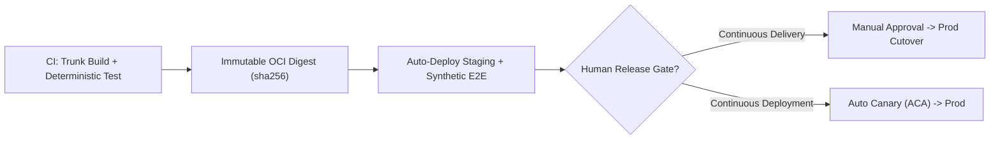
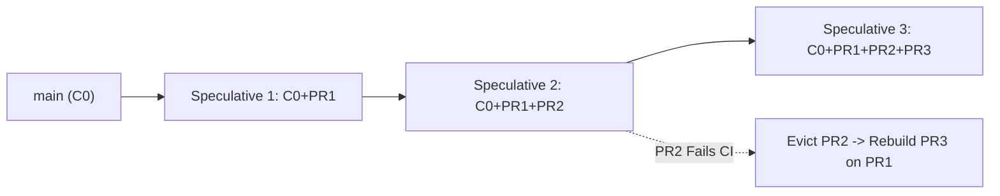
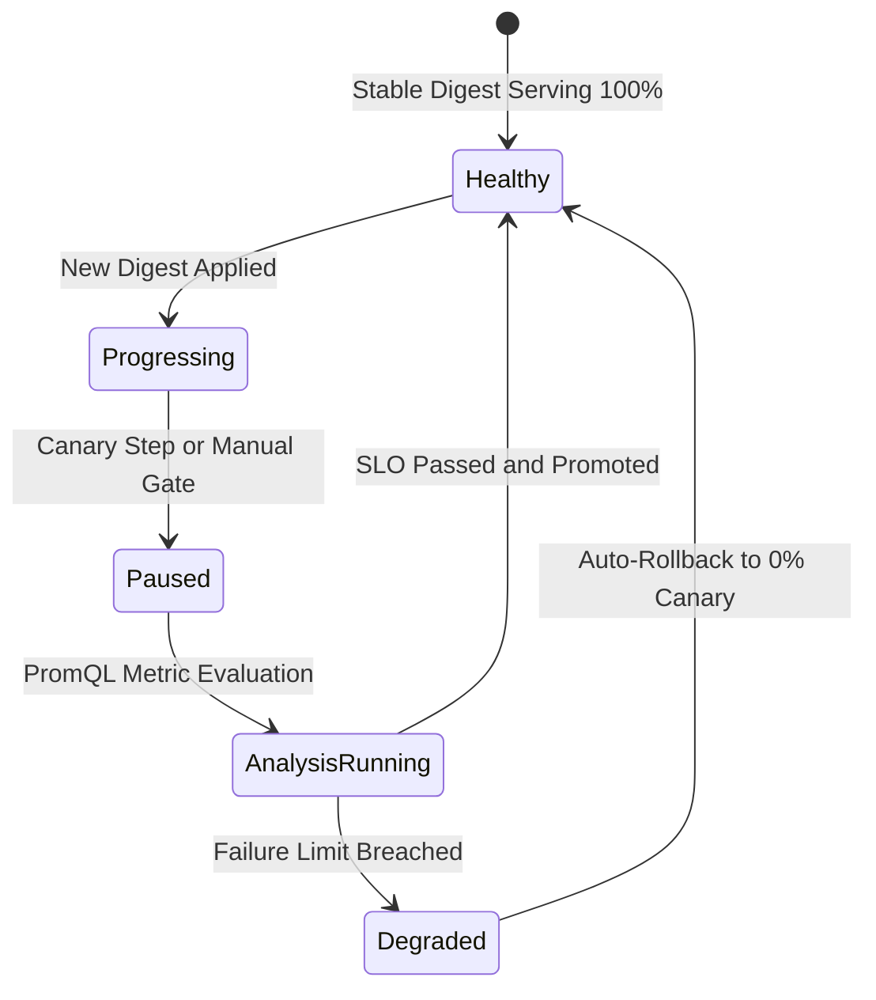
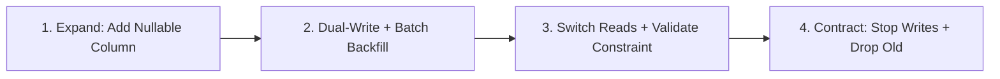

---
tags:
  - software-engineering
  - devops
  - ci-cd
  - release-engineering
created: 2026-01-02
updated: 2026-11-13
status: 🟢
level: mid-to-senior
---
# CI/CD Architecture, Progressive Delivery & Zero-Downtime Release Engineering

Continuous Integration, Continuous Delivery, and Continuous Deployment enforce mechanical invariants across source integration, artifact immutability, traffic cutover, and database evolution. Reliable production delivery depends on eliminating divergence between tested and deployed binaries while bounding the blast radius of any defective change through automated telemetry gates and sub-second rollback paths.

---

## 1. First-Principles Mechanics & Complete Architecture

### 1.1 Continuous Integration vs. Continuous Delivery vs. Continuous Deployment

These three stages form a strict dependency hierarchy rather than interchangeable labels:



- **Continuous Integration (CI)**: Every developer integrates changes into the shared trunk (`main`) at least daily. Every commit triggers a deterministic build pinned by exact lockfiles (`npm ci`, `pnpm install --frozen-lockfile`, `uv sync --locked`, `go build -mod=readonly`, `cargo build --locked`) and automated verification. When `main` breaks, stopping new merges or reverting immediately supersedes feature work.
- **Continuous Delivery**: Extends CI so that **every green commit on `main` emits an immutable, production-releasable artifact** that passes staging integration, contract, and security verification automatically. Production cutover waits solely on a single explicit human or business authorization (for compliance audit windows, customer release scheduling, or financial market freezes).
- **Continuous Deployment**: Removes the manual production gate. Every artifact passing automated CI and staging verification autonomously rolls out to production via progressive traffic shifting (Canary or Feature Flag rings) guarded by **Automated Canary Analysis (ACA)** and SLO error-budget rollback automation.

| Dimension | Continuous Integration | Continuous Delivery | Continuous Deployment |
|---|---|---|---|
| **Primary Invariant** | `main` compiles and passes automated verification at every commit | Every green `main` commit yields a deployable verified release candidate | Every verified `main` commit autonomously enters live production |
| **Dependency Pinning** | Strict lockfile hashes (`--frozen-lockfile`, `--require-hashes`) | Exact CI binary/OCI digest promoted unchanged to staging | Exact same OCI digest promoted autonomously through production rings |
| **Production Gate** | None (trunk verification only) | One explicit human/policy approval before production cutover | Automated statistical SLI/SLO gates (zero manual sign-off) |
| **Rollback Burden** | Revert breaking commit on `main` | Instant L7/digest pointer rollback + compatible DB schema | Autonomous controller abort/rollback + strict Expand-and-Contract DB |
| **Failure Mode Without Discipline** | Broken trunk stalls entire engineering organization | Rebuilding per environment introduces staging-to-prod drift | Unbounded production outages lacking canary sample sizing or rollback |

---

### 1.2 Artifact Immutability ("Build Once, Promote by Digest")

Mutable image tags (`api:latest`, `api:staging`, `api:v2.1`) violate reproducibility because tag pointers mutate silently across builds. Under Kubernetes `imagePullPolicy: IfNotPresent`, worker nodes caching an earlier `api:prod` digest silently skip pulling a newly pushed image carrying the identical tag name—leaving half a cluster on stale code while the other half runs new code.

**The Digest Promotion Invariant**:
1. CI compiles source code **once** per commit into an OCI Image Manifest (`application/vnd.oci.image.manifest.v1+json`) addressed by the SHA-256 hash of its config JSON and compressed layer digests:
   `ghcr.io/acme/checkout-api@sha256:9f86d081884c7d659a2feaa0c55ad015a3bf4f1b2b0b822cd15d6c15b0f00a08`
2. Staging, canary, and production deployments reference **exclusively this immutable `@sha256:...` digest** (never rebuilding `docker build` per environment).
3. Environment-specific settings (database endpoints, upstream URLs, secret keys, runtime log levels) never bake into image layers or `.env` files inside the container. They inject exclusively at container startup via Kubernetes `ConfigMap`, External Secrets Operator, or cloud IAM/OIDC workload identity. See [[Programming/Software Engineering/DevOps/Docker|Docker]] and [[Programming/Software Engineering/DevOps/Kubernetes|Kubernetes]].

---

### 1.3 Merge Queues & Merge Trains Solving Semantic Merge Skew

Standard branch protection ("Require status checks to pass before merging") evaluates each Pull Request against `main`'s SHA at trigger time, failing to prevent **Semantic Merge Skew**:

1. At `t = 0`, `main` rests at commit `C0`.
2. **PR `#201`** renames `calculateTax(amount, stateCode)` to `calculateTax(amount, jurisdiction)` in `src/tax.ts` and updates all existing callers. CI passes against `C0`.
3. **PR `#202`** adds a brand-new route `src/routes/invoice.ts` calling `calculateTax(500, "CA")`. CI passes against `C0`.
4. Textual file diffs are completely disjoint; Git merges both PRs cleanly. Composite `main` (`C0 -> #201 -> #202`) fails TypeScript compilation or crashes at runtime immediately upon merge.

Enabling naive "Require branch to be up to date before merging" forces $N$ engineers into an $O(N^2)$ thundering herd: merging one PR invalidates all $N-1$ open PRs simultaneously, blocking teams indefinitely on manual rebases.



**Merge Queue / Merge Train Execution Mechanics**:
1. **Queue Enlistment**: Approved PRs enter a FIFO queue instead of merging directly to `main`.
2. **Speculative Stacking**: The queue controller generates temporary virtual commits stacking queued PRs optimistically: `C0+P1`, `C0+P1+P2`, `C0+P1+P2+P3` up to configured concurrency depth (`max_entries_to_build`).
3. **Parallel Execution & Fast Bisection**: All speculative builds execute concurrently. If `C0+P1` passes and `C0+P1+P2` fails, the controller commits `P1` to `main`, **evicts `P2`** back to the author, cancels `C0+P1+P2+P3`, and immediately rebuilds `P3` atop `C0+P1`.
4. **Result**: `main` remains strictly green (`CFR` of trunk compilation = `0%`) while preserving parallel throughput across high-velocity monorepos.

---

### 1.4 Progressive Delivery Mechanics & Control Loops

Progressive delivery bounds customer exposure during rollout by shifting traffic incrementally while continuously validating live Service Level Indicators (SLIs).

| Strategy | Traffic Shifting Mechanism | Extra Capacity Cost | Blast Radius | Rollback Latency | Mandatory Schema Rule |
|---|---|---|---|---|---|
| **Rolling Update** | Gradual pod replacement (`maxSurge`, `maxUnavailable`) | `10–25%` temporary surge | Proportional to replaced batch (`1/N` to `100%`) | Slow (requires spinning up `v1` pods) | Strict $N / N-1$ backward compatibility |
| **Blue-Green** | Instant L4/L7 target group or K8s Service selector swap | `100%` (`2x` live fleet during cutover) | `100%` upon cutover | Sub-second LB pointer flip | Strict Expand-and-Contract compatibility |
| **Canary (ACA)** | Weighted L7 split (`5% -> 25% -> 50% -> 100%`) via Envoy/Gateway API | `5–20%` canary pods | Bounded (`5%` initial user cohort) | Sub-second weight reset to `0%` | Strict $N / N-1$ backward compatibility |
| **Shadow (Dark)** | Async traffic mirroring (`Envoy` `request_mirror_policies`) | `+100%` shadow fleet capacity | `0%` user-facing HTTP impact | Instant mirror rule removal | **Must suppress/stub external writes & side effects** |
| **Feature Flags (OpenFeature)** | Runtime SDK evaluation inside request execution | Negligible (`~0%`) | Single user, tenant ID, or `%` bucket | Milliseconds via SSE streaming update | Code supports both paths until flag retirement |

#### 1. Rolling Update: The Kubernetes `EndpointSlice` Drain Race

In Kubernetes, sending `SIGTERM` to a terminating container and removing that Pod's IP from `EndpointSlice` objects across `kube-proxy` iptables/IPVS rules, CoreDNS, and Ingress/Envoy upstreams occur **asynchronously in parallel**. If an application immediately closes its listening socket upon `SIGTERM`, incoming requests dispatched by nodes whose `kube-proxy` rules have not yet synced (`1–5s` window) fail with `502 Bad Gateway` / `ECONNREFUSED`.
- **Mandatory Mechanical Fix**: Add a Pod `lifecycle.preStop` delay (`sleep 8`) so the process keeps accepting connections while `EndpointSlice` updates propagate cluster-wide, flip `/readyz` to `503` immediately, and stop new keep-alive requests cleanly before `terminationGracePeriodSeconds` expires.

#### 2. Blue-Green: Why DNS Cutovers Fail vs. L7 Target Group Flips

Updating a DNS `A`/`CNAME` record from Blue IP to Green IP does **not** execute an atomic cutover or instant rollback. Recursive ISP resolvers, corporate DNS forwarders, OS caches (`systemd-resolved`), and JVM `networkaddress.cache.ttl` ignore low TTLs (`60s`), splitting live production traffic unpredictably across Blue and Green for `10–30+` minutes.
- **Mandatory Mechanical Fix**: Anchor DNS permanently to a single static L4/L7 Load Balancer VIP (AWS ALB, Envoy Gateway, or Kubernetes Service). Register `tg-blue` and `tg-green` behind one HTTPS listener rule so cutover and rollback swap target weights atomically in `< 1 second`. Verify Green privately via a dedicated host/header rule (`X-Canary-Target: green`) before shifting production weights.

#### 3. Canary Rollout & Automated Canary Analysis (ACA)

Controllers such as **Argo Rollouts** and **Flagger** automate progressive promotion using real-time metric queries:
1. Controller deploys the canary `ReplicaSet` (`v2`) alongside stable (`v1`) and programs Gateway API `HTTPRoute` / NGINX / Envoy to route `5%` traffic to `v2`.
2. Every evaluation interval (`1m`), the controller queries Prometheus comparing **Canary vs. Baseline (Stable)** error ratios and `p99` latencies over identical sliding windows (eliminating global traffic or downstream vendor noise!).
3. **Sample Size & Cohort Sticky Routing**: Pure per-request random `5%` splits corrupt multi-step workflows (checkout Step 1 hits `v1`, Step 2 hits `v2`) and lack statistical power on low-RPS endpoints. Route user sessions consistently via request headers/cookies (`X-Canary-Cohort`) and gate canary evaluation with a minimum throughput check ($N \ge 500$ requests/window) plus `clamp_min(..., 1)` denominator guards to avoid `0 / 0 = NaN` false aborts during off-peak traffic.

#### 4. Feature Flags & OpenFeature Runtime Toggles

Feature flags decouple **Deployment** (installing `v2` binaries onto servers) from **Release** (exposing capability `X` to customers). Under the CNCF **OpenFeature** standard:
- Application code evaluates flags against a vendor-neutral `Client` interface (`client.getBooleanValue("new-tax-engine", false, context)`).
- Providers (`flagd`, LaunchDarkly, Unleash, Split) push updated rulesets out-of-band over persistent **gRPC/SSE streams** into an in-memory local rules cache.
- Evaluation performs deterministic **MurmurHash3** hashing over `(flagKey + targetingKey)` in `< 50 microseconds` with **zero synchronous network I/O on the request path**, guaranteeing identical user bucketing across distributed pods.

---

## 2. Real-World Use Cases, DORA Metrics & Decision Matrix

### 2.1 DORA Four Key Metrics & Goodhart's Law Traps

DORA metrics measure software delivery throughput and operational stability simultaneously. Optimizing throughput alone without paired stability guardrails simply accelerates outage velocity.

| DORA Metric | Dimension | Elite Benchmark | Exact Measurement Boundaries | Goodhart's Law Gaming Anti-Pattern | Mandatory Counter-Guardrail |
|---|---|---|---|---|---|
| **Deployment Frequency (DF)** | Throughput | Multiple deploys/day | Count of distinct production releases reaching live traffic | Splitting CSS/whitespace tweaks into 30 micro-deploys | Pair with **Deployment Batch Value** & customer SLO attainment |
| **Lead Time for Changes (LTFC)** | Throughput | `< 1 hour` | Timestamp of **first commit** (or PR open) to running in prod | Measuring only `merge -> deploy` (hiding 4-day PR review queues) | Measure full `commit_authored -> prod_serving` + PR queue wait |
| **Change Failure Rate (CFR)** | Stability | `0% – 5%` | `%` of prod deploys triggering incident, hotfix, or rollback | Relabeling production bugs as "manual config hotfixes" outside tracker | Auto-link every Argo Rollouts abort, revert PR, and PagerDuty Sev1/2 to last deploy SHA |
| **Failed Deployment Recovery Time (MTTR)** | Stability | `< 1 hour` | Incident detection timestamp to verified SLO restoration | Blindly pushing untested "roll-forward" patches instead of rolling back | Automate `< 60s` digest rollback & enforce Expand-and-Contract DB checks |

### 2.2 Concrete Release Engineering Decision Matrix

| Engineering Scenario | Recommended Delivery Pattern | Why This Pattern Wins | When NOT to Use / Avoid |
|---|---|---|---|
| **High-RPS Stateless SaaS API (`> 500 RPS`)** | **Continuous Deployment + Argo Rollouts Canary (ACA)** | High statistical power detects `0.2%` regressions in `2–5m` within a `5%` cohort | Do NOT use ACA on internal batch workers or `< 5 RPS` admin endpoints (insufficient statistical sample size) |
| **Regulated Fintech / Healthcare Core Ledger** | **Continuous Delivery (1 Policy Gate) + Blue-Green + Expand-and-Contract** | Immutable `sha256` digest satisfies audit provenance; instant ALB target-group flip reverts `100%` of fleet without mixed `v1/v2` ledger states | Do NOT skip Expand-and-Contract for DB changes; Blue-Green cannot roll back across destructive DDL |
| **Multi-Tenant B2B SaaS Product Feature Launch** | **Rolling Update + OpenFeature Tenant/Percentage Rings** | Internal dogfooding (`plan=internal`), beta opt-in tenants, and `0 -> 10 -> 100%` rollout occur without redeploying containers | Do NOT leave flags permanently in code; enforce mandatory flag expiry (`<= 30 days`) |
| **Stateful Event Consumer / Low-RPS Microservice** | **Rolling Update + Synthetic Integration Gate + Auto-Rollback on CrashLoop** | Avoids canary statistical noise while `maxUnavailable: 0` + readiness probes prevent dropped Kafka offsets | Do NOT use Shadow Traffic mirroring if consumers mutate databases, charge cards, or emit Kafka events |
| **Mobile App / Installed Desktop / Embedded Firmware** | **Release Stabilization Branches + Staged Store Rollout + Remote Kill Switch** | Users control update timing (`vN-2..vN` active simultaneously); instant binary rollback is impossible | Never ship unflagged breaking server-side API deletions; support backward API versions until telemetry confirms `< 0.1%` old client usage |

---

## 3. Step-by-Step Practical Application (Production Progressive Delivery Stack)

This section implements a complete production delivery architecture combining **Argo Rollouts + Gateway API Canary ACA**, **Zero-Downtime Pod Lifecycle + Node.js Graceful Shutdown**, **OpenFeature Runtime Flag Evaluation**, and an automated **Cutover & Rollback Verification Script**.

### Production Deployment Directory Structure

```text
checkout-service/
├── deploy/
│   ├── base/
│   │   ├── rollout.yaml
│   │   ├── services.yaml
│   │   ├── httproute.yaml
│   │   ├── analysis-template.yaml
│   │   └── pdb.yaml
│   └── overlays/prod/
│       └── kustomization.yaml
├── flags/
│   └── checkout.flagd.json
├── src/
│   ├── flags/
│   │   └── openfeature.ts
│   └── server.ts
└── scripts/
    └── progressive-cutover-check.sh
```

### 3.1 Argo Rollouts + Gateway API + Baseline-vs-Canary Prometheus `AnalysisTemplate`

Instead of hardcoding brittle absolute thresholds that misfire during global upstream latency spikes, this `AnalysisTemplate` compares **`canary` error rate and `p99` latency directly against `stable` baseline pods** while enforcing a minimum request count guard (`inconclusiveLimit`):

```yaml
# deploy/base/services.yaml
apiVersion: v1
kind: Service
metadata:
  name: checkout-stable
  namespace: production
spec:
  selector:
    app: checkout-api
  ports:
    - name: http
      port: 80
      targetPort: 8080
---
apiVersion: v1
kind: Service
metadata:
  name: checkout-canary
  namespace: production
spec:
  selector:
    app: checkout-api
  ports:
    - name: http
      port: 80
      targetPort: 8080
---
# deploy/base/httproute.yaml
apiVersion: gateway.networking.k8s.io/v1
kind: HTTPRoute
metadata:
  name: checkout-route
  namespace: production
spec:
  parentRefs:
    - name: prod-gateway
      namespace: ingress
  hostnames:
    - "api.acme.io"
  rules:
    - matches:
        - path:
            type: PathPrefix
            value: /v1/checkout
      backendRefs:
        - name: checkout-stable
          port: 80
          weight: 100
        - name: checkout-canary
          port: 80
          weight: 0
```

```yaml
# deploy/base/analysis-template.yaml
apiVersion: argoproj.io/v1alpha1
kind: AnalysisTemplate
metadata:
  name: checkout-canary-slo
  namespace: production
spec:
  args:
    - name: service-namespace
      value: production
  metrics:
    # Guard 1: Ensure sufficient sample size before trusting canary ratios (avoid low-RPS false aborts)
    - name: canary-min-throughput
      interval: 1m
      count: 5
      inconclusiveLimit: 3
      successCondition: result[0] >= 5.0
      provider:
        prometheus:
          address: http://prometheus-operated.monitoring.svc:9090
          query: |
            sum(rate(http_requests_total{namespace="{{args.service-namespace}}",service="checkout-canary"}[2m])) or vector(0)

    # Guard 2: Canary 5xx rate must not exceed stable baseline 5xx rate by > 0.25% (0.0025)
    - name: canary-vs-stable-5xx-delta
      interval: 1m
      count: 5
      failureLimit: 1
      successCondition: result[0] <= 0.0025
      provider:
        prometheus:
          address: http://prometheus-operated.monitoring.svc:9090
          query: |
            (
              sum(rate(http_requests_total{namespace="{{args.service-namespace}}",service="checkout-canary",status=~"5.."}[2m]))
              / clamp_min(sum(rate(http_requests_total{namespace="{{args.service-namespace}}",service="checkout-canary"}[2m])), 1)
            )
            -
            (
              sum(rate(http_requests_total{namespace="{{args.service-namespace}}",service="checkout-stable",status=~"5.."}[2m]))
              / clamp_min(sum(rate(http_requests_total{namespace="{{args.service-namespace}}",service="checkout-stable"}[2m])), 1)
            )

    # Guard 3: Canary p99 latency must stay within 1.25x of stable p99 latency
    - name: canary-vs-stable-p99-ratio
      interval: 1m
      count: 5
      failureLimit: 1
      successCondition: result[0] <= 1.25
      provider:
        prometheus:
          address: http://prometheus-operated.monitoring.svc:9090
          query: |
            histogram_quantile(0.99, sum by (le) (rate(http_request_duration_seconds_bucket{namespace="{{args.service-namespace}}",service="checkout-canary"}[2m])))
            /
            clamp_min(histogram_quantile(0.99, sum by (le) (rate(http_request_duration_seconds_bucket{namespace="{{args.service-namespace}}",service="checkout-stable"}[2m]))), 0.01)
```

```yaml
# deploy/base/rollout.yaml
apiVersion: argoproj.io/v1alpha1
kind: Rollout
metadata:
  name: checkout-api
  namespace: production
spec:
  replicas: 12
  revisionHistoryLimit: 5
  selector:
    matchLabels:
      app: checkout-api
  strategy:
    canary:
      canaryService: checkout-canary
      stableService: checkout-stable
      trafficRouting:
        plugins:
          argoproj-labs/gatewayAPI:
            httpRoute: checkout-route
            namespace: production
      # Allow internal/QA cohorts to test 100% canary via header prior to public weight shift
      steps:
        - setHeaderRoute:
            name: qa-cohort-header
            match:
              - headerName: X-Canary-Cohort
                headerValue:
                  exact: "internal-qa"
        - pause: { duration: 2m }
        - setWeight: 5
        - pause: { duration: 3m }
        - analysis:
            templates:
              - templateName: checkout-canary-slo
        - setWeight: 25
        - pause: { duration: 5m }
        - analysis:
            templates:
              - templateName: checkout-canary-slo
        - setWeight: 50
        - pause: { duration: 5m }
        - analysis:
            templates:
              - templateName: checkout-canary-slo
        - setHeaderRoute:
            name: qa-cohort-header
  template:
    metadata:
      labels:
        app: checkout-api
    spec:
      terminationGracePeriodSeconds: 45
      containers:
        - name: api
          # Immutable digest injected via Kustomize overlays/prod/kustomization.yaml
          image: ghcr.io/acme/checkout-api@sha256:9f86d081884c7d659a2feaa0c55ad015a3bf4f1b2b0b822cd15d6c15b0f00a08
          ports:
            - containerPort: 8080
          envFrom:
            - configMapRef:
                name: checkout-runtime-config
            - secretRef:
                name: checkout-runtime-secrets
          lifecycle:
            preStop:
              exec:
                # Hold open port during async EndpointSlice / Envoy upstream deregistration
                command: ["sh", "-c", "sleep 8"]
          startupProbe:
            httpGet:
              path: /healthz
              port: 8080
            failureThreshold: 15
            periodSeconds: 2
          readinessProbe:
            httpGet:
              path: /readyz
              port: 8080
            periodSeconds: 3
            failureThreshold: 2
          livenessProbe:
            httpGet:
              path: /healthz
              port: 8080
            periodSeconds: 10
            failureThreshold: 3
          resources:
            requests:
              cpu: "500m"
              memory: "512Mi"
            limits:
              memory: "512Mi"
---
# deploy/base/pdb.yaml
apiVersion: policy/v1
kind: PodDisruptionBudget
metadata:
  name: checkout-api-pdb
  namespace: production
spec:
  minAvailable: "75%"
  selector:
    matchLabels:
      app: checkout-api
```

### 3.2 Zero-Downtime HTTP Server Shutdown & Keep-Alive Drain Handler (TypeScript)

Pair the Kubernetes `preStop: sleep 8` and `terminationGracePeriodSeconds: 45` with an application shutdown handler that flips `/readyz` to `503`, sets `keepAliveTimeout` safely **above** the cloud ALB/Envoy idle timeout (`65s` vs AWS ALB `60s`), and drains active in-flight HTTP requests deterministically:

```typescript
// src/server.ts
import http from 'node:http';
import express, { Request, Response } from 'express';
import { initFlags, isNewTaxEngineEnabled } from './flags/openfeature';

const app = express();
app.use(express.json());

let isDraining = false;
let activeRequests = 0;

app.use((req: Request, res: Response, next) => {
  if (isDraining) {
    // Signal load balancers/clients not to reuse keep-alive sockets on draining pods
    res.setHeader('Connection', 'close');
  }
  activeRequests += 1;
  res.on('finish', () => {
    activeRequests -= 1;
  });
  next();
});

app.get('/healthz', (_req: Request, res: Response) => {
  res.status(200).json({ status: 'alive' });
});

app.get('/readyz', (_req: Request, res: Response) => {
  if (isDraining) {
    res.status(503).json({ status: 'draining', activeRequests });
    return;
  }
  res.status(200).json({ status: 'ready' });
});

app.post('/v1/checkout', async (req: Request, res: Response) => {
  const userId = String(req.header('x-user-id') ?? 'anonymous');
  const region = String(req.header('x-region') ?? 'us-east');
  const useNewEngine = await isNewTaxEngineEnabled(userId, region);

  res.status(200).json({
    orderId: req.body?.orderId ?? 'ord-001',
    taxEngine: useNewEngine ? 'v2-jurisdiction' : 'v1-legacy',
  });
});

async function start(): Promise<void> {
  await initFlags();
  const server = http.createServer(app);

  // Prevent Node.js 5s default keepAliveTimeout from racing AWS ALB / Envoy 60s idle reuse
  server.keepAliveTimeout = 65_000;
  server.headersTimeout = 66_000;

  const port = Number(process.env.PORT ?? 8080);
  server.listen(port, () => {
    console.log(JSON.stringify({ event: 'server_started', port }));
  });

  const gracefulShutdown = (signal: string) => {
    if (isDraining) return;
    isDraining = true;
    console.log(JSON.stringify({ event: 'shutdown_initiated', signal, activeRequests }));

    // Stop accepting new TCP connections; existing requests finish cleanly
    server.close((err) => {
      if (err) {
        console.error(JSON.stringify({ event: 'shutdown_error', error: err.message }));
        process.exit(1);
      }
      console.log(JSON.stringify({ event: 'shutdown_complete' }));
      process.exit(0);
    });

    // Close idle keep-alive sockets without aborting active in-flight responses (Node 18.2+)
    server.closeIdleConnections();

    // Hard safety exit strictly below Kubernetes terminationGracePeriodSeconds (45s - 8s preStop = 37s)
    setTimeout(() => {
      console.error(JSON.stringify({ event: 'forced_exit_timeout', activeRequests }));
      process.exit(1);
    }, 30_000).unref();
  };

  process.on('SIGTERM', () => gracefulShutdown('SIGTERM'));
  process.on('SIGINT', () => gracefulShutdown('SIGINT'));
}

start().catch((err) => {
  console.error(JSON.stringify({ event: 'startup_fatal', error: String(err) }));
  process.exit(1);
});
```

### 3.3 OpenFeature Runtime Flag Provider & Kill-Switch Config

```json
// flags/checkout.flagd.json
{
  "$schema": "https://flagd.dev/schema/v0/flags.json",
  "flags": {
    "new-tax-engine": {
      "state": "ENABLED",
      "variants": {
        "on": true,
        "off": false
      },
      "defaultVariant": "off",
      "targeting": {
        "if": [
          { "in": [{ "var": "region" }, ["internal-qa"]] },
          "on",
          {
            "fractional": [
              ["on", 10],
              ["off", 90]
            ]
          }
        ]
      }
    }
  }
}
```

```typescript
// src/flags/openfeature.ts
import { OpenFeature, Client } from '@openfeature/server-sdk';
import { FlagdProvider } from '@openfeature/flagd-provider';

let flagClient: Client;

export async function initFlags(): Promise<void> {
  const provider = new FlagdProvider({
    host: process.env.FLAGD_HOST ?? 'localhost',
    port: Number(process.env.FLAGD_PORT ?? 8013),
    cache: true,
  });
  await OpenFeature.setProviderAndWait(provider);
  flagClient = OpenFeature.getClient('checkout-api');
}

export async function isNewTaxEngineEnabled(userId: string, region: string): Promise<boolean> {
  if (!flagClient) {
    return false;
  }
  // Never throw or block requests if flag control plane degrades; fail safe to legacy v1
  try {
    return await flagClient.getBooleanValue('new-tax-engine', false, {
      targetingKey: userId,
      region,
    });
  } catch (err) {
    console.error(JSON.stringify({ event: 'flag_eval_error', error: String(err) }));
    return false;
  }
}
```

### 3.4 Kubernetes / Envoy Progressive Cutover & Zero-Downtime Rollback Checklist

Execute this automated verification script during cutovers and emergency rollbacks (`./scripts/progressive-cutover-check.sh verify|abort|undo`):

```bash
#!/usr/bin/env bash
# scripts/progressive-cutover-check.sh
set -euo pipefail

NAMESPACE="${NAMESPACE:-production}"
ROLLOUT="${ROLLOUT:-checkout-api}"
ACTION="${1:-verify}"

case "$ACTION" in
  verify)
    echo "[1/4] Checking PodDisruptionBudget & Rollout health..."
    kubectl get pdb -n "$NAMESPACE"
    kubectl argo rollouts get rollout "$ROLLOUT" -n "$NAMESPACE" --no-color

    echo "[2/4] Verifying EndpointSlice convergence (zero unready addresses receiving traffic)..."
    kubectl get endpointslices -n "$NAMESPACE" -l kubernetes.io/service-name=checkout-stable -o wide
    kubectl get endpointslices -n "$NAMESPACE" -l kubernetes.io/service-name=checkout-canary -o wide

    echo "[3/4] Confirming Gateway API HTTPRoute parent status & backend weights..."
    kubectl get httproute checkout-route -n "$NAMESPACE" -o jsonpath='{.spec.rules[0].backendRefs}'
    echo ""

    echo "[4/4] Watching rollout progress (timeout 10m; exits non-zero on Degraded/Aborted)..."
    kubectl argo rollouts status "$ROLLOUT" -n "$NAMESPACE" --timeout 600s
    ;;

  abort)
    echo "EMERGENCY: Aborting active canary rollout -> resetting HTTPRoute canary weight to 0%..."
    kubectl argo rollouts abort "$ROLLOUT" -n "$NAMESPACE"
    kubectl argo rollouts status "$ROLLOUT" -n "$NAMESPACE" --timeout 120s
    ;;

  undo)
    echo "EMERGENCY: Rolling back to previous immutable stable revision..."
    kubectl argo rollouts undo "$ROLLOUT" -n "$NAMESPACE"
    kubectl argo rollouts status "$ROLLOUT" -n "$NAMESPACE" --timeout 180s
    ;;

  *)
    echo "Usage: $0 {verify|abort|undo}" >&2
    exit 1
    ;;
esac
```

**Zero-Downtime Rollback Checklist**:
1. Confirm the active defect is isolated to the new application revision rather than an external dependency outage (compare `canary` vs `stable` metrics before rolling back!).
2. If behind a runtime flag (`new-tax-engine`), flip `"defaultVariant": "off"` in GitOps/flag store first (sub-second blast-radius reduction with zero pod restarts).
3. If the binary itself is defective, run `kubectl argo rollouts abort` (drops canary weight to `0%` in `< 1s`) or `kubectl argo rollouts undo` / revert the `@sha256:` digest in the GitOps manifest.
4. Confirm zero destructive DB schema migrations (`DROP COLUMN`, `RENAME COLUMN`, tightened `NOT NULL`) were coupled to the rollout before executing rollback.
5. Verify `EndpointSlice` readiness and `5xx` error-rate decay within `60s` after traffic resets to `v1`.

### 3.5 GitHub Merge Queue Workflow & Kustomize Digest Promotion Overlay

A GitHub Merge Queue workflow requires the **`merge_group`** event trigger so speculative stacked commits execute CI before fast-forwarding `main`:

```yaml
# .github/workflows/merge-queue.yml
name: Merge Queue & Trunk Verification

on:
  pull_request:
    branches: [main]
  merge_group:
    types: [checks_requested]

permissions:
  contents: read

jobs:
  verify-composite-state:
    runs-on: ubuntu-latest
    steps:
      - uses: actions/checkout@11bd71901bbe5b1630ceea73d27597364c9af683 # v4.2.2
      - uses: actions/setup-node@49933ea5288caeca8642d1e84afbd3f7d6820020 # v4.4.0
        with:
          node-version-file: .nvmrc
          cache: npm
      - run: npm ci
      - run: npm run typecheck && npm test
```

Promote verified OCI digests cleanly across environments without modifying base manifests or using mutable tags via Kustomize `images:` digest overrides:

```yaml
# deploy/overlays/prod/kustomization.yaml
apiVersion: kustomize.config.k8s.io/v1beta1
kind: Kustomization
namespace: production
resources:
  - ../../base
images:
  - name: ghcr.io/acme/checkout-api
    newName: ghcr.io/acme/checkout-api
    digest: sha256:9f86d081884c7d659a2feaa0c55ad015a3bf4f1b2b0b822cd15d6c15b0f00a08
```

### 3.6 Blue-Green Rollout Spec (Continuous Delivery Gate) & Throttled Batch Backfill

For regulated workloads requiring pre-cutover dark smoke testing and an explicit human release promotion gate (`autoPromotionEnabled: false`), configure Argo Rollouts `blueGreen` alongside `prePromotionAnalysis`:

```yaml
# deploy/base/bluegreen-rollout.yaml
apiVersion: argoproj.io/v1alpha1
kind: Rollout
metadata:
  name: ledger-api
  namespace: production
spec:
  replicas: 6
  selector:
    matchLabels:
      app: ledger-api
  strategy:
    blueGreen:
      activeService: ledger-active
      previewService: ledger-preview
      autoPromotionEnabled: false
      scaleDownDelaySeconds: 300
      prePromotionAnalysis:
        templates:
          - templateName: ledger-dark-smoke-check
  template:
    metadata:
      labels:
        app: ledger-api
    spec:
      containers:
        - name: ledger
          image: ghcr.io/acme/ledger-api@sha256:3b4e91f8d04a2c598e1b67f281a90431d198a3b2c4e5f6a7b8c9d0e1f2a3b4c5
          ports:
            - containerPort: 8080
```

Setting `scaleDownDelaySeconds: 300` preserves the inactive Blue ReplicaSet warm for 5 minutes post-cutover so an emergency `kubectl argo rollouts undo ledger-api` swaps the active Kubernetes Service selector back to Blue in `< 1s` with zero cold-start delay.



When executing Phase 2 of Expand-and-Contract backfills on multi-million-row tables, avoid single-statement full-table `UPDATE` locks by paginating deterministically by primary key with replication-safe throttling:

```sql
-- scripts/backfill-display-name.sql (Execute iteratively via cron/job until rows_updated = 0)
WITH batch AS (
  SELECT id, full_name
  FROM users
  WHERE display_name IS NULL
  ORDER BY id ASC
  LIMIT 5000
  FOR UPDATE SKIP LOCKED
)
UPDATE users u
SET display_name = b.full_name
FROM batch b
WHERE u.id = b.id;
```

Using `FOR UPDATE SKIP LOCKED` guarantees the background backfill never blocks live user transactions updating the same rows, while `5,000`-row batches prevent WAL saturation and replica lag spikes.

---

## 4. Complete Construct Reference & Edge Cases

### 4.1 Expand-and-Contract Database & Wire Evolution Protocol

Rolling updates, Blue-Green cutovers, and Canary rollouts run `v1` and `v2` simultaneously against shared databases and message buses. Any single-release breaking change causes `UndefinedColumn` (`42703`) or deserialization faults.



**PostgreSQL Lock-Safe Execution Rules**:
- Always enforce `SET lock_timeout = '2s';` and `SET statement_timeout = '5s';` on DDL sessions so a blocked `ACCESS EXCLUSIVE` request never stalls behind a slow analytics `SELECT` and piles up every application connection behind it.
- Create indexes exclusively with `CREATE INDEX CONCURRENTLY` outside transactions (`SHARE UPDATE EXCLUSIVE`, allowing concurrent `SELECT`/`INSERT`/`UPDATE`/`DELETE`).
- Enforce new `NOT NULL` or `CHECK` constraints without full-table write locks using two-phase validation:
  1. `ALTER TABLE orders ADD CONSTRAINT chk_currency CHECK (currency IS NOT NULL) NOT VALID;` (fast metadata lock).
  2. `ALTER TABLE orders VALIDATE CONSTRAINT chk_currency;` (`SHARE UPDATE EXCLUSIVE`—scans rows while permitting live reads and writes!).

See [[Programming/Software Engineering/SDLC/Release Engineering & Migrations|Release Engineering & Migrations]] for full SQL migration playbooks.

**Wire & Cache Compatibility Rules During $N / N-1$ Coexistence**:
- **Protobuf / gRPC**: Never reuse deleted numeric field tags; mark removed fields `reserved`; deploy consumers tolerating unknown enum values *before* producers emit new enum variants.
- **Kafka / Event Schemas**: Enforce `BACKWARD_TRANSITIVE` compatibility in Schema Registry (new fields carry defaults; consumers upgrade prior to producers).
- **Redis / Shared Distributed Caches**: Never overwrite shared Redis keys with altered JSON/Msgpack serialization schemas under the same key name! Prefix cache keys with schema versions (`v2:cart:${userId}`) so rolling back from `v2` to `v1` lets `v1` read `v1:cart:...` without crashing on unknown `v2` fields.

### 4.2 Rollback vs. Roll-Forward Decision Criteria

| Condition | Choose Deterministic Rollback | Choose Surgical Roll-Forward |
|---|---|---|
| **Root Cause Clarity** | Unknown or complex regression in production | Trivial 2-line config/typos fix isolated cleanly with high confidence |
| **Time to Mitigate** | Immediate `< 60s` weight reset or digest revert restores SLOs | Full CI + build + test takes longer than allowed error-budget burn |
| **State Compatibility** | Database schema and Redis keys follow Expand-and-Contract | Irreversible data format written that `v1` cannot tolerate |

### 4.3 Subtle Progressive Delivery Traps

1. **Cold-Start Canary Latency Skew**: Newly created `canary` pods running JVM, Go JIT/GC, or V8 engines with cold connection pools and empty in-memory LRU caches exhibit artificially elevated `p99` latencies for the first `60–120s`, triggering false ACA latency rollbacks. **Fix**: Implement a warmup endpoint invoked inside `startupProbe`, stagger initial `pause: { duration: 2m }` **before** launching the `AnalysisTemplate` step, and warm HTTP/DB pools prior to passing `/readyz`.
2. **HTTP/2 & gRPC Connection Pinning**: HTTP/2 multiplexes thousands of requests over a single persistent TCP socket. L4 Load Balancers (AWS NLB, `kube-proxy` iptables) balance **per TCP connection**, not per RPC—causing `5%` canary pod weight to receive `0%` or `50%` of requests depending on client socket timing! **Fix**: Terminate and load-balance gRPC/HTTP/2 at an L7 proxy (**Envoy** / Gateway API / Linkerd) configured with `max_connection_duration` or per-request HTTP/2 stream routing.
3. **HPA vs. Argo Rollouts Replica Fighting**: Attaching a standard Kubernetes `HorizontalPodAutoscaler` targeting a `Rollout` during an active canary step causes replica thrash if traffic shifts skew CPU metrics unevenly between `stable` and `canary` ReplicaSets. Configure `scaleDownDelaySeconds` (`30s`) and keep HPA targets conservative during canary windows.
4. **Feature Flag $2^N$ Combinatorial Explosion**: Retaining 20 uncleaned release toggles produces $2^{20}$ untested runtime combinations. Enforce automated flag-age checks (`<= 30 days`) and require dead-code removal PRs immediately after `100%` rollout stabilization.

For build provenance, keyless Sigstore `cosign` attestation, SBOM emission (`syft`), and Kubernetes Kyverno signature enforcement prior to deployment, see [[Programming/Software Engineering/DevOps/Pipeline Design|Pipeline Design]] and [[Programming/Software Engineering/DevOps/GitHub Actions|GitHub Actions]].

---

## 5. Production Debugging, Profiling & Operations Playbook

| Symptom | Root Cause | Exact Diagnostic Commands | Verified Remediation |
|---|---|---|---|
| **`502 Bad Gateway` / `ECONNRESET` bursts strictly during rolling updates** | App stops listening on `SIGTERM` before `EndpointSlice`/Envoy deregisters IP, OR Node `keepAliveTimeout` (`5s`) < ALB idle timeout (`60s`) | `kubectl get endpointslices -n production -l app=checkout-api` and `curl -I` checking ALB `502` timing vs Pod termination timestamp | Add `preStop: sleep 8`, set `server.keepAliveTimeout = 65000`, flip `/readyz` to `503` on `SIGTERM` |
| **Canary `AnalysisRun` aborts at `02:00 UTC` with `NaN` or 1 spurious failure** | Zero traffic (`0 / 0 = NaN`) or `1` error out of `4` requests (`25%`) exceeds `0.5%` threshold | `kubectl describe analysisrun -n production` and query Prometheus raw numerator/denominator over `[2m]` | Add `clamp_min(denom, 1)`, add `min-throughput` guard with `inconclusiveLimit`, widen window to `[2m]`, compare Canary vs Stable delta |
| **Blue-Green rollback leaves 20% of users on broken Green version** | DNS record swap (`TTL=300s`) cached by ISP resolvers, OS, or persistent HTTP/2 keep-alive clients | `dig +trace api.acme.io` across resolvers + check Green pod access logs after rollback | Replace DNS switching with L7 ALB target group / Envoy Gateway `HTTPRoute` weight swap behind static VIP |
| **Pods crash with `UndefinedColumn` or `JSON Parse Error` immediately after rollback** | Single-release destructive DDL (`RENAME`/`DROP COLUMN`) or unversioned shared Redis key format mutation | `kubectl logs -n production -l app=checkout-api --previous` | Enforce 4-phase Expand-and-Contract DB migrations and key-versioned Redis namespaces (`v2:...`) |
| **Merge Queue backs up `> 2 hours` with constant queue resets** | Slow flaky `45m` E2E suite runs per speculative entry, magnifying queue eviction cascades | Inspect queue metrics (eviction rate, median queue depth, CI duration per speculative build) | Run fast deterministic smoke + unit + contract suite inside Merge Queue (`< 7m`); run full cross-browser E2E async post-merge or nightly |
| **Argo Rollout stuck in `Degraded` / `Paused` state after failed analysis** | `AnalysisRun` exceeded `failureLimit` or Pod `ImagePullBackOff` on immutable digest mismatch | `kubectl argo rollouts get rollout checkout-api -n production` and `kubectl get events -n production --sort-by='.lastTimestamp'` | Run `kubectl argo rollouts undo checkout-api -n production`, inspect failed `AnalysisRun` metrics, fix image/code in new PR |

---

## 6. Comprehensive Worked Exercises

### Exercise 1: Semantic Merge Conflict & Speculative Merge Queue Sizing
Two PRs pass all required CI checks concurrently against `main@8a1f2c`:
- **PR `#412`**: Changes Python helper signature from `def calc_fee(amount: int, currency: str = "USD") -> int:` to `def calc_fee(amount: int, region: str) -> int:` in `billing/fees.py`.
- **PR `#415`**: Adds a new route calling `calc_fee(amount=500, currency="EUR")` in newly created `routes/v2_checkout.py`.

Both PRs display green checkmarks and merge within 90 seconds. Production immediately crashes with `TypeError: calc_fee() got an unexpected keyword argument 'currency'`.
1. Explain why standard "Require status checks to pass before merging" failed to catch this defect.
2. Explain why simply enabling "Require branches to be up to date before merging" degrades velocity at 40 engineers/day, and how a **Merge Queue** resolves both problems.
3. Suppose CI takes **6 minutes** per run, **6 PRs** (`P1..P6`) enter the Merge Queue concurrently, speculative depth `max_entries_to_build = 3`, and **`P2`** carries a hidden semantic conflict with **`P1`**. Trace the exact execution timeline and total wall-clock time until all 5 valid PRs reach `main`.

### Solution 1
1. **Root Cause**: Standard PR checks evaluate the merge preview `(main_at_trigger + PR_head)`. Both `#412` and `#415` tested independently against `8a1f2c`. Because their edited paths (`billing/fees.py` vs `routes/v2_checkout.py`) were textually disjoint, Git merged both cleanly, leaving `main` in the untested composite state `(8a1f2c + #412 + #415)`.
2. **Up-to-Date Starvation vs. Merge Queue**: Plain "Require branches to be up to date" triggers an $O(N^2)$ manual rebase storm: merging one PR invalidates every remaining PR's CI status simultaneously. A **Merge Queue** creates automated speculative merge branches (`C0+P1`, `C0+P1+P2`, `C0+P1+P2+P3`) tested in parallel without manual developer rebasing, committing only verified composite states to `main`.
3. **Timeline Trace (`T_CI = 6 min`, speculative depth = `3`, `P2` conflicts with `P1`)**:
   - **`t = 0..6 min` (Wave 1)**: Queue dispatches 3 concurrent speculative builds:
     - Build A `[P1]`: **PASS** at `t = 6m` -> `P1` merges onto `main`.
     - Build B `[P1, P2]`: **FAIL** at `t = 6m` (semantic conflict caught).
     - Build C `[P1, P2, P3]`: **FAIL / CANCELED** at `t = 6m` (invalidated because `P2` failed).
   - **`t = 6..12 min` (Wave 2)**: Queue evicts `P2`, resets base to `main (P1)`, and launches the next 3 speculative builds:
     - Build D `[P3]`: **PASS** at `t = 12m`.
     - Build E `[P3, P4]`: **PASS** at `t = 12m`.
     - Build F `[P3, P4, P5]`: **PASS** at `t = 12m` -> `P3`, `P4`, and `P5` fast-forward onto `main` together.
   - **`t = 12..18 min` (Wave 3)**: Remaining `P6` builds as `[P6]` atop `main(P1, P3, P4, P5)` -> **PASS** at `t = 18m` and merges.
   - **Result**: All 5 valid PRs integrate safely with zero broken `main` commits in **18 minutes** (versus `30+` minutes strictly serial or broken `main` incident delays).

---

### Exercise 2: Blue-Green + Destructive DB Migration Outage Diagnosis
A team releases `users-api` (`v1 -> v2`) via Blue-Green:
1. Step 1 executes `ALTER TABLE users RENAME COLUMN full_name TO display_name;`.
2. Step 2 deploys `v2` onto Green (`100%` replicas ready).
3. Step 3 updates AWS Route53 `api.acme.com` (`TTL = 300s`) from Blue ALB IP to Green ALB IP.
4. `v2` immediately throws HTTP `500` errors due to an OOM regression in a new JSON serializer.
5. On-call reverts Route53 back to Blue IP. For the next `8 minutes`, Blue (`v1`) receives traffic and crashes with `psycopg2.errors.UndefinedColumn: column "full_name" does not exist`, while some clients continue hitting Green (`v2`)!

Identify the **three distinct architectural failures** and write the remediated Blue-Green + Expand-and-Contract release sequence.

### Solution 2
1. **Failure 1 — Destructive Single-Release Schema Change (`RENAME COLUMN`)**: Renaming `full_name` instantaneously breaks `v1` queries during cutover overlap and destroys rollback safety.
2. **Failure 2 — DNS Cutover (`TTL = 300s`)**: Recursive resolvers, OS caches, and HTTP connection pools disregard short TTLs, creating ~8 minutes of split-brain traffic across Blue and Green during both rollout and rollback.
3. **Failure 3 — Missing Pre-Cutover Dark Smoke Verification**: Green received external production traffic before automated synthetic tests exercised serialization endpoints on an internal Green listener rule.

**Remediated Release Sequence**:
1. **Static L7 Load Balancer**: Point `api.acme.com` permanently to a single ALB. Register `tg-blue` and `tg-green` behind one HTTPS listener; run internal smoke checks against Green via `Host` or `X-Env: green` header rule, then swap traffic in `< 1s` via ALB target group weights.
2. **Expand-and-Contract Schema Evolution**:
   - *Release A (Expand)*: `SET lock_timeout = '2s'; ALTER TABLE users ADD COLUMN display_name TEXT;` -> deploy `v1.1` dual-writing `(full_name, display_name)` while reading `full_name` -> backfill `NULL` rows in throttled `5,000`-row batches.
   - *Release B (`v2`)*: Read `display_name`, continue dual-writing `full_name`. If `v2` OOMs, instant ALB flip back to `v1.1` succeeds with zero SQL errors and zero lost writes.
   - *Release C (Contract, 7 days post-stabilization)*: Deploy `v2.1` stopping references to `full_name`, then run standalone `ALTER TABLE users DROP COLUMN full_name;`.

---

### Exercise 3: Automated Canary Analysis Statistical Noise vs. Cohort Blindness
A checkout API serves **`1,000 req/s`** uniformly across web and mobile clients. Baseline `v1` `5xx` error rate is **`0.05%`**. An Argo Rollouts canary sets `setWeight: 5` (`50 req/s` to canary), evaluates every **`30s`** (`interval: 30s`, `count: 4`), with `failureLimit: 1` and static threshold `5xx <= 0.5%` (`0.005`).
1. Compute expected healthy `5xx` errors per `30s` window ($\lambda$) and the exact integer count ($k_{\min}$) triggering a window failure. Evaluate sensitivity to brief downstream burst errors.
2. Suppose `v2` contains a deterministic **`2.0%` crash bug affecting ONLY iOS clients (`X-Client: ios`)**, which comprise **`15%`** of overall traffic. Compute the blended canary `5xx` rate observed by Prometheus. Will the `<= 0.5%` gate catch the iOS outage?
3. Redesign the `AnalysisTemplate` and cohort rollout strategy to eliminate both burst false positives and segment blindness.

### Solution 3
1. **Window Sample Math (`N = 50 req/s * 30s = 1,500` requests/window)**:
   - Expected healthy `5xx` errors: $\lambda = 1500 \times 0.0005 = \mathbf{0.75}$ errors per `30s` window.
   - Failure count threshold: $0.005 \times 1500 = 7.5 \implies \ge \mathbf{8}$ errors fails a single window (`failureLimit: 1` permits 1 bad window and aborts on the 2nd).
   - Real-world downstream blips (e.g., 10 concurrent retries failing within `200ms`) exceed `8` errors easily on a narrow `30s` / `1,500`-request window. Comparing against **Stable Baseline** over a wider `[2m]` window (`6,000` reqs) filters global downstream blips out completely.
2. **Cohort Blindness Calculation**:
   - Blended `5xx` rate $= (0.15 \times 0.02) + (0.85 \times 0.0005) = 0.003 + 0.000425 = \mathbf{0.3425\%}$.
   - Because `0.3425% <= 0.5%`, the global `AnalysisTemplate` **PASSES**, promoting a `2%` iOS checkout crash to `100%` of production traffic!
3. **Remediated `AnalysisTemplate` Design**:
   - Emit `client_platform` label (`ios`, `android`, `web`) on `http_requests_total` and assert **`max by (client_platform)`** canary-vs-stable delta (`<= 0.002`) so no minority client cohort is masked by global averages.
   - Route internal/beta `X-Client: ios` traffic first via `setHeaderRoute`, widen evaluation interval to `2m`, and enforce `clamp_min(..., 1)` + minimum per-cohort RPS guard (`inconclusiveLimit`).

---

### Exercise 4: Zero-Downtime Expand-and-Contract + Versioned Cache Cutover
A monolith splits `billing_accounts.address` (single JSONB column read by `v1`) into normalized columns `country_code CHAR(2) NOT NULL` and `postal_code TEXT NOT NULL` on a 40M-row PostgreSQL table (`15,000 QPS` peak), while caching serialized `BillingAccount` structs in Redis under key `acct:{id}` (`TTL = 1h`).
1. Explain two separate production failure modes that occur if `v2` is deployed directly after adding the columns and changing the serialized Redis struct under `acct:{id}`.
2. Write the exact lock-safe PostgreSQL DDL statements and versioned Redis cache contract across all required deployment phases so an instant rollback of `v2` at any stage triggers zero downtime or deserialization faults.

### Solution 4
1. **Two Coupled Outage Vectors**:
   - **PostgreSQL `ACCESS EXCLUSIVE` & `NOT NULL` Failure**: Adding `NOT NULL` without a default or running an unthrottled `UPDATE` across 40M rows holds locks / bloats WAL & replication lag, while `v1` pods writing rows without `country_code` violate `NOT NULL` constraints during rolling updates or rollbacks.
   - **Redis Poisoning Across `v1`/`v2` Overlap & Rollback**: When `v2` writes `{ "countryCode": "US", "postalCode": "10001" }` to `acct:123` while `v1` expects `{ "address": ... }`, running `v1` pods (and rolled-back `v1` pods for up to `1h`) crash deserializing `v2` cache entries (`NullPointerException` / `KeyError`)!
2. **Zero-Downtime Phased Implementation**:
   - **Phase 1 (Expand DB + Dual-Write/Versioned Cache `v1.1`)**:
     ```sql
     SET lock_timeout = '2s';
     SET statement_timeout = '5s';
     ALTER TABLE billing_accounts
       ADD COLUMN country_code CHAR(2),
       ADD COLUMN postal_code TEXT;
     ```
     Deploy `v1.1`: continues writing/reading `acct:v1:{id}`, populates both `address` and `(country_code, postal_code)` on every write. Execute throttled background backfill in `5,000`-row chunks (`WHERE country_code IS NULL`) with `50ms` sleep between batches.
   - **Phase 2 (Lock-Safe Constraint Validation)**:
     ```sql
     SET lock_timeout = '2s';
     ALTER TABLE billing_accounts
       ADD CONSTRAINT chk_country_nn CHECK (country_code IS NOT NULL) NOT VALID,
       ADD CONSTRAINT chk_postal_nn CHECK (postal_code IS NOT NULL) NOT VALID;
     -- Scans 40M rows under SHARE UPDATE EXCLUSIVE (permits all live reads/writes)
     ALTER TABLE billing_accounts VALIDATE CONSTRAINT chk_country_nn;
     ALTER TABLE billing_accounts VALIDATE CONSTRAINT chk_postal_nn;
     ```
   - **Phase 3 (Switch Reads + Versioned Cache Key `v2`)**:
     Deploy `v2`: reads `(country_code, postal_code)` and caches strictly under **`acct:v2:{id}`** while continuing to dual-write `address` and invalidate/dual-write `acct:v1:{id}` (or accept clean cache miss). If `v2` rolls back to `v1.1`, `v1.1` reads untouched `acct:v1:{id}` and `address` with zero errors.
   - **Phase 4 (Contract, Post-Window)**: Deploy `v3` dropping `address` and `acct:v1:{id}` writes, followed by `ALTER TABLE billing_accounts DROP COLUMN address;`.

---

### Exercise 5: Debugging a Rolling-Update `502 Bad Gateway` & Keep-Alive Race
During every production rolling deployment of an AWS ALB-backed Node.js service on EKS, clients observe a `2–4 second` burst of `502 Bad Gateway` errors (`ALB Target.FailedHealthChecks` is `0`, and Node logs show zero exceptions). Inspection reveals:
- Pod spec lacks `lifecycle.preStop`.
- Express app uses default `server.keepAliveTimeout` (`5,000 ms`) while AWS ALB idle timeout is `60,000 ms`.
- `SIGTERM` handler calls `process.exit(0)` immediately after printing `"shutting down"`.

Explain **both distinct race conditions** producing `502` responses and provide the complete fixed Kubernetes Pod container spec and Node.js shutdown handler.

### Solution 5
1. **Race 1 — `EndpointSlice` / ALB Deregistration vs. Immediate `process.exit(0)`**: When Kubernetes terminates a Pod, `kubelet` sends `SIGTERM` concurrently with the control plane updating `EndpointSlice` and the AWS Load Balancer Controller deregistering target IP + port. Immediate `process.exit(0)` drops listening sockets `2–4s` **before** ALB stops forwarding new requests to that IP, causing ALB to receive TCP `RST`/`ECONNREFUSED` and return `502`.
2. **Race 2 — Node.js `5s` `keepAliveTimeout` < ALB `60s` Idle Timeout**: Even outside deploys, when Node closes an idle keep-alive socket at `t = 5.000s` simultaneously as ALB sends a new HTTP request over that exact pooled socket at `t = 5.001s`, ALB sees an unexpected TCP `FIN`/`RST` mid-request and emits `502`.
3. **Verified Complete Fix**:
   - **Kubernetes Pod Spec**:
     ```yaml
     terminationGracePeriodSeconds: 45
     containers:
       - name: api
         lifecycle:
           preStop:
             exec:
               command: ["sh", "-c", "sleep 8"]
         readinessProbe:
           httpGet:
             path: /readyz
             port: 8080
           periodSeconds: 3
           failureThreshold: 2
     ```
   - **Node.js `server.ts` Keep-Alive & Drain Fix**:
     ```typescript
     server.keepAliveTimeout = 65_000;
     server.headersTimeout = 66_000;
     process.on('SIGTERM', () => {
       isDraining = true; // Flips /readyz to 503 and adds Connection: close on responses
       server.close(() => process.exit(0));
       server.closeIdleConnections();
     });
     ```

---

### Exercise 6: Diagnosing DORA Goodhart's Law Gaming & Re-Architecting Delivery Guardrails
Over 6 months after tying engineering bonuses to **Deployment Frequency (`> 2/day`)** and **Lead Time (`< 2h`)**, executive dashboards celebrate:
- Deployment Frequency rose from `3/week` to `25/day`.
- Reported Lead Time dropped from `14 hours` to `18 minutes`.
- Reported Change Failure Rate remained flat at `3%`.

Meanwhile, customer support tickets tripled, on-call engineers receive `19 pages/week`, and post-mortems reveal:
1. Engineers split single features into 10 micro-PRs (each toggling empty config keys or stubbing disabled routes) and measure Lead Time strictly from `PR merge -> Kubernetes Pod Running`.
2. Production bugs are routinely patched manually via `kubectl set env` or hotfix database edits outside incident tracking so `CFR` stays at `3%`.

Diagnose all **three measurement/governance defects**, compute what the true operational DORA state actually indicates, and design **three automated technical guardrails** to restore honest delivery telemetry.

### Solution 6
1. **Three Structural Measurement Failures**:
   - **Lead Time Denominator Manipulation**: Measuring `merge -> pod ready` hides multi-day PR queue delays, code review bottlenecks, and unintegrated branch drift (`first commit -> prod`).
   - **Artificial Deployment Inflation**: Micro-splitting non-functional commits artificially inflates `DF` without accelerating customer value delivery or improving small-batch safety.
   - **CFR Undercounting & Out-of-Band Drift**: Mutating production state manually (`kubectl set env`, direct SQL hotfixes) bypasses Git/CI tracking, hiding true failures while creating undocumented configuration drift between Git and live clusters.
2. **True Operational Diagnosis**: The team exhibits **Low/Medium effective stability** masked by metric gaming—high incident/page volume paired with out-of-band manual fixes indicates fragile automated testing, missing canary rollback gates, and insufficient SLO enforcement.
3. **Automated Technical Guardrails**:
   - **Immutable GitOps Cluster Enforcement**: Revoke interactive write RBAC (`kubectl edit/set env`) in production for human engineers; enforce **ArgoCD / Flux** auto-self-heal (`selfHeal: true`) reconciling strictly from Git. Every production change becomes an auditable Git commit SHA.
   - **Automated Objective Telemetry Ingestion**: Compute `LTFC` automatically from **earliest unmerged commit timestamp on the PR branch** to production Argo Rollouts healthy timestamp; compute `CFR` automatically by correlating PagerDuty/Alertmanager Sev1/Sev2 incidents and automated Argo Rollouts `abort`/`undo` events against deployed digest SHAs.
   - **Balanced SPACE + SLO Guardrails**: Remove individual/team bonuses tied to raw `DF`/`LTFC`; evaluate delivery health using paired **Customer SLO Attainment (`99.95%`) + On-Call Page Load (`<= 2 pages/week`) + Developer Satisfaction** alongside honest DORA metrics.

---

## Related Notes
- [[Programming/Software Engineering/DevOps/Pipeline Design|Pipeline Design]]
- [[Programming/Software Engineering/DevOps/Git|Git]]
- [[Programming/Software Engineering/DevOps/GitHub Actions|GitHub Actions]]
- [[Programming/Software Engineering/DevOps/Docker|Docker]]
- [[Programming/Software Engineering/DevOps/Kubernetes|Kubernetes]]
- [[Programming/Software Engineering/SDLC/Release Engineering & Migrations|Release Engineering & Migrations]]
- [[Programming/Software Engineering/Testing/Testing Complete Guide|Testing Complete Guide]]
- [[Programming/Software Engineering/DevOps/DevOps Complete Guide|DevOps Complete Guide]]
