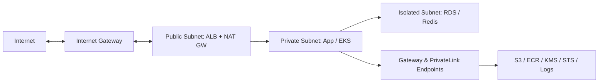
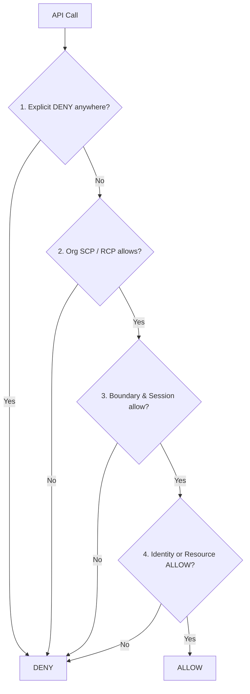

---
tags:
  - software-engineering
  - devops
  - cloud
  - networking
  - iam
  - finops
created: 2026-01-02
updated: 2026-11-13
status: 🟢
level: mid-to-senior
---

# Cloud Fundamentals

Cloud infrastructure separates programmable control planes (API-driven provisioning, IAM authorization, routing control, billing telemetry) from high-throughput data planes (hardware-offloaded hypervisors, software-defined VPC switching, distributed block/object storage). Production cloud engineering centers on deterministic CIDR partitioning, zero-static-secret IAM evaluation, micro-segmented networking, reliability compounding math, and eliminating hidden data-transfer cost traps. Related guides: [[Programming/Software Engineering/DevOps/DevOps Complete Guide|DevOps Complete Guide]], [[Programming/Software Engineering/DevOps/Kubernetes|Kubernetes]], [[Programming/Software Engineering/DevOps/Terraform|Terraform]], [[Programming/Software Engineering/DevOps/Serverless|Serverless]], [[Programming/Software Engineering/System Design/Load Balancing|Load Balancing]], [[Programming/Software Engineering/System Design/Scalability|Scalability]].

---

## 1. First-Principles Control/Data Plane Architecture & Cross-Cloud Parity

### 1.1 Control Plane vs Data Plane Mechanics

Every major cloud provider (AWS, GCP, Azure) decouples **control plane** operations from **data plane** packet forwarding so control-plane API throttling or metadata outages do not immediately collapse running traffic:

- **Control Plane (Asynchronous / Eventually Consistent)**: Provisioning APIs (`CreateVpc`, `PutRolePolicy`, `UpdateRouteTable`) mutate distributed metadata stores and propagate configuration asynchronously to hypervisor cards, virtual switches, and IAM edge caches. For example, updating an IAM Role policy or attaching a Security Group rule propagates within seconds, meaning automated deployments must retry transient permission propagation gaps rather than assuming instantaneous global cutover.
- **Data Plane (Hardware-Offloaded / Deterministic)**: Modern compute instances run on dedicated virtualization offload hardware (AWS Nitro ASICs, GCP Titanium DPUs, Azure SmartNICs). Virtual NIC packet encapsulation, Security Group stateful connection tracking, and EBS/NVMe encryption execute in dedicated hardware pipelines rather than stealing host vCPU cycles—leaving near-100% of host cores available to guest workloads while maintaining strict tenant memory/network isolation.
- **Instance Metadata Service (`IMDSv2`) Security Boundary**: Compute nodes fetch temporary IAM credentials and instance identity from link-local `169.254.169.254`. Legacy IMDSv1 accepted stateless `GET` requests, allowing any Server-Side Request Forgery (SSRF) vulnerability inside an application to steal host IAM credentials. Production fleets must require **IMDSv2** (enforces a `PUT /latest/api/token` session token header) and set `HttpPutResponseHopLimit = 1` on container hosts so Docker/Kubernetes Pods traversing a virtual bridge hop (`TTL - 1`) cannot reach host EC2 IAM credentials.

### 1.2 Shared Responsibility Model

Security ownership shifts upward as operational abstraction rises, though **data-plane security never disappears**:

| Responsibility Layer | On-Premises | IaaS (`EC2` / `GCE` / `VM`) | Managed K8s (`EKS` / `GKE` / `AKS`) | Serverless Containers (`Fargate` / `Cloud Run`) | FaaS (`Lambda`) | Managed DBaaS (`RDS` / `Cloud SQL`) |
| :--- | :--- | :--- | :--- | :--- | :--- | :--- |
| **Application Code & Secrets** | Customer | Customer | Customer | Customer | Customer | Customer (SQL/schema/auth) |
| **IAM, KMS Keys, & Network Rules** | Customer | Customer | Customer | Customer | Customer | Customer |
| **Container Image & Dependencies** | Customer | Customer | Customer | Customer | Customer | Provider |
| **Host OS & Runtime Patching** | Customer | Customer | Shared (Customer on unmanaged nodes) | Provider | Provider | Provider |
| **Cluster Control Plane** | Customer | Customer | Provider | Provider | Provider | Provider |
| **Hypervisor, Physical Network, Power** | Customer | Provider | Provider | Provider | Provider | Provider |

> [!warning] Compliance Certifications Do Not Secure Your Account
> Provider SOC2, ISO 27001, and PCI certifications validate the physical datacenter, hypervisor, and control-plane isolation *of* the cloud. Misconfigured public S3 bucket policies, overly broad IAM wildcard permissions (`"Action": "*"`), unencrypted KMS exports, and exposed Security Group `0.0.0.0/0` database ports remain strictly customer-owned breaches *in* the cloud.

### 1.3 Cross-Cloud Primitive Parity Matrix (AWS / GCP / Azure)

| Domain | Capability | AWS | GCP | Azure | Key Architectural Nuance |
| :--- | :--- | :--- | :--- | :--- | :--- |
| **Compute** | Virtual Machines | `EC2` | `Compute Engine` | `Virtual Machines` | Hardware-offloaded Nitro/Titanium hypervisors eliminate traditional Xen/KVM virtualization jitter |
| **Compute** | Managed Kubernetes | `EKS` | `GKE` | `AKS` | GKE offers native VPC aliasing and Autopilot serverless nodes; EKS charges `$0.10/hr` per cluster control plane |
| **Compute** | Serverless Containers | `ECS Fargate` / `App Runner` | `Cloud Run` | `Container Apps` | Run arbitrary OCI containers with zero node OS management; Cloud Run supports scale-to-zero HTTP concurrency |
| **Compute** | Functions as a Service | `Lambda` | `Cloud Run functions` | `Azure Functions` | Sub-second microVM scale-out; evaluated in depth in [[Programming/Software Engineering/DevOps/Serverless\|Serverless]] |
| **Networking** | Virtual Private Network | `VPC` (Regional) | `VPC` (Global) | `VNet` (Regional) | **Critical Difference**: A single GCP VPC spans all regions natively with regional subnets; AWS VPCs and Azure VNets are strictly regional |
| **Networking** | Multi-Network Hub | `Transit Gateway` / `Cloud WAN` | `Network Connectivity Center` / `Cloud Router` | `Virtual WAN` | Eliminates $O(N^2)$ mesh peering complexity once >3–4 VPCs/VNets interconnect |
| **Networking** | Private Service Exposure | `PrivateLink` (VPC Endpoints) | `Private Service Connect` | `Azure Private Link` | Exposes SaaS or provider APIs into consumer subnets via private ENI IPs; immune to overlapping RFC 1918 CIDRs |
| **Networking** | Managed DNS | `Route 53` | `Cloud DNS` | `Azure DNS` | Supports Private Hosted Zones scoped per VPC and split-horizon DNS routing |
| **Edge & LB** | Layer 4 Load Balancer | `NLB` (Network LB) | `Passthrough Network LB` | `Azure Load Balancer` | Sub-millisecond TCP/UDP forwarding; preserves original client source IP without TLS termination |
| **Edge & LB** | Layer 7 Load Balancer | `ALB` (Application LB) | `Cloud Application LB` | `Application Gateway` | Terminates TLS/HTTP2/gRPC; inspects host, path, headers, and JWTs; injects `X-Forwarded-For` |
| **Edge & LB** | Global CDN + WAF | `CloudFront` + `AWS WAF` | `Cloud CDN` + `Cloud Armor` | `Azure Front Door` + `WAF` | Anycast PoP TCP/TLS termination reduces global RTT by eliminating cross-ocean SYN/TLS round trips |
| **IAM** | Identity & Role Assumption | `IAM Roles` + `STS` | `Service Accounts` + `IAM Bindings` | `Entra ID` + `Managed Identities` | Always exchange OIDC tokens for short-lived STS credentials rather than issuing static keys |
| **IAM** | Org-Wide Guardrails | `AWS Organizations SCP` & `RCP` | `Organization Policy` | `Azure Management Groups` + `Policy` | Acts as an upper ceiling intersection filter; never grants permissions independently |
| **IAM** | Key Management | `AWS KMS` | `Cloud KMS` | `Azure Key Vault` | Hardware-backed HSM root keys performing envelope encryption (`GenerateDataKey`) |
| **Storage** | Object Storage | `S3` | `Cloud Storage` | `Blob Storage` | `99.999999999%` (11 nines) durability across >=3 AZs; S3 offers strong read-after-write consistency |
| **Storage** | Block Storage | `EBS` (`gp3`, `io2`) | `Hyperdisk` / `Persistent Disk` | `Managed Disks` | Single-AZ attachment constraint (except `io2` Multi-Attach); always prefer `gp3` to decouple IOPS from storage GB |
| **Storage** | Shared POSIX Filesystem | `EFS` | `Filestore` | `Azure Files` | Multi-AZ NFS/SMB mountable across concurrent nodes; higher per-GB cost and tail latency than EBS |
| **Messaging** | Point-to-Point Queue | `SQS` | `Pub/Sub` (Pull subscription) | `Service Bus Queues` | Buffering and dead-letter queues (`DLQ`); use `visibilityTimeout` >= 6x worker timeout |
| **Messaging** | Pub/Sub & Event Routing | `SNS` + `EventBridge` | `Pub/Sub` + `Eventarc` | `Event Grid` | Decouples producers from fan-out consumers; see [[Programming/Software Engineering/System Design/Message Queues\|Message Queues]] |
| **Messaging** | Partitioned Event Stream | `MSK` (Kafka) / `Kinesis` | `Managed Service for Apache Kafka` | `Event Hubs` | Ordered append-only partitioned log supporting consumer replay and rack-aware AZ consumption |
| **Database** | Managed Relational | `RDS` / `Aurora` | `Cloud SQL` / `AlloyDB` | `Azure SQL` / `PostgreSQL Flex` | Aurora/AlloyDB decouple stateless SQL compute heads from 6-way quorum distributed storage |
| **Database** | Distributed NoSQL | `DynamoDB` | `Firestore` / `Bigtable` | `Cosmos DB` | Predictable single-digit ms latency at petabyte scale governed strictly by partition-key cardinality |
| **Database** | In-Memory Cache | `ElastiCache` (`Valkey` / `Redis`) | `Memorystore` | `Azure Managed Redis` | Sub-millisecond key-value caching; cross-AZ client reads incur network RTT and `$0.02/GB` round-trip charges |

---

## 2. Real-World Cloud Architecture Scenarios & Decision Matrix

Designing cloud topology requires trading operational simplicity, network blast radius, disaster recovery guarantees, and recurring data-transfer spend against concrete workload constraints.

### Concrete Engineering Scenarios

1. **Multi-Account Landing Zone vs Single-Account VPC Sprawl**: Deploying production workloads, staging environments, CI runners, and audit logs into one AWS account or GCP project lets a single misconfigured IAM role or resource quota spike compromise production data and logs simultaneously. Production organizations isolate workloads into dedicated accounts/projects (`Shared-Networking`, `Security-Log-Archive`, `Prod-Core`, `Staging`, `Sandbox`) governed by root Organization SCPs that prevent disabling CloudTrail or creating unencrypted EBS volumes.
2. **Hub-and-Spoke Transit Gateway vs Mesh VPC Peering vs PrivateLink**: Full-mesh VPC peering across $N$ VPCs demands $\frac{N(N-1)}{2}$ peering connections (at $N=15$, `105` individual peering links and route-table updates) and fails outright if any two VPCs share overlapping `10.0.0.0/16` CIDRs. Adopt **Transit Gateway** when 4+ internal VPCs require general IP routing, and adopt **PrivateLink** whenever exposing specific TCP services across overlapping customer/partner CIDRs or isolating multi-tenant SaaS boundaries.
3. **Multi-AZ Synchronous HA vs Multi-Region Active-Active**: Multi-AZ provides `< 2 ms` optical fiber RTT enabling synchronous database quorum (`RPO = 0`) at zero application complexity cost. Multi-Region incurs `50–200 ms` speed-of-light RTT across oceans, forcing asynchronous database replication (`RPO > 0`), conflict resolution, and split-brain failover mechanics. Reserve Multi-Region Active-Active strictly for strict regional data residency (EU/US) or global `< 100 ms` edge writes requiring `99.999%` availability.
4. **Edge Anycast CDN in Front of Dynamic HTTP APIs**: Placing CloudFront or Cloudflare in front of a public regional ALB benefits uncached dynamic API calls as much as static assets. Client TLS 1.3 and TCP handshakes terminate at a nearby Edge PoP (`< 20 ms` RTT) instead of crossing continents (`150–300 ms`), while the Edge reuses persistent warm HTTP/2 connections back to the ALB origin.
5. **VPC Interface Endpoints vs NAT Gateway Egress Crossover**: An Interface Endpoint costs `$0.01/hr` per AZ (`$7.30/mo` per AZ, `$21.90/mo` across 3 AZs) plus `$0.01/GB`, whereas a NAT Gateway costs `$0.045/GB` data processing (on top of `$32.85/mo` per AZ fixed). Break-even volume per Interface Endpoint across 3 AZs occurs at:
   $$\frac{\$21.90}{\$0.045 - \$0.01} = \frac{\$21.90}{\$0.035/\text{GB}} \approx \mathbf{626\text{ GB/month}}$$
   Above ~`626 GB/month` (or whenever zero-internet private compliance is required), PrivateLink Interface Endpoints cost less than NAT Gateways while boosting throughput ceilings (`100 Gbps` burst). Gateway Endpoints (`S3`, `DynamoDB`) cost `$0/hr` and `$0/GB`—always deploy them unconditionally in every VPC.

### Topology Decision Matrix

| Architectural Choice | Adopt When | Avoid When | Key Operational / Cost Trade-Off |
| :--- | :--- | :--- | :--- |
| **Multi-Account Org (`SCP` + `IAM Identity Center`)** | Running production customer data, >1 team, or compliance audits (SOC2/HIPAA) | Single-developer weekend prototype | Zero ongoing compute cost; upfront Terraform landing-zone bootstrapping required |
| **VPC Peering** | 2–3 VPCs with guaranteed non-overlapping CIDRs and heavy inter-VPC traffic (`$0.01/GB` cross-AZ, no hourly port fee) | >4 VPCs or overlapping partner CIDRs | Cheaper per-GB than Transit Gateway (`$0.02/GB` TGW processing fee avoided), non-transitive |
| **Transit Gateway** | 4+ VPCs plus VPN/Direct Connect hybrid datacenter hub | Only 2 VPCs communicating at multi-TB/day scale | Centralizes routing tables; adds `$0.05/hr/attachment` + `$0.02/GB` data processing |
| **PrivateLink (`Interface Endpoint`)** | Accessing AWS APIs (ECR, KMS, STS, Logs) privately, >626 GB/mo traffic, or exposing SaaS to overlapping customer VPCs | Tiny dev VPC pushing `<50 GB/mo` to non-sensitive public APIs | Eliminates NAT `$0.045/GB` fee & internet exposure; incurs `$7.30/mo/AZ` fixed base fee |
| **Multi-AZ Active/Standby** | Standard Tier-1 SaaS targeting `99.9%–99.99%` SLA with `RPO = 0` | Contractual requirement to survive full cloud-region outage | Automatic DB failover (`30–60s` RDS, `<35s` Aurora); watch `$0.02/GB` cross-AZ replication charges |
| **Multi-Region Active-Active** | Global multi-continent latency SLOs or `99.999%` SLA requirement | Standard regional CRUD app without multi-master conflict handling | `2x+` infrastructure cost, async data lag, complex schema migrations |

---

## 3. Step-by-Step Practical Production Implementation

This complete production blueprint provisions an AWS 3-AZ VPC (`10.20.0.0/16`) with Public (`/24`), Isolated Data (`/24`), and Private Compute/EKS (`/20`) tiers, per-AZ NAT Gateways, Gateway & PrivateLink Interface Endpoints with an organization-scoped Endpoint Policy, stateful tier Security Groups, stateless NACL guardrails, OIDC Workload Identity (IRSA), and separated KMS Envelope Encryption permissions.

### Production Infrastructure Repository Layout

```text
infra/
├── modules/
│   ├── vpc/
│   │   ├── main.tf
│   │   ├── endpoints.tf
│   │   ├── security.tf
│   │   └── variables.tf
│   └── workload-iam-kms/
│       └── main.tf
└── envs/
    └── prod/
        ├── main.tf
        └── verify.sh
```

### Step 1: 3-AZ Non-Overlapping CIDR & Multi-Tier VPC (`infra/modules/vpc/main.tf`)

```hcl
terraform {
  required_version = ">= 1.9.0"
  required_providers {
    aws = {
      source  = "hashicorp/aws"
      version = "~> 5.70"
    }
  }
}

variable "vpc_cidr" {
  type    = string
  default = "10.20.0.0/16"
}

variable "azs" {
  type    = list(string)
  default = ["us-east-1a", "us-east-1b", "us-east-1c"]
}

locals {
  # Binary-aligned non-overlapping CIDR plan inside 10.20.0.0/16:
  # Public (/24):       10.20.0.0/24, 10.20.1.0/24, 10.20.2.0/24      (251 usable each)
  # Isolated DB (/24):  10.20.4.0/24, 10.20.5.0/24, 10.20.6.0/24      (251 usable each)
  # Private App (/20):  10.20.16.0/20, 10.20.32.0/20, 10.20.48.0/20   (4,091 usable each)
  # Reserved Spare:     10.20.64.0/18 - 10.20.192.0/18 (49,152 IPs unallocated for growth)
  public_cidrs   = [for idx, _ in var.azs : cidrsubnet(var.vpc_cidr, 8, idx)]       # .0, .1, .2
  isolated_cidrs = [for idx, _ in var.azs : cidrsubnet(var.vpc_cidr, 8, idx + 4)]   # .4, .5, .6
  private_cidrs  = [for idx, _ in var.azs : cidrsubnet(var.vpc_cidr, 4, idx + 1)]   # /20 blocks .16, .32, .48
}

resource "aws_vpc" "this" {
  cidr_block           = var.vpc_cidr
  enable_dns_support   = true
  enable_dns_hostnames = true
  tags                 = { Name = "prod-core-vpc" }
}

resource "aws_internet_gateway" "this" {
  vpc_id = aws_vpc.this.id
  tags   = { Name = "prod-core-igw" }
}

resource "aws_subnet" "public" {
  count                   = length(var.azs)
  vpc_id                  = aws_vpc.this.id
  availability_zone       = var.azs[count.index]
  cidr_block              = local.public_cidrs[count.index]
  map_public_ip_on_launch = false
  tags                    = { Name = "prod-public-${var.azs[count.index]}", "kubernetes.io/role/elb" = "1" }
}

resource "aws_subnet" "private" {
  count             = length(var.azs)
  vpc_id            = aws_vpc.this.id
  availability_zone = var.azs[count.index]
  cidr_block        = local.private_cidrs[count.index]
  tags              = { Name = "prod-private-${var.azs[count.index]}", "kubernetes.io/role/internal-elb" = "1" }
}

resource "aws_subnet" "isolated" {
  count             = length(var.azs)
  vpc_id            = aws_vpc.this.id
  availability_zone = var.azs[count.index]
  cidr_block        = local.isolated_cidrs[count.index]
  tags              = { Name = "prod-isolated-${var.azs[count.index]}" }
}

# One EIP + NAT Gateway per AZ eliminates cross-AZ NAT transfer fees and AZ blast-radius coupling.
resource "aws_eip" "nat" {
  count  = length(var.azs)
  domain = "vpc"
  tags   = { Name = "prod-nat-eip-${var.azs[count.index]}" }
}

resource "aws_nat_gateway" "this" {
  count         = length(var.azs)
  allocation_id = aws_eip.nat[count.index].id
  subnet_id     = aws_subnet.public[count.index].id
  depends_on    = [aws_internet_gateway.this]
  tags          = { Name = "prod-nat-${var.azs[count.index]}" }
}

resource "aws_route_table" "public" {
  vpc_id = aws_vpc.this.id
  route {
    cidr_block = "0.0.0.0/0"
    gateway_id = aws_internet_gateway.this.id
  }
  tags = { Name = "prod-public-rt" }
}

resource "aws_route_table_association" "public" {
  count          = length(var.azs)
  subnet_id      = aws_subnet.public[count.index].id
  route_table_id = aws_route_table.public.id
}

resource "aws_route_table" "private" {
  count  = length(var.azs)
  vpc_id = aws_vpc.this.id
  route {
    cidr_block     = "0.0.0.0/0"
    nat_gateway_id = aws_nat_gateway.this[count.index].id
  }
  tags = { Name = "prod-private-rt-${var.azs[count.index]}" }
}

resource "aws_route_table_association" "private" {
  count          = length(var.azs)
  subnet_id      = aws_subnet.private[count.index].id
  route_table_id = aws_route_table.private[count.index].id
}

# Isolated data subnets retain ONLY implicit VPC local route (+ optional S3 Gateway Endpoint).
resource "aws_route_table" "isolated" {
  vpc_id = aws_vpc.this.id
  tags   = { Name = "prod-isolated-rt" }
}

resource "aws_route_table_association" "isolated" {
  count          = length(var.azs)
  subnet_id      = aws_subnet.isolated[count.index].id
  route_table_id = aws_route_table.isolated.id
}
```

### Step 2: Zero-NAT S3 Gateway Endpoint & PrivateLink Interface Endpoints (`infra/modules/vpc/endpoints.tf`)

Attach an **Endpoint Policy** to the S3 Gateway Endpoint preventing compromised compute inside your VPC from reading or exfiltrating data to an external attacker-owned S3 bucket (`aws:ResourceOrgID` / `aws:PrincipalOrgID`):

```hcl
data "aws_region" "current" {}
data "aws_organizations_organization" "current" {}

resource "aws_security_group" "vpce" {
  name        = "prod-vpce-https-sg"
  description = "Allow HTTPS 443 from private VPC CIDR to PrivateLink ENIs"
  vpc_id      = aws_vpc.this.id

  ingress {
    description = "TLS from private subnets"
    from_port   = 443
    to_port     = 443
    protocol    = "tcp"
    cidr_blocks = local.private_cidrs
  }
}

resource "aws_vpc_endpoint" "s3_gateway" {
  vpc_id            = aws_vpc.this.id
  service_name      = "com.amazonaws.${data.aws_region.current.name}.s3"
  vpc_endpoint_type = "Gateway"
  route_table_ids   = concat(aws_route_table.private[*].id, [aws_route_table.isolated.id])

  policy = jsonencode({
    Version = "2012-10-17"
    Statement = [
      {
        Sid       = "AllowOrgBucketsAndOfficialAMILayersOnly"
        Effect    = "Allow"
        Principal = "*"
        Action    = ["s3:GetObject", "s3:PutObject", "s3:ListBucket"]
        Resource  = "*"
        Condition = {
          StringEquals = {
            "aws:PrincipalOrgID" = data.aws_organizations_organization.current.id
          }
        }
      },
      {
        Sid       = "AllowAWSManagedECRAndPackageBuckets"
        Effect    = "Allow"
        Principal = "*"
        Action    = ["s3:GetObject"]
        Resource  = ["arn:aws:s3:::prod-${data.aws_region.current.name}-starport-layer-bucket/*"]
      }
    ]
  })
}

locals {
  interface_services = toset(["ecr.api", "ecr.dkr", "sts", "logs", "kms"])
}

resource "aws_vpc_endpoint" "interface" {
  for_each            = local.interface_services
  vpc_id              = aws_vpc.this.id
  service_name        = "com.amazonaws.${data.aws_region.current.name}.${each.key}"
  vpc_endpoint_type   = "Interface"
  private_dns_enabled = true
  subnet_ids          = aws_subnet.private[*].id
  security_group_ids  = [aws_security_group.vpce.id]
  tags                = { Name = "prod-vpce-${each.key}" }
}
```

### Step 3: Stateful Tier Security Groups & Stateless NACL Guardrails (`infra/modules/vpc/security.tf`)

```hcl
data "aws_ec2_managed_prefix_list" "cloudfront" {
  name = "com.amazonaws.global.cloudfront.origin-facing"
}

resource "aws_security_group" "alb" {
  name        = "prod-alb-sg"
  description = "Accept HTTPS solely from Edge CloudFront IP ranges"
  vpc_id      = aws_vpc.this.id

  ingress {
    from_port       = 443
    to_port         = 443
    protocol        = "tcp"
    prefix_list_ids = [data.aws_ec2_managed_prefix_list.cloudfront.id]
  }
}

resource "aws_security_group" "app" {
  name        = "prod-app-sg"
  description = "Accept HTTP/8080 strictly from ALB SG"
  vpc_id      = aws_vpc.this.id

  ingress {
    from_port       = 8080
    to_port         = 8080
    protocol        = "tcp"
    security_groups = [aws_security_group.alb.id]
  }

  egress {
    description = "Outbound HTTPS and DNS/DB controlled via downstream SGs and NACLs"
    from_port   = 0
    to_port     = 0
    protocol    = "-1"
    cidr_blocks = ["0.0.0.0/0"]
  }
}

resource "aws_security_group_rule" "alb_to_app" {
  type                     = "egress"
  security_group_id        = aws_security_group.alb.id
  from_port                = 8080
  to_port                  = 8080
  protocol                 = "tcp"
  source_security_group_id = aws_security_group.app.id
}

resource "aws_security_group" "rds" {
  name        = "prod-rds-postgres-sg"
  description = "Accept PostgreSQL 5432 strictly from App SG"
  vpc_id      = aws_vpc.this.id

  ingress {
    from_port       = 5432
    to_port         = 5432
    protocol        = "tcp"
    security_groups = [aws_security_group.app.id]
  }
}

# Stateless Private Subnet NACL explicitly allowing ephemeral return ports (1024-65535)
resource "aws_network_acl" "private" {
  vpc_id     = aws_vpc.this.id
  subnet_ids = aws_subnet.private[*].id

  ingress {
    rule_no    = 100
    protocol   = "tcp"
    action     = "allow"
    cidr_block = var.vpc_cidr
    from_port  = 8080
    to_port    = 8080
  }
  ingress {
    rule_no    = 110
    protocol   = "tcp"
    action     = "allow"
    cidr_block = "0.0.0.0/0"
    from_port  = 1024
    to_port    = 65535
  }
  ingress {
    rule_no    = 120
    protocol   = "udp"
    action     = "allow"
    cidr_block = var.vpc_cidr
    from_port  = 1024
    to_port    = 65535
  }

  egress {
    rule_no    = 100
    protocol   = "tcp"
    action     = "allow"
    cidr_block = "0.0.0.0/0"
    from_port  = 443
    to_port    = 443
  }
  egress {
    rule_no    = 110
    protocol   = "tcp"
    action     = "allow"
    cidr_block = var.vpc_cidr
    from_port  = 5432
    to_port    = 5432
  }
  egress {
    rule_no    = 120
    protocol   = "tcp"
    action     = "allow"
    cidr_block = "0.0.0.0/0"
    from_port  = 1024
    to_port    = 65535
  }
}
```

### Step 4: Zero-Static-Key OIDC Role & Separated KMS Envelope Policy (`infra/modules/workload-iam-kms/main.tf`)

Notice two critical production hardening controls:
1. The workload assumes its IAM role via OIDC (`sts:AssumeRoleWithWebIdentity`) bound strictly to a specific Kubernetes `ServiceAccount` (`system:serviceaccount:payments:payments-api-sa`).
2. The KMS Key Policy separates **Key Administration** (`SecurityAdminRole`, no `kms:Decrypt`) from **Runtime Envelope Encryption** (`prod-payments-api`, restricted via `kms:ViaService` to S3 only) while preserving root delegation carefully with explicit boundary constraints:

```hcl
variable "eks_oidc_provider_arn" { type = string }
variable "eks_oidc_issuer_host" { type = string }
variable "security_admin_role_arn" { type = string }
variable "payments_bucket_arn" { type = string }

data "aws_caller_identity" "current" {}

resource "aws_iam_role" "payments_api" {
  name = "prod-payments-api"
  assume_role_policy = jsonencode({
    Version = "2012-10-17"
    Statement = [{
      Effect    = "Allow"
      Principal = { Federated = var.eks_oidc_provider_arn }
      Action    = "sts:AssumeRoleWithWebIdentity"
      Condition = {
        StringEquals = {
          "${var.eks_oidc_issuer_host}:aud" = "sts.amazonaws.com"
          "${var.eks_oidc_issuer_host}:sub" = "system:serviceaccount:payments:payments-api-sa"
        }
      }
    }]
  })
}

resource "aws_kms_key" "payments_data" {
  description             = "Customer Managed Key for payments S3 envelope encryption"
  enable_key_rotation     = true
  deletion_window_in_days = 30

  policy = jsonencode({
    Version = "2012-10-17"
    Statement = [
      {
        Sid       = "EnableAccountIAMAdminDelegation"
        Effect    = "Allow"
        Principal = { AWS = "arn:aws:iam::${data.aws_caller_identity.current.account_id}:root" }
        Action    = "kms:*"
        Resource  = "*"
      },
      {
        Sid       = "KeyAdminManageOnlyNoDecrypt"
        Effect    = "Allow"
        Principal = { AWS = var.security_admin_role_arn }
        Action    = ["kms:Create*", "kms:Describe*", "kms:Enable*", "kms:List*", "kms:Put*", "kms:Update*", "kms:ScheduleKeyDeletion", "kms:CancelKeyDeletion"]
        Resource  = "*"
      },
      {
        Sid       = "PaymentsRuntimeEnvelopeEncryptionViaS3Only"
        Effect    = "Allow"
        Principal = { AWS = aws_iam_role.payments_api.arn }
        Action    = ["kms:Encrypt", "kms:Decrypt", "kms:ReEncrypt*", "kms:GenerateDataKey*", "kms:DescribeKey"]
        Resource  = "*"
        Condition = {
          StringEquals = {
            "kms:ViaService" = "s3.us-east-1.amazonaws.com"
          }
        }
      }
    ]
  })
}

resource "aws_iam_role_policy" "payments_s3_access" {
  name = "payments-s3-kms-least-privilege"
  role = aws_iam_role.payments_api.id

  policy = jsonencode({
    Version = "2012-10-17"
    Statement = [
      {
        Sid      = "ObjectRW"
        Effect   = "Allow"
        Action   = ["s3:GetObject", "s3:PutObject"]
        Resource = "${var.payments_bucket_arn}/ledgers/*"
      },
      {
        Sid      = "UseCMKViaS3"
        Effect   = "Allow"
        Action   = ["kms:Decrypt", "kms:GenerateDataKey"]
        Resource = aws_kms_key.payments_data.arn
      }
    ]
  })
}
```

Verify IAM evaluation and VPC reachability deterministically before production rollout (`infra/envs/prod/verify.sh`):

```bash
#!/usr/bin/env bash
set -euo pipefail

# 1. Verify payments_api can invoke s3:PutObject on target ledger prefix
aws iam simulate-principal-policy \
  --policy-source-arn "arn:aws:iam::123456789012:role/prod-payments-api" \
  --action-names "s3:PutObject" \
  --resource-arns "arn:aws:s3:::acme-prod-payments-ledgers/ledgers/2026.parquet" \
  --query "EvaluationResults[0].EvalDecision"

# 2. Verify payments_api CANNOT call kms:Decrypt directly without kms:ViaService=s3
aws iam simulate-principal-policy \
  --policy-source-arn "arn:aws:iam::123456789012:role/prod-payments-api" \
  --action-names "kms:Decrypt" \
  --resource-arns "arn:aws:kms:us-east-1:123456789012:key/1111-2222" \
  --query "EvaluationResults[0].EvalDecision"
```

---

## 4. Deep Reference: Networking, IAM Precedence, Load Balancing, Reliability, & FinOps

### 4.1 VPC CIDR Math, Subnet Alignment, & IP Exhaustion Mechanics

An IPv4 CIDR block `/N` allocates $2^{32 - N}$ total addresses. Every cloud provider reserves specific host addresses inside every subnet for gateway routing, internal DNS resolution, and network broadcast:

| Cloud Provider | Reserved IPs / Subnet | Exact Reserved Offsets | Usable Host IPs Formula | `/24` ($256$) | `/22` ($1,024$) | `/20` ($4,096$) |
| :--- | :--- | :--- | :--- | :--- | :--- | :--- |
| **AWS VPC** | `5` | `.0` (network), `.1` (VPC router), `.2` (Amazon DNS), `.3` (reserved future), `.last` (broadcast) | $2^{32-N} - 5$ | `251` | `1,019` | `4,091` |
| **Azure VNet** | `5` | `.0` (network), `.1` (default gateway), `.2` & `.3` (Azure DNS), `.last` (broadcast) | $2^{32-N} - 5$ | `251` | `1,019` | `4,091` |
| **GCP VPC** | `4` | `.0` (network), `.1` (default gateway), `.last-1` (second-to-last), `.last` (broadcast) | $2^{32-N} - 4$ | `252` | `1,020` | `4,092` |

#### Binary Alignment Invariant

A CIDR block `/N` where $16 \le N \le 24$ divides the 3rd IPv4 octet into block sizes of $2^{24 - N}$ contiguous `/24` units. The starting 3rd octet **must be an integer multiple of $2^{24 - N}$**:
- `/23` spans `2` `/24` blocks -> valid 3rd octets: `0, 2, 4, 6, ...` (`10.20.3.0/23` masks silently down to `10.20.2.0/23` and collides with `.2.0/24`!).
- `/22` spans `4` `/24` blocks -> valid 3rd octets: `0, 4, 8, 12, 16, ...`
- `/21` spans `8` `/24` blocks -> valid 3rd octets: `0, 8, 16, 24, ...`
- `/20` spans `16` `/24` blocks -> valid 3rd octets: `0, 16, 32, 48, 64, ...`

> [!danger] Kubernetes VPC-Native Pod IP Exhaustion Trap
> Under AWS VPC CNI or GKE VPC-native aliasing, **every Pod receives a native VPC IPv4 address** from the node/pod subnet. Sizing worker subnets as `/25` (`123` usable IPs on AWS) accommodates only ~2 nodes running 50 Pods each before scheduling fails with `FailedCreatePodSandBox: failed to assign an IP address to container`. Always size Private App/Pod subnets at `/20`–`/19` (`4,091–8,187` usable IPs/AZ), enable **AWS VPC CNI `/28` Prefix Delegation** (allocates 16-IP prefixes to ENIs rather than single IPs, avoiding per-instance ENI IP caps, though watch subnet fragmentation when `/28` contiguous blocks are scarce), or attach a Secondary RFC 6598 CGNAT CIDR (`100.64.0.0/10`) dedicated purely to Pods.

---

### 4.2 Route Tables, Longest Prefix Match, IGW, NAT Gateway, & PrivateLink



- **Longest Prefix Match (LPM) Routing**: Route tables evaluate all matching routes and pick the **most specific CIDR prefix** (largest `/N`), regardless of insertion order:
  - Every VPC route table automatically holds `10.20.0.0/16 -> local` (which cannot be deleted or overridden by a broader route).
  - Adding an S3 Gateway Endpoint injects a managed AWS prefix list (`pl-63a5400a -> vpce-0abc...`) containing S3's regional public CIDR blocks (`/16`–`/24` prefixes). Because those prefixes are far more specific than `0.0.0.0/0`, S3 traffic matches `vpce-...` and never enters the NAT Gateway route!
- **Internet Gateway (IGW)**: Performs stateless 1:1 NAT between an instance's private VPC IP and its assigned Elastic IP / Public IPv4 address. Note that AWS charges **`$0.005/hr` (`$3.65/mo`) per in-use public IPv4 address**, reinforcing why private compute should never hold public IPs.
- **NAT Gateway Internals & SNAT Port Exhaustion**:
  - Stateful Source NAT translating private subnet outbound flows onto a public Elastic IP while dropping unsolicited inbound Internet `SYN` packets.
  - **Per-AZ Isolation**: Deploy one NAT Gateway inside each AZ's Public Subnet and bind each AZ's Private Route Table strictly to the **same-AZ NAT Gateway**. Pointing AZ-B and AZ-C to a single NAT Gateway in AZ-A pays `$0.02/GB` cross-AZ round-trip fees on every internet packet AND turns an AZ-A outage into a 3-AZ total egress outage!
  - **55,000-Flow SNAT Exhaustion Limit**: A single Elastic IP on a NAT Gateway provides ~`55,000` simultaneous connections to **one unique destination `(IP, port)` tuple**. High-concurrency scrapers, telemetry shippers, or webhook callers hammering one external IP hit `NATPortAllocationErrors` packet drops. Fix by attaching secondary Elastic IPs (up to `8` EIPs = `440,000` concurrent flows per destination) or migrating destinations to PrivateLink.
- **Gateway Endpoints vs Interface Endpoints (PrivateLink)**:
  - **Gateway Endpoints (`S3`, `DynamoDB`)**: `$0/hr`, `$0/GB`. Injects route-table prefix lists routing directly over the AWS backbone.
  - **Interface Endpoints (`PrivateLink`)**: `$0.01/hr/AZ` (`$7.30/mo/AZ`) + `$0.01/GB` data processed (`4.5x` cheaper per GB than NAT Gateway). Drops an ENI with a private VPC IP directly into your subnets. With `private_dns_enabled = true`, Route 53 Resolver (`.2`) overrides public service FQDNs (e.g., `123456.dkr.ecr.us-east-1.amazonaws.com`, `sts.us-east-1.amazonaws.com`) to return private `10.20.x.y` ENI IPs transparently.

---

### 4.3 Stateful Security Groups vs Stateless Network ACLs

| Property | Security Group (SG) | Network ACL (NACL) |
| :--- | :--- | :--- |
| **Enforcement Boundary** | Virtual NIC / ENI (EC2, Pod ENI, RDS, ALB, VPC Endpoint) | Subnet ingress and egress border (does **not** inspect intra-subnet traffic) |
| **Connection State** | **Stateful**: Automatically allows return response packets for permitted inbound/outbound flows | **Stateless**: Inbound and outbound rules evaluate independently on every single packet |
| **Rule Semantics** | Allow-only (implicit deny at end); evaluates union of all attached rules | Numbered ordered rules (`1–32766`), lowest rule number wins immediately; supports explicit `ALLOW` and `DENY`; catch-all `* DENY` at end |
| **Target Selectors** | Dynamic SG IDs (`sg-alb -> sg-app -> sg-rds`), managed prefix lists, or CIDRs | IP CIDR ranges, protocols, and port ranges only (cannot reference SG IDs) |
| **Architectural Role** | Primary micro-segmentation firewall across application tiers | Emergency IP blocklists (`DENY` hostile CIDRs) and coarse subnet blast-radius guardrails |

> [!warning] The Stateless NACL Ephemeral Return Port Trap
> When a Pod or EC2 instance in a Private Subnet opens an outbound TLS connection (`dest port 443`) to an external API, the Linux kernel binds a random **ephemeral source port** (`32768–60999` on Linux, `1024–65535` across IANA/Windows/NAT Gateways). Because NACLs are stateless, permitting **Outbound TCP `443`** without a matching **Inbound TCP `1024–65535`** rule causes the NACL to silently drop the remote server's returning `SYN-ACK` packets—manifesting as hanging `ETIMEDOUT` errors even when Security Groups and Route Tables are completely valid.

---

### 4.4 IAM Policy Evaluation Precedence, STS Federation, & KMS Envelope Encryption

IAM defaults to implicit deny and evaluates every applicable policy boundary on every API invocation:



#### Precedence & Intersection Mechanics

1. **Explicit `Deny` Wins Unconditionally**: Any `Effect: "Deny"` anywhere in Organizations SCPs, Resource Control Policies (RCPs), Permissions Boundaries, Session Policies, Resource Policies, or Identity Policies halts evaluation immediately with `DENY`.
2. **Guardrail Intersection (SCP, RCP, Permissions Boundary, Session Policy)**: Guardrails **filter** maximum allowed actions—they **never grant** permissions themselves. Effective authority equals:
   $$\text{Effective} = \text{Allowed}_{\text{Identity/Resource}} \cap \text{SCP} \cap \text{RCP} \cap \text{PermissionsBoundary} \cap \text{SessionPolicy}$$
   - **Organizations SCP**: Limits maximum permissions across every principal inside member AWS accounts (excluding the Management Account itself!).
   - **Permissions Boundary**: Attached directly to a developer-created IAM Role so teams can create roles freely via CI/CD without escalating privileges beyond the security team's boundary cap.
3. **Same-Account vs Cross-Account Evaluation**:
   - **Same-Account**: Either an Identity Policy `Allow` **OR** a Resource-Based Policy `Allow` (such as an S3 Bucket Policy or SQS Queue Policy) grants access (filtered by guardrails and explicit denies).
   - **Cross-Account**: **Both** the caller's Identity Policy in Account A **AND** the Resource Policy / Role Trust Policy in Account B must explicitly `Allow` the call. **KMS Key Policy Exception**: KMS Key Policies do **not** trust IAM policies automatically; IAM policies in the same account only grant KMS access if the KMS Key Policy contains an explicit statement delegating to `arn:aws:iam::<account>:root`.

#### STS Short-Lived Federation & Confused Deputy Defense

Static IAM Access Keys (`AKIA...`) never expire unless rotated manually and are the primary driver of credential-leak breaches. Replace all static keys with short-lived STS credentials (`ASIA...`, `15 min–12 hr` TTL):
- **OIDC Workload Federation**: GitHub Actions (`token.actions.githubusercontent.com`), AWS EKS IRSA / EKS Pod Identity (`169.254.170.23`), and GCP Workload Identity Federation exchange cryptographically signed JWTs directly with cloud STS (`sts:AssumeRoleWithWebIdentity`) with zero stored secrets.
- **Cross-Account `sts:AssumeRole` & `sts:ExternalId`**: When granting a third-party multi-tenant SaaS vendor cross-account read access into your AWS account, **always require `sts:ExternalId`** (a unique secret string assigned per tenant by the vendor) plus `aws:SourceArn` / `aws:SourceAccount` on service principals. Without `sts:ExternalId`, an attacker who signs up for the same SaaS vendor can submit your IAM Role ARN and trick the vendor into accessing your account (**Confused Deputy attack**).

#### KMS Envelope Encryption Mechanics

Cloud KMS Hardware Security Modules limit direct `Encrypt`/`Decrypt` payloads to `4 KB`. Cloud storage (S3 SSE-KMS, EBS, RDS, DynamoDB) uses **Envelope Encryption**:
1. The service requests `kms:GenerateDataKey` against your Customer Managed Key (CMK), receiving a **plaintext Data Encryption Key (`DEK`)** and a **CMK-encrypted `DEK` ciphertext**.
2. The service encrypts gigabytes of object/block data locally in memory using AES-256-GCM with the plaintext `DEK`, wipes the plaintext `DEK` from RAM immediately, and writes the encrypted payload alongside the encrypted `DEK` header.
3. On read, the service passes only the small encrypted `DEK` header to `kms:Decrypt`, auditing every access in CloudTrail and permitting instant revocation simply by disabling the CMK or restricting `kms:ViaService`.

---

### 4.5 Load Balancing & Global Edge Routing

| Dimension | L4 `NLB` (Network Load Balancer) | L7 `ALB` (Application Load Balancer) | Global Edge (`CloudFront` / `Anycast`) |
| :--- | :--- | :--- | :--- |
| **Protocol Layer** | Layer 4 (`TCP`, `UDP`, `TLS` passthrough) | Layer 7 (`HTTP/1.1`, `HTTP/2`, `gRPC`, `WebSockets`) | Edge Anycast CDN + L7 Reverse Proxy |
| **Latency Profile** | Sub-millisecond (~`0.1 ms`) | `1–5 ms` (TLS + HTTP parsing overhead) | Eliminates `100–250 ms` WAN TCP/TLS handshake RTT for global users |
| **Source IP Visibility** | Preserved natively on `instance` targets (and `PROXY` protocol v2 on `ip` targets) | Terminates client TCP; injects original IP inside `X-Forwarded-For` | Injects `CloudFront-Viewer-Address` and `X-Forwarded-For` |
| **Routing Intelligence** | L4 5-tuple hash only | Hostname, path prefix, headers, query params, OIDC auth | Path cache behaviors, Edge Functions, multi-origin failover |
| **Static IP Support** | Native Elastic IP per AZ | Dynamic DNS only (use Global Accelerator if static Anycast IP required) | Global Anycast IP pool |
| **WAF & Origin Hardening** | Security Groups supported; no L7 WAF | Native WAF, mTLS client certs, OIDC login | Volumetric DDoS shield, Edge WAF, Origin Access Control (OAC) |

#### Critical Load Balancer Production Failure Traps

1. **ALB HTTP Keep-Alive Race (`502 Bad Gateway`)**: ALB defaults its backend idle connection timeout to `60s` and reuses pooled TCP connections. Many app frameworks default shorter server idle timeouts (`Node.js` `5s`, `Gunicorn` `2s`, `Go` configurable). If the app closes an idle keep-alive socket at the exact microsecond the ALB dispatches a new HTTP request across that socket, the ALB receives an unexpected `TCP FIN/RST` and returns `502 Bad Gateway`. **Fix**: Set application `keepAliveTimeout` strictly `> 60s` (e.g., `65s` on Node.js, `--keep-alive 75` on Gunicorn/Uvicorn).
2. **Direct-to-ALB WAF Bypass**: Exposing an ALB behind CloudFront/Cloudflare without origin authentication allows attackers to query the ALB DNS hostname directly, bypassing Edge WAF rules. **Fix**: Restrict the ALB Security Group solely to the CDN provider's Managed Prefix List and validate a rotated custom origin secret header (`X-Origin-Verify`) on an ALB Listener Rule (returning fixed `403` if absent).
3. **Cross-Zone Load Balancing Charges**: Enabling cross-zone load balancing on NLBs distributes traffic evenly across targets even if one AZ holds fewer instances—at the cost of `$0.02/GB` cross-AZ transfer on every byte forwarded across AZs. Keep compute replicas balanced evenly across AZs and disable NLB cross-zone routing when per-GB regional transfer matters.

---

### 4.6 Availability, SLA Compounding Math, & Disaster Recovery

#### Serial vs Parallel Reliability Equations

For $n$ **serial** synchronous dependencies (failure of *any* component fails the request):

$$A_{\text{serial}} = \prod_{i=1}^{n} A_i \approx 1 - \sum_{i=1}^{n} (1 - A_i)$$

Notice how three serial dependencies each offering **"three 9s" (`99.9%`)** SLA degrade well below three 9s:

$$A_{\text{serial}} = 0.999 \times 0.999 \times 0.999 = 0.997003 \ (\mathbf{99.70\%} \implies 2.16\text{ hours/month downtime!})$$

For $k$ **parallel redundant** components (active-active or automatic failover) possessing **statistically independent** failure modes:

$$A_{\text{parallel}} = 1 - \prod_{i=1}^{k} (1 - A_i)$$

> [!warning] Correlated Failures Void Parallel SLA Math
> Multiplying $(1 - 0.999)^2 = 10^{-6}$ (`99.9999%`) assumes zero shared failure modes. If both redundant instances share the same Availability Zone power grid, the same regional KMS/IAM control plane, the same DNS provider, or a synchronous bug triggered by a poisoned request payload, the true availability collapses toward the weakest shared bottleneck. True independence requires separate failure isolation cells (Multi-AZ for hardware; Multi-Region + isolated control-plane data snapshots for region-level resilience).

| SLA Target | Max Downtime / 30-Day Month | Max Downtime / Year | Required Cloud Topology |
| :--- | :--- | :--- | :--- |
| **99.0%** (Two 9s) | `7.20 hours` | `3.65 days` | Single-AZ compute + automated AMI/VM recovery |
| **99.9%** (Three 9s) | `43.20 minutes` | `8.76 hours` | Multi-AZ stateless fleet + Multi-AZ managed database |
| **99.95%** | `21.60 minutes` | `4.38 hours` | 3-AZ spread + fast health-checked failover + graceful rolling deploys |
| **99.99%** (Four 9s) | `4.32 minutes` | `52.56 minutes` | Multi-AZ + circuit breakers + degraded read fallbacks + automated canary rollbacks |
| **99.999%** (Five 9s) | `25.92 seconds` | `5.26 minutes` | Multi-Region Active-Active + cell-based blast-radius isolation + async event queues |

#### Disaster Recovery (DR) Tiers (`RPO` vs `RTO`)

- **Recovery Point Objective (`RPO`)**: Maximum tolerable duration of committed data loss measured backward from the outage moment.
- **Recovery Time Objective (`RTO`)**: Maximum tolerable elapsed clock time between disaster declaration and restored production service.

| DR Strategy | Typical RPO | Typical RTO | Baseline Cost Profile | Architectural Implementation |
| :--- | :--- | :--- | :--- | :--- |
| **Backup & Restore** | `1–24 hours` | `2–12 hours` | Minimal (`S3` cross-region snapshot storage only) | Automated cross-region RDS/EBS/S3 replication; Terraform provisions compute in DR region upon disaster |
| **Pilot Light** | `Seconds–Minutes` | `10–30 minutes` | Low (`~10–15%` prod cost: live DB replica only) | Core data layer runs continuously in DR region (Aurora Global DB / async replica); app compute scaled at `0` until failover |
| **Warm Standby** | `Seconds` | `1–5 minutes` | Moderate (`~30–50%` prod cost) | Scaled-down production stack running live in DR region serving synthetic checks; scales out on Route 53 failover |
| **Multi-Site Active-Active** | `~0–Seconds` | `Seconds` | High (`2x+` full production capacity) | Both regions actively serve partitioned production users simultaneously behind Route 53 latency/health routing |

*(Validate every DR tier quarterly via unannounced Game Days—a Pilot Light cluster fails if Service Quotas in the DR region cap EC2 vCPU launches below production demand!)*

---

### 4.7 FinOps & Hidden Data-Transfer Cost Engineering

#### Compute Commitment Strategy

1. **Compute Savings Plans (`20–66%` discount)**: Commit steady-state baseline compute (`~60–70%` of monthly minimum p10 load) via `$ / hour` Compute Savings Plans applying flexibly across EC2, Fargate, Lambda, instance families, and regions without lock-in. Reserve instance-specific **Reserved Instances (RIs)** strictly for long-lived stateful clusters (RDS, ElastiCache).
2. **Spot / Preemptible Instances (`60–90%` discount)**:
   - AWS delivers a **2-minute interruption warning** via IMDSv2 (`spot/instance-action`) and EventBridge; GCP Spot VMs issue **30 seconds**.
   - Run Spot solely on stateless horizontally scaled pools (Karpenter diversified across multiple instance families like `c6i`, `c6a`, `m6i`, `m6a` so one family depletion does not drain capacity), queue consumers, and ephemeral CI runners.

#### The Four Hidden Cloud Data-Transfer & Storage Cost Traps

| Cost Trap | Exact Pricing Mechanics (AWS `us-east-1` Baseline) | Root Cause & Architectural Remediation |
| :--- | :--- | :--- |
| **1. NAT Gateway Processing Tax** | `$0.045/GB` NAT processing + `$0.045/hr/AZ` (`$32.85/mo/AZ`) + `$0.09/GB` if internet-bound | Private instances pulling ECR images, reading S3 datasets, or pushing CloudWatch logs traverse NAT unnecessarily. **Fix**: Deploy **S3/DynamoDB Gateway Endpoints (`$0`)** and **ECR/Logs/KMS Interface Endpoints (`$0.01/GB`)**; configure ECR pull-through cache |
| **2. Cross-AZ Chatty Data Plane** | `$0.01/GB` egress + `$0.01/GB` ingress = **`$0.02/GB` round-trip** across AZ borders | Random cross-AZ Kafka consumer reads, ElastiCache Redis misses, Elasticsearch shard queries, and ALB cross-zone routing multiply hidden regional transfer charges. **Fix**: Enable Kafka rack-aware fetching (`client.rack`), K8s `trafficDistribution: PreferClose`, and AZ-local Redis read replicas |
| **3. Unshielded Internet Egress & IPv4 Tax** | `$0.09/GB` raw EC2/ALB public egress (first 10 TB/mo) + `$0.005/hr` (`$3.65/mo`) per public IPv4 | Serving API JSON, media, or downloadable exports straight from ALB/EC2 pays peak regional egress rates. **Fix**: Route behind **CloudFront** (`1 TB/mo` free egress + lower edge bandwidth tiers + cache offload) and eliminate public IPv4s from private compute |
| **4. Legacy Storage & Log Ingestion Bloat** | `gp2` (`$0.10/GB`) vs `gp3` (`$0.08/GB`), CloudWatch Logs ingestion (`$0.50/GB`) | Provisioning huge `gp2` EBS volumes just to buy baseline `3 IOPS/GB` wastes storage budget; noisy `DEBUG` logs burned into CloudWatch cost more than compute. **Fix**: Migrate all EBS volumes to `gp3` (decoupled 3,000 free baseline IOPS), sample/drop verbose logs in OTel/Vector before cloud ingestion, and expire old logs to S3 Glacier |

---

## 5. Production Cloud Troubleshooting & Operations Playbook

| Production Symptom | Common Root Causes | Exact Diagnostic Verification & Remediation |
| :--- | :--- | :--- |
| **Private Subnet Outbound HTTPS `ETIMEDOUT`** | Stateless NACL missing Inbound TCP `1024–65535` return path; Private Route Table missing `0.0.0.0/0 -> NAT` in same AZ; SG outbound blocked | Run **VPC Reachability Analyzer** (`aws ec2 create-network-insights-path`) + check `VPC Flow Logs` (`REJECT` on inbound ephemeral port); add Inbound `1024–65535` to NACL and verify NAT route |
| **Intermittent NAT Connection Drops Under High Load** | `NATPortAllocationErrors` (>55,000 simultaneous connections to single destination IP:port on 1 EIP) | Inspect CloudWatch `NATGateway` metrics (`ErrorPortAllocation`, `PacketsDropCount`); associate secondary Elastic IPs to NAT Gateway or switch destination to PrivateLink |
| **`AccessDeniedException` Despite `AdministratorAccess` Policy** | Root/OU **SCP** denial; attached **IAM Permissions Boundary** ceiling; **VPC Endpoint Policy** block; missing **KMS Key Policy** delegation or `kms:ViaService` | Decode encrypted error token via `aws sts decode-authorization-message --encoded-message <msg>`; test exact policy chain with `aws iam simulate-principal-policy` |
| **Intermittent `502 Bad Gateway` Behind ALB** | App `keepAliveTimeout` (`2–5s`) shorter than ALB idle timeout (`60s`); target health check passing while app hangs; missing SG rule from ALB to target port | Check ALB CloudWatch `HTTPCode_ELB_502_Count` + TargetResponseTime (`-1`); raise backend `keepAliveTimeout > 65s` (`headersTimeout > 66s`) and verify `TargetGroup` SG |
| **PrivateLink Resolves Public IP Instead of Private ENI** | `enable_dns_hostnames` or `enable_dns_support` disabled on VPC; Pod `dnsConfig`/custom corporate DNS bypassing VPC `.2` Route 53 Resolver | Run `dig ecr.api.us-east-1.amazonaws.com` inside private instance; verify private `10.20.x.y` answer rather than public IP and enable `private_dns_enabled = true` |
| **Sudden `$18k+/mo` `DataTransfer` Bill Spike** | Missing S3 Gateway Endpoint (`NatGateway-Bytes`); unpinned cross-AZ Kafka/Redis (`DataTransfer-Regional-Bytes`); uncached S3/ALB egress (`DataTransfer-Out-Bytes`) | Query Cost Explorer grouped by `UsageType` (`NatGateway-Bytes`, `USE1-DataTransfer-Regional-Bytes`, `DataTransfer-Out-Bytes`) and correlate with VPC Flow Logs top source/dest IP pairs |

### Diagnostic Cloud CLI Commands

```bash
# 1. Inspect route tables & verify Longest Prefix Match + Gateway Endpoint prefix lists
aws ec2 describe-route-tables --filters "Name=vpc-id,Values=vpc-0a1b2c3d" \
  --query "RouteTables[*].{ID:RouteTableId,Routes:Routes[*].{Dest:DestinationCidrBlock,Prefix:DestinationPrefixListId,GW:GatewayId,NAT:NatGatewayId}}"

# 2. Trace end-to-end packet drops across SG, NACL, and Route Tables without SSH
aws ec2 create-network-insights-path \
  --source eni-01112223334445556 \
  --destination eni-09998887776665554 \
  --protocol tcp --destination-port 5432

# 3. Decode obfuscated STS/IAM authorization failure details
aws sts decode-authorization-message --encoded-message "<encoded-string>" \
  --query "DecodedMessage" --output text | jq .

# 4. Simulate exact IAM permission evaluation including SCP/Boundary/Resource context
aws iam simulate-principal-policy \
  --policy-source-arn "arn:aws:iam::123456789012:role/prod-payments-api" \
  --action-names "s3:GetObject" "kms:Decrypt" \
  --resource-arns "arn:aws:s3:::acme-prod-payments-ledgers/ledgers/q1.parquet"

# 5. Verify PrivateLink DNS resolution inside a private EC2/Pod returns private VPC IP
dig +short sts.us-east-1.amazonaws.com
```

---

## 6. Worked Exercises

### Exercise 1: Sizing a 3-AZ VPC CIDR Plan & EKS Pod IP Capacity

You are designing an AWS VPC using root CIDR `10.20.0.0/16` (`65,536` IPs) across **3 Availability Zones** (`us-east-1a`, `us-east-1b`, `us-east-1c`). Requirements:
- 3 Public Subnets sized `/24` (ALB + NAT Gateways).
- 3 Isolated DB Subnets sized `/24` (RDS + ElastiCache).
- 3 Private App/EKS Subnets sized `/20` (EC2 worker nodes + AWS VPC CNI Pods).
- Leave the upper half of the VPC (`10.20.128.0/17`) strictly unallocated for future expansion / peering.

1. Assign exact non-overlapping, binary-aligned CIDR blocks for all 9 subnets and prove zero overlap.
2. Calculate exact **usable** host IPs per subnet on AWS (vs GCP).
3. Using AWS VPC CNI (where each Pod takes 1 real VPC IP plus 1 IP for the host node ENI, ignoring `/28` prefix padding), compute the maximum number of full 60-Pod nodes each `/20` Private subnet supports.

### Solution 1

1. **Binary-Aligned Non-Overlapping CIDR Plan**:
   - **Public `/24` subnets** (`256` IPs each; increment 3rd octet by `1`):
     - `us-east-1a`: `10.20.0.0/24` (`10.20.0.0 – 10.20.0.255`)
     - `us-east-1b`: `10.20.1.0/24` (`10.20.1.0 – 10.20.1.255`)
     - `us-east-1c`: `10.20.2.0/24` (`10.20.2.0 – 10.20.2.255`)
     *(Reserve `10.20.3.0/24`–`10.20.15.0/24` cleanly around aligned block boundaries.)*
   - **Isolated DB `/24` subnets**:
     - `us-east-1a`: `10.20.4.0/24` (`10.20.4.0 – 10.20.4.255`)
     - `us-east-1b`: `10.20.5.0/24` (`10.20.5.0 – 10.20.5.255`)
     - `us-east-1c`: `10.20.6.0/24` (`10.20.6.0 – 10.20.6.255`)
   - **Private App/EKS `/20` subnets** (`4,096` IPs = sixteen `/24` blocks; third octet **must align on multiples of `16`**):
     - `us-east-1a`: `10.20.16.0/20` (`10.20.16.0 – 10.20.31.255`)
     - `us-east-1b`: `10.20.32.0/20` (`10.20.32.0 – 10.20.47.255`)
     - `us-east-1c`: `10.20.48.0/20` (`10.20.48.0 – 10.20.63.255`)
   - **Expansion Reserve**: `10.20.64.0/18` (`64–127`) plus `10.20.128.0/17` (`128–255`, `32,768` IPs) remain completely unallocated with zero overlap.
2. **Usable Host IPs per Subnet**:
   - AWS `/24`: $2^{32-24} - 5 = 256 - 5 = \mathbf{251\text{ usable IPs}}$ (GCP: $256 - 4 = 252$).
   - AWS `/20`: $2^{32-20} - 5 = 4,096 - 5 = \mathbf{4,091\text{ usable IPs}}$ (GCP: $4,096 - 4 = 4,092$).
3. **EKS Node Capacity per `/20` Subnet**:
   - Each full node consumes $1\text{ (node)} + 60\text{ (pods)} = 61\text{ IPs}$.
   - $\lfloor 4,091 / 61 \rfloor = \mathbf{67\text{ full 60-Pod nodes per AZ}}$ ($67 \times 61 = 4,087$ IPs used; `4` IPs remaining), giving `201` nodes / `12,060` Pods cluster-wide across 3 AZs before needing a secondary CGNAT CIDR.

---

### Exercise 2: Debugging an Asymmetric Stateless NACL Packet Drop

An application Pod in Private Subnet `10.20.16.0/20` (AZ-A) executes `curl -v https://api.stripe.com`, hanging until `ETIMEDOUT`. Inbound ALB health checks from Public Subnet `10.20.0.0/24` on port `8080` continue returning `200 OK`. Configuration:
- Private Route Table: `10.20.0.0/16 -> local`, `0.0.0.0/0 -> nat-0abc` (in `10.20.0.0/24`).
- App Security Group: Inbound `8080` from `sg-alb`; Outbound `All Traffic` (`0.0.0.0/0`).
- Private Subnet NACL:
  - Inbound: `100 ALLOW TCP 8080 from 10.20.0.0/24`, `* DENY ALL`
  - Outbound: `100 ALLOW TCP 443 to 0.0.0.0/0`, `110 ALLOW TCP 1024-65535 to 10.20.0.0/24`, `* DENY ALL`

Explain why outbound HTTPS fails while ALB health checks succeed, trace the exact dropped packet headers, and provide the minimal NACL fix.

### Solution 2

1. **Exact Dropped Packet Trace**:
   - The Pod initiates `SYN` from ephemeral source port (e.g., `51420`) -> destination `api.stripe.com:443`. Private NACL Outbound Rule `100` (`ALLOW TCP 443`) passes the `SYN` to the NAT Gateway.
   - Stripe replies with `SYN-ACK` from `src port 443 -> dst port 51420` back through the NAT Gateway to the Private Subnet border.
   - Because **NACLs are stateless**, Inbound evaluation checks `dst port = 51420`. Inbound Rule `100` only permits `TCP 8080 from 10.20.0.0/24`, so the `SYN-ACK` falls through to `* DENY ALL` and is dropped silently (`ETIMEDOUT`).
2. **Why ALB Health Checks Succeeded**:
   - The ALB initiates inbound `SYN` to `dst port 8080` from `10.20.0.0/24`, matching Inbound Rule `100` (`ALLOW TCP 8080 from 10.20.0.0/24`).
   - The Pod sends `SYN-ACK` back to the ALB's ephemeral source port (`1024–65535`) inside `10.20.0.0/24`, matching Outbound Rule `110` (`ALLOW TCP 1024-65535 to 10.20.0.0/24`).
3. **Minimal Fix**:
   - Add **Inbound Rule `110`** on the Private Subnet NACL: `ALLOW TCP 1024-65535 from 0.0.0.0/0` (and verify the Public Subnet NACL, if non-default, likewise allows Inbound TCP `1024–65535 from 0.0.0.0/0` for the NAT Gateway's return packets).

---

### Exercise 3: Tracing a Multi-Layer IAM Policy Denial

An engineer assigns IAM Role `DataExporterRole` in Account `111122223333` running on an EKS Pod inside VPC `vpc-01` (which uses an S3 Gateway Endpoint `vpce-s3`) the following Identity Policy:

```json
{
  "Version": "2012-10-17",
  "Statement": [
    { "Effect": "Allow", "Action": ["s3:*", "kms:*"], "Resource": "*" }
  ]
}
```

When the Pod runs `aws s3 cp s3://partner-bucket-999/feed.parquet /tmp/` (bucket owned by Account `444455556666`, encrypted with CMK `arn:aws:kms:us-east-1:444455556666:key/abc`), it fails with `AccessDenied`. Identify **four independent policy layers** outside the Identity Policy above that can cause `AccessDenied`, and explain how to pinpoint the exact blocker.

### Solution 3

1. **Four Potential Blocking Layers Beyond Identity Policy**:
   - **Organizations SCP / IAM Permissions Boundary**: Either an OU SCP or a Permissions Boundary attached to `DataExporterRole` lacks `s3:GetObject`/`kms:Decrypt` or contains an explicit `Deny` (e.g., restricting S3 access outside `aws:PrincipalOrgID`). Because Effective = `Identity ∩ SCP ∩ Boundary`, wildcard `s3:*` in the Identity Policy is silently clipped.
   - **S3 Gateway VPC Endpoint Policy (`vpce-s3`)**: Since all S3 traffic in `vpc-01` routes through `vpce-s3`, if the Endpoint Policy allows only `aws:ResourceOrgID` or internal account buckets, S3 calls targeting external Account `444455556666` are rejected at the VPC border even before reaching the bucket policy.
   - **Cross-Account S3 Bucket Policy (`444455556666`)**: Cross-account access requires an explicit `Allow` on **both** the caller Identity Policy (`111122223333`) AND the Resource Policy (`partner-bucket-999`). Missing `DataExporterRole`'s ARN on the bucket policy fails cross-account evaluation.
   - **Cross-Account KMS Key Policy (`arn:aws:kms:...:key/abc`)**: Unlike S3, KMS **never** allows cross-account access via IAM alone; the CMK Key Policy in `444455556666` must explicitly include `DataExporterRole` for `kms:Decrypt`.
2. **Diagnostic Pinpointing**:
   - Inspect the exact `AccessDenied` message wording (`with an explicit deny in a service control policy`, `in a VPC endpoint policy`, or `KMS.AccessDeniedException`), and run `aws iam simulate-principal-policy` plus `aws sts decode-authorization-message` if encoded.

---

### Exercise 4: Serial vs Parallel SLA Compounding & Correlated Failures

A checkout flow invokes **3 independent synchronous services in series**, each carrying a **`99.9%` (`Three 9s`)** SLA:
1. API Gateway (`99.9%`)
2. Payment Authorization Service (`99.9%`)
3. Managed Database (`99.9%`)

1. Calculate the composite **serial SLA** and monthly downtime budget (`43,200` min/month).
2. If you add an independent active-active redundant Payment Authorization Service behind a global failover router (both `99.9%`), compute the new Payment tier SLA and composite SLA.
3. Explain one shared dependency that breaks the `99.9999%` calculation in practice.

### Solution 4

1. **Serial Composite SLA**:
   $$A_{\text{serial}} = 0.999 \times 0.999 \times 0.999 = 0.999^3 = \mathbf{0.997003\ (99.70\%)}$$
   - Monthly downtime budget: $(1 - 0.997003) \times 43,200\text{ min} \approx \mathbf{129.47\text{ minutes/month}}$ (`2.16 hours`)—demonstrating why chaining three `99.9%` services breaks a `99.9%` customer SLA!
2. **Parallel Redundant Payment Tier**:
   $$A_{\text{pay,parallel}} = 1 - (1 - 0.999)(1 - 0.999) = 1 - 0.001^2 = \mathbf{0.999999\ (99.9999\%)}$$
   - New end-to-end SLA:
     $$A_{\text{new}} = 0.999 \times 0.999999 \times 0.999 \approx \mathbf{0.998000\ (99.80\%)}$$
     *(Monthly downtime drops to $(1 - 0.998000) \times 43,200 = \mathbf{86.4\text{ min/month}}$, now bounded by API Gateway and Managed DB.)*
3. **Correlated Failure Trap**: If both Payment Authorization instances rely on the **same single-region KMS key, single DNS registrar, or shared primary database**, a regional outage on that shared control-plane dependency takes down both active-active payment instances simultaneously—invalidating the independence assumption $(1 - A_1)(1 - A_2)$.

---

### Exercise 5: Auditing & Cutting an `$18,400+/Month` Cloud Network Egress Bill

An AWS production VPC across 3 AZs (`us-east-1`) receives a surprise monthly data-transfer invoice totaling **`$18,400/month`** across three line items (`1 TB = 1,000 GB` billing basis):
- **Flow A (`NatGateway-Bytes`)**: `120 TB/month` of S3 parquet ETL reads and `30 TB/month` of ECR image pulls + CloudWatch Logs traversing NAT Gateways (`$0.045/GB`).
- **Flow B (`DataTransfer-Regional-Bytes`)**: `350 TB/month` of cross-AZ Kafka consumer fetches & Redis cache lookups (`$0.02/GB` round-trip = `$0.01` sent + `$0.01` received).
- **Flow C (`DataTransfer-Out-Bytes`)**: `50 TB/month` of cacheable JSON/media exports served directly to users from ALB + EC2 (`$0.09/GB`).

1. Verify the exact current monthly variable transfer cost (`$18,250–$18,400` breakdown).
2. Calculate the optimized monthly cost after implementing:
   - An **S3 Gateway Endpoint** (`$0/GB`).
   - **3 PrivateLink Interface Endpoints** (`ecr.api`, `ecr.dkr`, `logs`) across 3 AZs (`9 ENIs * $0.01/hr * 730 hrs` + `$0.01/GB` on `30 TB`).
   - **Kafka rack-aware (`client.rack`) + K8s `PreferClose` local-AZ routing** reducing cross-AZ Flow B by `70%` (leaving `105 TB/month` unavoidable broker/DB replication).
   - **CloudFront CDN + Edge Brotli Compression** fronting Flow C (`$0/GB` CloudFront-to-ALB AWS origin fetch, Brotli reducing JSON/media payload volume by `60%` from `50 TB` to `20 TB`, billed at `$0.085/GB` edge egress after AWS's `1 TB/month` free egress tier).

### Solution 5

1. **Current Monthly Variable Cost Audit**:
   - **Flow A (NAT Gateway Processing)**: $(120,000 + 30,000)\text{ GB} \times \$0.045 = 150,000 \times \$0.045 = \mathbf{\$6,750/mo}$
   - **Flow B (Cross-AZ Transfer)**: $350,000\text{ GB} \times \$0.02 = \mathbf{\$7,000/mo}$
   - **Flow C (Raw Internet Egress via ALB)**: $50,000\text{ GB} \times \$0.09 = \mathbf{\$4,500/mo}$
   - **Total Baseline Variable Transfer Bill**: $\$6,750 + \$7,000 + \$4,500 = \mathbf{\$18,250/mo}$ *(plus `~$98.55/mo` fixed hourly NAT fees = `$18,348.55/mo`)*.
2. **Optimized Architecture Monthly Cost**:
   - **S3 Gateway Endpoint**: $120,000\text{ GB} \times \$0 = \mathbf{\$0/mo}$.
   - **Interface Endpoints (`ecr.api`, `ecr.dkr`, `logs` across 3 AZs = 9 ENIs)**:
     - Fixed ENI hours: $9 \times \$0.01/\text{hr} \times 730\text{ hrs} = \$65.70/\text{mo}$.
     - Data processing: $30,000\text{ GB} \times \$0.01 = \$300/\text{mo}$.
     - Subtotal: $\mathbf{\$365.70/mo}$ *(down from `$6,750/mo`!)*.
   - **Topology-Aware Local Routing (`client.rack` + `PreferClose`)**:
     - Remaining `30%` replication (`105 TB`) $\times \$0.02/\text{GB} = \mathbf{\$2,100/mo}$.
   - **CloudFront + Edge Compression (`brotli` shrinking JSON/media egress by `60%` to `20 TB` at `$0.085/GB` edge rate with `$0` CloudFront-to-ALB origin fetch fee)**:
     - $(20,000 - 1,000\text{ free})\text{ GB} \times \$0.085 = \mathbf{\$1,615/mo}$.
   - **Total Optimized Variable + Endpoint Cost**: $\$0 + \$365.70 + \$2,100 + \$1,615 = \mathbf{\$4,080.70/mo}$.
   - **Net Monthly Savings**: $\$18,250 - \$4,080.70 = \mathbf{\$14,169.30/mo}$ (**77.6% cost reduction** / `~$170k/year` saved without altering compute capacity).

---

### Exercise 6: Multi-Region DR Trade-Offs & Fixing ALB `502` Keep-Alive Races

An e-commerce checkout backend running behind an AWS ALB (`idle_timeout = 60s`) exhibits two operational issues:
1. Random bursts of `502 Bad Gateway` errors (`HTTPCode_ELB_502_Count`) occur even during steady non-deploy traffic; target logs show `200 OK` on normal requests and zero crashes.
2. Leadership requests a Multi-Region Disaster Recovery tier meeting **`RPO <= 5 minutes`** and **`RTO <= 15 minutes`** while capping steady-state DR region monthly spend under **`25%`** of primary production spend.

Diagnose the `502` root cause with exact timeout mechanics and select/justify the DR tier.

### Solution 6

1. **ALB `502` Keep-Alive Race Root Cause & Fix**:
   - **Mechanism**: AWS ALB pools persistent HTTP/1.1 keep-alive connections to backend instances/Pods for up to its `idle_timeout` (`60s`). Node.js defaults `server.keepAliveTimeout` to `5s` (and Python Gunicorn defaults to `2s`). When the backend closes an idle TCP socket (`FIN`) at `t = 5.000s` simultaneously as the ALB transmits a new client HTTP request down that pooled socket, the backend kernel replies `TCP RST`, causing the ALB to emit **`502 Bad Gateway`**.
   - **Fix**: Configure the backend HTTP server's keep-alive timeout strictly **above** `60s` (`server.keepAliveTimeout = 65_000` ms and `server.headersTimeout = 66_000` ms in Node.js; `--keep-alive 75` in Gunicorn), forcing the ALB—never the backend—to initiate idle connection teardown cleanly.
2. **DR Tier Selection (`Pilot Light` vs `Warm Standby`)**:
   - **Choice**: **Pilot Light** (or minimal **Warm Standby** if compute cold-provision risk threatens `15-min` RTO).
   - **Justification**:
     - *Backup & Restore* violates both `RPO <= 5 min` and `RTO <= 15 min` (restoring terabytes of RDS/EBS snapshots requires hours).
     - *Multi-Site Active-Active* exceeds the `25%` cost ceiling (`100%+` duplicate spend).
     - *Pilot Light* keeps an **Aurora Global Database** async read replica running in the DR region (`RPO < 5 seconds`, well under `5 min`), costing ~`15%` of total primary spend while keeping Terraform/EKS worker nodes scaled to `0` (`RTO ~10–15 min` via automated Route 53 failover + pre-tested Terraform/ASG scale-up runbook; keep Route 53 DNS TTLs at `30–60s` so client DNS caches converge inside the `15-min` RTO budget).

---

## Related Notes

- [[Programming/Software Engineering/DevOps/DevOps Complete Guide|DevOps Complete Guide]]
- [[Programming/Software Engineering/DevOps/Kubernetes|Kubernetes]]
- [[Programming/Software Engineering/DevOps/Terraform|Terraform]]
- [[Programming/Software Engineering/DevOps/Infrastructure as Code|Infrastructure as Code]]
- [[Programming/Software Engineering/DevOps/Serverless|Serverless]]
- [[Programming/Software Engineering/DevOps/Monitoring|Monitoring]]
- [[Programming/Software Engineering/System Design/Load Balancing|Load Balancing]]
- [[Programming/Software Engineering/System Design/Scalability|Scalability]]
- [[Programming/Software Engineering/System Design/Caching|Caching]]
- [[Programming/Software Engineering/System Design/CDN|CDN]]
- [[Programming/Software Engineering/Database Design/Replication|Replication]]
