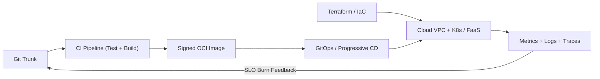

---
tags:
  - software-engineering
  - devops
  - platform-engineering
  - sre
  - hub
created: 2026-01-02
updated: 2026-11-13
status: 🟢
level: mid-to-senior
---
# Platform & DevOps Engineering Map

Platform and DevOps engineering automates the delivery path from version-controlled source code to resilient, observable production infrastructure. Modern teams implement this through immutable container artifacts, declarative Infrastructure as Code (IaC), progressive delivery pipelines, least-privilege cloud networking, and closed-loop telemetry tied to SLO error budgets.



---

## 1. Domain Curriculum & Guide Index

### Version Control & Delivery Pipelines
- [[Programming/Software Engineering/DevOps/Git|Git]] — Object model (blobs/trees/commits), rebase vs merge, reflog recovery, bisect, worktrees, and trunk-based workflows.
- [[Programming/Software Engineering/DevOps/CI-CD|CI/CD]] — Continuous Integration/Delivery/Deployment invariants, progressive rollouts (Canary, Blue-Green), rollback safety, and artifact immutability.
- [[Programming/Software Engineering/DevOps/Pipeline Design|Pipeline Design]] — DAG optimization, fast-fail stage ordering, deterministic dependency caching, supply-chain security (SBOM, SLSA, cosign), and ephemeral environments.
- [[Programming/Software Engineering/DevOps/GitHub Actions|GitHub Actions]] — Workflow concurrency, composite actions, BuildKit layer caching, OIDC keyless cloud authentication, and runner hardening.

### Containers & Workload Orchestration
- [[Programming/Software Engineering/DevOps/Docker|Docker]] — Linux namespaces/cgroups, OverlayFS copy-on-write, multi-stage BuildKit builds, non-root distroless hardening, and image CVE scanning.
- [[Programming/Software Engineering/DevOps/Docker Compose|Docker Compose]] — Declarative multi-service stacks, health-check dependency gating, bridge DNS networking, bind mounts vs named volumes, and `watch` dev loops.
- [[Programming/Software Engineering/DevOps/Kubernetes|Kubernetes]] — Control-plane reconciliation, Pod scheduling, Services/Gateway API, HPA/KEDA scaling, Pod Security Admission, NetworkPolicies, and graceful shutdown.

### Cloud Infrastructure & Serverless
- [[Programming/Software Engineering/DevOps/Cloud Fundamentals|Cloud Fundamentals]] — AWS/GCP/Azure primitive mapping, CIDR subnetting, VPC routing/PrivateLink, SG vs NACL, IAM evaluation precedence, L4/L7 LB, SLA math, and FinOps egress traps.
- [[Programming/Software Engineering/DevOps/Infrastructure as Code|Infrastructure as Code]] — Declarative vs imperative IaC, state drift prevention, immutable infra, policy-as-code (OPA/Checkov), and GitOps reconciliation.
- [[Programming/Software Engineering/DevOps/Terraform|Terraform]] — State locking, DAG resource graph, `for_each` vs `count`, zero-downtime `moved`/`import` refactors, module composition, and remote OIDC CI execution.
- [[Programming/Software Engineering/DevOps/Serverless|Serverless]] — Firecracker microVM lifecycle, cold-start/SnapStart internals, SQS `ReportBatchItemFailures`, DynamoDB idempotency, RDS Proxy pooling, and FaaS vs container break-even math.

### Telemetry, Reliability & SRE
- [[Programming/Software Engineering/DevOps/Monitoring|Monitoring]] — RED/USE/Golden Signals, Histogram vs Summary math, pull vs push collection, cardinality explosion prevention, PromQL, and multi-window SLO burn-rate alerting.
- [[Programming/Software Engineering/DevOps/Logging|Logging]] — JSON canonical wide events, `AsyncLocalStorage`/`contextvars` propagation, `stdout` DaemonSet pipelines (Fluent Bit/Vector), PII redaction, and Loki label cardinality.
- [[Programming/Software Engineering/DevOps/Observability|Observability]] — W3C `traceparent`, async Kafka/SQS span propagation, OpenTelemetry Collector two-tier tail sampling, eBPF continuous profiling, and 4-signal incident triage.

---

## 2. Engineering Effectiveness: DORA & SPACE Metrics

### DORA Four Key Metrics (Software Delivery & Operational Performance)

| Metric | Dimension | Elite | High | Medium | Low | Common Anti-Pattern / Gaming Risk |
|---|---|---|---|---|---|---|
| **Deployment Frequency** | Throughput | On-demand (multiple/day) | Weekly to monthly | Monthly to biannually | < Every 6 months | Splitting trivial no-op commits to inflate deploy count |
| **Lead Time for Changes** | Throughput | `< 1 hour` | `1 day – 1 week` | `1 week – 1 month` | `> 1 month` | Bypassing code review or CI tests to rush PR merges |
| **Change Failure Rate (CFR)** | Stability | `0% – 5%` | `5% – 10%` | `10% – 15%` | `> 15%` | Hiding prod hotfixes as "config tweaks" outside incident counts |
| **Failed Deployment Recovery Time (MTTR)** | Stability | `< 1 hour` | `< 1 day` | `1 day – 1 week` | `> 1 week` | Rolling forward blind patches instead of deterministic rollbacks |

> [!warning] Never Optimize Throughput Metrics in Isolation
> Throughput (Deployment Frequency, Lead Time) and Stability (CFR, MTTR) are coupled guardrails. Pushing Deployment Frequency without automated contract tests, canary gates, and fast rollbacks simply accelerates Change Failure Rate.

### SPACE Framework (Multi-Dimensional Developer Productivity)

Single-metric productivity tracking (lines of code, PR count, story points) fails via Goodhart's Law. Evaluate team health across **at least three** SPACE dimensions simultaneously:

| SPACE Dimension | Objective Signals | What Breaks If Over-Optimized Alone |
|---|---|---|
| **S — Satisfaction & Well-Being** | Developer NPS, on-call page load (`pages/week`), burnout surveys | High satisfaction with zero shipping velocity |
| **P — Performance** | Customer reliability (SLO attainment), feature adoption, CFR | Delivering fast features while burning out engineers |
| **A — Activity** | Build frequency, PR throughput, code review turnaround | Gaming commit/PR splits; ignoring architectural debt |
| **C — Communication & Collaboration** | PR review depth, onboarding time, cross-team RFC clarity | Endless meetings reducing uninterrupted focus blocks |
| **E — Efficiency & Flow** | CI queue duration (`< 10 min`), uninterrupted deep-work hours, local env parity | Siloed individual speed without shared maintainability |

---

## 3. Mastery Progression Path

| Phase | Core Focus | Guides to Complete | Mastery Checkpoint |
|---|---|---|---|
| **Phase 1: Source & Packaging** | Reproducible local builds and branch hygiene | `Git` $\rightarrow$ `Docker` $\rightarrow$ `Docker Compose` | Write a multi-stage non-root distroless Dockerfile + Compose stack with health-gated Postgres/Redis |
| **Phase 2: Automated Delivery** | Fast, secure CI/CD pipelines without static secrets | `CI-CD` $\rightarrow$ `Pipeline Design` $\rightarrow$ `GitHub Actions` | Design an OIDC-authenticated pipeline building signed OCI images with SBOM + canary rollback |
| **Phase 3: Cloud, IaC & Runtime** | Network boundaries, state management, and orchestration | `Cloud Fundamentals` $\rightarrow$ `Infrastructure as Code` $\rightarrow$ `Terraform` $\rightarrow$ `Kubernetes` $\rightarrow$ `Serverless` | Partition a multi-AZ VPC, manage remote Terraform state w/ `moved` blocks, and size K8s/Lambda workloads |
| **Phase 4: Telemetry & SRE** | Production incident triage and SLO reliability math | `Monitoring` $\rightarrow$ `Logging` $\rightarrow$ `Observability` | Configure multi-window SLO burn-rate alerts, OTel two-tier tail sampling, and trace-correlated JSON logging |

---

## 4. Cross-Domain Architecture Links

- [[Programming/Software Engineering/SDLC/SDLC Complete Guide|SDLC Complete Guide]]
- [[Programming/Software Engineering/SDLC/Release Engineering & Migrations|Release Engineering & Migrations]]
- [[Programming/Software Engineering/System Design/System Design Overview|System Design Overview]]
- [[Programming/Software Engineering/System Design/Scalability|Scalability]]
- [[Programming/Software Engineering/System Design/Caching|Caching]]
- [[Programming/Software Engineering/System Design/CDN|CDN]]
- [[Programming/Software Engineering/System Design/API Design|API Design]]

---

## Vault Index (Dataview)

```dataview
TABLE WITHOUT ID
  file.link as "Guide",
  status as "Status",
  level as "Level",
  updated as "Updated"
FROM "Programming/Software Engineering/DevOps"
WHERE file.name != "DevOps Complete Guide" AND !contains(file.name, "_Index")
SORT file.name ASC
```

---

← [[Programming/Software Engineering/Software Engineering Roadmap|Back to Software Engineering Roadmap]]
