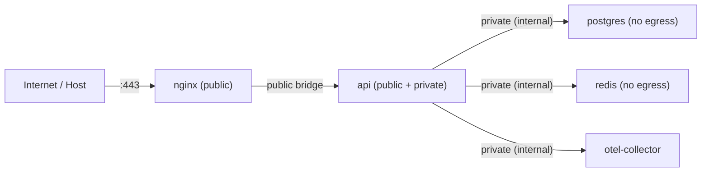
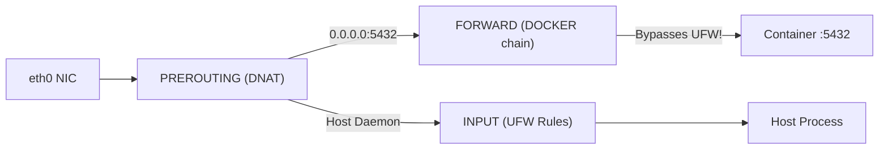
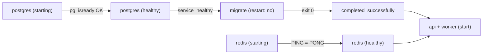

---
tags:
  - software-engineering
  - devops
  - docker
  - docker-compose
created: 2026-01-02
updated: 2026-11-13
status: 🟢
level: mid-to-senior
---
# Docker Compose

> [!abstract] Compose Specification Invariant
> Modern **Docker Compose v2+** (`docker compose` Go CLI plugin) implements the open **Compose Specification**, reconciling multi-service networks, storage mounts, health-gated startup DAGs, secrets, and cgroups v2 resource limits on a single Docker Engine host. The legacy `version: '3.x'` top-level key is **obsolete** and ignored by Compose v2—omit it from every `compose.yaml`. Related foundations: [[Programming/Software Engineering/DevOps/Docker|Docker]], [[Programming/Software Engineering/DevOps/Kubernetes|Kubernetes]], [[Programming/Software Engineering/DevOps/Observability|Observability]], [[Programming/Software Engineering/DevOps/DevOps Complete Guide|DevOps Complete Guide]].

---

## 1. Compose Specification Mechanics & Internal Architecture

Unlike legacy Python `docker-compose` v1 (which ceased maintenance in 2023), Compose v2 is compiled directly into the Docker CLI plugin ecosystem (`docker compose`), sharing the Go Compose Specification parser (`compose-go`) with Docker Buildx Bake and Testcontainers. When `docker compose up` executes, the engine computes a deterministic SHA256 `com.docker.compose.config-hash` label per service specification. On subsequent invocations, Compose diffs each live container's stored hash against the rendered YAML hash and recreates **only** the services whose configuration changed, preserving unaffected stateful containers (`postgres`, `redis`).

### 1.1 File Discovery, Merge Precedence & Override Tags

Compose namespaces every container, bridge network, and named volume under a project scope using `com.docker.compose.project` labels and `<project>-<service>-<replica>` naming (Compose v2 uses hyphens `-`, whereas legacy v1 used underscores `_`).

| Mechanism | Syntax & Discovery | Reconciliation Behavior |
|---|---|---|
| **Canonical File** | `compose.yaml` (preferred) > `compose.yml` > `docker-compose.yaml` | Automatically loads `compose.override.yaml` in the same directory whenever `-f` is **omitted** |
| **Explicit Override Chain** | `docker compose -f compose.yaml -f compose.prod.yaml up -d` | Disables auto-loading `compose.override.yaml`; merges listed files left-to-right |
| **Project Isolation** | Top-level `name: orders-platform`, `-p ci-491`, or `COMPOSE_PROJECT_NAME` | Prevents container, bridge subnet, and named-volume collisions across branches or parallel CI jobs |
| **Map vs Sequence Merge** | Mappings (`environment`, `labels`) deep-merge by key; sequences (`ports`, `volumes`) **append** | Use `!override` (replaces list wholesale) or `!reset` (strips inherited attribute) YAML tags in Compose v2.20+ |

When deploying `compose.yaml` to a staging host while stripping developer localhost port forwards inherited from base files, use `!reset` rather than maintaining duplicate YAML files:

```yaml
# compose.prod.yaml
services:
  postgres:
    ports: !reset []
  redis:
    ports: !reset []
  api:
    ports: !override
      - "127.0.0.1:8080:8080"
```

### 1.2 Variable Interpolation Precedence & the `env_file` Trap

Compose evaluates `${VAR}` placeholders across the YAML AST **prior to schema validation**.

| Expression | Evaluation Semantics | Production Usage |
|---|---|---|
| `${TAG:-latest}` | Uses `latest` if `TAG` is **unset or empty (`""`)** | Safe non-secret image tag defaults |
| `${TAG-latest}` | Uses `latest` **only when `TAG` is completely unset** | Preserves intentional empty strings |
| `${DB_NAME:?missing DB_NAME}` | Aborts immediately with an error if unset or empty | Fail-fast validation before deploying incomplete configs |
| `${DEBUG:+--verbose}` | Expands to `--verbose` only when `DEBUG` is set and non-empty | Conditional CLI flag injection |
| `$$REGEX` | Escapes literal `$` without interpolation | Required inside Prometheus relabel rules, Nginx `$host`, or bcrypt hashes |

**Interpolation Precedence (Highest $\rightarrow$ Lowest)**:
1. Host process environment (`IMAGE_TAG=2.1.0 docker compose up -d`)
2. `--env-file .env.staging` CLI argument
3. `.env` located alongside `compose.yaml`
4. Inline defaults (`${VAR:-default}`)

> [!warning] Compose `.env` Interpolation vs `services.<name>.env_file:`
> `services.<name>.env_file` injects variables **strictly into the container's runtime PID 1 environment** (`os.environ` / `process.env`). Compose does **not** load `env_file:` values when substituting `${VAR}` placeholders inside `compose.yaml` (`ports`, `image`, `deploy`). Always supply build/YAML interpolation variables via `.env` or `--env-file`.

### 1.3 Networking Internals: Embedded DNS (`127.0.0.11`), `internal: true` & UFW Bypass

By default, Compose provisions an isolated **user-defined bridge network** (`<project>_default`) instead of attaching workloads to Docker's legacy flat `docker0` bridge.

| Capability | Legacy `docker0` Bridge | Compose User-Defined Bridge |
|---|---|---|
| **Service Discovery** | Static IPs only (deprecated `--link`) | Embedded Docker DNS resolver listening on **`127.0.0.11:53`** inside each container's `net` namespace |
| **Replica Load Balancing** | Manual reverse proxy required | DNS `A` lookups for a service name return **all healthy replica IPs** in rotated round-robin order (`--scale worker=3`) |
| **Network Segmentation** | Single shared L2 broadcast domain | Explicit multi-tier bridges (`public` ingress vs `private` datastore tier) |

Inside every container on a Compose user-defined bridge, `/etc/resolv.conf` specifies `nameserver 127.0.0.11`. Within the container's network namespace (`CLONE_NEWNET`), `dockerd` installs Netfilter `DNAT` rules redirecting UDP/TCP port `53` packets targeting `127.0.0.11` to an in-daemon DNS server listening on a random ephemeral loopback port. Queries matching container names or service `aliases:` resolve immediately to bridge IPs (`172.18.0.x`), while external FQDNs forward to host upstream nameservers.



- **Zero-Egress `internal: true` Networks**: Marking a network `internal: true` instructs `dockerd` to omit the default gateway route and `MASQUERADE` NAT rules for that bridge. Datastores (`postgres`, `redis`) attached solely to `private` cannot initiate outbound TCP connections to the internet or exfiltrate payloads even under SQL/command injection, while multi-homed services (`api` attached to both `public` and `private`) proxy external requests safely.
- **Linux `host.docker.internal`**: Docker Desktop (macOS/Windows) injects `host.docker.internal` automatically. On Linux servers running native Docker Engine, map it explicitly using `extra_hosts`:

```yaml
services:
  api:
    extra_hosts:
      - "host.docker.internal:host-gateway"
```

#### The `0.0.0.0` Port Publishing UFW / `firewalld` Bypass

> [!danger] Published Ports Bypass Host `INPUT` Firewalls (`UFW` / `firewalld`)
> Writing `ports: ["5432:5432"]` binds `0.0.0.0:5432` on every host interface and inserts `DNAT` rules into `PREROUTING` paired with `ACCEPT` rules inside `FORWARD -> DOCKER` in Linux Netfilter. Because incoming packets redirected to a container bridge traverse **`PREROUTING -> FORWARD -> POSTROUTING`** and **never enter the `INPUT` chain**, host firewall policies (`ufw default deny incoming`, `ufw deny 5432`) are completely bypassed—exposing PostgreSQL or Redis directly to the public internet.



**Mandatory Production Rule**:
- Omit `ports:` completely for internal databases, queues, and caches (`postgres`, `redis`, `worker`); access them exclusively over Compose DNS on `private`.
- When local workstation debugging or a host-level Nginx/Caddy reverse proxy requires host access, pin the listener strictly to loopback (`127.0.0.1`):

```yaml
ports:
  - "127.0.0.1:5432:5432"
```

### 1.4 Lifecycle State Machine & `depends_on` Conditions

Writing short-form `depends_on: [postgres]` enforces `condition: service_started`, which unblocks the exact millisecond `dockerd` spawns `postgres` PID `1`—long before WAL crash recovery, `initdb` SQL bootstrap, and TCP socket binding on `:5432` complete. Production stacks gate execution via `service_healthy` and `service_completed_successfully`:



| Healthcheck Field | Default | Mechanics & Production Tuning |
|---|---|---|
| `test` | — | `["CMD", "/app/server", "-healthcheck"]` runs without `/bin/sh` (compatible with Distroless/`scratch`); `["CMD-SHELL", "..."]` spawns `/bin/sh -c` for shell pipes and `$$VAR` expansion |
| `interval` | `30s` | Steady-state polling period once the container enters `healthy` |
| `timeout` | `30s` | Probe timeout before marking an individual check failed (`3s–5s` recommended to catch hung event loops early) |
| `retries` | `3` | Consecutive probe failures required to flip state from `healthy` $\rightarrow$ `unhealthy` |
| `start_period` | `0s` | Warm-up window during which failed probes do **not** increment `retries` (prevents premature restarts during JVM/DB cold start) |
| `start_interval` | `5s` | *(Compose v2.20+ / Engine 25+)* Aggressive probe cadence **inside** `start_period` (set `1s–2s` so `depends_on` unblocks immediately rather than stalling 30s) |

### 1.5 Storage Architecture: Named Volumes vs Bind Mounts vs `tmpfs`

| Mount Type | Storage Backing | First-Mount Initialization Behavior | Latency & Production Role |
|---|---|---|---|
| **Named Volume** | `/var/lib/docker/volumes/<project>_<name>/_data` | If the volume is empty on first mount, Docker **copies existing image directory contents and file ownership** into the volume | Native Linux filesystem performance bypassing OverlayFS copy-up; mandatory for stateful engines (`postgres`, `redis`) |
| **Bind Mount** | Explicit host path (`./src:/app/src`) | **Shadows** the container directory completely with zero auto-copy from the image | Local config files (`:ro`), development source mounts, or explicit host log sinks |
| **`tmpfs` Mount** | Host kernel page cache / RAM (`type: tmpfs`) | Starts empty on every `up`/`start` and vanishes on container stop | Read-only container scratch space (`/tmp`), high-speed ephemeral CI databases, sensitive in-memory runtime files (`noexec,nosuid`) |

#### Cross-Platform Bind-Mount Traps: Linux UID/GID `EACCES` & macOS/Windows VirtioFS Latency

1. **Linux UID/GID Ownership Mismatch**: On native Linux hosts, bind mounts share kernel VFS inodes directly with zero UID translation. If a container executes as root (`0`), build artifacts or database files generated inside `./dist` become `root:root` owned on the developer's workstation; conversely, if the Dockerfile specifies `USER 10001:10001` while the host user is UID `1000`, writes into `./src` fail immediately with `EACCES`. Fix this in `compose.override.yaml` by inheriting host IDs (`user: "${UID:-1000}:${GID:-1000}"`) or eliminating bind mounts in favor of `develop.watch`.
2. **macOS / Windows VirtioFS I/O Penalty**: On Docker Desktop / WSL2 / OrbStack, host bind mounts traverse a VM boundary (VirtioFS or 9p). Stat-heavy dependency trees containing 30,000+ files (`node_modules/`, Python `.venv/`, Rust `target/`) degrade by **10–50x** when bind-mounted from the host.
   - **Legacy Docker Desktop Flag (`:delegated`)**: Historically, macOS engineers appended `:delegated` (`./app:/app:delegated`) to relax host-to-container cache coherency on osxfs; on modern VirtioFS engines `:delegated` is largely ignored, making **named volume shadowing** or **`develop.watch`** mandatory for fast inner dev loops.
   - **Named Volume Shadow Pattern**: Mount only source directories and isolate `node_modules` inside a named volume residing natively in the Linux VM filesystem:

```yaml
services:
  api:
    volumes:
      - ./src:/app/src
      - api_node_modules:/app/node_modules
volumes:
  api_node_modules:
```

---

## 2. Real-World Use Cases & Multi-Service Orchestration Matrix

| Engineering Scenario | Compose Architecture Pattern | When NOT to Use Compose (Alternative) | Operational Rationale |
|---|---|---|---|
| **Local Polyglot Microservice Development** | Single `compose.yaml` + auto-loaded `compose.override.yaml` with `target: dev` + `develop.watch` | Individual manual `docker run` commands or remote-only cloud dev | Eliminates "works on my machine" drift; boots identical Postgres 16, Redis 7, and OTel topologies locally in seconds |
| **Parallel CI Integration Test Harnesses** | Isolated `-p ci-${RUN_ID}` projects, `postgres` on `type: tmpfs` (`fsync=off`), `--exit-code-from` | Mocking SQL/Redis with in-memory fakes (misses SQL lock/transaction/ACL bugs; see [[Programming/Software Engineering/Testing/Integration Testing|Integration Testing]]) | Tests real wire protocols and migrations deterministically at RAM speed with zero cross-job port collisions |
| **Single-Host Staging / Edge Deployments** | Hardened `compose.yaml` (`read_only`, `cap_drop: ALL`, `secrets`, `deploy.resources`, loopback proxy) | Multi-AZ HA, zero-downtime rolling updates across hosts, or autoscaling (use [[Programming/Software Engineering/DevOps/Kubernetes|Kubernetes]]) | Compose lacks cross-node Raft consensus, multi-host health-aware ingress failover, and horizontal pod autoscaling |
| **Modular Monorepo Platform Composition** | Compose `include:` referencing team-owned `compose.postgres.yaml` / `compose.otel.yaml` + `profiles:` | Copying 500-line monolithic YAML across 12 service repos | Keeps infrastructure sub-stacks versioned cleanly while letting developers boot optional observability UIs on demand |
| **Database Schema Migration & Seed Gates** | Dedicated one-shot `migrate` service (`restart: "no"`) gated by `service_healthy` and blocking `api` via `service_completed_successfully` | Embedding `prisma migrate deploy` or DDL inside `api` PID 1 startup | Prevents race conditions when scaling `api` replicas concurrently (`--scale api=3`); aligns with [[Programming/Software Engineering/SDLC/Release Engineering & Migrations|Release Engineering & Migrations]] |

---

## 3. Step-by-Step End-to-End 6-Service Production Stack

Below is a complete, production-structured **Orders Platform** demonstrating unified dev/prod single-Dockerfile parity, 6 core services (`api`, `worker`, `migrate`, `postgres`, `redis`, `otel-collector`), secret mounting at `/run/secrets/`, custom Postgres/Redis tuning, OTLP telemetry export, `develop.watch` hot reload, and automated integration smoke testing.

### 3.1 Repository Layout

```text
orders-platform/
├── compose.yaml
├── compose.override.yaml
├── .env.example
├── .dockerignore
├── Dockerfile
├── package.json
├── package-lock.json
├── secrets/
│   ├── db_password.txt.example
│   └── redis_password.txt.example
├── config/
│   ├── otel-collector.yaml
│   └── redis.acl
├── migrations/
│   └── 001_init_orders.sql
├── scripts/
│   ├── wait-and-migrate.sh
│   └── smoke-test.sh
└── src/
    ├── secrets.mjs
    ├── otel.mjs
    ├── api.mjs
    └── worker.mjs
```

### 3.2 Environment Template, Secrets & Configurations

**`.env.example`** (for Compose YAML interpolation—copy to `.env` locally, never commit `.env` or plaintext secret files):

```dotenv
COMPOSE_PROJECT_NAME=orders-platform
APP_VERSION=1.5.0
API_PORT=8080
POSTGRES_DB=orders
POSTGRES_USER=orders_app
OTEL_SERVICE_NAMESPACE=commerce
DEV_UID=1000
DEV_GID=1000
```

**`secrets/db_password.txt.example` & `secrets/redis_password.txt.example`** (generate locally with `openssl rand -hex 24 > secrets/db_password.txt && chmod 0400 secrets/db_password.txt`):

```text
replace_with_32_byte_random_db_password
```

```text
replace_with_32_byte_random_redis_password
```

**`config/redis.acl`** (least-privilege ACL template disabling `default` and dedicating `orders_app` scoped strictly to `orders:*` keys and streams, hydrated at startup from `/run/secrets/redis_password`):

```text
user default off
user orders_app on >__REDIS_PASSWORD__ ~orders:* +@read +@write +@stream +@connection +ping +info -@dangerous
```

**`config/otel-collector.yaml`** (receives OTLP gRPC `4317` and HTTP `4318` from `api` and `worker` and exports structured batch telemetry):

```yaml
receivers:
  otlp:
    protocols:
      grpc:
        endpoint: 0.0.0.0:4317
      http:
        endpoint: 0.0.0.0:4318

processors:
  memory_limiter:
    check_interval: 1s
    limit_mib: 180
    spike_limit_mib: 45
  batch:
    timeout: 2s
    send_batch_size: 512

exporters:
  debug:
    verbosity: normal

service:
  telemetry:
    metrics:
      address: 0.0.0.0:8888
  pipelines:
    traces:
      receivers: [otlp]
      processors: [memory_limiter, batch]
      exporters: [debug]
    metrics:
      receivers: [otlp]
      processors: [memory_limiter, batch]
      exporters: [debug]
```

### 3.3 SQL Migration & Idempotent Wait/Migration Runner

**`migrations/001_init_orders.sql`**:

```sql
CREATE TABLE IF NOT EXISTS orders (
  id UUID PRIMARY KEY,
  customer_id TEXT NOT NULL,
  amount_cents INTEGER NOT NULL CHECK (amount_cents > 0),
  status TEXT NOT NULL DEFAULT 'PENDING',
  created_at TIMESTAMPTZ NOT NULL DEFAULT NOW()
);

CREATE TABLE IF NOT EXISTS outbox_events (
  id BIGSERIAL PRIMARY KEY,
  aggregate_id UUID NOT NULL REFERENCES orders(id) ON DELETE CASCADE,
  event_type TEXT NOT NULL,
  payload JSONB NOT NULL,
  published_at TIMESTAMPTZ,
  created_at TIMESTAMPTZ NOT NULL DEFAULT NOW()
);

CREATE INDEX IF NOT EXISTS idx_outbox_unpublished
  ON outbox_events (id)
  WHERE published_at IS NULL;
```

**`scripts/wait-and-migrate.sh`** (reads `/run/secrets/db_password`, waits defensively for TCP + `SELECT 1`, and applies ordered SQL migrations inside a single transaction with an advisory lock to guard concurrent executions):

```bash
#!/usr/bin/env bash
set -euo pipefail

DB_HOST="${DB_HOST:-postgres}"
DB_PORT="${DB_PORT:-5432}"
DB_NAME="${DB_NAME:-orders}"
DB_USER="${DB_USER:-orders_app}"
DB_PASSWORD_FILE="${DB_PASSWORD_FILE:-/run/secrets/db_password}"

if [[ ! -r "$DB_PASSWORD_FILE" ]]; then
  echo "FATAL: unreadable DB password file at $DB_PASSWORD_FILE" >&2
  exit 1
fi

export PGPASSWORD
PGPASSWORD="$(tr -d '\r\n' < "$DB_PASSWORD_FILE")"

echo "Waiting for PostgreSQL at ${DB_HOST}:${DB_PORT}/${DB_NAME}..."
until pg_isready -h "$DB_HOST" -p "$DB_PORT" -U "$DB_USER" -d "$DB_NAME" >/dev/null 2>&1; do
  sleep 1
done

psql -v ON_ERROR_STOP=1 -h "$DB_HOST" -p "$DB_PORT" -U "$DB_USER" -d "$DB_NAME" <<'SQL'
CREATE TABLE IF NOT EXISTS schema_migrations (
  filename TEXT PRIMARY KEY,
  applied_at TIMESTAMPTZ NOT NULL DEFAULT NOW()
);
SQL

for file in /migrations/*.sql; do
  base="$(basename "$file")"
  already_applied=$(psql -tAc "SELECT 1 FROM schema_migrations WHERE filename = '${base}'" -h "$DB_HOST" -p "$DB_PORT" -U "$DB_USER" -d "$DB_NAME")
  if [[ "$already_applied" == "1" ]]; then
    echo "Skipping already applied migration: ${base}"
    continue
  fi
  echo "Applying migration: ${base}"
  psql -v ON_ERROR_STOP=1 -1 -h "$DB_HOST" -p "$DB_PORT" -U "$DB_USER" -d "$DB_NAME" \
    -f "$file" \
    -c "INSERT INTO schema_migrations (filename) VALUES ('${base}');"
done

echo "All migrations applied successfully."
```

### 3.4 Application Source (`api`, `worker`, Secrets Reader & OTLP Emitter)

**`package.json`**:

```json
{
  "name": "orders-platform",
  "version": "1.5.0",
  "type": "module",
  "scripts": {
    "dev:api": "node --watch src/api.mjs",
    "dev:worker": "node --watch src/worker.mjs",
    "start:api": "node src/api.mjs",
    "start:worker": "node src/worker.mjs"
  },
  "dependencies": {
    "pg": "^8.13.1",
    "redis": "^4.7.0"
  }
}
```

**`src/secrets.mjs`** (reads Compose `/run/secrets/<name>` files cleanly with fallback to environment variables for tests):

```javascript
import fs from 'node:fs';

export function readSecret(envKey, fileEnvKey) {
  const filePath = process.env[fileEnvKey];
  if (filePath && fs.existsSync(filePath)) {
    return fs.readFileSync(filePath, 'utf8').trim();
  }
  const direct = process.env[envKey];
  if (!direct) {
    throw new Error(`Missing required credential: neither ${fileEnvKey} nor ${envKey} is set`);
  }
  return direct;
}
```

**`src/otel.mjs`** (lightweight OTLP/HTTP JSON span exporter pushing trace spans directly to `otel-collector:4318`):

```javascript
import crypto from 'node:crypto';

const OTLP_ENDPOINT = process.env.OTEL_EXPORTER_OTLP_ENDPOINT || 'http://otel-collector:4318';

export async function emitTraceSpan(serviceName, spanName, startNs, endNs, attributes = {}) {
  const traceId = crypto.randomBytes(16).toString('hex');
  const spanId = crypto.randomBytes(8).toString('hex');
  const payload = {
    resourceSpans: [
      {
        resource: {
          attributes: [{ key: 'service.name', value: { stringValue: serviceName } }],
        },
        scopeSpans: [
          {
            spans: [
              {
                traceId,
                spanId,
                name: spanName,
                kind: 2,
                startTimeUnixNano: String(startNs),
                endTimeUnixNano: String(endNs),
                attributes: Object.entries(attributes).map(([key, val]) => ({
                  key,
                  value: { stringValue: String(val) },
                })),
              },
            ],
          },
        ],
      },
    ],
  };

  try {
    await fetch(`${OTLP_ENDPOINT}/v1/traces`, {
      method: 'POST',
      headers: { 'Content-Type': 'application/json' },
      body: JSON.stringify(payload),
      signal: AbortSignal.timeout(1500),
    });
  } catch {
    // Non-blocking telemetry drop protects critical request latency
  }
}
```

**`src/api.mjs`** (HTTP server with transactional order + outbox insert, Redis read-through cache, `/healthz` readiness probe, inline `--healthcheck` mode for Distroless, and graceful `SIGTERM` drain):

```javascript
import crypto from 'node:crypto';
import http from 'node:http';
import pg from 'pg';
import { createClient } from 'redis';
import { emitTraceSpan } from './otel.mjs';
import { readSecret } from './secrets.mjs';

const port = Number(process.env.PORT || 8080);

if (process.argv.includes('--healthcheck')) {
  try {
    const res = await fetch(`http://127.0.0.1:${port}/healthz`, { signal: AbortSignal.timeout(2000) });
    process.exit(res.ok ? 0 : 1);
  } catch {
    process.exit(1);
  }
}

const pool = new pg.Pool({
  host: process.env.DB_HOST || 'postgres',
  port: Number(process.env.DB_PORT || 5432),
  database: process.env.DB_NAME || 'orders',
  user: process.env.DB_USER || 'orders_app',
  password: readSecret('DB_PASSWORD', 'DB_PASSWORD_FILE'),
  max: 15,
  idleTimeoutMillis: 30000,
  connectionTimeoutMillis: 3000,
});

const redisClient = createClient({
  socket: { host: process.env.REDIS_HOST || 'redis', port: Number(process.env.REDIS_PORT || 6379) },
  username: process.env.REDIS_USER || 'orders_app',
  password: readSecret('REDIS_PASSWORD', 'REDIS_PASSWORD_FILE'),
});
redisClient.on('error', (err) => {
  process.stderr.write(JSON.stringify({ level: 'error', component: 'redis', err: err.message }) + '\n');
});
await redisClient.connect();

const server = http.createServer(async (req, res) => {
  const startNs = BigInt(Date.now()) * 1_000_000n;
  if (req.method === 'GET' && req.url === '/healthz') {
    try {
      await pool.query('SELECT 1');
      await redisClient.ping();
      res.writeHead(200, { 'Content-Type': 'application/json' });
      res.end(JSON.stringify({ status: 'healthy' }));
    } catch (err) {
      res.writeHead(503, { 'Content-Type': 'application/json' });
      res.end(JSON.stringify({ status: 'unhealthy', error: err.message }));
    }
    return;
  }

  if (req.method === 'POST' && req.url === '/orders') {
    let body = '';
    for await (const chunk of req) body += chunk;
    const parsed = JSON.parse(body || '{}');
    const orderId = crypto.randomUUID();
    const customerId = String(parsed.customerId || 'cust-anonymous');
    const amountCents = Number(parsed.amountCents || 1999);

    const client = await pool.connect();
    try {
      await client.query('BEGIN');
      await client.query(
        'INSERT INTO orders (id, customer_id, amount_cents) VALUES ($1, $2, $3)',
        [orderId, customerId, amountCents],
      );
      await client.query(
        'INSERT INTO outbox_events (aggregate_id, event_type, payload) VALUES ($1, $2, $3)',
        [orderId, 'OrderCreated', JSON.stringify({ orderId, customerId, amountCents })],
      );
      await client.query('COMMIT');
      await redisClient.set(`orders:latest:${customerId}`, orderId, { EX: 300 });
      void emitTraceSpan('orders-api', 'POST /orders', startNs, BigInt(Date.now()) * 1_000_000n, { orderId });
      res.writeHead(201, { 'Content-Type': 'application/json' });
      res.end(JSON.stringify({ orderId, status: 'PENDING' }));
    } catch (err) {
      await client.query('ROLLBACK');
      res.writeHead(500, { 'Content-Type': 'application/json' });
      res.end(JSON.stringify({ error: err.message }));
    } finally {
      client.release();
    }
    return;
  }

  res.writeHead(404);
  res.end('Not Found');
});

server.listen(port, '0.0.0.0', () => {
  process.stdout.write(JSON.stringify({ level: 'info', component: 'api', msg: `listening on ${port}` }) + '\n');
});

async function shutdown(signal) {
  process.stdout.write(JSON.stringify({ level: 'info', component: 'api', msg: `draining on ${signal}` }) + '\n');
  server.close(async () => {
    await redisClient.quit();
    await pool.end();
    process.exit(0);
  });
}

process.on('SIGTERM', () => void shutdown('SIGTERM'));
process.on('SIGINT', () => void shutdown('SIGINT'));
```

**`src/worker.mjs`** (Outbox polling worker using `FOR UPDATE SKIP LOCKED`, pushing events to Redis Stream `orders:stream`, and terminating gracefully between batches):

```javascript
import pg from 'pg';
import { createClient } from 'redis';
import { emitTraceSpan } from './otel.mjs';
import { readSecret } from './secrets.mjs';

let stopping = false;

const pool = new pg.Pool({
  host: process.env.DB_HOST || 'postgres',
  port: Number(process.env.DB_PORT || 5432),
  database: process.env.DB_NAME || 'orders',
  user: process.env.DB_USER || 'orders_app',
  password: readSecret('DB_PASSWORD', 'DB_PASSWORD_FILE'),
  max: 5,
});

const redisClient = createClient({
  socket: { host: process.env.REDIS_HOST || 'redis', port: Number(process.env.REDIS_PORT || 6379) },
  username: process.env.REDIS_USER || 'orders_app',
  password: readSecret('REDIS_PASSWORD', 'REDIS_PASSWORD_FILE'),
});
await redisClient.connect();

async function processOutboxBatch() {
  const client = await pool.connect();
  try {
    await client.query('BEGIN');
    const { rows } = await client.query(
      `SELECT id, aggregate_id, event_type, payload
       FROM outbox_events
       WHERE published_at IS NULL
       ORDER BY id ASC
       LIMIT 20
       FOR UPDATE SKIP LOCKED`,
    );
    for (const row of rows) {
      const startNs = BigInt(Date.now()) * 1_000_000n;
      await redisClient.xAdd('orders:stream', '*', {
        eventType: row.event_type,
        aggregateId: row.aggregate_id,
        payload: JSON.stringify(row.payload),
      });
      await client.query('UPDATE outbox_events SET published_at = NOW() WHERE id = $1', [row.id]);
      void emitTraceSpan('orders-worker', 'outbox.publish', startNs, BigInt(Date.now()) * 1_000_000n, {
        outboxId: row.id,
      });
    }
    await client.query('COMMIT');
    return rows.length;
  } catch (err) {
    await client.query('ROLLBACK');
    process.stderr.write(JSON.stringify({ level: 'error', component: 'worker', err: err.message }) + '\n');
    return 0;
  } finally {
    client.release();
  }
}

process.on('SIGTERM', () => {
  stopping = true;
});
process.on('SIGINT', () => {
  stopping = true;
});

process.stdout.write(JSON.stringify({ level: 'info', component: 'worker', msg: 'outbox worker started' }) + '\n');
while (!stopping) {
  const count = await processOutboxBatch();
  if (count === 0 && !stopping) {
    await new Promise((resolve) => setTimeout(resolve, 1000));
  }
}

await redisClient.quit();
await pool.end();
process.stdout.write(JSON.stringify({ level: 'info', component: 'worker', msg: 'worker drained cleanly' }) + '\n');
process.exit(0);
```

### 3.5 Unified Multi-Target `Dockerfile` (Dev & Prod Parity)

Using one `Dockerfile` with distinct BuildKit targets (`dev`, `migrator`, `prod-api`, `prod-worker`) guarantees local development and CI/production share identical Node.js minor versions, OS libraries, and dependency trees while allowing `dev` to use `--watch` hot reload and `prod-*` to run on shell-less Distroless:

```dockerfile
# syntax=docker/dockerfile:1

ARG NODE_IMAGE=node:22.11.0-bookworm-slim@sha256:4000000000000000000000000000000000000000000000000000000000000001
ARG DISTROLESS_IMAGE=gcr.io/distroless/nodejs22-debian12:nonroot@sha256:4000000000000000000000000000000000000000000000000000000000000002

FROM ${NODE_IMAGE} AS base
WORKDIR /app

FROM base AS dev
COPY package.json package-lock.json ./
RUN --mount=type=cache,id=npm,target=/root/.npm npm ci
COPY src ./src
CMD ["npm", "run", "dev:api"]

FROM base AS prod-deps
COPY package.json package-lock.json ./
RUN --mount=type=cache,id=npm,target=/root/.npm npm ci --omit=dev

FROM postgres:16.4-alpine@sha256:4444444444444444444444444444444444444444444444444444444444444444 AS migrator
RUN apk add --no-cache bash
COPY migrations /migrations
COPY scripts/wait-and-migrate.sh /usr/local/bin/wait-and-migrate.sh
RUN chmod +x /usr/local/bin/wait-and-migrate.sh
ENTRYPOINT ["/usr/local/bin/wait-and-migrate.sh"]

FROM ${DISTROLESS_IMAGE} AS prod-api
WORKDIR /app
ENV NODE_ENV=production
COPY --link --from=prod-deps --chown=65532:65532 /app/node_modules ./node_modules
COPY --link --chown=65532:65532 package.json ./package.json
COPY --link --chown=65532:65532 src ./src
USER 65532:65532
EXPOSE 8080
CMD ["src/api.mjs"]

FROM ${DISTROLESS_IMAGE} AS prod-worker
WORKDIR /app
ENV NODE_ENV=production
COPY --link --from=prod-deps --chown=65532:65532 /app/node_modules ./node_modules
COPY --link --chown=65532:65532 package.json ./package.json
COPY --link --chown=65532:65532 src ./src
USER 65532:65532
CMD ["src/worker.mjs"]
```

### 3.6 Complete `compose.yaml` & `compose.override.yaml`

Notice that `compose.yaml` omits `version:` completely, mounts secrets with explicit numeric `uid: "65532"` and `mode: 0400` so Distroless non-root UID `65532` can read `/run/secrets/*`, isolates datastores on an `internal: true` network, tunes PostgreSQL flags and Redis persistence, and configures `develop.watch`:

```yaml
name: ${COMPOSE_PROJECT_NAME:-orders-platform}

x-runtime-hardening: &runtime-hardening
  restart: unless-stopped
  init: true
  stop_grace_period: 30s
  security_opt:
    - no-new-privileges:true
  cap_drop:
    - ALL
  logging:
    driver: json-file
    options:
      max-size: "25m"
      max-file: "4"

services:
  postgres:
    <<: *runtime-hardening
    image: postgres:16.4-bookworm@sha256:3333333333333333333333333333333333333333333333333333333333333333
    command:
      - "postgres"
      - "-c"
      - "shared_buffers=256MB"
      - "-c"
      - "max_connections=200"
      - "-c"
      - "work_mem=8MB"
      - "-c"
      - "wal_level=logical"
    environment:
      POSTGRES_USER: ${POSTGRES_USER:-orders_app}
      POSTGRES_DB: ${POSTGRES_DB:-orders}
      POSTGRES_PASSWORD_FILE: /run/secrets/db_password
    secrets:
      - source: db_password
        mode: 0400
    volumes:
      - pg_data:/var/lib/postgresql/data
    networks:
      - private
    cap_add:
      - CHOWN
      - SETUID
      - SETGID
      - DAC_OVERRIDE
    healthcheck:
      test: ["CMD-SHELL", "pg_isready -U $${POSTGRES_USER} -d $${POSTGRES_DB}"]
      interval: 15s
      timeout: 3s
      retries: 5
      start_period: 20s
      start_interval: 2s
    deploy:
      resources:
        limits:
          cpus: "1.5"
          memory: 768M
          pids: 256

  redis:
    <<: *runtime-hardening
    image: redis:7.4.1-alpine@sha256:7777777777777777777777777777777777777777777777777777777777777777
    user: "999:999"
    read_only: true
    tmpfs:
      - /tmp:rw,noexec,nosuid,size=8m
    entrypoint:
      - "/bin/sh"
      - "-ec"
      - "PASS=\"$$(tr -d '\\r\\n' < /run/secrets/redis_password)\" && sed \"s|__REDIS_PASSWORD__|$$PASS|g\" /etc/redis/users.acl.tmpl > /tmp/users.acl && exec redis-server --appendonly yes --save 60 1000 --aclfile /tmp/users.acl"
    configs:
      - source: redis_acl
        target: /etc/redis/users.acl.tmpl
        mode: 0444
    secrets:
      - source: redis_password
        uid: "999"
        gid: "999"
        mode: 0400
    volumes:
      - redis_data:/data
    networks:
      - private
    healthcheck:
      test: ["CMD-SHELL", "redis-cli --user orders_app --pass \"$$(tr -d '\\r\\n' < /run/secrets/redis_password)\" --no-auth-warning ping | grep -q PONG"]
      interval: 10s
      timeout: 3s
      retries: 5
      start_period: 10s
      start_interval: 2s
    deploy:
      resources:
        limits:
          cpus: "0.5"
          memory: 256M
          pids: 64

  migrate:
    build:
      context: .
      target: migrator
    restart: "no"
    environment:
      DB_HOST: postgres
      DB_PORT: "5432"
      DB_NAME: ${POSTGRES_DB:-orders}
      DB_USER: ${POSTGRES_USER:-orders_app}
      DB_PASSWORD_FILE: /run/secrets/db_password
    secrets:
      - source: db_password
        mode: 0444
    networks:
      - private
    depends_on:
      postgres:
        condition: service_healthy
    security_opt:
      - no-new-privileges:true
    cap_drop:
      - ALL

  otel-collector:
    <<: *runtime-hardening
    image: otel/opentelemetry-collector-contrib:0.114.0@sha256:8888888888888888888888888888888888888888888888888888888888888888
    command: ["--config=/etc/otelcol-contrib/config.yaml"]
    configs:
      - source: otel_config
        target: /etc/otelcol-contrib/config.yaml
        mode: 0444
    networks:
      - private
    deploy:
      resources:
        limits:
          cpus: "0.5"
          memory: 256M
          pids: 64

  api:
    <<: *runtime-hardening
    build:
      context: .
      target: prod-api
    read_only: true
    tmpfs:
      - /tmp:rw,noexec,nosuid,size=32m
    ports:
      - "127.0.0.1:${API_PORT:-8080}:8080"
    environment:
      PORT: "8080"
      DB_HOST: postgres
      DB_PORT: "5432"
      DB_NAME: ${POSTGRES_DB:-orders}
      DB_USER: ${POSTGRES_USER:-orders_app}
      DB_PASSWORD_FILE: /run/secrets/db_password
      REDIS_HOST: redis
      REDIS_PORT: "6379"
      REDIS_PASSWORD_FILE: /run/secrets/redis_password
      OTEL_EXPORTER_OTLP_ENDPOINT: http://otel-collector:4318
    secrets:
      - source: db_password
        uid: "65532"
        gid: "65532"
        mode: 0400
      - source: redis_password
        uid: "65532"
        gid: "65532"
        mode: 0400
    networks:
      - public
      - private
    depends_on:
      postgres:
        condition: service_healthy
      redis:
        condition: service_healthy
      migrate:
        condition: service_completed_successfully
      otel-collector:
        condition: service_started
    healthcheck:
      test: ["CMD", "/nodejs/bin/node", "/app/src/api.mjs", "--healthcheck"]
      interval: 15s
      timeout: 3s
      retries: 3
      start_period: 10s
      start_interval: 2s
    deploy:
      resources:
        limits:
          cpus: "1.0"
          memory: 512M
          pids: 128

  worker:
    <<: *runtime-hardening
    build:
      context: .
      target: prod-worker
    read_only: true
    tmpfs:
      - /tmp:rw,noexec,nosuid,size=32m
    stop_grace_period: 45s
    environment:
      DB_HOST: postgres
      DB_PORT: "5432"
      DB_NAME: ${POSTGRES_DB:-orders}
      DB_USER: ${POSTGRES_USER:-orders_app}
      DB_PASSWORD_FILE: /run/secrets/db_password
      REDIS_HOST: redis
      REDIS_PORT: "6379"
      REDIS_PASSWORD_FILE: /run/secrets/redis_password
      OTEL_EXPORTER_OTLP_ENDPOINT: http://otel-collector:4318
    secrets:
      - source: db_password
        uid: "65532"
        gid: "65532"
        mode: 0400
      - source: redis_password
        uid: "65532"
        gid: "65532"
        mode: 0400
    networks:
      - private
    depends_on:
      postgres:
        condition: service_healthy
      redis:
        condition: service_healthy
      migrate:
        condition: service_completed_successfully
      otel-collector:
        condition: service_started
    deploy:
      resources:
        limits:
          cpus: "0.75"
          memory: 384M
          pids: 128

configs:
  otel_config:
    file: ./config/otel-collector.yaml
  redis_acl:
    file: ./config/redis.acl

secrets:
  db_password:
    file: ./secrets/db_password.txt
  redis_password:
    file: ./secrets/redis_password.txt

networks:
  public:
    driver: bridge
  private:
    driver: bridge
    internal: true

volumes:
  pg_data:
  redis_data:
```

**`compose.override.yaml`** (auto-loaded in local development: switches `api` and `worker` to `target: dev`, sets dynamic `${DEV_UID}:${DEV_GID}` ownership, disables `read_only` for hot-reload watcher writes, exposes loopback DB/Redis ports, and configures `develop.watch` without slow macOS/Windows `node_modules` bind mounts):

```yaml
services:
  postgres:
    ports:
      - "127.0.0.1:5432:5432"

  redis:
    ports:
      - "127.0.0.1:6379:6379"

  api:
    build:
      target: dev
    user: "${DEV_UID:-1000}:${DEV_GID:-1000}"
    read_only: false
    command: ["npm", "run", "dev:api"]
    secrets: !override
      - source: db_password
        mode: 0444
      - source: redis_password
        mode: 0444
    develop:
      watch:
        - action: sync
          path: ./src
          target: /app/src
          ignore:
            - node_modules/
        - action: rebuild
          path: ./package-lock.json
        - action: sync+restart
          path: ./package.json
          target: /app/package.json

  worker:
    build:
      target: dev
    user: "${DEV_UID:-1000}:${DEV_GID:-1000}"
    read_only: false
    command: ["npm", "run", "dev:worker"]
    secrets: !override
      - source: db_password
        mode: 0444
      - source: redis_password
        mode: 0444
    develop:
      watch:
        - action: sync
          path: ./src
          target: /app/src
          ignore:
            - node_modules/
        - action: rebuild
          path: ./package-lock.json
```

### 3.7 End-to-End Integration Smoke Test (`scripts/smoke-test.sh`)

```bash
#!/usr/bin/env bash
set -euo pipefail

PROJECT="smoke-${RANDOM}-$$"
cleanup() {
  docker compose -p "$PROJECT" -f compose.yaml down -v --remove-orphans --timeout 10 || true
}
trap cleanup EXIT

docker compose -p "$PROJECT" -f compose.yaml up -d --build --wait --wait-timeout 90

# Create order via API -> triggers PostgreSQL transaction + Outbox insert
RESP=$(curl -fsS -X POST http://127.0.0.1:8080/orders \
  -H "Content-Type: application/json" \
  -d '{"customerId":"cust-42","amountCents":4500}')
echo "API Response: $RESP"

# Allow worker 2 seconds to publish outbox event to Redis Stream
sleep 2

REDIS_PASS=$(tr -d '\r\n' < ./secrets/redis_password.txt)
STREAM_LEN=$(docker compose -p "$PROJECT" -f compose.yaml exec -T redis \
  redis-cli --user orders_app --pass "$REDIS_PASS" --no-auth-warning XLEN orders:stream)

if [[ "$STREAM_LEN" -lt 1 ]]; then
  echo "FAIL: expected outbox event in Redis orders:stream, got $STREAM_LEN" >&2
  exit 1
fi

echo "PASS: End-to-end 6-service stack verified (orders:stream length=$STREAM_LEN)"
```

---

## 4. Complete Compose Construct Reference & Edge Cases

### 4.1 `develop.watch` Inner-Dev Loop Mechanics

Launched via `docker compose up --watch` (or `docker compose watch` alongside an already running stack), `develop.watch` runs an OS-native file watcher (`fsnotify` / FSEvents / ReadDirectoryChangesW) on the developer host and transmits only changed files through the Docker engine API—completely eliminating VirtioFS/9p cross-VM filesystem overhead on macOS and Windows.

| `develop.watch` Action | Engine Operation | Target Use Case |
|---|---|---|
| `sync` | Streams modified file bytes directly into the running container's `/app/...` without restarting PID 1 | Frameworks with built-in reloaders (`node --watch`, Vite, Next.js, Uvicorn `--reload`, Go `air`) |
| `rebuild` | Triggers a BuildKit image rebuild and hot-swaps the container seamlessly | Dependency lockfile mutations (`package-lock.json`, `pnpm-lock.yaml`, `uv.lock`, `go.mod`) |
| `sync+restart` | Syncs changed files into container, then executes container restart | Static configs (`nginx.conf`, `otel-collector.yaml`, `package.json` scripts) |
| `sync+exec` | *(Compose v2.29+)* Copies changed files and invokes a targeted `exec` command inside the container | Running codegen (`prisma generate`, `sqlc generate`, CSS compilers) inside the container |

### 4.2 Modularity Mechanisms: YAML Anchors, `extends`, `include`, and `profiles`

| Mechanism | Scope | Network & Volume Isolation | Best Architectural Fit |
|---|---|---|---|
| **YAML Anchors (`x-*`, `&anchor`, `<<: *anchor`)** | Single YAML file only | Same project namespace | Keeping `logging`, `restart`, `security_opt`, and `cap_drop` DRY across services in one `compose.yaml` |
| **`extends`** | Across local YAML files | Merged into calling project | Sharing a common service template (e.g., `base-worker`) across multiple compose variants without creating separate projects |
| **`include`** | Multiple Compose files (`./infra/compose.otel.yaml`) | **Preserves isolated sub-project scoping & resources** | Large teams composing independently maintained sub-stacks (Postgres cluster, Kafka, [[Programming/Software Engineering/DevOps/Monitoring|Monitoring]]) cleanly |
| **`profiles`** | Service-level array (`profiles: ["observability"]`) | Shares project networks/volumes when activated | Gating heavy optional services (Prometheus, Grafana, Adminer, seeders) so core `docker compose up` remains fast |

Example combining `include:` and `profiles:` cleanly:

```yaml
name: commerce-platform

include:
  - path: ./observability/compose.monitoring.yaml

services:
  prometheus:
    image: prom/prometheus:v2.55.0
    profiles: ["observability"]
    ports:
      - "127.0.0.1:9090:9090"

  seed:
    build:
      context: .
      target: migrator
    profiles: ["seed"]
    entrypoint: ["/usr/local/bin/seed-demo-data.sh"]
```

Invoke selectively: `docker compose --profile observability up -d` or `docker compose --profile seed run --rm seed`.

### 4.3 `secrets:` vs `configs:` vs `environment:`

| Attribute | `environment:` | `configs:` | `secrets:` |
|---|---|---|---|
| **Storage / Exposure** | Plaintext inside `docker inspect` (`Config.Env`) and inherited by every child subprocess and crash dump | Read-only bind mount (default `/<config_name>` or custom `target:`) | Read-only bind mount inside `/run/secrets/<secret_name>` (`mode: 0400` or custom) |
| **Non-Root Container Gotcha** | Readable by all UIDs | Set `uid`/`gid`/`mode` when strict permissions are needed | Default ownership is host file UID/root! Distroless non-root containers (`USER 65532`) fail with `EACCES` unless `uid: "65532"`, `gid: "65532"`, `mode: 0400` (or `0444` locally) are explicitly set |
| **Swarm vs Standalone Compose** | Identical | Immutable Raft object in Swarm; file mount in standalone Compose | Encrypted in Swarm Raft log + tmpfs mount; bind-mounted host file in standalone Compose (`chmod 0400` on host!) |

### 4.4 Subtle Edge Cases in Production Compose Operations

1. **`depends_on` Does Not Restart Dependents on Subsequent Crashes**: `depends_on` enforces ordering **solely during `up` / `start`**. If `postgres` restarts mid-flight due to an OOM event, Compose does **not** restart `api` or `worker`. Application connection pools (`pg.Pool`, SQLAlchemy, `database/sql`) must implement retry backoff and reconnect loops independently.
2. **YAML Anchor Shallow Merge Limitation**: YAML merge keys (`<<: *common`) perform a **shallow** top-level map merge. If `*common` defines `environment:` or `volumes:`, defining `environment:` on a service **replaces the entire inherited `environment` block** rather than deep-merging keys. Keep `environment:` and `volumes:` out of `x-*` anchors (put `restart`, `init`, `stop_grace_period`, `security_opt`, `cap_drop`, and `logging` inside `x-*`).
3. **Anonymous Volume Persistence Trap**: Declaring `volumes: ["/app/node_modules"]` (without a named prefix) creates an **unnamed UUID volume** that silently retains old `node_modules` across image rebuilds—causing mysterious missing-package errors even after updating `package.json`! Always use explicit named volumes and delete stale dependency volumes with `docker compose down -v` or `docker compose up --renew-anon-volumes`.
4. **Subnet Exhaustion (`172.17.0.0/16`–`172.31.0.0/16`)**: Docker's default IPAM allocates `/16` or `/20` subnets per Compose project network. On busy CI runners or developer workstations running 30+ Compose projects over time, Docker runs out of RFC1918 `/16` pools (`could not find an available, non-overlapping IPv4 address pool`). Configure `"default-address-pools": [{"base": "10.200.0.0/16", "size": 24}]` in `/etc/docker/daemon.json` to expand capacity from ~30 networks to **256 `/24` networks** (`65,536` per `/8`).
5. **`deploy.resources` on Standalone Engine**: While `deploy.replicas` and `deploy.placement` target Swarm, modern Compose v2 honors `deploy.resources.limits` (`cpus`, `memory`, `pids`) and `reservations` directly via Docker Engine's cgroups v2 APIs without Swarm mode!

---

## 5. Production Debugging, Operations Cheatsheet & Failure Playbook

### 5.1 Essential Compose v2 Operational Cheatsheet

| Command | Production / Dev Operation |
|---|---|
| `docker compose config` | Renders the fully merged, interpolated YAML AST (critical before applying overrides or `!reset`) |
| `docker compose config --services` | Lists all active service names (excluding disabled `profiles`) for CI scripting |
| `docker compose up -d --wait --wait-timeout 60` | Boots stack and blocks until all `healthcheck`-enabled services report `healthy` (exits non-zero on failure) |
| `docker compose up --watch` | Starts stack with live `develop.watch` file synchronization and targeted rebuilds |
| `docker compose up -d --force-recreate --no-deps api` | Recreates strictly `api` (e.g., after secret rotation) without touching healthy `postgres` or `redis` |
| `docker compose logs -f --tail=100 api worker` | Streams timestamp-interleaved stdout/stderr logs for targeted services |
| `docker compose ps --format json` | Emits machine-readable service state, health status, and published ports |
| `docker compose top` | Inspects live host PIDs and running commands inside every service container |
| `docker compose run --rm api npm test` | Executes one-off command on the project network and removes container + anonymous volumes on exit |
| `docker compose up --abort-on-container-exit --exit-code-from test` | Tears down full CI stack when `test` exits and propagates `test`'s exact exit code |
| `docker compose down -v --remove-orphans --timeout 15` | Destroys containers, bridges, orphaned containers from renamed services, and named volumes (`-v`) |

### 5.2 Failure Triage Playbook

| Symptom | Root Cause | Diagnostic Command | Verified Fix |
|---|---|---|---|
| **`dependency failed to start: container ... is unhealthy`** | Target container failed `retries` consecutive health probes after `start_period` | `docker inspect --format '{{json .State.Health}}' <cid> \| jq .` | Inspect exact `Output` / `ExitCode` inside `.Health.Log`; verify `$$VAR` escaping in `CMD-SHELL` and extend `start_period` + `start_interval: 2s` |
| **Updated `.env` or secret file ignored by running service** | Compose only compares container `config-hash` on `compose.yaml` changes; file-mounted `secrets` or `env_file` edits require recreation or restart | `docker compose exec api env` and `docker compose config` | Run `docker compose up -d --force-recreate <service>` (for env/config changes) or restart container after rotating host secret file |
| **`EACCES: permission denied, open '/run/secrets/db_password'`** | Host secret file is `0600` owned by host UID `0`/`1000`, unreadable by container non-root `USER 65532` | `docker compose exec api id` and `ls -ln secrets/` | Specify `uid: "65532"`, `gid: "65532"`, `mode: 0400` under service `secrets:` (or `0444` in dev override) |
| **`could not find an available, non-overlapping IPv4 address pool`** | Unpruned Compose networks exhausted Docker's default `/16` IPAM pools | `docker network ls \| wc -l` and `docker network inspect <net>` | Run `docker network prune -f` and configure smaller `/24` `default-address-pools` in `/etc/docker/daemon.json` |
| **`api` prints stale JS/Python code after `git checkout`** | Anonymous volume (`node_modules`) or stale `compose.override.yaml` container left behind | `docker compose ps -a` and `docker volume ls` | Run `docker compose down --remove-orphans` and rebuild with `docker compose up -d --build --renew-anon-volumes` |
| **Container restarts continuously with `status: exited (137)`** | Memory leak or `deploy.resources.limits.memory` too low, or PID 1 ignores `SIGTERM` during `down` | `docker inspect -f '{{.State.OOMKilled}} {{.State.ExitCode}}' <cid>` | Increase `deploy.resources.limits.memory` / bound runtime heap if `OOMKilled=true`; enable `init: true` + `SIGTERM` handler if `OOMKilled=false` |

---

## 6. Worked Exercises

### Exercise 1: Eliminating Dual Startup Race Conditions (`ECONNREFUSED` + Missing Schema)

A staging deployment of a backend stack crashes randomly on cold boots with `ECONNREFUSED 172.18.0.2:5432` or `ERROR: relation "orders" does not exist`:

```yaml
services:
  db:
    image: postgres:16-alpine
    environment:
      POSTGRES_PASSWORD: secret
  migrate:
    image: ghcr.io/org/migrator:1.5.0
    depends_on:
      - db
  api:
    image: ghcr.io/org/api:1.5.0
    depends_on:
      - db
      - migrate
```

**Tasks**:
1. Identify the **two independent race conditions** embedded in this YAML and explain why `depends_on: [db]` fails even though `postgres` PID 1 started.
2. Rewrite the stack using healthcheck probes (`start_interval`), `restart: "no"`, `service_healthy`, `service_completed_successfully`, and file-mounted `secrets:`.

### Solution 1

1. **Root Causes**:
   - **PID 1 Start vs TCP Readiness**: Short-form `depends_on: [db]` defaults to `condition: service_started`. The `postgres` entrypoint spawns PID `1` immediately, then takes 2–10 seconds running `initdb`, executing `/docker-entrypoint-initdb.d/`, performing WAL recovery, restarting internally, and opening `:5432`. Both `migrate` and `api` fail during that bootstrap window with `ECONNREFUSED`.
   - **Migration Completion Race**: `api` only waited for `migrate` to **start**, not finish exiting `0`. Consequently, `api` begins accepting traffic and querying `orders` before `CREATE TABLE` DDL transactions commit.

2. **Deterministic Fixed Configuration**:

```yaml
services:
  db:
    image: postgres:16.4-alpine@sha256:4444444444444444444444444444444444444444444444444444444444444444
    environment:
      POSTGRES_USER: postgres
      POSTGRES_DB: app
      POSTGRES_PASSWORD_FILE: /run/secrets/pg_pass
    secrets:
      - pg_pass
    volumes:
      - pg_data:/var/lib/postgresql/data
    healthcheck:
      test: ["CMD-SHELL", "pg_isready -U postgres -d app"]
      interval: 10s
      timeout: 3s
      retries: 5
      start_period: 20s
      start_interval: 2s

  migrate:
    image: ghcr.io/org/migrator:1.5.0
    restart: "no"
    environment:
      DB_HOST: db
      DB_PASSWORD_FILE: /run/secrets/pg_pass
    secrets:
      - pg_pass
    depends_on:
      db:
        condition: service_healthy

  api:
    image: ghcr.io/org/api:1.5.0
    environment:
      DB_HOST: db
      DB_PASSWORD_FILE: /run/secrets/pg_pass
    secrets:
      - pg_pass
    depends_on:
      db:
        condition: service_healthy
      migrate:
        condition: service_completed_successfully

secrets:
  pg_pass:
    file: ./secrets/pg_pass.txt

volumes:
  pg_data:
```

Setting `start_interval: 2s` inside `start_period: 20s` ensures `migrate` launches within 2 seconds of `postgres` opening connections rather than waiting for the default `30s` polling interval.

---

### Exercise 2: Cross-Platform Bind-Mount `EACCES` on Linux & 45-Second I/O Stalls on macOS/Windows

A multi-OS engineering team shares this `compose.yaml`:

```yaml
services:
  web:
    build: .
    user: "10001:10001"
    volumes:
      - .:/app
```

- On **Linux**, `npm run build` fails inside `web` with `EACCES: permission denied, open '/app/dist/main.js'`.
- On **macOS / Windows**, Next.js dev server startup takes **45 seconds** and pegs host CPU at `200%` scanning files.

**Tasks**:
1. Diagnose both failures at the Linux kernel VFS and Docker Desktop hypervisor layers.
2. Provide a clean cross-platform setup eliminating both bugs using `develop.watch`, dynamic UID/GID inheritance, and shadow named volumes.

### Solution 2

1. **Root Causes**:
   - **Linux `EACCES`**: Host repository files are owned by developer UID `1000`. Linux bind mounts map VFS inodes directly without UID translation, so container process UID `10001` receives kernel `EACCES` attempting to write inside `./` (`drwxr-xr-x 1000:1000`).
   - **macOS/Windows 45s I/O Stall**: Mounting `.:/app` routes every `stat()`, `lstat()`, and `readdir()` across 35,000+ files inside `node_modules/` and `.git/` across the VM VirtioFS / 9p boundary, multiplying syscall latency by 10–50x.

2. **Cross-Platform Remediation (`compose.override.yaml`)**:

```yaml
services:
  web:
    build:
      context: .
      target: dev
    user: "${UID:-1000}:${GID:-1000}"
    volumes:
      - ./src:/app/src
      - web_node_modules:/app/node_modules
    develop:
      watch:
        - action: sync
          path: ./src
          target: /app/src
          ignore:
            - node_modules/
        - action: rebuild
          path: ./package-lock.json

volumes:
  web_node_modules:
```

On Linux, setting `export UID=$(id -u) GID=$(id -g)` aligns container write ownership cleanly with the host directory; on macOS/Windows, isolating `web_node_modules` inside a native Linux VM volume (or removing bind mounts altogether and launching `docker compose up --watch`) drops cold boot time from `45s` to `<2s`.

---

### Exercise 3: Remediating Docker `0.0.0.0` UFW Firewall Bypass on Production Host

An engineer deploys a 3-tier Compose stack to a cloud VM protected by UFW (`ufw default deny incoming`, `ufw allow 22,80,443/tcp`). External vulnerability scanners report port `5432` (PostgreSQL) and `6379` (Redis) open to the public internet despite `ufw status` listing both ports blocked:

```yaml
services:
  api:
    image: ghcr.io/org/api:2.1.0
    ports: ["8080:8080"]
  postgres:
    image: postgres:16-alpine
    ports: ["5432:5432"]
  redis:
    image: redis:7-alpine
    ports: ["6379:6379"]
```

**Tasks**:
1. Identify the host commands proving the Netfilter bypass and trace the exact packet path explaining why UFW failed to drop packets.
2. Refactor `compose.yaml` to eliminate public exposure and block datastore internet egress completely.

### Solution 3

1. **Forensic Proof & Netfilter Path**:
   - Running `ss -tulpn | grep -E '5432|6379'` shows `0.0.0.0:5432` and `0.0.0.0:6379` bound on all interfaces.
   - Running `sudo iptables -t nat -L DOCKER -n -v` and `sudo iptables -L DOCKER -n -v` reveals `DNAT` rules in `PREROUTING` translating external `eth0` packets directly to bridge IPs alongside `ACCEPT` rules in `FORWARD -> DOCKER`.
   - UFW filters the **`INPUT`** chain (traffic destined for host local processes). Container `DNAT` traffic traverses **`PREROUTING -> FORWARD -> POSTROUTING`**, bypassing `INPUT` (`ufw-user-input`) entirely.

2. **Hardened Network Topology (`compose.yaml`)**:

```yaml
services:
  proxy:
    image: nginx:1.27-alpine@sha256:9000000000000000000000000000000000000000000000000000000000000001
    ports:
      - "80:80"
      - "443:443"
    networks:
      - public
    depends_on:
      api:
        condition: service_healthy

  api:
    image: ghcr.io/org/api:2.1.0
    networks:
      - public
      - private
    healthcheck:
      test: ["CMD", "/app/server", "-healthcheck"]
      interval: 15s
      timeout: 3s
      retries: 3
      start_period: 10s

  postgres:
    image: postgres:16.4-alpine@sha256:4444444444444444444444444444444444444444444444444444444444444444
    networks:
      - private

  redis:
    image: redis:7.4.1-alpine@sha256:7777777777777777777777777777777777777777777777777777777777777777
    networks:
      - private

networks:
  public:
    driver: bridge
  private:
    driver: bridge
    internal: true
```

Removing `ports:` from `postgres`, `redis`, and `api` removes all `DNAT`/`FORWARD` exposure; attaching datastores exclusively to `internal: true` drops their default gateway and outbound `MASQUERADE` rules.

---

### Exercise 4: Migrating Plaintext `.env` Passwords to Non-Root `/run/secrets/` & Read-Only Runtime

A security review flags a production Compose service because:
1. `DB_PASSWORD` appears in plaintext when running `docker inspect orders-api`.
2. Adding `secrets:` causes `api` (running as Distroless `USER 65532:65532`) to crash on startup with `Error: EACCES: permission denied, open '/run/secrets/db_password'`.
3. Enabling `read_only: true` breaks temporary file writes during CSV exports.

**Tasks**:
1. Explain why `DB_PASSWORD` appeared in `docker inspect` and why UID `65532` hit `EACCES`.
2. Write the hardened `compose.yaml` service definition fixing secret ownership, read-only `tmpfs`, capability dropping, and `*_FILE` injection.

### Solution 4

1. **Root Causes**:
   - Plaintext `environment:` or `env_file:` values are stored directly inside the container's OCI `Config.Env` metadata (`docker inspect`) and propagated to every child process and crash dump.
   - Host secret files (`chmod 0400` owned by root `0:0`) preserve host UID/mode when bind-mounted unless `uid`/`gid`/`mode` are specified in Compose `secrets:`, blocking non-root UID `65532`.

2. **Hardened Compose Configuration**:

```yaml
services:
  api:
    image: ghcr.io/org/orders-api:1.5.0
    read_only: true
    init: true
    stop_grace_period: 30s
    tmpfs:
      - /tmp:rw,noexec,nosuid,size=64m
    cap_drop:
      - ALL
    security_opt:
      - no-new-privileges:true
    environment:
      DB_HOST: postgres
      DB_PASSWORD_FILE: /run/secrets/db_password
    secrets:
      - source: db_password
        uid: "65532"
        gid: "65532"
        mode: 0400
    deploy:
      resources:
        limits:
          cpus: "1.0"
          memory: 512M
          pids: 128

secrets:
  db_password:
    file: ./secrets/db_password.txt
```

`uid: "65532"`, `gid: "65532"`, and `mode: 0400` restrict secret read access solely to the application user inside `/run/secrets/db_password`, while `/tmp` `tmpfs` supports temporary exports with `noexec,nosuid`.

---

### Exercise 5: Parallel CI Integration Test Harness with RAM `tmpfs` PostgreSQL

Design a [[Programming/Software Engineering/DevOps/CI-CD|CI/CD]] integration test configuration and wrapper script that:
- Executes **up to 6 concurrent CI jobs** on the same self-hosted runner without subnet, container-name, volume, or host-port collisions.
- Runs PostgreSQL completely in RAM (`tmpfs`) with `fsync=off` for maximum test throughput.
- Fails deterministically with the test runner's exit code and guarantees volume/network cleanup even when tests crash or `SIGINT` cancels the job.

### Solution 5

**`compose.ci.yaml`**:

```yaml
services:
  db:
    image: postgres:16.4-alpine@sha256:4444444444444444444444444444444444444444444444444444444444444444
    environment:
      POSTGRES_USER: ci
      POSTGRES_PASSWORD: ci_ephemeral_password
      POSTGRES_DB: test_db
      POSTGRES_INITDB_ARGS: "--nosync"
    command:
      - "postgres"
      - "-c"
      - "fsync=off"
      - "-c"
      - "synchronous_commit=off"
      - "-c"
      - "full_page_writes=off"
    volumes:
      - type: tmpfs
        target: /var/lib/postgresql/data
        tmpfs:
          size: 536870912
    healthcheck:
      test: ["CMD-SHELL", "pg_isready -U ci -d test_db"]
      interval: 5s
      timeout: 2s
      retries: 15
      start_period: 10s
      start_interval: 1s

  test-runner:
    build:
      context: .
      target: dev
    environment:
      DATABASE_URL: postgres://ci:ci_ephemeral_password@db:5432/test_db
    depends_on:
      db:
        condition: service_healthy
    command: ["npm", "run", "test:integration"]
```

**`scripts/run-ci-tests.sh`**:

```bash
#!/usr/bin/env bash
set -euo pipefail

PROJECT_NAME="ci-${GITHUB_RUN_ID:-local}-${GITHUB_RUN_ATTEMPT:-1}-$$"

cleanup() {
  docker compose -p "${PROJECT_NAME}" -f compose.ci.yaml down -v --remove-orphans --timeout 10 || true
}
trap cleanup EXIT

# Boot database and wait for pg_isready healthcheck (zero host ports -> zero collisions)
docker compose -p "${PROJECT_NAME}" -f compose.ci.yaml up -d --wait --wait-timeout 60 db

# Execute integration tests once and propagate exact exit status
docker compose -p "${PROJECT_NAME}" -f compose.ci.yaml run --rm --build --no-deps test-runner
```

---

### Exercise 6: Subnet Pool Exhaustion & Shallow YAML Anchor Merge Failure

A team operating 25 microservices in Compose experiences two production/CI incidents:
1. `docker compose up` aborts with `failed to create network ... could not find an available, non-overlapping IPv4 address pool among the defaults to assign to the network`.
2. After refactoring `compose.yaml` to extract shared `environment:` defaults into `x-common: &common`, adding `PORT: "9000"` on one service mysteriously wipes out `LOG_LEVEL`, `OTEL_ENDPOINT`, and `TZ` inherited from `&common`.

**Tasks**:
1. Explain the mathematical cause of IPv4 pool exhaustion and provide the `/etc/docker/daemon.json` configuration preventing recurrence.
2. Explain the YAML shallow-merge behavior responsible for missing environment variables and show the clean Compose fix.

### Solution 6

1. **IPAM Pool Exhaustion Fix**:
   - Docker Engine's default IPv4 pool uses `172.17.0.0/16`–`172.31.0.0/16` and `192.168.0.0/16`–`192.168.240.0/20`, creating fewer than ~32 default bridge subnets before exhausting available blocks.
   - Reclaim unused networks immediately with `docker network prune -f`, then configure `/etc/docker/daemon.json` with `/24` subnets (`254` container IPs per bridge, sufficient for single-host stacks) to expand capacity to **256 concurrent networks** inside one `/16`:

```json
{
  "default-address-pools": [
    {
      "base": "10.200.0.0/16",
      "size": 24
    }
  ]
}
```

   Restart Docker (`sudo systemctl restart docker`—safe for running workloads when `"live-restore": true` is enabled).

2. **YAML Anchor Shallow-Merge Fix**:
   - Standard YAML merge keys (`<<: *common`) perform a **shallow merge** on top-level map keys only. Overriding `environment:` on a service replaces the entire `environment` dictionary from `*common`.
   - **Fix**: Keep non-service-specific operational metadata (`restart`, `init`, `cap_drop`, `logging`) in `x-common`, place shared environment variables inside a reusable **`env_file:`** (or a separate **`x-env: &common-env`** anchor merged inside `environment:` directly), and verify the rendered YAML via `docker compose config`:

```yaml
x-common-ops: &common-ops
  restart: unless-stopped
  init: true
  cap_drop:
    - ALL

x-common-env: &common-env
  TZ: UTC
  LOG_LEVEL: info
  OTEL_EXPORTER_OTLP_ENDPOINT: http://otel-collector:4318

services:
  billing-api:
    <<: *common-ops
    image: ghcr.io/org/billing-api:2.0.0
    environment:
      <<: *common-env
      PORT: "9000"
```

---

## Related

- [[Programming/Software Engineering/DevOps/Docker|Docker]] — Linux namespaces, cgroups v2, OverlayFS copy-on-write, BuildKit, and Distroless hardening
- [[Programming/Software Engineering/DevOps/Kubernetes|Kubernetes]] — Graduating single-host Compose services to multi-node Pods, Services, and Deployments
- [[Programming/Software Engineering/DevOps/CI-CD|CI/CD]] — Automated Compose integration harnesses and artifact delivery
- [[Programming/Software Engineering/DevOps/Observability|Observability]] — OpenTelemetry Collector pipelines, trace propagation, and metrics scraping
- [[Programming/Software Engineering/DevOps/Monitoring|Monitoring]] — Prometheus service discovery and alerting on containerized SLOs
- [[Programming/Software Engineering/DevOps/Logging|Logging]] — Structured stdout/stderr JSON logging and rotation drivers
- [[Programming/Software Engineering/SDLC/Release Engineering & Migrations|Release Engineering & Migrations]] — Zero-downtime expand-contract schema migrations
- [[Programming/Software Engineering/DevOps/DevOps Complete Guide|DevOps Complete Guide]]
