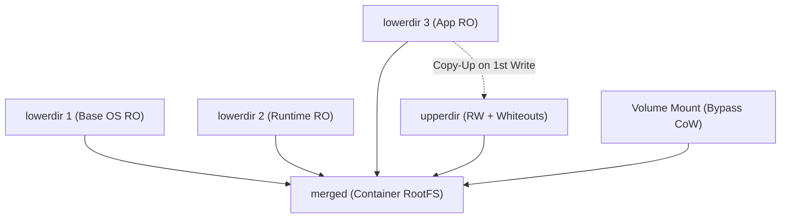
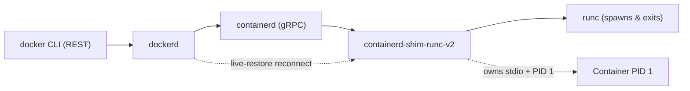
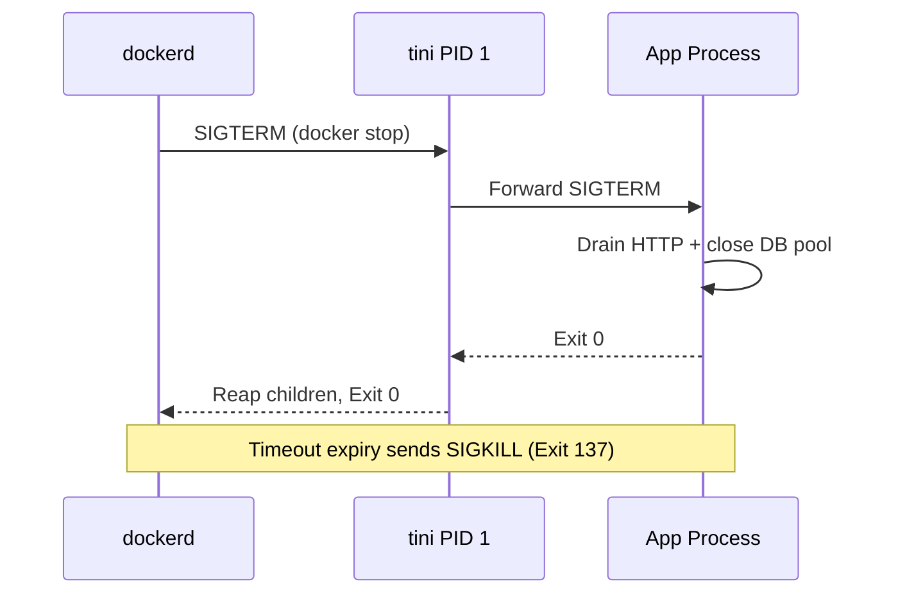

---
tags:
  - software-engineering
  - devops
  - docker
  - containers
  - linux
created: 2026-01-02
updated: 2026-11-13
status: 🟢
level: mid-to-senior
---
# Docker

> [!abstract] Core Invariant
> A Linux container is not a lightweight virtual machine; it is an ordinary host OS process tree isolated by **kernel namespaces**, bounded by **cgroups v2**, layered via **OverlayFS**, and restricted by **Linux capabilities**, **seccomp**, and **LSM profiles** (AppArmor/SELinux). Related foundations: [[Programming/Software Engineering/DevOps/DevOps Complete Guide|DevOps Complete Guide]], [[Programming/Software Engineering/DevOps/Docker Compose|Docker Compose]], [[Programming/Software Engineering/DevOps/Kubernetes|Kubernetes]], [[Programming/Software Engineering/DevOps/CI-CD|CI/CD]].

---

## 1. First-Principles Linux Kernel Isolation & Runtime Architecture

Unlike Type-1 or Type-2 hypervisors (KVM, QEMU, Firecracker microVMs covered in [[Programming/Software Engineering/DevOps/Serverless|Serverless]]), containers do not emulate hardware or boot an independent guest kernel. Every container shares the host Linux kernel directly via standard system calls (`clone(2)`, `unshare(2)`, `setns(2)`, and `pivot_root(2)`). A container process appears in the host process table (`ps aux` on the host) with a normal host PID; what transforms it into a container is the set of kernel isolation boundaries applied to its `task_struct` before `execve(2)` launches the application binary.

### 1.1 Kernel Namespaces (Visibility Virtualization)

Namespaces virtualize global kernel resources per process so a process tree perceives an isolated operating environment without duplicating the kernel itself. When the OCI runtime invokes `clone(2)` with namespace flags, the kernel allocates dedicated namespace descriptors linked via `/proc/<pid>/ns/`.

| Namespace | `clone(2)` Flag | Kernel Resource Isolated | Operational Consequence |
|---|---|---|---|
| `pid` | `CLONE_NEWPID` | Process ID number space | First process becomes PID `1` inside container; requires mounting an isolated `/proc` (`procfs`) so `ps`/`top` do not leak host PIDs |
| `net` | `CLONE_NEWNET` | NICs, IPs, routing tables, `iptables`/`nftables`, sockets | Container receives private `lo`, `eth0` (`veth` peer bridged to host), and full `0–65535` port range |
| `mnt` | `CLONE_NEWNS` | Filesystem mount table | Runtime calls `pivot_root(2)` (not `chroot`, which allows directory-fd escapes) to swap `/` to the container rootfs |
| `ipc` | `CLONE_NEWIPC` | System V IPC, POSIX message queues, `/dev/shm` | Prevents cross-container shared-memory collisions (Docker defaults `/dev/shm` to `64 MB`, often too small for Chromium or PyTorch workers) |
| `uts` | `CLONE_NEWUTS` | Hostname and NIS domain name | Isolates `uname -n` / `hostname` (defaults to the 12-character container ID prefix) |
| `user` | `CLONE_NEWUSER` | UID/GID tables (`/proc/<pid>/uid_map`) | Maps container UID `0` (root) to an unprivileged host UID such as `100000`, neutralizing host-root escapes |
| `cgroup` | `CLONE_NEWCGROUP` | `/proc/self/cgroup` hierarchy view | Virtualizes the visible cgroup root at `/` so container libraries read their own limits rather than host paths |

Because namespaces are kernel objects exposed as file descriptors under `/proc/<pid>/ns/`, an engineer or debugging tool (`docker exec`, `nsenter`) can attach a new process to an existing container's namespaces using `setns(2)`:

```bash
# Resolve the host PID of a running container's PID 1
PID=$(docker inspect --format '{{.State.Pid}}' api-prod)

# Inspect all active namespace inode identifiers
ls -la /proc/"$PID"/ns/

# List host namespaces and compare against the host init (PID 1)
sudo lsns -p "$PID"
```

### 1.2 Control Groups v2 (Resource Accounting & Limits)

Namespaces govern **what a process can see**; Control Groups govern **what hardware resources a process tree can consume**. Modern Linux kernels and Docker Engine (`20.10+` on systemd/cgroupfs v2 hosts) operate exclusively on **cgroups v2**, which replaces cgroups v1's fragmented per-controller directory trees with a single unified hierarchy mounted at `/sys/fs/cgroup`. A crucial architectural improvement in cgroups v2 is unified memory + I/O accounting: asynchronous page-cache writeback performed by kernel flushers is now accurately charged back to the allocating container's cgroup rather than escaping to the root host cgroup.

#### CPU: CFS Quota/Period Throttling, Bursts & Relative Weight

| Mechanism | Docker CLI Flag | cgroup v2 File | Kernel Scheduler Behavior | Failure Mode |
|---|---|---|---|---|
| **Hard Quota** | `--cpus=0.5` | `cpu.max` (`50000 100000`) | Completely Fair Scheduler (CFS) bandwidth control grants `50000 us` (`50 ms`) of aggregate CPU time per `100000 us` (`100 ms`) period across all runnable threads | Multi-threaded runtimes (Go `GOMAXPROCS`, JVM GC, Node libuv/worker threads) consume `50 ms` across 4 host cores in `12.5 ms` of wall time, then freeze for `87.5 ms`, producing periodic p99 latency spikes |
| **Burst Allowance** | *(cgroup v2 native)* | `cpu.max.burst` | Allows unused quota from idle periods to accumulate up to `burst` microseconds and spend during traffic spikes | Reduces spurious throttling on spiky workloads, though sustained saturation still stalls at `cpu.max` |
| **Relative Weight** | `--cpu-shares=512` | `cpu.weight` (`1–10000`, default `100`) | Proportional CPU allocation enforced **only under CPU contention**; idle host cores remain available to any container | Without a hard quota, a runaway service consumes 100% of idle host CPU, masking scaling flaws until co-located neighbors experience contention |
| **CPU Pinning** | `--cpuset-cpus="0-1"` | `cpuset.cpus` | Restricts thread scheduling strictly to listed logical CPUs | Eliminates cross-socket NUMA hops and L1/L2 cache invalidation, at the cost of manual capacity bin-packing |

Inspect CFS throttling directly inside a container (when cgroup namespaces are enabled, `/sys/fs/cgroup/cpu.stat` reflects only that container's cgroup):

```text
usage_usec 48120931
user_usec 39401120
system_usec 8719811
nr_periods 1240
nr_throttled 418        # Non-zero indicates threads were frozen mid-execution
throttled_usec 29400112 # 29.4 seconds of aggregate wall-clock freeze across periods
nr_bursts 0
burst_usec 0
```

#### Memory Limits, Page Cache, OOM Killer & Exit Codes

| cgroup v2 Control | Docker CLI Flag | Kernel Mechanics |
|---|---|---|
| `memory.max` | `--memory=512m` | Hard cap covering **anonymous RSS + kernel slab + page cache** charged to the cgroup. Reaching `memory.max` triggers synchronous direct memory reclaim; if reclaim fails to free pages, the kernel invokes the **cgroup OOM killer** and increments `oom_kill` in `memory.events` |
| `memory.high` | *(systemd / orchestrator)* | Soft throttle ceiling; crossing `memory.high` slows allocating threads and accelerates background page reclaim before hitting `memory.max` |
| `memory.swap.max` | `--memory-swap=512m` | Combined RAM + swap budget (`--memory` == `--memory-swap` sets `memory.swap.max=0`, disabling swap completely; `--memory-swap=-1` permits unlimited host swap) |
| `memory.oom.group` | *(runtime/cgroup policy)* | Setting `1` instructs the kernel to kill **all processes in the cgroup atomically** upon an OOM event rather than killing one sidecar thread while leaving PID 1 in a corrupted half-alive state |
| `pids.max` | `--pids-limit=256` | Caps maximum threads/processes (`clone(2)` returns `EAGAIN`), neutralizing fork bombs before the host PID table (`kernel.pid_max`) exhausts |
| `io.max` | `--device-write-bps` / `--device-read-iops` | Throttles block device read/write throughput (`rbps`, `wbps`, `riops`, `wiops`) via the blk-io controller |

> [!warning] Exit Code 137 vs Exit Code 143 Disambiguation
> Container exit codes follow the POSIX convention `128 + signal_number`:
> - **Exit `137` (`128 + 9`, `SIGKILL`)** has three distinct causes: (1) kernel cgroup OOM killer (`State.OOMKilled: true`), (2) `docker stop` grace-period timeout expiring after PID 1 failed to handle `SIGTERM` (`State.OOMKilled: false`), or (3) an external operator running `docker kill` / `kill -9`.
> - **Exit `143` (`128 + 15`, `SIGTERM`)** indicates the process received `SIGTERM` and exited via the default signal termination disposition rather than catching `SIGTERM`, draining connections, and returning `0`.
> - **Always verify** `docker inspect --format '{{.State.OOMKilled}} {{.State.ExitCode}}' <cid>` alongside `/sys/fs/cgroup/memory.events` (`oom_kill` count) and `dmesg -T | grep -i oom`.

### 1.3 Union Filesystems: OverlayFS (`overlay2`) Copy-on-Write Mechanics

Docker constructs a container's root filesystem by stacking immutable, content-addressed OCI image layers (`lowerdir`) beneath a single mutable container writable layer (`upperdir`) using the Linux kernel `overlay2` storage driver.



| OverlayFS Directory | Role | Operational Internals |
|---|---|---|
| `lowerdir` | Colon-separated stack of read-only image layers (`layerN:...:layer1`) | Shared across every container instantiated from the same image via Linux VFS inode and page-cache deduplication |
| `upperdir` | Single per-container read-write directory | Stores newly created files, full copies of modified lower-layer files, and whiteout deletion markers |
| `workdir` | Empty directory residing on the same underlying host filesystem as `upperdir` | Required by the Linux kernel to perform atomic `rename(2)` operations during copy-up |
| `merged` | Unified VFS mountpoint presented as `/` after `pivot_root(2)` | Resolves file reads top-down (`upperdir` first, then descending through `lowerdir`), returning the topmost visible entry |

> [!danger] Copy-Up Amplification & Whiteout Traps
> 1. **Copy-Up Write Penalty**: Modifying **1 byte**—or merely changing metadata via `chmod -R`, `chown -R`, or `touch`—on a 1.5 GB file residing in `lowerdir` forces the kernel to synchronously copy the **entire 1.5 GB file** into `upperdir` before applying the metadata or byte update. Inside a `Dockerfile`, running `COPY large-bundle /app` in one step and `RUN chown -R 1000:1000 /app` in the next `RUN` instruction **doubles the stored size of `/app` in the final image**. Always pass `COPY --chown=1000:1000` (or `chmod`/`chown` inside the same `RUN` that writes the file).
> 2. **Whiteout Masking (`c 0/0`)**: Deleting a file from `lowerdir` does not erase bytes from read-only lower layers; the kernel creates a **`0/0` character device whiteout file** in `upperdir` (or attaches an `xattr` `trusted.overlay.opaque=y` when a directory is replaced). Therefore, running `rm -rf /tmp/build-cache` or `apt-get clean` in a **separate `RUN` instruction** never reduces image pull size—the deleted bytes remain in the lower layer tarball forever and are merely hidden at mount time.
> 3. **Database I/O Anti-Pattern**: Never place write-heavy workloads (PostgreSQL, MySQL, RocksDB, SQLite, Kafka logs) on the OverlayFS writable layer; bypass `overlay2` entirely using named volumes or bind mounts (`docker run -v`).

### 1.4 Runtime Architecture & OCI Standards

Docker separates high-level developer/API orchestration from kernel-level container creation using modular **Open Container Initiative (OCI)** components.



| Component | Protocol & Responsibilities | Persistence Lifecycle |
|---|---|---|
| `dockerd` | Exposes REST API (`/var/run/docker.sock`), coordinates BuildKit image builds, bridge/overlay networking, and volume drivers | Long-lived host daemon; restartable without killing running containers when `"live-restore": true` is configured in `/etc/docker/daemon.json` |
| `containerd` | Industry-standard container lifecycle supervisor (`gRPC`), manages OCI image pulls, content store, and `overlay2` snapshotters | Long-lived host daemon; delegates execution to per-container shims |
| `containerd-shim-runc-v2` | Owns open `stdin`/`stdout`/`stderr` pipes, acts as subreaper for orphaned processes, reports exit status to `containerd`, and proxies `exec` requests | Lives for the exact lifetime of the container, enabling **daemonless upgrades** of `dockerd` and `containerd` without dropping running workloads |
| `runc` | Reference OCI Runtime CLI (`libcontainer`); parses `config.json`, creates namespaces/cgroups, executes `pivot_root`, drops capabilities, loads seccomp BPF filters, and invokes `execve()` | **Ephemeral**: terminates immediately once container PID 1 begins executing |

The OCI ecosystem enforces portability via two distinct specifications:
- **OCI Image Spec (`application/vnd.oci.image.*`)**: Defines the static distribution artifact pushed to registries: an optional **Image Index** (mapping `linux/amd64`, `linux/arm64` digests) $\rightarrow$ **Image Manifest** (JSON pointing to config and layer digests) $\rightarrow$ **Config JSON** (`Env`, `Cmd`, `Entrypoint`, `User`, `RootFS.diff_ids`) + compressed layer tarballs (`gzip` or `zstd` / `estargz` lazy-pullable).
- **OCI Runtime Spec**: Defines the unpacked execution bundle on disk—an extracted root filesystem directory paired with a runtime `config.json` enumerating namespaces, cgroup limits, masked paths (`/proc/kcore`, `/sys/firmware`), read-only paths (`/proc/sys`), seccomp syscall rules, and Linux capability sets consumed by `runc create` / `runc start`.

### 1.5 Security Isolation: Capabilities, Seccomp, LSMs, Rootless & `userns-remap`

By default, running as UID `0` inside a container is **not** equivalent to unrestricted host root because `runc` applies defense-in-depth restrictions before `execve()`:
1. **Linux Capabilities**: `runc` drops dangerous kernel capabilities (`CAP_SYS_ADMIN`, `CAP_SYS_MODULE`, `CAP_SYS_PTRACE`, `CAP_NET_ADMIN`) and retains only a minimal default subset (such as `CAP_NET_BIND_SERVICE`, `CAP_CHOWN`, `CAP_SETUID`, `CAP_SETGID`, `CAP_NET_RAW`). Hardened production workloads strip **all** capabilities (`--cap-drop=ALL`).
2. **Seccomp BPF Filtering**: Docker's default seccomp profile runs as an in-kernel Berkeley Packet Filter blocking ~44 high-risk syscalls (`bpf`, `kexec_load`, `init_module`, `mount`, `reboot`, `unshare`, `clone` with `CLONE_NEWUSER` on older profiles) with `EPERM`.
3. **Linux Security Modules (AppArmor / SELinux)**: Applies mandatory access control labels (`docker-default` AppArmor profile or `container_t` SELinux MCS labels) blocking writes to sensitive `/proc` and `/sys` paths even if an attacker acquires UID `0`.
4. **`userns-remap` vs Rootless Docker**:

| Mode | `dockerd` Privilege | Container UID `0` Host Mapping | Networking & Operational Trade-Offs |
|---|---|---|---|
| **Default Rootful** | Runs as `root` | Maps directly to host UID `0` | Native `overlay2` and netns speed; a container breakout combined with a host bind mount gives root access unless mitigated by non-root `USER` + `--cap-drop=ALL` |
| **`userns-remap`** | Runs as `root` | Remapped via `/etc/subuid` (e.g., `dockremap:100000:65536`) so container UID `0` = unprivileged host UID `100000` | Preserves native bridge networking and `overlay2` kernel performance while neutralizing UID `0` breakout risk; requires careful `chown` on shared host bind mounts |
| **Rootless Docker** | Runs as unprivileged user (`rootlesskit`) | Entire daemon + containers execute inside a user namespace via `newuidmap`/`newgidmap` | Eliminates root daemon attack surface completely; network packets traverse user-space NAT (`slirp4netns` or `pasta`), reducing throughput and preventing binding host ports `< 1024` without `sysctl` tuning |

---

## 2. Real-World Use Cases & Containerization Decision Matrix

### 2.1 Base Image Selection Matrix

Choosing the base image determines runtime CVE exposure, memory footprint, DNS correctness, and native binary compatibility.

| Image Family | C Standard Library | Shell & Package Manager | Typical Runtime Size | Production Fit & Critical Gotchas |
|---|---|---|---|---|
| **`scratch`** | None (static binary only) | None | `2–20 MB` | Ideal for Go (`CGO_ENABLED=0`) and static Rust (`musl`) binaries. Zero OS attack surface; must explicitly copy `/etc/ssl/certs/ca-certificates.crt`, `/usr/share/zoneinfo`, and `/etc/passwd` for non-root UID |
| **Distroless** (`gcr.io/distroless/*`) | `glibc` (Debian 12) | **None** (no `sh`, no `apt`) | `20 MB` (`static`) / `60–140 MB` (`nodejs22`/`python3`) | Standard production baseline for Node.js, Python, Java, and dynamic Go. Blocks post-RCE shell execution; debugging requires `nsenter` or ephemeral sidecars |
| **Chainguard Wolfi** (`cgr.dev/chainguard/*`) | `glibc` | **None** in prod tags (`-dev` adds `sh`/`apk`) | `10–65 MB` | Automated daily rebuilds targeting zero CVEs, embedded SPDX SBOM and Cosign signatures. Free tier restricts version-pinned tags to `:latest` |
| **Alpine** (`alpine:3.20`) | **`musl`** | `busybox sh` + `apk` | `8–15 MB` base | Small general-purpose base, **but `musl` introduces 4 major production traps**: (1) parallel DNS A/AAAA queries & `ndots`/TCP fallback quirks in Kubernetes; (2) `128 KB` default thread stack size causes stack overflows in deep C/Python/Rust call stacks; (3) `musl` `malloc` global lock contention degrades multi-threaded throughput vs `glibc` `ptmalloc2`/`jemalloc`; (4) Python wheels (`manylinux`) often fall back to slow C source builds |
| **Debian Slim** (`bookworm-slim`) | `glibc` | `dash`/`bash` + `apt` | `75–120 MB` base | Full `glibc` and `manylinux` compatibility without docs/manpages; prefer **only** as builder stages or when runtime shell/OS utilities (`ffmpeg`, `wkhtmltopdf`) are mandatory |

### 2.2 Architectural Adoption & Anti-Pattern Decision Matrix

| Scenario | Recommended Pattern | Alternative / When NOT to Use Docker | Concrete Technical Rationale |
|---|---|---|---|
| **Multi-team Web APIs & Workers (Node/Python/Go)** | Multi-stage BuildKit build $\rightarrow$ Distroless or `scratch` non-root OCI image | Direct VM AMIs (Packer) only if legacy kernel modules are required | Deterministic artifact immutability across local, CI, and [[Programming/Software Engineering/DevOps/Kubernetes|Kubernetes]]; 90%+ smaller attack surface than full OS packages |
| **Multi-Architecture Fleet (`amd64` dev laptops + AWS Graviton `arm64`)** | `FROM --platform=$BUILDPLATFORM` native cross-compilation (Go/Rust) or remote multi-node Buildx runners | Single-runner QEMU (`binfmt_misc`) for heavy Node/C++ builds | QEMU user-mode instruction translation slows compilers by `10–30x` and triggers occasional V8/futex emulation crashes; native cross-compilation finishes in seconds |
| **Multi-Tenant Untrusted Code Execution (Sandboxes / CI Runners)** | **Do NOT rely on standard `runc` containers alone**; use Firecracker microVMs, Kata Containers, or gVisor | Standard Docker `runc` with default seccomp | Shared host Linux kernel syscall surface allows kernel zero-day escapes across tenants; hardware-virtualized microVMs isolate each tenant behind KVM + separate guest kernel |
| **Stateful Clustered Databases in Production** | Managed DB (RDS/Cloud SQL) or K8s Operator with PVCs bypassing `overlay2` | Plain `docker run` storing DB files inside container writable layer | OverlayFS copy-up stalls `fsync` and amplifies write latency; container ephemerality without orchestrated volume fencing risks split-brain data loss |
| **Ultra-Low-Latency Kernel-Bypass / HFT (`DPDK`, `RDMA`)** | Bare-metal host processes or privileged host-networked SR-IOV pods | Default `docker0` / bridge NAT networking | Virtual Ethernet (`veth`) pair + Netfilter `MASQUERADE` NAT adds microseconds of packet processing jitter and CPU interrupts |

---

## 3. Step-by-Step Production Build Playbook

Every production repository begins with strict build-context hygiene, modern BuildKit syntax, and stack-specific multi-stage pipelines that separate compilers/secrets from the final immutable runtime filesystem.

### 3.1 `.dockerignore` Build-Context Hygiene

When `docker build .` starts, the CLI packages the **entire build context directory** into a tar stream sent to the BuildKit daemon. Omitting `.dockerignore` uploads `.git/` history, host `node_modules/`, Python `.venv/`, local `.env` secrets, and build logs—bloating context transfer, invalidating `COPY . .` layer caches whenever any unrelated file changes, and risking accidental inclusion of `.env` credentials inside the image.

```text
# .dockerignore
**/.git
**/.gitignore
**/.github
**/.vscode
**/.idea
**/.DS_Store

# Secrets and local environment files
**/.env
**/.env.*
!**/.env.example
**/*.pem
**/*.key
secrets/

# Language dependencies & build outputs (always built inside container)
**/node_modules
**/.pnpm-store
**/dist
**/build
**/.next
**/.venv
**/__pycache__
**/*.pyc
**/.pytest_cache
**/target
coverage/
*.log
```

### 3.2 BuildKit Mounts & Parser Directives (`# syntax=docker/dockerfile:1`)

Placing `# syntax=docker/dockerfile:1` on line 1 unlocks the latest stable BuildKit Dockerfile frontend (cache mounts, ephemeral secret mounts, SSH agent forwarding, heredocs, and `COPY --link`) independently of the host Docker Engine version.

| BuildKit Feature | Syntax | Execution Mechanics | Security / Cache Guarantee |
|---|---|---|---|
| **Cache Mount** | `RUN --mount=type=cache,id=pnpm,target=/root/.local/share/pnpm/store` | Mounts a persistent BuildKit-managed directory during `RUN` only | Packages survive across builds; **zero bytes enter the final OCI image layer** |
| **Locked Cache** | `RUN --mount=type=cache,target=/var/cache/apt,sharing=locked` | Serializes concurrent `RUN` steps accessing the same cache ID | Prevents `dpkg`/`apt` lockfile corruption during parallel multi-stage builds |
| **Secret Mount** | `RUN --mount=type=secret,id=npmrc,target=/root/.npmrc` | Mounts host secret file into an in-memory `tmpfs` inside the build step | **Never written to `overlay2`, OCI config `Env`, or `docker history`** |
| **SSH Mount** | `RUN --mount=type=ssh git clone git@github.com:org/private.git` | Forwards host `$SSH_AUTH_SOCK` into the build container | Private SSH keys never touch container disk or image layers |
| **`COPY --link`** | `COPY --link --from=builder /app/dist /app/dist` | Creates an independent layer snapshot merged directly into rootfs | Upstream `FROM` base OS patch updates do **not** require re-copying or re-compressing unchanged application layers |
| **Heredocs** | `RUN <<EOF` / `COPY <<EOF /path` | Executes multi-line shell/Python scripts cleanly without `&& \` escaping | Supports `set -euo pipefail` and readable inline config generation |

To fetch private Go or Node dependencies over SSH during `docker build --ssh default .` without persisting private keys into any layer:

```dockerfile
# syntax=docker/dockerfile:1
FROM golang:1.23.4-bookworm AS builder
WORKDIR /src
RUN mkdir -p -m 0700 ~/.ssh && ssh-keyscan github.com >> ~/.ssh/known_hosts
RUN --mount=type=ssh \
    --mount=type=cache,id=gomod,target=/go/pkg/mod \
    git config --global url."git@github.com:".insteadOf "https://github.com/" && \
    go mod download
```

> [!danger] Never Use `ARG` or `ENV` for Build Secrets, and Disable `docker-clean` for APT
> 1. Passing `--build-arg NPM_TOKEN=...` writes the token plaintext into OCI image `history` (`docker history --no-trunc`), while `ENV` permanently persists it inside the OCI Config JSON (`docker inspect`) even if a subsequent `RUN unset` runs. Always pass private registry tokens (`~/.npmrc`, `~/.netrc`, GitHub tokens) via `--mount=type=secret`.
> 2. Debian/Ubuntu official images ship `/etc/apt/apt.conf.d/docker-clean`, which deletes `.deb` caches immediately after `apt-get install`. When using `--mount=type=cache` with `apt`, remove `docker-clean` and configure `Keep-Downloaded-Packages "true"` first.

---

### 3.3 Production Stack A: Node.js 22 + pnpm + NestJS on Distroless

This layout implements a complete NestJS service (compatible with [[Programming/Backend/NestJS Complete Guide|NestJS Complete Guide]]) with private registry secret mounting, `pnpm deploy` pruning, zero-shell Distroless runtime, Distroless healthcheck without `curl`, and graceful `SIGTERM` drain.

```text
orders-api/
├── .dockerignore
├── Dockerfile
├── package.json
├── pnpm-lock.yaml
├── tsconfig.json
└── src/
    ├── main.ts
    └── healthcheck.mjs
```

**`package.json`**:

```json
{
  "name": "orders-api",
  "version": "1.4.0",
  "private": true,
  "scripts": {
    "build": "tsc -p tsconfig.json",
    "start:prod": "node dist/main.js"
  },
  "dependencies": {
    "@nestjs/common": "^10.4.4",
    "@nestjs/core": "^10.4.4",
    "@nestjs/platform-express": "^10.4.4",
    "reflect-metadata": "^0.2.2",
    "rxjs": "^7.8.1"
  },
  "devDependencies": {
    "@types/node": "^22.9.0",
    "typescript": "^5.6.3"
  }
}
```

**`src/main.ts`** (enables NestJS `SIGTERM`/`SIGINT` shutdown hooks and exposes `/healthz`):

```typescript
import 'reflect-metadata';
import { Controller, Get, Injectable, Module, OnModuleDestroy } from '@nestjs/common';
import { NestFactory } from '@nestjs/core';

@Injectable()
class AppLifecycleService implements OnModuleDestroy {
  async onModuleDestroy(): Promise<void> {
    process.stdout.write(JSON.stringify({ level: 'info', msg: 'closing db pools and draining connections' }) + '\n');
    await new Promise((resolve) => setTimeout(resolve, 250));
  }
}

@Controller()
class HealthController {
  @Get('/healthz')
  check(): { status: string; pid: number } {
    return { status: 'ok', pid: process.pid };
  }
}

@Module({
  controllers: [HealthController],
  providers: [AppLifecycleService],
})
class AppModule {}

async function bootstrap(): Promise<void> {
  const app = await NestFactory.create(AppModule, { logger: ['error', 'warn', 'log'] });
  app.enableShutdownHooks();

  const port = Number(process.env.PORT ?? 3000);
  await app.listen(port, '0.0.0.0');
  process.stdout.write(JSON.stringify({ level: 'info', msg: `listening on ${port}`, pid: process.pid }) + '\n');
}

bootstrap().catch((err: unknown) => {
  process.stderr.write(JSON.stringify({ level: 'fatal', error: String(err) }) + '\n');
  process.exit(1);
});
```

**`src/healthcheck.mjs`** (zero-dependency Node probe replacing `curl`/`wget` inside Distroless):

```javascript
const port = process.env.PORT || '3000';
const controller = new AbortController();
const timer = setTimeout(() => controller.abort(), 2500);

try {
  const res = await fetch(`http://127.0.0.1:${port}/healthz`, { signal: controller.signal });
  if (!res.ok) {
    process.exit(1);
  }
  process.exit(0);
} catch {
  process.exit(1);
} finally {
  clearTimeout(timer);
}
```

**`Dockerfile`** (Multi-stage Node 22 + pnpm + Distroless non-root):

```dockerfile
# syntax=docker/dockerfile:1

ARG NODE_IMAGE=node:22.11.0-bookworm-slim@sha256:4000000000000000000000000000000000000000000000000000000000000001
ARG DISTROLESS_IMAGE=gcr.io/distroless/nodejs22-debian12:nonroot@sha256:4000000000000000000000000000000000000000000000000000000000000002

FROM ${NODE_IMAGE} AS base
ENV PNPM_HOME="/pnpm"
ENV PATH="$PNPM_HOME:$PATH"
RUN corepack enable && corepack prepare pnpm@9.12.3 --activate
WORKDIR /app

FROM base AS builder
COPY package.json pnpm-lock.yaml ./
RUN --mount=type=cache,id=pnpm-store,target=/pnpm/store \
    --mount=type=secret,id=npmrc,target=/root/.npmrc \
    pnpm install --frozen-lockfile --store-dir=/pnpm/store

COPY tsconfig.json ./
COPY src ./src
RUN pnpm build && pnpm deploy --filter=. --prod /prod

FROM ${DISTROLESS_IMAGE} AS runtime
WORKDIR /app
ENV NODE_ENV=production
ENV PORT=3000

COPY --link --from=builder --chown=65532:65532 /prod/node_modules ./node_modules
COPY --link --from=builder --chown=65532:65532 /prod/package.json ./package.json
COPY --link --from=builder --chown=65532:65532 /app/dist ./dist
COPY --link --from=builder --chown=65532:65532 /app/src/healthcheck.mjs ./healthcheck.mjs

USER 65532:65532
EXPOSE 3000

HEALTHCHECK --interval=15s --timeout=3s --start-period=10s --retries=3 \
  CMD ["/nodejs/bin/node", "/app/healthcheck.mjs"]

# Distroless nodejs22 ENTRYPOINT is ["/nodejs/bin/node"], so CMD passes the script directly as PID 1
CMD ["dist/main.js"]
```

Build and run with private `.npmrc` secret mount (never persisted in image layers):

```bash
docker build --secret id=npmrc,src="$HOME/.npmrc" -t ghcr.io/org/orders-api:1.4.0 .
docker run -d --name orders-api --read-only --cap-drop=ALL -p 127.0.0.1:3000:3000 ghcr.io/org/orders-api:1.4.0
```

---

### 3.4 Production Stack B: Python 3.12 + `uv` FastAPI Service

`uv` (written in Rust) resolves and installs `uv.lock` dependencies 10–50x faster than `pip`, creates relocatable virtual environments, and cleanly separates build-only compilers (`gcc`, `libpq-dev`) from a minimal runtime stage. Using a non-root UID (`10001`) on `python:3.12-slim-bookworm` (or Distroless Python when zero shell is mandatory) keeps `glibc` compatibility for C-extension wheels (`numpy`, `pydantic-core`, `psycopg[binary]`).

```text
inference-api/
├── .dockerignore
├── Dockerfile
├── pyproject.toml
├── uv.lock
└── app/
    ├── __init__.py
    ├── main.py
    └── healthcheck.py
```

**`pyproject.toml`**:

```toml
[project]
name = "inference-api"
version = "0.8.0"
requires-python = ">=3.12,<3.13"
dependencies = [
  "fastapi==0.115.5",
  "uvicorn[standard]==0.32.0",
]
```

**`app/main.py` & `app/healthcheck.py`**:

```python
from contextlib import asynccontextmanager
import json
import os
import sys
from fastapi import FastAPI

@asynccontextmanager
async def lifespan(_app: FastAPI):
    sys.stdout.write(json.dumps({"level": "info", "msg": "startup complete", "pid": os.getpid()}) + "\n")
    sys.stdout.flush()
    yield
    sys.stdout.write(json.dumps({"level": "info", "msg": "draining connections cleanly"}) + "\n")
    sys.stdout.flush()

app = FastAPI(title="inference-api", lifespan=lifespan)

@app.get("/healthz")
async def healthz() -> dict[str, str]:
    return {"status": "ok"}
```

```python
# app/healthcheck.py
import os
import sys
import urllib.request

port = os.environ.get("PORT", "8000")
url = f"http://127.0.0.1:{port}/healthz"

try:
    with urllib.request.urlopen(url, timeout=2.5) as resp:
        sys.exit(0 if resp.status == 200 else 1)
except Exception:
    sys.exit(1)
```

**`Dockerfile`** (Multi-stage Python 3.12 + `uv` + non-root `10001:10001` + `tini`):

```dockerfile
# syntax=docker/dockerfile:1

ARG PYTHON_IMAGE=python:3.12.7-slim-bookworm@sha256:5000000000000000000000000000000000000000000000000000000000000001
ARG UV_IMAGE=ghcr.io/astral-sh/uv:0.5.4@sha256:5000000000000000000000000000000000000000000000000000000000000002

FROM ${UV_IMAGE} AS uv-bin

FROM ${PYTHON_IMAGE} AS builder
COPY --from=uv-bin /uv /uvx /bin/
ENV UV_COMPILE_BYTECODE=1 \
    UV_LINK_MODE=copy \
    UV_PYTHON_DOWNLOADS=0

WORKDIR /app

# Install dependencies first without copying source code (maximizes BuildKit layer cache)
RUN --mount=type=cache,id=uv-cache,target=/root/.cache/uv \
    --mount=type=secret,id=netrc,target=/root/.netrc \
    --mount=type=bind,source=uv.lock,target=uv.lock \
    --mount=type=bind,source=pyproject.toml,target=pyproject.toml \
    uv sync --frozen --no-install-project --no-dev

COPY app ./app
RUN --mount=type=cache,id=uv-cache,target=/root/.cache/uv \
    --mount=type=bind,source=uv.lock,target=uv.lock \
    --mount=type=bind,source=pyproject.toml,target=pyproject.toml \
    uv sync --frozen --no-dev --no-editable

FROM ${PYTHON_IMAGE} AS runtime
RUN <<EOF
set -euo pipefail
rm -f /etc/apt/apt.conf.d/docker-clean
echo 'Binary::apt::APT::Keep-Downloaded-Packages "true";' > /etc/apt/apt.conf.d/keep-cache
EOF

RUN --mount=type=cache,target=/var/cache/apt,sharing=locked \
    --mount=type=cache,target=/var/lib/apt,sharing=locked \
    apt-get update && apt-get install -y --no-install-recommends tini

RUN groupadd --gid 10001 appgroup && useradd --uid 10001 --gid 10001 --no-create-home --shell /usr/sbin/nologin appuser

WORKDIR /app
ENV PATH="/app/.venv/bin:$PATH" \
    PYTHONUNBUFFERED=1 \
    PYTHONDONTWRITEBYTECODE=1 \
    PORT=8000

COPY --link --from=builder --chown=10001:10001 /app/.venv /app/.venv
COPY --link --from=builder --chown=10001:10001 /app/app /app/app

USER 10001:10001
EXPOSE 8000

HEALTHCHECK --interval=15s --timeout=3s --start-period=10s --retries=3 \
  CMD ["python3", "/app/app/healthcheck.py"]

ENTRYPOINT ["/usr/bin/tini", "--"]
CMD ["uvicorn", "app.main:app", "--host", "0.0.0.0", "--port", "8000", "--timeout-graceful-shutdown", "25"]
```

---

### 3.5 Production Stack C: Go 1.23 Static Binary on `FROM scratch` + Built-In Healthcheck

`FROM scratch` contains **zero files**—no `libc`, no shell, no `tzdata`, no TLS root certificates, and no `curl`. Therefore, a production `FROM scratch` binary must:
1. Compile statically with `CGO_ENABLED=0`.
2. Explicitly copy CA certificates (`/etc/ssl/certs/ca-certificates.crt`), IANA timezone data (`/usr/share/zoneinfo`), and a minimal `/etc/passwd` + `/etc/group` entry for numeric UID `65532`.
3. Implement an inline `-healthcheck` flag in the binary itself so `HEALTHCHECK CMD ["/server", "-healthcheck"]` works without any shell or external HTTP client!

**`cmd/server/main.go`**:

```go
package main

import (
	"context"
	"errors"
	"flag"
	"fmt"
	"net/http"
	"os"
	"os/signal"
	"syscall"
	"time"
)

func main() {
	healthcheck := flag.Bool("healthcheck", false, "run local healthcheck probe and exit")
	flag.Parse()

	port := os.Getenv("PORT")
	if port == "" {
		port = "8080"
	}

	if *healthcheck {
		os.Exit(runHealthcheck(port))
	}

	mux := http.NewServeMux()
	mux.HandleFunc("/healthz", func(w http.ResponseWriter, _ *http.Request) {
		w.Header().Set("Content-Type", "application/json")
		w.WriteHeader(http.StatusOK)
		_, _ = w.Write([]byte(`{"status":"ok"}`))
	})

	srv := &http.Server{
		Addr:              ":" + port,
		Handler:           mux,
		ReadHeaderTimeout: 5 * time.Second,
		IdleTimeout:       60 * time.Second,
	}

	ctx, stop := signal.NotifyContext(context.Background(), syscall.SIGTERM, syscall.SIGINT)
	defer stop()

	go func() {
		fmt.Printf(`{"level":"info","msg":"listening","port":%q,"pid":%d}`+"\n", port, os.Getpid())
		if err := srv.ListenAndServe(); err != nil && !errors.Is(err, http.ErrServerClosed) {
			fmt.Fprintf(os.Stderr, `{"level":"fatal","err":%q}`+"\n", err.Error())
			os.Exit(1)
		}
	}()

	<-ctx.Done()
	shutdownCtx, cancel := context.WithTimeout(context.Background(), 20*time.Second)
	defer cancel()

	if err := srv.Shutdown(shutdownCtx); err != nil {
		fmt.Fprintf(os.Stderr, `{"level":"error","msg":"forced shutdown","err":%q}`+"\n", err.Error())
		os.Exit(1)
	}
	fmt.Println(`{"level":"info","msg":"graceful shutdown complete"}`)
}

func runHealthcheck(port string) int {
	client := &http.Client{Timeout: 2 * time.Second}
	resp, err := client.Get("http://127.0.0.1:" + port + "/healthz")
	if err != nil {
		return 1
	}
	defer resp.Body.Close()
	if resp.StatusCode != http.StatusOK {
		return 1
	}
	return 0
}
```

**`Dockerfile`** (Multi-arch native cross-compile into `FROM scratch`, ~12 MB final image):

```dockerfile
# syntax=docker/dockerfile:1

FROM --platform=$BUILDPLATFORM golang:1.23.4-bookworm@sha256:6000000000000000000000000000000000000000000000000000000000000001 AS builder
ARG TARGETOS TARGETARCH
WORKDIR /src

RUN apt-get update && apt-get install -y --no-install-recommends ca-certificates tzdata && rm -rf /var/lib/apt/lists/*
RUN printf 'nonroot:x:65532:65532:nonroot:/nonexistent:/sbin/nologin\n' > /etc/passwd.nonroot && \
    printf 'nonroot:x:65532:\n' > /etc/group.nonroot

COPY go.mod go.sum ./
RUN --mount=type=cache,id=gomod,target=/go/pkg/mod \
    go mod download

COPY . .
RUN --mount=type=cache,id=gomod,target=/go/pkg/mod \
    --mount=type=cache,id=gobuild-${TARGETARCH},target=/root/.cache/go-build \
    CGO_ENABLED=0 GOOS="${TARGETOS}" GOARCH="${TARGETARCH}" \
    go build -trimpath -ldflags="-s -w" -o /out/server ./cmd/server

FROM scratch
COPY --from=builder /etc/ssl/certs/ca-certificates.crt /etc/ssl/certs/ca-certificates.crt
COPY --from=builder /usr/share/zoneinfo /usr/share/zoneinfo
COPY --from=builder /etc/passwd.nonroot /etc/passwd
COPY --from=builder /etc/group.nonroot /etc/group
COPY --from=builder --chown=65532:65532 /out/server /server

USER 65532:65532
ENV PORT=8080
EXPOSE 8080

HEALTHCHECK --interval=15s --timeout=3s --start-period=5s --retries=3 \
  CMD ["/server", "-healthcheck"]

ENTRYPOINT ["/server"]
```

### 3.6 Multi-Platform Buildx, `docker-bake.hcl` & Container Smoke Tests

When building for heterogeneous CPU fleets (`linux/amd64` workstations + AWS Graviton `linux/arm64` nodes), configure a `docker-container` Buildx builder:

```bash
docker buildx create --name multiarch --driver docker-container --bootstrap --use
docker buildx build --platform linux/amd64,linux/arm64 \
  --cache-from type=registry,ref=ghcr.io/org/server:buildcache \
  --cache-to type=registry,ref=ghcr.io/org/server:buildcache,mode=max \
  --sbom=true --provenance=mode=max \
  -t ghcr.io/org/server:1.4.0 --push .
```

| Multi-Arch Strategy | Execution Mechanism | Build Speed | Production Trade-Off |
|---|---|---|---|
| **QEMU (`binfmt_misc`)** | Kernel intercepts foreign ELF binaries (`arm64` on `amd64`) via `qemu-aarch64-static` | **10–30x slower** on CPU-bound compilation | Occasional V8 JIT or futex emulation hang; requires zero Dockerfile edits |
| **Native Cross-Compile (`--platform=$BUILDPLATFORM`)** | Compiler executes natively on host architecture and emits foreign ELF (`GOOS`/`GOARCH` or `cargo-zigbuild`) | **Near-native speed** | Zero QEMU crashes; straightforward for Go and Rust, complex for C/C++ Python extensions |
| **Remote Multi-Node Builder** | `docker buildx create --append` binds dedicated native `amd64` and `arm64` builder nodes | **Full native speed** | Best for heavy C++/Node/Python multi-arch builds; requires builder instance lifecycle ops |

For monorepos shipping multiple targets concurrently, centralize tags, platforms, secrets, and remote caches in `docker-bake.hcl` (`docker buildx bake --push`):

```hcl
variable "TAG" {
  default = "dev"
}

group "default" {
  targets = ["orders-api", "go-gateway"]
}

target "_common" {
  platforms  = ["linux/amd64", "linux/arm64"]
  cache-from = ["type=gha"]
  cache-to   = ["type=gha,mode=max"]
  attest     = ["type=sbom", "type=provenance,mode=max"]
}

target "orders-api" {
  inherits   = ["_common"]
  context    = "./orders-api"
  dockerfile = "Dockerfile"
  target     = "runtime"
  secret     = ["id=npmrc,src=${HOME}/.npmrc"]
  tags       = ["ghcr.io/org/orders-api:${TAG}"]
}

target "go-gateway" {
  inherits   = ["_common"]
  context    = "./go-gateway"
  dockerfile = "Dockerfile"
  tags       = ["ghcr.io/org/go-gateway:${TAG}"]
}
```

Validate built images deterministically in CI using an automated container runtime smoke test (`tests/container-smoke.sh`):

```bash
#!/usr/bin/env bash
set -euo pipefail

IMAGE="${1:?usage: $0 <image>}"
CID=""

cleanup() {
  if [[ -n "$CID" ]]; then
    docker rm -f "$CID" >/dev/null 2>&1 || true
  fi
}
trap cleanup EXIT

# 1. Verify non-root numeric UID in OCI image config
IMG_USER=$(docker inspect --format '{{.Config.User}}' "$IMAGE")
if [[ -z "$IMG_USER" || "$IMG_USER" == "0" || "$IMG_USER" == "root" ]]; then
  echo "FAIL: container configured to run as root ($IMG_USER)" >&2
  exit 1
fi

# 2. Launch under full production read-only hardening
CID=$(docker run -d --read-only \
  --tmpfs /tmp:rw,noexec,nosuid,size=16m \
  --cap-drop=ALL \
  --security-opt=no-new-privileges:true \
  --pids-limit=128 \
  "$IMAGE")

# 3. Wait up to 30s for HEALTHCHECK to report healthy
for _ in $(seq 1 30); do
  STATUS=$(docker inspect --format '{{.State.Health.Status}}' "$CID")
  if [[ "$STATUS" == "healthy" ]]; then
    break
  fi
  sleep 1
done

if [[ "$STATUS" != "healthy" ]]; then
  docker logs "$CID" >&2
  echo "FAIL: container did not reach healthy state (status=$STATUS)" >&2
  exit 1
fi

# 4. Verify graceful SIGTERM shutdown completes under 5s without SIGKILL (Exit 137)
docker stop -t 5 "$CID" >/dev/null
EXIT_CODE=$(docker inspect --format '{{.State.ExitCode}}' "$CID")
if [[ "$EXIT_CODE" != "0" && "$EXIT_CODE" != "143" ]]; then
  echo "FAIL: unexpected exit code on SIGTERM: $EXIT_CODE" >&2
  exit 1
fi

echo "PASS: $IMAGE (user=$IMG_USER, healthy=true, exit_code=$EXIT_CODE)"
```

---

## 4. Complete Dockerfile, Daemon & Security Reference

### 4.1 Dockerfile Instruction Semantics & Edge Cases

| Instruction | Correct Production Usage | Subtle Edge Cases & Failure Modes |
|---|---|---|
| `FROM` | Pin immutable SHA256 digest (`node:22.11.0-bookworm-slim@sha256:...`) | `ARG` declared **before** the first `FROM` is out of scope inside build stages unless redeclared after `FROM` without a default |
| `COPY` vs `ADD` | Default strictly to **`COPY`** (`--chown`, `--link`) | `ADD` silently auto-extracts local `.tar.*` archives and fetches unverified HTTP URLs without checksum validation; reserve `ADD --checksum=sha256:...` strictly for verified remote artifacts |
| `ENTRYPOINT` + `CMD` | Always use **JSON exec-form** arrays (`["/app"]`) | Mixing shell-form `ENTRYPOINT` with exec-form `CMD` discards `CMD` entirely (`sh -c` receives `CMD` arguments as `$0`, `$1`, unused by the command string) |
| `ENV` vs `ARG` | `ARG` for build-time config; `ENV` for non-secret runtime defaults | `ENV` persists into the final container and `docker inspect`; never store tokens in either |
| `USER` | Numeric `UID:GID` (`USER 65532:65532`) | Named `USER appuser` fails Kubernetes `runAsNonRoot: true` admission checks because kubelet validates numeric UID from OCI metadata without reading `/etc/passwd` |
| `STOPSIGNAL` | Defaults to `SIGTERM` | Nginx uses `SIGQUIT` for graceful worker drain (`STOPSIGNAL SIGQUIT`); PostgreSQL distinguishes `SIGTERM` (smart shutdown) from `SIGINT` (fast shutdown) |
| `HEALTHCHECK` | Exec-form probe (`CMD ["/server", "-healthcheck"]`) | Ignored by Kubernetes (`kubelet` executes its own `livenessProbe`/`readinessProbe`), but critical for standalone `docker run` and [[Programming/Software Engineering/DevOps/Docker Compose|Docker Compose]] `service_healthy` gating |

### 4.2 PID 1 Signal Handling, `SIGTERM` Semantics & Zombie Reaping

Inside a container's `pid` namespace, PID `1` inherits two special Linux kernel behaviors that do not apply to normal processes:
1. **Signal Immunity for Unregistered Handlers**: The kernel suppresses default-disposition `SIGTERM` and `SIGINT` for PID `1`. A process that relies on the OS default behavior to terminate on `SIGTERM` (instead of registering an explicit signal handler) completely ignores `docker stop`, stalling until the grace period expires and triggering **`SIGKILL` (Exit `137`)**.
2. **Shell-Form Wrapping Trap**: Writing `CMD node dist/main.js` (without brackets) wraps the command inside `/bin/sh -c "node dist/main.js"`. Dash/ash `/bin/sh` runs as PID `1`, spawns `node` as PID `7`, and **does not forward `SIGTERM`** to child PIDs.
3. **Orphan Reparenting & Zombie Exhaustion**: Whenever an intermediate process spawns children and exits, those grandchildren reparent to PID `1`. If PID `1` does not call `waitpid(-1, &status, WNOHANG)` on `SIGCHLD`, defunct (`Z`) processes accumulate until `pids.max` rejects all new spawns with `EAGAIN`.



**Production Solutions**:
- Use **exec-form** `ENTRYPOINT`/`CMD` JSON arrays (`CMD ["dist/main.js"]`) paired with an application runtime that installs explicit `SIGTERM` handlers (Go `signal.NotifyContext`, NestJS `enableShutdownHooks()`, FastAPI/Uvicorn lifespan).
- When wrapping startup with an entrypoint shell script (e.g., to populate environment config from `/run/secrets`), end the script with **`exec "$@"`** so the application binary replaces the shell as PID `1`.
- For multi-process or child-forking workloads (Python Gunicorn workers, JVM subprocess callers, legacy scripts), wrap execution with `tini` (`docker run --init`, Compose `init: true`, or baked into the image `ENTRYPOINT ["/usr/bin/tini", "--"]`).

### 4.3 Host Daemon & Runtime Security Hardening

Configure `/etc/docker/daemon.json` on production Docker hosts to enforce log rotation (preventing `/var/lib/docker` disk exhaustion), daemonless restarts, default `no-new-privileges`, and isolated inter-container bridge rules:

```json
{
  "live-restore": true,
  "icc": false,
  "no-new-privileges": true,
  "userns-remap": "default",
  "log-driver": "json-file",
  "log-opts": {
    "max-size": "25m",
    "max-file": "4"
  },
  "default-ulimits": {
    "nofile": {
      "Name": "nofile",
      "Hard": 65536,
      "Soft": 65536
    }
  },
  "default-address-pools": [
    { "base": "10.200.0.0/16", "size": 24 }
  ]
}
```

Launch production containers with strict kernel-enforced least privilege:

```bash
docker run -d --name orders-api \
  --read-only \
  --tmpfs /tmp:rw,noexec,nosuid,size=64m \
  --tmpfs /run:rw,noexec,nosuid,size=16m \
  --cap-drop=ALL \
  --security-opt=no-new-privileges:true \
  --pids-limit=256 \
  --memory=512m --memory-swap=512m \
  --cpus=1.0 \
  ghcr.io/org/orders-api@sha256:4000000000000000000000000000000000000000000000000000000000000002
```

| Hardening Control | Kernel Enforcement Mechanism | Attack Vector Mitigated |
|---|---|---|
| `--read-only` + `--tmpfs ...:noexec,nosuid` | Mounts container rootfs read-only; writable scratch areas forbid binary execution (`EACCES` on `execve`) | Prevents attackers exploiting RCE from dropping or running malicious binaries on disk |
| `--cap-drop=ALL` | Clears `CapEff`, `CapPrm`, `CapBnd` bitmasks | Eliminates raw packet sniffing (`CAP_NET_RAW`), file ownership overrides (`CAP_DAC_OVERRIDE`), and `chown` privilege pivots |
| `no-new-privileges:true` | Sets `PR_SET_NO_NEW_PRIVS` in kernel `task_struct` | Blocks `execve` from honoring `setuid`/`setgid` file bits or filesystem capabilities |
| `--pids-limit=256` + `--memory-swap=512m` | Enforces cgroups v2 `pids.max` and `memory.swap.max=0` | Prevents host PID exhaustion and unpredictable swap thrashing during memory leaks |

### 4.4 Supply-Chain Security: SBOM, CVE Gating & Keyless Signing

Integrate automated artifact attestation into [[Programming/Software Engineering/DevOps/Pipeline Design|Pipeline Design]] and [[Programming/Software Engineering/DevOps/GitHub Actions|GitHub Actions]]:

```bash
# 1. Generate SPDX or CycloneDX Software Bill of Materials (SBOM) via Syft
syft ghcr.io/org/orders-api:1.4.0 -o cyclonedx-json=sbom.cdx.json

# 2. Gate CI builds on fixable HIGH/CRITICAL vulnerabilities via Trivy
trivy image --exit-code 1 --severity CRITICAL,HIGH --ignore-unfixed ghcr.io/org/orders-api:1.4.0

# 3. Keyless OIDC signing bound to immutable SHA256 digest (logged in Sigstore Rekor)
DIGEST=$(docker inspect --format '{{index .RepoDigests 0}}' ghcr.io/org/orders-api:1.4.0)
cosign sign --yes "$DIGEST"

# 4. Admission verification before production deployment
cosign verify \
  --certificate-identity-regexp '^https://github.com/org/repo/.github/workflows/' \
  --certificate-oidc-issuer 'https://token.actions.githubusercontent.com' \
  "$DIGEST"
```

---

## 5. Production Debugging, Profiling & Operations Playbook

When containers fail in production—especially hardened Distroless or `scratch` workloads lacking `sh`, `bash`, `curl`, and `ps`—engineers operate from the host or attach ephemeral namespace-sharing tools.

### 5.1 Symptom-to-Root-Cause Triage Matrix

| Production Symptom | Primary Diagnostic Commands | Root Cause & Verified Fix |
|---|---|---|
| **Container exits `137` silently** | `docker inspect -f '{{.State.OOMKilled}} {{.State.ExitCode}}' <cid>` and `dmesg -T \| grep -iE 'oom\|killed'` | If `OOMKilled=true`: heap/page-cache hit `memory.max` -> cap runtime heap (`NODE_OPTIONS=--max-old-space-size`, `GOMEMLIMIT`) or raise limit. If `OOMKilled=false`: PID 1 missed `SIGTERM` and hit `stop_grace_period` -> fix exec-form `CMD` or signal handler |
| **Container exits `143` during deploy** | `docker inspect -f '{{.State.ExitCode}}' <cid>` + application shutdown logs | Process received `SIGTERM` but exited with default signal termination (`128 + 15`) instead of draining sockets and returning `0` -> register `SIGTERM` shutdown hook |
| **p99 latency spikes with host CPU < 40%** | `docker exec <cid> cat /sys/fs/cgroup/cpu.stat` (or read host cgroup path) | `nr_throttled > 0` and high `throttled_usec` -> CFS `cpu.max` quota exhausted by multi-threaded bursts -> raise `--cpus`, align `GOMAXPROCS`, or use `cpu.weight` |
| **Distroless DNS / TLS / socket failure** | `PID=$(docker inspect -f '{{.State.Pid}}' <cid>)` then `sudo nsenter -t "$PID" -n tcpdump -i eth0 -nn` and `sudo nsenter -t "$PID" -m cat /etc/resolv.conf` | Inspects container `net` and `mnt` namespaces using host binaries without modifying the container. Fix missing `/etc/ssl/certs/ca-certificates.crt` or upstream DNS/MTU mismatch |
| **Host disk 100% full (`ENOSPC`) despite small `docker ps -s`** | `docker system df -v`, `docker buildx du`, and `sudo lsof +L1 \| grep overlay2` | Cause 1: unrotated `*-json.log` files in `/var/lib/docker/containers/`. Cause 2: unlinked deleted files still held open by a running process FD in `overlay2` (reclaimed only when process closes FD or restarts). Cause 3: unbounded BuildKit cache |
| **Image unexpectedly > 1 GB** | `dive ghcr.io/org/app:1.4.0` or `docker history --no-trunc <image>` | `chmod -R`/`chown -R` copy-up duplication, `rm -rf` in a separate `RUN` layer creating whiteouts, or missing `.dockerignore` copying `.git`/`node_modules` |

### 5.2 Debugging Shell-Less Distroless & `scratch` Containers

When host root access is available, `nsenter` attaches host binaries (`tcpdump`, `ss`, `strace`, `cat`) directly into specific namespaces of the target container's PID:

```bash
CID="orders-api"
PID=$(docker inspect --format '{{.State.Pid}}' "$CID")

# 1. Inspect container /etc/resolv.conf and /etc/hosts via mount namespace (-m)
sudo nsenter -t "$PID" -m cat /etc/resolv.conf

# 2. Capture live DNS (53) and TLS/HTTP (443/8443) packets in container's netns (-n)
sudo nsenter -t "$PID" -n tcpdump -i eth0 -nn -s0 "port 53 or port 8443"

# 3. Inspect active TCP state machine (SYN_SENT, CLOSE_WAIT, TIME_WAIT)
sudo nsenter -t "$PID" -n ss -tanp

# 4. Trace failing syscalls without restarting the target process
sudo nsenter -t "$PID" -p -m strace -f -e trace=network,openat -p 1
```

When operating via Docker API without direct host `nsenter` privileges, attach an ephemeral sidecar container sharing the target container's `net` and `pid` namespaces (the Docker equivalent of `kubectl debug --target` in [[Programming/Software Engineering/DevOps/Kubernetes|Kubernetes]]):

```bash
# Stream or snapshot live CPU, memory, network I/O, block I/O, and PID counts across containers
docker stats --no-stream --format "table {{.Name}}\t{{.CPUPerc}}\t{{.MemUsage}}\t{{.MemPerc}}\t{{.PIDs}}"

# Attach ephemeral debug sidecar in Docker
docker run --rm -it \
  --net=container:orders-api \
  --pid=container:orders-api \
  --cap-add=NET_ADMIN --cap-add=NET_RAW \
  nicolaka/netshoot:v0.13 \
  bash -c "ss -tanp && dig +short billing.internal && tcpdump -i eth0 -nn -c 20"

# Equivalent ephemeral debug container against a Distroless Pod in Kubernetes
kubectl debug -it orders-api-7f8b9c -n prod --image=nicolaka/netshoot:v0.13 --target=orders-api
```

### 5.3 Routine Maintenance & Safe Pruning Commands

```bash
# Inspect detailed space usage across images, containers, volumes, and BuildKit cache
docker system df -v
docker buildx du --verbose

# Prune BuildKit cache older than 7 days while retaining 20 GB warm cache for CI/dev speed
docker buildx prune --filter "until=168h" --keep-storage=20GB -f

# Prune stopped containers and dangling/unused images older than 72h (never add --volumes blindly in prod!)
docker system prune -a --filter "until=72h" -f
```

---

## 6. Worked Exercises

### Exercise 1: Refactoring a 1.48 GB Node.js Dockerfile with Secret Leaks & CoW Bloat

A platform audit rejects the following production `Dockerfile`, which outputs a **1.48 GB** image, exposes a private npm token, and causes 10-second hangs on every deploy:

```dockerfile
FROM node:22
ARG NPM_TOKEN
ENV NPM_TOKEN=${NPM_TOKEN}
WORKDIR /app
COPY . .
RUN echo "//registry.npmjs.org/:_authToken=${NPM_TOKEN}" > ~/.npmrc \
    && npm install \
    && npm run build \
    && rm -f ~/.npmrc
RUN useradd -m appuser && chown -R appuser:appuser /app
USER appuser
EXPOSE 3000
CMD npm start
```

**Tasks**:
1. Diagnose **all seven** defects across security, OverlayFS copy-up bloat, build caching, image size, Kubernetes compatibility, and PID 1 lifecycle.
2. Write the production-hardened multi-stage Distroless replacement using BuildKit cache/secret mounts and verify no secrets exist in `docker history` or `docker inspect`.

### Solution 1

**Defect Audit**:
1. **Plaintext Secret Persistence (`ARG` + `ENV` + `RUN` history)**: `ENV NPM_TOKEN=${NPM_TOKEN}` stores the secret permanently in the OCI image config (`docker inspect`), and `ARG` + `RUN echo ...` embeds it verbatim in `docker history --no-trunc`. Deleting `~/.npmrc` inside the same `RUN` only hides it from the filesystem, not OCI metadata.
2. **OverlayFS Copy-Up Duplication (`chown -R appuser:appuser /app` in separate `RUN`)**: Changing ownership on every file in `node_modules` copied from the previous `RUN` layer triggers kernel copy-up across thousands of files, duplicating `node_modules` across two layers and inflating image size.
3. **Unbounded Base Image (`node:22`)**: Full Debian toolchain (`gcc`, `g++`, `make`, `python3`, `git`) adds ~1.1 GB of compilers and shell tools that become RCE post-exploitation utilities in production.
4. **Broken BuildKit Layer Cache (`COPY . .` before `npm install`)**: Any modification to source files, tests, or `README.md` invalidates the dependency installation layer.
5. **DevDependencies & Source Bloat**: `npm install` keeps `typescript`, `@types/*`, test runners, and uncompiled `src/` inside the runtime container.
6. **Named `USER appuser` Instead of Numeric UID**: Fails Kubernetes Pod Security admission (`runAsNonRoot: true`) because kubelet cannot verify UID $\neq 0$ statically from metadata.
7. **Shell-Form `CMD npm start`**: Spawns `/bin/sh -c "npm start"` as PID `1`, which does not forward `SIGTERM` to Node, causing 10-second shutdown stalls ending in `SIGKILL` (`137`).

**Hardened Production `Dockerfile`**:

```dockerfile
# syntax=docker/dockerfile:1

FROM node:22.11.0-bookworm-slim@sha256:4000000000000000000000000000000000000000000000000000000000000001 AS deps
WORKDIR /app
COPY package.json package-lock.json ./
RUN --mount=type=cache,id=npm,target=/root/.npm \
    --mount=type=secret,id=npmrc,target=/root/.npmrc \
    npm ci --omit=dev

FROM node:22.11.0-bookworm-slim@sha256:4000000000000000000000000000000000000000000000000000000000000001 AS builder
WORKDIR /app
COPY package.json package-lock.json ./
RUN --mount=type=cache,id=npm,target=/root/.npm \
    --mount=type=secret,id=npmrc,target=/root/.npmrc \
    npm ci
COPY tsconfig.json ./
COPY src ./src
RUN npm run build

FROM gcr.io/distroless/nodejs22-debian12:nonroot@sha256:4000000000000000000000000000000000000000000000000000000000000002
WORKDIR /app
ENV NODE_ENV=production
COPY --link --from=deps --chown=65532:65532 /app/node_modules ./node_modules
COPY --link --from=builder --chown=65532:65532 /app/dist ./dist
COPY --link --from=builder --chown=65532:65532 /app/package.json ./package.json
COPY --link --from=builder --chown=65532:65532 /app/src/healthcheck.mjs ./healthcheck.mjs

USER 65532:65532
EXPOSE 3000
HEALTHCHECK --interval=15s --timeout=3s --start-period=10s --retries=3 \
  CMD ["/nodejs/bin/node", "/app/healthcheck.mjs"]
CMD ["dist/main.js"]
```

Verify zero secret leakage and reduced size:

```bash
docker build --secret id=npmrc,src="$HOME/.npmrc" -t ghcr.io/org/api:1.0.0 .
docker history --no-trunc ghcr.io/org/api:1.0.0 | grep -i token || echo "Clean history"
docker inspect --format '{{json .Config.Env}}' ghcr.io/org/api:1.0.0
```

Image size drops from **1.48 GB** to **~160 MB**, with zero `chown -R` copy-up duplication, zero shell/npm binaries, numeric non-root `65532:65532`, and direct Node PID `1` execution.

---

### Exercise 2: Diagnosing cgroups v2 CFS CPU Throttling Tail Latency

A Go API service runs on a 16-core production node with `--cpus=0.25`. Average CPU utilization is only `12%`, and host node CPU is `28%`, yet p99 request latency spikes unpredictably from `14 ms` to `410 ms`. Checking `/sys/fs/cgroup/cpu.stat` inside the container outputs:

```text
usage_usec 148290411
nr_periods 5930
nr_throttled 1842
throttled_usec 138450200
```

**Tasks**:
1. Compute the exact `cpu.max` period/quota values, throttle percentage, and explain mathematically why a 16-core host causes `410 ms` pauses at low average load.
2. Provide two distinct fixes (quota/runtime concurrency alignment vs cgroup weighting).

### Solution 2

1. **Mathematical Diagnosis**:
   - `--cpus=0.25` writes `25000 100000` (`25 ms` CPU quota per `100 ms` CFS period) into `/sys/fs/cgroup/cpu.max`.
   - From `cpu.stat`, `1842 / 5930 = 31.1%` of all `100 ms` intervals experienced hard throttling, accumulating `138.45 seconds` of frozen wait time.
   - Inside a container on a 16-core node, Go's runtime defaults `GOMAXPROCS` to host logical core count (`16` threads) unless constrained. When a burst of HTTP requests or parallel stop-the-world GC mark workers activates **8 runnable threads** simultaneously, those 8 threads exhaust the entire `25 ms` container budget in $25\text{ ms} / 8 = 3.125\text{ ms}$ of wall-clock time.
   - For the remaining $100 - 3.125 = 96.875\text{ ms}$ of that period, the CFS bandwidth controller **freezes every thread in the cgroup**. An operation needing `100 ms` of cumulative CPU time spans 4 periods ($4 \times 96.875\text{ ms} = 387.5\text{ ms}$ stall + execution $\approx 410\text{ ms}$).

2. **Remediation**:
   - **Fix A (Concurrency Alignment + Adequate Burst Headroom)**: Raise `--cpus=1.0` (or `2.0`) and inject `GOMAXPROCS=2` (or Go's `automaxprocs` library / Go 1.25 container-aware `GOMAXPROCS`, or `-XX:ActiveProcessorCount=2` for JVM) so thread concurrency matches allotted CPU quota without burning the budget in `3 ms`.
   - **Fix B (Relative Contention Scheduling)**: Remove the tight `cpu.max` hard cap where strict billing ceilings are not required, and assign `--cpu-shares=1024` (`cpu.weight`) so latency-critical bursts freely consume idle host cores and only contend proportionally when host CPU saturates.

---

### Exercise 3: Disambiguating Exit Code `137` (`OOMKilled` vs Timeout) and Exit `143`

During a 48-hour incident review, three container termination events occur on the same service:
- **Event A**: `docker stop -t 10 worker` results in `ExitCode=137`, `OOMKilled=false`.
- **Event B**: Under heavy PDF/JSON payload load (`--memory=512m --memory-swap=512m`), the container dies with `ExitCode=137`, `OOMKilled=true`.
- **Event C**: After changing the entrypoint, `docker stop -t 10 worker` finishes in `0.4s` with `ExitCode=143`, causing the Kubernetes/supervisor health alert to treat the clean deploy as a crash.

**Tasks**:
1. Trace the exact kernel and daemon mechanics distinguishing Event A, Event B, and Event C.
2. Provide a clean Node.js / shell entrypoint implementation that terminates on `SIGTERM` with `ExitCode=0`.

### Solution 3

1. **Forensic Breakdown**:
   - **Event A (`137`, `OOMKilled: false`)**: `dockerd` sent `SIGTERM` (`15`) to container PID `1`. PID `1` either lacked a signal handler (kernel suppresses default `SIGTERM` for PID `1`) or was `/bin/sh -c` ignoring child forwarding. After `10s`, `dockerd` sent **`SIGKILL` (`9`)**, returning `128 + 9 = 137`.
   - **Event B (`137`, `OOMKilled: true`)**: Container RSS plus non-reclaimable page cache reached `memory.max` (`512 MB`) while `memory.swap.max` was `0`. Direct reclaim failed, triggering the cgroup OOM killer (`oom_kill` incremented in `/sys/fs/cgroup/memory.events`), delivering kernel **`SIGKILL` (`9`)** $\rightarrow$ `137`. Fix requires bounding runtime heap (`NODE_OPTIONS=--max-old-space-size=384`) or fixing unbounded stream buffering.
   - **Event C (`143`, `OOMKilled: false`)**: PID `1` was `tini` (or an unwrapped child process) using default `SIGTERM` termination without catching the signal to return `0`, yielding `128 + 15 = 143`.

2. **Graceful `Exit 0` Signal Handling Implementation**:
   Ensure the entrypoint shell script (if used) uses `exec` and the application registers `SIGTERM` explicitly and calls `process.exit(0)` after draining:

```javascript
// server.mjs
import http from 'node:http';

const server = http.createServer((_req, res) => {
  res.writeHead(200, { 'Content-Type': 'application/json' });
  res.end('{"status":"ok"}');
});

server.listen(3000, '0.0.0.0');

async function shutdown(signal) {
  process.stdout.write(`received ${signal}, draining connections\n`);
  const forceTimer = setTimeout(() => process.exit(1), 8000);
  forceTimer.unref();

  server.close((err) => {
    if (err) {
      process.stderr.write(`shutdown error: ${err.message}\n`);
      process.exit(1);
    }
    process.exit(0);
  });
}

process.on('SIGTERM', () => void shutdown('SIGTERM'));
process.on('SIGINT', () => void shutdown('SIGINT'));
```

And if wrapping with a pre-start secret/config script (`entrypoint.sh`), always transfer PID `1` via `exec`:

```bash
#!/bin/sh
set -eu
export DB_PASSWORD="$(cat /run/secrets/db_password)"
exec node /app/server.mjs
```

---

### Exercise 4: Debugging DNS & TLS Failures Inside a Distroless Container

A static Go microservice running on `FROM scratch` fails outbound HTTPS calls to `https://auth.internal:8443/token` with `x509: certificate signed by unknown authority`, while another Distroless Node container experiences intermittent 5-second stalls calling `billing.internal`. Running `docker exec -it <cid> sh` fails because no shell binary exists inside either container.

**Tasks**:
1. Demonstrate the exact host `nsenter` and ephemeral sidecar (`nicolaka/netshoot`) commands to inspect DNS resolution, `/etc/resolv.conf`, and TLS handshake alerts live without restarting the failing container.
2. Explain the root causes and concrete fixes for both failures.

### Solution 4

1. **Live Inspection Without Shell or Container Restart**:

```bash
# Method A: Host nsenter (targets mount and network namespaces directly)
PID=$(docker inspect --format '{{.State.Pid}}' auth-caller)
sudo nsenter -t "$PID" -m cat /etc/resolv.conf
sudo nsenter -t "$PID" -n ss -tanp
sudo nsenter -t "$PID" -n tcpdump -i eth0 -nn -s0 "port 53 or port 8443" -w /tmp/capture.pcap

# Method B: Ephemeral sidecar sharing container net + pid namespaces
docker run --rm -it \
  --net=container:auth-caller \
  --pid=container:auth-caller \
  --cap-add=NET_ADMIN --cap-add=NET_RAW \
  nicolaka/netshoot:v0.13 \
  bash -c "dig billing.internal +stats && openssl s_client -connect auth.internal:8443 -servername auth.internal"
```

2. **Root Causes & Fixes**:
   - **`x509: certificate signed by unknown authority` on `FROM scratch`**: The `scratch` container omitted `/etc/ssl/certs/ca-certificates.crt` (or internal corporate CA PEM files). **Fix**: Copy the host/builder CA bundle (`COPY --from=builder /etc/ssl/certs/ca-certificates.crt /etc/ssl/certs/ca-certificates.crt`) and append internal CA certificates via `update-ca-certificates` in the builder stage before copying into `scratch`.
   - **5-second DNS stall in `billing.internal`**: `tcpdump` reveals UDP DNS `A` and `AAAA` queries sent simultaneously; one upstream query drops or hits an IPv6 blackhole/timeout (`5s` default glibc resolver timeout before retry), or `ndots:5` triggers unnecessary search-domain lookups. **Fix**: Qualify internal FQDNs with trailing dots (`billing.internal.`) or tune resolver options (`options single-request-reopen ndots:2 timeout:2` in Kubernetes `dnsConfig` / container `--dns-opt`).

---

### Exercise 5: Eliminating 28-Minute QEMU Multi-Arch Builds in CI

A GitHub Actions pipeline builds a Go service for `linux/amd64,linux/arm64` on standard `ubuntu-latest` (`amd64`) runners. Every commit requires **28 minutes** to finish, and CPU flamegraphs show `qemu-aarch64-static` saturating runner cores while Go modules re-download on every run.

**Tasks**:
1. Identify why QEMU emulation occurs and why `--mount=type=cache` loses data across CI runs.
2. Write the refactored cross-compiling `Dockerfile` and `docker buildx build` command reducing total build time under 90 seconds.

### Solution 5

1. **Bottleneck Diagnosis**:
   - **QEMU `binfmt_misc` Emulation**: Without `FROM --platform=$BUILDPLATFORM` on the builder stage, BuildKit instantiates the `linux/arm64` `golang` builder image via user-mode QEMU translation, executing every Go compiler and linker instruction ~20x slower.
   - **Ephemeral Runner Cache Destruction**: GitHub-hosted runners are destroyed after each job, discarding local `/var/lib/buildkit` `--mount=type=cache` volumes unless layers are persisted externally with `--cache-from` / `--cache-to`.

2. **Refactored Native Cross-Compile `Dockerfile` & CI Invocation**:

```dockerfile
# syntax=docker/dockerfile:1

FROM --platform=$BUILDPLATFORM golang:1.23.4-bookworm@sha256:6000000000000000000000000000000000000000000000000000000000000001 AS builder
ARG TARGETOS TARGETARCH
WORKDIR /src

COPY go.mod go.sum ./
RUN --mount=type=cache,id=gomod,target=/go/pkg/mod \
    go mod download

COPY . .
RUN --mount=type=cache,id=gomod,target=/go/pkg/mod \
    --mount=type=cache,id=gobuild-${TARGETARCH},target=/root/.cache/go-build \
    CGO_ENABLED=0 GOOS="${TARGETOS}" GOARCH="${TARGETARCH}" \
    go build -trimpath -ldflags="-s -w" -o /out/service ./cmd/service

FROM gcr.io/distroless/static-debian12:nonroot@sha256:6000000000000000000000000000000000000000000000000000000000000002
COPY --link --from=builder --chown=65532:65532 /out/service /service
USER 65532:65532
ENTRYPOINT ["/service"]
```

```bash
docker buildx build \
  --platform linux/amd64,linux/arm64 \
  --cache-from type=gha \
  --cache-to type=gha,mode=max \
  --sbom=true --provenance=mode=max \
  -t ghcr.io/org/service:"${GITHUB_SHA}" \
  --push .
```

Separating `gobuild-${TARGETARCH}` prevents `amd64` and `arm64` compiler object caches from colliding, while `--platform=$BUILDPLATFORM` compiles both architectures natively on `amd64` with zero QEMU execution.

---

### Exercise 6: Forensics of Unexplained `/var/lib/docker` Disk Exhaustion & Layer Whiteouts

A production host reports `/var/lib/docker` at `98%` disk utilization (`ENOSPC`), yet `docker ps -s` shows container writable layers totaling under `3 GB` on a `100 GB` volume. Meanwhile, a Python ML image grew by `900 MB` despite the author adding `RUN rm -rf /root/.cache/pip /tmp/wheels` at the end of the `Dockerfile`.

**Tasks**:
1. Identify the two causes of hidden host disk exhaustion in `/var/lib/docker` and explain how to measure each one accurately.
2. Explain the OverlayFS whiteout mechanism behind the Python image size bug and provide the fixed `Dockerfile` pattern.

### Solution 6

1. **Host `/var/lib/docker` Disk Exhaustion Forensics**:
   - **Cause 1 — Unrotated `json-file` Container Logs & Orphaned BuildKit Cache**: Docker's default logging driver stores unbounded stdout/stderr JSON logs at `/var/lib/docker/containers/<cid>/<cid>-json.log`, which `docker ps -s` excludes. Run `docker system df -v`, `docker buildx du`, and `sudo du -sh /var/lib/docker/containers/*/*-json.log | sort -hr | head`.
   - **Cause 2 — Unlinked Open File Descriptors in `overlay2`**: When an application or log-rotation script deletes a multi-gigabyte log/temp file inside a running container while the process still holds an open file descriptor (`FD`), the directory entry is removed (`du` shows `0`), **but kernel blocks stay allocated in `overlay2` until the FD closes or the container restarts**. Detect via `sudo lsof +L1 | grep overlay2` and remediate via `truncate -s 0` or process restart + permanent `log-opts` rotation (`max-size`, `max-file`) in `/etc/docker/daemon.json`.

2. **OverlayFS Whiteout Fix in `Dockerfile`**:
   - Running `rm -rf /root/.cache/pip /tmp/wheels` in a **later `RUN` step** writes `c 0/0` whiteout device nodes in the new layer while leaving the `900 MB` tarball intact inside the lower layer (`dive <image>` displays `900 MB` wasted space).
   - **Fix**: Replace persistent `pip install` + separate `rm` with `--mount=type=cache,target=/root/.cache/pip` and `--mount=type=bind` for local wheels (or `rm -rf` inside the exact same `RUN` instruction), preventing the cache bytes from ever entering any committed image layer:

```dockerfile
# syntax=docker/dockerfile:1
FROM python:3.12.7-slim-bookworm@sha256:5000000000000000000000000000000000000000000000000000000000000001 AS builder
WORKDIR /app
RUN --mount=type=cache,id=pip,target=/root/.cache/pip \
    --mount=type=bind,source=requirements.txt,target=requirements.txt \
    pip install --prefix=/install --no-cache-dir -r requirements.txt
```

---

## Related

- [[Programming/Software Engineering/DevOps/Docker Compose|Docker Compose]] — Multi-service orchestration, embedded DNS (`127.0.0.11`), health gating, and `develop.watch`
- [[Programming/Software Engineering/DevOps/Kubernetes|Kubernetes]] — Pod scheduling, CNI/Service networking, Pod Security Admission, and graceful shutdown
- [[Programming/Software Engineering/DevOps/CI-CD|CI/CD]] — Automated BuildKit pipelines, Trivy gating, and Cosign keyless signing
- [[Programming/Software Engineering/DevOps/GitHub Actions|GitHub Actions]] — OIDC keyless registry authentication, `type=gha` caching, and multi-arch workflows
- [[Programming/Software Engineering/DevOps/Pipeline Design|Pipeline Design]] — DAG optimization, SBOM attestations, and SLSA supply-chain controls
- [[Programming/Software Engineering/DevOps/Observability|Observability]] — Container cgroup metrics, structured JSON logs, and OpenTelemetry instrumentation
- [[Programming/Software Engineering/DevOps/DevOps Complete Guide|DevOps Complete Guide]]
