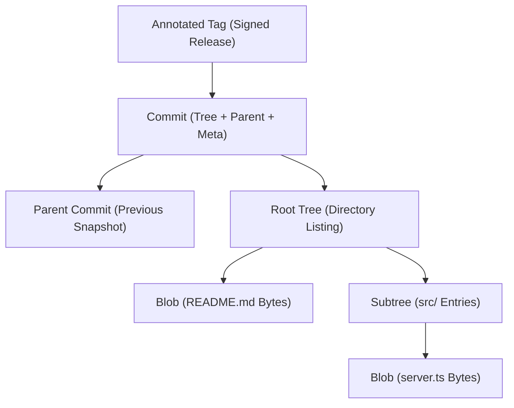
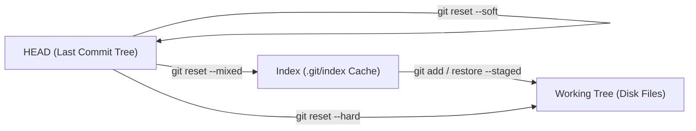
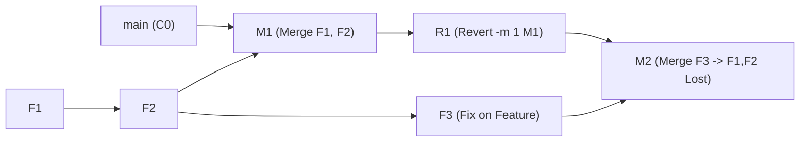
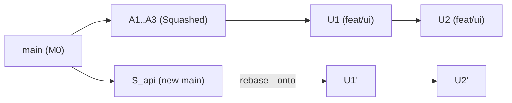

---
tags:
  - software-engineering
  - devops
  - git
  - version-control
created: 2025-12-29
updated: 2026-11-13
status: 🟢
level: mid-to-senior
---
# Git Internals, Branching Architecture & Forensic Recovery

Git is a content-addressable filesystem layered beneath an immutable Directed Acyclic Graph (DAG) of repository snapshots. Every branch operation, merge, rebase, and forensic recovery command manipulates four immutable object primitives, mutable reference pointers, and a binary staging index inside `.git/`. Understanding these disk structures eliminates guesswork during history surgery, monorepo scaling, and production credential leaks.

---

## 1. First-Principles Mechanics & Complete Architecture

### 1.1 Content-Addressable Object Database (`.git/objects`)

Unlike legacy version control systems (CVS, Subversion) that store sequential file-level diff chains, Git models every commit as a **complete logical snapshot** of the entire directory tree. Identical files and unchanged subdirectories across commits share the exact same cryptographic object identifier (OID), preventing exponential storage duplication.

Before hashing or storing any object on disk, Git prepends an ASCII header containing the object type, a single ASCII space (`0x20`), the decimal uncompressed payload byte length, and a null byte (`0x00`):

$$\text{OID} = \text{SHA-1}\big(\text{"<type> <byte\_size>\\0"} \parallel \text{raw\_bytes}\big)$$

Git compresses the combined header and payload with `zlib` (DEFLATE) and writes the result to `.git/objects/xx/yyyy...`, where `xx` is the first 2 hex characters (256 fan-out shards) and `yyyy...` is the remaining 38 hex characters (for SHA-1, or 62 hex characters under `git init --object-format=sha256`).



#### Exact Binary Anatomy of the Four Object Types

| Object Type | Stored Payload | Metadata Inside Hash | Deduplication & Immutability Property |
|---|---|---|---|
| **`blob`** | Raw file bytes only | Zero filename, mode, or timestamp metadata | Identical bytes under 20 paths or 500 commits store 1 `blob` |
| **`tree`** | Sorted binary entries `(octal_mode, name, 20B_raw_oid)` | File mode (`100644`, `100755`, `120000`, `040000`, `160000`) and entry name | Unchanged directories reuse identical `tree` OIDs across commits |
| **`commit`** | `tree` OID, `0..N` `parent` OIDs, `author`, `committer`, optional `gpgsig`, message | Unix timestamps + timezone + parent DAG pointers | Changing any ancestor SHA, author timestamp, or message creates a new SHA |
| **`tag`** | `object` OID, `type`, `tag` name, `tagger`, message, optional cryptographic signature | Detached release metadata separate from lightweight `refs/tags/*` pointers | Signed immutable release anchor verifiable via SSH or GPG |

Inspect any object directly using plumbing commands without altering the working tree:

```bash
# 1. Inspect object type, uncompressed byte size, and decoded structure
git cat-file -t HEAD
git cat-file -s HEAD
git cat-file -p HEAD

# 2. Compute the exact content-addressable OID of stdin bytes without writing to .git/objects
printf "hello production\n" | git hash-object --stdin

# 3. Inspect raw tree entries including executable (100755), symlink (120000), and gitlink (160000) modes
git ls-tree -r HEAD

# 4. Decompress a raw loose object file using Python to observe the exact disk format
python3 -c 'import zlib, sys; print(zlib.decompress(open(sys.argv[1], "rb").read()))' .git/objects/e6/9de29bb2d1d6434b8b29ae775ad8c2e48c5391
```

In `git ls-tree`, each mode carries exact POSIX and Git structural semantics:
- `100644`: Regular non-executable file.
- `100755`: Regular executable file (Git tracks **only** the executable bit, ignoring group/world permissions and `umask`).
- `120000`: Symbolic link whose target path string is stored as the `blob` bytes.
- `040000`: Nested subdirectory pointing to another `tree` OID.
- `160000`: **Gitlink** pointing to a commit OID inside an external submodule repository.

---

### 1.2 Packfiles, Delta Compression & Acceleration Structures

Writing one loose zlib-compressed file per file revision causes inode exhaustion and redundant network transfers. When running `git gc`, `git repack`, or `git push`/`fetch`, Git consolidates loose objects into **Packfiles** (`.git/objects/pack/pack-<hash>.pack`) accompanied by binary lookup indexes (`.idx`):

1. **Heuristic Sliding-Window Sorting**: Git orders candidate objects primarily by `(object_type, basename_hash, uncompressed_size DESC)`. Sorting descending by size ensures the **newest revision** (typically checked out most frequently) is stored as an intact base object (`OBJ_BLOB` / `OBJ_TREE`), while older historical revisions store compact **delta instructions** (`OBJ_OFS_DELTA` referencing a byte offset inside the same packfile, or `OBJ_REF_DELTA` referencing an external OID).
2. **Delta Window & Depth Bounds**: Git evaluates pairwise diff compression across a sliding window of `--window=10` neighboring objects up to a maximum chain depth of `--depth=50`. When checking out `HEAD`, Git reads the full object in $O(1)$ without walking long delta chains backward.
3. **Commit-Graph File (`.git/objects/info/commit-graph`)**: Stores flattened commit parent pointers, root tree OIDs, and topological generation numbers (`v2` corrected commit dates) in a single memory-mapped file. Commands like `git log --graph` and `git merge-base` traverse millions of commits without inflating hundreds of thousands of zlib-compressed commit objects.
4. **Reachability Bitmaps (`.bitmap`)**: Precomputed bitsets stored alongside packfiles (and Multi-Pack Indexes `.midx`) mapping selected commits to every reachable object index in the packfile. Server-side `git clone` and `git fetch` compute object sets via fast bitwise `OR`/`ANDNOT` operations instead of traversing the entire commit-tree DAG per client request.

---

### 1.3 References, Symbolic `HEAD` & The 3-Tree Architecture

Commit DAGs are navigated through **Refs** stored under `.git/refs/` or consolidated into `.git/packed-refs`. Creating or deleting a branch costs $O(1)$ because a branch is a 41-byte text file containing a 40-hex commit SHA and a trailing newline.

- **Local Branches (`refs/heads/<name>`)**: Mutable pointers advancing automatically on `git commit`.
- **Remote-Tracking Branches (`refs/remotes/origin/<name>`)**: Read-only local caches updated exclusively during `git fetch`, `git pull`, or `git push`.
- **Tags (`refs/tags/<name>`)**: Lightweight tags point directly to a commit OID; annotated tags point to an immutable `tag` object OID containing tagger identity and cryptographic signature.
- **Symbolic `HEAD` (`.git/HEAD`)**: Normally stores `ref: refs/heads/main`. When you check out a raw commit SHA, tag, or `origin/main`, `.git/HEAD` stores the raw 40-hex commit OID directly—placing the repository in **Detached `HEAD`** state. Commits created while detached do not belong to any branch ref and become unreachable orphans once you switch away unless anchored with `git switch -c <branch>`.

Git updates ref files atomically using `.lock` sibling files (`O_CREAT | O_EXCL` on `refs/heads/main.lock`, writing the new SHA, `fsync`, and atomically calling `rename(2)`). Never manipulate `.git/refs/` directly during concurrent CI runs without acquiring Git's ref transaction locks.

#### The 3-Tree Model & Index Internals

Git coordinates repository state across three distinct trees:
1. **`HEAD`**: The read-only commit tree referenced by `.git/HEAD`.
2. **Staging Index (`.git/index`)**: A binary cache (`DIRC` format v2/v3/v4) listing every tracked path, its `blob` OID, file mode, conflict stage bits (`0..3`), and filesystem `stat()` metadata (`ctime`, `mtime`, `dev`, `ino`, `uid`, `gid`, `size`). When you run `git status`, Git runs `lstat(2)` on working tree files and compares cached metadata against `.git/index` in microseconds without re-hashing unchanged files.
3. **Working Directory**: Plain files checked out on disk for compilers, editors, and test runners.



#### Exact State Mutation Matrix: `reset`, `restore`, and `switch`

| Command | Moves `HEAD` Branch Pointer? | Overwrites `.git/index`? | Overwrites Working Tree? | Practical Production Effect |
|---|---|---|---|---|
| **`git reset --soft <ref>`** | Yes | No | No | Uncommits changes while preserving them staged (`git diff --cached`) |
| **`git reset --mixed <ref>`** | Yes *(default)* | Yes (matches `<ref>`) | No | Uncommits and unstages changes; edits remain intact on disk (`git diff`) |
| **`git reset --hard <ref>`** | Yes | Yes | Yes (tracked files only) | Wipes tracked commits, staged index, and tracked disk edits; untracked files persist |
| **`git restore --staged <path>`** | No | Yes (copies `HEAD`) | No | Safely unstages a file without modifying disk contents or `HEAD` |
| **`git restore <path>`** | No | No | Yes (copies `Index`) | Discards unstaged local edits on disk by restoring from `.git/index` |
| **`git restore --source=<ref> --staged --worktree <path>`** | No | Yes (matches `<ref>`) | Yes (matches `<ref>`) | Resets a single file to an arbitrary historical commit without moving `HEAD` |

---

### 1.4 History Operations Mechanics: Merge, Rebase, `--onto`, `rerere` & Interactive Rebase

#### Fast-Forward vs. `--no-ff` vs. `ort` 3-Way Merge

- **Fast-Forward Merge**: When `HEAD` is a direct topological ancestor of the target branch (zero divergent commits on `HEAD`), Git moves the `HEAD` branch pointer forward to the target commit SHA in $O(1)$ without generating a merge commit.
- **`git merge --no-ff <branch>`**: Forces creation of a 2-parent merge commit even when fast-forward is eligible. Parent 1 (`^1`) points to the previous `main` commit; Parent 2 (`^2`) points to the tip of `<branch>`. This keeps feature boundaries explicit so `git revert -m 1 <merge-sha>` reverts an entire multi-commit feature atomically.
- **`ort` Merge Engine (Default since Git 2.34)**: Replaced the legacy `recursive` strategy ("Ostensibly Recursive's Twin"). Given `HEAD` ($A$) and target ($B$):
  1. Computes the Lowest Common Ancestor (**Merge Base**) via `git merge-base A B`. If criss-cross merges yield multiple LCAs, `ort` recursively merges the candidate bases in memory to synthesize one deterministic virtual base.
  2. Traverses trees top-down and short-circuits immediately whenever a directory subtree holds identical `tree` OIDs across base, $A$, and $B$—reducing merge complexity from $O(\text{total repo files})$ to $O(\text{changed paths})$.
  3. Tracks file renames and directory-level renames across commits before performing 3-way line-level hunk merging.

#### Conflict Stages Inside `.git/index`

When `ort` detects overlapping line edits or delete/modify conflicts on `src/billing.ts`, Git writes conflict markers into the working tree and inserts **three stage entries** into `.git/index` (inspectable via `git ls-files -u`):
- **Stage `1`**: Common Merge Base (`:1:src/billing.ts`).
- **Stage `2`**: Current `HEAD` (`:2:src/billing.ts`, `--ours`).
- **Stage `3`**: Incoming commit (`:3:src/billing.ts`, `--theirs`).

> [!warning] The Rebase `--ours` vs. `--theirs` Inversion
> During `git merge feature`, `--ours` is your checked-out branch and `--theirs` is the incoming `feature` branch. During **`git rebase main`** (while on `feature`), Git first detaches `HEAD` onto `main`, then replays each `feature` commit sequentially on top—meaning **`--ours` is `main` (upstream)** and **`--theirs` is YOUR feature commit**! Running `git checkout --ours` during a rebase silently discards your own feature changes in favor of upstream.

#### `git rebase` & `git rebase --onto`

`git rebase <upstream>` isolates the commit range `<upstream>..HEAD`, saves the ordered commit list into `.git/rebase-merge/git-rebase-todo`, resets `HEAD` to `<upstream>`, and replays each commit patch sequentially. Even if file diffs are byte-identical, replaying atop a new `parent` SHA (and updated committer timestamp) produces **brand-new commit SHAs** (`C3 -> C3'`, `C4 -> C4'`).

When a child branch (`feat/ui`) was created atop a parent feature branch (`feat/api`) that was later **squash-merged** into `main` (leaving original commits `A1..A3` unlinked from `S_api`), plain `git rebase main` fails because `merge-base(main, feat/ui)` falls back to the pre-branch ancestor `M0`, attempting to replay `A1..A3` again on top of `S_api`.

Use **three-argument `rebase --onto`** to slice off only the child commits:

```bash
# Syntax: git rebase --onto <new-base> <old-base-excluded> <target-branch>
git fetch origin
git rebase --onto origin/main <A3-commit-sha> feat/ui
```

Git replays exclusively the range `<A3-commit-sha>..feat/ui` onto `origin/main` while leaving `A1..A3` behind.

#### `git rerere` ("Reuse Recorded Resolution")

During long-lived release branch maintenance or multi-commit rebases that repeatedly touch the same conflicting file across 10 replayed commits, manual conflict resolution repeats identically. Enabling `rerere` automates conflict replay:

```bash
git config --global rerere.enabled true
git config --global rerere.autoupdate true
```

When a conflict occurs, `git rerere` strips branch labels from conflict hunk markers, computes a SHA-1 signature of the conflict text, and writes the unresolved conflict to `.git/rr-cache/<hash>/preimage`. Once you resolve the conflict and stage/commit, Git records your resolution in `.git/rr-cache/<hash>/postimage`. Whenever the exact conflict recurs during a future rebase, bisect, or merge, Git automatically applies `postimage` and stages the resolution (`rerere.autoupdate true`)—never auto-committing without review.

#### Interactive Rebase (`git rebase -i`, `--autosquash` & `exec`)

Before opening or merging a pull request, interactive rebase cleans commit history into atomic, independently compilable units:

- `pick`: Keep commit unmodified.
- `reword`: Keep diff, edit commit message.
- `edit`: Pause replay after applying commit so you can split commits (`git reset HEAD^`) or add missing tests before `git rebase --continue`.
- `squash`: Merge diff into previous commit and open editor to combine commit messages.
- `fixup`: Merge diff into previous commit and discard this commit's message (use `fixup -C` to replace with this commit's message).
- `drop`: Remove commit completely.
- `exec <cmd>`: Execute a shell command after each commit step; if `<cmd>` returns non-zero, rebase pauses immediately at the exact breaking commit.

Automate review feedback cleanup without manually reordering lines in an interactive todo file:

```bash
# 1. Stage a review fix targeted at historical commit 9a4f12c
git add src/auth.ts
git commit --fixup=9a4f12c

# 2. Automatically reorder and fold fixup! commits into their targets, verifying every commit builds
git rebase -i --autosquash --exec "npm run typecheck && npm test" origin/main
```

#### Public History Invariant & Safe Force-Pushing

Rewriting commits that collaborators already pulled splits the DAG into duplicate histories carrying identical diffs under distinct SHAs. Collaborators running `git pull` generate duplicated merge commits, and `git push --force` blindly overwrites commits pushed by teammates between your last `git fetch` and `git push`.

- **Hard Invariant**: Never rewrite or force-push shared integration branches (`main`, `release/*`).
- **Safe Feature Force-Push**: Always use:

```bash
git push --force-with-lease --force-if-includes
```

`--force-with-lease` fails if the remote branch tip moved since your local `origin/<branch>` ref was updated. `--force-if-includes` adds a second verification check confirming that the remote branch tip actually exists in your local reflog (preventing blind `git fetch` + `git push --force-with-lease` from overwriting unmerged remote commits you fetched without inspecting).

---

## 2. Real-World Use Cases, Branching Strategies & Decision Matrix

Choosing a branching strategy determines CI queue latency, merge conflict frequency, release batch size, and rollback complexity.

### Quantitative Comparison of Branching Topologies

| Topology | Branch Lifetime | Integration Mechanism | CI / Flag Prerequisite | DORA Delivery Impact | Failure Modes |
|---|---|---|---|---|---|
| **Trunk-Based Development (TBD)** | `< 24` hours (or direct to trunk with pair/automated review) | Frequent fast-forward / squash / merge queue onto `main` | Merge Queue + Runtime Feature Flags (`OpenFeature`) + fast `<10m` CI | Elite Lead Time (`<1h`), minimal merge conflict rate | Broken `main` stalls org without Merge Queue; flag debt without TTL cleanup |
| **GitHub Flow** | `1–3` days per feature PR | PR CI gates + review -> merge to `main` -> deploy | Automated CI + containerized artifact immutability | High Deployment Frequency; simple mental model | Long review delays drift PRs (`>3d`); multi-version support requires release branches |
| **Release Branching** | `main` always releasable; `release/vX.Y` cut on release | Bugfixes commit to `main` first, then `git cherry-pick -x` to `release/vX.Y` | Automated cherry-pick PR bots + semantic versioning tags | Required for versioned SDKs, mobile apps, or on-prem appliances | Cherry-pick omissions cause regressions ("fixed in `v2.1`, missing in `v2.2`") |
| **GitFlow** | Weeks to months (`develop`, `release/*`, `hotfix/*`, `main`) | Multi-branch batch merges across divergent DAGs | Heavy manual release coordination | Low Deployment Frequency, High CFR & Lead Time | Fails Continuous Delivery (see mathematical degradation below) |

### Why GitFlow Fails Continuous Delivery

GitFlow introduces parallel long-lived integration branches (`develop`, `release/*`, `hotfix/*`, `main`) built around periodic manual release freezes rather than continuous deployment:

1. **Quadratic Conflict Surface**: With $k$ parallel long-lived feature branches open over time $\Delta t$, expected textual and semantic merge conflicts scale superlinearly ($\propto k^2 \cdot \Delta t$). Resolving weeks of accumulated drift in a `release/*` freeze branch introduces unreviewed merge-conflict bugs immediately before production cutover.
2. **Batch Attribution Collapse**: Merging 30 features into `develop` and promoting a weekly `release/1.8` branch couples unrelated risk profiles. When production fails, pinpointing which feature caused a metric regression across 150 commits stalls MTTR and forces full-batch rollbacks delaying unrelated teams.
3. **Artifact Rebuilding & Divergent Histories**: `develop` and `main` diverge structurally whenever `hotfix/*` commits merge directly to `main` and back-merge awkwardly to `develop`. Staging builds created from `develop` or `release/*` run different SHAs than production builds cut from `main`, violating artifact immutability. See [[Programming/Software Engineering/DevOps/CI-CD|CI/CD]].

### Merge Strategy Trade-Offs on Pull Requests

| PR Merge Strategy | Graph Topology on `main` | `git bisect` Behavior | Revert Granularity | Trade-Off |
|---|---|---|---|---|
| **Squash and Merge** | Strict linear chain (`1 PR = 1 Commit`) | Pinpoints exact PR in $O(\log_2 N)$ | `git revert <sha>` cleanly removes whole PR | Discards granular sub-commit steps unless developer links PR; breaks stacked dependent branches unless using `--onto` |
| **Rebase and Merge** | Strict linear chain (`N` replayed commits) | Pinpoints exact sub-commit inside PR | Must revert range or merge wrapper | Breaks if individual PR commits don't compile (`exec` omitted); cannot revert multi-commit PR with 1 command |
| **Merge Commit (`--no-ff`)** | 2-parent merge rail preserving branch commits | Walks `--first-parent` (`PR` level) or full DAG (commit level) | `git revert -m 1 <merge-sha>` | Visual noise in naive `git log` (solved via `git log --first-parent`); subject to Revert-of-Revert trap |

### Concrete Engineering Adoption Matrix

- **Adopt Trunk-Based Development + Merge Queue**: SaaS web backends, platform APIs, microservices deploying multiple times daily with automated tests and feature flags.
- **Adopt Release Stabilization Branches (`main` + `cherry-pick -x`)**: Distributed binaries, Kubernetes operators, database engines, mobile iOS/Android binaries requiring backported security patches to supported `vN-1` releases.
- **Do NOT adopt GitFlow** for continuously deployed cloud services or web applications.
- **Do NOT use Squash-Merge blindly with stacked PR chains** unless tooling (Graphite, `git rebase --onto`) automatically updates child branch bases upon parent PR merge.

---

## 3. Step-by-Step Practical Application (Production Repo Governance & Forensic Scripts)

This section constructs a production-grade Git governance layout alongside executable forensic scripts for commit hygiene, secret prevention, cryptographic SSH signing, automated bisection, and full-history secret purging.

### Production Repository Structure

```text
repo-root/
├── .gitattributes
├── .gitconfig.team
├── .gitleaks.toml
├── .git-blame-ignore-revs
├── lefthook.yml
├── commitlint.config.mjs
└── scripts/
    ├── verify-ci-signatures.sh
    ├── bisect-regression.sh
    ├── purge-secret.sh
    └── recover-orphans.sh
```

### 3.1 `.gitattributes` & `.git-blame-ignore-revs`

Prevent cross-platform CRLF line-ending corruption across macOS/Windows/Linux contributors and exclude bulk formatting commits from polluting `git blame`:

```gitattributes
# Enforce LF normalization inside the Git object database for source code
* text=auto eol=lf

# Keep Windows batch scripts CRLF on checkout
*.bat text eol=crlf
*.ps1 text eol=crlf

# Prevent diff/merge corruption on binary assets and generated lockfiles
*.png binary
*.pdf binary
*.wasm binary
package-lock.json -diff linguist-generated=true
pnpm-lock.yaml -diff linguist-generated=true
```

Configure `git config blame.ignoreRevsFile .git-blame-ignore-revs` so Prettier/Black formatting commits remain invisible during production `git blame` forensics.

### 3.2 Conventional Commits & Local Guardrails (`commitlint.config.mjs` + `lefthook.yml`)

Enforce deterministic Conventional Commits (`feat`, `fix`, `refactor`, `perf`, `chore`, `ci`, `revert`) and pre-commit secret scanning using **Lefthook** (fast Go binary executing hooks in parallel without Node runtime latency on non-JS hooks):

```javascript
// commitlint.config.mjs
export default {
  extends: ['@commitlint/config-conventional'],
  rules: {
    'type-enum': [
      2,
      'always',
      ['feat', 'fix', 'perf', 'refactor', 'test', 'docs', 'ci', 'build', 'chore', 'revert'],
    ],
    'scope-case': [2, 'always', 'kebab-case'],
    'subject-case': [2, 'never', ['start-case', 'pascal-case', 'upper-case']],
    'header-max-length': [2, 'always', 100],
    'body-max-line-length': [2, 'always', 120],
  },
};
```

```yaml
# lefthook.yml
pre-commit:
  parallel: true
  commands:
    gitleaks:
      run: gitleaks protect --staged --redact --verbose
    branch-guard:
      run: |
        branch="$(git symbolic-ref --short HEAD 2>/dev/null || echo 'DETACHED')"
        if [ "$branch" = "main" ] || [ "$branch" = "master" ]; then
          echo "ERROR: Direct commits to '$branch' are prohibited. Create a short-lived feature branch."
          exit 1
        fi

commit-msg:
  commands:
    commitlint:
      run: npx --no -- commitlint --edit {1}

pre-push:
  commands:
    block-fixup-commits:
      run: |
        remote_sha="$(git rev-parse --verify @{u} 2>/dev/null || git rev-parse origin/main)"
        if git log --format='%s' "${remote_sha}..HEAD" | grep -Eq '^(fixup!|squash!|WIP)'; then
          echo "ERROR: Unsquashed fixup!/squash!/WIP commits detected. Run 'git rebase -i --autosquash' first."
          exit 1
        fi
```

### 3.3 Cryptographic Commit Signing (SSH Ed25519 / Hardware Keys + CI Verification)

Git `Author` and `Committer` headers are plain arbitrary text fields (`git commit --author="security-bot <sec@org.com>"` succeeds unverified). Since Git `2.34`, native **SSH signing** removes GPG keyring and `gpg-agent` passphrase daemon complexity while supporting YubiKey hardware keys (`ed25519-sk`).

Developer configuration (`~/.gitconfig` and `.gitconfig.team` via `git config --local include.path ../.gitconfig.team`):

```ini
[gpg]
    format = ssh
[user]
    signingkey = ~/.ssh/id_ed25519_signing.pub
[commit]
    gpgsign = true
[tag]
    gpgsign = true
[gpg "ssh"]
    allowedSignersFile = .github/allowed_signers
[merge]
    conflictstyle = zdiff3
[diff]
    algorithm = histogram
    colorMoved = default
[rerere]
    enabled = true
    autoupdate = true
[fetch]
    prune = true
[rebase]
    autoStash = true
    updateRefs = true
```

Note two senior configuration optimizations above:
- `merge.conflictstyle = zdiff3`: Renders **base** (`|||||||`) alongside `ours` (`<<<<<<<`) and `theirs` (`>>>>>>>`) inside conflict blocks, exposing what both sides deleted or mutated relative to the merge base.
- `rebase.updateRefs = true`: Automatically advances stacked intermediate branch refs when rebasing a multi-branch stack in a single command.

Populate `.github/allowed_signers` in the repository so both engineers and CI verify commit signatures deterministically:

```text
# .github/allowed_signers
alice@acme.io namespaces="git" ssh-ed25519 AAAAC3NzaC1lZDI1NTE5AAAAIKx8ExamplePublicKeyAliceSigningKey01
bob@acme.io namespaces="git" sk-ssh-ed25519@openssh.com AAAAGnNrLXNzaC1lZDI1NTE5QG9wZW5zc2guY29tAAAAINHardwareKeyBob
```

Executable CI verification gate checking every commit introduced by a PR:

```bash
#!/usr/bin/env bash
# scripts/verify-ci-signatures.sh
set -euo pipefail

BASE_REF="${1:-origin/main}"
HEAD_REF="${2:-HEAD}"
SIGNERS_FILE="${3:-.github/allowed_signers}"

if [[ ! -f "$SIGNERS_FILE" ]]; then
  echo "FATAL: Missing allowed signers file at $SIGNERS_FILE" >&2
  exit 1
fi

git config gpg.ssh.allowedSignersFile "$SIGNERS_FILE"

RANGE="${BASE_REF}..${HEAD_REF}"
COMMITS=$(git rev-list "$RANGE")

if [[ -z "$COMMITS" ]]; then
  echo "No commits found in range $RANGE"
  exit 0
fi

FAILED=0
while IFS= read -r sha; do
  status=$(git log -n 1 --format='%G?' "$sha")
  signer=$(git log -n 1 --format='%GS' "$sha")
  subject=$(git log -n 1 --format='%s' "$sha")
  # 'G' = valid good signature, 'U' = good signature with unknown/untrusted validity (SSH allowed_signers returns 'G')
  if [[ "$status" != "G" ]]; then
    echo "UNVERIFIED COMMIT: $sha ($status) '$subject'" >&2
    FAILED=1
  else
    echo "VERIFIED: $sha signed by [$signer] - $subject"
  fi
done <<< "$COMMITS"

if [[ "$FAILED" -ne 0 ]]; then
  echo "ERROR: One or more commits lack a valid signature in $SIGNERS_FILE" >&2
  exit 1
fi
```

### 3.4 Automated Regression Isolation (`scripts/bisect-regression.sh`)

When a performance regression or memory leak slips into `main` across 1,000 commits, manual checkout testing wastes hours. `git bisect run` executes an automated test script returning specific exit codes:
- `0`: Commit is **good**.
- `1..124` or `126..127`: Commit is **bad**.
- `125`: **Skip** commit (intermediate unbuildable commit unrelated to the regression).

```bash
#!/usr/bin/env bash
# scripts/bisect-regression.sh
# Usage:
#   git bisect start HEAD v2.4.0
#   git bisect run ./scripts/bisect-regression.sh
#   git bisect reset
set -uo pipefail

# Guarantee clean build context from previous bisect step without wiping ignored env configs
rm -rf dist/ .build-tmp/

if ! npm ci --prefer-offline --silent >/dev/null 2>&1; then
  echo "Dependency install failed at $(git rev-parse --short HEAD); skipping commit"
  exit 125
fi

if ! npm run build --silent >/dev/null 2>&1; then
  echo "Compilation failed at $(git rev-parse --short HEAD); skipping commit"
  exit 125
fi

# Run deterministic regression check with hard timeout to catch infinite-loop regressions
if timeout 30s node ./tests/perf/check-p99-latency.mjs --max-ms=180; then
  exit 0
else
  rc=$?
  # Treat timeout (124) and assertion failure (1) as bad; preserve 125 solely for build failures
  if [[ "$rc" -eq 125 ]]; then
    exit 1
  fi
  exit 1
fi
```

### 3.5 Full-History Secret Purge (`scripts/purge-secret.sh`)

Deleting a leaked credential in a new commit leaves the secret permanently readable inside historical commit blobs. Legacy `git filter-branch` is slow, unsafe against tag rewrites, and explicitly deprecated by the Git project; **replace it exclusively with `git filter-repo`**.

```bash
#!/usr/bin/env bash
# scripts/purge-secret.sh
# Prerequisite: pip install git-filter-repo
# CRITICAL: First REVOKE the leaked credential at the provider (AWS/Stripe/GitHub) BEFORE running history cleanup!
set -euo pipefail

if [[ $# -lt 2 ]]; then
  echo "Usage: $0 <repo-https-or-ssh-url> <expressions-file>" >&2
  exit 1
fi

REPO_URL="$1"
EXPRESSIONS_FILE="$(realpath "$2")"
WORKDIR="$(mktemp -d)/mirror.git"

# Example expressions-file format:
#   literal:sk_live_51AbcDefSecretValue==>REDACTED_STRIPE_SECRET
#   regex:AKIA[0-9A-Z]{16}==>REDACTED_AWS_KEY_ID

echo "[1/5] Creating bare mirror clone at $WORKDIR..."
git clone --mirror "$REPO_URL" "$WORKDIR"
cd "$WORKDIR"

echo "[2/5] Rewriting all commits, trees, blobs, and tags via git filter-repo..."
git filter-repo --force --replace-text "$EXPRESSIONS_FILE"

# To delete an entire leaked file path (e.g. .env.prod) across all history instead of text replacement:
# git filter-repo --force --invert-paths --path .env.prod

echo "[3/5] Verifying zero remaining occurrences across ALL refs and reachable objects..."
while IFS= read -r line; do
  [[ -z "$line" || "$line" == \#* ]] && continue
  needle="${line%%==>*}"
  needle="${needle#literal:}"
  if [[ "$needle" != regex:* ]]; then
    if git log --all -S "$needle" --oneline | grep -q .; then
      echo "FATAL: Secret substring still detected in history!" >&2
      exit 1
    fi
  fi
done < "$EXPRESSIONS_FILE"

echo "[4/5] Expiring reflogs and running aggressive garbage collection..."
git reflog expire --expire=now --all
git gc --prune=now --aggressive

echo "[5/5] Ready to force-push rewritten refs cleanly:"
echo "  cd $WORKDIR"
echo "  git remote add origin $REPO_URL"
echo "  git push origin --force --all"
echo "  git push origin --force --tags"
echo "NOTE: Open a GitHub/GitLab support ticket to clear dangling pull-request/commit caches (refs/pull/*/head), and instruct all engineers to re-clone fresh."
```

### 3.6 Forensic Orphan & Staged-Blob Recovery (`scripts/recover-orphans.sh`)

```bash
#!/usr/bin/env bash
# scripts/recover-orphans.sh
set -euo pipefail

echo "=== Recent HEAD movements (recoverable via: git switch -c rescue <sha>) ==="
git reflog -n 20 --date=iso

echo ""
echo "=== Unreachable commits and staged-only blobs (.git/lost-found/) ==="
git fsck --lost-found --unreachable --no-reflogs

echo ""
echo "Dangling commits written to .git/lost-found/commit/:"
for c in .git/lost-found/commit/*; do
  [[ -e "$c" ]] || continue
  sha="$(basename "$c")"
  git log -n 1 --format="%h %ai %s" "$sha"
done

echo ""
echo "Dangling blobs (staged via git add but never committed) written to .git/lost-found/other/:"
ls -lh .git/lost-found/other/ 2>/dev/null || echo "None found."
```

---

## 4. Complete Construct Reference & Edge Cases

### 4.1 The Notorious `..` vs. `...` Inversion (`git log` vs. `git diff`)

Git's two-dot (`..`) and three-dot (`...`) operators change mathematical meaning completely between `git log` (commit set operations) and `git diff` (snapshot comparison):

| Syntax | Behavior in `git log` / `git rev-list` | Behavior in `git diff` | Primary CI / Dev Use Case |
|---|---|---|---|
| **`A..B`** | Commits reachable from `B` **excluding** ancestors of `A` ($B \setminus A$) | Diff between snapshot tip `A` and snapshot tip `B` (includes unrelated changes on `A`!) | `git log origin/main..HEAD` lists unmerged PR commits |
| **`A...B`** | Symmetric difference: commits in `A` or `B` excluding their merge base ($(A \cup B) \setminus \text{LCA}(A,B)$) | Diff from **`merge-base(A, B)` to `B`** (isolates **only** changes introduced on `B`!) | `git diff --name-only origin/main...HEAD` computes exact PR changed files in CI |

Using `git diff --name-only origin/main..HEAD` (two dots) in a CI affected-file detector is a classic production bug: whenever `main` moves ahead of a PR branch, two-dot `diff` falsely flags every file merged into `main` by *other* engineers as modified by this PR!

### 4.2 `git stash` Internals & Untracked Secret Deletion Trap

`git stash` does not save diff files in a temporary directory—it constructs a special **2-parent (or 3-parent with `-u`/`-a`) commit** stored on `refs/stash`:
- Parent 1 (`^1`): `HEAD` commit at stash time.
- Parent 2 (`^2`): Tree snapshot of the **Index** (staged changes).
- Parent 3 (`^3`, only with `--include-untracked` / `-u` or `--all` / `-a`): Tree snapshot of untracked files.
- The stash commit's own root tree holds the **Working Tree** state.

**Critical Trap (`git stash -a` vs `-u`)**: Running `git stash push -a` sweeps **gitignored files** (`node_modules`, `.env.local`, local SSL keys) into Parent 3 and deletes them from disk. If `git stash pop` hits a merge conflict or gets dropped accidentally (`git stash drop`), restoring gitignored files from the 3rd parent requires digging into `git fsck` or `git show stash@{0}^3`. Prefer `git worktree` over `git stash` for context switching.

### 4.3 `git worktree` & Large-Monorepo Scaling

Switching branches in a 3 GB monorepo invalidates Rust `target/`, Node `node_modules`, and TypeScript LSP incremental state. **`git worktree`** mounts multiple branches in sibling directories sharing a single `.git/objects/` store and ref database:

```bash
# Create an isolated directory checked out to a new hotfix branch off origin/main
git worktree add -b hotfix/tls-cert ../svc-hotfix origin/main

# List active worktrees and detect stale/prunable worktree metadata
git worktree list
git worktree prune
```

*Hard Invariant*: Git forbids checking out the same branch simultaneously in two linked worktrees (preventing conflicting concurrent commits to the same branch pointer).

#### Partial Clones, Cone Sparse Checkout & Background Maintenance

| Scaling Mechanism | Exact Command | Bytes Transferred & Stored | Operational Caveat |
|---|---|---|---|
| **Blobless Partial Clone** | `git clone --filter=blob:none <url>` | Downloads all commits + trees; lazy-fetches `blob` bytes only on checkout or `git log -p` | Ideal for developer workstations & monorepo CI affected-file checks |
| **Treeless Clone** | `git clone --filter=tree:0 <url>` | Downloads commits only; fetches trees + blobs dynamically per checkout | Restrict strictly to ephemeral CI single-SHA builds; never run `blame`/`log -p` locally |
| **Cone Sparse Checkout** | `git sparse-checkout set --cone apps/api libs/auth` | Materializes only listed directory prefixes + root files ($O(1)$ prefix filter) | Avoid `--no-cone` pattern globs on `>100k` files; regex matching degrades checkout speed |
| **Background Maintenance** | `git maintenance start` | Runs hourly `prefetch` + `commit-graph` and daily `incremental-repack` + `loose-objects` | Essential on repos `>100k` commits to keep `git status` and `git log` sub-100ms |
| **Built-in FSMonitor** | `git config core.fsmonitor true` | OS filesystem watcher (`inotify`/`FSEvents`/USN journal) tracks dirty paths in memory | Eliminates full-tree `lstat()` scans on `git status` across `>50k` files |

### 4.4 Subtle Edge Cases & Security Traps

1. **The Revert-of-Revert Topological Trap**: Reverting a 2-parent merge commit `M1` (`git revert -m 1 M1`) creates inverse commit `R1`, removing feature code from `main`'s tree while leaving the original feature commits `F1, F2` **topological ancestors of `main`**. When developers later push fix `F3` to the original feature branch and re-merge (`M2`), `git merge-base main feature` resolves to `F2`, causing `ort` to see zero changes for `F1, F2` relative to `F2` and silently drop `F1, F2` in production! Fix by running **`git revert <R1>`** on `main` before merging `F3`, or rebasing `F1..F3` with `--force-rebase` to mint fresh SHAs beyond `R1`.



2. **Case-Insensitive Filesystem Ghost Collisions**: On macOS (APFS) and Windows (NTFS), `core.ignorecase=true` ignores case renames (`mv User.ts user.ts`). Standard `mv` changes disk casing without updating `.git/index`, or creates both `User.ts` and `user.ts` in the tree object—breaking Linux CI builds with duplicate module errors. Always rename case-only files via `git mv -f User.ts user.ts` (or two-step `git mv User.ts tmp.ts && git mv tmp.ts user.ts`).
3. **Submodule Detached-HEAD Drift**: Running `git submodule update` checks out submodules in Detached `HEAD` state. Making edits directly inside a submodule without first checking out a branch creates orphaned commits inside `.git/modules/` that break teammate clones after pushing the superproject gitlink (`160000`) pointer without pushing the submodule commit.
4. **Malicious `.gitmodules` / Symlink Traversal CVEs**: Untrusted repositories can embed relative-path symlinks or crafted submodule hooks (`CVE-2024-32002`). Enforce `Git >= 2.45.1` on developer machines and CI runners, and keep `protocol.file.allow=user` disabled outside local test harnesses.

### 4.5 Forensic Code Review & History Inspection Plumbing

Beyond basic `git log -p`, senior engineering code review and incident forensics rely on three precision commands:

```bash
# 1. Compare two versions of a rebased PR series (excluding rebase noise from upstream main!)
git range-diff origin/main...feat/v1-before-rebase origin/main...feat/v2-after-rebase

# 2. Trace true original authorship across whitespace formatting, moved lines, and cross-file splits
git blame -w -M -C -C -C -L 40,85 src/billing/tax.ts

# 3. Backport a trunk fix to a release stabilization branch with immutable provenance trailer
git switch release/v2.4
git cherry-pick -x 9f8e7d6c5b4a
```

- **`git range-diff`**: Computes diffs-of-diffs across two commit sequences (`v1` vs `v2` of a PR after `git rebase` + `git commit --fixup`), isolating strictly the semantic adjustments an author introduced between review rounds rather than forcing reviewers to re-read 800 lines of upstream main changes.
- **`git blame -w -M -C -C -C`**: `-w` ignores whitespace changes, `-M` detects moved lines within the file, and triple `-C` searches across all commits and files in history to attribute extracted helper functions back to the original author rather than the refactor commit.
- **`git cherry-pick -x`**: Appends `(cherry picked from commit <sha>)` to the commit message, enabling automated audit scripts to verify which `main` bugfixes have been backported to supported `release/*` branches.

### 4.6 Submodules vs. Git Subtree vs. Package Registries

| Dependency Integration Method | Disk Storage inside Parent Repo | Atomic Cross-Repo Commits? | Onboarding & CI Friction | Production Recommendation |
|---|---|---|---|---|
| **Git Submodules (`160000`)** | Gitlink commit OID only + `.gitmodules` URL | No (easy to push parent pointing to unpushed child SHA) | High (`--recurse-submodules`, detached HEAD traps) | Avoid for active product code; reserve strictly for pinned third-party C/C++ vendored SDKs |
| **Git Subtree** | Full child source copied directly into parent tree | Yes (lives inside parent DAG) | Medium (messy squash/split merge commits if pushing upstream) | Use only when intermittently absorbing an unmaintained upstream fork |
| **Versioned Package Registry (npm / PyPI / Go Proxy)** | Immutable lockfile hash + version pin only | No (separate release lifecycle) | Low (`npm ci` / `go mod`) | Standard for loosely coupled cross-team libraries with independent release cadences |
| **Workspace Monorepo (`pnpm` / `nx` / `cargo`)** | Single unified Git DAG + object store | **Yes** (atomic PR edits library + all callers together) | Low with `--filter=blob:none` + affected CI | **Preferred** when shared libraries and consuming services co-evolve weekly |

---

## 5. Production Debugging, Profiling & Operations Playbook

| Symptom | Root Cause | Exact Diagnostic Commands | Verified Remediation |
|---|---|---|---|
| **`git push --force-with-lease` rejected (`stale info`) or overwrote teammate's commit** | Remote ref moved ahead of `origin/<branch>`, OR running `git fetch` updated `origin/<branch>` blindly before inspecting incoming commits | `git log --oneline HEAD..origin/<branch>` and `git reflog show origin/<branch>` | Enable `--force-if-includes`; inspect `HEAD..origin/<branch>` and `git rebase origin/<branch>` before pushing |
| **Repository `.git/` balloons to `> 4 GB` & clones time out** | Large binary assets (`.tar`, `.sqlite`, `.zip`, compiled artifacts) committed historically or dangling unreachable packs | `git count-objects -vH` and `git rev-list --objects --all \| git cat-file --batch-check='%(objecttype) %(objectname) %(objectsize) %(rest)' \| sort -k3 -nr \| head -n 20` | Purge large binaries with `git filter-repo --strip-blobs-bigger-than 10M` or convert repo to Git LFS + `--filter=blob:none` |
| **`git status` takes `> 5s` in monorepo** | Unindexed `lstat()` tree traversal across `100k+` files or missing untracked cache / commit-graph | `GIT_TRACE_PERFORMANCE=1 git status` | Enable `git config core.fsmonitor true`, `git config core.untrackedCache true`, and `git maintenance start` |
| **`fatal: Unable to create '.git/index.lock': File exists`** | Interrupted `git` process crashed mid-write or another background IDE/LSP Git daemon holds the lock | `ps aux \| grep git` (or `lsof .git/index.lock`) to verify no live `git` PID holds the file | Wait if live PID exists; if zero processes hold lock, `rm -f .git/index.lock` |
| **Corrupted binary index (`error: bad signature 0x00000000`)** | Hard machine power loss during `git add` / index rewrite | `git status` fails immediately reading `.git/index` | Rebuild index cleanly from `HEAD` without losing working files: `rm -f .git/index && git reset --mixed HEAD` |
| **Detached `HEAD` commits lost after `git switch main`** | Commits created with `.git/HEAD` holding a raw SHA became unreachable from branch refs | `git reflog -n 30` (or `git fsck --unreachable --no-reflogs` if reflog aged out) | Anchor orphaned commit SHA immediately: `git switch -c recover/work <orphan-sha>` |
| **Production API key committed & pushed to GitHub/GitLab PR** | Developer committed `.env` / hardcoded key; PR webhook triggered remote mirror & cached ref `refs/pull/<id>/head` | `git log --all -S "<key-prefix>" -p` | 1. **Revoke/rotate key at provider immediately**; 2. Audit access logs; 3. Run `git filter-repo`; 4. Force-push + contact host support to purge PR refs |

---

## 6. Comprehensive Worked Exercises

### Exercise 1: Catastrophic `reset --hard` + Deleted Branch + Staged-Only Blob Recovery
A developer ran the following locally without pushing to any remote:
1. Committed `C1` (`feat: schema`), then `C2` (`feat: controller`) on branch `feat/billing`.
2. Amended `C2` into `C2_amended` (`git commit --amend`).
3. Created a new 200-line file `db/009.sql`, ran `git add db/009.sql` (never committed it), and also modified `README.md` in the working directory without running `git add`.
4. Accidentally ran `git reset --hard HEAD~2`, switched to `main`, and ran `git branch -D feat/billing`.

Trace which items survive inside `.git/`, which item is permanently unrecoverable from Git, and write the exact commands to restore every recoverable artifact.

### Solution 1
1. **Forensic State Inventory inside `.git/`**:
   - **`C1`, `C2`, and `C2_amended`**: All three commit objects (and their `tree`/`blob` subgraphs) survive intact in `.git/objects/`. Deleting `feat/billing` removed only the mutable branch pointer file `.git/refs/heads/feat/billing`; the `HEAD` reflog (`.git/logs/HEAD`) retains unreachable commit entries for `30` days (`gc.reflogExpireUnreachable`).
   - **`db/009.sql` (staged via `git add`, never committed)**: Running `git add` hashed the bytes of `db/009.sql`, compressed them, and wrote an orphan **`blob`** object into `.git/objects/`. Because no commit ever pointed a `tree` entry at this blob, it does **not** appear in `git reflog` and has lost its filename—it survives solely as an unreachable dangling blob until `git gc` prunes objects older than `gc.pruneExpire` (`2 weeks` default).
   - **Unstaged edits to `README.md`**: **Permanently lost from Git.** Neither `git add` nor `git commit` hashed those modified disk bytes into `.git/objects/`, and `reset --hard` overwrote the working directory file from `HEAD`. Only OS filesystem snapshots or IDE local history could restore them.
2. **Exact Recovery Procedure**:
   ```bash
   # 1. Inspect HEAD reflog to locate C2_amended immediately before reset --hard
   git reflog --date=iso
   # Example output:
   # a1b2c3d HEAD@{1}: checkout: moving from feat/billing to main
   # d4e5f6a HEAD@{2}: reset: moving to HEAD~2
   # 9f8e7d6 HEAD@{3}: commit (amend): feat: controller

   # 2. Recreate the deleted branch anchored at C2_amended (9f8e7d6)
   git switch -c feat/billing 9f8e7d6

   # 3. Materialize unreachable staged blobs into .git/lost-found/other/
   git fsck --lost-found --unreachable --no-reflogs

   # 4. Identify db/009.sql by content (blobs store zero filenames) and restore it
   grep -rn "CREATE TABLE" .git/lost-found/other/
   cp .git/lost-found/other/<matched-blob-oid> db/009.sql
   git add db/009.sql
   ```

---

### Exercise 2: `git rebase --onto` After Upstream Squash-Merge + Rebase Conflict Inversion
Developer A worked on `feat/api` (`A1 -> A2 -> A3` branched off `main@M0`). Developer B branched `feat/ui` (`U1 -> U2`) on top of `A3`. Maintainers then **squash-merged** `feat/api` into `main` as a single commit `S_api` (`M0 -> S_api`) and deleted remote `feat/api`.
1. Explain topologically why executing `git rebase main` while checked out on `feat/ui` generates unnecessary merge conflicts and duplicate patches.
2. Provide the exact command sequence to transplant `U1` and `U2` cleanly onto `origin/main`.
3. During that transplant, `U1` conflicts with `S_api` on `src/Button.tsx`. If Developer B wants `feat/ui`'s version (`U1`) to win completely, should they run `git checkout --ours` or `git checkout --theirs`? Prove why.

### Solution 2


1. **Why Plain `git rebase main` Fails**: Because `S_api` was minted as a brand-new commit with parent `M0` (no parent link back to `A1..A3`), `git merge-base origin/main feat/ui` resolves to `M0`. Plain `git rebase origin/main` therefore attempts to replay **all five commits** (`A1, A2, A3, U1, U2`) onto `S_api`, colliding with `S_api` which already contains `A1..A3`'s changes under different intermediate line contexts.
2. **Exact Transplant Sequence**:
   ```bash
   git fetch origin
   # Inspect feat/ui history to obtain A3's exact commit SHA (or use U1^ directly)
   git log --oneline -n 6 feat/ui
   # Replay strictly (A3..feat/ui) = (U1, U2) onto origin/main
   git rebase --onto origin/main <A3-commit-sha> feat/ui
   ```
3. **`--theirs` Wins for `feat/ui`**: When `git rebase` executes, Git first detaches `HEAD` onto `<new-base>` (`origin/main` / `S_api`), assigning `S_api` to **`--ours`** (`Stage 2`), and replays `U1` as the incoming cherry-picked commit (**`--theirs`**, `Stage 3`). Keeping `feat/ui`'s version therefore requires:
   ```bash
   git checkout --theirs -- src/Button.tsx
   git add src/Button.tsx
   git rebase --continue
   ```

---

### Exercise 3: The Revert-of-Revert Production Regression Trap
Production incident timeline on `main`:
1. `feature/oauth` (`C1`, `C2`) merges into `main` via 2-parent commit `M1` (`git merge --no-ff feature/oauth`).
2. `M1` triggers an authentication crash in production; on-call runs `git revert -m 1 M1` on `main`, creating commit `R1` that deletes the OAuth files.
3. The original author fixes the crash by adding commit `C3` atop `feature/oauth` (still branched off `C2`), verifies tests pass locally on `feature/oauth`, and merges `feature/oauth` into `main` (`M2`).
4. In production, `/oauth/callback` returns `404` and all code from `C1` and `C2` has vanished from `main`!

Prove via `git merge-base` why `C1` and `C2` disappeared, and provide **two** distinct safe remediation procedures.

### Solution 3
1. **Topological & 3-Way Merge Proof**:
   - Before `M2`, `main`'s parent chain includes `... -> M1 -> R1`. Because `M1` has second parent `C2`, commits **`C1` and `C2` are topological ancestors of `main`**.
   - `feature/oauth`'s chain is `... -> C1 -> C2 -> C3`.
   - Computing `git merge-base main feature/oauth` returns **`C2`**.
   - `ort` performs 3-way merge across `(Base = C2, Ours = R1, Theirs = C3)`:
     - Between `Base (C2)` and `Theirs (C3)`, `C1` and `C2` have **zero diff** (unchanged relative to `C2`).
     - Between `Base (C2)` and `Ours (R1)`, `Ours` explicitly deleted `C1` and `C2`.
     - Standard 3-way merge rule: when one side makes no change relative to Base (`Theirs`) and the other side deletes (`Ours`), the deletion wins! `M2` therefore applies **only `C3`**, silently omitting `C1` and `C2`.
2. **Two Valid Remediations**:
   - **Option A (Revert the Revert on `main`)**: Create an inverse commit of `R1` on `main` (`git revert <R1-sha>`), re-introducing `C1 + C2` as fresh diffs relative to `R1`, and either merge `C3` afterward or run `git revert <R1-sha>` on top of `M2` followed by resolving any conflict with `C3`.
   - **Option B (Re-anchor `feature/oauth` as New SHAs)**: Before merging `C3`, rewrite `C1, C2, C3` atop `main` using `--force-rebase` (`git switch feature/oauth && git rebase --force-rebase origin/main`), minting `C1', C2', C3'` whose parent is `R1`. Relative to `R1`, `C1'` and `C2'` once again introduce net-new file additions and apply cleanly.

---

### Exercise 4: Automated `git bisect run` Across Unbuildable Commits & Monorepo Clone Strategy
A memory leak (`RSS > 2 GB` after 60s load) appeared between tag `v3.0.0` and `HEAD` (`2,048` commits). Roughly 18 historical commits fail `cargo build` due to a temporarily broken workspace macro fixed later in history.
1. Calculate the expected upper bound on `git bisect` steps across `2,048` commits.
2. Write a production-safe `scripts/bisect-oom.sh` harness that safely skips unbuildable commits without falsely classifying them as good or bad, and prevents hanging processes from stalling bisect.
3. Explain why running `git bisect` inside a CI runner checked out with `actions/checkout` defaults (`fetch-depth: 1`) fails, and select the optimal clone flags for a `6 GB` monorepo.

### Solution 4
1. **Iteration Bound**: $\lceil \log_2(2048) \rceil = \mathbf{11}$ bisection probes (plus `1–3` adjacent probes when encountering skipped `125` commits).
2. **Executable `scripts/bisect-oom.sh`**:
   ```bash
   #!/usr/bin/env bash
   set -uo pipefail

   # Skip commits that fail to compile (exit 125 instructs git bisect to probe adjacent commit)
   if ! cargo build --release --bin api-server --quiet; then
     exit 125
   fi

   # Execute deterministic memory-leak probe with a hard timeout
   timeout 90s ./target/release/api-server --self-test-rss-under-mb=1024
   rc=$?

   if [[ "$rc" -eq 0 ]]; then
     exit 0
   elif [[ "$rc" -eq 125 ]]; then
     exit 1
   else
     exit 1
   fi
   ```
   Execute via:
   ```bash
   git bisect start HEAD v3.0.0
   git bisect run ./scripts/bisect-oom.sh
   git bisect reset
   ```
3. **Clone Strategy**:
   - `fetch-depth: 1` (shallow clone) truncates the commit DAG to `HEAD` only; `v3.0.0` and the `2,048` intermediate parents are absent, causing `git bisect start` to abort with `fatal: Needed a single revision`.
   - Use **blobless partial clone** (`git clone --filter=blob:none <url>`): transfers the complete commit and tree DAG upfront (~tens of MB even on a `6 GB` monorepo) so `git bisect` navigates all `2,048` commits locally in milliseconds while lazy-fetching source blobs strictly for the ~12 checked-out revisions. (Pairing `--filter=blob:none` with `git sparse-checkout set --cone services/api` avoids fetching blobs for unrelated services during checkout.)

---

### Exercise 5: Purging a Leaked Production Stripe Live Key Across 14,000 Commits & Tags
An engineer accidentally committed `STRIPE_SECRET=sk_live_99xyz...` inside `config/local.env` 400 commits ago, merged it to `main`, tagged three releases (`v1.4.0`, `v1.4.1`, `v1.4.2`), and pushed all branches and tags to GitHub. Later, commit `HEAD~10` deleted `config/local.env` and replaced it with `.env.example`.
1. Explain why deleting `config/local.env` in `HEAD~10` fails to remediate the exposure, and why creating a new commit deleting the key does nothing to historical blobs.
2. Explain **two reasons** why legacy `git filter-branch --tree-filter 'rm -f config/local.env' HEAD` leaves the secret exposed in production repos.
3. Provide the complete 5-step incident containment and `git filter-repo` purge execution sequence.

### Solution 5
1. **Immutability of Historical Objects**: Commit `HEAD~10` minted a new `tree` OID omitting `config/local.env`, leaving all 390 older commits pointing to prior `tree` objects referencing the exact `blob` OID containing `sk_live_99xyz...`. Any `git clone` downloads the entire packfile including that historical `blob`, readable via `git log -S sk_live_99xyz -p`.
2. **Why `filter-branch ... HEAD` Fails**:
   - Passing `HEAD` rewrites **only the current branch**, leaving tags (`v1.4.0..v1.4.2`) and other branches pointing to the unrewritten history containing the leaked `blob`.
   - `filter-branch` saves backup original refs under `refs/original/`, and without manual `reflog expire` + `gc --prune=now`, the leaked objects persist locally and can be accidentally pushed back if an engineer merges stale local refs.
3. **Complete Incident Containment & Purge Sequence**:
   - **Step 1 (Immediate Revocation — First Priority)**: Revoke/roll `sk_live_99xyz...` inside the Stripe Dashboard **before** running Git history cleanup (assume public/fork/CI caches already copied it) and audit Stripe API charge logs for unauthorized calls.
   - **Step 2 (Bare Mirror Rewrite via `git filter-repo`)**:
     ```bash
     git clone --mirror git@github.com:acme/billing-api.git billing-purge.git
     cd billing-purge.git
     cat <<'EOF' > /tmp/purge-rules.txt
     literal:sk_live_99xyz_REDACTED_EXACT_KEY==>REDACTED_STRIPE_KEY
     EOF
     git filter-repo --force --invert-paths --path config/local.env
     git filter-repo --force --replace-text /tmp/purge-rules.txt
     ```
   - **Step 3 (Verify Zero Residual Blobs)**:
     ```bash
     git log --all --stat -- config/local.env
     git log --all -S "sk_live_99xyz" --oneline
     ```
   - **Step 4 (Prune & Force-Push All Refs and Tags)**:
     ```bash
     git reflog expire --expire=now --all
     git gc --prune=now --aggressive
     git remote add origin git@github.com:acme/billing-api.git
     git push origin --force --all
     git push origin --force --tags
     ```
   - **Step 5 (Platform Cache Eviction & Collaborator Re-Clone)**: Contact GitHub/GitLab Support to garbage-collect dangling `refs/pull/*/head` snapshots and CDN view caches; force every developer and CI cache to delete local clones and re-clone cleanly so unrewritten commits cannot be merged back in.

---

### Exercise 6: Diagnosing a Two-Dot `git diff` CI Bug & Case-Sensitivity Collision
A monorepo CI workflow detects modified packages using:
```bash
git diff --name-only origin/main..HEAD
```
Two failures hit engineering in the same week:
1. Whenever `main` merges 10 unrelated PRs while PR `#88` sits open overnight, PR `#88`'s CI pipeline suddenly builds and tests all 10 unrelated services—even though PR `#88` touched only 1 file in `docs/`.
2. A macOS developer renamed `src/AuthClient.ts` to `src/authClient.ts` via Finder/normal `mv`, committed, and pushed. Tests passed on macOS, but Linux CI failed with `error TS2305: Cannot find module './authClient'`. Running `git status` on macOS showed `nothing to commit, working tree clean`.

Diagnose both root causes and provide the exact fixes.

### Solution 6
1. **Two-Dot vs. Three-Dot `git diff` Defect**:
   - `git diff origin/main..HEAD` compares the **tips** `origin/main` and `HEAD`. Because `origin/main` advanced by 10 commits after PR `#88` branched off, those 10 commits' files differ between `origin/main`'s tip and `HEAD`, falsely flagging unrelated services!
   - **Fix**: Switch to **three-dot diff** (`git diff --name-only origin/main...HEAD`), which diffs `merge-base(origin/main, HEAD)` against `HEAD`—isolating strictly commits introduced by PR `#88`. (Better yet, delegate affected computation to graph-aware tooling; see [[Programming/Software Engineering/DevOps/Pipeline Design|Pipeline Design]].)
2. **Case-Insensitive Filesystem Ghost Entry**:
   - macOS APFS defaults to case-insensitive mode, setting `core.ignorecase=true` in `.git/config`. Running plain `mv src/AuthClient.ts src/authClient.ts` altered the filesystem entry name without changing `.git/index`, which still recorded `src/AuthClient.ts`. When `git status` probed `.git/index` entries via `lstat("src/AuthClient.ts")`, APFS returned the inode for `src/authClient.ts`, reporting a clean tree while Git kept `AuthClient.ts` in the committed tree object. Case-sensitive Linux `ext4`/`overlayfs` in CI rejected imports targeting `./authClient`.
   - **Fix**: On macOS, explicitly force index update via two-step `git mv`:
     ```bash
     git mv src/AuthClient.ts src/authClient.ts.tmp
     git mv src/authClient.ts.tmp src/authClient.ts
     git commit -m "refactor(auth): normalize authClient filename casing"
     ```
     Additionally, add a Tier-0 CI check failing on case-colliding paths in the Git index:
     ```bash
     git ls-files | tr '[:upper:]' '[:lower:]' | sort | uniq -d
     ```

---

## Related Notes
- [[Programming/Software Engineering/DevOps/CI-CD|CI/CD]]
- [[Programming/Software Engineering/DevOps/Pipeline Design|Pipeline Design]]
- [[Programming/Software Engineering/DevOps/GitHub Actions|GitHub Actions]]
- [[Programming/Software Engineering/SDLC/SDLC Complete Guide|SDLC Complete Guide]]
- [[Programming/Software Engineering/DevOps/DevOps Complete Guide|DevOps Complete Guide]]
