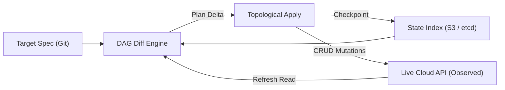
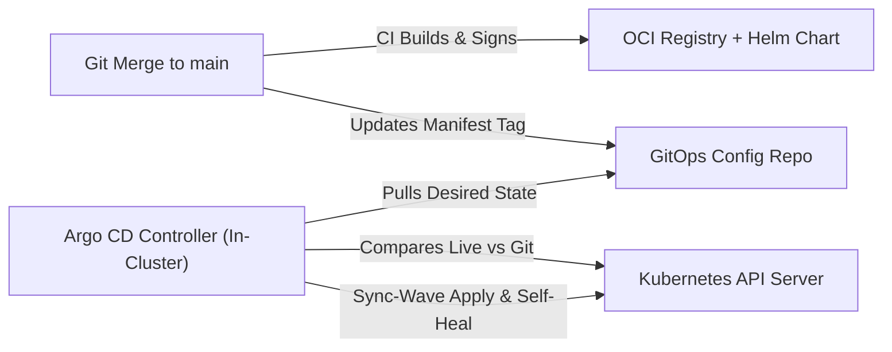
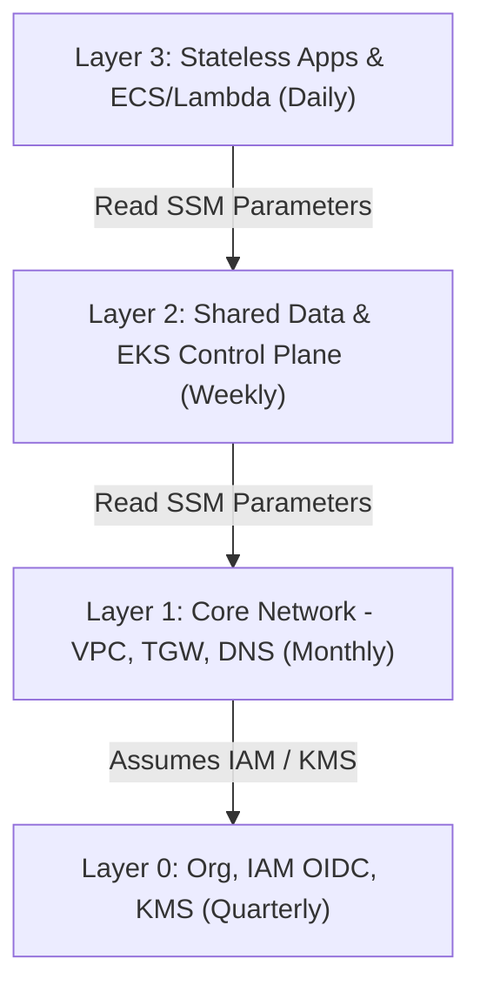

---
tags:
  - software-engineering
  - devops
  - iac
  - platform-engineering
  - gitops
  - policy-as-code
created: 2026-11-13
updated: 2026-11-13
status: 🟢
level: mid-to-senior
---
# Infrastructure as Code (IaC)

**Infrastructure as Code (IaC)** is the engineering discipline of provisioning, configuring, and governing compute, networking, storage, identity, and managed platform primitives through version-controlled, machine-readable specifications processed by deterministic convergence engines. Rather than mutating cloud control planes interactively, changes flow through code review, automated static policy verification, plan inspection, and programmatic reconciliation.

> [!abstract] Scope & Vault Context
> This handbook covers IaC convergence theory, state reconciliation mechanics, immutable image lifecycles, ephemeral preview topology, policy-as-code enforcement (OPA Rego, Checkov, Trivy), and GitOps pull reconciliation (Argo CD). For deep HCL2 internals, S3 native state locking, ephemeral write-only secrets, and state surgery, see [[Programming/Software Engineering/DevOps/Terraform|Terraform]]. Related guides: [[Programming/Software Engineering/DevOps/Cloud Fundamentals|Cloud Fundamentals]], [[Programming/Software Engineering/DevOps/Kubernetes|Kubernetes]], [[Programming/Software Engineering/DevOps/Docker|Docker]], [[Programming/Software Engineering/DevOps/CI-CD|CI/CD]], [[Programming/Software Engineering/DevOps/Pipeline Design|Pipeline Design]], [[Programming/Software Engineering/DevOps/GitHub Actions|GitHub Actions]], and [[Programming/Software Engineering/DevOps/DevOps Complete Guide|DevOps Complete Guide]].

---

## 1. First-Principles Mechanics & Complete Architecture

### 1.1 Declarative DAG Convergence vs. Imperative Idempotency Failures

An IaC tool executes one of two fundamentally different operational models: **ordered procedural execution** (imperative) or **graph-based state convergence** (declarative).

#### Why Imperative Scripts Fail Under Partial Failure

An imperative script (Bash + AWS CLI, Boto3, or raw cloud SDK loops) specifies *control flow* (`create_vpc()`, `wait()`, `create_subnet()`, `attach_igw()`). Its execution model lacks two critical primitives:

1. **Implicit Dependency Topology:** Engineers manually maintain step ordering. When step 5 alters a dependency created in step 2, every caller must reorder procedural invocations cleanly.
2. **Symmetric-Difference Accounting:** If step 4 of 9 fails due to an API rate limit (`RequestLimitExceeded`), IAM propagation delay, or malformed CIDR, re-running the script throws `ResourceInUseException` or `EntityAlreadyExists` on steps 1–3 unless the author manually wraps every API call in fragile `describe-then-create-or-update` branching. Worse, **deleting a line from an imperative script never deletes the live cloud resource**, leaving orphaned infrastructure consuming quota and budget indefinitely.

Even traditional **Configuration Management** tools (Ansible, Chef, Puppet) exhibit partial procedural behavior. Although individual Ansible modules (such as `ansible.builtin.apt` or `ansible.builtin.systemd`) are idempotent at the task level, playbooks execute sequentially top-to-bottom. Removing a user account, cron job, or firewall task from an Ansible role silently leaves that artifact active on target hosts unless an explicit `state: absent` counter-task is authored and retained.

#### Declarative Graph Convergence ($\Delta = G_{\text{target}} \ominus G_{\text{observed}}$)

Declarative provisioners ([[Programming/Software Engineering/DevOps/Terraform|Terraform]], OpenTofu, CloudFormation) and programmatic synthesis engines (Pulumi, AWS CDK) separate **specification** from **execution**:

1. **AST Parsing & Graph Synthesis:** The parser compiles `.tf` files (or evaluates a TypeScript/Go/Python object tree into a Cloud Assembly or gRPC resource graph) to construct a **Directed Acyclic Graph (DAG)** $G_{\text{target}} = (V, E)$, where vertices $V$ represent resources and data sources, and directed edges $E$ represent attribute dependencies (`subnet.vpc_id -> vpc.id`).
2. **State Refresh & Observation:** The engine reads its serialized state index $S$ (containing mapped provider IDs from prior runs) and executes read-only provider calls (`ReadResource` / `Describe*`) to materialize the live cloud control-plane state $G_{\text{observed}}$.
3. **Three-Way Diff Calculation:** The engine computes the minimal transition plan $\Delta$ across every vertex $v \in V_{\text{target}} \cup V_{\text{state}}$:
   - $v \in V_{\text{target}} \setminus V_{\text{state}} \implies \text{CREATE}$
   - $v \in V_{\text{state}} \setminus V_{\text{target}} \implies \text{DELETE}$ (automatic orphan garbage collection)
   - $v \in V_{\text{target}} \cap V_{\text{state}}$ with changed mutable fields $\implies \text{UPDATE\_IN\_PLACE}$
   - $v \in V_{\text{target}} \cap V_{\text{state}}$ with changed immutable (`ForceNew`) fields $\implies \text{REPLACE}$ (`CREATE` then `DELETE`, or `DELETE` then `CREATE`)
4. **Concurrent Topological Traversal:** Independent graph branches execute in parallel worker pools (`-parallelism=10`), while dependent vertices block until upstream `ApplyResourceChange` calls commit and update intermediate state checkpoints.

| Axis / Property | Imperative / Procedural | Configuration Management | Declarative Pipeline IaC | Programmatic SDK + Declarative Engine | Continuous Control Plane |
| :--- | :--- | :--- | :--- | :--- | :--- |
| **Representative Tools** | Bash/AWS CLI, Boto3 | Ansible, Chef, Puppet | Terraform, OpenTofu, CloudFormation | Pulumi, AWS CDK | Crossplane, AWS ACK, Argo CD |
| **Core Input** | Ordered API calls | Sequential host tasks | Target graph $G_{\text{target}}$ | General-purpose AST emitting $G_{\text{target}}$ | Kubernetes CRDs in `etcd` |
| **Idempotency Model** | Manual `if exists` guards | Per-module host checks | Engine computes $\Delta$ automatically | Engine computes $\Delta$ automatically | Level-triggered controller loop |
| **Orphan Deletion** | Manual cleanup scripts | Requires `state: absent` | Automatic on code removal | Automatic on code removal | Automatic via K8s finalizers |
| **Drift Healing** | None | Only when playbook runs | Only when `plan`/`apply` runs | Only when `preview`/`up` runs | Continuous self-healing loop |



### 1.2 State File vs. Live Resource Reconciliation & Drift Mechanics

**Configuration drift** is any divergence between the live cloud control plane ($G_{\text{observed}}$) and the codified source of truth ($G_{\text{target}}$). In pipeline-triggered IaC, reconciliation is **edge-triggered** (runs only during CI events or schedules), creating a temporal window where live infrastructure can diverge silently.

#### Three-Way Reconciliation Failure Modes

1. **Out-of-Band Console Mutations (ClickOps):** During an outage, an operator opens a Security Group rule to `0.0.0.0/0`, bumps RDS IOPS, or attaches an inline IAM policy. Because the state file $S$ still records the pre-incident attributes, the next CI `plan` run refreshes $G_{\text{observed}}$, detects the discrepancy, and proposes **reverting** the live change—potentially taking down production if the emergency change (such as increased storage or connection limits) was actually load-bearing.
2. **External Runtime Controllers:** Kubernetes Horizontal Pod Autoscalers (`replicas`), ECS deployment controllers (`task_definition` revision), or EC2 Auto Scaling target tracking (`desired_capacity`) continuously mutate live attributes at runtime. Declaring those volatile fields statically in IaC causes deployment pipelines to fight autoscalers on every run.
3. **Provider-Managed Auto-Mutations:** Cloud providers periodically mutate resources automatically—RDS minor engine version patches (`16.2` $\to$ `16.4`), AWS Config remediation Lambdas revoking non-compliant S3 ACLs, or EKS managed node group AMI patches.

#### Refresh-Only Reconciliation vs. Normal Plan

When an intentional out-of-band change must be absorbed without mutating cloud infrastructure:

- **Standard `plan` / `apply`:** Compares $G_{\text{target}}$ against $G_{\text{observed}}$ and attempts to force $G_{\text{observed}} \to G_{\text{target}}$.
- **Refresh-Only (`terraform apply -refresh-only` / `tofu apply -refresh-only`):** Queries live cloud APIs and updates **only** the state file $S \leftarrow G_{\text{observed}}$ with zero cloud control-plane mutations.
- **Invariant Rule:** Running `-refresh-only` without updating `.tf` code leaves $G_{\text{target}}$ stale; the very next normal `plan` will still try to overwrite the live change. Always backport approved live changes into Git **first** (or add `lifecycle { ignore_changes = [...] }` for externally managed attributes), verify a zero-diff plan, and then converge state.

### 1.3 Immutable Infrastructure vs. Mutable Configuration Management

In **mutable infrastructure**, long-lived VMs are provisioned once and modified over months via SSH, cron, or Ansible plays. Every partial apt upgrade, hotfix edit in `/etc`, or failed package post-install script accumulates **snowflake state**—hosts sharing identical Git tags behave differently in production, and rollbacks fail because reverse-patching scripts cannot predict diverged local disk states.

In **immutable infrastructure**, running compute units are never modified after boot. Any kernel patch, runtime upgrade, configuration change, or observability agent update triggers building a new versioned artifact (Golden AMI via Packer or signed OCI container image via BuildKit). Rollout replaces instances via Blue/Green target swaps, Auto Scaling Group (ASG) Instance Refresh, or Kubernetes rolling `Deployment` updates.

| Engineering Dimension | Mutable Infrastructure (Ansible / SSH) | Immutable Infrastructure (Packer AMI / OCI Containers) |
| :--- | :--- | :--- |
| **Update Mechanism** | In-place package & file mutation | Bake versioned image $\to$ replace fleet $\to$ drain & terminate old nodes |
| **Rollback MTTR** | High (`15–90 min`); downgrade scripts fail frequently | Low (`1–5 min`); revert Launch Template / image digest to $N-1$ |
| **Autoscaling Reliability** | Fragile; `user_data` running `apt-get` breaks if mirrors throttle | Deterministic; zero external package downloads at instance boot |
| **Supply Chain Provenance** | Low; requires continuous host-level file integrity monitoring | Cryptographic; exact Git SHA, CVE scan, and SBOM tied to AMI/OCI digest |
| **Stateful Data Handling** | Risk of coupling local disk state to OS root volume | Forces clean separation into external EBS, RDS, EFS, or S3 storage |

#### Golden Image Pipeline Invariant

1. **Bake Phase (CI):** **Packer** launches an ephemeral builder VM in an isolated build subnet, applies CIS Level 1 hardening (`sysctl`, disabled SSH password auth, auditd rules), pre-installs pinned OS packages and telemetry agents (OpenTelemetry Collector, eBPF Falco), cleans temporary credentials/machine IDs (`/etc/machine-id`, SSH host keys), generates an SPDX SBOM, and creates an encrypted AMI tagged with Git SHA and build timestamp.
2. **Deploy Phase (IaC):** Terraform/OpenTofu resolves the verified AMI ID, updates `aws_launch_template`, and triggers an ASG `instance_refresh` (`min_healthy_percentage = 90`, `instance_warmup = 120`).
3. **Boot Phase (`cloud-init`):** Boot-time `user_data` executes *only* lightweight environment binding (fetching runtime config from SSM Parameter Store, formatting attached NVMe scratch disks, registering with ECS/K8s cluster). Executing `apt update`, `pip install`, or `curl | bash` inside autoscaling `user_data` turns transient upstream package registry outages into full cluster scale-out failures.

### 1.4 Ephemeral Test & Preview Environments

Long-lived shared `staging` environments serialize releases, suffer from stale database fixtures, and accumulate cross-PR test pollution. **Ephemeral environments** spin up isolated infrastructure per Pull Request (`pr-418`), execute end-to-end integration tests against real cloud APIs, and tear down automatically upon PR merge or closure.

Architecture patterns for safe ephemeral stacks:

- **Namespace / Prefix Isolation:** Parameterize all globally/regionally unique identifiers (S3 buckets, IAM roles, Target Groups, database schemas) with `pr-${var.pr_number}` (`name_prefix` or explicit suffix) inside a dedicated sandbox AWS account (`aws-sandbox-ephemeral`)—never inside production accounts.
- **Shared Heavyweight Dependencies:** Provisioning a full NAT Gateway, EKS cluster, or Aurora instance per PR adds `15–25 minutes` and unnecessary hourly cost. Share the sandbox VPC, ALB listener (routing `pr-418.preview.internal` via host header rules), and shared Aurora cluster (creating an isolated logical database/schema `app_pr_418` per PR) while spinning up ephemeral compute (ECS tasks, Lambda functions, SQS queues) per branch.
- **Cost & Orphan Reaper Guarantees:** GitHub Actions `pull_request: types: [closed]` hooks occasionally fail or miss cancellations when runners crash. Enforce a mandatory `ExpiresAt` RFC3339 tag on every ephemeral resource and run a nightly scheduled reaper (`aws-nuke` / custom Python/Go TTL sweeper) in the sandbox account to purge expired PR resources automatically.

### 1.5 Policy-as-Code Enforcement (OPA Rego, Checkov, Trivy)

Raw HCL linting (`tflint`, `terraform validate`) verifies syntax and schema compliance but cannot enforce organizational security guardrails reliably when attributes come from `tfvars`, `locals`, or nested child modules.

Enforce security gates across **two complementary layers**:

1. **Fast Local & Pre-Plan HCL Scanning (`trivy config`, `checkov`):** Runs in `< 5 seconds` during pre-commit and early CI stages against raw `.tf`, Kubernetes YAML, and Dockerfiles to catch obvious misconfigurations (hardcoded secrets, missing encryption flags, privileged pods) before generating cloud credentials.
2. **Evaluated Plan Gate (`OPA / Rego` via `conftest` against `tfplan.json`):** Executes **after** `terraform plan -out=tfplan && terraform show -json tfplan > tfplan.json`. Evaluating `tfplan.json` resolves every variable default, `.tfvars` override, `for_each` expansion, and computed local into concrete JSON under `resource_changes[*].change.after`, making variable-indirection bypasses impossible.
3. **Cloud Control-Plane Backstop (AWS SCPs / Azure Policy):** Even if a human uses break-glass console access bypassing CI entirely, AWS Organizations Service Control Policies (SCPs) reject API calls attempting to disable S3 Block Public Access or launch unencrypted EBS volumes.

### 1.6 GitOps Pull Reconciliation vs. Push CI Pipelines

Continuous delivery for cloud and Kubernetes resources follows either a **Push** model or a **Pull (GitOps)** model:

| Dimension | Push CI Model (GitHub Actions $\to$ Cloud/K8s) | Pull GitOps Model (Argo CD / Flux / Crossplane) |
| :--- | :--- | :--- |
| **Control Location** | External CI runner pushes changes on commit | In-cluster/control-plane agent pulls Git on poll/webhook |
| **Credential Boundary** | CI runner holds write credentials (`kubeconfig` / Apply IAM role) | CI needs **zero** production cluster write access; agent stays inside trust boundary |
| **Drift Detection** | Blind between CI runs unless scheduled drift cron runs | Continuous (default every `180 s`); surfaces `OutOfSync` immediately |
| **Self-Healing** | Manual or custom workflow re-trigger | Automatic (`selfHeal: true`) reverts manual `kubectl edit` mutations |
| **Ordering & Rollout Hooks** | Imperative pipeline job dependencies | Declarative `sync-wave` annotations + `PreSync` / `Sync` / `PostSync` hooks |
| **Primary Best Fit** | Foundation cloud infra (VPC, IAM, KMS, RDS via Terraform) | Kubernetes workloads, CRDs, Helm charts, Crossplane composite infra |



In production platforms, **Push IaC and Pull GitOps work together**: Terraform/OpenTofu provisions the foundational cloud topology (AWS accounts, VPC, KMS, RDS, EKS control plane, and bootstraps Argo CD), while **Argo CD** reconciles all Kubernetes platform add-ons (Ingress/Gateway API, External Secrets Operator, OpenTelemetry Collector, Cert-Manager) and application microservices declaratively using `sync-wave` ordering.

---

## 2. Real-World Use Cases & Decision Matrix

### 2.1 Deep Tooling Comparison Matrix (2025–2026)

| Capability | Terraform | OpenTofu | Pulumi | AWS CDK | Crossplane | Argo CD |
| :--- | :--- | :--- | :--- | :--- | :--- | :--- |
| **License / Governance** | BSL 1.1 (HashiCorp / IBM) | **MPL 2.0** (Linux Foundation / CNCF) | Apache 2.0 | Apache 2.0 | Apache 2.0 (CNCF) | Apache 2.0 (CNCF) |
| **Authoring Format** | HCL2 | HCL2 (drop-in `tofu` CLI) | TypeScript, Python, Go, C#, YAML | TypeScript, Python, Go, Java | Kubernetes YAML CRDs (XRDs) | K8s YAML / Helm / Kustomize |
| **Execution Model** | Core DAG + gRPC plugins | Core DAG + gRPC plugins | Engine + gRPC language hosts | Synthesizes CloudFormation JSON | K8s controller manager (`etcd`) | In-cluster K8s reconciliation loop |
| **Native State Encryption** | Backend SSE-KMS only | **Client-side AES-GCM** (v1.7+: KMS, OpenBao) | Per-secret ciphertext + backend | Managed by CloudFormation | Stored in K8s `etcd` (enable KMS) | Stateless (`etcd` live objects) |
| **Write-Only State Secrets** | `ephemeral` (1.10) + `_wo` (1.11) | `ephemeral` + `_wo` (1.11) | `pulumi.secret()` encrypted state | `{{resolve:secretsmanager:...}}` | K8s `Secret` + External Secrets | External Secrets Operator / SOPS |
| **Unique Capabilities** | HCP Stacks; List Resources (1.14) | Provider `for_each` (1.9); OCI registries (1.10); `enabled` (1.11); dynamic `prevent_destroy` (1.12) | Full type system, Automation API, unit tests | L2/L3 AWS ergonomics (`grantRead()`) | Continuous cloud drift healing; IDP APIs | `sync-wave`, AppSets, progressive rollouts |
| **Operational Friction** | BSL limits commercial SaaS tooling | Minor cadence lag vs upstream | Language runtime/package dependency drift | AWS-only; stuck `UPDATE_ROLLBACK_FAILED` | Cloud API rate throttling at >2k CRDs | K8s-only; needs Terraform/CDK for VPC/EKS |

> [!warning] CDK for Terraform (CDKTF) Deprecation (December 2025)
> HashiCorp officially **deprecated and archived CDKTF on December 10, 2025**, halting provider binding updates and security patches. Do not start new platforms on CDKTF. Migrate legacy CDKTF stacks either to raw HCL via `cdktf synth --hcl` (targeting **OpenTofu** or **Terraform**) or to **Pulumi** when general-purpose programming abstractions are mandatory.

### 2.2 Six Concrete Engineering Scenarios: When to Adopt & When Not To

| Scenario | Recommended Stack | Why This Wins | What to Avoid & Trade-Off |
| :--- | :--- | :--- | :--- |
| **1. Multi-Account AWS Landing Zone, VPC, IAM & RDS** | **OpenTofu / Terraform** (layered states + OIDC) | Industry-standard multi-cloud provider ecosystem, deterministic `plan` previews, `moved`/`import` blocks, zero runtime cluster dependency. | **Avoid Crossplane** for bootstrapping root VPC/IAM (chicken-and-egg K8s dependency; high blast radius if `etcd` corrupts). |
| **2. Kubernetes Microservices & Cluster Add-ons** | **Argo CD** (GitOps Pull) + Helm/Kustomize | Zero inbound cluster secrets in CI, continuous self-healing against manual `kubectl edit`, deterministic `sync-wave` migration ordering. | **Avoid Terraform `kubernetes_manifest`** for high-churn app deployments (slow plan diffs, helm release lock corruption on timeout). |
| **3. Self-Service Internal Developer Platform (IDP)** | **Crossplane Compositions** + **Argo CD** | App teams request a namespace-scoped `AppDatabase` XRD claim without knowing VPC peering, KMS, or IAM policy internals; continuous reconciliation prevents cloud drift. | **Avoid Crossplane** on small teams (`< 15` engineers)—maintaining Composition upgrades and provider controller memory overhead slows delivery vs Terraform modules. |
| **4. App-Coupled Serverless / Event-Driven AWS Stack** | **AWS CDK** or **Pulumi** | Shared TypeScript types between Lambda handlers, SQS queues, and DynamoDB tables; `.grantReadWriteData()` builds least-privilege IAM automatically. | **Avoid AWS CDK** for multi-cloud or shared core networking where CloudFormation drift recovery and 500-resource stack limits create friction. |
| **5. High-Throughput Immutable EC2 Worker Fleet** | **Packer Golden AMI** + **Terraform ASG Refresh** | Sub-60s deterministic autoscaling boot, pinned kernel/CIS hardening, instant rollback to $N-1$ AMI ID without package repository dependency. | **Avoid Ansible-over-SSH** on autoscaling pools—dynamic host inventory drift and runtime `apt` latency break traffic-spike scaling. |
| **6. Dynamic Per-Tenant Runtime Objects (SaaS Signups)** | **Application Control Plane / DB API** (NOT IaC!) | Provisioning tenant buckets, schemas, or API keys synchronously during user signup requires `< 500 ms` transactional APIs—never Git commits and 2-minute CI Terraform plans. | **Never trigger `terraform apply` inside a web request handler** or generate 10,000 dynamic tenant HCL blocks in Git. |

---

## 3. Step-by-Step Practical Application (Production Implementation)

Below is a complete, production-ready repository blueprint combining **Packer** golden AMI baking, **OPA/Rego + Conftest** plan gating with automated unit tests, **Trivy** & **Checkov** configuration scanning, **Argo CD** `sync-wave` GitOps delivery, and an automated **GitHub Actions Drift Detection & Policy Pipeline**.

### 3.1 Production Platform Repository Layout

```text
platform-iac/
├── .checkov.yaml
├── .trivy.yaml
├── .github/
│   └── workflows/
│       └── iac-policy-and-drift.yml
├── packer/
│   ├── ubuntu-2404-worker.pkr.hcl
│   └── scripts/
│       └── harden.sh
├── policy/
│   ├── security.rego
│   └── security_test.rego
├── gitops/
│   ├── project-platform.yaml
│   ├── app-orders-service.yaml
│   └── manifests/
│       ├── 00-migration-job.yaml
│       └── 01-orders-deployment.yaml
└── stacks/
    └── prod/
        └── compute/
            └── main.tf
```

### 3.2 Immutable Golden AMI Pipeline (Packer HCL2)

`packer/scripts/harden.sh` enforces deterministic OS tuning, removes SSH password auth, installs the OpenTelemetry Collector, and strips host-specific identifiers before snapshotting:

```bash
#!/usr/bin/env bash
set -euo pipefail

export DEBIAN_FRONTEND=noninteractive

# Pin security updates deterministically at bake time (never at autoscaling boot)
apt-get update -y
apt-get upgrade -y
apt-get install -y --no-install-recommends \
  ca-certificates \
  curl \
  jq \
  auditd \
  unattended-upgrades

# Kernel network tuning baked immutably into sysctl.d
cat <<'EOF' > /etc/sysctl.d/99-platform-tuning.conf
net.core.somaxconn = 4096
net.ipv4.tcp_max_syn_backlog = 4096
net.ipv4.ip_local_port_range = 10240 65535
net.ipv4.conf.all.rp_filter = 1
EOF
sysctl --system

# Disable SSH password authentication and root login
sed -i 's/^#\?PasswordAuthentication.*/PasswordAuthentication no/' /etc/ssh/sshd_config
sed -i 's/^#\?PermitRootLogin.*/PermitRootLogin no/' /etc/ssh/sshd_config

# Strip transient machine/SSH identifiers so cloned AMIs regenerate unique keys on boot
rm -f /etc/ssh/ssh_host_*
truncate -s 0 /etc/machine-id
apt-get clean
rm -rf /var/lib/apt/lists/*
```

`packer/ubuntu-2404-worker.pkr.hcl` builds an encrypted EBS-backed AMI enforcing IMDSv2 and embedding provenance metadata:

```hcl
packer {
  required_version = ">= 1.11.0"
  required_plugins {
    amazon = {
      source  = "github.com/hashicorp/amazon"
      version = "~> 1.3.4"
    }
  }
}

variable "aws_region" {
  type    = string
  default = "us-east-1"
}

variable "git_sha" {
  type = string
}

source "amazon-ebs" "worker" {
  region                      = var.aws_region
  instance_type               = "t3.medium"
  ssh_username                = "ubuntu"
  ami_name                    = "acme-worker-ubuntu2404-${formatdate("YYYYMMDDhhmm", timestamp())}-${substr(var.git_sha, 0, 7)}"
  associate_public_ip_address = false
  encrypt_boot                = true

  # Require IMDSv2 on builder instance itself
  metadata_options {
    http_endpoint               = "enabled"
    http_tokens                 = "required"
    http_put_response_hop_limit = 1
  }

  source_ami_filter {
    filters = {
      name                = "ubuntu/images/hvm-ssd-gp3/ubuntu-noble-24.04-amd64-server-*"
      root-device-type    = "ebs"
      virtualization-type = "hvm"
    }
    most_recent = true
    owners      = ["099720109477"] # Canonical
  }

  tags = {
    Name      = "acme-worker-golden"
    GitSHA    = var.git_sha
    OS        = "ubuntu-24.04"
    ManagedBy = "packer"
    Hardened  = "cis-l1"
  }
}

build {
  sources = ["source.amazon-ebs.worker"]

  provisioner "shell" {
    execute_command = "sudo -S env {{ .Vars }} bash '{{ .Path }}'"
    script          = "${path.root}/scripts/harden.sh"
  }

  post-processor "manifest" {
    output     = "packer-manifest.json"
    strip_path = true
  }
}
```

### 3.3 OPA / Rego Policy-as-Code Gate + Automated Tests

`policy/security.rego` evaluates resolved `tfplan.json` output (`terraform show -json tfplan > tfplan.json`), catching five critical production failure classes:

1. Unrestricted ingress on administrative ports (`22`, `3389`, or all-ports `-1`) across both legacy `aws_security_group_rule` and modern `aws_vpc_security_group_ingress_rule`.
2. Missing S3 Public Access Block flags (`block_public_acls` or `restrict_public_buckets`).
3. Unencrypted RDS instances (`aws_db_instance` / `aws_rds_cluster` with `storage_encrypted != true`).
4. Unencrypted EBS volumes (`aws_ebs_volume` with `encrypted != true`).
5. Over-permissive IAM policy statements granting `Action: "*"` on `Resource: "*"` with `Effect: "Allow"`.

```rego
package main

import rego.v1

# Match only changes that create or mutate cloud state (allow pure delete PRs)
is_mutating(actions) if {
	some action in actions
	action in {"create", "update"}
}

world_cidr_present(after) if {
	some cidr in after.cidr_blocks
	cidr == "0.0.0.0/0"
}

world_cidr_present(after) if {
	some cidr in after.ipv6_cidr_blocks
	cidr == "::/0"
}

exposes_admin_port(after) if after.ip_protocol == "-1"
exposes_admin_port(after) if after.protocol == "-1"

exposes_admin_port(after) if {
	is_number(after.from_port)
	is_number(after.to_port)
	some port in {22, 3389}
	after.from_port <= port
	after.to_port >= port
}

# 1a. Legacy aws_security_group_rule ingress check
deny contains msg if {
	some rc in input.resource_changes
	rc.type == "aws_security_group_rule"
	is_mutating(rc.change.actions)

	after := rc.change.after
	after.type == "ingress"
	exposes_admin_port(after)
	world_cidr_present(after)

	msg := sprintf(
		"SECURITY VIOLATION [%s]: SG rule exposes port 22/3389 publicly",
		[rc.address],
	)
}

# 1b. Modern aws_vpc_security_group_ingress_rule check
world_v4_or_v6(after) if after.cidr_ipv4 == "0.0.0.0/0"
world_v4_or_v6(after) if after.cidr_ipv6 == "::/0"

deny contains msg if {
	some rc in input.resource_changes
	rc.type == "aws_vpc_security_group_ingress_rule"
	is_mutating(rc.change.actions)

	after := rc.change.after
	exposes_admin_port(after)
	world_v4_or_v6(after)

	msg := sprintf(
		"SECURITY VIOLATION [%s]: VPC SG ingress rule exposes port 22/3389 publicly",
		[rc.address],
	)
}

# 2. Enforce S3 Public Access Block flags
missing_s3_block(after) if object.get(after, "block_public_acls", false) != true
missing_s3_block(after) if object.get(after, "restrict_public_buckets", false) != true

deny contains msg if {
	some rc in input.resource_changes
	rc.type == "aws_s3_bucket_public_access_block"
	is_mutating(rc.change.actions)

	missing_s3_block(rc.change.after)

	msg := sprintf(
		"SECURITY VIOLATION [%s]: block_public_acls and restrict_public_buckets must both be true",
		[rc.address],
	)
}

# 3. Require encryption at rest for RDS instances and Aurora clusters
deny contains msg if {
	some rc in input.resource_changes
	rc.type in {"aws_db_instance", "aws_rds_cluster"}
	is_mutating(rc.change.actions)

	object.get(rc.change.after, "storage_encrypted", false) != true

	msg := sprintf(
		"SECURITY VIOLATION [%s]: RDS storage_encrypted must be true",
		[rc.address],
	)
}

# 4. Require encryption at rest for EBS volumes
deny contains msg if {
	some rc in input.resource_changes
	rc.type == "aws_ebs_volume"
	is_mutating(rc.change.actions)

	object.get(rc.change.after, "encrypted", false) != true

	msg := sprintf(
		"SECURITY VIOLATION [%s]: EBS volume encrypted must be true",
		[rc.address],
	)
}

# 5. Block wildcard IAM policies (Allow * on *)
has_wildcard(val) if val == "*"
has_wildcard(val) if {
	is_array(val)
	some item in val
	item == "*"
}

deny contains msg if {
	some rc in input.resource_changes
	rc.type in {"aws_iam_policy", "aws_iam_role_policy"}
	is_mutating(rc.change.actions)

	doc := json.unmarshal(rc.change.after.policy)
	some stmt in doc.Statement
	stmt.Effect == "Allow"
	has_wildcard(stmt.Action)
	has_wildcard(stmt.Resource)

	msg := sprintf(
		"SECURITY VIOLATION [%s]: IAM policy grants wildcard Action '*' on Resource '*'",
		[rc.address],
	)
}
```

Policy-as-code itself requires automated unit testing in CI so refactoring Rego helper predicates never silently weakens enforcement (`policy/security_test.rego`, runnable via `opa test policy/ -v`):

```rego
package main

import rego.v1

test_deny_unencrypted_rds if {
	mock_plan := {"resource_changes": [{
		"address": "aws_db_instance.orders",
		"type": "aws_db_instance",
		"change": {
			"actions": ["create"],
			"after": {"identifier": "orders-prod", "storage_encrypted": false},
		},
	}]}
	count(deny) == 1 with input as mock_plan
}

test_allow_encrypted_rds if {
	mock_plan := {"resource_changes": [{
		"address": "aws_db_instance.orders",
		"type": "aws_db_instance",
		"change": {
			"actions": ["create"],
			"after": {"identifier": "orders-prod", "storage_encrypted": true},
		},
	}]}
	count(deny) == 0 with input as mock_plan
}

test_deny_public_s3_block_omitted if {
	mock_plan := {"resource_changes": [{
		"address": "aws_s3_bucket_public_access_block.logs",
		"type": "aws_s3_bucket_public_access_block",
		"change": {
			"actions": ["update"],
			"after": {"block_public_acls": false, "restrict_public_buckets": true},
		},
	}]}
	count(deny) == 1 with input as mock_plan
}

test_allow_delete_of_noncompliant_sg_rule if {
	mock_plan := {"resource_changes": [{
		"address": "aws_vpc_security_group_ingress_rule.legacy_ssh",
		"type": "aws_vpc_security_group_ingress_rule",
		"change": {
			"actions": ["delete"],
			"after": null,
		},
	}]}
	count(deny) == 0 with input as mock_plan
}

test_deny_wildcard_iam_policy if {
	mock_plan := {"resource_changes": [{
		"address": "aws_iam_policy.admin",
		"type": "aws_iam_policy",
		"change": {
			"actions": ["create"],
			"after": {
				"name": "bad-admin",
				"policy": `{"Version":"2012-10-17","Statement":[{"Effect":"Allow","Action":["*"],"Resource":"*"}]}`,
			},
		},
	}]}
	count(deny) == 1 with input as mock_plan
}
```

### 3.4 Trivy & Checkov Static Scanner Configurations

`.trivy.yaml` configures Trivy's IaC misconfiguration engine (`trivy config` replaces the legacy `tfsec` project) to fail CI on `HIGH` and `CRITICAL` cloud security defects:

```yaml
misconfiguration:
  include-non-failures: false
  terraform:
    exclude-downloaded-modules: false
severity:
  - HIGH
  - CRITICAL
exit-code: 1
```

`.checkov.yaml` enforces deterministic framework selection, hard failure thresholds, and explicit compliance check selection without relying on unreviewed inline `#checkov:skip` suppressions:

```yaml
framework:
  - terraform
  - terraform_plan
  - kubernetes
soft-fail: false
compact: true
quiet: true
check:
  - CKV_AWS_16   # Ensure RDS database has encryption enabled
  - CKV_AWS_17   # Ensure RDS instance is not publicly accessible
  - CKV_AWS_20   # Ensure S3 bucket does not have public read ACL
  - CKV_AWS_21   # Ensure S3 bucket versioning is enabled
  - CKV_AWS_145  # Ensure S3 bucket is encrypted with KMS CMK
  - CKV_AWS_260  # Ensure no security group allows ingress from 0.0.0.0:0 to port 80/443/22
```

### 3.5 Argo CD GitOps `Application`, `AppProject` & `sync-wave` Manifests

Argo CD enforces project-level RBAC (`AppProject`) so application repositories cannot deploy cluster-scoped `ClusterRole` or non-approved namespaces, while `sync-wave` annotations guarantee database schema migrations finish *before* application containers roll out.

`gitops/project-platform.yaml`:

```yaml
apiVersion: argoproj.io/v1alpha1
kind: AppProject
metadata:
  name: orders-platform
  namespace: argocd
spec:
  description: "Scoped GitOps boundary for Orders microservices"
  sourceRepos:
    - "https://github.com/acme/orders-gitops.git"
  destinations:
    - namespace: "orders-prod"
      server: "https://kubernetes.default.svc"
  clusterResourceWhitelist:
    - group: ""
      kind: "Namespace"
  namespaceResourceBlacklist:
    - group: ""
      kind: "ResourceQuota"
```

`gitops/app-orders-service.yaml`:

```yaml
apiVersion: argoproj.io/v1alpha1
kind: Application
metadata:
  name: orders-service-prod
  namespace: argocd
  finalizers:
    - resources-finalizer.argocd.argoproj.io
spec:
  project: orders-platform
  source:
    repoURL: "https://github.com/acme/orders-gitops.git"
    targetRevision: main
    path: "envs/prod/orders"
  destination:
    server: "https://kubernetes.default.svc"
    namespace: orders-prod
  syncPolicy:
    automated:
      prune: true      # Automatically delete K8s resources removed from Git
      selfHeal: true   # Immediately revert manual kubectl edit drift
      allowEmpty: false
    syncOptions:
      - CreateNamespace=true
      - PrunePropagationPolicy=foreground
      - PruneLast=true
      - ApplyOutOfSyncOnly=true
      - ServerSideApply=true
      - RespectIgnoreDifferences=true
    retry:
      limit: 3
      backoff:
        duration: 10s
        factor: 2
        maxDuration: 2m
  # Prevent Argo CD from fighting HPA dynamic scaling on Deployment replicas
  ignoreDifferences:
    - group: apps
      kind: Deployment
      jqPathExpressions:
        - ".spec.replicas"
```

Ordered Kubernetes workloads inside `gitops/manifests/` demonstrating `sync-wave: "-1"` (schema migration hook running before the Deployment) and `sync-wave: "0"` (rollout):

```yaml
# gitops/manifests/00-migration-job.yaml
apiVersion: batch/v1
kind: Job
metadata:
  name: orders-db-migrate-20261113
  namespace: orders-prod
  annotations:
    argocd.argoproj.io/hook: PreSync
    argocd.argoproj.io/sync-wave: "-1"
    argocd.argoproj.io/hook-delete-policy: BeforeHookCreation
spec:
  backoffLimit: 2
  activeDeadlineSeconds: 300
  template:
    spec:
      restartPolicy: Never
      serviceAccountName: orders-migrator
      containers:
        - name: migrate
          image: ghcr.io/acme/orders-migrator:v2.14.0
          command: ["./migrate", "up"]
          envFrom:
            - secretRef:
                name: orders-db-credentials
---
# gitops/manifests/01-orders-deployment.yaml
apiVersion: apps/v1
kind: Deployment
metadata:
  name: orders-api
  namespace: orders-prod
  annotations:
    argocd.argoproj.io/sync-wave: "0"
spec:
  selector:
    matchLabels:
      app: orders-api
  template:
    metadata:
      labels:
        app: orders-api
    spec:
      serviceAccountName: orders-api
      securityContext:
        runAsNonRoot: true
        seccompProfile:
          type: RuntimeDefault
      containers:
        - name: orders-api
          image: ghcr.io/acme/orders-api:v2.14.0
          ports:
            - containerPort: 8080
          readinessProbe:
            httpGet:
              path: /healthz
              port: 8080
            initialDelaySeconds: 5
            periodSeconds: 5
          resources:
            requests:
              cpu: "250m"
              memory: "256Mi"
            limits:
              memory: "512Mi"
```

### 3.6 Continuous Policy Gate & Drift Detection Workflow (GitHub Actions)

`.github/workflows/iac-policy-and-drift.yml` runs OPA/Trivy/Checkov on every PR and executes a scheduled 4-hourly read-only drift check against production stacks using OIDC read-only credentials (`plan -detailed-exitcode`), opening/updating a GitHub Issue whenever exit code `2` signals out-of-band drift:

```yaml
name: IaC Policy Gate & Drift Detection

on:
  pull_request:
    paths:
      - "stacks/**"
      - "policy/**"
  schedule:
    - cron: "15 */4 * * *" # Every 4 hours (offset from :00 to avoid API spikes)
  workflow_dispatch:

permissions:
  id-token: write
  contents: read
  issues: write
  pull-requests: write

jobs:
  policy-unit-tests:
    name: OPA & Static Scanners
    runs-on: ubuntu-latest
    steps:
      - uses: actions/checkout@v4

      - name: Setup OPA
        uses: open-policy-agent/setup-opa@v2
        with:
          version: "1.0.0"

      - name: Run OPA Rego Policy Unit Tests
        run: opa test policy/ -v

      - name: Run Trivy IaC Config Scan
        uses: aquasecurity/trivy-action@0.29.0
        with:
          scan-type: config
          scan-ref: stacks/
          config-file: .trivy.yaml
          exit-code: "1"

      - name: Run Checkov Static Scan
        uses: bridgecrewio/checkov-action@v12
        with:
          directory: stacks/
          config_file: .checkov.yaml

  plan-and-drift-check:
    name: Plan & Drift Reconciliation (${{ matrix.stack }})
    runs-on: ubuntu-latest
    needs: policy-unit-tests
    strategy:
      fail-fast: false
      matrix:
        stack:
          - stacks/prod/network
          - stacks/prod/data
          - stacks/prod/compute
    steps:
      - uses: actions/checkout@v4

      - name: Configure Read-Only AWS OIDC Credentials
        uses: aws-actions/configure-aws-credentials@v4
        with:
          role-to-assume: ${{ secrets.AWS_OIDC_PLAN_ROLE_ARN }}
          aws-region: us-east-1

      - name: Setup OpenTofu
        uses: opentofu/setup-opentofu@v1
        with:
          tofu_version: "1.11.0"

      - name: Install Conftest
        run: |
          CONFTEST_VER="0.56.0"
          curl -sSL "https://github.com/open-policy-agent/conftest/releases/download/v${CONFTEST_VER}/conftest_${CONFTEST_VER}_Linux_x86_64.tar.gz" -o /tmp/conftest.tar.gz
          tar -xzf /tmp/conftest.tar.gz -C /usr/local/bin conftest
          conftest --version

      - name: Initialize Stack
        working-directory: ${{ matrix.stack }}
        run: tofu init -input=false

      - name: Generate Binary Plan & Check Exit Code
        id: plan
        working-directory: ${{ matrix.stack }}
        run: |
          set +e
          tofu plan -input=false -no-color -detailed-exitcode -out=tfplan > plan.txt 2>&1
          EXIT_CODE=$?
          set -e
          echo "exitcode=${EXIT_CODE}" >> "$GITHUB_OUTPUT"
          cat plan.txt
          if [ "$EXIT_CODE" -eq 1 ]; then
            exit 1
          fi

      - name: Evaluate Resolved Plan JSON Against OPA Rego
        working-directory: ${{ matrix.stack }}
        run: |
          tofu show -json tfplan > tfplan.json
          conftest test tfplan.json --policy ../../../policy/

      - name: Report Production Drift Incident (Scheduled Cron)
        if: github.event_name == 'schedule' && steps.plan.outputs.exitcode == '2'
        uses: actions/github-script@v7
        with:
          script: |
            const stack = "${{ matrix.stack }}";
            const fs = require("fs");
            const planSnippet = fs.readFileSync(`${stack}/plan.txt`, "utf8").slice(0, 4000);
            await github.rest.issues.create({
              owner: context.repo.owner,
              repo: context.repo.name,
              title: `[DRIFT] Out-of-band infrastructure drift detected in ${stack}`,
              labels: ["infra-drift", "severity-high"],
              body: `Scheduled reconciliation detected live control-plane divergence (\`exitcode=2\`).\n\n\`\`\`hcl\n${planSnippet}\n\`\`\`\n\nRunbook: Inspect AWS CloudTrail for recent manual mutations before running apply or backporting HCL.`
            });
```

*(Note on action maintenance: in production workflows, pin GitHub Actions to full 40-character commit SHAs rather than mutable `@v4` tags to prevent supply-chain compromise, and validate `conftest` installation via verified binary checksums or `aquasecurity/setup-trivy` / `open-policy-agent` official releases.)*

---

## 4. Complete Framework & Construct Reference & Edge Cases

### 4.1 Plan Exit Codes & Automation Semantics

| Exit Code | Meaning (`-detailed-exitcode`) | CI/CD Pipeline Action |
| :--- | :--- | :--- |
| **`0`** | Succeeded; empty diff (live state matches Git) | Pass check; skip downstream `apply` stage cleanly. |
| **`1`** | Runtime error (invalid HCL, state lock failure, IAM `AccessDenied`, provider timeout) | Fail pipeline immediately; page on-call if occurring on scheduled drift run. |
| **`2`** | Succeeded with non-empty diff | On PR: post diff + run OPA/Conftest on `tfplan.json`. On scheduled drift check: alert as ClickOps drift. |

### 4.2 Policy Engine & Scanner Capabilities Matrix

| Tool | Input Evaluated | Rule Language | Best Used For | Key Limitation / Edge Case |
| :--- | :--- | :--- | :--- | :--- |
| **OPA + Conftest** | `tfplan.json`, K8s YAML, JSON | Rego v1 | Enforcing custom org invariants after variable & module resolution | Requires cloud read access (`plan`) to evaluate computed attributes unless mocking defaults. |
| **Trivy (`trivy config`)** | Raw `.tf`, Dockerfile, K8s, Helm | Built-in Rego + Go checks | Unified fast shift-left CVE + IaC scanning in one binary | Cannot resolve remote `data` lookups or external `tfvars` values on raw `.tf` scans. |
| **Checkov** | Raw `.tf`, `tfplan.json`, CDK/CFN | Python & YAML graphs | Rich graph-based cross-resource checks (e.g., KMS key attached to S3 bucket) | Large repos need `--skip-check` governance so devs do not silence critical rules without review. |
| **AWS SCP / Azure Policy** | Live Cloud API HTTP Requests | IAM JSON Conditions | Hard preventive boundary blocking even break-glass console mutations | Coarse error messages; hard to exempt single legitimate admin bootstrap tasks cleanly. |

### 4.3 Argo CD Sync Phases, Waves & Edge Cases

Argo CD executes manifests inside a single sync operation across ordered phases and integer waves (ascending from negative integers, default `0`, to positive integers):

1. **`PreSync` Phase (`wave -N .. +N`):** Runs hooks *before* applying core resources (database schema migrations, pre-flight secret checks, backup snapshots). If a `PreSync` Job fails, the `Sync` phase never starts.
2. **`Sync` Phase (`wave -N .. +N`):** Applies core resources ordered by wave (`wave: "-2"` Namespace/RBAC $\to$ `wave: "-1"` ExternalSecrets/ConfigMaps $\to$ `wave: "0"` Deployments/Services).
3. **`PostSync` Phase:** Executes integration smoke tests, Slack notifications, or cache invalidation after every `Sync` resource reaches `Healthy`.
4. **`SyncFail` Phase:** Triggers rollback webhooks or incident alerts if any earlier phase fails.

**Critical Edge Cases & Traps:**

- **`OutOfSync` Infinite Self-Heal Loops:** Mutating Admission Webhooks (Istio sidecar injection, Kyverno default labels, K8s API defaulting `imagePullPolicy: Always` or HPA mutating `spec.replicas`) alter live objects after Argo CD applies them. With `selfHeal: true`, Argo CD immediately detects a diff, re-applies the original Git manifest, triggers the webhook/HPA again, and thrashes the API server. Fix via explicit `ignoreDifferences` with `jqPathExpressions` AND `syncOptions: ["RespectIgnoreDifferences=true"]` (without `RespectIgnoreDifferences`, Argo CD *displays* `Synced` in the UI while still overwriting ignored fields during an active sync!).
- **`ServerSideApply=true` for Large CRDs:** Kubernetes CRDs (Prometheus Operator `kube-prometheus-stack`, Istio, Crossplane providers) exceed the `262,144`-byte limit of `kubectl.kubernetes.io/last-applied-configuration` client-side annotation. Always enable `ServerSideApply=true` in `syncOptions` for CRD-heavy applications.
- **`terraform_remote_state` Security Leak:** Granting microservice Layer 3 CI roles read access to Layer 1/2 `.tfstate` files via `terraform_remote_state` leaks *every* attribute in that upstream state (including sensitive outputs or resource metadata). Export non-sensitive outputs (`vpc_id`, `subnet_ids`) to AWS SSM Parameter Store / Cloud Map and read them via scoped `data "aws_ssm_parameter"` calls.
- **`pull_request_target` OIDC Compromise:** Configuring GitHub Actions `on: pull_request_target` checks out untrusted fork PR code while retaining access to repository secrets and OIDC cloud roles. An attacker opening a fork PR containing a malicious `external` data source (`program = ["bash", "-c", "env | curl ..."]`) can exfiltrate the OIDC temporary STS token directly during `terraform plan`. Never run `pull_request_target` against untrusted code!

### 4.4 Blast-Radius Environment Topology & Layering

Partition infrastructure by **rate of change** and **failure impact** rather than placing an entire cloud account into one monolithic state file:



| Environment Strategy | Structure | Primary Strength | Failure Risk |
| :--- | :--- | :--- | :--- |
| **Directory-per-Env** (`envs/dev`, `envs/prod`) | Separate root states referencing pinned child modules | Explicit promotion diffs; distinct OIDC IAM roles per env | Controlled module-call boilerplate across directories |
| **CLI Workspaces** (`terraform workspace`) | Single root directory switching state key prefixes | Zero code duplication for ephemeral PR preview stacks | Refactoring the shared root affects `prod` and `dev` simultaneously; weak per-env IAM isolation |
| **Terragrunt DRY Stacks** | `terragrunt.hcl` generating backends + `dependency` DAG | Eliminates backend/provider boilerplate; orders multi-stack `run-all` | Additional abstraction layer; debugging generated HCL adds friction |

---

## 5. Production Debugging, Profiling & Operations Playbook

| Production Symptom | Underlying Root Cause | Exact Diagnostic Commands | Production Remediation |
| :--- | :--- | :--- | :--- |
| **Unrelated PR `plan` proposes destroying/modifying live SG or DB attributes** | Out-of-band ClickOps console drift mutated live resources without updating Git | `tofu plan -detailed-exitcode`<br>`aws cloudtrail lookup-events --lookup-attributes AttributeKey=ResourceName,AttributeValue=<id>` | Classify change: if unauthorized (e.g., public port), let `apply` revert it; if intentional emergency fix, backport into HCL first and verify zero diff before running `apply`. |
| **Argo CD `Application` oscillates `Synced` $\leftrightarrow$ `OutOfSync` continuously** | HPA (`spec.replicas`), VPA, or mutating admission webhook edits live fields while `selfHeal: true` runs | `argocd app diff orders-service-prod`<br>`kubectl get deploy orders-api -n orders-prod -o yaml` | Add exact `jqPathExpressions` under `spec.ignoreDifferences` AND add `RespectIgnoreDifferences=true` to `syncOptions`. |
| **ASG scale-out fails during traffic spike with `Could not resolve archive.ubuntu.com` or `Timeout`** | Mutable `user_data` runs `apt-get update` / `curl` / `pip install` dynamically at instance boot | `aws ec2 get-console-output --instance-id <id> --latest`<br>`cat /var/log/cloud-init-output.log` | Migrate package/agent installation into Packer golden AMI CI build; limit `user_data` strictly to local config binding; roll out via ASG `instance_refresh`. |
| **Conftest passes locally on `.tf`, but fails in CI on `tfplan.json` (or vice versa)** | Policy was tested against raw HCL instead of resolved `tfplan.json`, or null attributes omitted in `after` block | `terraform show -json tfplan \| jq '.resource_changes[] \| select(.type=="aws_s3_bucket_public_access_block")'`<br>`opa eval -d policy/ -i tfplan.json "data.main.deny"` | Always evaluate Conftest on `tfplan.json`; use null-safe `object.get(after, "attr", false)` in Rego rules; add negative/positive fixtures in `*_test.rego`. |
| **Ephemeral sandbox AWS bill spikes unexpectedly from orphaned PR stacks** | Crashed GitHub runner or force-closed PR skipped `tofu destroy` teardown workflow | `aws resourcegroupstaggingapi get-resources --tag-filters Key=Environment,Values=ephemeral` | Enforce mandatory `ExpiresAt` ISO timestamp tag via SCP/OPA; schedule daily Lambda/`aws-nuke` reaper in sandbox account destroying resources past TTL. |
| **Cross-team Terraform `plan` takes `> 12 min` and blocks urgent security hotfixes** | Monolithic single `.tfstate` (>3,000 resources) causes sequential API throttling and global lock contention | `TF_LOG=INFO terraform plan 2>&1 \| grep "Refreshing state" \| wc -l` | Split monolith by churn rate into Layers `0..3` using declarative `removed { destroy = false }` + `import {}` blocks and SSM Parameter Store wiring. |

---

## 6. Worked Exercises

### Exercise 1: Policy-as-Code with OPA/Rego on `tfplan.json`

**Scenario:** Your platform team deploys Terraform via [[Programming/Software Engineering/DevOps/GitHub Actions|GitHub Actions]]. A developer bypasses a raw HCL regex linter by passing `cidr_blocks = var.allowed_cidrs` (where `terraform.tfvars` sets `["0.0.0.0/0"]`) into a child module containing `aws_security_group_rule` and `aws_vpc_security_group_ingress_rule`. Additionally, another PR tries to set `block_public_acls = false` on an S3 Public Access Block and `storage_encrypted = false` on an RDS instance.

**Task:** Write a complete OPA Rego v1 policy (`policy/security.rego`) evaluated by Conftest against `terraform show -json tfplan` that rejects:
1. Any `create` or `update` action on `aws_security_group_rule` (ingress) or `aws_vpc_security_group_ingress_rule` exposing SSH (`22`) or RDP (`3389`) to `0.0.0.0/0` or `::/0` (including port ranges such as `0..65535` or `ip_protocol = "-1"`).
2. Any `create` or `update` action on `aws_s3_bucket_public_access_block` where `block_public_acls` or `restrict_public_buckets` is not `true`.
3. Any `create` or `update` action on `aws_db_instance` where `storage_encrypted` is not `true`.

Explain why evaluating `tfplan.json` defeats the variable/module bypass that defeats HCL regex checks.

---

### Solution 1

Raw HCL linters inspect static `.tf` syntax before variable binding, module expansion, `for_each` iteration, or `locals` computation. When `cidr_blocks = var.allowed_cidrs` lives inside a child module, raw HCL analysis sees only an identifier reference. Running `terraform plan -out=tfplan && terraform show -json tfplan > tfplan.json` resolves every expression, `tfvars` assignment, and default value into concrete JSON under `resource_changes[*].change.after`.

```rego
package main

import rego.v1

is_mutating(actions) if {
	some action in actions
	action in {"create", "update"}
}

world_cidr_present(after) if {
	some cidr in after.cidr_blocks
	cidr == "0.0.0.0/0"
}

world_cidr_present(after) if {
	some cidr in after.ipv6_cidr_blocks
	cidr == "::/0"
}

exposes_admin_port(after) if after.ip_protocol == "-1"
exposes_admin_port(after) if after.protocol == "-1"

exposes_admin_port(after) if {
	is_number(after.from_port)
	is_number(after.to_port)
	some port in {22, 3389}
	after.from_port <= port
	after.to_port >= port
}

deny contains msg if {
	some rc in input.resource_changes
	rc.type == "aws_security_group_rule"
	is_mutating(rc.change.actions)

	after := rc.change.after
	after.type == "ingress"
	exposes_admin_port(after)
	world_cidr_present(after)

	msg := sprintf(
		"SECURITY VIOLATION [%s]: ingress rule exposes port 22/3389 to 0.0.0.0/0 or ::/0",
		[rc.address],
	)
}

world_v4_or_v6(after) if after.cidr_ipv4 == "0.0.0.0/0"
world_v4_or_v6(after) if after.cidr_ipv6 == "::/0"

deny contains msg if {
	some rc in input.resource_changes
	rc.type == "aws_vpc_security_group_ingress_rule"
	is_mutating(rc.change.actions)

	after := rc.change.after
	exposes_admin_port(after)
	world_v4_or_v6(after)

	msg := sprintf(
		"SECURITY VIOLATION [%s]: VPC SG ingress rule exposes port 22/3389 publicly",
		[rc.address],
	)
}

missing_s3_block(after) if object.get(after, "block_public_acls", false) != true
missing_s3_block(after) if object.get(after, "restrict_public_buckets", false) != true

deny contains msg if {
	some rc in input.resource_changes
	rc.type == "aws_s3_bucket_public_access_block"
	is_mutating(rc.change.actions)

	missing_s3_block(rc.change.after)

	msg := sprintf(
		"SECURITY VIOLATION [%s]: block_public_acls and restrict_public_buckets must both be true",
		[rc.address],
	)
}

deny contains msg if {
	some rc in input.resource_changes
	rc.type == "aws_db_instance"
	is_mutating(rc.change.actions)

	object.get(rc.change.after, "storage_encrypted", false) != true

	msg := sprintf(
		"SECURITY VIOLATION [%s]: storage_encrypted must be true on all RDS databases",
		[rc.address],
	)
}
```

**CI Invocation:**

```bash
terraform plan -out=tfplan
terraform show -json tfplan > tfplan.json
conftest test tfplan.json --policy policy/
```

**Why naive alternatives fail:** Checking `from_port == 22` misses range rules (`from_port = 0`, `to_port = 65535`) and all-protocol rules (`-1`). Checking `rc.change.actions == ["create"]` misses `["update"]` or `["delete", "create"]` replacement arrays. Evaluating `is_mutating` prevents blocking PRs whose sole purpose is deleting an existing offending rule (`actions == ["delete"]`).

---

### Exercise 2: Blast-Radius Stack Layering for Multi-Region AWS Platform

**Scenario:** A growing engineering org stores its AWS Organization SCPs, primary/DR VPCs, Transit Gateway, RDS Aurora PostgreSQL cluster, EKS control plane, and 18 ECS/Lambda microservices inside a single monolithic state (`prod/terraform.tfstate`, ~4,500 resources). Currently:
- `terraform plan` takes 14 minutes due to sequential API refreshes.
- The CI IAM role holds `AdministratorAccess` because it manages both IAM/KMS and microservice deployments.
- A broken microservice Security Group update timed out mid-apply, leaving the shared state locked and blocking network firewall emergency fixes.

**Task:** Design a target multi-stack architecture specifying: (1) stack layers and resource assignments, (2) cross-stack dependency wiring without exposing sensitive upstream state, (3) scoped CI OIDC IAM boundaries per layer, and (4) why this eliminates the lock and blast-radius bottlenecks.

---

### Solution 2

**1. Four-Layer Stack Decomposition (Partitioned by Churn Rate & Impact):**

| Stack Layer | Folder / State Key | Resources Owned | Change Frequency | Deletion Guard |
| :--- | :--- | :--- | :--- | :--- |
| **Layer 0: Identity & KMS** | `org/iam-kms.tfstate` | OIDC providers, CI Apply roles, KMS CMKs, state bucket policies | Quarterly | `prevent_destroy = true` + SCP deny delete |
| **Layer 1: Core Network** | `net/us-east-1.tfstate`, `net/us-west-2.tfstate` | VPCs, subnets, NAT GWs, Transit Gateway, Route53 zones | Monthly | `prevent_destroy = true` on VPC/TGW |
| **Layer 2: Shared Data & K8s** | `data/aurora.tfstate`, `platform/eks.tfstate` | Aurora clusters, ElastiCache, EKS control plane & managed node groups | Weekly–Monthly | `prevent_destroy = true` + final snapshots |
| **Layer 3: Workload Compute** | `apps/<service>/prod.tfstate` (18 isolated states) | Service IAM task roles, ALB target groups, ECS services, Lambdas, app SGs | Multiple/day | Standard CI rollback |

**2. Cross-Layer Dependency Wiring (Zero `terraform_remote_state` Exposure):**
- Layer 1 publishes non-sensitive outputs (`vpc_id`, `private_subnet_ids`, `tgw_id`) to **AWS SSM Parameter Store** under predictable paths (`/platform/prod/network/vpc_id`).
- Layer 2 & Layer 3 read those via `data "aws_ssm_parameter"` rather than `terraform_remote_state`.
- **Why not `terraform_remote_state`:** Reading `terraform_remote_state` requires granting every microservice CI role `s3:GetObject` on the upstream state file—exposing KMS metadata or unrelated outputs and tightly coupling Terraform state schemas across teams.

**3. Scoped OIDC IAM Roles per Layer:**
- **Layer 3 Service Roles (`role-ci-app-orders`):** Scoped via IAM resource tags/path prefixes (`arn:aws:ecs:*:*:service/prod/orders-*`, `arn:aws:iam::*:role/app-orders-*`). **Explicitly denied** `ec2:DeleteVpc`, `rds:DeleteDBCluster`, and `iam:*` outside `/app-orders/` path.
- **Layer 0/1 Platform Roles:** Assume elevated network/IAM permissions restricted exclusively to the `platform-infra` repository's `main` branch and protected `prod-platform` GitHub environment requiring 2 staff reviewer approvals.

**4. Operational Impact:**
- **Plan Latency:** Each Layer 3 microservice state shrinks from 4,500 resources to ~25–60 resources; `plan` completes in `< 15 seconds`.
- **Lock Isolation:** A crashed ECS microservice apply locks *only* `apps/orders/prod.tfstate`. Network, database, and the other 17 services remain unblocked.

---

### Exercise 3: Resolving ClickOps Drift & Immutable Image Rollout

**Scenario:** During a database latency P0 outage, an engineer takes three emergency manual actions:
1. SSHs into 3 running production EC2 worker nodes (part of an ASG), modifies `/etc/sysctl.conf` (`net.core.somaxconn = 4096`), and manually upgrades `openssl` via `apt`.
2. Opens TCP port `9090` (Prometheus exporter) to `0.0.0.0/0` in the worker Security Group via the AWS Console to debug metrics quickly.
3. Increases the ASG `DesiredCapacity` from `6` to `12` in the AWS Console.

**Task:** Define the exact engineering sequence to bring production back into deterministic compliance without dropping live traffic, preserving intentional improvements, and preventing recurrence.

---

### Solution 3

**1. Triage & Classify Each Drift Vector:**
- **OS tuning (`somaxconn = 4096`) & `openssl` upgrade:** Intentional reliability/security improvements, currently existing *only* as mutable snowflake edits on 3 instances (meaning newly autoscaled nodes lack them).
- **Port `9090` open to `0.0.0.0/0`:** Unacceptable public exposure; must be reverted or restricted to internal VPC Prometheus CIDR.
- **ASG `DesiredCapacity = 12`:** Operational scaling adjustment; must be managed by Auto Scaling Target Tracking policies rather than hardcoded by Terraform.

**2. Step-by-Step Remediation Sequence:**
1. **Bake Immutable Golden AMI (Packer):** Commit `net.core.somaxconn = 4096` into Packer's `sysctl.d/99-tuning.conf` provisioning step alongside updated base packages (`openssl`). Run CI to build and test `ami-0newgolden123`.
2. **Enforce IaC Ownership Boundary on Capacity:** Confirm the ASG block in HCL sets `lifecycle { ignore_changes = [desired_capacity] }` so subsequent IaC runs do not accidentally scale production down from `12` back to an old hardcoded `6` during peak load.
3. **Remediate Security Group Drift & Roll Launch Template via IaC:**
   - Update `aws_launch_template` `image_id = data.aws_ami.golden.id` in Git.
   - Keep `aws_vpc_security_group_ingress_rule` restricted strictly to internal monitoring CIDR `10.20.0.0/16` (removing `0.0.0.0/0` drift).
   - Run `terraform plan`: observe `aws_vpc_security_group_ingress_rule` reverting the unauthorized `0.0.0.0/0` rule, and `aws_launch_template` bumping `latest_version`.
   - Run `terraform apply`: AWS executes the ASG **Instance Refresh** (`MinHealthyPercentage = 90`, `InstanceWarmup = 120`), rolling out fresh immutable nodes built from `ami-0newgolden123` and draining/terminating all 3 mutated SSH'd instances with zero downtime.
4. **Prevent Recurrence:**
   - Disable SSH ingress entirely; require **AWS Systems Manager Session Manager** (audited break-glass access with IAM expiry) for rare read-only debugging.
   - Enable scheduled hourly `tofu plan -detailed-exitcode` drift alerts routed to the platform Slack channel.
   - Apply an AWS Organizations **Service Control Policy (SCP)** restricting direct console Security Group edits in production accounts to break-glass emergency roles that emit immediate PagerDuty audit alerts on assumption.

---

### Exercise 4: Argo CD `sync-wave` Ordering & HPA Reconciliation Infinite Loop

**Scenario:** A Kubernetes platform team manages a production payments API via Argo CD (`automated.selfHeal: true`, `automated.prune: true`). A release simultaneously adds a mandatory non-null database column (`V42__add_risk_tier.sql`), deploys `v3.1.0` of the API `Deployment` referencing that column, and runs a `HorizontalPodAutoscaler` (`minReplicas: 4`, `maxReplicas: 20`). Immediately after merging:
1. New `v3.1.0` pods crash-loop (`CrashLoopBackOff`) for 2 minutes before the migration Job finishes, causing `500` errors on active traffic.
2. Once live under afternoon load (`HPA` scales `replicas` from `4` to `11`), Argo CD repeatedly slams `replicas` back down to `4` every 3 minutes, triggering latency spikes.

**Task:** Diagnose both failure modes and provide the exact corrected Argo CD `Application` and Kubernetes manifest annotations.

---

### Solution 4

**Root Causes:**
1. **Missing Ordering Between Migration & Rollout:** Without Argo CD sync phases and `sync-wave` ordering, Argo CD creates the `Job` and updates the `Deployment` concurrently in wave `0`. New `v3.1.0` pods start before the schema migration completes, failing SQL queries against the missing column.
2. **Argo CD `selfHeal` Fighting HPA:** The Deployment manifest in Git declares `spec.replicas: 4`. When HPA scales live pods to `11`, Argo CD detects live `spec.replicas (11) != Git spec.replicas (4)` and `selfHeal: true` patches the Deployment back to `4`. Even adding `ignoreDifferences` alone fails during syncs unless `RespectIgnoreDifferences=true` is enabled in `syncOptions` (or `spec.replicas` is omitted from the Deployment manifest entirely!).

**Production Fix:**

1. **Enforce `PreSync` Hook + `sync-wave: "-1"` on Schema Migration Job:**
   ```yaml
   metadata:
     name: payments-db-migrate-v42
     annotations:
       argocd.argoproj.io/hook: PreSync
       argocd.argoproj.io/sync-wave: "-1"
       argocd.argoproj.io/hook-delete-policy: BeforeHookCreation
   ```
   Argo CD blocks the `Sync` phase until `payments-db-migrate-v42` succeeds (`Complete`), ensuring `v3.1.0` pods never boot against an older schema.

2. **Remove Hardcoded `spec.replicas` & Enable `ignoreDifferences` + `RespectIgnoreDifferences=true`:**
   ```yaml
   syncPolicy:
     automated:
       prune: true
       selfHeal: true
     syncOptions:
       - RespectIgnoreDifferences=true
   ignoreDifferences:
     - group: apps
       kind: Deployment
       jqPathExpressions:
         - ".spec.replicas"
   ```
   Deleting `spec.replicas` from the Deployment YAML AND configuring `ignoreDifferences` + `RespectIgnoreDifferences=true` gives the HPA exclusive ownership of horizontal pod counts while keeping `selfHeal: true` active for container images, env vars, and security contexts.

---

### Exercise 5: Ephemeral PR Preview Topology & Cost-Leak Prevention

**Scenario:** An engineering org of 45 developers wants every Pull Request (`pr-101` .. `pr-999`) to spin up an isolated preview environment (`https://pr-101.preview.internal`) for Playwright E2E tests. A junior prototype creates a brand-new VPC, 3 NAT Gateways, an EKS cluster, and an RDS Multi-AZ Postgres instance per PR, running inside the shared `staging` AWS account. Within one month:
- Preview provisioning takes `38 minutes` per commit.
- Two developers force-pushed/closed PRs whose cleanup jobs aborted, leaving orphaned NAT Gateways and RDS clusters running for 21 days (`$4,800` wasted).
- A buggy PR teardown script accidentally targeted the shared staging security group.

**Task:** Re-architect the ephemeral preview system detailing: (1) AWS account & shared-vs-ephemeral resource boundary, (2) routing/DB isolation mechanics, (3) state backend keying, and (4) guaranteed orphan reaping.

---

### Solution 5

**1. Dedicated Account Boundary & Shared Infrastructure Split:**
- **Account Isolation:** Move previews strictly into a dedicated `aws-ephemeral-sandbox` AWS account, enforcing hard SCP/IAM boundaries preventing any preview OIDC role from touching `staging` or `prod`.
- **Shared Long-Lived Layer (Provisioned Once):** Keep the VPC, NAT Gateways, shared internal ALB, Route53 `*.preview.internal` wildcard DNS record, and one shared Aurora/RDS Serverless v2 cluster inside `envs/preview-shared/`.
- **Ephemeral Per-PR Layer (`< 90 s` Provisioning):** Spin up *only* the PR-specific ECS Fargate service (or K8s namespace via Argo CD `ApplicationSet` PR Generator), PR-scoped ALB listener rule (`Host: pr-${var.pr_id}.preview.internal`), SQS queue, and a logical Postgres database/schema (`app_pr_${var.pr_id}`) inside the shared RDS cluster.

**2. State Keying Isolation:**
- Use S3 state paths keyed explicitly by PR ID (`key = "previews/pr-${PR_NUMBER}/terraform.tfstate"`) or Argo CD `ApplicationSet` (`pullRequest` generator) so every PR maintains an independent lock and zero shared state blast radius.

**3. Guaranteed Orphan Teardown (Defense in Depth):**
- **Primary Hook:** Run `tofu destroy -auto-approve` on `pull_request: types: [closed]` AND run a Postgres `DROP DATABASE IF EXISTS app_pr_${PR_NUMBER}` cleanup job.
- **Fallback TTL Reaper:** Tag every ephemeral resource via provider `default_tags` with `EphemeralPR = var.pr_id` and `ExpiresAt = timeadd(timestamp(), "24h")`. Schedule an AWS Lambda reaper every 6 hours inside `aws-ephemeral-sandbox` that queries `ResourceGroupsTaggingAPI`, compares `ExpiresAt < now()` (and verifies via GitHub API that the PR is closed or idle `> 24h`), and terminates orphaned ECS services, ALB rules, target groups, and PR state files—capping maximum leak lifetime at 24 hours regardless of CI runner crashes.

---

## Related Notes

- [[Programming/Software Engineering/DevOps/Terraform|Terraform]]
- [[Programming/Software Engineering/DevOps/Kubernetes|Kubernetes]]
- [[Programming/Software Engineering/DevOps/Docker|Docker]]
- [[Programming/Software Engineering/DevOps/Cloud Fundamentals|Cloud Fundamentals]]
- [[Programming/Software Engineering/DevOps/CI-CD|CI/CD]]
- [[Programming/Software Engineering/DevOps/Pipeline Design|Pipeline Design]]
- [[Programming/Software Engineering/DevOps/GitHub Actions|GitHub Actions]]
- [[Programming/Software Engineering/DevOps/DevOps Complete Guide|Back to DevOps Hub]]
