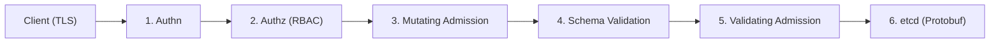
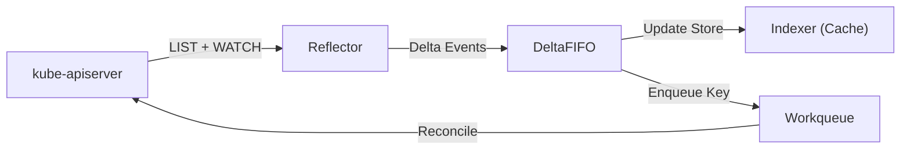
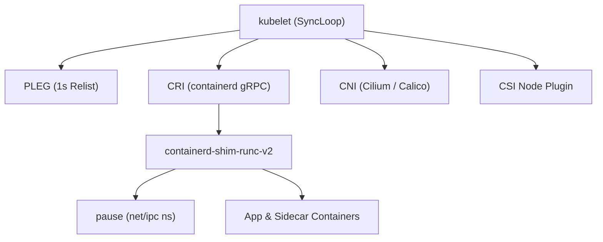
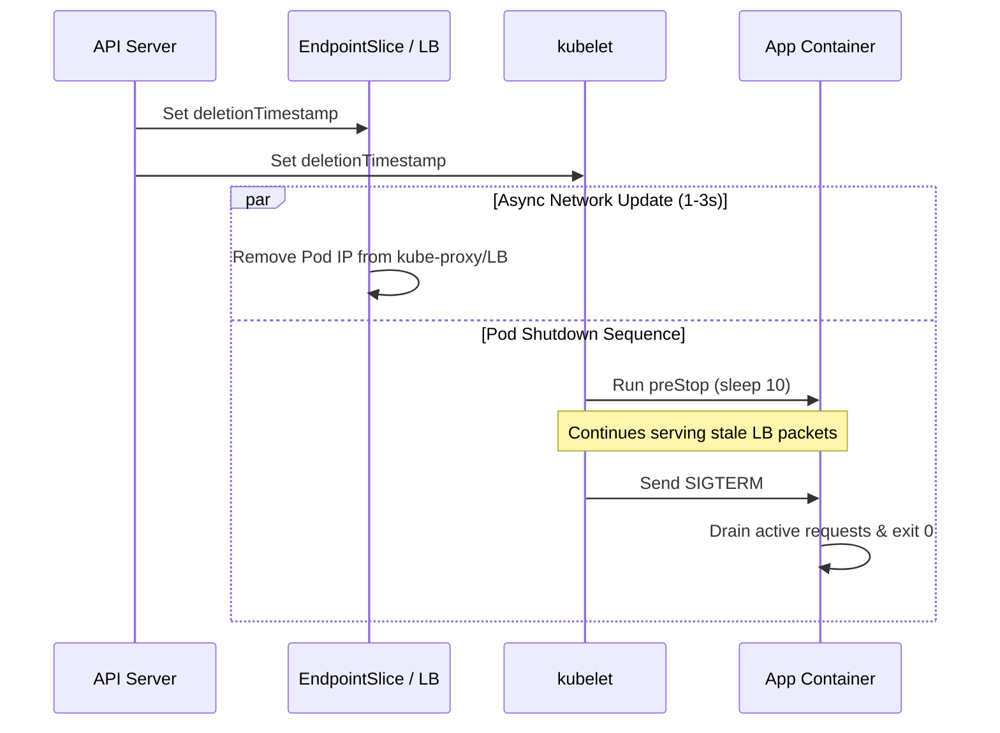
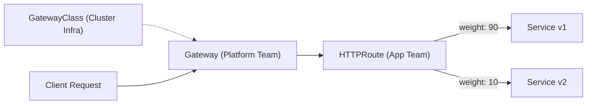

# Kubernetes

Kubernetes is a distributed, declarative container orchestration control plane built around a linearizable persistent state store (`etcd`), a RESTful schema and policy gateway (`kube-apiserver`), and asynchronous level-triggered reconciliation controllers that drive observed cluster state toward declared manifests. Related foundations: [[Programming/Software Engineering/DevOps/DevOps Complete Guide|DevOps Complete Guide]], [[Programming/Software Engineering/DevOps/Docker|Docker]], [[Programming/Software Engineering/DevOps/Cloud Fundamentals|Cloud Fundamentals]], [[Programming/Software Engineering/DevOps/Infrastructure as Code|Infrastructure as Code]], [[Programming/Software Engineering/System Design/Load Balancing|Load Balancing]].

---

## 1. First-Principles Control Plane & Node Architecture

Every Kubernetes cluster separates control-plane state reconciliation from worker-node container execution. Controllers never communicate directly with one another through point-to-point RPC; instead, every component reads and writes state exclusively through `kube-apiserver` using typed resource schemas and optimistic concurrency tokens.

### 1.1 API Server (`kube-apiserver`) Request Pipeline

`kube-apiserver` is the sole component permitted to read from and write to `etcd`. Every mutating HTTP request traverses a deterministic six-stage pipeline before a single byte is persisted to `etcd`:



| Stage | Execution Model & Mechanism | Failure Mode & HTTP Status |
| :--- | :--- | :--- |
| **Authentication (Authn)** | Evaluates X.509 client certificates, OIDC JWTs, projected ServiceAccount tokens, or `TokenReview` webhooks | Expired certificate, invalid signature, or unverified issuer returns `401 Unauthorized` |
| **Authorization (Authz)** | Evaluates RBAC, Node authorizer (`system:node:<name>`), and Webhook authorizers using default-deny across union of rules | Missing `apiGroup`, `resource`, `verb`, or subresource (`pods/exec`, `status`) returns `403 Forbidden` |
| **Mutating Admission** | Runs **sequentially**: built-in mutators (`ServiceAccount`, `DefaultStorageClass`, `LimitRanger`) followed by `MutatingWebhookConfiguration` (`reinvocationPolicy: IfNeeded`) | Unreachable webhook with `failurePolicy: Fail` halts Pod creation cluster-wide (`500` / `422`) |
| **Schema Validation** | Validates payload against OpenAPI v3 built-in structural schemas or CRD `openAPIV3Schema` | Unknown fields (`strict`), wrong types, or missing required keys return `422 Unprocessable Entity` |
| **Validating Admission** | Runs **in parallel**: built-in validators, in-process `ValidatingAdmissionPolicy` (CEL, GA 1.30+), and `ValidatingWebhookConfiguration` | Policy rejection returns `403`/`422`; slow webhook degrades write throughput without blocking `GET` reads |
| **Persistence (`etcd`)** | Verifies `metadata.resourceVersion` for Optimistic Concurrency Control, serializes object as protobuf (JSON for CRDs), writes to Raft quorum | Stale `resourceVersion` triggers `409 Conflict` |

Authorization intentionally precedes admission so unauthenticated or unauthorized clients cannot trigger webhook network calls or consume compute inside admission plugins. Mutating admission precedes schema validation so defaulted fields injected by webhooks are validated against the structural OpenAPI schema before persistence.

> [!tip] Prefer `ValidatingAdmissionPolicy` (CEL) Over External Webhooks
> Introduced as GA in Kubernetes 1.30, `ValidatingAdmissionPolicy` compiles Common Expression Language (CEL) expressions directly inside `kube-apiserver` memory. Use CEL for Pod security guardrails, trusted container registry enforcement, replica bounds, and mandatory metadata labels instead of deploying external `ValidatingWebhookConfiguration` servers. Eliminating external webhook hops removes TLS certificate rotation outages, tail-latency spikes during node scaling, and circular bootstrap deadlocks when webhook Pods themselves fail to schedule.

```yaml
apiVersion: admissionregistration.k8s.io/v1
kind: ValidatingAdmissionPolicy
metadata:
  name: enforce-acme-registry-and-nonroot
spec:
  failurePolicy: Fail
  matchConstraints:
    resourceRules:
      - apiGroups: [""]
        apiVersions: ["v1"]
        operations: ["CREATE", "UPDATE"]
        resources: ["pods"]
      - apiGroups: ["apps"]
        apiVersions: ["v1"]
        operations: ["CREATE", "UPDATE"]
        resources: ["deployments", "statefulsets"]
  variables:
    - name: containers
      expression: >-
        object.kind == 'Pod' ? object.spec.containers : object.spec.template.spec.containers
  validations:
    - expression: >-
        variables.containers.all(c, c.image.startsWith('ghcr.io/acme/'))
      message: "All container images must originate from ghcr.io/acme/."
    - expression: >-
        variables.containers.all(c,
          has(c.securityContext) &&
          has(c.securityContext.runAsNonRoot) &&
          c.securityContext.runAsNonRoot == true &&
          has(c.securityContext.readOnlyRootFilesystem) &&
          c.securityContext.readOnlyRootFilesystem == true
        )
      message: "Containers must set runAsNonRoot: true and readOnlyRootFilesystem: true."
---
apiVersion: admissionregistration.k8s.io/v1
kind: ValidatingAdmissionPolicyBinding
metadata:
  name: enforce-acme-prod-namespaces
spec:
  policyName: enforce-acme-registry-and-nonroot
  validationActions: ["Deny"]
  matchResources:
    namespaceSelector:
      matchLabels:
        environment: production
```

#### Optimistic Concurrency Control (`resourceVersion`) & Server-Side Apply (SSA)

Kubernetes avoids distributed write locks in favor of Optimistic Concurrency Control (OCC):

- **MVCC Revision Tracking**: Every persisted object stores `metadata.resourceVersion`, which encodes the `etcd` MVCC `mod_revision` integer at the time of last mutation.
- **Compare-And-Swap Semantics**: `PUT` and strategic-merge `PATCH` operations compare the request's `resourceVersion` against the current key revision in `etcd`. When two controllers read revision `4102` and both mutate the object, the first write advances `etcd` to `4103`, and the second writer fails immediately with `409 Conflict`, forcing the second controller into a fresh `GET -> recompute -> retry` loop.
- **Server-Side Apply (`SSA`)**: Standard `kubectl apply` computes a three-way diff on the client using the bloated `kubectl.kubernetes.io/last-applied-configuration` annotation. Server-Side Apply moves field ownership directly to `kube-apiserver` via `metadata.managedFields`, keyed by `fieldManager` (`kubectl-client-side-apply`, `argocd-controller`, `hpa-controller`). Two controllers owning **disjoint** fields (for example, ArgoCD managing `spec.template` while HPA manages `spec.replicas`) merge cleanly without `409 Conflict`. Attempting to overwrite a field owned by another manager yields `409 Conflict` unless `--force-conflicts` transfers ownership explicitly.

#### List-Watch, Pagination, & Informer Cache Architecture

Polling `kube-apiserver` with periodic `LIST` calls serializes thousands of objects from `etcd` into protobuf/JSON on every interval, saturating API server CPU and heap allocations. Controllers eliminate polling via the **SharedInformer** pattern (`client-go`):



1. **Paginated Initial `LIST`**: At controller startup, the `Reflector` issues `LIST` with `limit=500` and iterates via `metadata.continue` tokens so `kube-apiserver` never buffers an entire 50,000-Pod dataset in one allocation.
   - `resourceVersion=""` (unset): Forces a consistent quorum read (`ReadIndex`) directly from `etcd`.
   - `resourceVersion="0"`: Serves from `kube-apiserver`'s in-memory watch cache, slashing `etcd` CPU load at the cost of accepting events up to milliseconds behind the Raft leader.
2. **HTTP/2 Chunked `WATCH` & `BOOKMARK` Events**: After `LIST` completes, the `Reflector` opens a long-lived HTTP/2 `WATCH` stream starting from the `LIST` response's `resourceVersion`. Only incremental `ADDED`, `MODIFIED`, `DELETED`, and `BOOKMARK` frames cross the wire. Periodic `BOOKMARK` events advance the client's `resourceVersion` even on idle resource types so a brief TCP disconnect resumes from a recent revision instead of falling behind compaction.
3. **`DeltaFIFO`, `Indexer`, & Rate-Limiting `Workqueue`**: The `Reflector` pushes events into `DeltaFIFO`, which coalesces bursts targeting the same `namespace/name` key, updates the thread-safe local `Indexer` cache (so controller reads hit local RAM at zero API cost), and enqueues only the string key (`"payments/api-7f8d"`) into a deduplicated, exponentially backed-off `workqueue`.

---

### 1.2 `etcd` Distributed Consensus & MVCC Storage Internals

`etcd` provides linearizable key-value persistence backed by the **Raft** consensus protocol and a local memory-mapped B+tree storage engine (`bbolt`):

- **Raft Quorum Math**: For an `etcd` cluster of $N$ voting members, write commits and leader elections require a strict majority quorum of $\lfloor N/2 \rfloor + 1$ nodes. Fault tolerance equals $\lfloor (N-1)/2 \rfloor$ simultaneous node failures:

| Cluster Size ($N$) | Quorum Required ($\lfloor N/2 \rfloor + 1$) | Max Tolerated Failures | Production Guidance |
| :--- | :--- | :--- | :--- |
| **$N = 1$** | $1$ | $0$ | Single point of failure; local dev/testing only |
| **$N = 3$** | $2$ | $1$ | Standard production baseline; tolerates 1 AZ failure |
| **$N = 4$** | $3$ | $1$ | Anti-pattern: requires 33% more nodes to stay up while tolerating the exact same 1 failure as $N=3$ |
| **$N = 5$** | $3$ | $2$ | High-resilience production; tolerates 1 planned maintenance node + 1 unexpected failure simultaneously |
| **$N = 7$** | $4$ | $3$ | Usually degrades write latency due to cross-node Raft replication fan-out without proportional reliability benefit |

- **Linearizable Reads (`ReadIndex`)**: Rather than writing a dummy entry through the Raft log on every read, `etcd` leaders execute Raft's **ReadIndex** protocol: the leader records its current `commitIndex`, sends a lightweight heartbeat round to confirm it has not been deposed by a network-partitioned quorum, waits until `appliedIndex >= ReadIndex`, and reads directly from local `bbolt` state.
- **MVCC Append-Only B+Tree, Compaction, & Defragmentation**:
  - `etcd` never overwrites existing keys in place; every update appends a new revision tuple (`(key, mod_revision)`) into `bbolt`.
  - **Compaction** (`kube-apiserver --etcd-compaction-interval=5m`) purges historical key revisions older than the retention horizon and marks those B+tree pages inside `bbolt`'s **internal freelist** so future `etcd` writes reuse them. **Compaction does not reduce the `db` file size on disk.**
  - **Defragmentation** (`etcdctl defrag`) copies live B+tree pages into a fresh `bbolt` file to reclaim freed disk blocks back to the filesystem. Always execute `defrag` **sequentially one member at a time** (followers first, leader last after leadership step-down), because defrag acquires an exclusive database lock that stalls reads and writes on that member.
  - **Space Quota (`NOSPACE` Alarm)**: `etcd` defaults to a `2 GiB` storage quota (operational hard ceiling `8 GiB` before memory mapping pressure degrades Raft heartbeats). Crossing the quota raises a cluster-wide `NOSPACE` alarm, rejecting all writes across the entire Kubernetes cluster (`mvcc: database space exceeded`) until an operator compacts old revisions, defragments every member, and runs `etcdctl alarm disarm`.
  - **Watch History Expiration (`410 Gone`)**: If a `kubelet` or controller drops its TCP watch longer than the 5-minute compaction window, its cached `resourceVersion` no longer exists in `etcd`, causing `kube-apiserver` to return `410 Gone (too old resource version)` and forcing a full paginated re-`LIST`.

---

### 1.3 `kube-scheduler` Filtering, Scoring, & Binding Pipeline

`kube-scheduler` watches for Pods where `spec.nodeName == ""` and executes a two-phase pipeline per unscheduled Pod:

1. **Scheduling Cycle (Synchronous, Serial Per Pod)**:
   - **Filtering (Predicates)**: Runs plugins such as `NodeResourcesFit` (verifies `sum(pod requests) <= node.status.allocatable`), `TaintToleration`, `NodeAffinity`, `PodTopologySpread`, `InterPodAffinity`, `VolumeBinding` (inspects CSI volume AZ topology constraints), and `NodePorts`. If zero nodes survive, the Pod enters `Pending` (`FailedScheduling`), triggering either **Preemption** or external node autoscaling (Cluster Autoscaler / Karpenter).
   - **Scoring (Priorities)**: Scores surviving nodes on a `0–100` weighted scale across `NodeResourcesBalancedAllocation` (balances CPU/RAM utilization ratios to prevent stranding memory on CPU-full nodes), `NodeResourcesFit` (`LeastAllocated` vs `MostAllocated` bin-packing), `ImageLocality` (prefers nodes with cached image layers), and `TopologySpreadConstraints`. Ties resolve randomly to distribute load.
   - **Preemption**: If a high-priority Pod (`spec.priorityClassName`) fails filtering due to resource exhaustion, `kube-scheduler` simulates evicting lower-priority Pods on candidate nodes, assigns `status.nominatedNodeName` on the winning Pod, triggers graceful deletion of victim Pods, and schedules the high-priority Pod once capacity clears. Set `preemptionPolicy: Never` on batch `PriorityClass` objects that should jump the scheduling queue without evicting running workloads.
2. **Binding Cycle (Asynchronous)**:
   - Immediately updates the scheduler's **optimistic in-memory node cache** with the winning Pod's resource reservations so subsequent scheduling decisions do not over-commit the same CPU/memory while awaiting persistence.
   - Executes an asynchronous `POST /api/v1/namespaces/<ns>/pods/<name>/binding` request to persist `spec.nodeName` in `etcd`.

#### Taints, Tolerations, Affinity, & Topology Spread Constraints

| Mechanism | Pipeline Stage | Semantics & Production Gotchas |
| :--- | :--- | :--- |
| **`NoSchedule` Taint** | Filter | Hard block unless the Pod defines a matching toleration. Existing running Pods on the node are unaffected. |
| **`PreferNoSchedule` Taint** | Score | Soft penalty; scheduler avoids the node when healthy alternatives exist, but schedules there rather than leaving Pods `Pending`. |
| **`NoExecute` Taint** | Filter + Eviction | Blocks new Pods AND evicts existing running Pods lacking a matching toleration immediately (or after `tolerationSeconds`). Node Controller adds `node.kubernetes.io/not-ready:NoExecute` and `unreachable:NoExecute` with automatic `tolerationSeconds: 300` unless overridden. |
| **`NodeAffinity` (`required...`)** | Filter | Hard constraint on node labels (`In`, `NotIn`, `Exists`, `Gt`, `Lt`). `IgnoredDuringExecution` means relabeling a node does not evict running Pods. |
| **`PodAntiAffinity` (`required...`)** | Filter | Prevents co-locating Pods matching `labelSelector` inside the same `topologyKey`. **Scale Trap**: At $>1,000$ Pods, pairwise label evaluation across every Pod on every node degrades scheduling throughput unless scoped via `namespaces` or replaced with topology spread. |
| **`topologySpreadConstraints`** | Filter or Score | Bounds Pod count skew across failure domains (`maxSkew = maxCount - minCount`). `DoNotSchedule` enforces a hard filter; `ScheduleAnyway` converts skew minimization into a scoring weight. |

> [!warning] Rolling Deployments Skew `topologySpreadConstraints`
> During a `Deployment` rollout, the old `ReplicaSet` and new `ReplicaSet` share identical `app` labels. Without `matchLabelKeys: ["pod-template-hash"]` (GA in Kubernetes 1.33, beta since 1.27), `kube-scheduler` counts old Pods that are about to be replaced alongside new Pods, falsely saturating one AZ's spread budget and stalling new Pods in `Pending`. Always specify `matchLabelKeys: ["pod-template-hash"]` and `minDomains` (equal to your AZ count, e.g., `3`) on multi-AZ Deployments.

---

### 1.4 `kube-controller-manager` & Level-Triggered Reconciliation

`kube-controller-manager` bundles dozens of control loops (`Deployment`, `ReplicaSet`, `StatefulSet`, `Node`, `EndpointSlice`, `Namespace`, `ServiceAccount` token controllers) inside a single binary protected by `coordination.k8s.io/v1` `Lease` leader election for high availability:

- **Edge-Triggered Failure**: Event-driven architectures that react solely to transition callbacks (`OnPodDeleted -> LaunchReplacement`) lose synchronization permanently whenever a controller restarts mid-crash, a network packet drops, or two mutations race out of order.
- **Level-Triggered Invariant**: Every Kubernetes controller computes `diff(DesiredSpec, ObservedStatus)` directly from the local `Indexer` cache and issues idempotent corrective actions to converge observed state toward desired state. Dropped watch messages or controller crashes self-heal deterministically on reconnect or on the controller's periodic informer resync interval.
- **Workqueue Coalescing & Backoff**: If a Deployment's replica status changes five times in `50ms`, `workqueue` deduplicates the key (`"payments/api"`) so the reconciler runs once against the latest snapshot, applying exponential rate limiting when downstream API calls fail.

---

### 1.5 Worker Node Internals (`kubelet`, CRI, CNI, CSI, & Linux cgroups)



- **`kubelet` SyncLoop & PLEG (Pod Lifecycle Event Generator)**: `kubelet` runs a node-local reconciliation loop watching PodSpecs assigned to `spec.nodeName == <this-node>`, local static manifests (`/etc/kubernetes/manifests`), and probe timers. PLEG polls the CRI runtime every `1s` to list container states and emit transitions (`ContainerStarted`, `ContainerDied`). If container runtime calls stall for longer than `3 minutes` (commonly triggered by hung overlayfs/XFS storage drivers, kernel `D`-state tasks, or a deadlocked `containerd`), `kubelet` flips the node condition to `Ready=False` with reason `PLEG is not healthy`, triggering `kube-controller-manager` eviction after `300s`.
- **CRI (`containerd`) & Shims**: `kubelet` speaks gRPC over `/run/containerd/containerd.sock` to `containerd`. For each Pod sandbox and container, `containerd` spawns a lightweight `containerd-shim-runc-v2` process that owns container `stdio` pipes, holds namespaces, and reports exit codes via waitpid. Decoupling the shim allows upgrading or restarting the `containerd` daemon without killing running workload containers.
- **The `pause` Sandbox Container (`registry.k8s.io/pause`)**: Spawned first for every Pod, `pause` executes a trivial infinite `pause()` syscall loop inside the Pod's dedicated Linux **`net`** and **`ipc`** namespaces (plus **`pid`** namespace if `shareProcessNamespace: true`, where `pause` serves as PID `1` reaping zombie processes). Application and sidecar containers join those existing namespaces, which is why containers inside the same Pod share `localhost` and retain the same Pod IP across individual container restarts.
- **Linux `cgroups v2` Hierarchy**: Worker nodes running modern kernels (`5.8+`) unify CPU, memory, and I/O accounting under a single `cgroups v2` tree (`/sys/fs/cgroup/kubepods.slice`). `kubelet` places Pods into sub-slices (`kubepods-burstable.slice`, `kubepods-besteffort.slice`, or directly under `kubepods.slice` for `Guaranteed` Pods), enforcing memory ceilings (`memory.max`), OOM preference (`oom_score_adj`), and CPU weight/bandwidth (`cpu.weight`, `cpu.max`).
- **CNI (`Calico` vs `Cilium`)**: Invoked by the CRI during sandbox creation to allocate an IP address (IPAM) and attach a `veth` network pair into the Pod's `net` namespace:
  - **Calico**: Routes Pod CIDRs at Layer 3 using **BGP** (direct host-to-host packet forwarding with zero encapsulation tax on flat or BGP-peered VPCs) or **IP-in-IP / VXLAN** overlays, enforcing `NetworkPolicy` via `iptables`/`nftables` chains (or an optional eBPF dataplane).
  - **Cilium**: Attaches Linux kernel **eBPF** programs directly at `socket` (`connect`/`sendmsg`), `tc` (traffic control), and `XDP` hooks—enforcing identity-based L3/L4/L7 policies via $O(1)$ BPF map lookups without per-packet netfilter chain traversal, and replacing `kube-proxy` altogether.
- **CSI (Container Storage Interface)**: Separates cloud block/file storage drivers from `kubelet` core code across a four-step lifecycle:
  1. **Provision (`CreateVolume`)**: CSI Controller provisions the cloud volume (e.g., AWS EBS `gp3` or GCP Hyperdisk) in the target AZ. With `volumeBindingMode: WaitForFirstConsumer`, provisioning pauses until `kube-scheduler` selects a node so the volume is created in the exact matching AZ.
  2. **Attach (`ControllerPublishVolume`)**: CSI Controller attaches the virtual block device to the worker node VM instance.
  3. **Stage (`NodeStageVolume`)**: `kubelet` invokes the node-local CSI DaemonSet plugin to format the block device (if blank) and mount it once globally on the host (`/var/lib/kubelet/plugins/kubernetes.io/csi/...`).
  4. **Publish (`NodePublishVolume`)**: Bind-mounts the globally staged directory into the Pod's private volume directory (`/var/lib/kubelet/pods/<uid>/volumes/...`), recursively applying `fsGroup` ownership (`chown`) unless `fsGroupChangePolicy: OnRootMismatch` prevents massive startup delays on volumes holding millions of files.

---

## 2. Real-World Use Cases & Orchestration Decision Matrix

Adopting Kubernetes introduces fixed control-plane, networking, upgrade-lifecycle, and observability complexity. Senior engineering teams evaluate workload shape, team topology, and infrastructure constraints before choosing Kubernetes over simpler managed platforms.

### Concrete Engineering Scenarios

1. **Multi-Service SaaS Platform (20–300+ Microservices)**: Organizations operating dozens of stateful and stateless services across Go, TypeScript, Python, and Rust benefit from a unified declarative deployment contract (`Deployment`, `Gateway API`, `NetworkPolicy`), multi-AZ bin-packing across shared compute pools, and GitOps promotion pipelines (ArgoCD).
2. **Asynchronous Event Workers & GPU/Batch Compute**: Workloads driven by Kafka lag or SQS depth benefit from KEDA scale-to-zero workers, while ML training and data-processing pipelines leverage `Job` `podFailurePolicy`, Karpenter Spot instance diversification, and GPU node taints/tolerations to pack heterogeneous hardware efficiently.
3. **Strict Network Micro-Segmentation & Hybrid Portability**: Regulated fintech or healthcare systems requiring uniform mTLS, explicit L3/L4/L7 egress allowlisting, custom ingress routing, and portable multi-cloud or on-premises deployment profiles avoid cloud-proprietary lock-in by standardizing on Kubernetes CRDs.
4. **When NOT to Use Kubernetes — Small Single-Team CRUD Services**: A 3-person startup running two stateless HTTP APIs and a managed PostgreSQL database pays an unjustified maintenance tax for Kubernetes cluster upgrades, CNI debugging, Ingress TLS management, and RBAC hardening. Serverless containers (AWS ECS Fargate, Google Cloud Run) deliver container portability with near-zero cluster operations.
5. **When NOT to Use Kubernetes — Spiky Sub-Minute Event Handlers or Core Primary Databases (Without Dedicated DBAs)**: Infrequent webhooks and lightweight async transforms cost orders of magnitude less on Serverless FaaS (AWS Lambda, Cloud Run functions). Similarly, avoid running mission-critical OLTP primary databases inside `StatefulSet` pods unless your team operates battle-tested Kubernetes Operators (such as CloudNativePG or Strimzi) with automated PITR backup verification and Chaos failover testing; managed DBaaS (RDS/Aurora, Cloud SQL) handles minor upgrades, storage quorum, and hardware replacement natively.

### Platform Selection Matrix

| Dimension | Managed Kubernetes (`EKS` / `GKE` / `AKS`) | Serverless Containers (`Cloud Run` / `Fargate`) | FaaS (`Lambda`) | VM Auto Scaling Groups (`EC2 ASG`) |
| :--- | :--- | :--- | :--- | :--- |
| **Operational Overhead** | High (cluster version upgrades every 14 months, CNI/CSI add-ons, add-on compatibility) | Low (no node OS patching or control-plane upgrades) | Minimal (runtime patched by cloud provider) | Moderate-High (AMI baking, Ansible/systemd drift) |
| **Cold Start / Scale Latency** | `1–5s` (warm node) / `30–90s` (provisioning new Karpenter/CA node) | `300ms–3s` (container image start from `0`) | `15ms–800ms` (Firecracker microVM / SnapStart) | `90–300s` (VM boot + cloud-init + service start) |
| **Workload Portability** | High (standard CNCF APIs across clouds and bare metal) | Moderate (OCI image portable; orchestration flags proprietary) | Low (handler signature and event envelopes cloud-coupled) | Moderate (Packer/systemd portable across IaaS) |
| **Stateful & GPU Support** | Native (`StatefulSet`, CSI block attach, MIG/GPU scheduling) | Ephemeral/stateless HTTP and short jobs only | Stateless ephemeral only (`15 min` cap on Lambda) | Full local NVMe, persistent EBS, custom kernel tuning |
| **Base Cost Floor** | Fixed control-plane fee (`$73/mo` EKS) + core system Pods (`CoreDNS`, metrics, DaemonSets) | `$0` at idle (`Cloud Run`) or per-task vCPU-second (`Fargate`) | `$0` at idle; steep crossover above ~25% sustained duty cycle | Minimum baseline VM cost per AZ (`$30–$150+/mo`) |

---

## 3. Step-by-Step Practical Production Application

To build a production-grade Kubernetes service, organize manifests cleanly for GitOps (`Kustomize` base + environment overlays), bind zero-trust network and Pod security boundaries at the namespace level, wire native sidecar telemetry, enforce safe disruption budgets, and pair Gateway API routing with KEDA event-driven autoscaling.

### Production Repository Layout

```text
deploy/
├── platform/
│   ├── gateway-class.yaml
│   ├── prod-gateway.yaml
│   └── priority-classes.yaml
└── apps/
    └── payments/
        ├── base/
        │   ├── kustomization.yaml
        │   ├── namespace.yaml
        │   ├── rbac.yaml
        │   ├── configmap.yaml
        │   ├── api-deployment.yaml
        │   ├── api-service.yaml
        │   ├── api-pdb.yaml
        │   ├── api-hpa.yaml
        │   ├── api-httproute.yaml
        │   ├── worker-deployment.yaml
        │   ├── worker-keda.yaml
        │   └── network-policies.yaml
        └── overlays/
            └── prod/
                ├── kustomization.yaml
                └── replica-patch.yaml
```

### Complete Multi-Manifest Production Suite

#### 1. Namespace (Pod Security Admission `restricted`), PriorityClass, & Identity (`namespace.yaml`, `priority-classes.yaml`, `rbac.yaml`)

```yaml
apiVersion: v1
kind: Namespace
metadata:
  name: payments
  labels:
    environment: production
    pod-security.kubernetes.io/enforce: restricted
    pod-security.kubernetes.io/enforce-version: v1.32
    pod-security.kubernetes.io/warn: restricted
    pod-security.kubernetes.io/audit: restricted
---
apiVersion: scheduling.k8s.io/v1
kind: PriorityClass
metadata:
  name: critical-stateless-api
value: 1000000
globalDefault: false
preemptionPolicy: PreemptLowerPriority
description: "Priority tier for customer-facing Tier-1 API workloads."
---
apiVersion: v1
kind: ServiceAccount
metadata:
  name: payments-api-sa
  namespace: payments
  annotations:
    eks.amazonaws.com/role-arn: arn:aws:iam::123456789012:role/prod-payments-api
automountServiceAccountToken: false
---
apiVersion: v1
kind: ServiceAccount
metadata:
  name: payments-worker-sa
  namespace: payments
  annotations:
    eks.amazonaws.com/role-arn: arn:aws:iam::123456789012:role/prod-payments-worker
automountServiceAccountToken: false
---
apiVersion: v1
kind: ConfigMap
metadata:
  name: payments-api-config
  namespace: payments
data:
  LOG_LEVEL: "info"
  PORT: "8080"
  DB_HOST: "payments-pg.internal.acme.dev"
  DB_PORT: "5432"
  OTEL_EXPORTER_OTLP_ENDPOINT: "http://127.0.0.1:4317"
```

#### 2. Production `Deployment` with Native OpenTelemetry Sidecar, Topology Spread, & Zero-Downtime Shutdown (`api-deployment.yaml`)

Notice how `otel-collector` sits inside `initContainers` with `restartPolicy: Always` (Native Sidecar, GA v1.33): `kubelet` starts it first, waits for its `startupProbe` on `:13133` before booting the `api` container, keeps it alive throughout Pod life, and sends `SIGTERM` to `otel-collector` **only after** the `api` container exits completely—ensuring final shutdown spans and logs flush cleanly without dropping telemetry.

```yaml
apiVersion: apps/v1
kind: Deployment
metadata:
  name: payments-api
  namespace: payments
  labels:
    app.kubernetes.io/name: payments-api
    app.kubernetes.io/version: v1
spec:
  replicas: 4
  revisionHistoryLimit: 5
  progressDeadlineSeconds: 300
  strategy:
    type: RollingUpdate
    rollingUpdate:
      maxSurge: 1
      maxUnavailable: 0
  selector:
    matchLabels:
      app.kubernetes.io/name: payments-api
      version: v1
  template:
    metadata:
      labels:
        app.kubernetes.io/name: payments-api
        version: v1
    spec:
      serviceAccountName: payments-api-sa
      automountServiceAccountToken: false
      priorityClassName: critical-stateless-api
      terminationGracePeriodSeconds: 45
      securityContext:
        runAsNonRoot: true
        runAsUser: 10001
        runAsGroup: 10001
        fsGroup: 10001
        fsGroupChangePolicy: OnRootMismatch
        seccompProfile:
          type: RuntimeDefault
      dnsConfig:
        options:
          - name: ndots
            value: "2"
          - name: single-request-reopen
      topologySpreadConstraints:
        - maxSkew: 1
          minDomains: 3
          topologyKey: topology.kubernetes.io/zone
          whenUnsatisfiable: DoNotSchedule
          matchLabelKeys:
            - pod-template-hash
          labelSelector:
            matchLabels:
              app.kubernetes.io/name: payments-api
        - maxSkew: 1
          topologyKey: kubernetes.io/hostname
          whenUnsatisfiable: ScheduleAnyway
          matchLabelKeys:
            - pod-template-hash
          labelSelector:
            matchLabels:
              app.kubernetes.io/name: payments-api
      initContainers:
        - name: otel-collector
          image: ghcr.io/acme/otel-collector-contrib:0.114.0
          restartPolicy: Always
          args: ["--config=/etc/otel/collector.yaml"]
          securityContext:
            allowPrivilegeEscalation: false
            readOnlyRootFilesystem: true
            capabilities:
              drop: ["ALL"]
          ports:
            - name: otlp-grpc
              containerPort: 4317
            - name: health
              containerPort: 13133
          startupProbe:
            httpGet:
              path: /
              port: health
            periodSeconds: 2
            failureThreshold: 15
          readinessProbe:
            httpGet:
              path: /
              port: health
            periodSeconds: 5
          resources:
            requests:
              cpu: 50m
              memory: 128Mi
            limits:
              memory: 128Mi
          volumeMounts:
            - name: otel-config
              mountPath: /etc/otel
              readOnly: true
      containers:
        - name: api
          image: ghcr.io/acme/payments-api:2.14.3
          imagePullPolicy: IfNotPresent
          securityContext:
            allowPrivilegeEscalation: false
            readOnlyRootFilesystem: true
            capabilities:
              drop: ["ALL"]
          ports:
            - name: http
              containerPort: 8080
              protocol: TCP
          envFrom:
            - configMapRef:
                name: payments-api-config
          env:
            - name: DATABASE_URL
              valueFrom:
                secretKeyRef:
                  name: payments-db-credentials
                  key: url
          lifecycle:
            preStop:
              exec:
                command: ["/bin/sh", "-c", "sleep 10"]
          startupProbe:
            httpGet:
              path: /livez
              port: http
            periodSeconds: 2
            failureThreshold: 20
          livenessProbe:
            httpGet:
              path: /livez
              port: http
            periodSeconds: 10
            timeoutSeconds: 2
            failureThreshold: 3
          readinessProbe:
            httpGet:
              path: /readyz
              port: http
            periodSeconds: 5
            timeoutSeconds: 2
            failureThreshold: 2
          resources:
            requests:
              cpu: 500m
              memory: 512Mi
            limits:
              memory: 512Mi
          volumeMounts:
            - name: tmp
              mountPath: /tmp
      volumes:
        - name: tmp
          emptyDir:
            sizeLimit: 128Mi
        - name: otel-config
          configMap:
            name: otel-sidecar-config
```

#### 3. Service, PodDisruptionBudget, & Gateway API Canary Routing (`api-service.yaml`, `api-pdb.yaml`, `gateway.yaml`, `api-httproute.yaml`)

```yaml
apiVersion: v1
kind: Service
metadata:
  name: payments-api-v1
  namespace: payments
spec:
  type: ClusterIP
  trafficDistribution: PreferClose
  selector:
    app.kubernetes.io/name: payments-api
    version: v1
  ports:
    - name: http
      port: 80
      targetPort: http
      protocol: TCP
---
apiVersion: v1
kind: Service
metadata:
  name: payments-api-v2
  namespace: payments
spec:
  type: ClusterIP
  trafficDistribution: PreferClose
  selector:
    app.kubernetes.io/name: payments-api
    version: v2
  ports:
    - name: http
      port: 80
      targetPort: http
      protocol: TCP
---
apiVersion: policy/v1
kind: PodDisruptionBudget
metadata:
  name: payments-api-pdb
  namespace: payments
spec:
  maxUnavailable: 1
  unhealthyPodEvictionPolicy: AlwaysAllow
  selector:
    matchLabels:
      app.kubernetes.io/name: payments-api
---
apiVersion: gateway.networking.k8s.io/v1
kind: GatewayClass
metadata:
  name: acme-envoy-gateway
spec:
  controllerName: gateway.envoyproxy.io/gatewayclass-controller
---
apiVersion: gateway.networking.k8s.io/v1
kind: Gateway
metadata:
  name: prod-gateway
  namespace: infra-gateway
spec:
  gatewayClassName: acme-envoy-gateway
  listeners:
    - name: https
      protocol: HTTPS
      port: 443
      hostname: "api.acme.dev"
      tls:
        mode: Terminate
        certificateRefs:
          - name: payments-edge-tls
            namespace: payments
      allowedRoutes:
        namespaces:
          from: Selector
          selector:
            matchLabels:
              environment: production
---
apiVersion: gateway.networking.k8s.io/v1beta1
kind: ReferenceGrant
metadata:
  name: allow-gateway-tls-read
  namespace: payments
spec:
  from:
    - group: gateway.networking.k8s.io
      kind: Gateway
      namespace: infra-gateway
  to:
    - group: ""
      kind: Secret
      name: payments-edge-tls
---
apiVersion: gateway.networking.k8s.io/v1
kind: HTTPRoute
metadata:
  name: payments-canary
  namespace: payments
spec:
  parentRefs:
    - name: prod-gateway
      namespace: infra-gateway
      sectionName: https
  hostnames: ["api.acme.dev"]
  rules:
    - matches:
        - path:
            type: PathPrefix
            value: /v2/charge
          headers:
            - name: X-Canary
              value: "true"
      backendRefs:
        - name: payments-api-v2
          port: 80
    - matches:
        - path:
            type: PathPrefix
            value: /v2/charge
      backendRefs:
        - name: payments-api-v1
          port: 80
          weight: 90
        - name: payments-api-v2
          port: 80
          weight: 10
```

#### 4. HPA (`autoscaling/v2`) & KEDA Event-Driven Queue Autoscaling (`api-hpa.yaml`, `worker-keda.yaml`)

```yaml
apiVersion: autoscaling/v2
kind: HorizontalPodAutoscaler
metadata:
  name: payments-api-hpa
  namespace: payments
spec:
  scaleTargetRef:
    apiVersion: apps/v1
    kind: Deployment
    name: payments-api
  minReplicas: 4
  maxReplicas: 40
  metrics:
    - type: Resource
      resource:
        name: cpu
        target:
          type: Utilization
          averageUtilization: 65
  behavior:
    scaleUp:
      stabilizationWindowSeconds: 0
      policies:
        - type: Percent
          value: 100
          periodSeconds: 30
        - type: Pods
          value: 4
          periodSeconds: 30
      selectPolicy: Max
    scaleDown:
      stabilizationWindowSeconds: 300
      policies:
        - type: Percent
          value: 20
          periodSeconds: 60
      selectPolicy: Min
---
apiVersion: keda.sh/v1alpha1
kind: TriggerAuthentication
metadata:
  name: aws-sqs-irsa-auth
  namespace: payments
spec:
  podIdentity:
    provider: aws
    identityOwner: keda
---
apiVersion: keda.sh/v1alpha1
kind: ScaledObject
metadata:
  name: payments-worker-sqs-scaler
  namespace: payments
spec:
  scaleTargetRef:
    name: payments-worker
  pollingInterval: 15
  cooldownPeriod: 180
  idleReplicaCount: 0
  minReplicas: 0
  maxReplicas: 30
  fallback:
    failureThreshold: 3
    replicas: 2
  advanced:
    horizontalPodAutoscalerConfig:
      behavior:
        scaleDown:
          stabilizationWindowSeconds: 180
  triggers:
    - type: aws-sqs-queue
      authenticationRef:
        name: aws-sqs-irsa-auth
      metadata:
        queueURL: https://sqs.us-east-1.amazonaws.com/123456789012/payments-settlements
        queueLength: "10"
        awsRegion: us-east-1
        scaleOnInFlight: "true"
---
apiVersion: apps/v1
kind: Deployment
metadata:
  name: payments-worker
  namespace: payments
spec:
  replicas: 0
  selector:
    matchLabels:
      app.kubernetes.io/name: payments-worker
  template:
    metadata:
      labels:
        app.kubernetes.io/name: payments-worker
    spec:
      serviceAccountName: payments-worker-sa
      automountServiceAccountToken: false
      terminationGracePeriodSeconds: 60
      securityContext:
        runAsNonRoot: true
        runAsUser: 10001
        seccompProfile:
          type: RuntimeDefault
      containers:
        - name: worker
          image: ghcr.io/acme/payments-worker:2.14.3
          securityContext:
            allowPrivilegeEscalation: false
            readOnlyRootFilesystem: true
            capabilities:
              drop: ["ALL"]
          envFrom:
            - configMapRef:
                name: payments-api-config
          resources:
            requests:
              cpu: 500m
              memory: 512Mi
            limits:
              memory: 512Mi
---
apiVersion: v1
kind: Service
metadata:
  name: payments-postgres-headless
  namespace: payments
spec:
  clusterIP: None
  publishNotReadyAddresses: true
  selector:
    app.kubernetes.io/name: payments-postgres
  ports:
    - name: pg
      port: 5432
---
apiVersion: apps/v1
kind: StatefulSet
metadata:
  name: payments-postgres
  namespace: payments
spec:
  serviceName: payments-postgres-headless
  replicas: 3
  podManagementPolicy: OrderedReady
  persistentVolumeClaimRetentionPolicy:
    whenDeleted: Retain
    whenScaled: Delete
  selector:
    matchLabels:
      app.kubernetes.io/name: payments-postgres
  template:
    metadata:
      labels:
        app.kubernetes.io/name: payments-postgres
    spec:
      automountServiceAccountToken: false
      terminationGracePeriodSeconds: 60
      securityContext:
        runAsNonRoot: true
        runAsUser: 999
        fsGroup: 999
        fsGroupChangePolicy: OnRootMismatch
        seccompProfile:
          type: RuntimeDefault
      containers:
        - name: postgres
          image: ghcr.io/acme/postgres-hardened:16.4
          ports:
            - name: pg
              containerPort: 5432
          resources:
            requests:
              cpu: "1"
              memory: 2Gi
            limits:
              memory: 2Gi
          volumeMounts:
            - name: pgdata
              mountPath: /var/lib/postgresql/data
  volumeClaimTemplates:
    - metadata:
        name: pgdata
      spec:
        accessModes: ["ReadWriteOnce"]
        storageClassName: ebs-gp3-encrypted
        resources:
          requests:
            storage: 100Gi
```

#### 5. Zero-Trust `NetworkPolicy` Suite (`network-policies.yaml`)

```yaml
apiVersion: networking.k8s.io/v1
kind: NetworkPolicy
metadata:
  name: default-deny-all
  namespace: payments
spec:
  podSelector: {}
  policyTypes:
    - Ingress
    - Egress
---
apiVersion: networking.k8s.io/v1
kind: NetworkPolicy
metadata:
  name: allow-payments-api
  namespace: payments
spec:
  podSelector:
    matchLabels:
      app.kubernetes.io/name: payments-api
  policyTypes:
    - Ingress
    - Egress
  ingress:
    - from:
        - namespaceSelector:
            matchLabels:
              kubernetes.io/metadata.name: infra-gateway
          podSelector:
            matchLabels:
              gateway.envoyproxy.io/owning-gateway-name: prod-gateway
      ports:
        - protocol: TCP
          port: 8080
  egress:
    - to:
        - namespaceSelector:
            matchLabels:
              kubernetes.io/metadata.name: kube-system
          podSelector:
            matchLabels:
              k8s-app: kube-dns
      ports:
        - protocol: UDP
          port: 53
        - protocol: TCP
          port: 53
    - to:
        - podSelector:
            matchLabels:
              app.kubernetes.io/name: payments-postgres
      ports:
        - protocol: TCP
          port: 5432
    - to:
        - namespaceSelector:
            matchLabels:
              kubernetes.io/metadata.name: observability
          podSelector:
            matchLabels:
              app.kubernetes.io/name: otel-gateway
      ports:
        - protocol: TCP
          port: 4317
    - to:
        - ipBlock:
            cidr: 10.20.0.0/16
            except:
              - 169.254.169.254/32
      ports:
        - protocol: TCP
          port: 443
---
apiVersion: networking.k8s.io/v1
kind: NetworkPolicy
metadata:
  name: allow-postgres-from-api
  namespace: payments
spec:
  podSelector:
    matchLabels:
      app.kubernetes.io/name: payments-postgres
  policyTypes:
    - Ingress
  ingress:
    - from:
        - podSelector:
            matchLabels:
              app.kubernetes.io/name: payments-api
      ports:
        - protocol: TCP
          port: 5432
```

#### 6. Application Graceful Shutdown, Separate `/livez` vs `/readyz` Handlers, & Pre-Deploy Verification (`server.ts`, `verify-manifests.sh`)

Application runtime code must match Kubernetes shutdown semantics so `preStop` keeps serving stale proxy connections while `SIGTERM` drains active requests cleanly without dropping keep-alive sockets mid-flight:

```typescript
import http from 'node:http';
import { Pool } from 'pg';

const dbPool = new Pool({
  host: process.env.DB_HOST,
  port: Number(process.env.DB_PORT ?? 5432),
  connectionTimeoutMillis: 1500,
});

let isShuttingDown = false;

const server = http.createServer(async (req, res) => {
  // /livez checks event-loop responsiveness only; NEVER query Postgres/Redis here.
  if (req.url === '/livez') {
    res.writeHead(200, { 'Content-Type': 'application/json' });
    res.end(JSON.stringify({ status: 'alive' }));
    return;
  }

  // /readyz removes the Pod from EndpointSlice when draining or when DB is unreachable.
  if (req.url === '/readyz') {
    if (isShuttingDown) {
      res.writeHead(503, { 'Content-Type': 'application/json' });
      res.end(JSON.stringify({ status: 'draining' }));
      return;
    }
    try {
      await dbPool.query('SELECT 1');
      res.writeHead(200, { 'Content-Type': 'application/json' });
      res.end(JSON.stringify({ status: 'ready' }));
    } catch {
      res.writeHead(503, { 'Content-Type': 'application/json' });
      res.end(JSON.stringify({ status: 'db_unavailable' }));
    }
    return;
  }

  if (req.url === '/v2/charge' && req.method === 'POST') {
    // Reject new keep-alive reuse after SIGTERM arrives while completing active requests.
    if (isShuttingDown) {
      res.setHeader('Connection', 'close');
    }
    const result = await dbPool.query('SELECT NOW() AS ts');
    res.writeHead(200, { 'Content-Type': 'application/json' });
    res.end(JSON.stringify({ chargedAt: result.rows[0].ts }));
    return;
  }

  res.writeHead(404);
  res.end();
});

// Keep backend keepAliveTimeout strictly above upstream proxy/ALB idle timeout (60s).
server.keepAliveTimeout = 65_000;
server.headersTimeout = 66_000;

server.listen(Number(process.env.PORT ?? 8080));

async function gracefulShutdown(signal: string): Promise<void> {
  if (isShuttingDown) return;
  isShuttingDown = true;
  console.log(JSON.stringify({ event: 'shutdown_initiated', signal }));

  // Force exit strictly inside terminationGracePeriodSeconds (45s - 10s preStop = 35s max drain).
  const hardTimeout = setTimeout(() => {
    console.error(JSON.stringify({ event: 'shutdown_forced_exit' }));
    process.exit(1);
  }, 28_000);
  hardTimeout.unref();

  server.close(async () => {
    await dbPool.end();
    console.log(JSON.stringify({ event: 'shutdown_complete' }));
    process.exit(0);
  });

  // Close idle pooled keep-alive TCP connections immediately without aborting in-flight requests.
  server.closeIdleConnections();
}

process.on('SIGTERM', () => void gracefulShutdown('SIGTERM'));
process.on('SIGINT', () => void gracefulShutdown('SIGINT'));
```

Validate Kustomize rendering, schema compliance, security invariants, and server-side admission before committing:

```bash
#!/usr/bin/env bash
set -euo pipefail

RENDERED="/tmp/payments-prod.yaml"
kubectl kustomize deploy/apps/payments/overlays/prod > "${RENDERED}"

# 1. Structural OpenAPI + CEL ValidatingAdmissionPolicy verification against cluster
kubectl apply --dry-run=server -f "${RENDERED}"

# 2. Automated static security & reliability assertions (kyverno / yq checks)
yq -e 'select(.kind == "Deployment") | .spec.template.spec.securityContext.runAsNonRoot == true' "${RENDERED}" > /dev/null
yq -e 'select(.kind == "Deployment") | .spec.template.spec.automountServiceAccountToken == false' "${RENDERED}" > /dev/null
yq -e 'select(.kind == "PodDisruptionBudget") | .spec.unhealthyPodEvictionPolicy == "AlwaysAllow"' "${RENDERED}" > /dev/null
echo "Manifest verification passed."
```

---

## 4. Complete Framework Reference & Production Edge Cases

### 4.1 Pod Phases, `initContainers`, & Native Sidecar Lifecycle

- **Pod Phases**:
  - `Pending`: Accepted by `kube-apiserver`, awaiting `kube-scheduler` placement or container image pulls.
  - `Running`: Bound to a worker node; at least one container is created, running, or restarting.
  - `Succeeded`: All containers exited `0` and `restartPolicy != Always` (typical completed `Job`).
  - `Failed`: All containers terminated and at least one exited non-zero (`restartPolicy: Never`) or exceeded retry limits.
  - `Unknown`: Node heartbeat lost beyond `--node-monitor-grace-period` (`40s` default); `kubelet` cannot confirm state.
- **Standard `initContainers`**: Run strictly sequentially in declaration order and must each exit `0` before the first application container launches. Any failure stalls Pod startup (`Init:CrashLoopBackOff`). Because standard `initContainers` must terminate before app startup, they cannot run continuous proxies or log forwarders.
- **Native Sidecar Containers (`initContainers` + `restartPolicy: Always`, GA in Kubernetes 1.33)**:
  - Placed in `spec.initContainers` with `restartPolicy: Always`.
  - **Startup Ordering**: Start sequentially alongside other init containers. Instead of waiting for exit code `0`, `kubelet` advances to the next init or app container as soon as the sidecar passes its `startupProbe` (or immediately if no `startupProbe` is defined).
  - **Runtime Independence**: Restart automatically on crash independently of main containers, and participate in Pod `readinessProbe` aggregation.
  - **Job Completion Fix**: In a `Job`, main container exit `0` causes `kubelet` to send `SIGTERM` cleanly to native sidecars rather than keeping the `Job` stuck forever in `Running` (a classic failure with legacy sidecars such as Istio `envoy` or Cloud SQL Auth Proxy).
  - **Shutdown Ordering**: During Pod termination, `kubelet` sends `SIGTERM` to main application containers **first** and triggers `SIGTERM` on native sidecars **only after** every regular container has exited—preventing telemetry and mTLS proxy race cutoffs.

---

### 4.2 Graceful Shutdown & the Rolling-Update `502` Race Condition

Deleting a Pod (`kubectl delete` or `Deployment` rollout) fires **two asynchronous control-plane paths in parallel** with zero built-in synchronization barrier between network convergence and process termination:



**Why `502 Bad Gateway` Errors Spike on Deploy**: `kubelet` can initiate container `SIGTERM` within `<50ms` of `deletionTimestamp` creation, whereas propagating the `EndpointSlice` deletion across all cluster `kube-proxy` `iptables` chains, Cilium BPF maps, or cloud ALB/NLB target deregistration takes `1–3 seconds` (up to `5–10s` under heavy cluster churn). If the application immediately stops listening on `SIGTERM`, TCP `SYN` packets arriving from nodes holding stale `EndpointSlice` caches receive `ECONNREFUSED` / `TCP RST`, surfacing as `502 Bad Gateway` at the Ingress or Gateway.

**Deterministic Zero-Downtime Contract**:
1. Add `lifecycle.preStop` (`sleep 5` for internal `ClusterIP` Services, `sleep 10` behind cloud ALBs/NLBs). `kubelet` waits for `preStop` completion **before** delivering `SIGTERM`, while the app continues serving HTTP requests normally.
2. Note that `EndpointSlice` controller strips `Terminating` Pods from ready endpoints immediately upon `deletionTimestamp` regardless of `readinessProbe` status, so you do not need `/readyz` hacks solely to trigger endpoint removal—though marking `/readyz` as `503` on `SIGTERM` provides defense-in-depth for external health probes.
3. Size `terminationGracePeriodSeconds` strictly greater than the sum of `preStop` duration plus worst-case request drain time plus telemetry flush buffer:
   $$T_{\text{grace}} > T_{\text{preStop}} + T_{\text{max\_request\_drain}} + T_{\text{buffer}}$$
   Notice that `kubelet` starts the `terminationGracePeriodSeconds` countdown **at the same time** `preStop` begins—not after `preStop` finishes! If `preStop` is `10s` and `terminationGracePeriodSeconds` is `30s`, the application has at most `20s` after `SIGTERM` before `SIGKILL`.

---

### 4.3 Workload Controllers Reference & Operational Gotchas

| Controller | Identity, Network & Storage Semantics | Key Production Knobs & Subtle Traps |
| :--- | :--- | :--- |
| **`Deployment`** | Stateless/ephemeral Pods managed via `ReplicaSet`s stamped with `pod-template-hash` | `maxSurge` & `maxUnavailable` (setting both to `0` rejects the manifest); `revisionHistoryLimit` (`3–5` avoids `etcd` ReplicaSet accumulation); `progressDeadlineSeconds` (`600s` default); `kubectl rollout undo/pause/resume` |
| **`StatefulSet`** | Ordinal identities (`db-0`, `db-1`), deterministic DNS via Headless Service (`db-0.db-headless.ns.svc.cluster.local`), sequential creation/reverse deletion (`OrderedReady` vs `Parallel`) | `volumeClaimTemplates` allocate per-ordinal PVCs that are **retained** forever on scale-down or deletion by default; configure `persistentVolumeClaimRetentionPolicy` (GA 1.32) with `whenDeleted`/`whenScaled` (`Retain` vs `Delete`). Beware that `StatefulSet` **will not force-delete a stuck Pod** on an unreachable node (`Unknown`) because Kubernetes refuses to violate at-most-one-writer semantics for persistent storage! |
| **`DaemonSet`** | Runs one Pod per matching node via scheduler affinity (`NodeAffinity` + `kube-scheduler` since K8s 1.12+) | Must tolerate `node-role.kubernetes.io/control-plane`, `node.kubernetes.io/disk-pressure`, and `node.kubernetes.io/unschedulable` when infrastructure agents (CNI, log forwarders) are required during node drains; supports `RollingUpdate` with `maxSurge` (`maxUnavailable` must be `0` if `maxSurge > 0`) |
| **`Job`** | Run-to-completion batch tasks (`restartPolicy: OnFailure` or `Never`) | `completions`, `parallelism`, `backoffLimit` (`10s -> 20s -> ... -> 6m` cap), `podFailurePolicy` (GA 1.31: immediately fail Jobs on deterministic exit codes like invalid config rather than burning retries, or ignore Spot preemption `DisruptionTarget`), **`ttlSecondsAfterFinished`** (mandatory to prevent millions of dead Pod/Job objects bloating `etcd`!) |
| **`CronJob`** | Scheduled `Job` factory supporting `timeZone` (GA 1.27+, e.g., `"America/New_York"`) | `concurrencyPolicy`: `Allow` \| `Forbid` (skips new run if prior still active) \| `Replace` (kills active run). **Missed Schedule Trap**: `startingDeadlineSeconds` bounds how late a missed job can start; however, if the `CronJob` controller counts **$>100$ missed schedules** since `lastScheduleTime` (for instance, controller downtime or strict `startingDeadlineSeconds`), it logs `Cannot determine if job needs to be started` and **permanently stops scheduling** until recreated or `startingDeadlineSeconds` is adjusted |

---

### 4.4 Resource Sizing, Linux `cgroups`, QoS Classes, & Probes

Resource `requests` drive `kube-scheduler` bin-packing and kernel minimum guarantees; `limits` drive kernel cgroup enforcement ceilings.

#### CPU (Compressible) vs Memory (Incompressible) Mechanics

- **CPU Mechanics & The Multi-Threaded CFS Throttling Trap**:
  - `requests.cpu` translates into `cpu.shares` (`cgroups v1`) or `cpu.weight` (`cgroups v2`). Shares guarantee proportional CPU bandwidth **only when the node's CPU cores are saturated**. Whenever physical cores sit idle, any container without `limits.cpu` bursts freely across spare cycles.
  - `limits.cpu` enforces a strict Completely Fair Scheduler (CFS) bandwidth cap (`cpu.cfs_quota_us` per `cpu.cfs_period_us = 100ms`, or `cpu.max` in `cgroups v2`).
  - **Why `limits.cpu` Induces Latency Spikes**: Linux enforces the `100ms` CFS quota across **every OS thread in the container combined**. An 8-thread Go, JVM, or Node.js worker pool assigned `limits.cpu: 1000m` (`100ms` runtime quota per `100ms` wall period) executing concurrently across 8 host cores burns its entire `100ms` budget in:
    $$T_{\text{wall}} = \frac{100\text{ ms}}{8\text{ threads}} = 12.5\text{ ms}$$
    The Linux kernel immediately freezes all runnable threads in that container for the remaining **$87.5\text{ ms}$** of that period—causing severe `90ms+` p99 tail latency spikes even when Prometheus reports mean CPU usage at only `25%` on an almost idle worker node!
- **Memory Mechanics (`OOMKill` vs Node Eviction)**:
  - `requests.memory` influences scheduler placement and `oom_score_adj` calculation; it imposes no kernel allocation ceiling.
  - `limits.memory` sets `memory.max` (`cgroups v2`). Exceeding it triggers immediate kernel **OOMKill** (`SIGKILL`, Exit Code `137`, Pod status `OOMKilled`).
  - **Page Cache Accounting Nuance**: Linux counts file page cache faulted by a process inside its cgroup memory footprint (`container_memory_usage_bytes`). The kernel reclaims inactive clean page cache transparently under pressure; monitor **`container_memory_working_set_bytes`** (active anonymous RSS + active un-reclaimable cache) to measure true OOM proximity.
  - **Container `OOMKill` vs `kubelet` Node Eviction**: Container `OOMKill` strikes a single container breaching *its own* `limits.memory`. Node Eviction (`status.phase: Failed`, `reason: Evicted`) occurs when total host RAM falls below `evictionHard` (`memory.available < 100Mi`), causing `kubelet` to proactively evict entire Pods consuming above their `requests.memory` before the host kernel panics. `emptyDir` volumes backed by host disk also trigger `Evicted` (`ephemeral-storage`) if they exceed `limits.ephemeral-storage` or trigger `nodefs.available < 10%`.

> [!abstract] Senior SRE Resource Policy
> 1. **Always set `requests.memory == limits.memory`**: Eliminates memory overcommit illusions on worker nodes so healthy workloads are never unexpectedly `Evicted` by noisy neighbors.
> 2. **Omit `limits.cpu` on latency-sensitive services**: Rely on calibrated `requests.cpu` for scheduling fairness and cgroup weight under contention while preventing artificial multi-threaded CFS throttling. Reserve `limits.cpu` strictly for untrusted multi-tenant execution or runaway batch workloads, and align runtime thread pools (`GOMAXPROCS` via `automaxprocs`, JVM `-XX:ActiveProcessorCount`) to `requests.cpu` rather than host core count.

#### Quality of Service (QoS) Classes

`kubelet` assigns an immutable QoS class at Pod admission, mapping directly to Linux kernel `/proc/<pid>/oom_score_adj` (`-1000` immune to `1000` first killed):

| QoS Class | Exact Qualification Criteria | `oom_score_adj` | Kernel / `kubelet` Eviction Order |
| :--- | :--- | :--- | :--- |
| **`Guaranteed`** | **Every** container (including init/sidecar) sets non-zero `requests == limits` for **both** `cpu` and `memory` | `-997` | **Evicted Last**: Killed only if system-critical node daemons (`kubelet`, `containerd`) face starvation |
| **`Burstable`** | At least one container defines a `cpu` or `memory` `request`/`limit`, without meeting full `Guaranteed` symmetry | `2` to `999` (scaled inversely with `% memory requested`) | **Evicted Second**: Pods exceeding `requests.memory` by the highest percentage are killed first |
| **`BestEffort`** | Zero `requests` and zero `limits` specified across every container | `1000` | **Evicted First**: Immediately evicted on any node memory pressure |

#### Probes & The Cascading Database-Failover Trap

| Probe | Action on Exceeding `failureThreshold` | Operational Scope |
| :--- | :--- | :--- |
| **`startupProbe`** | Kills and restarts container; **suppresses** `livenessProbe` and `readinessProbe` until first `Success` | Accommodates slow JVM classloading or local ML model loading (`failureThreshold * periodSeconds`, e.g., `30 * 2s = 60s`) without weakening runtime `livenessProbe` responsiveness |
| **`readinessProbe`** | Marks Pod condition `Ready=False` and removes Pod IP from `EndpointSlice` (**container stays running**) | Gates traffic during rolling startup, downstream dependency loss, connection-pool exhaustion, or graceful drain |
| **`livenessProbe`** | Kills container (`SIGTERM`, then `SIGKILL` after termination grace period) and increments restart backoff (`CrashLoopBackOff`) | Detects unrecoverable deadlocks or frozen event loops inside the application process itself |

> [!danger] Never Query External Dependencies in `livenessProbe`
> Routing `/healthz` that runs `SELECT 1` on PostgreSQL or `PING` on Redis into `livenessProbe` causes catastrophic fleet-wide outages. During a 15-second primary database failover, every API replica fails `livenessProbe` in unison. `kubelet` kills and restarts the entire fleet simultaneously—severing in-flight client sockets, wiping warm in-memory caches, and unleashing a synchronized thundering-herd reconnection storm against the recovering database that locks Pods into `CrashLoopBackOff` long after the database recovers. Wire dependency checks strictly to `readinessProbe` (`/readyz`), and keep `livenessProbe` (`/livez`) strictly local to process responsiveness.

---

### 4.5 Scaling & Disruption Protection (HPA, KEDA, VPA, & PDB)

#### HorizontalPodAutoscaler (`autoscaling/v2`)

HPA reconciles every `15s` (`--horizontal-pod-autoscaler-sync-period`), computing:

$$\text{desiredReplicas} = \left\lceil \text{currentReplicas} \times \frac{\text{currentMetricValue}}{\text{desiredMetricValue}} \right\rceil$$

- **Requests Basis**: Resource utilization percentages (`averageUtilization: 65`) divide observed usage by **`requests`**, never `limits`. Pods missing `requests.cpu` silently break HPA resource scaling.
- **Tolerance Deadband**: Default `--horizontal-pod-autoscaler-tolerance` (`0.1` / `10%`) suppresses scaling whenever $\left|\frac{\text{current}}{\text{desired}} - 1\right| \le 0.1$.
- **Stabilization Windows**: `behavior.scaleDown.stabilizationWindowSeconds` defaults to `300s` (taking the maximum recommended replica count across the last 5 minutes) to damp rapid scale-in oscillation, whereas `behavior.scaleUp` defaults to `0s` with `max(4 Pods, 100%)` every `15s`.

#### KEDA (Kubernetes Event-Driven Autoscaling)

Native HPA cannot scale Deployments down to `0` replicas on empty queues because `0 * ratio` evaluates to `0`, and native `metrics-server` lacks queue-depth integrations. **KEDA** installs two components:
1. **KEDA Operator**: Activates/deactivates scaled workloads between `0` and `1` replica directly when external queue depth crosses `activationTargetValue`.
2. **KEDA Metrics Server**: Registers as an `external.metrics.k8s.io` API server and automatically creates/manages an underlying `HorizontalPodAutoscaler` to scale cleanly between `minReplicas` (`>=1`) and `maxReplicas`.
Always pair KEDA triggers with `TriggerAuthentication` referencing Workload Identity / IRSA rather than embedded API keys, and configure `fallback` replicas so temporary Prometheus or SQS API throttling does not collapse production consumer capacity to `0`.

#### VerticalPodAutoscaler (VPA)

- Recommends or applies right-sized `requests` (`CPU` / `Memory`) from historical metrics percentiles.
- **Modes**: `Off` (dry-run recommendations), `Initial` (mutating webhook injects sized requests at Pod creation only), `Recreate` / `Auto` (evicts running Pods to resize requests; **In-Place Pod Vertical Scaling**, beta in Kubernetes 1.33 via `spec.containers[].resizePolicy`, resizes CPU without restarting Pods and optionally restarts only on memory shrink).
- **HPA + VPA Oscillation Trap**: Never attach HPA (`Resource` CPU/memory) and VPA `Auto` (`CPU`/`memory`) to the same Deployment simultaneously—VPA lowers `requests.cpu` during quiet periods, spiking utilization percentage above HPA's threshold and triggering phantom horizontal scale-outs. Use VPA in `Off` mode (or `Initial` on memory-only) alongside HPA scaling on RPS or KEDA queue depth.

#### `PodDisruptionBudget` (PDB)

PDBs safeguard minimum availability strictly during **voluntary disruptions** (`kubectl drain`, EKS managed node group upgrades, Karpenter consolidation, GKE auto-upgrades). PDBs never block involuntary hardware failures, kernel panics, or `OOMKill`s.
- Specify `minAvailable` **or** `maxUnavailable` (never both).
- **Drain Deadlock**: Setting `maxUnavailable: 0`, `minAvailable: 100%`, or `minAvailable: 2` on a `replicas: 2` Deployment permanently freezes node drains and blocks cluster upgrades.
- **Unhealthy Pod Deadlock**: Always configure `unhealthyPodEvictionPolicy: AlwaysAllow` (GA in Kubernetes 1.31) so Pods trapped in `CrashLoopBackOff` or `ImagePullBackOff` do not consume available disruption budget and halt node maintenance.

---

### 4.6 Networking, Services, Dataplanes, Gateway API, & CoreDNS

#### Service Types & `EndpointSlice` Mechanics

| Service Type | Traffic Mechanism | Operational Use Case & Caveats |
| :--- | :--- | :--- |
| **`ClusterIP`** | Allocates virtual VIP from Service CIDR (`172.20.0.0/16`); traffic balanced across Ready Pod IPs | Standard east-west internal communication. Prefer `trafficDistribution: PreferClose` (beta 1.31 / GA 1.33) to route within the same AZ and eliminate cross-AZ transfer bills |
| **Headless (`clusterIP: None`)** | No virtual VIP; CoreDNS returns individual Pod `A`/`AAAA` records directly | Mandatory for `StatefulSet` peer discovery (`db-0.db-headless...`) and client-side gRPC L7 load balancing |
| **`NodePort`** | Opens port `30000–32767` on every node IP forwarding to backing Pods | Foundation beneath `LoadBalancer`. `externalTrafficPolicy: Cluster` SNATs client source IP and adds an extra node hop; `externalTrafficPolicy: Local` preserves real client IP and eliminates extra hops but drops traffic if no Pod runs on the receiving node |
| **`LoadBalancer`** | Cloud controller provisions NLB/ALB targeting NodePorts or directly targeting Pod IPs | Production public edge ingress; use **IP target mode** (`aws-load-balancer-controller`, GKE NEG) to skip node hops and preserve AZ alignment |
| **`ExternalName`** | CoreDNS answers with a `CNAME` record to an external DNS name | Legacy external aliasing; causes TLS SNI/certificate mismatches if HTTP clients send the internal `.svc.cluster.local` `Host` header |

**`EndpointSlice` vs Deprecated `Endpoints`**: Legacy `Endpoints` stored every backend IP for a Service in a single `etcd` key. At 5,000 Pods, every rolling update rewrote and fanned out a multi-megabyte JSON/protobuf payload to all cluster nodes. **`EndpointSlice`** (default since K8s 1.21; `Endpoints` formally deprecated in K8s 1.33) shards endpoints into slices of up to `100` addresses each, slicing `kube-apiserver` serialization CPU and network fan-out by two orders of magnitude.

#### Service Dataplanes: `iptables` vs `nftables` vs `IPVS` vs `Cilium eBPF`

| Dataplane | Lookup Complexity | Large-Cluster Update Cost | Features & Kernel Overhead |
| :--- | :--- | :--- | :--- |
| **`kube-proxy iptables`** | $O(N)$ linear chain traversal (`KUBE-SVC-*` -> `KUBE-SEP-*`) | $O(N)$ global `iptables-restore` lock across thousands of rules | Random probability selection only; degrades tail latency above `5,000` Services |
| **`kube-proxy nftables`** (Beta 1.31 / GA 1.33) | $O(1)$ kernel map/verdict lookup | Incremental atomic netlink transactions | Modern drop-in successor to `iptables` inside upstream `kube-proxy` |
| **`kube-proxy IPVS`** | $O(1)$ Linux kernel `ip_vs` hash table | Incremental netlink updates | Supports `rr`, `lc`, `wrr`, `sh`; still leans on `iptables`/`ipset` for SNAT/masquerade |
| **`Cilium` eBPF** (`kubeProxyReplacement: true`) | $O(1)$ eBPF hash lookup inside `connect()` / `sendmsg()` socket hooks | Incremental BPF map write | Bypasses `netfilter` and `conntrack` on service translation; supports native Direct Server Return (DSR) |

#### `Ingress` vs `Gateway API` (v1 GA)

Legacy `Ingress` broke down at organizational scale because every routing retry, header rewrite, CORS policy, or canary weight required non-portable vendor annotations (`nginx.ingress.kubernetes.io/*`), while binding TLS and routes into a single shared resource created multi-team blast radius. **Gateway API** separates infrastructure ownership cleanly across three role-oriented CRDs:



- **`GatewayClass`**: Cluster-scoped definition selecting the dataplane controller (`Envoy Gateway`, `Cilium`, `NGINX Gateway Fabric`).
- **`Gateway`**: Platform-owned entrypoint configuring ports, TLS termination listeners, and `allowedRoutes` namespace selectors.
- **`HTTPRoute` / `GRPCRoute` / `TCPRoute`**: Application-owned routing manifests delivering portable **canary traffic splits**, header/query matching, URL rewrites, timeouts, and cross-namespace target access gated explicitly by **`ReferenceGrant`**.

#### CoreDNS & The `ndots:5` Amplification + `conntrack` Race Trap

By default, `kubelet` injects the following `/etc/resolv.conf` into every Pod:

```text
search payments.svc.cluster.local svc.cluster.local cluster.local ec2.internal
options ndots:5
```

Because `ndots` defaults to `5`, any hostname queried without a trailing dot and containing fewer than five dots triggers sequential queries across all search suffixes *before* testing the root domain:
1. `api.stripe.com` (`2` dots `< 5`) fires concurrent `A` + `AAAA` lookups (`2` UDP queries each) for:
   - `api.stripe.com.payments.svc.cluster.local` -> `NXDOMAIN`
   - `api.stripe.com.svc.cluster.local` -> `NXDOMAIN`
   - `api.stripe.com.cluster.local` -> `NXDOMAIN`
   - `api.stripe.com.ec2.internal` -> `NXDOMAIN`
   - `api.stripe.com.` -> `NOERROR`
2. Result: **8–10 DNS packets per external lookup**, inflating CoreDNS CPU and hitting a notorious Linux kernel `netfilter` `conntrack` race where concurrent `A` and `AAAA` UDP packets sharing the same source socket race for the same NAT `conntrack` table slot, dropping one packet and triggering a **`5-second` DNS retry timeout** (`musl` / `glibc`).

**Production Fixes**:
1. Set Pod `spec.dnsConfig.options` with `ndots: "2"` (`<svc>.<ns>` has 1 dot so intra-cluster lookups still search `.svc.cluster.local`, while `api.stripe.com` with 2 dots resolves directly on the first query) and `single-request-reopen` (forces `glibc` to open separate sockets for `A` and `AAAA`).
2. Deploy **`NodeLocal DNSCache`** (`DaemonSet` listening on host link-local IP `169.254.20.10`): caches DNS locally per node, upgrades upstream CoreDNS queries to **TCP**, and sets `NOTRACK` `iptables` rules bypassing `conntrack` entirely.

---

### 4.7 Security Hardening, RBAC, Secrets, & GitOps Delivery

#### RBAC & Cloud Workload Identity

- **Scope Matrix**:
  - `Role` + `RoleBinding`: Strictly confined to a single namespace.
  - `ClusterRole` + `ClusterRoleBinding`: Cluster-wide access (nodes, persistent volumes, validating webhooks, all-namespace reads).
  - `ClusterRole` + `RoleBinding`: Defines a reusable permission template (`edit`, `view`) once, granted strictly inside the `RoleBinding`'s single namespace.
- **Privilege Escalation Audit**: Restrict `secrets` reads (`get`/`list` exposes every token/credential in the namespace), `pods/exec` & `pods/attach` (arbitrary shell inside privileged or identity-bearing Pods), `bind` / `escalate` / `impersonate`, and wildcard `verbs: ["*"]`.
- **Projected Tokens & Workload Identity**: Kubernetes 1.24+ eliminated auto-created non-expiring ServiceAccount Secrets; `kubelet` mounts short-lived, audience-scoped, auto-rotated OIDC JWTs via `TokenRequest` projected volumes. Set `automountServiceAccountToken: false` on every ServiceAccount and Pod that does not talk to `kube-apiserver`. For cloud APIs (S3, SQS, Secret Manager), use **AWS EKS Pod Identity / IRSA** or **GKE Workload Identity Federation** so Pods exchange their projected OIDC JWT for short-lived cloud STS tokens with zero static keys.

#### `NetworkPolicy` Evaluation & Pod Security Admission

`NetworkPolicy` is **default-allow**, **namespaced**, and **additive**: a Pod remains completely unrestricted until at least one `NetworkPolicy` selects it for `Ingress` or `Egress`, at which point unmatched packets in that direction are **dropped**.

> [!warning] Logical `OR` vs Logical `AND` in `NetworkPolicy`
> Placing `namespaceSelector` and `podSelector` on two separate `-` array elements creates a **logical OR** (all Pods in the target namespace **OR** matching Pods inside the policy's own namespace). Nesting both selectors under a **single `-` item** enforces **logical AND** (only matching Pods *inside* the matching namespace). Always verify `NetworkPolicy` allows egress to CoreDNS (`kube-system`, `k8s-app: kube-dns`, UDP/TCP `53`), and explicitly block cloud instance metadata (`169.254.169.254/32`) inside `ipBlock.except` rules to prevent SSRF IMDS credential theft.

**Pod Security Admission (PSA)** replaced deprecated `PodSecurityPolicy` across three built-in namespace profiles (`enforce`, `warn`, `audit`):
- `privileged`: Unrestricted; strictly for CNI/CSI/node-agent namespaces.
- `baseline`: Prohibits known host escapes (`hostNetwork`, `hostPID`, `hostIPC`, `privileged: true`, `hostPath` volumes, dangerous kernel capabilities).
- `restricted`: Mandatory baseline for application namespaces; enforces `runAsNonRoot: true`, `allowPrivilegeEscalation: false`, `capabilities.drop: ["ALL"]`, `seccompProfile.type: RuntimeDefault`, and restricted volume types (`configMap`, `secret`, `emptyDir`, `projected`, `persistentVolumeClaim`).

#### ConfigMaps, Secrets, KMS Encryption, & GitOps

- **`etcd` Encryption at Rest**: Kubernetes `Secret` objects are base64-encoded strings—**plaintext** inside `etcd` snapshots—unless `kube-apiserver` enables `--encryption-provider-config` using the **KMS v2** provider (GA in K8s 1.29, encrypting DEKs via AWS KMS, GCP KMS, or Vault).
- **Live Config Reload vs `subPath` Trap**: Environment variables injected via `envFrom`/`valueFrom` **never reload** on running Pods. Volume-mounted ConfigMaps and Secrets update atomically via `kubelet`'s `..data` symlink swap (~60s sync interval)—**except when `volumeMounts[].subPath` is set**, which bind-mounts the underlying file inode directly and **permanently disables live updates** until the Pod restarts.
- **External Secrets Operator (ESO)**: Syncs rotated secrets from AWS Secrets Manager, GCP Secret Manager, or HashiCorp Vault into Kubernetes `Secret` objects automatically without storing secrets in Git.

| Delivery Tool | Mechanism & Strengths | Operational Trade-offs |
| :--- | :--- | :--- |
| **Helm** | Go-templated charts (`values.yaml`), release state stored as compressed cluster Secrets, lifecycle hooks | Standard packaging format for third-party vendor operators (Cilium, Cert-Manager, Prometheus); complex template debugging (`helm template`) |
| **Kustomize** | Native template-free `base` + `overlays` patching via Strategic Merge & JSON6902 (`kubectl apply -k`) | Clean Git diffs and zero custom templating DSL for internal apps; lacks release rollback metadata without GitOps |
| **ArgoCD (GitOps)** | Pull-based cluster controller continuously reconciling Git commits against live cluster state (`ApplicationSet`, Sync Waves `argocd.argoproj.io/sync-wave`, `PreSync`/`PostSync` hooks, self-heal) | Eliminates handing cluster-admin kubeconfigs to external CI runners; exposes live drift detection and deterministic Git revert rollbacks |

Provision underlying VPCs, cloud IAM roles, and managed control planes via [[Programming/Software Engineering/DevOps/Terraform|Terraform]] before ArgoCD takes over cluster add-ons and workloads. Correlate cluster metrics, structured logs, and traces per [[Programming/Software Engineering/DevOps/Monitoring|Monitoring]], [[Programming/Software Engineering/DevOps/Logging|Logging]], and [[Programming/Software Engineering/DevOps/Observability|Observability]].

---

## 5. Production Debugging, Profiling, & Operations Playbook

### 5.1 Failure State & Root-Cause Matrix

| Symptom / State | Primary Root Causes | Diagnostic Verification & Exact Remediation |
| :--- | :--- | :--- |
| **`Pending`** | Insufficient CPU/RAM (`NodeResourcesFit`); untolerated node taints; `PodAntiAffinity` or `topologySpreadConstraints` skew; PVC `WaitForFirstConsumer` AZ lock; `ResourceQuota` limit | `kubectl describe pod <pod>` (`FailedScheduling` message); inspect `kubectl get pvc`, `kubectl get resourcequota`, and check whether `matchLabelKeys: [pod-template-hash]` is missing |
| **`ImagePullBackOff`** | Wrong image tag/digest; expired or missing `imagePullSecrets`; node IAM role lacks ECR/GAR pull permissions; Egress `NetworkPolicy` blocking registry (`443` or S3 CDN mirror); Docker Hub rate limit | `kubectl describe pod <pod>` (`Back-off pulling image`); verify VPC Endpoints (`ecr.api`, `ecr.dkr`, S3 Gateway Endpoint) and node IAM policies |
| **`CrashLoopBackOff`** | Uncaught startup error (Exit `1`); container `OOMKilled` (Exit `137`); segmentation fault (Exit `139`); bad CPU arch (`exec format error`); misconfigured `livenessProbe` killing app mid-startup | `kubectl logs <pod> -c <container> --previous`; inspect `lastState.terminated` (`exitCode`, `reason`); move slow startup checks into `startupProbe` |
| **`CreateContainerConfigError`** | Missing `ConfigMap`, `Secret`, or specific key without `optional: true`; invalid `env` reference | `kubectl describe pod <pod>`; verify target ConfigMap/Secret name and keys inside the exact Pod namespace |
| **`Evicted`** | Node host hit `memory.available < 100Mi` (Pod exceeded `requests.memory`) or `emptyDir` exceeded `ephemeral-storage` limits / `nodefs.available < 10%` | `kubectl describe pod <pod>` (`Status: Failed`, `Reason: Evicted`, `Message`); enforce `requests.memory == limits.memory` and set `emptyDir.sizeLimit` |
| **Stuck `Terminating`** | Active `metadata.finalizers` (`pvc-protection`, crashed operator); `ValidatingWebhookConfiguration` rejecting `DELETE`; hung CSI volume unmount; app PID `1` ignoring `SIGTERM` (stuck until grace period) | `kubectl get pod <pod> -o jsonpath='{.metadata.finalizers}'`; verify webhook endpoints; use `kubectl delete --force --grace-period=0` **only** after verifying CSI volume detachment on the node |
| **`NodeNotReady` / `PLEG is not healthy`** | Hung `containerd`/runc process, kernel `D`-state I/O lock on overlayfs/EBS, or exhausted node PIDs (`pid.available`) | `kubectl describe node <node>`; SSH/SSM or `kubectl debug node/<node>` to inspect `journalctl -u kubelet -u containerd --since "15m ago"` and `ps aux \| grep D` |
| **Cluster Read-Only (`mvcc: database space exceeded`)** | `etcd` crossed `2 GiB` default storage quota without compaction/defrag | Verify `etcdctl endpoint status --write-out=table` and `etcdctl alarm list`; run `etcdctl compact`, rolling `etcdctl defrag` one member at a time, then `etcdctl alarm disarm` |
| **Intermittent `5s` DNS Timeouts** | `ndots:5` lookup amplification + Linux `conntrack` UDP `A`/`AAAA` insertion race | Lower `ndots: "2"`, add `single-request-reopen`, and deploy `NodeLocal DNSCache` (`169.254.20.10`) |
| **`502 Bad Gateway` on Deploy** | `kubelet` fires `SIGTERM` before `EndpointSlice`/ALB target deregistration completes; backend `keepAliveTimeout < ALB idleTimeout` | Add `lifecycle.preStop: sleep 10`, raise `terminationGracePeriodSeconds`, set `keepAliveTimeout > 60s`, and call `server.closeIdleConnections()` on `SIGTERM` |

### 5.2 Essential Diagnostic CLI Command Reference

```bash
# 1. Inspect chronological namespace events (always check first on scheduling or mount errors)
kubectl get events -n payments --sort-by='.lastTimestamp'

# 2. Check Pod conditions, probe failures, OOMKilled exit reasons, and scheduler filters
kubectl describe pod payments-api-7d9f8b-x2k9p -n payments

# 3. Extract JSON termination state cleanly for scripts and incident tickets
kubectl get pod payments-api-7d9f8b-x2k9p -n payments \
  -o jsonpath='{.status.containerStatuses[*].lastState.terminated}'

# 4. Pull logs from the crashed previous container instance
kubectl logs payments-api-7d9f8b-x2k9p -n payments -c api --previous --tail=200

# 5. Attach ephemeral debug container sharing target container's network & PID namespaces (distroless safe)
kubectl debug -it payments-api-7d9f8b-x2k9p -n payments \
  --image=nicolaka/netshoot:v0.13 --target=api

# 6. Inspect underlying worker node host filesystem, kubelet logs, and conntrack table
kubectl debug node/ip-10-0-42-18.ec2.internal -it --image=ubuntu:24.04

# 7. Real-time CPU and memory working set usage per container
kubectl top pods -n payments --containers --sort-by=memory

# 8. Verify active Ready vs Terminating endpoints backing a Service
kubectl get endpointslices -n payments -l kubernetes.io/service-name=payments-api-v1 -o yaml

# 9. Audit RBAC permissions for a ServiceAccount before deploying
kubectl auth can-i list secrets -n payments \
  --as=system:serviceaccount:payments:payments-api-sa

# 10. Safe node drain for maintenance and automated rollback verification
kubectl drain ip-10-0-42-18.ec2.internal --ignore-daemonsets --delete-emptydir-data
kubectl rollout status deployment/payments-api -n payments --timeout=180s
kubectl rollout undo deployment/payments-api -n payments

# 11. etcd cluster health, revision size, and NOSPACE recovery commands
ETCDCTL_API=3 etcdctl endpoint status --cluster --write-out=table
ETCDCTL_API=3 etcdctl alarm list
rev=$(ETCDCTL_API=3 etcdctl endpoint status --write-out=json | jq -r '.[0].Status.header.revision')
ETCDCTL_API=3 etcdctl compact "$rev"
ETCDCTL_API=3 etcdctl defrag --endpoints=https://10.20.1.10:2379
ETCDCTL_API=3 etcdctl alarm disarm
```

---

## 6. Worked Exercises

### Exercise 1: Diagnosing `502 Bad Gateway` Spikes During Zero-Downtime Rolling Updates

A Node.js HTTP service behind an AWS ALB (`target-type: ip`) experiences bursts of `502 Bad Gateway` errors for ~2 seconds on every `Deployment` rollout. The current server shutdown handler and Deployment excerpt are:

```javascript
const server = app.listen(8080);
process.on('SIGTERM', () => {
  server.close(() => process.exit(0));
});
```

```yaml
spec:
  replicas: 6
  strategy:
    type: RollingUpdate
    rollingUpdate:
      maxSurge: 1
      maxUnavailable: 0
  template:
    spec:
      terminationGracePeriodSeconds: 30
      containers:
        - name: checkout
          image: ghcr.io/acme/checkout:3.1.0
          ports: [{ containerPort: 8080 }]
          readinessProbe:
            httpGet: { path: /ready, port: 8080 }
            periodSeconds: 5
```

Identify both root causes of the `502` responses (network propagation race + HTTP keep-alive/socket behavior) and write the exact corrected manifest and Node.js shutdown handler, justifying `terminationGracePeriodSeconds`.

### Solution 1

1. **Root Cause A (Asynchronous Target Deregistration Race)**: When a Pod enters `Terminating`, `kubelet` sends `SIGTERM` within milliseconds while `EndpointSlice` propagation across worker `kube-proxy` rules and AWS ALB IP-target deregistration require `1–3+ seconds`. Because `server.close()` stops accepting new TCP connections and destroys the listening socket once active sockets go idle, requests arriving from still-propagating ALB targets or `kube-proxy` nodes hit `ECONNREFUSED` / `TCP RST`, which the ALB surfaces to clients as `502 Bad Gateway`.
2. **Root Cause B (HTTP Keep-Alive Cutoff & Idle Timeout Race)**: Upstream ALBs pool persistent HTTP/1.1 keep-alive connections (default `60s` idle timeout) to backend Pods. Node.js defaults `server.keepAliveTimeout` to `5s`—meaning Node.js can close an idle keep-alive socket right as the ALB reuses it (`502`)—and during shutdown, `server.close()` waits on active requests without forcing idle keep-alive sockets closed cleanly via `server.closeIdleConnections()`, risking a `SIGKILL` timeout mid-request if `terminationGracePeriodSeconds` expires.
3. **Corrected Manifest & Shutdown Sequence**:
   - Add `preStop` `sleep 10` so `kubelet` holds off `SIGTERM` for 10 seconds while `EndpointSlice` and AWS ALB deregistration propagate—during which the HTTP server continues serving normally.
   - Set `terminationGracePeriodSeconds: 45` ($10\text{s preStop} + 28\text{s max request drain} + 7\text{s buffer}$, remembering that Kubernetes counts `terminationGracePeriodSeconds` concurrently with `preStop`!).
   - Raise `server.keepAliveTimeout = 65000` (`> 60s` ALB idle timeout) and invoke `server.closeIdleConnections()` inside the `SIGTERM` handler.

```yaml
spec:
  terminationGracePeriodSeconds: 45
  containers:
    - name: checkout
      image: ghcr.io/acme/checkout:3.1.0
      ports: [{ containerPort: 8080 }]
      lifecycle:
        preStop:
          exec:
            command: ["/bin/sh", "-c", "sleep 10"]
      readinessProbe:
        httpGet: { path: /readyz, port: 8080 }
        periodSeconds: 5
```

```javascript
const server = app.listen(8080);
server.keepAliveTimeout = 65_000;
server.headersTimeout = 66_000;

process.on('SIGTERM', () => {
  const timer = setTimeout(() => process.exit(1), 28_000);
  timer.unref();
  server.close(() => process.exit(0));
  server.closeIdleConnections();
});
```

---

### Exercise 2: Cascading Outage Triggered by `livenessProbe`

A 20-replica Go API service handles 12,000 RPS backed by PostgreSQL and an in-memory LRU cache (`5s` DB warmup on boot). During a routine 12-second PostgreSQL primary failover, the entire API fleet enters `CrashLoopBackOff`, keeping the API down for 14 minutes after PostgreSQL recovers. Its probes are:

```yaml
livenessProbe:
  httpGet: { path: /health, port: 8080 }
  initialDelaySeconds: 5
  periodSeconds: 5
  timeoutSeconds: 2
  failureThreshold: 2
readinessProbe:
  httpGet: { path: /health, port: 8080 }
  periodSeconds: 5
```

The `/health` handler runs `SELECT 1` on PostgreSQL (`2s` timeout). Trace the failure timeline, explain why `CrashLoopBackOff` kept the fleet down after PostgreSQL recovered, and provide the hardened probe configuration.

### Solution 2

1. **Failure Timeline**:
   - At $t = 0\text{s}$, PostgreSQL fails over for `12s`.
   - Every `/health` probe fails (`timeoutSeconds: 2` or connection refused).
   - At $t \approx 10\text{s}$ (`2 * 5s = 10s`), `livenessProbe` fails across **all 20 API Pods simultaneously**, causing `kubelet` to kill and restart the entire fleet.
   - At $t = 12\text{s}$, PostgreSQL recovers—just as 20 cold Pods reboot simultaneously, open 20 fresh DB pools, and execute cold LRU cache hydration queries against PostgreSQL concurrently.
   - Because `initialDelaySeconds: 5` is shorter than the `>5s` warmup under thundering-herd DB load, `/health` times out again within `10s`, triggering a second fleet-wide kill and entering exponential restart backoff (`10s -> 20s -> 40s -> 80s...`, `CrashLoopBackOff`).
2. **Hardened Probe Design**:
   - Decouple `/livez` (internal HTTP listener / goroutine health only—never queries PostgreSQL) from `/readyz` (checks DB readiness). During a 12s DB failover, Pods turn `Ready=False` cleanly without losing warm caches or triggering container restarts.
   - Replace fragile `initialDelaySeconds` with `startupProbe` (`30 * 2s = 60s` max boot budget) before `livenessProbe` or `readinessProbe` begin firing.

```yaml
startupProbe:
  httpGet: { path: /livez, port: 8080 }
  periodSeconds: 2
  failureThreshold: 30
livenessProbe:
  httpGet: { path: /livez, port: 8080 }
  periodSeconds: 10
  timeoutSeconds: 2
  failureThreshold: 3
readinessProbe:
  httpGet: { path: /readyz, port: 8080 }
  periodSeconds: 5
  timeoutSeconds: 2
  failureThreshold: 2
```

---

### Exercise 3: Multi-Factor `Pending` Pod Scheduling Diagnosis

A 3-replica `StatefulSet` (`analytics-db`, `StorageClass` `ebs-gp3` with `volumeBindingMode: WaitForFirstConsumer`) scales from `2` to `3`. `analytics-db-0` (`us-east-1a`) and `analytics-db-1` (`us-east-1b`) are healthy, while `analytics-db-2` previously bound a PVC in `us-east-1a` before its node died. Now `analytics-db-2` is stuck `Pending` across 6 nodes (2 GPU nodes, 2 CPU nodes in `1a`, 2 CPU nodes in `1b`):

```text
Warning  FailedScheduling  kube-scheduler  0/6 nodes are available:
  2 node(s) had untolerated taint {workload: gpu},
  2 node(s) didn't match pod anti-affinity rules,
  2 node(s) had volume node affinity conflict.
```

An engineer provisioned 2 brand-new CPU nodes in `us-east-1b`, yet `analytics-db-2` remained `Pending`. Diagnose all three filters, explain why adding `us-east-1b` nodes failed, and give the remediation.

### Solution 3

1. **Predicate Breakdown (`0/6` nodes)**:
   - **2 GPU nodes**: Rejected by `TaintToleration` (`workload=gpu:NoSchedule` taint without a matching Pod toleration).
   - **2 `us-east-1b` CPU nodes**: Rejected by `VolumeBinding` (`volume node affinity conflict`) because PVC `data-analytics-db-2` is already bound to an EBS volume previously provisioned in **`us-east-1a`**, carrying immutable `nodeAffinity: topology.ebs.csi.aws.com/zone in [us-east-1a]`.
   - **2 `us-east-1a` CPU nodes**: Rejected by `InterPodAffinity` (`podAntiAffinity: requiredDuringSchedulingIgnoredDuringExecution` with `topologyKey: topology.kubernetes.io/zone`) because `analytics-db-0` already occupies `us-east-1a`.
2. **Why Adding `us-east-1b` Nodes Failed**: New `us-east-1b` nodes only increase the count of nodes failing `volume node affinity conflict` because `data-analytics-db-2`'s EBS volume cannot attach across availability zones.
3. **Remediation**:
   - **Immediate fix**: Relax `podAntiAffinity` `topologyKey` from `topology.kubernetes.io/zone` to `kubernetes.io/hostname` (or replace `requiredDuringScheduling` `podAntiAffinity` with `topologySpreadConstraints` `whenUnsatisfiable: ScheduleAnyway` on zone + `DoNotSchedule` on hostname) so `analytics-db-2` schedules onto the spare `us-east-1a` host alongside `analytics-db-0` on a different machine.
   - **Strict 3-AZ topology fix**: Provision nodes in `us-east-1c`, snapshot/delete `data-analytics-db-2` PVC, and recreate the Pod so `WaitForFirstConsumer` provisions its EBS volume inside `us-east-1c`.

---

### Exercise 4: HPA Replica Calculation & Multi-Threaded CFS Throttling

A 4-replica Go gRPC service (`GOMAXPROCS=8` on 8-vCPU nodes) configures:

```yaml
resources:
  requests: { cpu: "500m", memory: "512Mi" }
  limits: { cpu: "1000m", memory: "512Mi" }
```

Its `HorizontalPodAutoscaler` (`minReplicas: 2`, `maxReplicas: 12`, default tolerance `0.1`) targets average CPU utilization of `60%`.
1. **Part A**: Observed CPU across the 4 Pods is `[460m, 480m, 470m, 490m]`. Calculate `desiredReplicas` step-by-step and verify the tolerance band.
2. **Part B**: Explain mathematically why the service shows `85–95ms` p99 tail latency spikes even though average Pod CPU is `475m` (below `1000m` limit) and host node CPU utilization is `22%`.
3. **Part C**: Write the fixed `resources` block and state the resulting QoS class.

### Solution 4

1. **Part A — HPA Replica Calculation**:
   - Mean Pod CPU:
     $$\text{currentMetric} = \frac{460 + 480 + 470 + 490}{4} = 475\text{m}$$
   - Target CPU (`60%` of `requests.cpu = 500m`; HPA evaluates against `requests`, **not** `limits`):
     $$\text{targetMetric} = 0.60 \times 500\text{m} = 300\text{m}$$
   - Tolerance band check (`0.1`):
     $$\text{ratio} = \frac{475}{300} \approx 1.5833 \implies |1.5833 - 1| = 0.5833 > 0.1$$
     Tolerance is exceeded, so HPA scales out:
     $$\text{desiredReplicas} = \lceil 4 \times 1.5833 \rceil = \lceil 6.333 \rceil = 7\text{ replicas}$$
2. **Part B — Multi-Threaded CFS Throttling**:
   - `limits.cpu: 1000m` allocates `100ms` of total CPU runtime per `100ms` CFS period **shared across all 8 Go OS threads combined**.
   - During a parallel burst where 8 goroutines execute simultaneously on 8 node cores, the container burns its full `100ms` CPU quota in $\frac{100\text{ ms}}{8} = 12.5\text{ ms}$ of wall-clock time.
   - The Linux kernel CFS scheduler hard-freezes all container threads for the remaining **$87.5\text{ ms}$** of that period—producing `85–95ms` p99 latency spikes despite low node (`22%`) and Pod (`475m`) average usage.
3. **Part C — Resource Fix & QoS Class**:
   - Remove `limits.cpu`, keeping `requests.cpu: 500m` and `requests.memory == limits.memory == 512Mi`.
   - **QoS Class**: Remains **`Burstable`** (it was already `Burstable` because `requests.cpu != limits.cpu`), preserving identical `oom_score_adj` memory protection while eliminating CFS CPU throttling.

```yaml
resources:
  requests:
    cpu: 500m
    memory: 512Mi
  limits:
    memory: 512Mi
```

---

### Exercise 5: Least-Privilege RBAC & Default-Deny `NetworkPolicy`

In namespace `payments`, an `api` Deployment (`labels: app=api`, port `8080`, `ServiceAccount: api-sa`) connects to a `postgres` StatefulSet (`labels: app=postgres`, port `5432`) and receives HTTP traffic strictly from `ingress-nginx` (`app.kubernetes.io/name: ingress-nginx`) in namespace `ingress-nginx`. `api` never calls `kube-apiserver`, whereas a companion `feature-watcher` Deployment (`ServiceAccount: watcher-sa`) watches updates only on a single `ConfigMap` named `feature-flags` in `payments` (zero access to `Secret`s).

Write the minimal manifests enforcing token hygiene, least-privilege RBAC, and zero-trust `NetworkPolicy` (default-deny + ingress/egress allowlists + CoreDNS), and explain why splitting `namespaceSelector` and `podSelector` in `ingress-nginx` breaks isolation.

### Solution 5

- **RBAC & Token Hygiene**: `api-sa` disables token injection (`automountServiceAccountToken: false`); `watcher-sa` receives a namespaced `Role` (never `ClusterRoleBinding`) scoped explicitly to `configmaps`, `resourceNames: ["feature-flags"]`, and `verbs: ["get", "watch"]`.
- **`NetworkPolicy` `AND` vs `OR`**: Separating `namespaceSelector` and `podSelector` with two `-` list entries produces a logical **OR** (admitting *all* Pods in `ingress-nginx` plus *any* spoofed Pod in `payments` bearing `app.kubernetes.io/name: ingress-nginx`). Placing both keys inside one `-` item enforces logical **AND**. Notice `allow-postgres-from-api` is equally required because `NetworkPolicy` evaluates independently at both source egress and destination ingress.

```yaml
apiVersion: v1
kind: ServiceAccount
metadata:
  name: api-sa
  namespace: payments
automountServiceAccountToken: false
---
apiVersion: v1
kind: ServiceAccount
metadata:
  name: watcher-sa
  namespace: payments
automountServiceAccountToken: true
---
apiVersion: rbac.authorization.k8s.io/v1
kind: Role
metadata:
  name: read-feature-flags
  namespace: payments
rules:
  - apiGroups: [""]
    resources: ["configmaps"]
    resourceNames: ["feature-flags"]
    verbs: ["get", "watch"]
---
apiVersion: rbac.authorization.k8s.io/v1
kind: RoleBinding
metadata:
  name: watcher-read-feature-flags
  namespace: payments
subjects:
  - kind: ServiceAccount
    name: watcher-sa
    namespace: payments
roleRef:
  kind: Role
  name: read-feature-flags
  apiGroup: rbac.authorization.k8s.io
---
apiVersion: networking.k8s.io/v1
kind: NetworkPolicy
metadata:
  name: default-deny-all
  namespace: payments
spec:
  podSelector: {}
  policyTypes: [Ingress, Egress]
---
apiVersion: networking.k8s.io/v1
kind: NetworkPolicy
metadata:
  name: allow-api-traffic
  namespace: payments
spec:
  podSelector:
    matchLabels:
      app: api
  policyTypes: [Ingress, Egress]
  ingress:
    - from:
        - namespaceSelector:
            matchLabels:
              kubernetes.io/metadata.name: ingress-nginx
          podSelector:
            matchLabels:
              app.kubernetes.io/name: ingress-nginx
      ports:
        - protocol: TCP
          port: 8080
  egress:
    - to:
        - podSelector:
            matchLabels:
              app: postgres
      ports:
        - protocol: TCP
          port: 5432
    - to:
        - namespaceSelector:
            matchLabels:
              kubernetes.io/metadata.name: kube-system
          podSelector:
            matchLabels:
              k8s-app: kube-dns
      ports:
        - protocol: UDP
          port: 53
        - protocol: TCP
          port: 53
---
apiVersion: networking.k8s.io/v1
kind: NetworkPolicy
metadata:
  name: allow-postgres-from-api
  namespace: payments
spec:
  podSelector:
    matchLabels:
      app: postgres
  policyTypes: [Ingress]
  ingress:
    - from:
        - podSelector:
            matchLabels:
              app: api
      ports:
        - protocol: TCP
          port: 5432
```

---

### Exercise 6: Node Upgrade `drain` Deadlock, Hanging Sidecar `Job`, & `etcd` `NOSPACE` Triage

During a scheduled Kubernetes cluster upgrade, three failures occur concurrently:
1. `kubectl drain worker-node-04` hangs indefinitely on namespace `billing` (`Deployment` `invoice-api` has `replicas: 2`, one Pod on `worker-node-04` is `Running`, the other Pod on `worker-node-02` is in `CrashLoopBackOff`, and `PodDisruptionBudget` specifies `minAvailable: 2`).
2. A nightly billing reconciliation `CronJob` creates `Job` Pods with two regular containers (`reconcile` and `vault-agent` sidecar). `reconcile` finishes with exit code `0`, yet the `Job` remains in `Running` indefinitely until `activeDeadlineSeconds` kills it, and `CronJob` `concurrencyPolicy: Forbid` skips every subsequent night's run.
3. Simultaneously, a self-managed 3-node `etcd` test cluster fails all writes with `etcdserver: mvcc: database space exceeded`.

Diagnose all three issues and provide the exact Kubernetes manifest fixes and `etcdctl` recovery sequence.

### Solution 6

1. **Fixing the `kubectl drain` PDB Deadlock**:
   - **Root Cause**: Setting `minAvailable: 2` on a `replicas: 2` Deployment leaves **zero** permitted disruption budget (`disruptionsAllowed = currentHealthy - minAvailable`). Even worse, the replica on `worker-node-02` is in `CrashLoopBackOff` (`Ready=False`), so `currentHealthy = 1 < 2`, locking `disruptionsAllowed = 0` permanently and halting cluster upgrades.
   - **Fix**: Set `minAvailable: 1` (or `maxUnavailable: 1`, ensuring `replicas >= 2` during normal operation) **and** set `unhealthyPodEvictionPolicy: AlwaysAllow` so unhealthy `CrashLoopBackOff` Pods never block voluntary node drains.
2. **Fixing the Hanging `CronJob` Sidecar (`Native Sidecar`)**:
   - **Root Cause**: A `Job` only marks `Completed` when **all** regular `spec.containers` exit. Because `vault-agent` runs as a regular container without terminating on `reconcile` exit, the `Job` stays `Running` forever and blocks subsequent `concurrencyPolicy: Forbid` triggers.
   - **Fix**: Move `vault-agent` into `spec.template.spec.initContainers` with `restartPolicy: Always`, and set `ttlSecondsAfterFinished` so finished `Job` objects do not accumulate in `etcd`.
3. **Recovering `etcd` `NOSPACE` Read-Only Lock**:
   - Compact `etcd` up to the current revision, defragment **each member sequentially** (reclaiming free `bbolt` pages to disk while maintaining quorum), then disarm the `NOSPACE` alarm so `kube-apiserver` resumes writes.

```yaml
apiVersion: policy/v1
kind: PodDisruptionBudget
metadata:
  name: invoice-api-pdb
  namespace: billing
spec:
  maxUnavailable: 1
  unhealthyPodEvictionPolicy: AlwaysAllow
  selector:
    matchLabels:
      app: invoice-api
---
apiVersion: batch/v1
kind: CronJob
metadata:
  name: nightly-reconcile
  namespace: billing
spec:
  schedule: "0 2 * * *"
  timeZone: "UTC"
  concurrencyPolicy: Forbid
  startingDeadlineSeconds: 600
  jobTemplate:
    spec:
      ttlSecondsAfterFinished: 86400
      backoffLimit: 2
      template:
        spec:
          restartPolicy: OnFailure
          initContainers:
            - name: vault-agent
              image: ghcr.io/acme/vault-agent:1.17.2
              restartPolicy: Always
              startupProbe:
                httpGet: { path: /agent/v1/cache-status, port: 8200 }
                periodSeconds: 2
                failureThreshold: 15
          containers:
            - name: reconcile
              image: ghcr.io/acme/billing-reconcile:1.9.0
```

```bash
# Recover etcd cluster locked in NOSPACE alarm
rev=$(ETCDCTL_API=3 etcdctl endpoint status --endpoints=https://10.0.1.10:2379 --write-out=json | jq -r '.[0].Status.header.revision')
ETCDCTL_API=3 etcdctl --endpoints=https://10.0.1.10:2379 compact "$rev"
for ep in https://10.0.1.10:2379 https://10.0.1.11:2379 https://10.0.1.12:2379; do
  ETCDCTL_API=3 etcdctl --endpoints="$ep" defrag
done
ETCDCTL_API=3 etcdctl --endpoints=https://10.0.1.10:2379 alarm disarm
```

---

## Related Notes

- [[Programming/Software Engineering/DevOps/DevOps Complete Guide|DevOps Complete Guide]]
- [[Programming/Software Engineering/DevOps/Docker|Docker]]
- [[Programming/Software Engineering/DevOps/Cloud Fundamentals|Cloud Fundamentals]]
- [[Programming/Software Engineering/DevOps/Infrastructure as Code|Infrastructure as Code]]
- [[Programming/Software Engineering/DevOps/Terraform|Terraform]]
- [[Programming/Software Engineering/DevOps/CI-CD|CI/CD]]
- [[Programming/Software Engineering/DevOps/Monitoring|Monitoring]]
- [[Programming/Software Engineering/DevOps/Logging|Logging]]
- [[Programming/Software Engineering/DevOps/Observability|Observability]]
- [[Programming/Software Engineering/System Design/Load Balancing|Load Balancing]]
- [[Programming/Software Engineering/System Design/Scalability|Scalability]]
- [[Programming/Software Engineering/System Design/Message Queues|Message Queues]]
