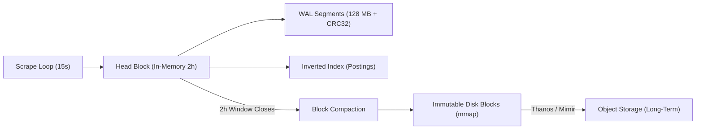
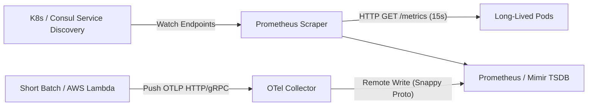
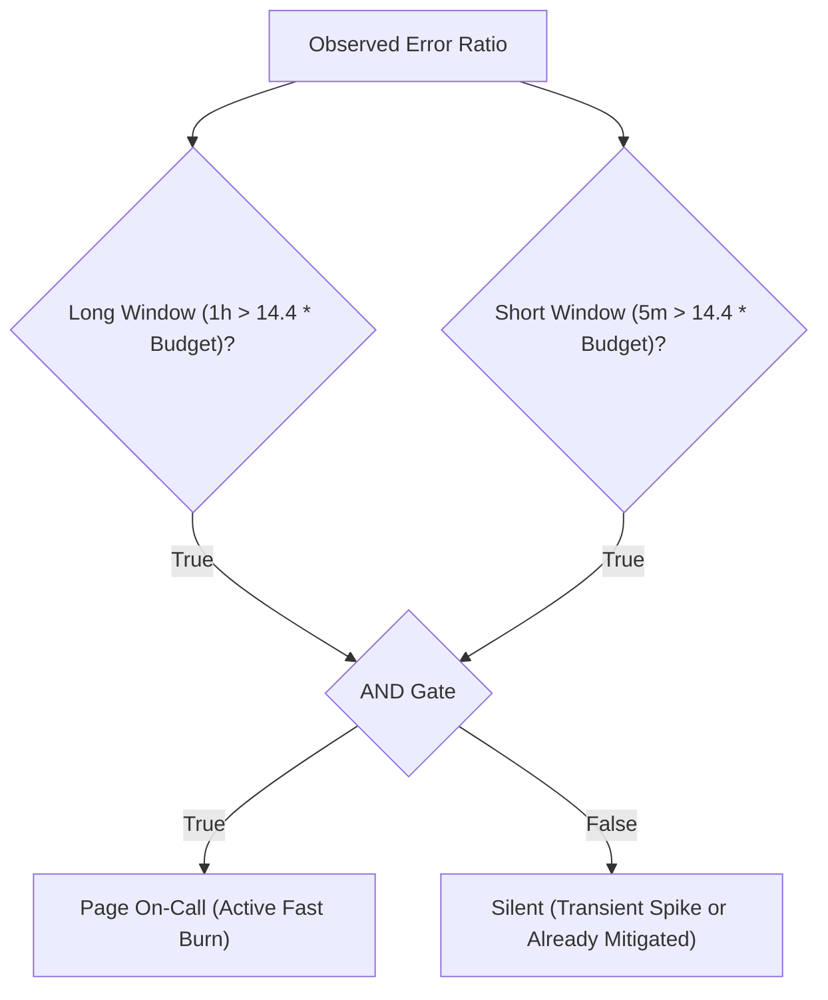

---
tags:
  - software-engineering
  - devops
  - monitoring
  - prometheus
  - sre
  - slo
created: 2026-11-13
updated: 2026-11-13
status: 🟢
level: mid-to-senior
---
# Monitoring & Quantitative Alerting

Monitoring evaluates pre-defined numeric time-series indicators (metrics) to detect known failure modes, verify capacity headroom, and drive deterministic reliability alerting. Production monitoring avoids noisy static-threshold pages by grounding telemetry in RED, USE, and the Four Golden Signals, sizing Prometheus Time-Series Database (TSDB) memory against high-cardinality label amplification, aggregating quantiles mathematically through cumulative and exponential histograms, and paging strictly on multi-window SLO error-budget burn rates. Related foundations: [[Programming/Software Engineering/DevOps/DevOps Complete Guide|DevOps Complete Guide]], [[Programming/Software Engineering/DevOps/Logging|Logging]], [[Programming/Software Engineering/DevOps/Observability|Observability]], [[Programming/Software Engineering/DevOps/Kubernetes|Kubernetes]], [[Programming/Software Engineering/System Design/Scalability|Scalability]].

---

## 1. First-Principles Metrics Storage Physics & TSDB Internals

A time-series metric is an ordered stream of `(timestamp_ms: int64, value: float64)` samples uniquely identified by a metric name (`__name__`) and an immutable, sorted set of key-value label pairs (`{service="checkout", status_class="2xx"}`). Metrics pipelines deliberately discard per-request identifiers so storage engines can compress telemetry to roughly `1.37 bytes` per sample and answer multi-million-sample PromQL aggregations in tens of milliseconds.

### 1.1 Prometheus TSDB Storage Engine & Memory Architecture

Prometheus implements an append-optimized Time-Series Database (TSDB) partitioned chronologically into two-hour temporal blocks backed by a crash-safe Write-Ahead Log (WAL) and an in-memory inverted index.



1. **In-Memory Head Block (`2h` Active Window)**:
   - Newly ingested samples land in the active **Head Block**, which holds the latest `2–3 hours` of mutable data in Go heap memory (and chunks recently closed within the head via `mmap` head chunk files to bound RAM).
   - Every unique label set maps to a **`MemSeries`** struct tracked in a lock-sharded hash map (`stripeSeries`), storing the currently open chunk (up to `120` samples per chunk by default) and the previous chunk reference.
   - **Inverted Index (`Postings`)**: To answer label matchers such as `{service="checkout", status_class="5xx"}` without scanning millions of series, the Head maintains an in-memory **Symbol Table** (deduplicated string interns) and **Postings Lists** mapping each `(label_name, label_value)` tuple to a sorted list of integer `seriesID`s. Evaluating a multi-label query computes a fast sorted intersection across postings lists in $O(\min(|A|, |B|))$ time.
2. **Write-Ahead Log (WAL) & Checkpointing**:
   - Before acknowledging an ingested sample, Prometheus appends the series creation record and compressed sample batch sequentially to `128 MB` segment files under `wal/` protected by CRC32 checksums.
   - When the Head truncates series older than `2h`, Prometheus writes a **`wal/checkpoint.XXXXXX`** snapshot summarizing active still-referenced series definitions and removes stale WAL segments. On crash restart, Prometheus memory-maps the latest checkpoint and replays only the remaining WAL tail segments.
3. **Gorilla XOR & Delta-of-Delta Compression**:
   - Raw `(int64, float64)` samples consume `16 bytes` uncompressed. Prometheus achieves nearly **12:1 compression** (`~1.37 bytes/sample`) inside 120-sample chunks using Facebook's Gorilla encoding:
   - **Timestamp Delta-of-Delta Encoding**: First sample stores raw $t_0$ (`64 bits`) and $t_1$ stores delta $\Delta_1 = t_1 - t_0$ (`14 bits`). Each subsequent timestamp encodes $D = (t_n - t_{n-1}) - (t_{n-1} - t_{n-2})$. Under steady `15,000 ms` scrape intervals, $D = 0$, encoded as a single `0` bit! Small OS timer jitter ($D \in [-63, 64]$) uses a `10`-prefix + `7`-bit signed offset (`9 bits` total).
   - **Float64 XOR Encoding**: Stores raw `float64` $v_0$ (`64 bits`). Subsequent values compute $\text{XOR}_n = v_n \oplus v_{n-1}$. When an idle counter or steady gauge does not change ($\text{XOR}_n = 0$), Prometheus writes a single `0` bit. Non-zero XORs strip leading and trailing zeros (`5 bits` leading count + `6 bits` meaningful length + meaningful XOR bits), or reuse the previous control header if the non-zero bit window fits within the prior frame.
4. **Immutable Compaction & `mmap` Paging**:
   - Every `2 hours`, the Head flushes closed series chunks and builds immutable sorted disk blocks (`data/01J.../chunks/`, `index`, `meta.json`, `tombstones`).
   - Background compaction merges `2h` blocks into `6h`, `18h`, `54h`, and up to `10%` of retention time, deduplicating overlapping symbols and purging deleted tombstones.
   - Prometheus accesses historical blocks strictly via POSIX `mmap()`, delegating page caching to the Linux kernel VFS page cache instead of bloating the Go garbage-collected heap.

### 1.2 Metric Types & Mathematical Aggregation Invariants

| Metric Type | Underlying Data Representation | Safe PromQL Functions | Mathematical Trap / Misuse |
| :--- | :--- | :--- | :--- |
| **Counter** | Monotonically non-decreasing `float64` starting at `0` on process boot | `rate()`, `irate()`, `increase()`, `resets()` | Querying raw counter value (reflects uptime, not load) or summing counters before `rate()` |
| **Gauge** | Arbitrary point-in-time `float64` moving up or down | `avg_over_time()`, `max_over_time()`, `sum()` | Sub-scrape aliasing (missing `200 ms` saturation bursts between `15 s` scrapes) |
| **Summary** | Client-computed streaming quantiles (`0.5`, `0.95`, `0.99`) + `_sum` + `_count` | Direct per-instance reading only | Aggregating across pods via `avg(p99)` or `max(p99)` (mathematically invalid) |
| **Classic Histogram** | Cumulative counters per upper bound `_bucket{le="0.1"}` ... `_bucket{le="+Inf"}` + `_sum` + `_count` | `histogram_quantile(0.99, sum by (le) (rate(...)))` | Coarse buckets near SLA boundary or high-cardinality labels multiplying `N_buckets` series |
| **Native Histogram** | Single time series carrying base-$2^{2^{-s}}$ exponential sparse buckets + schema + zero bucket | `histogram_quantile(0.99, sum(rate(metric[5m])))` | Legacy Prometheus `< 2.40` or remote-write sinks lacking native histogram protocol negotiation |

#### Algebraic Proof: Why Summaries Fail Across Distributed Pods

Quantiles are **non-linear, non-additive operators**. Consider a 2-pod cluster behind a round-robin or weighted load balancer during a canary deployment:

- **Pod A (Healthy)**: Serves `1,000 req/s` (`99.0%` of cluster traffic) with local `p99 = 20 ms`.
- **Pod B (Degraded)**: Receives `10 req/s` (`1.0%` of cluster traffic) with local `p99 = 4,000 ms`.
- **Cluster Reality**: Out of `1,010 req/s`, roughly `10` requests on Pod A exceed `20 ms` and `0.1` request on Pod B exceeds `4,000 ms`. True cluster `p99` sits near **`20–25 ms`**.
- **Broken Summary Aggregation (`avg`)**: `(20 + 4000) / 2 = 2,010 ms` — falsely overstates global latency by **100x**.
- **Broken Summary Aggregation (`max`)**: `4,000 ms` — triggers critical pages when `99%` of users see `20 ms`.

**Cumulative Histograms** solve this because each bucket boundary `le` exports an **additive cumulative count** (`observations <= le`). Summing `rate(http_request_duration_seconds_bucket[5m])` across all pods by `(le)` reconstructs the exact empirical cumulative distribution function (ECDF) of the entire cluster before `histogram_quantile()` linearly interpolates inside the target quantile's enclosing bucket.

#### Native (Exponential) Histograms Internals

Classic histograms require developers to guess static `le` bucket boundaries ahead of time (typically 10–15 buckets), creating `15x` active time series per label combination and introducing severe linear interpolation errors whenever latencies shift outside pre-configured ranges (for example, `le="0.5"` to `le="5.0"` causes `histogram_quantile(0.99)` to interpolate wildly across a `4.5 s` gap).

**Native Histograms** (GA/stable path in Prometheus `2.40+` / `3.x` and OpenTelemetry Exponential Histograms) pack arbitrary resolution into a **single time series** per label combination:

- **Exponential Scale Factor ($s$)**: Bucket boundaries follow $B(i) = 2^{i \cdot 2^{-s}}$. At scale $s = 3$, each bucket is only $2^{1/8} \approx 9.05\%$ wider than the prior bucket, guaranteeing a worst-case relative quantization error of $< 4.5\%$ across **nanoseconds to hours** simultaneously!
- **Sparse Encoding**: Empty buckets take zero bytes; populated positive and negative buckets encode compact delta-encoded varint counts in protobuf scrapes (`application/vnd.google.protobuf; proto=io.prometheus.client.MetricFamily`).
- **Auto-Rescaling**: If cardinality/bucket spread exceeds `native_histogram_max_buckets` (default `160`), Prometheus dynamically merges adjacent bucket pairs ($s \to s - 1$) losslessly without dropping observations.

### 1.3 Pull Scraping vs Push Collection Architectures



| Architectural Dimension | Pull Model (Prometheus Scrape) | Push Model (OTLP / Remote Write / StatsD) |
| :--- | :--- | :--- |
| **Target Discovery** | Centralized via `kubernetes_sd_configs`, EC2, Consul APIs; zero app config | Requires static collector DNS/VIP injected into every workload env |
| **Built-In Liveness (`up`)** | Scraper emits `up{job, instance} = 0` automatically on network/HTTP failure | Silent outage; requires synthetic dead-man's-switch heartbeat counters |
| **Backpressure & Load Control** | Scraper dictates exact cadence (`scrape_interval`); traffic spikes cannot flood TSDB | Sudden client traffic/retry storms push unbounded metric batches into collector |
| **Ephemeral Jobs & FaaS** | Poor fit: Lambda/Jobs exit between `15 s` scrapes; Pushgateway caches stale gauges forever | Native fit: flush final OTLP delta/cumulative batch via Lambda extension before freeze |
| **Network Topology** | Requires Prometheus ingress reachability into workload VPC/Pod network | Outbound-only egress from private subnets/edge IoT through NAT/PrivateLink |

> [!warning] Never Use Prometheus Pushgateway as a General Push Proxy
> Pushgateway persists the last pushed metric payload indefinitely in memory until an operator manually sends an HTTP `DELETE` or restarts Pushgateway. If a Kubernetes CronJob fails or stops running, Pushgateway continues exposing stale success metrics (`job_last_success_timestamp`), masking dead jobs and leaving zombie series across expired job labels. Use Pushgateway strictly for rare service-level batch summaries with explicit TTL cleanups, or prefer **OTLP Push to an OpenTelemetry Collector** exporting via `prometheusremotewrite` with out-of-order ingestion enabled.

### 1.4 High-Cardinality Explosion Bombs & TSDB Memory Math

Every unique label value permutation materializes an independent `MemSeries` object in Prometheus's Head Block, allocates chunk memory, expands the symbol table, and bloats inverted index postings lists.

$$\text{Active Series} = N_{\text{pods}} \times N_{\text{buckets}} \times \prod_{k=1}^{m} |\text{Label}_k|$$

**Concrete Failure Calculation**:
Suppose a `20`-pod microservice exposes `http_request_duration_seconds_bucket` (`14` cumulative buckets + `_sum` + `_count` = `16` series per label set) with `{method, status_code, route}`.
- **Bounded Configuration**: `3` methods $\times$ `5` status codes $\times$ `15` normalized route templates (`/v1/orders/:id`) $= 225$ combinations per pod $\implies 20 \times 16 \times 225 = \mathbf{72,000\text{ active series}}$ (`~144 MB` Head RAM).
- **Unbounded Mistake**: A developer sets `route = req.originalUrl` (emitting `/v1/orders/ord_8819204`) or adds `user_id` (`40,000` active users over 2h across 3 routes and 2 statuses). Even if each pod only touches `5,000` user/URL combos in `2h`: $20 \times 16 \times 5,000 = \mathbf{1,600,000\text{ series}}$ (`~3.2–4.8 GB` RAM just for ONE metric). Adding `pod_ip` or `request_id` creates **Series Churn** — every scrape creates brand-new series that stay pinned in the `2h` Head Block until compaction, triggering Linux kernel `oom-killer` (`Exit Code 137`) inside the Prometheus container!

---

## 2. Telemetry Methodologies & Decision Matrices

Choosing the right signals per system layer prevents blind spots where CPU looks idle during complete application outages.

### 2.1 RED vs USE vs Four Golden Signals

| Methodology | Target Domain | Core Signals | Exact Instrumentation & Failure Modes Exposed |
| :--- | :--- | :--- | :--- |
| **RED Method** | Stateless APIs, RPC servers, message consumers | **R**ate (`req/s`), **E**rrors (`5xx/s`), **D**uration (latency histogram) | Regression in deployment `git_sha`, upstream gateway timeouts, tail-latency regressions |
| **USE Method** | Kernel hardware, containers, thread/DB connection pools | **U**tilization (`% busy`), **S**aturation (`queue length / wait time`), **E**rrors (`drops / throttles`) | Kubernetes CFS CPU throttling, exhausted Postgres connection pools, NIC RX ring packet drops |
| **Four Golden Signals** | User-facing reliability SLIs (Google SRE) | **Latency** (success vs error split!), **Traffic**, **Errors**, **Saturation** | Fast `2 ms` `503` responses dragging down average latency while `200 OK` requests stall |

#### Exact Linux Kernel & Container USE Metrics (cAdvisor + `node_exporter`)

When diagnosing infrastructure bottlenecks in Kubernetes, verify these three dimensions per resource before blaming application code:

1. **CPU**:
   - **Utilization**: `sum by (pod) (rate(container_cpu_usage_seconds_total{container!=""}[5m]))` compared against `kube_pod_container_resource_limits{resource="cpu"}`.
   - **Saturation**: `rate(container_cpu_cfs_throttled_periods_total[5m]) / rate(container_cpu_cfs_periods_total[5m])` — values $> 0.05$ (`> 5%` throttled 100 ms CFS periods) explain tail latency spikes even when node average CPU sits at `30%`!
2. **Memory**:
   - **Utilization**: `container_memory_working_set_bytes` (NOT `container_memory_usage_bytes`, which includes reclaimable Linux page cache!) vs memory `limit`.
   - **Saturation / OOM Risk**: `rate(node_vmstat_pgmajfault[5m])` (major page faults from swap/disk thrashing) and `kube_pod_container_status_last_terminated_reason{reason="OOMKilled"}`.
3. **Network & Disk I/O**:
   - **Saturation**: `rate(node_disk_io_time_weighted_seconds_total[5m])` (average I/O queue depth) and `rate(node_netstat_TcpExt_ListenOverflows[5m])` (kernel dropping incoming SYN/ACK handshakes when `somaxconn` backlog fills).
   - **Errors**: `rate(node_network_receive_drop_total[5m])` and `rate(node_network_transmit_err_total[5m])`.

> [!danger] Never Mix `2xx` and `5xx` Requests in Latency Histograms
> During a database outage or circuit-breaker trip, failing requests reject immediately in `1–3 ms` with `503 Service Unavailable`. If latency histograms exclude `status_class`, thousands of fast `503`s pull `p50` and `p95` *downward*, creating an illusion of faster response times during a severe outage. Partition latency histograms by `status_class` (`2xx`, `4xx`, `5xx`) and track success latency strictly (`status_class="2xx"`).

### 2.2 Monitoring Stack & Architecture Decision Matrix

| Decision Axis | Option A | Option B | Engineering Selection Rule |
| :--- | :--- | :--- | :--- |
| **Metrics Backend** | Single-node Prometheus + local SSD | Mimir / VictoriaMetrics / Thanos + S3 | Use single-node HA pair Prometheus for `< 5M` active series per cluster; adopt Mimir/VictoriaMetrics cluster when exceeding `10M` active series, multi-cluster global PromQL, or $> 30\text{ day}$ hot retention |
| **Quantile Metric Type** | Classic Cumulative Histogram (`_bucket`) | Native Exponential Histogram | Use Classic Histograms if downstreams include legacy Prometheus `< 2.40` or Datadog/CloudWatch bridges; adopt Native Histograms inside Prometheus `2.50+`/`3.x` + Mimir to cut series count by `10x–15x` |
| **Alert Evaluation** | Direct raw-metric alerting rules | Pre-computed Recording Rules -> Burn-Rate Alerts | Use raw rules only for tiny `< 100`-series targets; compute Recording Rules for multi-window SLO burn alerts (`1h`/`5m`, `6h`/`30m`, `3d`/`6h`) so alert evaluation finishes in `< 10 ms` |
| **Batch / FaaS Metrics** | Prometheus Pushgateway | OTel Collector (`otlp` -> `prometheusremotewrite`) | Never use Pushgateway for per-tenant or high-churn ephemeral jobs; push OTLP metrics at function shutdown into OTel Collector -> Remote Write |

---

## 3. Step-by-Step Practical Application: Production Instrumentation & Alerting Stack

Below is a complete, deployable Node.js/TypeScript microservice instrumentation layer (`prom-client`) paired with hardened Prometheus scrape config, cardinality defenses, recording rules, and multi-window SLO burn-rate alerts.

### 3.1 Production Project Layout

```text
checkout-monitoring/
├── package.json
├── src/
│   ├── metrics/
│   │   ├── registry.ts              # Singleton Registry, default Node/libuv metrics, RED & USE instruments
│   │   └── dbPoolCollector.ts       # Custom async collector polling pg.Pool saturation gauges
│   ├── middleware/
│   │   └── metricsMiddleware.ts     # Route-normalized RED recording + W3C Exemplar trace attachment
│   └── server.ts                    # Express server + OpenMetrics /metrics endpoint negotiation
├── test/
│   └── metrics.test.ts              # Automated cardinality & histogram verification tests
└── infra/
    └── prometheus/
        ├── prometheus.yml           # K8s SD, Native Histogram flag, metric_relabel_configs guards
        ├── recording_rules.yml      # Pre-aggregated 5m/30m/1h/6h/3d SLI ratios & latencies
        └── slo_alerts.yml           # Multi-window multi-burn-rate pages + dead-man's switch
```

### 3.2 Node.js TypeScript Instrumentation (`prom-client` with Exemplars & Cardinality Normalization)

#### `src/metrics/registry.ts`

```typescript
import client from "prom-client";

// Enable OpenMetrics format support required for Prometheus Exemplars
export const metricsRegistry = new client.Registry();

metricsRegistry.setDefaultLabels({
  service: process.env.SERVICE_NAME ?? "checkout-api",
  env: process.env.NODE_ENV ?? "production",
});

// Exports process CPU, RSS, GC pause durations, active handles, and event-loop lag (USE signals)
client.collectDefaultMetrics({
  register: metricsRegistry,
  prefix: "nodejs_",
  gcDurationBuckets: [0.001, 0.01, 0.1, 1, 2, 5],
});

// RED Counter: Bounded strictly to method, normalized route template, and status_class
export const httpRequestsTotal = new client.Counter({
  name: "http_requests_total",
  help: "Total HTTP requests processed partitioned by method, normalized route, and status class",
  labelNames: ["method", "route", "status_class"] as const,
  registers: [metricsRegistry],
});

// RED Histogram with Exemplar support enabled (attaches trace_id to bucket updates)
export const httpRequestDurationSeconds = new client.Histogram({
  name: "http_request_duration_seconds",
  help: "HTTP request execution latency in seconds",
  labelNames: ["method", "route", "status_class"] as const,
  // Carefully spaced around 100ms, 300ms (SLO threshold), and 1s boundaries
  buckets: [0.005, 0.01, 0.025, 0.05, 0.1, 0.2, 0.3, 0.5, 1.0, 2.5, 5.0, 10.0],
  enableExemplars: true,
  registers: [metricsRegistry],
});

// USE Signals for Database Connection Pool Saturation
export const dbPoolConnections = new client.Gauge({
  name: "db_pool_connections",
  help: "PostgreSQL pool connection count by state (active, idle, waiting)",
  labelNames: ["pool_name", "state"] as const,
  registers: [metricsRegistry],
});

export const dbQueryDurationSeconds = new client.Histogram({
  name: "db_query_duration_seconds",
  help: "PostgreSQL query execution duration including pool acquisition wait",
  labelNames: ["operation", "outcome"] as const,
  buckets: [0.001, 0.005, 0.01, 0.025, 0.05, 0.1, 0.25, 0.5, 1.0, 2.5],
  enableExemplars: true,
  registers: [metricsRegistry],
});
```

#### `src/metrics/dbPoolCollector.ts`

```typescript
import type { Pool } from "pg";
import { dbPoolConnections } from "./registry.js";

/**
 * Attaches an on-scrape collector callback instead of using setInterval(), ensuring zero
 * sub-scrape timer leaks and guaranteeing fresh gauges precisely when Prometheus scrapes.
 */
export function registerDbPoolMetrics(pool: Pool, poolName = "primary"): void {
  const originalCollect = dbPoolConnections.collect?.bind(dbPoolConnections);

  dbPoolConnections.collect = function collectPoolSnapshot() {
    if (originalCollect) {
      originalCollect();
    }
    const activeCount = Math.max(0, pool.totalCount - pool.idleCount);
    this.set({ pool_name: poolName, state: "active" }, activeCount);
    this.set({ pool_name: poolName, state: "idle" }, pool.idleCount);
    this.set({ pool_name: poolName, state: "waiting" }, pool.waitingCount);
  };
}
```

#### `src/middleware/metricsMiddleware.ts`

```typescript
import type { NextFunction, Request, Response } from "express";
import { trace } from "@opentelemetry/api";
import { httpRequestDurationSeconds, httpRequestsTotal } from "../metrics/registry.js";

const KNOWN_METHODS = new Set(["GET", "POST", "PUT", "PATCH", "DELETE", "HEAD", "OPTIONS"]);

/**
 * Prevents unbounded cardinality from 404 vulnerability scanners (/wp-login.php, /orders/999123)
 * and strips dynamic path parameters strictly to Express matched route templates.
 */
export function resolveSafeRouteTemplate(req: Request, statusCode: number): string {
  if (req.route && typeof req.route.path === "string") {
    const baseUrl = req.baseUrl ?? "";
    return `${baseUrl}${req.route.path}` || "/";
  }
  if (statusCode === 404) {
    return "/:not_found";
  }
  if (statusCode === 405) {
    return "/:method_not_allowed";
  }
  return "/:unmatched";
}

export function classifyStatus(statusCode: number): string {
  if (statusCode >= 500) return "5xx";
  if (statusCode >= 400) return "4xx";
  if (statusCode >= 300) return "3xx";
  if (statusCode >= 200) return "2xx";
  return "1xx";
}

export function metricsMiddleware(req: Request, res: Response, next: NextFunction): void {
  if (req.path === "/metrics" || req.path === "/healthz") {
    next();
    return;
  }

  const startNs = process.hrtime.bigint();

  res.once("finish", () => {
    const durationSec = Number(process.hrtime.bigint() - startNs) / 1e9;
    const method = KNOWN_METHODS.has(req.method) ? req.method : "OTHER";
    const route = resolveSafeRouteTemplate(req, res.statusCode);
    const statusClass = classifyStatus(res.statusCode);

    const labels = {
      method,
      route,
      status_class: statusClass,
    };

    httpRequestsTotal.inc(labels, 1);

    // Extract active W3C trace_id/span_id if OpenTelemetry is active so slow requests emit Exemplars
    const spanContext = trace.getActiveSpan()?.spanContext();
    if (spanContext?.traceId) {
      httpRequestDurationSeconds.observe({
        labels,
        value: durationSec,
        exemplarLabels: {
          trace_id: spanContext.traceId,
          span_id: spanContext.spanId,
        },
      });
    } else {
      httpRequestDurationSeconds.observe(labels, durationSec);
    }
  });

  next();
}
```

#### `src/server.ts`

```typescript
import express from "express";
import { Pool } from "pg";
import { metricsRegistry } from "./metrics/registry.js";
import { registerDbPoolMetrics } from "./metrics/dbPoolCollector.js";
import { metricsMiddleware } from "./middleware/metricsMiddleware.js";

export function createApp(pool: Pool): express.Express {
  const app = express();
  app.use(express.json());
  app.use(metricsMiddleware);

  registerDbPoolMetrics(pool, "checkout_primary");

  app.get("/healthz", (_req, res) => {
    res.status(200).json({ status: "ok" });
  });

  app.get("/v1/orders/:orderId", async (req, res) => {
    const { orderId } = req.params;
    res.status(200).json({ orderId, state: "confirmed" });
  });

  // Expose OpenMetrics format when requested by Prometheus (enables Exemplar lines `# {trace_id=...}`)
  app.get("/metrics", async (req, res) => {
    const accept = req.headers.accept ?? "";
    const wantsOpenMetrics = accept.includes("application/openmetrics-text");
    if (wantsOpenMetrics) {
      metricsRegistry.setContentType(
        metricsRegistry.constructor === Object
          ? ("application/openmetrics-text; version=1.0.0; charset=utf-8" as never)
          : (await import("prom-client")).openMetricsContentType
      );
      res.setHeader("Content-Type", (await import("prom-client")).openMetricsContentType);
    } else {
      res.setHeader("Content-Type", metricsRegistry.contentType);
    }
    res.end(await metricsRegistry.metrics());
  });

  return app;
}
```

#### `test/metrics.test.ts`

```typescript
import { describe, it, beforeEach } from "node:test";
import assert from "node:assert/strict";
import request from "supertest";
import type { Pool } from "pg";
import { createApp } from "../src/server.js";
import { metricsRegistry } from "../src/metrics/registry.js";

describe("Monitoring Instrumentation & Cardinality Guards", () => {
  const mockPool = { totalCount: 8, idleCount: 5, waitingCount: 2 } as unknown as Pool;
  const app = createApp(mockPool);

  beforeEach(() => {
    metricsRegistry.resetMetrics();
  });

  it("normalizes dynamic path parameters and scanner 404 paths to bounded templates", async () => {
    await request(app).get("/v1/orders/ord_11111").expect(200);
    await request(app).get("/v1/orders/ord_22222").expect(200);
    await request(app).get("/wp-admin/install.php").expect(404);
    await request(app).get("/.env.production").expect(404);

    const payload = await metricsRegistry.getSingleMetricAsString("http_requests_total");
    assert.match(payload, /route="\/v1\/orders\/:orderId",status_class="2xx"\} 2/);
    assert.match(payload, /route="\/:not_found",status_class="4xx"\} 2/);
    assert.doesNotMatch(payload, /ord_11111/);
    assert.doesNotMatch(payload, /wp-admin/);
  });

  it("captures database connection pool USE gauges on /metrics scrape", async () => {
    const res = await request(app)
      .get("/metrics")
      .set("Accept", "application/openmetrics-text; version=1.0.0")
      .expect(200);

    assert.match(res.text, /db_pool_connections\{.*pool_name="checkout_primary",state="active"\} 3/);
    assert.match(res.text, /db_pool_connections\{.*pool_name="checkout_primary",state="waiting"\} 2/);
  });
});
```

### 3.3 Hardened Prometheus Config, Recording Rules & Burn-Rate Alerts

#### `infra/prometheus/prometheus.yml`

```yaml
global:
  scrape_interval: 15s
  evaluation_interval: 15s
  scrape_timeout: 10s

rule_files:
  - /etc/prometheus/rules/recording_rules.yml
  - /etc/prometheus/rules/slo_alerts.yml

scrape_configs:
  - job_name: kubernetes-pods
    scrape_protocols:
      - PrometheusProto          # Enables Native Exponential Histograms natively
      - OpenMetricsText1.0.0     # Enables Exemplars on classic histograms
      - PrometheusText0.0.4
    sample_limit: 15000          # Circuit breaker: fail scrape if a pod explodes >15k samples
    target_limit: 500            # Circuit breaker against runaway Kubernetes ReplicaSet loops
    kubernetes_sd_configs:
      - role: pod
    relabel_configs:
      # Opt-in scraping strictly via pod annotation
      - source_labels: [__meta_kubernetes_pod_annotation_prometheus_io_scrape]
        action: keep
        regex: "true"
      - source_labels: [__meta_kubernetes_pod_annotation_prometheus_io_path]
        action: replace
        target_label: __metrics_path__
        regex: (.+)
      - source_labels: [__address__, __meta_kubernetes_pod_annotation_prometheus_io_port]
        action: replace
        regex: ([^:]+)(?::\d+)?;(\d+)
        replacement: $1:$2
        target_label: __address__
      - source_labels: [__meta_kubernetes_namespace]
        target_label: namespace
      - source_labels: [__meta_kubernetes_pod_label_app_kubernetes_io_name]
        target_label: app
      - source_labels: [__meta_kubernetes_pod_name]
        target_label: pod
    metric_relabel_configs:
      # Drop Go/Node high-cardinality experimental or unused runtime buckets if noisy
      - source_labels: [__name__]
        regex: "(go_gc_pauses_seconds_bucket|http_client_deprecated_.*)"
        action: drop
      # Last-line defense: rewrite unnormalized numeric path IDs inside route label
      - source_labels: [route]
        regex: "(.*)/[0-9a-fA-F-]{8,36}(.*)"
        replacement: "$1/:id$2"
        target_label: route
      # Drop volatile pod_uid or container_id labels if injected by legacy SDKs
      - regex: "(pod_uid|request_id|user_id|session_id)"
        action: labeldrop
```

#### `infra/prometheus/recording_rules.yml`

```yaml
groups:
  - name: checkout_sli_recording_rules
    interval: 30s
    rules:
      # Total request rate over all burn-rate evaluation windows (5m, 30m, 1h, 6h, 3d)
      - record: service:http_requests:rate5m
        expr: sum by (service, env) (rate(http_requests_total[5m]))

      - record: service:http_requests:rate30m
        expr: sum by (service, env) (rate(http_requests_total[30m]))

      - record: service:http_requests:rate1h
        expr: sum by (service, env) (rate(http_requests_total[1h]))

      - record: service:http_requests:rate6h
        expr: sum by (service, env) (rate(http_requests_total[6h]))

      - record: service:http_requests:rate3d
        expr: sum by (service, env) (rate(http_requests_total[3d]))

      # Error ratio = 5xx / total (4xx client validation faults excluded from service SLO error budget)
      - record: service:http_error_ratio:rate5m
        expr: |
          (
            sum by (service, env) (rate(http_requests_total{status_class="5xx"}[5m]))
            or
            0 * service:http_requests:rate5m
          ) / clamp_min(service:http_requests:rate5m, 1e-9)

      - record: service:http_error_ratio:rate30m
        expr: |
          (
            sum by (service, env) (rate(http_requests_total{status_class="5xx"}[30m]))
            or
            0 * service:http_requests:rate30m
          ) / clamp_min(service:http_requests:rate30m, 1e-9)

      - record: service:http_error_ratio:rate1h
        expr: |
          (
            sum by (service, env) (rate(http_requests_total{status_class="5xx"}[1h]))
            or
            0 * service:http_requests:rate1h
          ) / clamp_min(service:http_requests:rate1h, 1e-9)

      - record: service:http_error_ratio:rate6h
        expr: |
          (
            sum by (service, env) (rate(http_requests_total{status_class="5xx"}[6h]))
            or
            0 * service:http_requests:rate6h
          ) / clamp_min(service:http_requests:rate6h, 1e-9)

      - record: service:http_error_ratio:rate3d
        expr: |
          (
            sum by (service, env) (rate(http_requests_total{status_class="5xx"}[3d]))
            or
            0 * service:http_requests:rate3d
          ) / clamp_min(service:http_requests:rate3d, 1e-9)

      # Latency SLI: proportion of 2xx requests exceeding 300ms target (le="0.3")
      - record: service:http_slow_ratio_300ms:rate5m
        expr: |
          1 - (
            sum by (service, env) (rate(http_request_duration_seconds_bucket{status_class="2xx", le="0.3"}[5m]))
            /
            clamp_min(sum by (service, env) (rate(http_request_duration_seconds_count{status_class="2xx"}[5m])), 1e-9)
          )

      # Precomputed p99 latency split by success vs error
      - record: service:http_request_duration_seconds:p99_2xx_5m
        expr: |
          histogram_quantile(
            0.99,
            sum by (service, env, le) (rate(http_request_duration_seconds_bucket{status_class="2xx"}[5m]))
          )
```

#### `infra/prometheus/slo_alerts.yml`

```yaml
groups:
  - name: checkout_slo_burn_rate_alerts
    rules:
      # Target 30-day Availability SLO = 99.9% => Error Budget = 0.001 (0.1%)
      # Critical Page: 2% budget consumed in 1h => Burn Rate = 14.4x (threshold = 0.0144)
      - alert: CheckoutAvailabilityBurnCritical
        expr: |
          (
            service:http_error_ratio:rate1h{service="checkout-api", env="production"} > (14.4 * 0.001)
            and
            service:http_error_ratio:rate5m{service="checkout-api", env="production"} > (14.4 * 0.001)
          )
          and
          service:http_requests:rate5m{service="checkout-api", env="production"} > 1
        for: 2m
        labels:
          severity: page
          service: checkout-api
          slo: "99.9"
        annotations:
          summary: "CRITICAL: checkout-api burning 30d error budget at >14.4x rate (2% in 1h)"
          runbook_url: "https://runbooks.internal/checkout/slo-availability-burn"

      # High Page: 5% budget consumed in 6h => Burn Rate = 6.0x (threshold = 0.006)
      - alert: CheckoutAvailabilityBurnHigh
        expr: |
          (
            service:http_error_ratio:rate6h{service="checkout-api", env="production"} > (6.0 * 0.001)
            and
            service:http_error_ratio:rate30m{service="checkout-api", env="production"} > (6.0 * 0.001)
          )
          and
          service:http_requests:rate30m{service="checkout-api", env="production"} > 1
        for: 5m
        labels:
          severity: page
          service: checkout-api
          slo: "99.9"
        annotations:
          summary: "HIGH: checkout-api burning 30d error budget at >6.0x rate (5% in 6h)"

      # Low Severity Ticket: 10% budget consumed over 3d => Burn Rate = 1.0x (threshold = 0.001)
      - alert: CheckoutAvailabilityBurnSlowTicket
        expr: |
          (
            service:http_error_ratio:rate3d{service="checkout-api", env="production"} > (1.0 * 0.001)
            and
            service:http_error_ratio:rate6h{service="checkout-api", env="production"} > (1.0 * 0.001)
          )
        for: 15m
        labels:
          severity: ticket
          service: checkout-api
          slo: "99.9"
        annotations:
          summary: "TICKET: checkout-api slow 1x burn consuming 10% of monthly error budget over 3 days"

      # Pipeline Liveness Dead-Man's Switch (always firing to Alertmanager -> external DeadMansSnitch)
      - alert: WatchdogTelemetryHeartbeat
        expr: vector(1)
        labels:
          severity: watchdog
        annotations:
          summary: "Prometheus alerting pipeline heartbeat is active"
```

#### `infra/prometheus/alertmanager.yml` & `test/slo_alerts_test.yml`

Prevent duplicate paging storms (`CheckoutAvailabilityBurnCritical` firing simultaneously alongside `CheckoutAvailabilityBurnHigh` for the exact same incident) using Alertmanager `inhibit_rules`, and unit-test burn-rate rules deterministically in CI before deployment:

```yaml
# infra/prometheus/alertmanager.yml
route:
  receiver: pagerduty-primary
  group_by: [service, env]
  group_wait: 30s
  group_interval: 5m
  repeat_interval: 4h
  routes:
    - matchers:
        - severity="watchdog"
      receiver: deadmanssnitch-webhook
      repeat_interval: 5m
    - matchers:
        - severity="ticket"
      receiver: jira-async-queue

inhibit_rules:
  - source_matchers:
      - severity="page"
      - alertname=~".*BurnCritical"
    target_matchers:
      - severity="page"
      - alertname=~".*BurnHigh"
    equal: [service, env]
```

```yaml
# test/slo_alerts_test.yml (executed via `promtool test rules`)
rule_files:
  - ../infra/prometheus/recording_rules.yml
  - ../infra/prometheus/slo_alerts.yml

evaluation_interval: 1m

tests:
  - interval: 1m
    input_series:
      - series: 'http_requests_total{service="checkout-api",env="production",status_class="2xx"}'
        values: '0+6000x70'
      - series: 'http_requests_total{service="checkout-api",env="production",status_class="5xx"}'
        # 2% error ratio sustained over 65 minutes (> 1.44% threshold for 14.4x burn on 99.9% SLO)
        values: '0+120x65'
    alert_rule_test:
      - eval_time: 62m
        alertname: CheckoutAvailabilityBurnCritical
        exp_alerts:
          - exp_labels:
              severity: page
              service: checkout-api
              slo: "99.9"
            exp_annotations:
              summary: "CRITICAL: checkout-api burning 30d error budget at >14.4x rate (2% in 1h)"
              runbook_url: "https://runbooks.internal/checkout/slo-availability-burn"
```

---

## 4. PromQL Reference, Multi-Window Burn-Rate Math & Edge Cases

### 4.1 PromQL Evaluation Mechanics (`rate`, `irate`, `increase`, Vector Matching)

1. **`rate(v[W])` vs `irate(v[W])`**:
   - `rate(http_requests_total[5m])` locates the earliest and latest sample strictly inside `[t - 5m, t]`, adjusts upward whenever a sample value is lower than its predecessor (counter reset), extrapolates linearly across the gaps between the first/last samples and the window edges `[t - 5m, t]`, and divides by `300s`.
   - **Minimum Window Invariant**: Set $W \ge 4 \times \text{scrape\_interval}$ (e.g., `1m` or `5m` for `15s` scrapes). If `W = 30s` and one scrape times out, only 1 sample remains in `[t - 30s, t]`, causing `rate()` to emit an empty vector (alert gap!).
   - **`irate(v[5m])`** looks back up to `5m` purely to find the **last two data points** and returns $(v_n - v_{n-1}) / (t_n - t_{n-1})$. Because `irate()` reflects only a single `15s` scrape interval, a 30-second outage recovery or single missed sample swings `irate()` abruptly—use `irate()` exclusively for zoomed live-debugging graphs, **never** inside alerts or recording rules.
2. **`increase(v[W])` Fractional Outputs**:
   - Implemented literally as `rate(v[W]) * duration_seconds(W)`. Because `rate()` extrapolates from the first sample timestamp (say `t - 4m52s`) to the exact window start (`t - 5m00s`), an integer counter that incremented by `12` requests over `292s` returns `12 * (300 / 292) = 12.328`! Never test `increase(...) == 12` for exact integer equality; use `round(increase(...))` or `>=` checks.
3. **Aggregation Order Invariant**:
   - **Correct**: `sum by (service) (rate(http_requests_total[5m]))` — detects counter resets independently on each pod series before summing per-second rates.
   - **Fatal Bug**: `rate(sum(http_requests_total)[5m:15s])` — summing raw cumulative counters merges all pod counters into one non-monotonic stream; whenever a single pod restarts, the global sum drops slightly, causing `rate()` to misinterpret the tiny dip as a full counter wrap from `0` and emit a phantom spike equal to the combined uptime total of all remaining pods!
4. **Vector Matching (`on`, `ignoring`, `group_left`)**:
   - Binary PromQL operators (`*`, `/`, `+`) require identical label sets unless explicitly joined. To enrich `cAdvisor` container throttling metrics (which lack business team labels) with `kube_pod_labels` (`label_team`), perform a many-to-one join:

```promql
sum by (namespace, label_team) (
  rate(container_cpu_cfs_throttled_periods_total{container!=""}[5m])
  * on (namespace, pod) group_left (label_team)
  kube_pod_labels
)
```

5. **Staleness & Lookback Delta (`5m`)**:
   - When a target shuts down cleanly or disappears from Kubernetes service discovery, Prometheus appends a special NaN **staleness marker** (`0x7ff0000000000002`) so instant queries stop returning zombie pods immediately instead of waiting for the `5m` default `--query.lookback-delta`. Without service discovery removal (such as frozen endpoints), Prometheus holds the last scraped sample valid for up to `5m` before dropping it from instant results.

### 4.2 Google SRE Multi-Window Multi-Burn-Rate Derivation

Define **SLI**, **SLO**, **Error Budget**, and **Burn Rate ($B$)**:

$$\text{SLI} = \frac{\text{Good Valid Events}}{\text{Total Valid Events}}, \quad \text{Error Budget} = 1 - \text{SLO}$$

$$B = \frac{\text{Observed Error Ratio}}{1 - \text{SLO}}$$

Over a rolling `30-day` window ($T = 720\text{ hours} = 43,200\text{ minutes}$):
- At $B = 1.0$, error budget exhausts in exactly `720 hours` (`30 days`).
- To alert when a percentage $p$ of the total monthly error budget burns within long window $W_{\text{long}}$:

$$B = \frac{p \cdot T}{W_{\text{long}}}$$

| Severity Tier | Budget Consumed ($p$) | Long Window ($W_{\text{long}}$) | Short Confirmation ($W_{\text{short}} = W_{\text{long}} / 12$) | Burn Rate ($B$) | Time to 100% Exhaustion | Reset Lag After Fix |
| :--- | :--- | :--- | :--- | :--- | :--- | :--- |
| **Critical (Page)** | `2%` (`0.02`) | `1h` | `5m` | `14.4` | `50 hours` | `<= 5 minutes` |
| **High (Page)** | `5%` (`0.05`) | `6h` | `30m` | `6.0` | `5 days` | `<= 30 minutes` |
| **Medium (Ticket)** | `10%` (`0.10`) | `1d` (`24h`) | `2h` | `3.0` | `10 days` | `<= 2 hours` |
| **Low (Ticket)** | `10%` (`0.10`) | `3d` (`72h`) | `6h` | `1.0` | `30 days` | `<= 6 hours` |



**Why the Short Window (`1/12` of Long Window) Is Essential**:
If an outage lasts `10 minutes` at `50%` errors and then recovers completely, the `1h` average stays elevated above `14.4 * 0.001` for up to `50` more minutes after recovery (`reset time`). Pairing `1h AND 5m` clears the alert within **`5 minutes`** of mitigation because `error_ratio[5m]` immediately drops back to `0`, preventing stale re-pages. Conversely, pairing `1h AND 5m` ensures a brief `2-minute` blip does not page unless it actually consumes meaningful error budget (`2%` over 1h) OR sustains intense burn long enough to lift the `1h` window!

**Traffic Minimum Guard (`service:http_requests:rate5m > 1`)**:
During midnight low-traffic windows (`0.05 RPS`, i.e., 3 requests/minute), `2` isolated retry failures produce a `10%` error ratio (`B = 100`!). Guard burn-rate alerts with a minimum request-rate floor or synthetic availability probe (`blackbox_exporter`) so low-volume noise does not trigger 3:00 AM pages.

### 4.3 Edge Cases: `histogram_quantile` Pitfalls & Counter-Reset Traps

1. **Bucket Mis-Sizing (`NaN` or Clamped Quantiles)**:
   - If your highest explicit bucket is `le="1.0"` and `> 5%` of requests take `3.0s`, `histogram_quantile(0.99, ...)` hits the `+Inf` bucket and **clamps the returned value to the upper bound of the second-to-last bucket (`1.0 s`)**! Always include buckets well above request timeouts (e.g., `2.5s`, `5.0s`, `10.0s`, `30.0s`), or switch to **Native Histograms**.
2. **All-Zero Observations Returning `NaN`**:
   - Dividing error counter rate by total request rate produces `NaN` when zero requests arrived over `5m`. Wrap denominators in `clamp_min(..., 1e-9)` and coalesce missing error series using `or 0 * total_rate`.
3. **Label Leakage from `honor_labels: true`**:
   - Enabling `honor_labels: true` blindly allows untrusted workload pods to spoof `job="kube-apiserver"` or `instance="prod-db-01"`, poisoning cluster-wide alerting rules. Only enable `honor_labels: true` when scraping trusted federations or OpenTelemetry Collectors.

---

## 5. Production Debugging, Profiling & Operations Playbook

| Symptom | Root Cause Diagnosis | Exact Diagnostic Commands / Queries | Remediation |
| :--- | :--- | :--- | :--- |
| **Prometheus `OOMKilled` (`Exit 137`) & Slow Scrape Loops** | High-cardinality label explosion (`user_id`, raw URLs) or `Pod` churn in Head Block | `topk(15, count by (__name__)({__name__=~".+"}))` or Prometheus UI `/tsdb-status` & `curl -s localhost:9090/api/v1/status/tsdb \| jq .data.seriesCountByMetricName[:10]` | Add `metric_relabel_configs` `labeldrop`/`drop`, enforce `sample_limit`, normalize URL templates in middleware |
| **`promtool` Disk Block / Index Bottleneck** | Excessive postings intersections or uncompacted WAL backlog (`> 10 GB`) | `promtool tsdb analyze /prometheus/data` and `curl -s localhost:9090/api/v1/status/runtimeinfo` | Compact/clean high-churn labels; increase `--storage.tsdb.min-block-duration` only if NOT using Thanos sidecar; scale RAM to `~3 KB * active_series + 30%` |
| **Sudden Phantom `50k req/s` Rate Spikes on Deploy** | PromQL evaluated `rate(sum(...))` instead of `sum(rate(...))` across rolling pods | Inspect rule expression via `curl -s localhost:9090/api/v1/rules \| jq` | Move `rate()` inside `sum by (...)`; ensure range window $\ge 4 \times \text{scrape\_interval}$ |
| **`up == 0` / Context Deadline Exceeded** | Pod CPU CFS throttling starving `/metrics` handler or exceeding `scrape_timeout` | Query `scrape_duration_seconds{job="..."}` and `rate(container_cpu_cfs_throttled_periods_total[5m])` | Make `/metrics` O(1) cache/fast serializer; remove heavy synchronous DB calls from `/metrics`; raise pod CPU limit |
| **SLO Burn Alert Never Clears After Mitigation** | Alert checks only `[1h]` or `[6h]` long window without a short confirmation gate | Check alert expression in Alertmanager UI / `amtool alert` | Add short window confirmation (`AND error_ratio[5m] > threshold`) to drop reset lag to `5m` |
| **Missing Exemplars on Grafana Panels** | Prometheus missing `--enable-feature=exemplar-storage` OR app returning classic text `0.0.4` instead of OpenMetrics | `curl -H "Accept: application/openmetrics-text; version=1.0.0" http://pod:8080/metrics \| grep "# {"` | Enable `--enable-feature=exemplar-storage`, configure `OpenMetricsText1.0.0` in `scrape_protocols`, attach active OTel `trace_id` |

### TSDB Head & Cardinality Profiling CLI Workflow

```bash
# 1. Inspect top-10 metrics and highest-cardinality label names directly from a TSDB block on disk
promtool tsdb analyze /var/lib/prometheus/data

# 2. Query Prometheus TSDB status API for live Head Block active series & memory footprints
curl -s http://localhost:9090/api/v1/status/tsdb | jq '{
  headSeries: .data.headStats.numSeries,
  headChunks: .data.headStats.numLabelPairs,
  topMetrics: .data.seriesCountByMetricName[:10],
  topLabels: .data.labelValueCountByLabelName[:10]
}'

# 3. Validate alert and recording rules syntactically and run unit tests before CI deploy
promtool check rules infra/prometheus/recording_rules.yml infra/prometheus/slo_alerts.yml
promtool test rules test/slo_alerts_test.yml

# 4. Capture live Go heap profile from Prometheus during unexpected RAM growth
go tool pprof -top -inuse_space http://localhost:9090/debug/pprof/heap
```

---

## 6. Worked Exercises

### Exercise 1: Debugging Broken PromQL Queries

An engineer writes these two PromQL expressions for a 15-pod Kubernetes service scraped every `15 s`:

```promql
# Query A: Request error rate
rate(sum(http_requests_total{status=~"5.."})[1m:15s])

# Query B: Cluster p99 latency
avg(http_request_duration_seconds{quantile="0.99"})
```

During a rolling deployment, Query A spikes to `+50,000 req/s` falsely, and Query B reports `180 ms` even though 3 heavy pods receiving `60%` of cluster traffic are hitting `3,500 ms` `p99`. Identify both root causes and write the mathematically valid PromQL replacements.

### Solution 1

1. **Query A Defect (`rate(sum(...))` counter-reset failure + narrow subquery)**:
   - Summing cumulative pod counters *before* taking `rate()` merges `15` independent counters into one aggregate value. When 3 pods terminate or restart during a rolling deploy, the aggregate drops sharply, and `rate()` misidentifies that drop as a complete counter reset from `0` to the remaining pods' total uptime count—producing a massive phantom positive spike! Additionally, `[1m]` is on the bare minimum edge (`4 × 15s`); a single missed scrape leaves too few samples.
   - **Fix**: Apply `rate()` independently to every pod series *first*, then sum:
   ```promql
   sum(rate(http_requests_total{status=~"5.."}[5m]))
   ```
2. **Query B Defect (Invalid `avg()` over non-linear client-side Summary quantiles)**:
   - Client-computed quantiles (`Summary` `{quantile="0.99"}`) are non-additive and unweighted by request rate. Averaging `12` healthy light pods (`~50 ms`) with `3` heavily loaded pods (`3,500 ms`) hides severe customer latency degradation.
   - **Fix**: Instrument latency using a **Histogram** (`_bucket`) or **Native Histogram**, sum additive bucket rates across pods first, and interpolate cluster-wide `p99` cleanly:
   ```promql
   histogram_quantile(
     0.99,
     sum by (le) (rate(http_request_duration_seconds_bucket{status_class="2xx"}[5m]))
   )
   ```

---

### Exercise 2: Diagnosing a Prometheus OOMKill from Cardinality Explosion

A `20`-pod payments API exposes a Prometheus Histogram `payment_latency_seconds_bucket` with **14 cumulative buckets** (`le`, plus `_sum` and `_count` = `16` series per label set) and labels `{service, pod, status_code, tenant_id, path}`.
- Over a 2-hour TSDB Head Block window, there are `20` pods, `5` status codes observed, `1,200` active enterprise `tenant_id`s, and `3` distinct normalized/unnormalized paths observed per tenant per pod (due to unnormalized `/v1/payments/pay_<uuid>` paths).
1. Calculate the total number of active time series materialized by this single histogram metric.
2. Estimate Prometheus Head-Block RAM required just for this single metric (assume `2 KB/series` active RAM including postings, symbols, and MemSeries chunks).
3. Provide the exact three-layer remediation without sacrificing per-tenant error or latency debugging.

### Solution 2

1. **Active Time Series Count**:
   $$\text{Active Series} = 20\text{ pods} \times 16\text{ histogram series} \times 5\text{ status codes} \times 1,200\text{ tenants} \times 3\text{ paths} = \mathbf{5,760,000\text{ active series}}$$
   Notice that because `path` contains dynamic payment UUIDs (`pay_<uuid>`), every new payment request during the `2h` Head window mints fresh `MemSeries` that remain pinned in RAM until the next compaction cycle, growing unboundedly with RPS.
2. **Estimated Head-Block RAM**:
   $$5,760,000\text{ series} \times 2\text{ KB/series} = 11,520,000\text{ KB} \approx \mathbf{11.0\text{ GiB RAM}}$$
   This single metric saturates an `8 GiB` or `16 GiB` Prometheus container once index postings, query evaluation working memory, and other cluster metrics are included, causing `OOMKilled`.
3. **Three-Layer Remediation**:
   - **Normalize `path` to route templates** (`/v1/payments/:paymentId`) and collapse `status_code` into **`status_class`** (`2xx`, `4xx`, `5xx`), immediately cutting path explosion and shrinking status cardinality.
   - **Remove `tenant_id` from high-bucket histograms** (retaining only bounded `tenant_tier="enterprise|standard"` on metrics, OR switching to **Native Histograms** which reduce `16` bucket series to `1` series, and shifting per-`tenant_id` slicing to **Exemplars** + [[Programming/Software Engineering/DevOps/Logging|Structured Wide Logs]] + [[Programming/Software Engineering/DevOps/Observability|Traces]]).
   - **Enforce Prometheus Collector Guardrails**: Add `metric_relabel_configs` regex rewrites (`/[0-9a-f-]{36}` -> `/:id`) and `sample_limit: 15000` per target so any future regression fails a single pod scrape rather than OOMKilling Prometheus.

---

### Exercise 3: Deriving Multi-Window Multi-Burn-Rate Alert Thresholds

Your checkout API has a **30-day rolling availability SLO of `99.95%`** (`720 hours` = `43,200 minutes`).
1. Compute the total monthly error budget in **percentage/ratio** and in **minutes of complete outage equivalent**.
2. For a **Critical Page** alert designed to fire when **`2%` of the monthly error budget is consumed in `1 hour`** (paired with a `5m` short window), calculate the required **Burn Rate ($B$)** and exact observed **Error Ratio threshold**.
3. Repeat step 2 for a **High Page** alert consuming **`5%` of the monthly error budget in `6 hours`** (paired with a `30m` short window) and write the PromQL rule.

### Solution 3

1. **Monthly Error Budget**:
   - Error Budget Ratio = $1 - 0.9995 = \mathbf{0.0005\ (0.05\%)}$.
   - Complete outage equivalent in 30 days: $0.0005 \times 43,200\text{ min} = \mathbf{21.6\text{ minutes}}$ (`1,296 seconds`).
2. **Critical Page (`2%` budget in `1h`)**:
   - Burn rate:
     $$B = \frac{0.02 \times 720\text{ h}}{1\text{ h}} = \mathbf{14.4}$$
   - Observed Error Ratio threshold:
     $$\text{Threshold} = 14.4 \times 0.0005 = \mathbf{0.0072\ (0.72\%)}$$
3. **High Page (`5%` budget in `6h`)**:
   - Burn rate:
     $$B = \frac{0.05 \times 720\text{ h}}{6\text{ h}} = \mathbf{6.0}$$
   - Observed Error Ratio threshold:
     $$\text{Threshold} = 6.0 \times 0.0005 = \mathbf{0.0030\ (0.30\%)}$$
   - PromQL expression:

```promql
(
  service:http_error_ratio:rate6h{service="checkout-api"} > (6.0 * 0.0005)
  and
  service:http_error_ratio:rate30m{service="checkout-api"} > (6.0 * 0.0005)
)
and
service:http_requests:rate30m{service="checkout-api"} > 1
```

---

### Exercise 4: Invisible Latency Degradation Under Mean Averaging & Low CPU

During peak traffic, customers report checkout hangs exceeding `10 seconds`, yet the existing Grafana overview shows:
- `Node CPU Utilization: 32%`
- `Average HTTP Latency: 210 ms` (normal baseline: `190 ms`)
- `HTTP 5xx Rate: 18%`

Explain why BOTH `Node CPU Utilization` and `Average HTTP Latency` failed to signal the outage, and provide exact PromQL queries (RED + USE) that expose the bottleneck immediately.

### Solution 4

1. **Why Average HTTP Latency Hid the Spike**:
   - Arithmetic mean combines fast errors (`503` failures returning in `2 ms`) with slow successes (`200 OK` taking `10,000 ms`) and fast static/cached endpoints. If `18%` fail in `2 ms`, `78%` hit cache in `40 ms`, and `4%` stall for `4,500 ms`, the global average stays around `~210 ms`, completely hiding severe tail-latency timeouts.
2. **Why Node CPU Utilization Stayed at `32%`**:
   - Worker threads/async event loops are **blocked waiting on I/O, downstream locks, or exhausted connection pools** rather than executing CPU instructions—OR a single container is hitting its **Kubernetes CFS CPU `limit`** (`container_cpu_cfs_throttled_periods_total`) while the underlying multi-core EC2 node sits mostly idle!
3. **Exact RED + USE Diagnostic PromQL**:

```promql
# RED: Separate success p99 latency from error latency
histogram_quantile(
  0.99,
  sum by (le, status_class) (rate(http_request_duration_seconds_bucket{service="checkout-api"}[5m]))
)

# USE (Pool Saturation): Check queued callers waiting for a free PostgreSQL connection
sum by (pool_name) (db_pool_connections{state="waiting"})

# USE (Container CPU CFS Throttling): Expose per-container throttling invisible in node CPU %
sum by (pod) (rate(container_cpu_cfs_throttled_periods_total{namespace="checkout"}[5m]))
/
clamp_min(sum by (pod) (rate(container_cpu_cfs_periods_total{namespace="checkout"}[5m])), 1e-9)
```

---

### Exercise 5: Latency SLO Burn-Rate Alerting & Bad Histogram Bucket Bounds

A search service commits to a **30-day Latency SLO**: **`99%` of `2xx` requests must finish under `250 ms`** (`Error Budget = 1% = 0.01`). Currently, developers configured histogram buckets `[0.05, 0.1, 0.5, 1.0, 5.0]` and wrote:

```promql
histogram_quantile(0.99, sum by (le) (rate(search_duration_seconds_bucket[5m]))) > 0.25
```

1. Explain why checking `histogram_quantile(0.99, ...)` both **quantitatively breaks** with those buckets AND fails as an error-budget burn-rate alert.
2. Fix the histogram bucket list and write the exact PromQL **Latency SLI Burn-Rate Alert** for **`5%` budget burn in `6h`** (`6h` + `30m` windows).

### Solution 5

1. **Two Structural Failures**:
   - **Coarse Interpolation Gap**: There is **no `le="0.25"` bucket**! `0.25 s` sits midway inside `[0.1, 0.5]`. `histogram_quantile()` assumes requests inside `[0.1, 0.5]` distribute uniformly—so if `99.5%` of requests finish at `110 ms`, linear interpolation places `p99` inside `[0.1, 0.5]` inaccurately; worse, evaluating raw `p99 > 0.25` cannot quantify *how fast* the monthly `1%` slow-request budget is burning (e.g., `2%` slow requests vs `25%` slow requests trigger identically!).
2. **Exact Fix**:
   - Add an explicit bucket boundary strictly matching the SLO threshold **`le="0.25"`** (e.g., `[0.05, 0.1, 0.25, 0.5, 1.0, 2.5, 5.0]`). Notice that counting requests exceeding `250 ms` uses the exact `le="0.25"` cumulative counter with **zero interpolation error**!
   - Compute burn rate threshold for `5%` budget in `6h`: $B = \frac{0.05 \times 720}{6} = 6.0$; threshold = $6.0 \times 0.01 = \mathbf{0.06\ (6\%)}$.

```promql
# Exact Latency SLI slow-request ratio (>250ms) without quantile interpolation error
(
  (
    1 - (
      sum(rate(search_duration_seconds_bucket{status_class="2xx", le="0.25"}[6h]))
      /
      clamp_min(sum(rate(search_duration_seconds_count{status_class="2xx"}[6h])), 1e-9)
    )
  ) > (6.0 * 0.01)
)
and
(
  (
    1 - (
      sum(rate(search_duration_seconds_bucket{status_class="2xx", le="0.25"}[30m]))
      /
      clamp_min(sum(rate(search_duration_seconds_count{status_class="2xx"}[30m])), 1e-9)
    )
  ) > (6.0 * 0.01)
)
```

---

### Exercise 6: Fixing Vector Matching & Stale Pushgateway Cron Alerts

1. An SRE tries to alert on throttled CPU by team ownership using `container_cpu_cfs_throttled_periods_total{namespace="prod"}` and `kube_pod_labels{label_team!=""}`, but PromQL returns an empty result (`many-to-many matching not allowed` / mismatched labels). Write the valid PromQL join.
2. A nightly billing CronJob pushes `billing_job_last_run_status 1` to Pushgateway on completion. Two weeks later, the CronJob silently fails to schedule inside Kubernetes (`FailedScheduling`), yet `billing_job_last_run_status == 1` stays green forever, preventing alerts! Fix the metric design and alert query.

### Solution 6

1. **Vector Matching Fix (`group_left` Many-to-One Join)**:
   - `container_cpu_cfs_throttled_periods_total` has multiple containers per pod (`container="app"`, `container="istio-proxy"`), whereas `kube_pod_labels` has one series per `(namespace, pod)` (and includes `job="kube-state-metrics"` which differs from cAdvisor's `job`). Restrict matching keys strictly via `on (namespace, pod)` and lift `label_team` onto every container series via `group_left (label_team)`:
   ```promql
   sum by (namespace, label_team) (
     rate(container_cpu_cfs_throttled_periods_total{namespace="prod", container!=""}[5m])
     * on (namespace, pod) group_left (label_team)
     kube_pod_labels{namespace="prod"}
   )
   ```
2. **Stale Pushgateway Metric Fix**:
   - Pushgateway never expires static `1/0` gauges after a CronJob stops running. Instead, push a Unix completion **timestamp** (`billing_job_last_success_timestamp_seconds`) alongside run status (or send OTLP metrics directly via OTel Collector, AND emit `kube_job_status_succeeded` from `kube-state-metrics`).
   - Alert strictly on **elapsed freshness (`time() - timestamp > 26 hours`)** rather than `status == 0`:
   ```promql
   (time() - max by (job_name) (billing_job_last_success_timestamp_seconds)) > 93600
   or
   absent(billing_job_last_success_timestamp_seconds)
   ```

---

## Related Notes

- [[Programming/Software Engineering/DevOps/Logging|Logging]]
- [[Programming/Software Engineering/DevOps/Observability|Observability]]
- [[Programming/Software Engineering/DevOps/Cloud Fundamentals|Cloud Fundamentals]]
- [[Programming/Software Engineering/DevOps/Kubernetes|Kubernetes]]
- [[Programming/Software Engineering/DevOps/DevOps Complete Guide|Back to DevOps Hub]]
