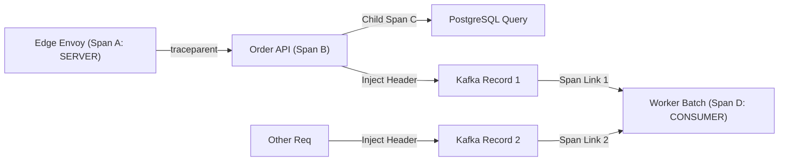
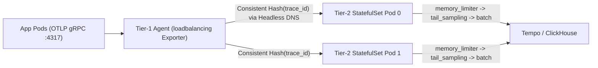
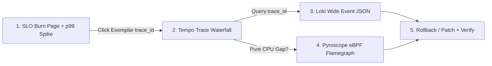

---
tags:
  - software-engineering
  - devops
  - observability
  - opentelemetry
  - tracing
  - ebpf
created: 2026-11-13
updated: 2026-11-13
status: 🟢
level: mid-to-senior
---
# Observability & Distributed Tracing

Monitoring evaluates pre-defined aggregated counters and gauges to detect known failure modes (**known-unknowns**). Observability establishes the structural capability to diagnose arbitrary, novel production failures by slicing high-dimensionality, unbounded-cardinality event data without deploying new instrumentation (**unknown-unknowns**). Modern production platforms unify four telemetry signals—**Metrics with Exemplars**, **Distributed Traces**, **Structured Wide Logs**, and **Continuous eBPF Profiles**—using **OpenTelemetry (OTel)** and **W3C Trace Context**. Related foundations: [[Programming/Software Engineering/DevOps/DevOps Complete Guide|DevOps Complete Guide]], [[Programming/Software Engineering/DevOps/Monitoring|Monitoring]], [[Programming/Software Engineering/DevOps/Logging|Logging]], [[Programming/Software Engineering/DevOps/Kubernetes|Kubernetes]], [[Programming/Software Engineering/System Design/Message Queues|Message Queues]].

---

## 1. Epistemic Foundations & Distributed Tracing Mechanics

### 1.1 Monitoring vs Observability

| Engineering Dimension | Monitoring (Metrics-First) | Observability (High-Dimensionality Events) |
| :--- | :--- | :--- |
| **Epistemic Objective** | Track predefined thresholds, capacities, and SLO error budgets | Isolate novel, multi-factor root causes across arbitrary dimensions on demand |
| **Primary Signals** | Pre-aggregated low-cardinality counters, gauges, histograms | Distributed trace DAGs, wide structured events, metric Exemplars, eBPF flamegraphs |
| **Cardinality Constraints** | Strictly bounded ($< 10^4\text{–}10^5$ label combinations/metric) | Unbounded high-cardinality keys (`trace_id`, `tenant_id`, `order_id`, `pod_uid`, `git_sha`) |
| **Diagnostic Workflow** | Inspect static dashboards and fire burn-rate pages | Follow `p99` Exemplar $\rightarrow$ trace waterfall $\rightarrow$ correlated logs $\rightarrow$ CPU/heap flamegraph |

### 1.2 Trace Directed Acyclic Graph (DAG), Spans, Events & Span Links

A **Distributed Trace** models a request's causal execution across network RPCs, asynchronous message brokers, and storage engines as a DAG keyed by a globally unique **128-bit `trace_id`** (`32` lowercase hex characters). Each node in the DAG is a **Span** containing:

- **`span_id` & `parent_span_id`**: 64-bit identifiers (`16` lowercase hex characters) defining parent-child containment. Root ingress spans omit `parent_span_id`.
- **`kind`**:
  - `SERVER` / `CLIENT`: Synchronous RPC boundaries (HTTP, gRPC, SQL, Redis). Clock skew between client and server explains slight overlap when visualizing waterfalls.
  - `PRODUCER` / `CONSUMER`: Asynchronous queue hops (Kafka, SQS, RabbitMQ, BullMQ) where execution decouples temporally.
  - `INTERNAL`: Pure in-process function spans (serialization, validation, lock acquisition).
- **Monotonic Timestamps (`start_unix_nano`, `end_unix_nano`)**: Captured via monotonic kernel clocks (`CLOCK_MONOTONIC` / `process.hrtime.bigint()`) so NTP step adjustments never generate negative span durations.
- **`attributes` & `events`**: Structured key-value pairs (`db.system="postgresql"`, `http.route="/v1/orders/:id"`) plus timestamped span `events` (e.g., `exception` carrying `exception.type`, `exception.message`, `exception.stacktrace`, or lock acquisition timestamps).
- **`status`**: `UNSET` (default normal execution—let tail samplers or callers decide), `OK` (explicit override), or `ERROR` (triggers error retention policies in tail-sampling collectors).
- **Span Links (`links[]`)**: Non-hierarchical causal pointers associating a span with one or more upstream `SpanContext`s outside a 1:1 parent-child relationship. **Span Links are mandatory for async batch consumers (fan-in)**: when a worker dequeues `50` Kafka messages from `50` unrelated user requests and executes a single batch `INSERT` into ClickHouse, a span can only have one parent, and setting one arbitrary message as parent hides the other `49` traces and inflates duration by queue wait time. Attaching all `50` extracted `SpanContext`s via `links` connects the batch consumer cleanly to every upstream request trace!



### 1.3 W3C Trace Context Specification (`traceparent`, `tracestate`, `baggage`)

Vendor-neutral trace propagation across heterogeneous services (Node.js, Python, Go, Envoy, AWS ALB) relies on the **W3C Trace Context** HTTP and messaging headers:

```text
traceparent: 00-4bf92f3577b34da6a3ce929d0e0e4736-00f067aa0ba902b7-01
tracestate:  rojo=00f067aa0ba902b7,congo=t61rcWkgMzE
baggage:     tenant.tier=enterprise,canary.cohort=beta
```

| Header / Field | Byte Width (Hex Chars) | Valid Rules & Semantics | Security / Operational Invariant |
| :--- | :--- | :--- | :--- |
| **`version`** | `1 B` (`2` hex) | Always `00` today; `ff` is permanently invalid | If incoming version is higher (`01`), parse the first 55 chars and preserve unknown trailing fields |
| **`trace-id`** | `16 B` (`32` hex) | Globally unique trace identifier; all-zeros (`000...000`) invalid | Must exhibit `>= 64` bits of cryptographically random entropy (lowest 64 bits or full 128 bits random) |
| **`parent-id`** | `8 B` (`16` hex) | Immediate caller's active `span_id`; all-zeros invalid | Downstream server creates a *new* child `span_id` and records incoming `parent-id` as `parent_span_id` |
| **`trace-flags`** | `1 B` (`2` hex) | Bit `0` (`0x01`): `sampled` flag; Bit `1` (`0x02`): `random-trace-id` | Upstream `01` tells `ParentBased` head samplers to record; untrusted external `01` must be stripped! |
| **`tracestate`** | String list (`<= 512 B`) | Vendor/router key-value pairs (`max 32` entries); active vendor prepends at index 0 | Mutate only your vendor key; preserve unknown third-party keys intact across proxies |
| **`baggage`** | String list | Cross-service key-value context (`tenant.tier=enterprise`) | **Never auto-copy all baggage into Span Attributes or Metric Labels** (triggers cardinality bombs!) |

> [!danger] Untrusted Edge `traceparent` & `baggage` Spoofing Vulnerability
> Never accept `traceparent`, `tracestate`, or `baggage` headers directly from public internet clients. An attacker sending `traceparent: 00-11111111111111111111111111111111-2222222222222222-01` forces `100%` head-based recording across your entire backend fleet, collides arbitrary requests into a single forged `trace_id`, and injects spoofed `baggage` properties (`user.role=admin`) into downstream logging or routing rules. Always strip untrusted incoming `traceparent`/`tracestate`/`baggage` at your public API Gateway / Envoy ingress and mint a fresh root `trace_id` inside the perimeter.

### 1.4 OpenTelemetry (`OTel`) Architecture & Semantic Conventions

OpenTelemetry strictly decouples **instrumentation APIs** from **SDK export pipelines**:

1. **OTel API (`@opentelemetry/api`)**: Zero-dependency interface used by libraries (`pg`, `express`, `kafkajs`) and domain code. If no SDK is registered (e.g., in unit tests or CLI tools), all API calls resolve to fast no-op functions.
2. **OTel SDK (`@opentelemetry/sdk-node`)**: Implements `TracerProvider`, `MeterProvider`, and `LoggerProvider`. Uses **`BatchSpanProcessor`** with an in-memory bounded ring queue (`maxQueueSize: 2048`, `maxExportBatchSize: 512`, `scheduledDelayMillis: 5000`). When downstream collectors stall, `BatchSpanProcessor` drops the oldest/incoming spans rather than leaking application heap until `OOMKilled`.
3. **OTLP Wire Protocol**: Encodes spans, metrics, and logs as **Protobuf** payloads transmitted over **gRPC (`:4317`)** or **HTTP/protobuf (`:4318`)** with gzip/zstd compression.
4. **OTel Semantic Conventions (`@opentelemetry/semantic-conventions`)**: Standardized attribute keys (`service.name`, `service.version`, `deployment.environment.name`, `http.request.method`, `http.route`, `http.response.status_code`, `db.system`, `db.operation.name`, `messaging.system`, `messaging.destination.name`). Adhering strictly to semantic conventions enables automatic trace-to-RED-metric generation (`spanmetrics` connector) and portable vendor dashboards.

---

## 2. Sampling Economics & Two-Tier Tail-Based Sampling Architecture

At `10,000 RPS` with an average of `15 spans/trace` (`~1.5 KB/span`), storing `100%` of raw traces generates `225 MB/sec` (`~19.4 TB/day`), rapidly dwarfing application compute spending. Production systems must retain **all anomalous traces** while sampling repetitive healthy traffic.

### 2.1 Head-Based vs Tail-Based Sampling

| Dimension | Head-Based Sampling (`TraceIdRatioBased`) | Tail-Based Sampling (`tail_sampling` Processor) |
| :--- | :--- | :--- |
| **Decision Instant** | At root ingress (`t = 0`) before business execution begins | After `decision_wait` (`10–30 s`) once the full trace DAG completes |
| **Error & Outlier Retention** | Captures only `S%` of errors (`5%` sampler loses **`95%`** of rare 500s!) | Captures **`100%`** of `ERROR` traces + `100%` of `latency > 500 ms` + `5%` healthy baseline |
| **Infrastructure State** | Fully stateless; runs inside SDK with zero collector RAM buffer | Stateful in-memory trace buffer (`RPS × decision_wait` traces held in RAM) |
| **Scaling Topology** | Simple round-robin `ClusterIP` Collector deployment | **Mandatory Two-Tier Topology** with consistent `trace_id` hashing |

### 2.2 Solving the Multi-Replica Tail-Sampling Split-Brain Bug



**Why Single-Tier `ClusterIP` Tail Sampling Fails**:
Placing 5 OTel Collector replicas running `tail_sampling` behind a standard Kubernetes `ClusterIP` Service breaks distributed traces completely. HTTP/2 gRPC connections from `api-gateway` pin to Collector Pod `0`, while `payment-svc` connects to Collector Pod `3`. When `payment-svc` throws an `ERROR` span, Collector Pod `3` holds only that child fragment while Collector Pod `0` sees only `200`-ish parent start spans and discards the trace under the `5%` baseline policy—fragmenting traces and dropping production errors!

**Two-Tier Solution**:
- **Tier 1 (Stateless Edge DaemonSet / Gateway Deployment)**: Runs `receivers.otlp`, `memory_limiter`, `k8sattributes`, PII `transform` redaction, and the **`loadbalancing` exporter** configured with `routing_key: traceID` and a `k8s` resolver querying a **Headless Service (`clusterIP: None`)**. Every span sharing a `trace_id` hashes deterministically onto the **exact same Tier-2 StatefulSet pod**!
- **Tier 2 (StatefulSet Tail Sampler)**: Receives complete trace graphs per `trace_id`, runs **`memory_limiter` (first!)** $\rightarrow$ **`tail_sampling`** (`decision_wait: 10s`) $\rightarrow$ **`batch`** $\rightarrow$ exports retained traces to Grafana Tempo / Jaeger / ClickHouse.

### 2.3 Collector Memory & `num_traces` Sizing Math

Under `tail_sampling`, Tier-2 collectors hold every incoming trace in heap memory for `decision_wait` seconds (plus processing slack). Sizing `num_traces` too low prematurely evicts active traces from the hash map before child errors arrive; under-sizing RAM causes Go runtime `OOMKilled` (`Exit 137`) loops.

$$\text{Buffered Traces} = \text{Traces/sec} \times \text{decision\_wait}$$

$$\text{Estimated Tier-2 Total RAM} \approx \left(\text{Buffered Traces} \times \text{Spans/Trace} \times \text{Bytes/Span}\right) \times 3.0\text{ (Go struct + GC overhead)}$$

- **Example (`10,000 traces/sec`, `12 spans/trace`, `1.5 KB/span`, `decision_wait: 10s`)**:
  - Active buffered traces: $10,000 \times 10 = \mathbf{100,000\text{ traces}}$.
  - Raw span bytes: $100,000 \times 12 \times 1.5\text{ KB} = 1,800,000\text{ KB} \approx \mathbf{1.72\text{ GiB}}$.
  - Including Go maps, protobuf pointers, string interns, and `GOGC=100` headroom (`~3x` multiplier): $1.72 \times 3 \approx \mathbf{5.15\text{ GiB}}$ fleet-wide.
  - Across **`4` Tier-2 StatefulSet replicas**: `~1.3 GiB` active heap per pod $\implies$ provision `3 GiB` K8s memory limit per pod, set `memory_limiter` `limit_mib: 2400` / `spike_limit_mib: 500`, and configure `num_traces: 35000` per pod ($100,000 / 4 = 25,000 + 40\%$ burst buffer).

---

## 3. Step-by-Step Practical Application: End-to-End OTel & Two-Tier Collector Stack

Below is a complete, deployable instrumentation and collector suite covering Node.js OTel SDK setup, Kafka batch `Span Links` propagation, Prometheus Exemplars, automated span tests, Two-Tier Collector YAMLs, K8s Headless StatefulSet, and Envoy ingress sanitization.

### 3.1 Production Project Layout

```text
observability-stack/
├── apps/
│   ├── order-api/
│   │   ├── src/
│   │   │   ├── tracing.ts                     # @opentelemetry/sdk-node boot, W3C propagators, OTLP gRPC
│   │   │   ├── kafka/
│   │   │   │   └── producer.ts                # Injects traceparent + baggage into Kafka record headers
│   │   │   └── metrics/
│   │   │       └── exemplars.ts               # Links Prometheus histogram buckets to active OTel trace_id
│   │   └── test/
│   │       └── tracing.test.ts                # InMemorySpanExporter unit tests verifying W3C + 50 Span Links
│   └── analytics-worker/
│       └── src/
│           └── consumer.ts                    # Extracts 50 Kafka headers into CONSUMER Span Links
└── infra/
    ├── otel/
    │   ├── tier1-agent.yaml                   # Stateless DaemonSet: memory_limiter + PII scrub + loadbalancing
    │   └── tier2-tail-sampler.yaml            # StatefulSet: tail_sampling (ERROR + >500ms + 5%) + spanmetrics
    ├── k8s/
    │   └── tier2-headless-statefulset.yaml    # Headless Service (clusterIP: None) + Tier-2 StatefulSet
    ├── envoy/
    │   └── ingress-trace-sanitization.yaml    # Strips untrusted client traceparent/baggage at perimeter
    └── pyroscope/
        └── ebpf-daemonset.yaml                # Continuous 99 Hz kernel eBPF CPU profiling DaemonSet
```

### 3.2 Node.js TypeScript Instrumentation, Kafka Batch Links & Exemplars

#### `apps/order-api/src/tracing.ts`

```typescript
import { NodeSDK } from "@opentelemetry/sdk-node";
import { OTLPTraceExporter } from "@opentelemetry/exporter-trace-otlp-grpc";
import { BatchSpanProcessor } from "@opentelemetry/sdk-trace-base";
import { getNodeAutoInstrumentations } from "@opentelemetry/auto-instrumentations-node";
import { resourceFromAttributes } from "@opentelemetry/resources";
import {
  ATTR_SERVICE_NAME,
  ATTR_SERVICE_VERSION,
} from "@opentelemetry/semantic-conventions";
import { CompositePropagator, W3CBaggagePropagator, W3CTraceContextPropagator } from "@opentelemetry/core";
import { AlwaysOnSampler } from "@opentelemetry/sdk-trace-base";
import { diag, DiagConsoleLogger, DiagLogLevel } from "@opentelemetry/api";

if (process.env.OTEL_DEBUG === "true") {
  diag.setLogger(new DiagConsoleLogger(), DiagLogLevel.INFO);
}

const traceExporter = new OTLPTraceExporter({
  // Point to local node DaemonSet Tier-1 agent via Pod downward API hostIP
  url: process.env.OTEL_EXPORTER_OTLP_ENDPOINT ?? "http://localhost:4317",
});

export const otelSdk = new NodeSDK({
  resource: resourceFromAttributes({
    [ATTR_SERVICE_NAME]: process.env.SERVICE_NAME ?? "order-api",
    [ATTR_SERVICE_VERSION]: process.env.GIT_SHA ?? "1.0.0",
    "deployment.environment.name": process.env.NODE_ENV ?? "production",
  }),
  // Apps use AlwaysOnSampler so Tier-2 Collector tail_sampling sees 100% of error & slow spans
  sampler: new AlwaysOnSampler(),
  textMapPropagator: new CompositePropagator({
    propagators: [new W3CTraceContextPropagator(), new W3CBaggagePropagator()],
  }),
  spanProcessor: new BatchSpanProcessor(traceExporter, {
    maxQueueSize: 4096,
    maxExportBatchSize: 512,
    scheduledDelayMillis: 2000,
    exportTimeoutMillis: 10000,
  }),
  instrumentations: [
    getNodeAutoInstrumentations({
      "@opentelemetry/instrumentation-http": {
        ignoreIncomingRequestHook: (req) =>
          req.url === "/healthz" || req.url === "/readyz" || req.url === "/metrics",
      },
      "@opentelemetry/instrumentation-fs": {
        enabled: false, // Prevents noisy filesystem fs.stat span explosions during module load
      },
    }),
  ],
});

otelSdk.start();

process.once("SIGTERM", async () => {
  await otelSdk.shutdown();
  process.exit(0);
});
```

#### `apps/order-api/src/kafka/producer.ts`

```typescript
import { context, propagation, SpanKind, SpanStatusCode, trace } from "@opentelemetry/api";
import type { Producer } from "kafkajs";

const tracer = trace.getTracer("order-api.kafka", "1.0.0");

export type KafkaHeadersMap = Record<string, string | Buffer | undefined>;

const kafkaHeaderSetter = {
  set(carrier: KafkaHeadersMap, key: string, value: string): void {
    carrier[key] = value;
  },
};

export interface OrderCreatedPayload {
  orderId: string;
  tenantId: string;
  totalCents: number;
}

/**
 * Creates a PRODUCER span, injects W3C `traceparent` / `tracestate` / `baggage` into Kafka
 * record headers while active, and records exception details cleanly on broker failures.
 */
export async function publishOrderCreated(
  producer: Producer,
  topic: string,
  event: OrderCreatedPayload
): Promise<void> {
  await tracer.startActiveSpan(
    `${topic} publish`,
    {
      kind: SpanKind.PRODUCER,
      attributes: {
        "messaging.system": "kafka",
        "messaging.operation.type": "send",
        "messaging.destination.name": topic,
        "order.id": event.orderId,
        "tenant.id": event.tenantId,
      },
    },
    async (span) => {
      try {
        const headers: KafkaHeadersMap = {};
        // Inject current PRODUCER span context (NOT parent HTTP span) so consumers link to exact publish hop
        propagation.inject(context.active(), headers, kafkaHeaderSetter);

        await producer.send({
          topic,
          messages: [
            {
              key: event.orderId,
              value: JSON.stringify(event),
              headers,
            },
          ],
        });
        span.setStatus({ code: SpanStatusCode.OK });
      } catch (err) {
        span.recordException(err as Error);
        span.setStatus({ code: SpanStatusCode.ERROR, message: (err as Error).message });
        throw err;
      } finally {
        span.end();
      }
    }
  );
}
```

#### `apps/analytics-worker/src/consumer.ts`

```typescript
import {
  context,
  propagation,
  ROOT_CONTEXT,
  SpanKind,
  SpanStatusCode,
  trace,
  type Link,
} from "@opentelemetry/api";

const tracer = trace.getTracer("analytics-worker.kafka", "1.0.0");

export interface RawKafkaMessage {
  offset: string;
  key: string | null;
  value: Buffer | null;
  headers?: Record<string, string | Buffer | undefined>;
}

const kafkaHeaderGetter = {
  keys(carrier: Record<string, string | Buffer | undefined>): string[] {
    return Object.keys(carrier);
  },
  get(carrier: Record<string, string | Buffer | undefined>, key: string): string | undefined {
    const raw = carrier[key] ?? carrier[key.toLowerCase()];
    if (raw === undefined) return undefined;
    return Buffer.isBuffer(raw) ? raw.toString("utf8") : raw;
  },
};

/**
 * Extracts upstream W3C SpanContexts from a batch of up to N Kafka messages and attaches them
 * as OpenTelemetry Span Links onto a single batch CONSUMER span (avoiding corrupted parent timings).
 */
export async function processOrderBatch(
  topic: string,
  messages: RawKafkaMessage[],
  bulkInsertFn: (rows: unknown[]) => Promise<void>
): Promise<void> {
  const links: Link[] = [];

  for (const msg of messages) {
    if (!msg.headers) continue;
    const extractedCtx = propagation.extract(ROOT_CONTEXT, msg.headers, kafkaHeaderGetter);
    const remoteSpanCtx = trace.getSpanContext(extractedCtx);
    if (remoteSpanCtx && trace.isSpanContextValid(remoteSpanCtx)) {
      links.push({
        context: remoteSpanCtx,
        attributes: {
          "messaging.kafka.offset": msg.offset,
        },
      });
    }
  }

  await tracer.startActiveSpan(
    `${topic} process batch`,
    {
      kind: SpanKind.CONSUMER,
      links,
      attributes: {
        "messaging.system": "kafka",
        "messaging.operation.type": "process",
        "messaging.destination.name": topic,
        "messaging.batch.message_count": messages.length,
      },
    },
    ROOT_CONTEXT,
    async (batchSpan) => {
      try {
        const parsedRows = messages
          .filter((m) => m.value !== null)
          .map((m) => JSON.parse(m.value!.toString("utf8")));

        await tracer.startActiveSpan(
          "clickhouse bulk_insert",
          {
            kind: SpanKind.CLIENT,
            attributes: {
              "db.system": "clickhouse",
              "db.operation.name": "INSERT",
              "db.batch.rows": parsedRows.length,
            },
          },
          context.active(),
          async (dbSpan) => {
            try {
              await bulkInsertFn(parsedRows);
              dbSpan.setStatus({ code: SpanStatusCode.OK });
            } catch (dbErr) {
              dbSpan.recordException(dbErr as Error);
              dbSpan.setStatus({ code: SpanStatusCode.ERROR, message: (dbErr as Error).message });
              throw dbErr;
            } finally {
              dbSpan.end();
            }
          }
        );

        batchSpan.setStatus({ code: SpanStatusCode.OK });
      } catch (err) {
        batchSpan.recordException(err as Error);
        batchSpan.setStatus({ code: SpanStatusCode.ERROR, message: (err as Error).message });
        throw err;
      } finally {
        batchSpan.end();
      }
    }
  );
}
```

#### `apps/order-api/src/metrics/exemplars.ts`

```typescript
import client from "prom-client";
import { trace } from "@opentelemetry/api";

export const exemplarRegistry = new client.Registry();
exemplarRegistry.setContentType(client.openMetricsContentType);

export const checkoutLatencyHistogram = new client.Histogram({
  name: "checkout_operation_duration_seconds",
  help: "Checkout operation execution latency with OpenMetrics trace_id Exemplars",
  labelNames: ["operation", "status_class"] as const,
  buckets: [0.025, 0.05, 0.1, 0.25, 0.5, 1.0, 2.5, 5.0],
  enableExemplars: true,
  registers: [exemplarRegistry],
});

/**
 * Records duration into a bounded-cardinality Prometheus histogram while attaching the
 * active W3C trace_id & span_id as an OpenMetrics Exemplar (zero TSDB cardinality overhead).
 */
export function observeWithExemplar(operation: string, statusClass: string, durationSec: number): void {
  const spanCtx = trace.getActiveSpan()?.spanContext();
  const labels = { operation, status_class: statusClass };

  if (spanCtx && spanCtx.traceId && spanCtx.spanId) {
    checkoutLatencyHistogram.observe({
      labels,
      value: durationSec,
      exemplarLabels: {
        trace_id: spanCtx.traceId,
        span_id: spanCtx.spanId,
      },
    });
    return;
  }

  checkoutLatencyHistogram.observe(labels, durationSec);
}
```

#### `apps/order-api/test/tracing.test.ts`

```typescript
import { describe, it, beforeEach, afterEach } from "node:test";
import assert from "node:assert/strict";
import { propagation, SpanKind, SpanStatusCode, trace } from "@opentelemetry/api";
import { W3CTraceContextPropagator } from "@opentelemetry/core";
import { BasicTracerProvider, InMemorySpanExporter, SimpleSpanProcessor } from "@opentelemetry/sdk-trace-base";
import { publishOrderCreated } from "../src/kafka/producer.js";
import { processOrderBatch, type RawKafkaMessage } from "../../analytics-worker/src/consumer.js";
import { exemplarRegistry, observeWithExemplar } from "../src/metrics/exemplars.js";

describe("Distributed Tracing Propagation, Batch Span Links & Exemplars", () => {
  let memoryExporter: InMemorySpanExporter;
  let provider: BasicTracerProvider;

  beforeEach(() => {
    memoryExporter = new InMemorySpanExporter();
    provider = new BasicTracerProvider({
      spanProcessors: [new SimpleSpanProcessor(memoryExporter)],
    });
    trace.setGlobalTracerProvider(provider);
    propagation.setGlobalPropagator(new W3CTraceContextPropagator());
  });

  afterEach(async () => {
    await provider.shutdown();
    trace.disable();
  });

  it("injects W3C traceparent into Kafka headers and connects 50 batch records via Span Links", async () => {
    const capturedMessages: RawKafkaMessage[] = [];
    const mockProducer = {
      send: async ({ messages }: { messages: Array<{ key: string; value: string; headers: Record<string, string> }> }) => {
        for (let i = 0; i < messages.length; i += 1) {
          capturedMessages.push({
            offset: String(capturedMessages.length),
            key: messages[i].key,
            value: Buffer.from(messages[i].value),
            headers: messages[i].headers,
          });
        }
      },
    };

    for (let i = 0; i < 50; i += 1) {
      await publishOrderCreated(mockProducer as never, "orders.created", {
        orderId: `ord_${i}`,
        tenantId: `tenant_${i}`,
        totalCents: 4999,
      });
    }

    assert.equal(capturedMessages.length, 50);
    assert.match(String(capturedMessages[0].headers?.traceparent), /^00-[0-9a-f]{32}-[0-9a-f]{16}-01$/);

    let insertedCount = 0;
    await processOrderBatch("orders.created", capturedMessages, async (rows) => {
      insertedCount = rows.length;
    });
    assert.equal(insertedCount, 50);

    const finishedSpans = memoryExporter.getFinishedSpans();
    const consumerBatchSpan = finishedSpans.find((s) => s.kind === SpanKind.CONSUMER);
    assert.ok(consumerBatchSpan, "expected CONSUMER batch span");
    assert.equal(consumerBatchSpan.links.length, 50);
    assert.equal(consumerBatchSpan.status.code, SpanStatusCode.OK);
  });

  it("emits OpenMetrics Exemplar lines carrying trace_id without creating TSDB metric labels", async () => {
    const tracer = trace.getTracer("test");
    await tracer.startActiveSpan("checkout.charge", async (span) => {
      observeWithExemplar("charge", "2xx", 0.42);
      span.end();
    });

    const openMetricsText = await exemplarRegistry.metrics();
    assert.match(openMetricsText, /checkout_operation_duration_seconds_bucket\{.*le="0\.5".*\} 1 # \{trace_id="[0-9a-f]{32}",span_id="[0-9a-f]{16}"\} 0\.42/);
    assert.doesNotMatch(openMetricsText, /checkout_operation_duration_seconds_bucket\{.*trace_id="/);
  });
});
```

### 3.3 Complete Two-Tier OTel Collector & Kubernetes Manifests

#### `infra/otel/tier1-agent.yaml` (Stateless DaemonSet Agent with `loadbalancing` Exporter)

```yaml
receivers:
  otlp:
    protocols:
      grpc:
        endpoint: 0.0.0.0:4317
      http:
        endpoint: 0.0.0.0:4318

processors:
  # MUST sit first in every OTel Collector pipeline to enforce soft/hard Go heap backpressure
  memory_limiter:
    check_interval: 1s
    limit_mib: 400
    spike_limit_mib: 100

  k8sattributes:
    auth_type: serviceAccount
    passthrough: false
    extract:
      metadata:
        - k8s.pod.name
        - k8s.pod.uid
        - k8s.deployment.name
        - k8s.namespace.name
        - k8s.node.name

  # Strip PII attributes at node edge before spans traverse the network to Tier-2 samplers
  transform/scrub_pii:
    error_mode: ignore
    trace_statements:
      - context: span
        statements:
          - delete_matching_keys(attributes, "(?i).*(password|secret|token|authorization|credit_card|ssn).*")
          - replace_pattern(attributes["url.full"], "(token|api_key|secret)=[^&]+", "$1=REDACTED")

  batch:
    send_batch_size: 2048
    timeout: 500ms

exporters:
  # Consistent-hash trace_id across Headless Service DNS endpoints so ALL spans of a trace hit 1 Tier-2 pod
  loadbalancing:
    routing_key: traceID
    protocol:
      otlp:
        timeout: 5s
        tls:
          insecure: true
        sending_queue:
          enabled: true
          num_consumers: 8
          queue_size: 2048
    resolver:
      k8s:
        service: otel-tier2-headless.observability.svc.cluster.local
        ports:
          - 4317

service:
  pipelines:
    traces:
      receivers: [otlp]
      processors: [memory_limiter, k8sattributes, transform/scrub_pii, batch]
      exporters: [loadbalancing]
```

#### `infra/otel/tier2-tail-sampler.yaml` (StatefulSet Tail Sampler + `spanmetrics` Connector)

```yaml
receivers:
  otlp:
    protocols:
      grpc:
        endpoint: 0.0.0.0:4317

processors:
  memory_limiter:
    check_interval: 1s
    limit_mib: 2400
    spike_limit_mib: 500

  tail_sampling:
    decision_wait: 10s
    num_traces: 35000
    expected_new_traces_per_sec: 3000
    policies:
      # Policy 1: Keep 100% of traces containing at least one ERROR span
      - name: keep-all-errors
        type: status_code
        status_code:
          status_codes: [ERROR]
      # Policy 2: Keep 100% of slow traces exceeding 500 ms end-to-end duration
      - name: keep-slow-traces
        type: latency
        latency:
          threshold_ms: 500
      # Policy 3: Keep 100% of Enterprise tenant traces for strict VIP troubleshooting
      - name: keep-enterprise-tier
        type: string_attribute
        string_attribute:
          key: tenant.tier
          values: [enterprise]
      # Policy 4: Retain 5% deterministic baseline of healthy fast traces
      - name: baseline-probabilistic
        type: probabilistic
        probabilistic:
          sampling_percentage: 5

  batch:
    send_batch_size: 4096
    timeout: 2s

connectors:
  # Derives accurate 100%-population RED metrics + Exemplars BEFORE tail_sampling drops healthy traces!
  spanmetrics:
    histogram:
      explicit:
        buckets: [5ms, 10ms, 25ms, 50ms, 100ms, 250ms, 500ms, 1s, 2.5s, 5s, 10s]
    dimensions:
      - name: http.request.method
      - name: http.route
      - name: http.response.status_code
    exemplars:
      enabled: true
    metrics_flush_interval: 15s

exporters:
  otlp/tempo:
    endpoint: tempo-distributor.observability.svc.cluster.local:4317
    tls:
      insecure: false
    retry_on_failure:
      enabled: true
      initial_interval: 1s
      max_interval: 30s
  prometheusremotewrite:
    endpoint: http://mimir-nginx.observability.svc.cluster.local/api/v1/push
    resource_to_telemetry_conversion:
      enabled: false

service:
  pipelines:
    traces/intake:
      receivers: [otlp]
      processors: [memory_limiter]
      exporters: [spanmetrics, routing/self]
    traces/sampled:
      receivers: [otlp]
      processors: [memory_limiter, tail_sampling, batch]
      exporters: [otlp/tempo]
    metrics/from_spans:
      receivers: [spanmetrics]
      processors: [memory_limiter, batch]
      exporters: [prometheusremotewrite]
```

> [!important] Generate `spanmetrics` Before Tail Sampling, Not After
> Never measure RED request rates or `p99` latency from tail-sampled spans. Tail sampling intentionally retains `100%` of errors and slow outliers while dropping `95%` of fast `200 OK` traces—skewing error rates upward by `20x`! Always connect `spanmetrics` at trace intake *prior* to `tail_sampling` (e.g., via a collector `forward` connector or routing fan-out) so RED metrics reflect 100% of traffic while attaching valid `trace_id` Exemplars from kept traces.

#### `infra/k8s/tier2-headless-statefulset.yaml`

```yaml
apiVersion: v1
kind: Service
metadata:
  name: otel-tier2-headless
  namespace: observability
spec:
  clusterIP: None   # Headless DNS returns individual Pod IPs so Tier-1 consistent hash works
  publishNotReadyAddresses: false
  selector:
    app: otel-tier2-tail-sampler
  ports:
    - name: otlp-grpc
      port: 4317
      targetPort: 4317
---
apiVersion: apps/v1
kind: StatefulSet
metadata:
  name: otel-tier2-tail-sampler
  namespace: observability
spec:
  serviceName: otel-tier2-headless
  replicas: 4
  podManagementPolicy: Parallel
  selector:
    matchLabels:
      app: otel-tier2-tail-sampler
  template:
    metadata:
      labels:
        app: otel-tier2-tail-sampler
    spec:
      terminationGracePeriodSeconds: 45
      containers:
        - name: otel-collector
          image: otel/opentelemetry-collector-contrib:0.114.0
          args: ["--config=/conf/tier2-tail-sampler.yaml"]
          ports:
            - containerPort: 4317
              name: otlp-grpc
          resources:
            requests:
              cpu: "1000m"
              memory: "2500Mi"
            limits:
              cpu: "2000m"
              memory: "3000Mi"
          volumeMounts:
            - name: config
              mountPath: /conf
      volumes:
        - name: config
          configMap:
            name: otel-tier2-config
```

#### `infra/envoy/ingress-trace-sanitization.yaml`

```yaml
# Envoy HTTP Connection Manager snippet preventing external client traceparent/baggage spoofing
static_resources:
  listeners:
    - name: public_https_ingress
      filter_chains:
        - filters:
            - name: envoy.filters.network.http_connection_manager
              typed_config:
                "@type": type.googleapis.com/envoy.extensions.filters.network.http_connection_manager.v3.HttpConnectionManager
                generate_request_id: true
                tracing:
                  provider:
                    name: envoy.tracers.opentelemetry
                    typed_config:
                      "@type": type.googleapis.com/envoy.config.trace.v3.OpenTelemetryConfig
                      grpc_service:
                        envoy_grpc:
                          cluster_name: otel_tier1_agent
                      service_name: edge-envoy-ingress
                # Strip untrusted incoming W3C tracing & baggage headers before Envoy mints root trace_id
                route_config:
                  request_headers_to_remove:
                    - traceparent
                    - tracestate
                    - baggage
```

---

## 4. Continuous eBPF Profiling, Exemplars & Edge Security

### 4.1 Continuous Profiling via Kernel eBPF (Pyroscope / Parca)

Distributed traces isolate *which* microservice or RPC span consumed `900 ms`, but cannot explain *why* an `INTERNAL` compute span burned `900 ms` without adding manual timer spans around every loop.


1. **Kernel Sampling Mechanics**:
   - An unintrusive root/privileged node **DaemonSet** (`CAP_BPF`, `CAP_PERFMON`) attaches an eBPF probe (`BPF_PROG_TYPE_PERF_EVENT`) via `perf_event_open()` across every physical CPU core at **`19–99 Hz`**, triggering once every `10–50 ms` of active CPU execution (`< 1%` total CPU overhead; zero sleeping threads sampled).
   - Inside kernel space, `bpf_get_stackid()` walks stack frames (via frame pointers `-fno-omit-frame-pointer` or kernel-space **DWARF `.eh_frame`** unwinding for stripped Rust/C++/Go binaries) and increments execution counters keyed by `(pid, user_stack_id, kernel_stack_id)` directly inside a fixed-size **`BPF_MAP_TYPE_HASH`** map—eliminating per-sample user-space context switches!
2. **Symbolization & Language Support**:
   - Every `15 seconds`, the DaemonSet user-space agent drains the eBPF map, resolves binary offsets against `/proc/<pid>/maps`, ELF `.symtab`/DWARF debuginfo, or V8/JVM JIT symbol maps (enabled in Node.js via `--perf-basic-prof` or `--interpreted-frames-native-stack`), and pushes compressed flamegraph profiles tagged with `service`, `pod`, and `git_sha`.
3. **Span-Linked Profiling**:
   - By coupling Pyroscope SDK profiling labels or eBPF async-context probes, engineers click directly from a slow `900 ms` trace span into a flamegraph filtered exclusively to that span's execution window.

#### `infra/pyroscope/ebpf-daemonset.yaml`

```yaml
apiVersion: apps/v1
kind: DaemonSet
metadata:
  name: alloy-ebpf-profiler
  namespace: observability
spec:
  selector:
    matchLabels:
      app: alloy-ebpf-profiler
  template:
    metadata:
      labels:
        app: alloy-ebpf-profiler
    spec:
      hostPID: true   # Required to inspect host /proc/<pid>/maps and attach kernel perf_event_open
      containers:
        - name: ebpf-profiler
          image: grafana/alloy:v1.5.0
          args: ["run", "/etc/alloy/ebpf.alloy"]
          securityContext:
            privileged: false
            capabilities:
              add: ["BPF", "PERFMON", "SYS_RESOURCE", "SYS_PTRACE"]
          resources:
            requests:
              cpu: "100m"
              memory: "256Mi"
            limits:
              cpu: "500m"
              memory: "512Mi"
```

### 4.2 Prometheus Exemplars Wire Format & Circular Buffer Storage

When `http_request_duration_seconds` increments a histogram bucket while an active OTel span exists, the application attaches an **Exemplar** directly to the OpenMetrics text exposition line (`# {trace_id="...",span_id="..."} <observed_value> <unix_timestamp>`):

```text
# TYPE checkout_operation_duration_seconds histogram
checkout_operation_duration_seconds_bucket{operation="charge",status_class="2xx",le="0.5"} 148 # {trace_id="4bf92f3577b34da6a3ce929d0e0e4736",span_id="00f067aa0ba902b7"} 0.42 1731520800.125
checkout_operation_duration_seconds_bucket{operation="charge",status_class="2xx",le="+Inf"} 152
```

- **Zero Cardinality Overhead**: Prometheus stores Exemplars inside a dedicated, **fixed-size circular in-memory ring buffer** (`--enable-feature=exemplar-storage`, `--storage.exemplars.exemplars-limit=100000`), completely isolated from TSDB `MemSeries` inverted index postings! Old Exemplars overwrite oldest entries monotonically without growing memory.
- **Grafana Data-Source Link**: Configure Grafana's Prometheus data source `exemplars` field (`Label name: trace_id`, `Internal link: Tempo`) so latency heatmaps and `p99` graphs render clickable diamond markers linking straight into the exact slow distributed trace.

---

## 5. Four-Signal Production Incident Triage Walkthrough & Operations Playbook

### 5.1 Live Incident Triage Walkthrough (10-Minute Root Cause Isolation)



**Scenario**: Alertmanager pages primary on-call with `CheckoutAvailabilityBurnCritical` (`14.4x` burn rate; `99.9%` SLO).

1. **Signal 1 — Metrics & Exemplars (`Monitoring`)**:
   - Open Grafana RED dashboard: `checkout-api` `5xx` rate surged from `0.02%` to `2.4%`, `p99` `2xx` latency jumped from `130 ms` to `3,150 ms`, DB node CPU is `14%`, while `checkout-api` Pod CPU sits at `99%` with `42%` Kubernetes CFS throttling (`container_cpu_cfs_throttled_periods_total`).
   - Click a diamond **Exemplar** marker sitting at `3.12 s` on the `p99` latency graph (`trace_id = 8a1f4c9d...`).
2. **Signal 2 — Trace Waterfall (`Tempo`)**:
   - Inspect `POST /v1/checkout` (`SERVER` span, `3,120 ms` total):
     - Child `GET inventory-svc /stock` (`CLIENT` span): `16 ms`.
     - **Uninstrumented `2,940 ms` gap** inside `POST /v1/checkout` with zero child RPC or SQL spans!
     - Child `INSERT orders` (`CLIENT` span): `14 ms`.
   - Conclusion from Trace: Neither PostgreSQL nor downstream HTTP calls stalled. The stall happened completely inside `checkout-api` application CPU/event-loop execution between `t = +16 ms` and `t = +2,956 ms`.
3. **Signal 3 — Correlated Structured Wide Logs (`Loki`)**:
   - Query Loki via Structured Metadata: `{namespace="checkout", app="checkout-api"} | trace_id="8a1f4c9d..."`.
   - The single Canonical Wide Event reveals `tenant_tier="enterprise"`, `http.payload_bytes=248000`, `context.line_items=48`, `context.promo_code_len=192`, `git_sha="9c3f1a2"`, showing the issue started immediately after release `9c3f1a2`.
4. **Signal 4 — Continuous eBPF Flamegraph (`Pyroscope`)**:
   - Open Pyroscope CPU flamegraph filtered to `service="checkout-api"`, `pod="checkout-api-9c3f1a2-x7p"`, over the incident 2-minute window.
   - Flamegraph shows **`86%`** of sampled CPU frames inside `v8::internal::RegExpExec` called by `validatePromoNotes()`.
5. **Mitigation & Verification**:
   - Release `9c3f1a2` introduced a nested-quantifier regex `(?:[a-z0-9]+[-_]?)+$` suffering **Catastrophic Backtracking (ReDoS)** on 192-char enterprise promo notes, stalling the single-threaded Node event loop for `~2.9 s` per request and hitting Pod CPU limits!
   - Roll back deployment (`kubectl rollout undo deploy/checkout-api`), watch `error_ratio[5m]` drop to `0` within 5 minutes, and replace the regex with linear-time RE2/character validation (`^[a-z0-9_-]{1,64}$`).

### 5.2 Operations Troubleshooting Matrix

| Symptom | Root Cause | Exact Diagnostic Commands / Queries | Remediation |
| :--- | :--- | :--- | :--- |
| **Traces Missing Downstream Child Spans / Dropped Errors** | Multi-replica `tail_sampling` behind round-robin `ClusterIP` Service instead of `loadbalancing` + Headless DNS | Compare Tier-1 DNS endpoints (`dig +short otel-tier2-headless.observability.svc.cluster.local`) and check `otelcol_processor_tail_sampling_count_traces_dropped` | Deploy Two-Tier topology: Tier-1 `loadbalancing` exporter (`routing_key: traceID`) -> K8s `clusterIP: None` Headless Service -> Tier-2 StatefulSet |
| **Tier-2 Collector `OOMKilled` (`Exit 137`)** | `decision_wait × traces/sec` exceeds pod RAM or `memory_limiter` omitted/placed after `tail_sampling` | Inspect `otelcol_process_memory_rss` and `otelcol_processor_tail_sampling_global_count_traces_sampled` | Put `memory_limiter` **first** in pipeline; size RAM to `3x` raw buffered trace size; scale StatefulSet replicas |
| **Orphaned Disconnected Traces Across Kafka / SQS** | Producer omitted `propagation.inject` or Consumer created new root span instead of `SpanKind.CONSUMER` Links | Inspect Kafka message headers in CLI (`kcat -C -t orders.created -J -c 1 \| jq .headers`) | Inject W3C `traceparent` on producer; extract context on consumer into `parent` (1:1) or `links[]` (batch) |
| **`otelcol_exporter_enqueue_failed_spans` Spikes** | Downstream Tempo/ClickHouse slowdown saturated `BatchSpanProcessor` / Collector `sending_queue` | Query `rate(otelcol_exporter_enqueue_failed_spans[5m])` and `otelcol_processor_refused_spans` | Enable `sending_queue` + `retry_on_failure`, tune `batch.send_batch_size`, verify Tempo distributor capacity |
| **eBPF Flamegraphs Show `[unknown]` Hex Offsets** | Stripped binaries lacking frame pointers / `.eh_frame` or Node.js missing `--perf-basic-prof` JIT symbol map | Check `/tmp/perf-<pid>.map` presence inside pod and verify `alloy-ebpf-profiler` DWARF config | Compile Go/Rust with frame pointers (`-C force-frame-pointers=yes`), launch Node with `--perf-basic-prof` (or `--interpreted-frames-native-stack`) |

---

## 6. Worked Exercises

### Exercise 1: Fixing Broken Tail Sampling & Sizing Tier-2 Collector RAM

Your platform processes **`8,000 traces/second`** (`avg 12 spans/trace`, `1.5 KB/span` in collector memory). The team deploys 5 replicas of an OTel Collector with `tail_sampling` (`decision_wait: 15s`) behind a standard Kubernetes `Service` (`ClusterIP`). Operators observe:
1. Traces in Tempo are missing downstream spans, and `500` errors on `billing-svc` frequently vanish from trace search even though `keep-all-errors` is enabled.
2. When peak load reaches `12,000 traces/sec`, Collector pods crash repeatedly with `OOMKilled` (`limit: 2 GiB`).

Diagnose both failures and calculate the minimum **total Tier-2 cluster RAM**, per-pod Kubernetes memory `limit`, `memory_limiter` thresholds, and `num_traces` configuration for `12,000 traces/sec`.

### Solution 1

1. **Split-Brain Missing Spans & Dropped Errors Fix**:
   - Standard Kubernetes `ClusterIP` Services load-balance gRPC HTTP/2 streams across the 5 Collector pods arbitrarily. When `api-gw`'s root span lands on Pod `1` and `billing-svc`'s `ERROR` span lands on Pod `3`, Pod `1` never sees the `ERROR` status and discards the trace under the `5%` baseline policy!
   - **Fix**: Deploy a **Two-Tier Collector Architecture**:
     - Tier 1 (Stateless DaemonSet/Deployment): Uses `exporters.loadbalancing` (`routing_key: traceID`, `protocol.otlp`) resolving a **Headless Service (`clusterIP: None`)** so every span sharing `trace_id` hashes deterministically to the same Tier-2 pod.
     - Tier 2 (5-replica StatefulSet): Runs `memory_limiter` $\rightarrow$ `tail_sampling` $\rightarrow$ `batch`.
2. **Tier-2 RAM & `num_traces` Sizing Math (`12,000 traces/sec`, `15s` window)**:
   - Bytes per trace: $12\text{ spans} \times 1.5\text{ KB} = 18\text{ KB/trace}$.
   - Active buffered traces in flight: $12,000\text{ traces/sec} \times 15\text{ s} = \mathbf{180,000\text{ traces}}$.
   - Raw span payload memory: $180,000 \times 18\text{ KB} = 3,240,000\text{ KB} \approx \mathbf{3.09\text{ GiB}}$.
   - Go heap / map / GC overhead multiplier (`3x`): $3.09\text{ GiB} \times 3 \approx \mathbf{9.27\text{ GiB}}$ cluster-wide.
   - Across `5` Tier-2 StatefulSet replicas: $\sim 1.85\text{ GiB}$ per pod peak working set $\implies$ set Kubernetes container limit **`4096Mi` (`4 GiB`)**, configure `memory_limiter` (`limit_mib: 3200`, `spike_limit_mib: 700`), and set `num_traces: 45000` per pod ($180,000 / 5 = 36,000 + 25\%$ burst headroom).

---

### Exercise 2: Fixing Broken Kafka Batch Propagation & Edge Header Spoofing

A public Node.js API receives HTTP requests, publishes events to **Kafka**, and a Python batch consumer reads batches of `50` Kafka messages to bulk-insert into ClickHouse. Two security and telemetry issues occur in production:
1. Every Kafka consumer batch starts a **brand-new disconnected `trace_id`**, breaking end-to-end visibility back to the originating HTTP API request.
2. External penetration testing demonstrates attackers can pass `traceparent: 00-11111111111111111111111111111111-2222222222222222-01` to force `100%` trace sampling and inject arbitrary `baggage` headers (`tenant.tier=enterprise`) to bypass tail-sampling filters.

Provide the exact architectural and code fixes for both issues.

### Solution 2

1. **Kafka Batch Trace Propagation Fix**:
   - **Producer (Node.js)**: Inside an active `SpanKind.PRODUCER` span, inject W3C context (`propagation.inject(context.active(), headers)`) into Kafka record headers before calling `producer.send()`.
   - **Consumer (Python / Node.js)**: Because a single batch aggregates `50` records originating from `50` independent upstream traces, extract each record's `SpanContext` (`propagation.extract(ROOT_CONTEXT, msg.headers)`) into a `Link[]` array and pass `links=links` when starting the single `SpanKind.CONSUMER` batch processing span. Each upstream request trace now cleanly references the downstream ClickHouse batch execution without distorting individual trace latencies.
2. **Edge Header Spoofing Fix**:
   - Configure the public API Gateway / Envoy ingress (`request_headers_to_remove: [traceparent, tracestate, baggage]`) to **strip untrusted client-supplied tracing and baggage headers** before the ingress tracer mints a cryptographically random root `trace_id` and sets internal `baggage` strictly from verified JWT claims!

---

### Exercise 3: End-to-End Four-Signal Incident Triage

An alert fires (`CheckoutAvailabilityBurnCritical`, burn rate `> 14.4`). You investigate across all 4 signals:
- **Metrics**: `checkout-api` `p99` `2xx` latency jumped from `140 ms` to `3,100 ms`; PostgreSQL CPU sits at `15%`; `checkout-api` container CPU sits at `98%` with `45%` CFS throttling.
- **Trace Waterfall** (reached via Prometheus Exemplar):
  - `POST /checkout` (`SERVER` span): `3,120 ms` total.
  - Child `GET inventory-svc /stock` (`CLIENT` span): `18 ms`.
  - Uninstrumented gap of `2,950 ms` inside `POST /checkout` with zero child spans.
  - Child `INSERT orders` (`CLIENT` span): `12 ms`.
- **Structured Wide Log** (filtered by `trace_id`): Reports `payload_bytes: 245000`, `line_items: 42`, `status_code: 200` (slower peers hit API Gateway `3,000 ms` timeout, producing `504`s).
- **Continuous eBPF CPU Flamegraph** (over the 2-minute spike): `87%` of sampled stack frames inside `checkout-api` sit inside `RegExp.exec` called by `validatePromoNotes()`.

Identify the exact root cause, explain why PostgreSQL looked healthy, and justify why all four signals were needed.

### Solution 3

- **Root Cause**: **Catastrophic Regex Backtracking (ReDoS)** inside `validatePromoNotes()` triggered by long strings in large `42`-item payloads. The regex engine pegged the single-threaded Node.js event loop synchronously for `2,950 ms` per request, hitting the container's CFS CPU limit (`98%`), starving concurrent requests on the same event loop, and causing upstream Envoy `504` gateway timeouts that burned the SLO budget.
- **Why PostgreSQL Appeared Healthy**: The `INSERT orders` span completed in `12 ms` and DB CPU remained at `15%` because all latency accumulated inside application-layer CPU execution *before* the database query started.
- **Role of Each Signal**:
  - **Metrics + Exemplar** quantified the SLO burn, identified pod CPU throttling (`USE`), and jumped directly to a concrete `3,120 ms` `trace_id`.
  - **Trace Waterfall** proved downstream RPCs (`18 ms`, `12 ms`) were healthy and narrowed the bottleneck strictly to in-process execution inside `checkout-api`.
  - **Structured Wide Log** exposed the anomalous payload attributes (`line_items: 42`, `payload_bytes: 245000`).
  - **eBPF Flamegraph** isolated `validatePromoNotes() -> RegExp.exec` down to the exact function without adding debug spans or redeploying.

---

### Exercise 4: Diagnosing Trace Waterfall "Uninstrumented Gaps" vs N+1 Staircases

During load testing, two microservices report identical `p99` latency (`1,600 ms`) on `/v1/catalog`, yet their Tempo trace waterfalls show completely different shapes:
- **Waterfall A (`catalog-node`)**: `GET /v1/catalog` (`SERVER` span, `1,600 ms`) starts at `t = 0 ms`, sits completely empty until `t = 1,420 ms`, then calls a single `SELECT * FROM products` (`CLIENT` span, `18 ms`) and returns at `t = 1,600 ms`.
- **Waterfall B (`catalog-py`)**: `GET /v1/catalog` (`SERVER` span, `1,600 ms`) immediately spawns `45` sequential `GET redis` / `SELECT` child spans back-to-back, each taking `~32 ms`.

Diagnose the exact underlying bottleneck in **Waterfall A** and **Waterfall B**, and prescribe the verification tool and code fix for each.

### Solution 4

- **Waterfall A Diagnosis (Thread / Pool Queueing or Event-Loop Saturation)**:
  - A `1,420 ms` dead gap *before* the fast `18 ms` SQL query executes indicates either:
    1. **Connection Pool Queueing**: `pg.Pool` had all `max: 10` connections occupied, queuing the request in JS memory for `1.42 s` before acquiring a socket (verified by `db_pool_connections{state="waiting"} > 0` and wrapping pool acquisition in an `INTERNAL` `db.pool.acquire` span!).
    2. **Synchronous Event-Loop / GC / CPU Stall**: Heavy synchronous JSON deserialization, TLS crypto, or V8 stop-the-world GC paused the thread before issuing SQL (verified by `nodejs_eventloop_lag_p99_seconds` and **eBPF CPU flamegraph**).
  - **Fix**: Instrument pool wait time explicitly, scale connection pool / optimize slow blocking JS computation off the event loop.
- **Waterfall B Diagnosis (N+1 Sequential Round-Trip Staircase)**:
  - `45` sequential `32 ms` spans reveal classic **N+1 sequential RPC/SQL looping** (`for item in items: await fetch_price(item)`). Even though every individual Redis/SQL call is reasonably fast (`32 ms`), serializing `45` network RTTs adds `45 × 32 ms = 1,440 ms`!
  - **Fix**: Replace the sequential `await` loop with a single **batched `WHERE id = ANY($1)` SQL query** or **`MGET` / Redis Pipeline** (or bounded `Promise.all` / `asyncio.gather` concurrency), collapsing `45` spans into `1–2` parallel spans (`~35 ms` total!).

---

### Exercise 5: OTel Collector Pipeline Backpressure & Span Drop Diagnostics

During a flash sale (`3x` traffic surge), operators notice missing traces in Tempo alongside these Prometheus metrics emitted by the Tier-1 DaemonSet OTel Collectors:
- `otelcol_processor_refused_spans_total`: rising sharply at `4,500 spans/sec`
- `otelcol_exporter_enqueue_failed_spans_total`: rising steadily
- `process_resident_memory_bytes`: oscillating flat right at `395 MiB` (configured `memory_limiter.limit_mib: 400`, container limit `512 MiB`)

Explain the exact causal chain between these three metrics and provide the safe Collector + SDK configuration changes to handle `3x` bursts without crashing Pods.

### Solution 5

1. **Causal Chain**:
   - Tier-2 Collectors or Tempo temporarily slowed down under `3x` load, causing Tier-1 `loadbalancing` exporters' `sending_queue` (`queue_size: 2048`) to fill completely (`otelcol_exporter_enqueue_failed_spans_total`).
   - Backpressure backed spans up inside Tier-1 memory until Tier-1 heap reached **`limit_mib - spike_limit_mib` (`300 MiB`–`400 MiB`)**.
   - **`memory_limiter` activated cleanly**, shedding incoming OTLP spans with `RESOURCE_EXHAUSTED` (`otelcol_processor_refused_spans_total`) so the Tier-1 pod stayed alive at `395 MiB` instead of `OOMKill`ing (`512 MiB` limit)!
   - In the application SDKs, `BatchSpanProcessor` caught those gRPC errors and dropped old spans inside its bounded `maxQueueSize` ring buffer safely rather than OOMing the app pods.
2. **Fixes**:
   - **Scale Tier-2 StatefulSet horizontally** (e.g., `4 -> 8` replicas) or tighten `tail_sampling` baseline (`5% -> 1%`) to relieve downstream backpressure first.
   - **Right-Size Tier-1 Buffer & Memory**: Raise Tier-1 memory limit to `1 GiB` (`memory_limiter.limit_mib: 800`, `spike_limit_mib: 150`), increase `loadbalancing` `sending_queue.num_consumers` (`8 -> 16`) and `queue_size` (`2048 -> 8192`), and drop noisy health/asset spans inside app SDKs before transmission.

---

### Exercise 6: Fixing Exemplar & `spanmetrics` Cardinality Poisoning

A junior engineer tries to connect Prometheus latency graphs to Tempo traces by modifying the OTel Collector `spanmetrics` connector as follows:

```yaml
connectors:
  spanmetrics:
    dimensions:
      - name: http.route
      - name: http.response.status_code
      - name: trace_id
      - name: user.id
```

Within 45 minutes, Mimir/Prometheus ingesters crash with `max series per metric limit exceeded`, while Grafana still shows **zero clickable Exemplars** on the histogram panels! Identify both mistakes and write the corrected `spanmetrics` configuration.

### Solution 6

1. **Two Distinct Bugs**:
   - **Fatal Metric Cardinality Bomb**: Putting `trace_id` and `user.id` inside `spanmetrics.dimensions` promotes unbounded unique UUIDs into **Prometheus metric label dimensions**, creating millions of new TSDB active time series per minute until Mimir/Prometheus hits series limits or OOMKills.
   - **Broken Exemplar Wiring**: Adding `trace_id` as a regular label does NOT emit an OpenMetrics **Exemplar**! Exemplars require explicit `exemplars: { enabled: true }` in `spanmetrics` AND `--enable-feature=exemplar-storage` / `max_exemplars` enabled in Prometheus/Mimir.
2. **Corrected `spanmetrics` Configuration**:

```yaml
connectors:
  spanmetrics:
    histogram:
      explicit:
        buckets: [10ms, 50ms, 100ms, 250ms, 500ms, 1s, 2.5s, 5s]
    # Strictly bounded low-cardinality dimensions ONLY
    dimensions:
      - name: http.request.method
      - name: http.route
      - name: http.response.status_code
    # Emits trace_id out-of-band inside OpenMetrics Exemplar ring buffers (zero TSDB series cost!)
    exemplars:
      enabled: true
```

---

## Related Notes

- [[Programming/Software Engineering/DevOps/Monitoring|Monitoring]]
- [[Programming/Software Engineering/DevOps/Logging|Logging]]
- [[Programming/Software Engineering/DevOps/Serverless|Serverless]]
- [[Programming/Software Engineering/DevOps/Kubernetes|Kubernetes]]
- [[Programming/Software Engineering/DevOps/DevOps Complete Guide|Back to DevOps Hub]]
