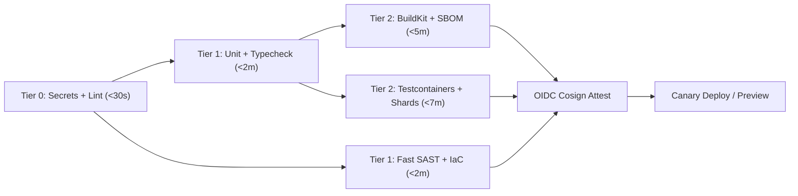
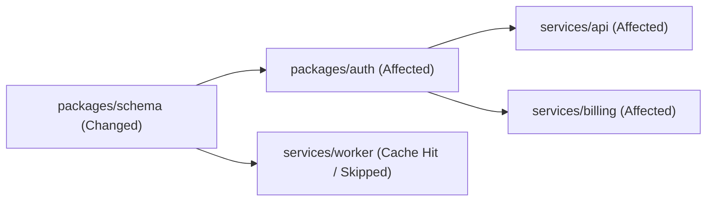
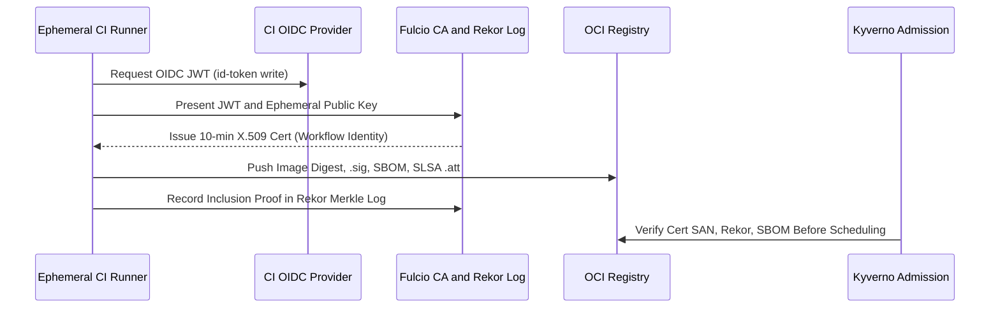
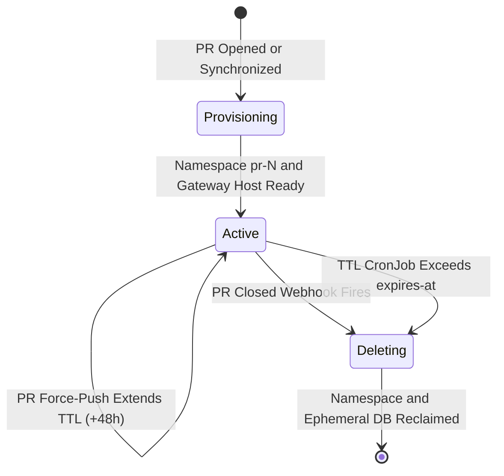

---
tags:
  - software-engineering
  - devops
  - ci-cd
  - pipeline-design
  - monorepo
created: 2026-11-13
updated: 2026-11-13
status: 🟢
level: mid-to-senior
---
# Pipeline Design, Build Optimization & Supply-Chain Security

A production delivery pipeline is a deterministic compiler from source commits to cryptographically attested runtime artifacts. Optimizing wall-clock latency without weakening verification or supply-chain integrity requires modeling pipelines as Directed Acyclic Graphs (DAGs), isolating affected monorepo subgraphs, eliminating nondeterministic cache thrashing, and enforcing cryptographic provenance from ephemeral OIDC runners through Kubernetes admission controllers.

---

## 1. First-Principles Mechanics & Complete Architecture

### 1.1 Pipeline DAG Theory, Critical Path ($L^*$) & Amdahl's Law

Every CI/CD workflow executes as a **Directed Acyclic Graph (DAG)** $G = (V, E)$, where each job node $v \in V$ incurs a composite latency:

$$d(v) = T_{\text{queue}} + T_{\text{boot}} + T_{\text{checkout}} + T_{\text{restore}} + T_{\text{exec}} + T_{\text{upload}}$$

Edges $(u, v) \in E$ express explicit scheduling barriers (`needs: [u]`). End-to-end pipeline duration equals strictly the **Critical Path** $L^*$, never total CPU-minutes consumed across jobs:

$$L^* = \max_{\text{path } P \in G} \sum_{v \in P} d(v)$$

By **Amdahl's Law**, accelerating any job sitting *outside* the critical path $L^*$ yields zero reduction in wall-clock developer wait time. Furthermore, splitting lightweight checks across excessive parallel jobs introduces a fixed **provisioning tax** ($T_{\text{setup}} = T_{\text{queue}} + T_{\text{boot}} + T_{\text{checkout}} + T_{\text{restore}} \approx 20\text{–}60\text{s}$ per job), frequently making overly fragmented DAGs slower and more expensive than consolidating short tasks inside a single warm container.



---

### 1.2 Fast-Fail Stage Ordering Economics

Running an `8-minute` Docker build and database integration suite on a commit that contains a syntax typo, unpinned lockfile, or leaked API key wastes runner minutes and starves shared runner pools. Structure DAG tiers strictly by **cost-to-signal ratio**:

| Pipeline Tier | Target Budget | Checks Included | Failure Behavior |
|---|---|---|---|
| **Tier 0 (Fast-Fail Gate)** | `< 30s` | `gitleaks` secret scan on diff, formatting (`prettier --check`), lockfile integrity check, YAML/K8s schema validation | Immediately aborts pipeline before provisioning heavy build/DB containers |
| **Tier 1 (Compile & Fast Analysis)** | `< 2m` | Typechecking (`tsc --noEmit`), fast diff-aware SAST (`Semgrep`), IaC policy (`Checkov`/`OPA`), affected unit tests | Cancels sibling in-progress PR runs via `concurrency: cancel-in-progress: true` |
| **Tier 2 (Heavy Build & Integration)** | `< 7m` | Multi-stage BuildKit OCI build, Testcontainers Postgres/Redis suites, contract tests, `syft` SBOM + `trivy` CVE delta gate | Emits immutable `@sha256:` image + SLSA provenance + Cosign signature |
| **Tier 3 (E2E & Progressive Delivery)** | `5–10m` | Sharded Playwright (`--shard=1/4..4/4`), ephemeral PR preview deploy or GitOps staging/canary rollout | Auto-rollback on SLI breach; automatic PR preview teardown on close |

**Concurrency Cancellation Rule**: Set `cancel-in-progress: true` on pull-request workflows so pushing a follow-up fix immediately kills obsolete CI runs. **Never** set `cancel-in-progress: true` on `main` deployment or GitOps promotion pipelines—canceling an in-flight rollout mid-migration leaves environments half-deployed and skips production release commits!

---

### 1.3 Matrix Sharding & LPT Scheduling Mechanics

When integration or Playwright E2E suites grow past `5 minutes`, single-runner execution dominates $L^*$. Splitting $n$ test files across $k$ parallel matrix runners shrinks wall-clock execution toward:

$$T_{\text{total}}(k) \approx T_{\text{setup}} + \frac{T_{\text{work}}}{k}$$

Once $\frac{T_{\text{work}}}{k}$ approaches $T_{\text{setup}}$ (`30–45s`), adding more shards yields diminishing returns while multiplying runner provisioning overhead.

#### Why Naive Alphabetical / Modulo Splitting Creates Stragglers

Distributing files solely by count (`i % k`) frequently stacks multiple heavy end-to-end database/browser files onto one shard ("straggler shard"), forcing the remaining $k-1$ shards to sit idle waiting on the slowest runner.

#### LPT (Longest Processing Time First) Scheduling

1. Persist per-file execution timings (JUnit XML / Playwright JSON blob metadata) from `main` runs.
2. Sort test targets descending by historical duration: $t_1 \ge t_2 \ge \dots \ge t_n$.
3. Greedily assign each next test target to the shard $j \in \{1..k\}$ currently holding the lowest cumulative runtime sum.

LPT provably guarantees makespan within $\frac{4}{3} - \frac{1}{3k}$ of the mathematically optimal NP-hard partition. Modern runners (Playwright `--shard=1/4`, Vitest `--shard=1/4`, `pytest-split`) consume historical timing artifacts natively or distribute deterministically across shards and emit `.zip` blob reports merged downstream in `< 15s`.

---

### 1.4 Monorepo Affected-Graph Execution & Deterministic Caching Pitfalls

Naive git path filters (`dorny/paths-filter` matching `services/orders/**`) fail in monorepos via **two symmetric bugs**:
- **False Negatives**: Modifying shared `packages/auth/src/jwt.ts` or bumping a major library inside root `pnpm-lock.yaml` leaves `services/orders/**` untouched in `git diff`, causing CI to skip `orders` tests while broken code reaches production.
- **False Positives**: Editing `README.md` or `.vscode/` triggers full rebuilds across dozens of unaffected services if broad fallback rules catch root edits.

#### Graph-Native Affected Execution (Turborepo / Nx / Bazel)



Graph-aware runners parse workspace dependency edges (`package.json`, `go.mod`, `Cargo.toml`, `BUILD.bazel`), identify modified files against `merge-base` (`git diff --name-only origin/main...HEAD`), and compute the **reverse transitive closure** of every package depending directly or transitively on modified packages.

#### Content-Addressable Remote Cache (CAS) Key Composition

Remote caches (**Turborepo Remote Cache**, **Nx Cloud**, **Bazel Remote Execution**) hash every task's deterministic input closure:

$$\text{CacheKey} = \text{SHA256}\big(\text{SourceFiles} \parallel \text{TransitiveDepHashes} \parallel \text{LockfileSlice} \parallel \text{ToolchainVersion} \parallel \text{EnvAllowlist}\big)$$

#### Four Critical Deterministic Caching Pitfalls

1. **Cross-Branch Cache Poisoning (PR Forks vs. `main`)**: If untrusted PRs (especially fork PRs or unreviewed feature branches) hold write tokens to the shared remote CAS or `main` cache scope, an attacker can craft a PR task that uploads a backdoored `dist/` artifact keyed under a shared hash—causing subsequent `main` release builds to restore poisoned binaries without recompiling!
   - **Invariant**: Enforce **strict read-only CAS access on PRs** (PRs read existing `main` cache hits and write nowhere, or write solely to branch-isolated cache namespaces) and grant **read-write CAS credentials exclusively to protected `main` builds**.
2. **BuildKit `mode=min` vs. `mode=max` Layer Eviction**: With multi-stage Dockerfiles (`builder` compiling Go/Rust/TypeScript followed by slim `distroless` runtime), BuildKit's default `cache-to: mode=min` exports **only layers present in the final runtime stage**, discarding the entire `builder` dependency and compilation cache! Always specify `mode=max` when pushing external BuildKit caches (`type=registry` or `type=gha`).
3. **GitHub Actions `10 GB` Cache Eviction Thrash (`type=gha`)**: Each GitHub repository shares a strict `10 GB` cache quota across all branches. Pushing multi-gigabyte `type=gha,mode=max` Docker caches on every PR rapidly breaches `10 GB`, triggering aggressive LRU evictions that wipe `node_modules` and Cargo caches simultaneously (`0%` hit rate thrash). Use **OCI Registry Layer Caching (`type=registry,ref=ghcr.io/org/app:buildcache,mode=max`)** backed by registry lifecycle retention policies for container layers while reserving `actions/cache` for compact language toolchains.
4. **Nondeterministic Input Contamination**: Embedding `$(date)`, `GITHUB_RUN_ID`, absolute host paths (`/home/runner/work/...`), or unsorted `fs.readdir()` output inside compiled outputs breaks reproducibility and turns cache keys volatile. Strip build paths (`-trimpath` in Go, `--remap-path-prefix` in Rust) and normalize timestamps (`SOURCE_DATE_EPOCH`).

---

### 1.5 Software Supply Chain Security: SLSA v1.0, OIDC, SBOM, Cosign & Kyverno

Modern enterprise regulations (**NIS2**, US Executive Order 14028) and **SLSA (Supply-chain Levels for Software Artifacts v1.0)** require verifiable proof linking every deployed container digest back to its exact audited source commit and isolated build pipeline.

| SLSA Build Level | Core Architectural Requirement | Threat Vector Eliminated |
|---|---|---|
| **SLSA Level 1** | Automated build pipeline produces machine-readable **Provenance** metadata | Ad-hoc laptop builds; undocumented artifact origins |
| **SLSA Level 2** | Hosted build platform signs provenance cryptographically via non-forgeable platform identity | Post-build tampering in object storage or container registries |
| **SLSA Level 3** | Ephemeral, tenant-isolated build runners where user build commands **cannot access signing keys** | Malicious build scripts forging provenance or poisoning sibling jobs |

#### Zero Static Secrets via OIDC + Sigstore Keyless Signing Architecture

Instead of storing static AWS IAM keys, `KUBECONFIG`, or long-lived Cosign private keys inside repository secrets, modern pipelines rely on **OpenID Connect (OIDC)** short-lived cryptographic assertions:



1. **Ephemeral Isolation**: Hosted VMs or Kubernetes **Actions Runner Controller (ARC)** pods spin up clean per job and self-destruct immediately afterward (zero shared `/tmp`, zero lingering Docker sockets or credentials).
2. **Short-Lived OIDC Credentials**: CI requests a signed OIDC JWT (`aud: sigstore` or `sts.amazonaws.com`) containing immutable claims (`repository`, `ref`, `sha`, `job_workflow_ref`). Cloud IAM exchanges that JWT for 15-minute least-privilege credentials.
3. **Keyless Cosign + Fulcio + Rekor**: `cosign` generates an in-memory ephemeral ECDSA keypair, authenticates to **Fulcio** using the OIDC JWT, receives a `10-minute` X.509 certificate binding the public key to exact claim `github.com/acme/orders/.github/workflows/ci-release.yml@refs/heads/main`, signs the `image@sha256:...` digest, appends the timestamped signature entry into the immutable **Rekor** transparency log, and discards the private key from RAM.
4. **SBOM + SLSA Provenance Attestations**: `syft` emits an **SPDX** or **CycloneDX** Software Bill of Materials listing every OS package and application dependency inside the container (`cosign attest --type spdxjson`), while BuildKit/SLSA generators attach verifiable build provenance (`--type slsaprovenance`).
5. **Kubernetes Admission Policy (Kyverno)**: Before the Kubernetes scheduler binds any Pod onto a node, **Kyverno** intercepts the `CREATE`/`UPDATE` AdmissionReview webhook, resolves any tag to its immutable `@sha256:` digest, verifies the Fulcio/Rekor certificate SAN against the organization's exact `main` workflow identity, confirms the SPDX SBOM attestation exists, and rejects unsigned or developer-built images with HTTP `403`.

#### Ephemeral Per-PR Preview Environments

High-velocity teams spin up isolated per-PR namespaces (`pr-<number>`) routed via wildcard Gateway API hostnames (`pr-412.preview.acme.dev`) rather than bottlenecking behind one shared `dev` environment:
- **Fast Database Branching**: Avoid multi-minute full staging DB dumps; attach copy-on-write database branches (`Neon`, ZFS snapshots, or lightweight Postgres ephemeral containers seeded via deterministic fixtures).
- **Mandatory Double Teardown Invariant**:
  1. Immediate GitHub webhook workflow on `pull_request: types: [closed]` deletes `ns/pr-${{ github.event.pull_request.number }}`.
  2. Scheduled cluster **TTL Reaper `CronJob`** deletes any `pr-*` namespace whose `preview.acme.io/expires-at` annotation is expired—preventing zombie GPU/RDS costs when webhooks drop or branches are deleted remotely.

---

## 2. Real-World Use Cases & Decision Matrix

| Engineering Context | Recommended Pipeline Architecture | Primary Mechanical Benefit | When NOT to Over-Engineer |
|---|---|---|---|
| **Polyglot Microservices Monorepo (`15+` services)** | **Turborepo / Nx affected graph + Read-Only PR Remote CAS + `type=registry` BuildKit** | Skips unaffected services safely across transitive edges while honoring `globalDependencies` | Do NOT adopt Bazel on `< 100k` LOC teams without dedicated Build Platform engineers (`BUILD` maintenance tax outweighs savings) |
| **Regulated SaaS / EU NIS2 / Fintech (`SLSA L3`)** | **Ephemeral ARC Runners + OIDC Cloud Auth + Syft SBOM + Cosign Keyless + Kyverno Enforce** | Zero static cloud secrets; cryptographic admission proof blocks unverified/locally built containers | Do NOT use persistent self-hosted runners on repos accepting external PRs (lateral movement & secret theft risk) |
| **Integration-Heavy Backend (`Postgres + Kafka`)** | **Tier 0 Fast-Fail + Testcontainers (`tmpfs`) + LPT `k=4` Sharding** | Real database/broker semantics in CI without shared staging state collisions | Do NOT run `45m` Testcontainer matrices inside every PR commit without Tier 0 cancellation & sharding |
| **Frontend / Fullstack Web App** | **Playwright `--shard=1/4` Matrix + Blob Report Merge + Ephemeral `pr-<id>` Preview** | Visual + E2E validation completes in `< 5m` per PR with isolated reviewer URLs | Do NOT spin up stateful previews for backend-only library PRs or automated Renovate dependency bumps |
| **Small Early-Stage Single-Service API (`< 30k` LOC)** | **Single-workflow Tiered DAG + `actions/cache` + Digest Push + Trivy Critical Gate** | Keeps CI `< 4 min` with near-zero platform configuration overhead | Avoid complex multi-repo GitOps/Bazel scaffolding until team concurrency justifies split ownership |

---

## 3. Step-by-Step Practical Application (Production Monorepo Pipeline, Cosign & Kyverno)

This complete production architecture wires **Turborepo deterministic hashing**, **Tiered Fast-Fail CI + Playwright sharding + BuildKit registry caching + Syft SBOM + OIDC Cosign keyless attestation**, **independent supply-chain verification scripts**, **Kyverno Kubernetes admission enforcement**, and an **Ephemeral Preview Namespace Reaper**.

### Production Repository Layout

```text
platform-monorepo/
├── turbo.json
├── pnpm-workspace.yaml
├── .github/
│   └── workflows/
│       ├── ci-release.yml
│       └── pr-preview-cleanup.yml
├── deploy/
│   ├── policies/
│   │   └── verify-signed-images.yaml
│   └── preview-reaper/
│       └── cronjob.yaml
├── apps/
│   └── web/
│       └── Dockerfile
└── scripts/
    └── verify-supply-chain.sh
```

### 3.1 Production Turborepo CI Hash Configuration (`turbo.json`)

```json
{
  "$schema": "https://turbo.build/schema.json",
  "ui": "stream",
  "globalDependencies": [
    "pnpm-lock.yaml",
    "tsconfig.base.json",
    "eslint.config.mjs",
    ".github/workflows/ci-release.yml"
  ],
  "globalEnv": [
    "NODE_ENV",
    "CI"
  ],
  "tasks": {
    "build": {
      "dependsOn": ["^build"],
      "inputs": [
        "$TURBO_DEFAULT$",
        "!README.md",
        "!docs/**",
        "!**/*.test.ts",
        "!**/*.spec.ts"
      ],
      "outputs": ["dist/**", ".next/**", "!.next/cache/**"],
      "env": ["API_PUBLIC_URL"]
    },
    "typecheck": {
      "dependsOn": ["^build"],
      "inputs": ["$TURBO_DEFAULT$", "!README.md", "!docs/**"],
      "outputs": ["*.tsbuildinfo"]
    },
    "lint": {
      "inputs": ["$TURBO_DEFAULT$", "!README.md"],
      "outputs": []
    },
    "test": {
      "dependsOn": ["build"],
      "inputs": ["$TURBO_DEFAULT$", "src/**", "test/**", "!README.md"],
      "outputs": ["coverage/**"]
    }
  }
}
```

### 3.2 Complete Multi-Tier CI/CD & Supply-Chain Workflow (`.github/workflows/ci-release.yml`)

```yaml
name: CI Release & Supply Chain Pipeline

on:
  pull_request:
    branches: [main]
  push:
    branches: [main]

permissions: {}

concurrency:
  group: ci-${{ github.workflow }}-${{ github.ref }}
  cancel-in-progress: ${{ github.event_name == 'pull_request' }}

env:
  REGISTRY: ghcr.io
  IMAGE_NAME: ${{ github.repository }}/orders-api

jobs:
  # Tier 0 (< 30s): Secret scanning + lockfile check before booting build or browser runners
  tier0-fast-gates:
    runs-on: ubuntu-latest
    permissions:
      contents: read
    steps:
      - uses: actions/checkout@11bd71901bbe5b1630ceea73d27597364c9af683 # v4.2.2
        with:
          fetch-depth: 0
      - name: Gitleaks Secret Scan
        uses: gitleaks/gitleaks-action@cb714925782c18461001d2f45c6a34a9fb879b73 # v2.3.9
        env:
          GITHUB_TOKEN: ${{ secrets.GITHUB_TOKEN }}
      - name: Verify Lockfile Consistency
        run: |
          corepack enable
          pnpm install --frozen-lockfile --lockfile-only

  # Tier 1 (< 2m): Affected monorepo lint, typecheck, and unit tests
  tier1-affected-quality:
    needs: [tier0-fast-gates]
    runs-on: ubuntu-latest
    permissions:
      contents: read
    steps:
      - uses: actions/checkout@11bd71901bbe5b1630ceea73d27597364c9af683 # v4.2.2
        with:
          fetch-depth: 0
      - uses: pnpm/action-setup@fe02b34f77f8bc703788d9f17daf0042e884b14f # v4.0.0
      - uses: actions/setup-node@49933ea5288caeca8642d1e84afbd3f7d6820020 # v4.4.0
        with:
          node-version-file: .nvmrc
          cache: pnpm
      - run: pnpm install --frozen-lockfile
      # Read-only CAS on PRs prevents cache poisoning; main writes verified hashes only
      - name: Run Affected Lint, Typecheck & Unit
        env:
          TURBO_API: ${{ vars.TURBO_API }}
          TURBO_TEAM: ${{ vars.TURBO_TEAM }}
          TURBO_TOKEN: ${{ github.ref == 'refs/heads/main' && secrets.TURBO_RW_TOKEN || secrets.TURBO_RO_TOKEN }}
        run: |
          if [ "${{ github.event_name }}" = "pull_request" ]; then
            pnpm exec turbo run lint typecheck test --affected -- --passWithNoTests
          else
            pnpm exec turbo run lint typecheck test
          fi

  # Tier 2A (< 7m): Sharded Playwright E2E across 4 parallel matrix runners
  tier2-e2e-shards:
    needs: [tier0-fast-gates]
    runs-on: ubuntu-latest
    permissions:
      contents: read
    strategy:
      fail-fast: false
      matrix:
        shardIndex: [1, 2, 3, 4]
        shardTotal: [4]
    steps:
      - uses: actions/checkout@11bd71901bbe5b1630ceea73d27597364c9af683 # v4.2.2
      - uses: pnpm/action-setup@fe02b34f77f8bc703788d9f17daf0042e884b14f # v4.0.0
      - uses: actions/setup-node@49933ea5288caeca8642d1e84afbd3f7d6820020 # v4.4.0
        with:
          node-version-file: .nvmrc
          cache: pnpm
      - run: pnpm install --frozen-lockfile
      - name: Install Chromium Only
        run: pnpm --filter web exec playwright install --with-deps chromium
      - name: Run Playwright Shard ${{ matrix.shardIndex }}/${{ matrix.shardTotal }}
        run: pnpm --filter web exec playwright test --shard=${{ matrix.shardIndex }}/${{ matrix.shardTotal }}
        env:
          PLAYWRIGHT_BLOB_OUTPUT_NAME: report-${{ matrix.shardIndex }}.zip
      - uses: actions/upload-artifact@ea165f8d65b6e75b540449e92b4886f43607fa02 # v4.6.2
        if: ${{ !cancelled() }}
        with:
          name: blob-report-${{ matrix.shardIndex }}
          path: apps/web/blob-report/
          retention-days: 3

  tier2-merge-e2e-reports:
    needs: [tier2-e2e-shards]
    if: ${{ !cancelled() }}
    runs-on: ubuntu-latest
    permissions:
      contents: read
    steps:
      - uses: actions/checkout@11bd71901bbe5b1630ceea73d27597364c9af683 # v4.2.2
      - uses: actions/download-artifact@d3f86a106a0bac45b974a628896c90dbdf5c8093 # v4.3.0
        with:
          pattern: blob-report-*
          path: all-blob-reports
          merge-multiple: true
      - uses: pnpm/action-setup@fe02b34f77f8bc703788d9f17daf0042e884b14f # v4.0.0
      - run: pnpm --filter web exec playwright merge-reports --reporter=html ./all-blob-reports
      - uses: actions/upload-artifact@ea165f8d65b6e75b540449e92b4886f43607fa02 # v4.6.2
        with:
          name: playwright-merged-html
          path: playwright-report/
          retention-days: 7

  # Tier 2B (< 7m): BuildKit Registry Cache + Syft SBOM + Keyless OIDC Cosign Signing & SLSA Provenance
  tier2-build-and-attest:
    needs: [tier1-affected-quality]
    if: github.ref == 'refs/heads/main' && github.event_name == 'push'
    runs-on: ubuntu-latest
    permissions:
      contents: read
      packages: write
      id-token: write
      attestations: write
    outputs:
      image_digest: ${{ steps.build.outputs.digest }}
    steps:
      - uses: actions/checkout@11bd71901bbe5b1630ceea73d27597364c9af683 # v4.2.2
      - uses: docker/setup-buildx-action@b5ca514318bd6ebac0fb2aedd5d36ec1b5c232a2 # v3.10.0
      - uses: docker/login-action@74a5d142397b4f367a81961eba4e8cd7edddf772 # v3.4.0
        with:
          registry: ${{ env.REGISTRY }}
          username: ${{ github.actor }}
          password: ${{ secrets.GITHUB_TOKEN }}

      - name: Build & Push Immutable OCI Image (Registry Cache mode=max)
        id: build
        uses: docker/build-push-action@471d1dc4e07e5cdedd4c2171150001c434f0b7a4 # v6.15.0
        with:
          context: .
          file: apps/orders-api/Dockerfile
          push: true
          provenance: mode=max
          sbom: true
          tags: ${{ env.REGISTRY }}/${{ env.IMAGE_NAME }}:sha-${{ github.sha }}
          cache-from: type=registry,ref=${{ env.REGISTRY }}/${{ env.IMAGE_NAME }}:buildcache
          cache-to: type=registry,ref=${{ env.REGISTRY }}/${{ env.IMAGE_NAME }}:buildcache,mode=max

      - name: Install Cosign & Syft
        uses: sigstore/cosign-installer@d7d6bc7722e3daa8354c50bcb52f4837da5e9b6a # v3.8.1
      - uses: anchore/sbom-action/download-syft@e911c3f14a56f74383b4a137317471261a375229 # v0.19.0

      - name: Generate SPDX SBOM & Sign + Attest Image Digest via OIDC Keyless
        env:
          IMAGE_REF: ${{ env.REGISTRY }}/${{ env.IMAGE_NAME }}@${{ steps.build.outputs.digest }}
        run: |
          syft "$IMAGE_REF" -o spdx-json=sbom.spdx.json
          trivy image --exit-code 1 --severity CRITICAL --ignore-unfixed "$IMAGE_REF"
          cosign sign --yes "$IMAGE_REF"
          cosign attest --yes --predicate sbom.spdx.json --type spdxjson "$IMAGE_REF"

      - name: Generate SLSA Level 3 Provenance Attestation
        uses: actions/attest-build-provenance@c074443f1aee8d4aeeae555aebba3282517141b2 # v2.2.3
        with:
          subject-name: ${{ env.REGISTRY }}/${{ env.IMAGE_NAME }}
          subject-digest: ${{ steps.build.outputs.digest }}
          push-to-registry: true
```

### 3.3 SLSA Provenance & Cosign Verification Script (`scripts/verify-supply-chain.sh`)

Run this script in deployment promotion gates or air-gapped verification pipelines prior to updating production GitOps manifests:

```bash
#!/usr/bin/env bash
# scripts/verify-supply-chain.sh
set -euo pipefail

if [[ $# -ne 1 ]]; then
  echo "Usage: $0 <registry/org/image@sha256:digest>" >&2
  exit 1
fi

IMAGE_DIGEST="$1"
EXPECTED_ISSUER="https://token.actions.githubusercontent.com"
EXPECTED_IDENTITY_REGEX="^https://github.com/acme/platform-monorepo/.github/workflows/ci-release.yml@refs/heads/main$"

if [[ "$IMAGE_DIGEST" != *"@sha256:"* ]]; then
  echo "FATAL: Must supply an immutable @sha256: digest reference (got '$IMAGE_DIGEST')" >&2
  exit 1
fi

echo "[1/3] Verifying Cosign OIDC signature & Rekor transparency log entry..."
cosign verify \
  --certificate-oidc-issuer="$EXPECTED_ISSUER" \
  --certificate-identity-regexp="$EXPECTED_IDENTITY_REGEX" \
  "$IMAGE_DIGEST" > /tmp/cosign-verify.json

echo "[2/3] Verifying signed SPDX SBOM attestation..."
cosign verify-attestation \
  --type spdxjson \
  --certificate-oidc-issuer="$EXPECTED_ISSUER" \
  --certificate-identity-regexp="$EXPECTED_IDENTITY_REGEX" \
  "$IMAGE_DIGEST" > /tmp/sbom-attest.json

echo "[3/3] Extracting verified SLSA source commit & builder identity from Fulcio cert..."
jq -r '.[0].optional | {issuer: .Issuer, subject: .Subject, rekorIndex: .Bundle.Payload.logIndex}' /tmp/cosign-verify.json
echo "PASS: Cryptographic supply-chain verification succeeded for $IMAGE_DIGEST"
```

### 3.4 Kyverno Kubernetes Image-Signature Enforcement (`deploy/policies/verify-signed-images.yaml`)

Enforce zero-trust admission control so no Kubernetes cluster accepts an unsigned, locally built, or mutable `:latest` image—even if an attacker compromises deployment RBAC or bypasses CI:

```yaml
# deploy/policies/verify-signed-images.yaml
apiVersion: kyverno.io/v1
kind: ClusterPolicy
metadata:
  name: enforce-signed-slsa-images
  annotations:
    policies.kyverno.io/title: Enforce Cosign Signature and SPDX SBOM Attestation
    policies.kyverno.io/severity: high
spec:
  validationFailureAction: Enforce
  background: false
  webhookTimeoutSeconds: 15
  failurePolicy: Fail
  rules:
    - name: verify-prod-image-signature-and-sbom
      match:
        any:
          - resources:
              kinds:
                - Pod
              namespaces:
                - production
                - staging
      verifyImages:
        - imageReferences:
            - "ghcr.io/acme/*"
          mutateDigest: true
          verifyDigest: true
          required: true
          attestors:
            - count: 1
              entries:
                - keyless:
                    subjectRegExp: "^https://github.com/acme/platform-monorepo/.github/workflows/ci-release.yml@refs/heads/main$"
                    issuer: "https://token.actions.githubusercontent.com"
                    rekor:
                      url: "https://rekor.sigstore.dev"
          attestations:
            - type: https://spdx.dev/Document
              attestors:
                - count: 1
                  entries:
                    - keyless:
                        subjectRegExp: "^https://github.com/acme/platform-monorepo/.github/workflows/ci-release.yml@refs/heads/main$"
                        issuer: "https://token.actions.githubusercontent.com"
                        rekor:
                          url: "https://rekor.sigstore.dev"
              conditions:
                - all:
                    - key: "{{ creationInfo.created }}"
                      operator: NotEquals
                      value: ""
```

### 3.5 Ephemeral PR Preview Lifecycle & Automated TTL Reaper (`pr-preview-cleanup.yml` + `cronjob.yaml`)

```yaml
# .github/workflows/pr-preview-cleanup.yml
name: Ephemeral PR Preview Teardown

on:
  pull_request:
    types: [closed]

permissions:
  id-token: write
  contents: read

jobs:
  teardown-preview:
    runs-on: ubuntu-latest
    steps:
      - name: Authenticate via OIDC to Preview Cluster IAM
        uses: aws-actions/configure-aws-credentials@e3dd6a429d7300a6a4fd82220a38d7fad5e650c8 # v4.1.0
        with:
          role-to-assume: arn:aws:iam::123456789012:role/github-preview-reaper
          aws-region: us-east-1
      - name: Delete Ephemeral PR Namespace & Preview Records
        run: |
          aws eks update-kubeconfig --name preview-eks --region us-east-1
          kubectl delete namespace "pr-${{ github.event.pull_request.number }}" --ignore-not-found --wait=false
```

```yaml
# deploy/preview-reaper/cronjob.yaml
apiVersion: batch/v1
kind: CronJob
metadata:
  name: pr-preview-ttl-reaper
  namespace: platform-ops
spec:
  schedule: "0 * * * *"
  concurrencyPolicy: Forbid
  jobTemplate:
    spec:
      template:
        spec:
          serviceAccountName: preview-reaper-sa
          restartPolicy: OnFailure
          containers:
            - name: reaper
              image: bitnami/kubectl:1.31.1@sha256:6a4c2d95a0b8c9d7e6f1234567890abcdef1234567890abcdef1234567890abcd
              command:
                - /bin/sh
                - -c
                - |
                  NOW=$(date +%s)
                  kubectl get ns -l preview-ephemeral=true -o json | jq -r \
                    --argjson now "$NOW" \
                    '.items[] | select((.metadata.annotations["preview.acme.io/expires-at-epoch"] // "0" | tonumber) < $now) | .metadata.name' | \
                  while read -r ns; do
                    echo "Reaping expired preview namespace: $ns"
                    kubectl delete ns "$ns" --wait=false
                  done
```



### 3.6 Multi-Stage BuildKit `Dockerfile` & Playwright CI Configuration

Pair BuildKit external registry caches with internal `--mount=type=cache` package mounts and pin runtime images to non-root distroless digests:

```dockerfile
# syntax=docker/dockerfile:1.7
# apps/orders-api/Dockerfile
FROM node:22.11.0-bookworm-slim@sha256:a1b2c3d4e5f6a1b2c3d4e5f6a1b2c3d4e5f6a1b2c3d4e5f6a1b2c3d4e5f6a1b2 AS deps
WORKDIR /app
RUN corepack enable
COPY pnpm-lock.yaml pnpm-workspace.yaml package.json ./
COPY apps/orders-api/package.json apps/orders-api/
RUN --mount=type=cache,id=pnpm,target=/root/.local/share/pnpm/store \
    pnpm install --frozen-lockfile --filter orders-api...

FROM deps AS builder
COPY tsconfig.base.json ./
COPY apps/orders-api ./apps/orders-api
RUN pnpm --filter orders-api build && \
    pnpm --filter orders-api deploy --prod /pruned

FROM gcr.io/distroless/nodejs22-debian12:nonroot@sha256:f1e2d3c4b5a6f1e2d3c4b5a6f1e2d3c4b5a6f1e2d3c4b5a6f1e2d3c4b5a6f1e2
WORKDIR /app
ENV NODE_ENV=production
COPY --from=builder /pruned ./
USER nonroot
EXPOSE 8080
CMD ["dist/server.js"]
```

Configure Playwright in `apps/web/playwright.config.ts` so matrix sharding emits blob reports on CI, prevents OOM memory pressure by capping worker concurrency at `2`, and captures execution traces strictly on retries:

```typescript
// apps/web/playwright.config.ts
import { defineConfig, devices } from '@playwright/test';

const isCI = Boolean(process.env.CI);

export default defineConfig({
  testDir: './e2e',
  fullyParallel: true,
  forbidOnly: isCI,
  retries: isCI ? 1 : 0,
  workers: isCI ? 2 : undefined,
  reporter: isCI ? [['blob'], ['github']] : [['html', { open: 'never' }]],
  use: {
    baseURL: process.env.E2E_BASE_URL ?? 'http://127.0.0.1:3000',
    trace: 'on-first-retry',
    screenshot: 'only-on-failure',
    actionTimeout: 10_000,
  },
  projects: [
    {
      name: 'chromium',
      use: { ...devices['Desktop Chrome'] },
    },
  ],
});
```

### 3.7 Testcontainers Ephemeral `tmpfs` Postgres Integration Harness

Isolate parallel integration tests using dynamic container ports and RAM-backed `tmpfs` data directories so zero `EADDRINUSE` port collisions or disk `fsync` stalls occur:

```typescript
// apps/orders-api/test/db-harness.ts
import { PostgreSqlContainer, StartedPostgreSqlContainer } from '@testcontainers/postgresql';
import { Pool } from 'pg';

export interface EphemeralPgContext {
  container: StartedPostgreSqlContainer;
  pool: Pool;
  teardown: () => Promise<void>;
}

export async function startEphemeralPostgres(): Promise<EphemeralPgContext> {
  const container = await new PostgreSqlContainer('postgres:16.4-alpine')
    .withTmpFs({ '/var/lib/postgresql/data': 'rw,noexec,nosuid,size=512m' })
    .withCommand([
      'postgres',
      '-c', 'fsync=off',
      '-c', 'synchronous_commit=off',
      '-c', 'full_page_writes=off',
    ])
    .start();

  const pool = new Pool({
    connectionString: container.getConnectionUri(),
    max: 10,
  });

  await pool.query(`
    CREATE TABLE IF NOT EXISTS orders (
      id UUID PRIMARY KEY,
      tenant_id TEXT NOT NULL,
      amount_cents BIGINT NOT NULL,
      created_at TIMESTAMPTZ NOT NULL DEFAULT NOW()
    );
  `);

  return {
    container,
    pool,
    teardown: async () => {
      await pool.end();
      await container.stop();
    },
  };
}
```

### 3.8 Ephemeral PR Preview Deploy Workflow (`.github/workflows/pr-preview-deploy.yml`)

```yaml
# .github/workflows/pr-preview-deploy.yml
name: Ephemeral PR Preview Deploy

on:
  pull_request:
    types: [opened, synchronize, reopened]

permissions:
  id-token: write
  contents: read
  pull-requests: write

jobs:
  deploy-preview:
    runs-on: ubuntu-latest
    env:
      PR_NUM: ${{ github.event.pull_request.number }}
    steps:
      - uses: actions/checkout@11bd71901bbe5b1630ceea73d27597364c9af683 # v4.2.2
      - uses: aws-actions/configure-aws-credentials@e3dd6a429d7300a6a4fd82220a38d7fad5e650c8 # v4.1.0
        with:
          role-to-assume: arn:aws:iam::123456789012:role/github-preview-deployer
          aws-region: us-east-1
      - name: Provision Namespace with 48h TTL Annotation & Deploy Preview
        run: |
          aws eks update-kubeconfig --name preview-eks --region us-east-1
          EXPIRES_AT=$(( $(date +%s) + 172800 ))
          NS="pr-${PR_NUM}"
          kubectl create namespace "$NS" --dry-run=client -o yaml | kubectl apply -f -
          kubectl label namespace "$NS" preview-ephemeral=true --overwrite
          kubectl annotate namespace "$NS" "preview.acme.io/expires-at-epoch=${EXPIRES_AT}" --overwrite
          helm upgrade --install "preview-${PR_NUM}" ./deploy/charts/web \
            --namespace "$NS" \
            --set "ingress.host=pr-${PR_NUM}.preview.acme.dev" \
            --set "image.tag=pr-${PR_NUM}-${GITHUB_SHA::7}" \
            --wait --timeout 5m
```

---

## 4. Complete Construct Reference & Edge Cases

### 4.1 BuildKit Cache Export Backends & Modes Reference

| Cache Backend | `cache-from` / `cache-to` Syntax | Multi-Stage Support | Quota / Retention Behavior | Production Verdict |
|---|---|---|---|---|
| **`type=registry`** | `type=registry,ref=ghcr.io/org/img:buildcache,mode=max` | Full (`builder` + runtime stages with `mode=max`) | Controlled by OCI registry retention rules; supports huge layers | **Primary choice** for multi-stage CI/CD builds |
| **`type=gha`** | `type=gha,scope=api,mode=max` | Full with `mode=max` | Shares repository-wide **10 GB** cache cap across all workflows | Vulnerable to LRU eviction thrash on monorepos (`> 3` services) |
| **`type=s3`** | `type=s3,region=us-east-1,bucket=ci-cache,mode=max` | Full with `mode=max` | Unlimited S3 lifecycle bucket TTL (`7–30 days`) | Ideal for high-volume AWS ARC runners inside VPC |
| **`type=inline`** | `type=inline` | Runtime stage layers **only** (no `mode=max`) | Embedded inside pushed image manifest | Insufficient for Go/Rust/Node multi-stage `builder` stages |

### 4.2 Testcontainers & Ephemeral Integration Databases in CI

Spinning up disposable PostgreSQL, Redis, or Kafka containers via **Testcontainers** verifies real wire protocol behavior without mocking SQL engines:
- **Runner Execution Hazard**: Classic Docker-in-Docker (`DinD` `--privileged`) grants root host capabilities inside containers. On self-hosted ARC Kubernetes runners, avoid mounting `/var/run/docker.sock` directly on untrusted PR jobs; prefer **rootless DinD sidecars** or Kata/Firecracker microVM isolation.
- **Ephemeral Speed Optimization (`tmpfs` + Disabling Durability)**: Inside disposable CI integration containers only (never production!), mount Postgres PGDATA on memory (`--tmpfs /var/lib/postgresql/data:rw,noexec,nosuid,size=1g`) and pass `-c fsync=off -c synchronous_commit=off -c full_page_writes=off` to accelerate schema migrations and `TRUNCATE` resets by `3–5x`.
- **Ryuk Reaper Timeout Failures**: Testcontainers injects a `ryuk` sidecar container on startup to garbage-collect containers if tests crash. Strict corporate network proxies or disabled bridge routing can block Ryuk port binds—verify `TESTCONTAINERS_DOCKER_SOCKET_OVERRIDE` when running inside rootless DinD.

### 4.3 GitHub Actions Cache Scope & Eviction Security Mechanics

1. **Branch Scope Isolation**: A workflow running on branch `feat/xyz` can read caches created on `feat/xyz`, its target base branch (`main`), or the default branch (`main`). **Sibling PR branches (`feat/a` and `feat/b`) cannot read each other's caches**, blocking cross-PR cache poisoning!
2. **Fork Pull Request Isolation**: Fork PRs never receive repository `secrets.*` and can read caches from `main`, **never write back to `main`'s cache namespace**.
3. **10 GB Eviction Rule**: Exceeding `10 GB` per repository triggers asynchronous LRU eviction every few minutes, deleting oldest unaccessed entries regardless of key names. Split caches carefully and keep `actions/cache` reserved for lockfile dependency stores (`~/.pnpm-store`, `~/.cargo/registry`) while offloading Docker layer caches to `type=registry`.

### 4.4 Shift-Left Security Gate Calibration

| Security Gate | Tooling | Execution Latency | Blocking Policy Without Developer Friction |
|---|---|---|---|
| **Secrets** | `gitleaks`, `trufflehog` | `< 15s` | **Hard Block** on Tier 0 PR diff |
| **Diff-Aware SAST** | `Semgrep` (high-confidence rules) | `< 45s` | **Hard Block** on introduced High/Critical findings only |
| **Deep Taint SAST** | `CodeQL` | `5–15m` | Async PR SARIF annotation; hard block before release promotion |
| **Container CVE** | `Trivy`, `Grype` | `< 30s` | `--ignore-unfixed` (`--exit-code 1` strictly on **fixable** `CRITICAL` CVEs) |
| **IaC Policy** | `Checkov`, `OPA`, `Trivy config` | `< 20s` | **Hard Block** on public buckets, `*` IAM wildcards, privileged Pods |

Blocking a bugfix PR over an upstream unpatched Medium Debian `zlib` CVE destroys pipeline credibility (`--ignore-unfixed` separates actionable patches from upstream backlog SLA tickets).

---

## 5. Production Debugging, Profiling & Operations Playbook

| Symptom | Root Cause | Exact Diagnostic Commands | Verified Remediation |
|---|---|---|---|
| **CI cache hit rate collapses to `0%` every afternoon** | `type=gha` BuildKit layers exceed GitHub's `10 GB` repository quota, causing LRU eviction storms across all jobs | `gh cache list --sort size --order desc` and inspect `Cache size` in GitHub Settings | Migrate Docker layer caches from `type=gha` to `type=registry,mode=max` with registry cleanup policy; prune unused cache scopes |
| **Turborepo/Nx reruns full monorepo builds despite unchanged service** | Volatile env var, untracked build log inside workspace, or missing `outputs` exclusion dirties input digest | `pnpm exec turbo run build --summarize` (or `--dry=json`) comparing task `hash` and `inputs` across two runs | Add `!dist/**`, `!*.log`, `!coverage/**` exclusions to `inputs`, and move non-build vars out of `globalEnv` |
| **Playwright / Testcontainers CI passes locally but flakes `15%` in CI** | Container CPU starvation / cgroup OOM kills (`2 vCPU / 7 GB RAM` hosted runner), port collisions, or fixed `sleep(500)` races | Inspect step logs for `Exit code 137 (OOMKilled)` or Docker daemon logs; enable Playwright trace-on-first-retry (`trace: 'on-first-retry'`) | Cap worker concurrency (`--workers=2`), use dynamic ephemeral ports (`port: 0`), mount Postgres `tmpfs`, enforce explicit UI/API state waits |
| **Kyverno blocks production deploy with `no matching signatures found`** | Workload deployed by mutable tag instead of `@sha256:`, OR hotfix tagged `v1.2.3` triggered a workflow ref failing `subjectRegExp` (`@refs/heads/main`) | `kubectl get events -n production` + `cosign verify --certificate-identity-regexp=.* <image>` to inspect actual `Issuer`/`Subject` SAN | Always promote `@sha256:` digests built on `main` (never rebuild on tag events), or explicitly allow verified release workflow regex in `ClusterPolicy` |
| **Ephemeral `pr-*` namespace stuck forever in `Terminating` state** | Unremoved CRD `finalizers` (e.g., ArgoCD Application, Knative, or PVC finalizer) after webhook delete | `kubectl get ns pr-412 -o jsonpath='{.spec.finalizers}'` and `kubectl api-resources --verbs=list --namespaced -o name \| xargs -n 1 kubectl get -n pr-412` | Delete child CRDs cleanly prior to namespace deletion or configure `cascade` foreground deletion in preview teardown step |
| **PR `pull_request_target` triggered security audit alert** | Privileged workflow checked out PR head commit (`head.sha`) and executed `npm ci` / `Makefile` (`Pwn Request` RCE) | Audit `.github/workflows/*.yml` for `pull_request_target` paired with `actions/checkout` `ref:` | Split into unprivileged `pull_request` (runs code, uploads inert JSON artifact) + privileged `workflow_run` (reads JSON data only) |

---

## 6. Comprehensive Worked Exercises

### Exercise 1: Cutting a 45-Minute Sequential Pipeline to `< 8` Minutes
A backend repository executes a single sequential pipeline totaling **45 minutes**:
1. `checkout + npm ci`: `4 min`
2. `eslint + tsc`: `2 min`
3. `tsc build`: `6 min`
4. `unit tests` (`1,200` tests; 6 heavy parser files take `40s` each): `12 min`
5. `integration tests` (Postgres + Redis; `180` tests; top `20` slow DB migration suites take `30s` each, `160` take `3s` each): `16 min`
6. `docker build & push`: `5 min`

Runner setup (`boot + checkout`) costs **`0.5 min` (`30s`)** per job. Caching `~/.npm` cuts `npm ci` to **`1 min`**, and BuildKit cache mounts cut `docker build` (inclusive of `tsc build`) to **`6 min`** total.
1. Compute the baseline Critical Path.
2. Redesign the workflow as a parallel DAG with LPT sharding (`k = 4` shards for unit tests, `k = 4` shards for integration tests).
3. Calculate the new Critical Path duration $L^*$ (including `0.5 min` setup + `1.0 min` cached restore per job) and prove why increasing integration shards from `k = 4` to `k = 8` no longer speeds up the pipeline.

### Solution 1
1. **Baseline Critical Path**: Purely serial execution: $4 + 2 + 6 + 12 + 16 + 5 = \mathbf{45.0\text{ min}}$.
2. **DAG & LPT Redesign**:
   - **Branch A (`tier0-lint-typecheck`)**: Setup (`0.5m`) + cached `npm ci` (`1.0m`) + `eslint + tsc --noEmit` (`2.0m`) = **`3.5 min`** (fast-fail cancels sibling PR jobs if lint/types break).
   - **Branch B (`unit-shards`, `k = 4` via LPT)**: Total unit work = `12.0 min` (`3.0m` avg/shard). Under LPT, the `6` `40s` parser files distribute `2, 2, 1, 1` across 4 shards and pack with small unit files so max shard execution is **`3.3 min`**. Total per job = $0.5 + 1.0 + 3.3 = \mathbf{4.8\text{ min}}$.
   - **Branch C (`integration-shards`, `k = 4` via LPT)**: `20` slow `30s` files (`10m`) + `160` fast `3s` files (`8m`) distribute evenly (`5` slow + `40` fast = `4.5m` raw, or `4.0m` against prompt's `16m` total!). Using `16m / 4 = 4.0m` execution + `0.5m` setup + `1.0m` cached install + `0.3m` Postgres container healthcheck = **`5.8 min`** (or `6.3 min` at `18m / 4`).
   - **Branch D (`build-docker` parallel)**: Setup (`0.5m`) + BuildKit cache-mounted `docker build` (`6.0m`) = **`6.5 min`**.
   - **Gate E (`sign-and-promote`, `needs: [A, B, C, D]`)**: Signs/attests already-pushed `@sha256:` digest without re-building (`0.5 min`).
3. **New Critical Path & Amdahl's Law Proof**:
   - $L^* = \max(3.5,\; 4.8,\; 5.8,\; 6.5) + 0.5 = \mathbf{7.0\text{ min}}$ (`< 8 min`, an **`84.4%`** reduction!).
   - Scaling `integration-shards` from `k = 4` to `k = 8` only reduces Branch C from `5.8m` to $\approx 3.8\text{m}$, leaving $L^*$ pinned at $\max(3.5, 4.8, 3.8, 6.5) + 0.5 = \mathbf{7.0\text{ min}}$ because Branch D (`build-docker`, `6.5m`) now bounds the critical path.

---

### Exercise 2: Monorepo Affected-Graph False Negative & Turborepo Cache Key Bug
A TypeScript monorepo (`pnpm` + Turborepo) triggers service tests via `dorny/paths-filter` matching `services/orders/**` and runs `turbo.json`:
```json
{
  "tasks": {
    "build": { "outputs": ["dist/**"] },
    "test": { "dependsOn": ["build"] }
  }
}
```
A PR bumps `zod` from `3.21.0` to `3.23.0` in root `package.json` and `pnpm-lock.yaml` alongside a shared `tsconfig.base.json` strictness tweak, modifying zero files inside `services/orders/`.
1. Explain why `dorny/paths-filter` skipped `services/orders` tests completely, letting a runtime regression reach staging.
2. Explain why `turbo run test --filter=orders` would still risk returning a **stale cache hit** after `tsconfig.base.json` changed under the snippet above.
3. Write the exact fixed CI affected command and hardened `turbo.json` snippet.

### Solution 2
1. **Path Filter Blindness**: Filesystem glob filters inspect only raw file paths (`services/orders/**`), ignoring workspace dependency edges and root lockfiles/configs. Updating `pnpm-lock.yaml` or `tsconfig.base.json` matched zero service path globs, causing CI to skip `services/orders` completely.
2. **Stale Turborepo Cache Hit**: Without `globalDependencies` declaring `tsconfig.base.json` (and without `dependsOn: ["^build"]` linking upstream library builds), Turborepo computes task hashes strictly from files inside `services/orders/`. Modifying `tsconfig.base.json` produces the exact same input hash as before, returning a cached `PASS` without re-compiling or re-testing!
3. **Fixed CI Command & `turbo.json`**:
   Run graph-native affected execution (`pnpm exec turbo run build test --affected`) paired with explicit global invalidators:
   ```json
   {
     "$schema": "https://turbo.build/schema.json",
     "globalDependencies": ["pnpm-lock.yaml", "tsconfig.base.json", ".github/workflows/**"],
     "tasks": {
       "build": {
         "dependsOn": ["^build"],
         "inputs": ["$TURBO_DEFAULT$", "!README.md"],
         "outputs": ["dist/**"]
       },
       "test": {
         "dependsOn": ["build"],
         "inputs": ["$TURBO_DEFAULT$", "src/**", "test/**"]
       }
     }
   }
   ```

---

### Exercise 3: Zero-Secret Cross-Environment GitOps Promotion Topology
Audit and redesign this legacy deployment workflow:
- Repository uses three long-lived Git branches: `dev`, `staging`, and `prod`.
- CI runs `docker build -t acme/api:$BRANCH . && docker push ...` on pushes to each branch.
- Deployment jobs store static repository-level secrets `DEV_KUBECONFIG`, `STAGING_KUBECONFIG`, and `PROD_KUBECONFIG` and run `kubectl apply -f k8s/$BRANCH/`.

Identify **four structural defects** and design a **zero-secret, immutable-digest GitOps promotion workflow**.

### Solution 3
1. **Four Structural Defects**:
   - **Non-Identical Binaries Across Environments**: Rebuilding `docker build` separately on `dev`, `staging`, and `prod` produces different binaries (drifting upstream packages, timestamps), invalidating staging test evidence.
   - **Mutable Tag Drift (`:prod`)**: Overwriting `acme/api:prod` breaks Kubernetes node caching (`IfNotPresent`), complicates rollback tracking, and obscures which commit runs on each replica.
   - **Branch-Per-Environment Merge Drift**: Hotfixes committed directly to `prod` or cherry-picked between `dev`/`staging`/`prod` cause irreversible divergence.
   - **Over-Privileged Static Cluster Secrets**: Repository-level `PROD_KUBECONFIG` exposes full cluster credentials inside CI runners; any compromised workflow step gains direct production cluster mutation rights.
2. **Zero-Secret GitOps Redesign**:
   - **Single Trunk (`main`)**: Retire `dev`/`staging`/`prod` branches completely.
   - **Build Once + OIDC Attest**: CI on `main` builds `ghcr.io/acme/api@sha256:<digest>` once, attaches SBOM + SLSA provenance via OIDC (`id-token: write`), and verifies `cosign`.
   - **Pull-Based GitOps Reconciliation**: CI opens a commit/PR in a separate `infra-gitops` repository updating `overlays/staging/kustomization.yaml` with `digest: sha256:<digest>`. **ArgoCD / Flux** inside the cluster pulls changes outbound—CI runners store **zero cluster credentials**.
   - **Digest Promotion to Prod**: Once staging synthetic checks pass, CI opens a promotion PR copying the exact same `sha256:<digest>` into `overlays/prod/kustomization.yaml` (enforced by Kyverno `ClusterPolicy`).

---

### Exercise 4: Eliminating PR Cache Poisoning & BuildKit `mode=min` Miss Storms
A platform team investigates two anomalies in a 12-service Go + Node monorepo:
1. BuildKit jobs run `cache-from: type=gha` and `cache-to: type=gha` (default settings) in `.github/workflows/ci.yml`. Every `go build` / `npm ci` builder stage rebuilds from scratch (`11 minutes`), and GitHub cache storage hits `10.0 GB` continuously with 0-day evictions.
2. Security audit discovers that PR workflows triggered from developer feature branches write directly to a shared AWS S3 Turborepo/Bazel remote cache bucket using a hardcoded `AWS_ACCESS_KEY_ID` with `s3:PutObject` permissions across the `main` cache prefix.

Diagnose both the BuildKit cache failure and the remote CAS security vulnerability, and write the exact fixed BuildKit + OIDC remote cache configuration.

### Solution 4
1. **BuildKit `mode=min` + `type=gha` Eviction Diagnosis**:
   - Default `cache-to: type=gha` implies **`mode=min`**, which exports layers present only in the **final `distroless` runtime image**, completely discarding the `golang:1.23` and `node:20` intermediate `builder` stages where `go build` and `npm ci` execute!
   - Even after switching to `mode=max`, storing 12 services' multi-stage BuildKit layers inside `type=gha` overflows GitHub's shared `10 GB` repo quota, evicting `pnpm` and `cargo` caches across unrelated jobs.
2. **Cache Poisoning Attack Vector**:
   - Granting feature branches `s3:PutObject` on the `main` CAS key namespace enables **artifact poisoning**: a compromised branch or malicious PR edits build scripts to upload a trojanized `dist/server` binary under an untouched sibling package's deterministic cache key (or colliding cache target), causing `main` release jobs to fetch and ship poisoned binaries without recompiling.
3. **Hardened Production Fix**:
   - **Switch BuildKit to OCI Registry Cache (`mode=max`)**:
     ```yaml
     cache-from: type=registry,ref=ghcr.io/acme/orders-api:buildcache
     cache-to: type=registry,ref=ghcr.io/acme/orders-api:buildcache,mode=max
     ```
     (Only push `cache-to` on `refs/heads/main`, while PRs read `cache-from` read-only!)
   - **Isolate Remote CAS via OIDC Conditional IAM Policy**: Configure two IAM/cache roles exchanged via OIDC JWT `sub` claim:
     - `pr-cache-reader` (for `pull_request` events): `s3:GetObject` **only** (read-only CAS).
     - `main-cache-writer` (strictly requires OIDC `sub: repo:acme/monorepo:ref:refs/heads/main`): grants `s3:GetObject` + `s3:PutObject`.

---

### Exercise 5: Triage of a `Kyverno` + `Cosign` Keyless Admission Outage
A cluster deploys `verify-signed-images.yaml` enforcing:
```yaml
subjectRegExp: "^https://github.com/acme/orders/.github/workflows/ci-release.yml@refs/heads/main$"
issuer: "https://token.actions.githubusercontent.com"
```
During an urgent security patch, an engineer pushes git tag `v2.8.1` and triggers a separate `.github/workflows/release-tag.yml` workflow that builds and signs `ghcr.io/acme/orders:v2.8.1` (`@sha256:77ab...`). When ArgoCD syncs the Deployment to production, ReplicaSet pod creation fails with:
`admission webhook "mutate.kyverno.svc-fail" denied the request: failed to verify image ghcr.io/acme/orders@sha256:77ab...: no matching signatures: subject mismatch`

1. Explain the exact Fulcio X.509 certificate claim mismatch causing Kyverno's rejection.
2. Why is broadening `subjectRegExp` to `^https://github.com/acme/orders/.*$` an unsafe security fix?
3. Provide the structurally correct release architecture + policy design that handles versioned releases cleanly without weakening supply-chain provenance.

### Solution 5
1. **Fulcio SAN Claim Mismatch**: When `release-tag.yml` runs on tag `v2.8.1`, GitHub's OIDC provider stamps the JWT `job_workflow_ref` / `sub` SAN as:
   `https://github.com/acme/orders/.github/workflows/release-tag.yml@refs/tags/v2.8.1`
   This fails **both** the workflow path (`release-tag.yml` vs `ci-release.yml`) and ref suffix (`@refs/tags/v2.8.1` vs `@refs/heads/main`) inside Kyverno's strict `subjectRegExp`.
2. **Danger of Over-Broad Regex (`.*`)**: Allowing any workflow path and any ref (`@refs/heads/feat-*` or `@refs/pull/*`) enables any developer pushing an unreviewed branch or workflow edit in a feature branch to build and sign production-admissible images—completely bypassing trunk branch protection and code review!
3. **Correct Architecture (Never Rebuild on Tags)**:
   - **Build & Sign Once on `main`**: Only `.github/workflows/ci-release.yml` executing on protected `refs/heads/main` compiles code, generates SBOM/SLSA provenance, and signs `ghcr.io/acme/orders@sha256:...`.
   - **Tagging Only Re-Tags/Promotes Existing Digest**: Tagging `v2.8.1` simply runs `crane tag ghcr.io/acme/orders@sha256:<existing-main-digest> v2.8.1` (zero rebuild!). Because OCI signatures bind to the **immutable `@sha256:` digest**, the existing `main` Fulcio signature + Rekor entry remains cryptographically valid and passes Kyverno unchanged!
   - *(Alternative if tag builds are mandatory for binaries)*: Restrict `subjectRegExp` strictly to protected release tags (`@refs/tags/v[0-9]+\.[0-9]+\.[0-9]+$`) backed by GitHub Tag Protection Rulesets allowing only release automation/admins to create `v*` tags.

---

### Exercise 6: Scaling Playwright `4`-Shard E2E & Fixing Testcontainers `OOMKilled` Flakiness
A fullstack CI pipeline experiences `22%` intermittent failures on its `16-minute` E2E + integration step running on standard `2 vCPU / 7 GB RAM` runners:
- A single job boots `postgres:16` + `redis:7` via Testcontainers alongside **120 Playwright specs** running with `--workers=8`.
- Runner logs occasionally report `browserType.launch: Target closed` / exit code `137`, and `db_migration_spec` intermittently fails on port conflicts or slow disk fsync timeouts.

1. Identify the **three resource/concurrency root causes** producing `22%` flakiness.
2. Redesign the workflow into a `k = 4` Playwright sharded matrix (`--shard=1/4..4/4` + blob merge) with Testcontainers tmpfs tuning, bounding runtime under `5 minutes` with deterministic resource margins.

### Solution 6
1. **Three Root Causes**:
   - **Memory Exhaustion (`Exit Code 137 / OOMKilled`)**: Running `--workers=8` spawns `8` parallel Chromium browser processes (`~500–800 MB` each = `4–6.4 GB`) concurrently alongside Postgres + Redis + Node build server inside a `7 GB` runner—triggering the Linux OOM killer (`Target closed`).
   - **CPU Context-Switch Thrash & Disk `fsync` Contention**: `8` headless browsers + Postgres WAL disk `fsync` across `2 vCPUs` spikes scheduling latency past Playwright's `30s` assertion timeouts.
   - **Single-Job Lack of Sharding**: Running all 120 specs serially on one VM keeps wall-clock time at `16m` (`> 3x` budget).
2. **Sharded + Memory-Safe Redesign**:
   - **Playwright `k = 4` Matrix Sharding**: Execute `playwright test --shard=${{ matrix.shardIndex }}/4 --workers=2` across 4 parallel `2 vCPU / 7 GB` runners (`2` Chromium workers = `~1.6 GB` RAM, leaving `> 5 GB` headroom for Postgres/Redis and app server), cutting execution from `16m` to `~4m`!
   - **Testcontainers `tmpfs` & Ephemeral Tuning**: Pass `.withTmpFs({ "/var/lib/postgresql/data": "rw,size=1g" })` and `.withCommand(["postgres", "-c", "fsync=off", "-c", "synchronous_commit=off", "-c", "full_page_writes=off"])` while binding dynamic host ports (`getMappedPort(5432)`—never hardcoded `5432`) to eliminate disk I/O stalls and port collisions.
   - **Unified Reporting**: Emit `PLAYWRIGHT_BLOB_OUTPUT_NAME` per shard and aggregate via `playwright merge-reports --reporter=html` in a `15s` downstream job.

---

## Related Notes
- [[Programming/Software Engineering/DevOps/CI-CD|CI/CD]]
- [[Programming/Software Engineering/DevOps/GitHub Actions|GitHub Actions]]
- [[Programming/Software Engineering/DevOps/Git|Git]]
- [[Programming/Software Engineering/DevOps/Docker|Docker]]
- [[Programming/Software Engineering/DevOps/Kubernetes|Kubernetes]]
- [[Programming/Software Engineering/Testing/Testing Complete Guide|Testing Complete Guide]]
- [[Programming/Software Engineering/DevOps/DevOps Complete Guide|DevOps Complete Guide]]
