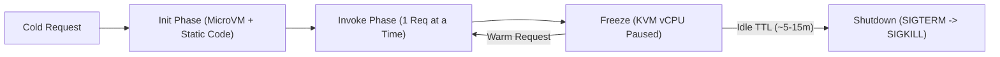
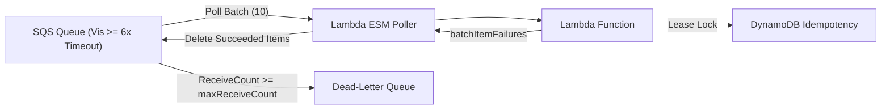

---
tags:
  - software-engineering
  - devops
  - serverless
  - cloud
  - aws-lambda
  - distributed-systems
created: 2026-01-02
updated: 2026-11-13
status: 🟢
level: mid-to-senior
---
# Serverless & FaaS Engineering Handbook

Function-as-a-Service (FaaS) platforms decouple application logic from host capacity management by executing isolated, single-concurrency microVMs on demand and billing strictly per invocation and GB-second of allocated memory. Production serverless engineering requires mastering Firecracker microVM freeze/thaw semantics, cold-start elimination, event-source failure mechanics (`ReportBatchItemFailures`), lease-aware DynamoDB idempotency, database connection-pool multiplexing, timeout alignment across distributed queues/gateways, and quantitative FaaS-vs-container TCO modeling.

> [!abstract] Scope & Vault Context
> This handbook covers Firecracker microVM execution internals, cold-start optimization, SQS/EventBridge reliability patterns, complete production TypeScript handler + DynamoDB idempotency middleware + Vitest tests, RDS Proxy connection pooling, Step Functions orchestration, and TCO break-even derivations. Related vault notes: [[Programming/Software Engineering/DevOps/Cloud Fundamentals|Cloud Fundamentals]], [[Programming/Software Engineering/DevOps/Infrastructure as Code|Infrastructure as Code]], [[Programming/Software Engineering/DevOps/Terraform|Terraform]], [[Programming/Software Engineering/DevOps/Monitoring|Monitoring]], [[Programming/Software Engineering/DevOps/Logging|Logging]], [[Programming/Software Engineering/DevOps/Observability|Observability]], [[Programming/Software Engineering/System Design/Message Queues|Message Queues]], [[Programming/Software Engineering/System Design/Scalability|Scalability]], [[Programming/Software Engineering/Database Design/NoSQL|NoSQL]], and [[Programming/Software Engineering/DevOps/DevOps Complete Guide|DevOps Complete Guide]].

---

## 1. First-Principles Mechanics & Complete Architecture

### 1.1 Firecracker MicroVM Isolation & Lifecycle

AWS Lambda runs every concurrent function instance inside a dedicated **Firecracker microVM**—a minimalist KVM-based Virtual Machine Monitor written in Rust (`< 5 MB` memory overhead per microVM, kernel boot time `~125 ms`). Unlike multi-tenant OS containers sharing a single host Linux kernel namespace, Firecracker enforces strict hardware virtualization boundaries (`KVM` + `jailer` `seccomp`/`cgroup` isolation) between AWS tenants, accounts, and function versions.

Crucially, **each microVM processes strictly one invocation at a time**. Concurrency $N$ means $N$ independent microVMs running simultaneously—never $N$ threads sharing a single Node.js event loop inside one sandbox (unless explicitly opting into multi-threaded internal workers inside an invocation).



#### Three Execution Phases & Runtime API Protocol

1. **Init Phase (Runs Once Per MicroVM Instance):**
   - **Extension Init:** Starts external/internal Lambda Extensions (`/opt/extensions`) such as OpenTelemetry collectors or secrets caching agents.
   - **Runtime Init:** Bootstraps the language runtime (Node.js V8, Python CPython, JVM, Go/Rust binary).
   - **Function Static Init:** Evaluates module-level code *outside* `handler()`—loading AWS SDK clients, initializing TLS connection pools, parsing environment variables. Standard invocations enforce a hard **`10 s` Init timeout** (Provisioned Concurrency and SnapStart allow up to `15 min` during initialization).
2. **Invoke Phase (Per Request, Max `900 s` / `15 min`):**
   - The runtime communicates over loopback HTTP (`127.0.0.1:9001`) with the **Lambda Runtime API**: calling `GET /2018-06-01/runtime/invocation/next`, executing `handler(event, context)`, and posting results to `/invocation/<AwsRequestId>/response` or `/error`.
   - **Freeze / Thaw Suspension Trap:** Immediately after an `async` handler resolves (or `callback` completes with `callbackWaitsForEmptyEventLoop = false`), Firecracker suspends the microVM's vCPU via KVM. Any unawaited background promises (`fetch()`, `setTimeout`, async telemetry flushes, unawaited DB writes) freeze mid-flight in RAM. They either resume corrupting a *future* invocation minutes later (potentially with stale auth context) or vanish permanently upon microVM shutdown!
   - **Legacy Callback Event-Loop Trap:** In Node.js non-`async` callback handlers (`(event, context, callback) => ...`), Lambda waits until the entire Node.js event loop drains before returning the HTTP response unless `context.callbackWaitsForEmptyEventLoop = false` is set. Holding an open global `pg.Pool` socket keeps the event loop non-empty, forcing the invocation to hang until full Lambda timeout! Prefer `async/await` handlers and explicitly set timeouts (`AbortSignal`) on all network calls.
3. **Shutdown Phase (`SIGTERM` $\to$ `SIGKILL`):**
   - After `~5–15 min` of zero traffic (or internal sandbox recycling), Lambda tears down the microVM. If an Extension is registered, the runtime receives `SIGTERM` with up to **`2,000 ms` (`500 ms` without extensions if runtime shutdown hooks exist; immediate `SIGKILL` otherwise)** to flush connection pools and telemetry buffers cleanly.

### 1.2 Cold-Start Anatomy, Hyperplane VPC & Mitigations

Cold-start latency equals:
$$T_{\text{cold}} = T_{\text{placement}} + T_{\text{download/mount}} + T_{\text{runtime}} + T_{\text{static\_init}}$$

| Runtime / Mechanism | Typical Init Duration | Memory-to-CPU Coupling | Engineering Trade-Off |
| :--- | :--- | :--- | :--- |
| **Rust / Go / C++ (`provided.al2023`)** | `15–50 ms` | Linear (`1,769 MB = 1 vCPU`) | Minimal binary footprint (`~5–15 MB`); ideal for latency-sensitive APIs & authorizers. |
| **AWS LLRT (QuickJS Engine)** | `20–60 ms` | Fast startup, no V8 JIT | 10x lower cold start than Node.js, but slower on CPU-heavy loops (parsing/crypto). |
| **Node.js 22 / Python 3.13** | `150–450 ms` | `esbuild` tree-shaking cuts Init by `50–70%` | Monolithic dependencies (`aws-sdk` v2, `pandas`, unbundled `node_modules`) balloon Init to `1–3 s`. |
| **JVM (Java / Kotlin) Standard** | `1,500–6,000 ms` | Classloading + Spring DI reflection spikes Init | Unacceptable for synchronous APIs without SnapStart or GraalVM Native Image. |
| **SnapStart (Java / Python / .NET)** | `100–250 ms` | Restores cached memory chunks | Requires CRaC `afterRestore` hooks for PRNG entropy, timestamps, and DB sockets. |

#### Bundling & Tree-Shaking Impact (`esbuild`)

AWS Lambda mounts ZIP deployment packages synchronously before `Runtime Init`. Importing the legacy `aws-sdk` v2 package (`~90 MB`) or shipping unbundled `node_modules` forces thousands of filesystem `stat`/`open` syscalls during V8 `require()` resolution. Bundling with **`esbuild`** (`--bundle --minify --tree-shaking=true`) collapses 5,000 files into one `200 KB–2 MB` `.mjs` bundle—and importing modular AWS SDK v3 packages (`@aws-sdk/client-dynamodb`, `@aws-sdk/client-sqs`) cuts static module init by `50–70%`. (Prefer bundling pinned `@aws-sdk/client-*` v3 versions explicitly over relying on the Lambda base runtime's pre-installed SDK so unexpected runtime patches never break serialization contracts.)

#### VPC ENI Evolution: Legacy vs. AWS Hyperplane

Historically, attaching a Lambda function to private VPC subnets forced AWS to create and attach a dedicated Elastic Network Interface (ENI) dynamically during cold starts—adding **`10–30 s`** latency and exhausting subnet IPv4 addresses during concurrency spikes.

Modern VPC-attached Lambdas use **AWS Hyperplane**: a managed network-tunneling infrastructure that provisions shared Hyperplane ENIs **once at deploy/update time** per unique `{subnet_ids, security_group_ids}` tuple across your account. **VPC attachment now incurs zero per-invocation cold-start latency.** Note that private-subnet Lambdas still cannot reach external endpoints or AWS services (`DynamoDB`, `SQS`, `Secrets Manager`) unless you deploy **VPC Interface/Gateway Endpoints** (`PrivateLink`) or route egress through a **NAT Gateway** (see [[Programming/Software Engineering/DevOps/Cloud Fundamentals|Cloud Fundamentals]]).

#### SnapStart (CRaC) & Provisioned Concurrency Cost Cliff

- **AWS Lambda SnapStart:** Executes `Init` once when publishing an immutable function `$LATEST` $\to$ numbered version, captures a Firecracker memory + disk snapshot, deduplicates chunks into low-latency tiered storage, and restores cold starts in `< 250 ms`.
- **Provisioned Concurrency:** Keeps $N$ microVMs permanently initialized and warm, eliminating cold starts completely up to concurrency $N$. **Cost Cliff:** Provisioned Concurrency bills **24/7 per GB-second even at 0 requests** (`~$0.015 / GB-hour` for provisioned capacity + standard invocation fees). Any request spiking *above* $N$ spills over onto standard on-demand cold starts. Mitigate idle waste with Application Auto Scaling schedules aligned to traffic patterns.

> [!danger] SnapStart Shared Memory & Entropy Security Invariant
> Restoring a SnapStart snapshot clones identical memory pages across concurrent microVMs. Any `Math.random()`, Java `SecureRandom`, Python `random` state, cryptographic nonce, JWT/JWKS cache, startup timestamp (`const startedAt = Date.now()`), or TCP socket created during `Init` becomes **identically duplicated across every restored microVM**. Always re-seed PRNGs, invalidate cached secrets, and re-open connections inside **CRaC `afterRestore` hooks** (`org.crac.Resource` in Java; `snapshot_restore_py` `@register_after_restore` in Python).

### 1.3 Invocation Semantics, Timeout Alignment & Event Source Mapping

| Invocation Model | Representative Triggers | Retry Policy | Partial Batch Support | Failure Sink |
| :--- | :--- | :--- | :--- | :--- |
| **Synchronous** | API Gateway, ALB, Function URL | None (caller handles retries) | N/A | HTTP `4xx` / `5xx` to caller |
| **Asynchronous** | S3, SNS, EventBridge | **2 automatic retries** w/ jittered backoff (`6 h` max age) | N/A (single event) | `EventInvokeConfig` On-Failure Destination (SQS/SNS) |
| **Event Source Mapping (ESM)** | SQS, Kinesis, DynamoDB Streams, MSK | Poller retries until success or retention/age limit | **Yes** (`ReportBatchItemFailures`) | SQS `RedrivePolicy` DLQ / Kinesis `OnFailure` + Bisect |



#### Four Mandatory SQS + Lambda Production Invariants

1. **Always Enable `ReportBatchItemFailures`:** Without partial batch responses, throwing an error on record `#9` of a 10-message batch forces Lambda to reject the **entire** batch—returning records `#1–#8` (whose side effects already executed!) back into SQS for duplicate execution. Returning `{ batchItemFailures: [{ itemIdentifier: record.messageId }] }` deletes the 9 succeeded messages and re-queues *only* the failed item.
2. **Visibility Timeout Invariant ($\text{VisibilityTimeout} \ge 6 \times \text{Lambda Timeout} + \text{BatchingWindow}$):** The Lambda Event Source Mapping (ESM) poller runs continuously outside your function. When downstream concurrency throttles (`429 TooManyRequestsException`), the ESM holds fetched messages in memory and backs off before retrying. If SQS `VisibilityTimeout` is shorter than $6 \times \text{Lambda Timeout}$, SQS expires the lease mid-backoff and delivers the exact same batch to another consumer concurrently—guaranteeing parallel duplicate processing.
3. **Configure `RedrivePolicy` (`maxReceiveCount`) Directly on SQS:** Lambda's native asynchronous `DeadLetterConfig` is **ignored** for Event Source Mappings! Always attach `RedrivePolicy` (`maxReceiveCount: 3–5`) on the source SQS queue so malformed poison-pill payloads route to a Dead-Letter Queue instead of spinning infinitely and exhausting concurrency quotas.
4. **SQS FIFO `batchItemFailures` Ordering Rule:** In SQS FIFO queues (`*.fifo`), messages sharing a `MessageGroupId` require strict sequential ordering. If message `#2` in `group-A` fails while processing a 10-message batch, **you MUST stop processing subsequent messages in `group-A` and return `#2` PLUS every remaining unprocessed message in `group-A`** inside `batchItemFailures`! Returning only `#2` allows SQS to delete `#3–#10` or break strict FIFO ordering guarantees.

#### Cross-Service Timeout Alignment Chain

Never configure downstream timeouts larger than upstream gateway caps:

| Hop | Hard Cap / Recommended Setting | Alignment Failure Symptom |
| :--- | :--- | :--- |
| **API Gateway REST API** | **29 s** hard max integration timeout (`30 s` HTTP API; ALB up to `4,000 s`) | Lambda runs for `45 s`, commits DB charge at `35 s`, while caller already received `504 Gateway Timeout` at `29 s` and retries! |
| **Lambda Sync API Handler** | Set `timeout <= 25 s` (below API Gateway `29 s` cap) + `AbortSignal` on HTTP/SQL calls at `20 s` | Ensures Lambda fails cleanly, rolls back transactions, and returns structured JSON `504` before gateway severs connection. |
| **SQS Worker Lambda** | Up to `900 s` (`15 min`); set `VisibilityTimeout >= 6 * Timeout` | Prevents concurrent duplicate batch delivery during ESM backoff. |

### 1.4 Database Connection Exhaustion Under FaaS Concurrency

Traditional backend servers size DB connection pools (`max: 10–20` per server) across `4–20` stable hosts (`40–400` DB connections). Under FaaS horizontal bursts, `500` concurrent microVMs each initializing `new Pool({ max: 10 })` attempt **`5,000` concurrent TCP/TLS connections**, immediately breaching PostgreSQL/MySQL `max_connections` (`100–500` on typical RDS tiers) with `FATAL: sorry, too many clients already`. Even worse, **frozen microVMs do not close TCP sockets**—holding idle backend Postgres processes pinned in RAM for `5–15 min` until sandbox reaping.

| Mitigation Pattern | Connection Mechanics | Latency & Scaling Behavior | Production Traps & Best Fit |
| :--- | :--- | :--- | :--- |
| **RDS Proxy / PgBouncer (Transaction Pooling)** | Multiplexes thousands of short-lived Lambda TLS sockets onto a small persistent DB pool | Adds `~1–3 ms` network hop; cuts RDS Multi-AZ failover interruption to `< 2 s` | **Session Pinning Trap:** Issuing `SET` session variables, temp tables, or named prepared statements pins the client to one backend socket for the session lifetime—defeating pooling! |
| **Stateless HTTP DB APIs** | DynamoDB HTTPS, RDS Data API, Neon Serverless Driver (HTTP/WS) | Zero TCP handshake/socket state persisted across frozen microVMs | Slight HTTP per-query overhead vs persistent TCP; best for greenfield serverless apps. |
| **Handler-Cached `max: 1` Pool + `ReservedConcurrency`** | Global `new Pool({ max: 1 })` + capping Lambda concurrency $\le 0.8 \times \text{max\_connections}$ | Zero proxy cost (`~$0.015/vCPU-hr` saved per RDS Proxy vCPU) | Hard cap on concurrent throughput; share capacity safely across sibling Lambdas. |

### 1.5 Orchestration: AWS Step Functions Standard vs. Express

Chaining multiple Lambdas asynchronously directly via SNS/SQS without centralized workflow state ("Lambda Pinball") makes failure correlation, saga rollbacks, and end-to-end SLA tracking difficult. **AWS Step Functions** extracts control flow into declarative Amazon States Language (ASL):

| Dimension | Step Functions **Standard** | Step Functions **Express** |
| :--- | :--- | :--- |
| **Execution Semantics** | **Exactly-once** workflow execution (state checkpointed per step) | **At-least-once** (or at-most-once sync); requires idempotent downstream steps |
| **Maximum Duration** | **1 year** | **5 minutes** |
| **Throughput Scale** | `2,000+` executions/s (account soft limits) | `100,000+` executions/s |
| **Pricing Model** | **`$25.00 / 1M` state transitions** | `$1.00 / 1M` requests + GB-second duration |
| **Primary Use Case** | Payment sagas (with compensating rollbacks), human approvals, long ML/ETL pipelines | High-volume IoT/webhook enrichment pipelines, parallel microservices orchestration (`< 5 m`) |

**Eliminating Wrapper Lambdas:** Use Step Functions **AWS SDK Direct Integrations** (`arn:aws:states:::dynamodb:putItem`, `arn:aws:states:::sqs:sendMessage`, `arn:aws:states:::ecs:runTask.sync`) to write directly to DynamoDB, SQS, or ECS without paying for or maintaining trivial glue Lambdas.

### 1.6 FaaS vs. ECS Fargate / Kubernetes TCO Break-Even Math

Standard AWS `us-east-1` compute rates (excluding monthly free tier):

- **Lambda (`x86_64`):** `$0.20 / 1M requests` + `$0.0000166667 / GB-second`
- **Lambda (`arm64` Graviton2):** `$0.20 / 1M requests` + **`$0.0000133334 / GB-second`** (**20% compute savings** with zero code changes for Node.js/Python/Java/Rust)
- **ECS Fargate (`x86_64`):** `$0.04048 / vCPU-hour` + `$0.004445 / GB-hour` (`1 vCPU + 2 GB` task running 720h = **$35.55/mo**; 2 HA tasks = **$71.10/mo**)
- **Hidden Ingress Surcharge Trap:**
  - **API Gateway REST API:** `$3.50 / 1M requests` (at `100M req/mo`, REST API adds **`$350/mo`**—often exceeding Lambda compute cost itself!).
  - **API Gateway HTTP API (v2):** `$1.00 / 1M requests`.
  - **ALB:** `$16.20/mo` + `$0.008 / LCU-hour` (frequently cheaper than API Gateway above `~20M req/mo`).
  - **Lambda Function URL:** `$0.00` per-request surcharge (only IAM/none auth + optional CloudFront).

#### Utilization Break-Even Formula

Let $R$ be requests per month, $D$ mean execution duration (seconds), $M$ allocated RAM (GB), and $P_{\text{GB-s}}$ the per-GB-second rate (`$0.0000133334` on ARM64). Monthly Lambda compute cost equals:
$$C_{\text{Lambda}} = \left(\frac{R}{10^6} \times \$0.20\right) + \left(R \cdot D \cdot M \cdot P_{\text{GB-s}}\right)$$

Meanwhile, the average concurrent microVMs active across a 720-hour (`2,592,000 s`) month is:
$$\bar{C}_{\text{avg}} = \frac{R \cdot D}{2,592,000}$$

Comparing against a dedicated `arm64` Fargate container (`$0.03238 / vCPU-hr` + `$0.00356 / GB-hr`):
- **Low Duty Cycle ($\bar{C}_{\text{avg}} < 0.25\text{–}0.35$ containers, spiky bursty workloads, async queue workers):** Lambda wins decisively (`2x–10x` cheaper) because idle periods cost `$0`.
- **Steady High Utilization (sustained `24/7` streams where $\bar{C}_{\text{avg}} \ge 1.5\text{–}2.0$, or fast `< 15 ms` APIs at `> 500 RPS`):** Always-on ECS Fargate / [[Programming/Software Engineering/DevOps/Kubernetes|Kubernetes]] containers win decisively (`3x–25x` cheaper), because container idle headroom is already paid for and there is zero `$0.20 / 1M` invocation fee or `$3.50 / 1M` API Gateway tax.
- **Memory-to-vCPU Sweet Spot:** Lambda scales CPU linearly with RAM (`1,769 MB = 1 full vCPU`, `3,538 MB = 2 vCPUs`). CPU-bound handlers (Zod validation, TLS handshakes, JSON serialization, image resizing) frequently run **`2.5x–3x` faster** at `1,769 MB` than at `512 MB`, slashing `p95` latency *and* lowering total GB-seconds billed!

---

## 2. Real-World Use Cases & Decision Matrix

| Architectural Scenario | Recommended Runtime / Architecture | Why This Fits | Anti-Pattern / When NOT to Use FaaS |
| :--- | :--- | :--- | :--- |
| **1. Spiky Webhook Ingestion & Async Payment Worker** | API Gateway HTTP API $\to$ SQS (`ReportBatchItemFailures`) $\to$ Lambda (`arm64`) + DynamoDB Idempotency | Absorbs `100x` webhook bursts safely without dropping requests; SQS smooths DB write rates (`maximum_concurrency`). | **Avoid synchronous API $\to$ RDS writes** without queue buffering during marketing spikes. |
| **2. Multi-Step Distributed Saga (Order + Inventory + Refund)** | Step Functions **Standard** + Direct SDK Integrations + Idempotent Lambdas | Persists execution state across failures up to 1 year; automatic compensating rollback transitions. | **Avoid Lambda-to-Lambda synchronous calls** (double-billing wait time while caller blocks idle). |
| **3. Sustained `500+ RPS` Low-Latency Core API** | **ECS Fargate / EKS** behind **ALB** | Eliminates cold starts, `$0.20/1M` Lambda tax, API Gateway `$3.50/1M` surcharge, and DB connection multiplexing overhead. | **Avoid Lambda + Provisioned Concurrency + REST API Gateway** for steady 24/7 baseline traffic (`3x–10x` higher TCO). |
| **4. Media / ETL Batch Jobs Exceeding `15 min` or `10 GB` RAM** | **AWS Batch / ECS Fargate Spot** triggered via EventBridge | Native long-running jobs, local NVMe/EFS scratch, GPU support, zero `900 s` execution guillotine. | **Never slice arbitrarily stateful long loops** into recursive self-invoking Lambdas—creates fragile state continuation bugs. |
| **5. Scheduled Cron / Ops Automation / Drift Reapers** | EventBridge Scheduler $\to$ Lambda (`arm64`) | Executes 5 minutes/day for pennies (`< $0.05/mo`) with zero idle VM patching or daemon maintenance. | **Avoid running a dedicated 24/7 EC2/Fargate cron worker** for periodic minute-long tasks. |
| **6. Ultra-Low-Latency Edge JWT / Header Routing** | **CloudFront Functions** (`< 1 ms`) or Rust Lambda (`arm64`) | Sub-millisecond edge inspection without cross-region round trips. | **Avoid JVM/Python VPC Lambdas** for inline CDN request-path inspection. |

---

## 3. Step-by-Step Practical Application (Production TypeScript Worker)

Below is a complete, production-grade TypeScript **SQS Order Worker** combining:
1. **Lease-Aware DynamoDB Idempotency Middleware** (`IN_PROGRESS` lease lock + SHA-256 payload digest validation + automatic crash recovery after TTL expiry + `COMPLETED` result caching).
2. **Handler-Cached PostgreSQL Pool** (`max: 1`, TLS via RDS Proxy, `statement_timeout`).
3. **SQS `ReportBatchItemFailures` Handler** distinguishing permanent malformed poison-pill payloads from transient infrastructure errors.
4. **Runnable Vitest Unit Test Suite** verifying partial batch failure isolation, duplicate skip, in-flight conflict retry, expired lease takeover, and payload-hash tampering guard.
5. **`esbuild` Bundle Script & Complete Terraform Stack** (`arm64` Lambda, SQS + DLQ with $6\times$ Visibility Timeout, DynamoDB TTL table, and least-privilege IAM).

### 3.1 Project Directory Structure

```text
serverless-orders-worker/
├── package.json
├── tsconfig.json
├── esbuild.config.mjs
├── src/
│   ├── db/
│   │   └── pool.ts
│   ├── middleware/
│   │   └── idempotency.ts
│   └── handlers/
│       └── order-worker.ts
├── tests/
│   └── order-worker.test.ts
└── infra/
    └── main.tf
```

### 3.2 Package Manifest, TypeScript Config & `esbuild` Bundler

`package.json`:

```json
{
  "name": "serverless-orders-worker",
  "version": "1.0.0",
  "type": "module",
  "scripts": {
    "build": "node esbuild.config.mjs",
    "test": "vitest run",
    "typecheck": "tsc --noEmit"
  },
  "dependencies": {
    "@aws-sdk/client-dynamodb": "^3.750.0",
    "pg": "^8.13.3",
    "zod": "^3.24.2"
  },
  "devDependencies": {
    "@types/aws-lambda": "^8.10.148",
    "@types/node": "^22.13.0",
    "@types/pg": "^8.11.11",
    "esbuild": "^0.25.0",
    "typescript": "^5.7.3",
    "vitest": "^3.0.7"
  }
}
```

`tsconfig.json`:

```json
{
  "compilerOptions": {
    "target": "ES2023",
    "module": "ESNext",
    "moduleResolution": "bundler",
    "strict": true,
    "esModuleInterop": true,
    "skipLibCheck": true,
    "noUncheckedIndexedAccess": true,
    "outDir": "dist"
  },
  "include": ["src", "tests"]
}
```

`esbuild.config.mjs` (outputs a single tree-shaken ESM `.mjs` artifact with source maps for stack trace clarity):

```javascript
import { build } from "esbuild";

await build({
  entryPoints: ["src/handlers/order-worker.ts"],
  outfile: "dist/order-worker.mjs",
  bundle: true,
  minify: true,
  sourcemap: true,
  platform: "node",
  target: "node22",
  format: "esm",
  mainFields: ["module", "main"],
  banner: {
    // Allow CommonJS transitive dependencies (such as pg) to call createRequire inside ESM bundle
    js: "import { createRequire } from 'module'; const require = createRequire(import.meta.url);"
  }
});
```

### 3.3 Handler-Cached PostgreSQL Connection Pool (`src/db/pool.ts`)

Initializes a singleton pool capped at `max: 1` during static `Init` so each Firecracker microVM reuses its single socket across warm invocations without exploding RDS connection counts:

```typescript
import { Pool } from "pg";

let cachedPool: Pool | null = null;

export function getDbPool(): Pool {
  if (cachedPool) {
    return cachedPool;
  }

  const connectionString = process.env.DATABASE_URL;
  if (!connectionString) {
    throw new Error("Missing DATABASE_URL environment variable");
  }

  cachedPool = new Pool({
    connectionString,
    max: 1, // Strictly 1 connection per single-concurrency microVM
    idleTimeoutMillis: 15_000,
    connectionTimeoutMillis: 3_000,
    statement_timeout: 5_000,
    ssl: {
      rejectUnauthorized: true
    }
  });

  cachedPool.on("error", (err) => {
    console.error(JSON.stringify({ event: "pg.pool.error", message: err.message }));
    cachedPool = null; // Force clean socket reconnect on next invocation
  });

  return cachedPool;
}
```

### 3.4 Lease-Aware DynamoDB Idempotency Middleware (`src/middleware/idempotency.ts`)

A naive `attribute_not_exists(idempotencyKey)` lock breaks if a worker acquires the lock and crashes before completing payment: every retry sees the stale lock and falsely skips processing! Production idempotency solves this with a two-phase state machine (`IN_PROGRESS` with short lease expiry $\to$ `COMPLETED` with 24h TTL) plus SHA-256 payload digest validation:

```typescript
import { createHash } from "node:crypto";
import {
  ConditionalCheckFailedException,
  DeleteItemCommand,
  DynamoDBClient,
  GetItemCommand,
  PutItemCommand,
  UpdateItemCommand
} from "@aws-sdk/client-dynamodb";

export class IdempotencyInProgressError extends Error {
  constructor(key: string) {
    super(`Idempotency lease is currently held by another execution for key: ${key}`);
    this.name = "IdempotencyInProgressError";
  }
}

export class IdempotencyPayloadMismatchError extends Error {
  constructor(key: string) {
    super(`Idempotency key reused with mismatched payload digest: ${key}`);
    this.name = "IdempotencyPayloadMismatchError";
  }
}

export interface IdempotencyConfig {
  tableName: string;
  leaseSeconds?: number;
  retentionSeconds?: number;
  client?: DynamoDBClient;
}

export interface IdempotentResult<T> {
  status: "EXECUTED" | "REPLAYED";
  data: T;
}

export function hashPayload(payload: unknown): string {
  const canonical = JSON.stringify(payload);
  return createHash("sha256").update(canonical).digest("hex");
}

export async function runIdempotent<TPayload, TResult>(
  key: string,
  payload: TPayload,
  config: IdempotencyConfig,
  fn: () => Promise<TResult>
): Promise<IdempotentResult<TResult>> {
  const client = config.client ?? new DynamoDBClient({});
  const leaseSeconds = config.leaseSeconds ?? 60;
  const retentionSeconds = config.retentionSeconds ?? 86_400;
  const nowEpoch = Math.floor(Date.now() / 1000);
  const leaseExpiresAt = nowEpoch + leaseSeconds;
  const finalExpiresAt = nowEpoch + retentionSeconds;
  const payloadDigest = hashPayload(payload);

  try {
    // Phase 1: Acquire IN_PROGRESS lease atomically, or take over an expired crashed lease
    await client.send(
      new PutItemCommand({
        TableName: config.tableName,
        Item: {
          idempotencyKey: { S: key },
          status: { S: "IN_PROGRESS" },
          payloadDigest: { S: payloadDigest },
          inProgressUntil: { N: String(leaseExpiresAt) },
          expiresAt: { N: String(leaseExpiresAt) }
        },
        ConditionExpression:
          "attribute_not_exists(idempotencyKey) OR (#status = :inProgress AND #inProgressUntil < :now)",
        ExpressionAttributeNames: {
          "#status": "status",
          "#inProgressUntil": "inProgressUntil"
        },
        ExpressionAttributeValues: {
          ":inProgress": { S: "IN_PROGRESS" },
          ":now": { N: String(nowEpoch) }
        }
      })
    );
  } catch (err) {
    if (!(err instanceof ConditionalCheckFailedException)) {
      throw err;
    }

    // Phase 1b: Inspect existing record to distinguish COMPLETED vs active IN_PROGRESS vs tampered payload
    const existing = await client.send(
      new GetItemCommand({
        TableName: config.tableName,
        Key: { idempotencyKey: { S: key } },
        ConsistentRead: true
      })
    );

    const item = existing.Item;
    if (!item) {
      throw new IdempotencyInProgressError(key);
    }

    if (item.payloadDigest?.S && item.payloadDigest.S !== payloadDigest) {
      throw new IdempotencyPayloadMismatchError(key);
    }

    if (item.status?.S === "COMPLETED" && item.resultJson?.S) {
      return {
        status: "REPLAYED",
        data: JSON.parse(item.resultJson.S) as TResult
      };
    }

    // Another active worker holds an unexpired lease; throw retryable error so SQS re-delivers later
    throw new IdempotencyInProgressError(key);
  }

  // Phase 2: Execute protected side effect
  try {
    const data = await fn();

    // Phase 3: Commit COMPLETED state with full 24h retention TTL
    await client.send(
      new UpdateItemCommand({
        TableName: config.tableName,
        Key: { idempotencyKey: { S: key } },
        UpdateExpression:
          "SET #status = :completed, resultJson = :result, expiresAt = :ttl REMOVE inProgressUntil",
        ConditionExpression: "#status = :inProgress AND payloadDigest = :digest",
        ExpressionAttributeNames: {
          "#status": "status"
        },
        ExpressionAttributeValues: {
          ":completed": { S: "COMPLETED" },
          ":inProgress": { S: "IN_PROGRESS" },
          ":digest": { S: payloadDigest },
          ":result": { S: JSON.stringify(data) },
          ":ttl": { N: String(finalExpiresAt) }
        }
      })
    );

    return { status: "EXECUTED", data };
  } catch (err) {
    // Release IN_PROGRESS lock on failure so SQS retry does not wait for full lease expiry
    await client
      .send(
        new DeleteItemCommand({
          TableName: config.tableName,
          Key: { idempotencyKey: { S: key } },
          ConditionExpression: "#status = :inProgress",
          ExpressionAttributeNames: { "#status": "status" },
          ExpressionAttributeValues: { ":inProgress": { S: "IN_PROGRESS" } }
        })
      )
      .catch((cleanupErr) => {
        console.warn(
          JSON.stringify({
            event: "idempotency.lease_cleanup_failed",
            key,
            err: String(cleanupErr)
          })
        );
      });

    throw err;
  }
}
```

### 3.5 Production SQS Partial-Batch Worker Handler (`src/handlers/order-worker.ts`)

Validates EventBridge-wrapped or direct SQS payloads via `zod`, writes transactional orders into PostgreSQL under DynamoDB idempotency protection, checks `context.getRemainingTimeInMillis()` before processing remaining batch items, and returns exact `batchItemFailures`:

```typescript
import { DynamoDBClient } from "@aws-sdk/client-dynamodb";
import type { Context, SQSBatchItemFailure, SQSBatchResponse, SQSEvent } from "aws-lambda";
import type { Pool } from "pg";
import { z } from "zod";
import { getDbPool } from "../db/pool.js";
import {
  IdempotencyPayloadMismatchError,
  runIdempotent
} from "../middleware/idempotency.js";

const OrderEventSchema = z.object({
  orderId: z.string().uuid(),
  customerId: z.string().min(1),
  amountCents: z.number().int().positive(),
  currency: z.enum(["USD", "EUR", "GBP"])
});

type OrderPayload = z.infer<typeof OrderEventSchema>;

export interface WorkerDependencies {
  ddb: DynamoDBClient;
  pool: Pool;
  tableName: string;
  leaseSeconds: number;
}

// Lazily cached during first invocation / static Init for warm container reuse
let defaultDeps: WorkerDependencies | null = null;

function getDefaultDependencies(): WorkerDependencies {
  if (!defaultDeps) {
    const tableName = process.env.IDEMPOTENCY_TABLE;
    if (!tableName) {
      throw new Error("Missing IDEMPOTENCY_TABLE environment variable");
    }
    defaultDeps = {
      ddb: new DynamoDBClient({}),
      pool: getDbPool(),
      tableName,
      leaseSeconds: Number(process.env.LAMBDA_TIMEOUT_SECONDS ?? "30") + 15
    };
  }
  return defaultDeps;
}

function parseSqsBody(rawBody: string): OrderPayload {
  const parsed = JSON.parse(rawBody) as Record<string, unknown>;
  // Unwrap EventBridge envelope if message arrived via EventBridge -> SQS rule
  const candidate =
    typeof parsed.detail === "object" && parsed.detail !== null ? parsed.detail : parsed;
  return OrderEventSchema.parse(candidate);
}

export function createOrderHandler(depsProvider: () => WorkerDependencies) {
  return async (event: SQSEvent, context: Context): Promise<SQSBatchResponse> => {
    const deps = depsProvider();
    const batchItemFailures: SQSBatchItemFailure[] = [];

    for (let i = 0; i < event.Records.length; i++) {
      const record = event.Records[i]!;

      // Guard against partial-batch mid-loop timeout: fail remaining records cleanly before Lambda guillotine
      if (context.getRemainingTimeInMillis() < 3_000) {
        console.warn(
          JSON.stringify({
            event: "sqs.batch.deadline_abort",
            requestId: context.awsRequestId,
            remainingRecords: event.Records.length - i
          })
        );
        for (let j = i; j < event.Records.length; j++) {
          batchItemFailures.push({ itemIdentifier: event.Records[j]!.messageId });
        }
        break;
      }

      try {
        const order = parseSqsBody(record.body);
        const idempotencyKey = `order-create#${order.orderId}`;

        const outcome = await runIdempotent(
          idempotencyKey,
          order,
          {
            tableName: deps.tableName,
            leaseSeconds: deps.leaseSeconds,
            client: deps.ddb
          },
          async () => {
            const client = await deps.pool.connect();
            try {
              await client.query("BEGIN");
              await client.query(
                `INSERT INTO orders (order_id, customer_id, amount_cents, currency, status)
                 VALUES ($1, $2, $3, $4, 'CONFIRMED')
                 ON CONFLICT (order_id) DO NOTHING`,
                [order.orderId, order.customerId, order.amountCents, order.currency]
              );
              await client.query("COMMIT");
              return { orderId: order.orderId, recorded: true };
            } catch (dbErr) {
              await client.query("ROLLBACK").catch(() => undefined);
              throw dbErr;
            } finally {
              client.release();
            }
          }
        );

        console.log(
          JSON.stringify({
            event: "order.processed",
            messageId: record.messageId,
            orderId: order.orderId,
            idempotencyStatus: outcome.status
          })
        );
      } catch (err) {
        // Note: reporting failed messageId allows SQS RedrivePolicy to move poison pills after maxReceiveCount
        const errorType =
          err instanceof z.ZodError || err instanceof IdempotencyPayloadMismatchError
            ? "PERMANENT_VALIDATION"
            : "TRANSIENT_FAILURE";

        console.error(
          JSON.stringify({
            event: "order.record.failed",
            errorType,
            messageId: record.messageId,
            requestId: context.awsRequestId,
            err: err instanceof Error ? err.message : String(err)
          })
        );

        batchItemFailures.push({ itemIdentifier: record.messageId });
      }
    }

    return { batchItemFailures };
  };
}

export const handler = createOrderHandler(getDefaultDependencies);
```

### 3.6 Complete Vitest Handler & Idempotency Tests (`tests/order-worker.test.ts`)

Tests partial batch failure isolation, duplicate execution prevention, lease takeover after worker crash, and payload tampering rejection with zero external cloud dependencies:

```typescript
import {
  ConditionalCheckFailedException,
  DeleteItemCommand,
  GetItemCommand,
  PutItemCommand,
  UpdateItemCommand,
  type DynamoDBClient
} from "@aws-sdk/client-dynamodb";
import type { Context, SQSEvent, SQSRecord } from "aws-lambda";
import type { Pool } from "pg";
import { describe, expect, it, vi } from "vitest";
import { createOrderHandler } from "../src/handlers/order-worker.js";
import { hashPayload } from "../src/middleware/idempotency.js";

function makeRecord(messageId: string, body: unknown): SQSRecord {
  return {
    messageId,
    receiptHandle: `rh-${messageId}`,
    body: typeof body === "string" ? body : JSON.stringify(body),
    attributes: {
      ApproximateReceiveCount: "1",
      SentTimestamp: "1731530000000",
      SenderId: "AIDATEST",
      ApproximateFirstReceiveTimestamp: "1731530000010"
    },
    messageAttributes: {},
    md5OfBody: "abc",
    eventSource: "aws:sqs",
    eventSourceARN: "arn:aws:sqs:us-east-1:111122223333:orders-queue",
    awsRegion: "us-east-1"
  };
}

function makeContext(remainingMs = 25_000): Context {
  return {
    callbackWaitsForEmptyEventLoop: false,
    functionName: "orders-worker",
    functionVersion: "$LATEST",
    invokedFunctionArn: "arn:aws:lambda:us-east-1:111122223333:function:orders-worker",
    memoryLimitInMB: "1024",
    awsRequestId: "req-test-123",
    logGroupName: "/aws/lambda/orders-worker",
    logStreamName: "2026/11/13/[$LATEST]abc",
    getRemainingTimeInMillis: () => remainingMs,
    done: () => undefined,
    fail: () => undefined,
    succeed: () => undefined
  };
}

function createInMemoryDynamoMock() {
  const store = new Map<string, Record<string, { S?: string; N?: string }>>();

  const send = vi.fn(async (cmd: unknown) => {
    if (cmd instanceof PutItemCommand) {
      const key = cmd.input.Item!.idempotencyKey!.S!;
      const existing = store.get(key);
      const now = Number(cmd.input.ExpressionAttributeValues![":now"]!.N);

      if (existing) {
        const isExpiredInProgress =
          existing.status?.S === "IN_PROGRESS" && Number(existing.inProgressUntil?.N ?? 0) < now;
        if (!isExpiredInProgress) {
          throw new ConditionalCheckFailedException({ message: "Condition failed", $metadata: {} });
        }
      }
      store.set(key, structuredClone(cmd.input.Item!));
      return {};
    }

    if (cmd instanceof GetItemCommand) {
      const key = cmd.input.Key!.idempotencyKey!.S!;
      return { Item: store.get(key) };
    }

    if (cmd instanceof UpdateItemCommand) {
      const key = cmd.input.Key!.idempotencyKey!.S!;
      const existing = store.get(key);
      if (!existing || existing.status?.S !== "IN_PROGRESS") {
        throw new ConditionalCheckFailedException({ message: "Not in progress", $metadata: {} });
      }
      store.set(key, {
        ...existing,
        status: { S: "COMPLETED" },
        resultJson: cmd.input.ExpressionAttributeValues![":result"]!,
        expiresAt: cmd.input.ExpressionAttributeValues![":ttl"]!
      });
      return {};
    }

    if (cmd instanceof DeleteItemCommand) {
      const key = cmd.input.Key!.idempotencyKey!.S!;
      store.delete(key);
      return {};
    }

    throw new Error("Unsupported DynamoDB command");
  });

  return { client: { send } as unknown as DynamoDBClient, store };
}

function createMockPgPool(failOrderId?: string) {
  const queries: Array<{ sql: string; params?: unknown[] }> = [];
  const queryFn = vi.fn(async (sql: string, params?: unknown[]) => {
    queries.push({ sql, params });
    if (failOrderId && params?.[0] === failOrderId) {
      throw new Error("Simulated transient DB write error");
    }
    return { rows: [], rowCount: 1 };
  });

  const pool = {
    connect: vi.fn(async () => ({
      query: queryFn,
      release: vi.fn()
    }))
  } as unknown as Pool;

  return { pool, queries, queryFn };
}

describe("order-worker SQS batch handler", () => {
  it("isolates partial batch failures while committing valid records and skipping duplicates", async () => {
    const { client: ddb, store } = createInMemoryDynamoMock();
    const { pool, queries } = createMockPgPool("22222222-2222-4222-8222-222222222222");

    const validOrder1 = {
      orderId: "11111111-1111-4111-8111-111111111111",
      customerId: "cust-1",
      amountCents: 4500,
      currency: "USD"
    };
    const transientFailOrder2 = {
      orderId: "22222222-2222-4222-8222-222222222222",
      customerId: "cust-2",
      amountCents: 1900,
      currency: "EUR"
    };

    // Pre-populate duplicate completed order
    const dupOrder3 = {
      orderId: "33333333-3333-4333-8333-333333333333",
      customerId: "cust-3",
      amountCents: 9900,
      currency: "GBP"
    };
    store.set(`order-create#${dupOrder3.orderId}`, {
      idempotencyKey: { S: `order-create#${dupOrder3.orderId}` },
      status: { S: "COMPLETED" },
      payloadDigest: { S: hashPayload(dupOrder3) },
      resultJson: { S: JSON.stringify({ orderId: dupOrder3.orderId, recorded: true }) }
    });

    const event: SQSEvent = {
      Records: [
        makeRecord("msg-1", validOrder1),
        makeRecord("msg-2-transient", transientFailOrder2),
        makeRecord("msg-3-poison", "{bad json"),
        makeRecord("msg-4-duplicate", { detail: dupOrder3 })
      ]
    };

    const handler = createOrderHandler(() => ({
      ddb,
      pool,
      tableName: "idempotency-test",
      leaseSeconds: 45
    }));

    const res = await handler(event, makeContext());

    // Only msg-2 and msg-3 are returned for retry/DLQ; msg-1 & msg-4 succeed cleanly!
    expect(res.batchItemFailures).toEqual([
      { itemIdentifier: "msg-2-transient" },
      { itemIdentifier: "msg-3-poison" }
    ]);

    // DB INSERT ran only for order-1 and failed attempt order-2 (never duplicated order-3!)
    const inserts = queries.filter((q) => q.sql.includes("INSERT INTO orders"));
    expect(inserts).toHaveLength(2);
    expect(store.get(`order-create#${validOrder1.orderId}`)?.status?.S).toBe("COMPLETED");
    // Transient failure cleaned up its IN_PROGRESS lock so SQS retries proceed immediately
    expect(store.has(`order-create#${transientFailOrder2.orderId}`)).toBe(false);
  });

  it("allows takeover of an expired IN_PROGRESS lease left behind by a crashed worker", async () => {
    const { client: ddb, store } = createInMemoryDynamoMock();
    const { pool, queries } = createMockPgPool();

    const crashedOrder = {
      orderId: "44444444-4444-4444-8444-444444444444",
      customerId: "cust-4",
      amountCents: 1200,
      currency: "USD"
    };

    store.set(`order-create#${crashedOrder.orderId}`, {
      idempotencyKey: { S: `order-create#${crashedOrder.orderId}` },
      status: { S: "IN_PROGRESS" },
      payloadDigest: { S: hashPayload(crashedOrder) },
      inProgressUntil: { N: "1000" } // Expired far in the past
    });

    const handler = createOrderHandler(() => ({
      ddb,
      pool,
      tableName: "idempotency-test",
      leaseSeconds: 45
    }));

    const res = await handler(
      { Records: [makeRecord("msg-takeover", crashedOrder)] },
      makeContext()
    );

    expect(res.batchItemFailures).toEqual([]);
    expect(queries.some((q) => q.sql.includes("COMMIT"))).toBe(true);
    expect(store.get(`order-create#${crashedOrder.orderId}`)?.status?.S).toBe("COMPLETED");
  });

  it("rejects mismatched payload reuse on an existing idempotency key", async () => {
    const { client: ddb, store } = createInMemoryDynamoMock();
    const { pool } = createMockPgPool();

    const originalOrder = {
      orderId: "55555555-5555-4555-8555-555555555555",
      customerId: "cust-5",
      amountCents: 1000,
      currency: "USD"
    };

    store.set(`order-create#${originalOrder.orderId}`, {
      idempotencyKey: { S: `order-create#${originalOrder.orderId}` },
      status: { S: "COMPLETED" },
      payloadDigest: { S: hashPayload(originalOrder) },
      resultJson: { S: JSON.stringify({ orderId: originalOrder.orderId, recorded: true }) }
    });

    const tamperedOrder = { ...originalOrder, amountCents: 999900 };
    const handler = createOrderHandler(() => ({
      ddb,
      pool,
      tableName: "idempotency-test",
      leaseSeconds: 45
    }));

    const res = await handler(
      { Records: [makeRecord("msg-tampered", tamperedOrder)] },
      makeContext()
    );

    expect(res.batchItemFailures).toEqual([{ itemIdentifier: "msg-tampered" }]);
  });
});
```

### 3.7 Terraform Deployment Snippet (`infra/main.tf`)

Provisions the DynamoDB Idempotency table (TTL enabled), SQS queue + DLQ (`VisibilityTimeout = 180 s = 6 × 30 s`, `maxReceiveCount = 3`), `arm64` Lambda function, and Event Source Mapping (`ReportBatchItemFailures` + `maximum_concurrency`):

```hcl
resource "aws_sqs_queue" "orders_dlq" {
  name                      = "orders-worker-dlq"
  message_retention_seconds = 1209600 # 14 days
  sqs_managed_sse_enabled   = true
}

resource "aws_sqs_queue" "orders" {
  name                       = "orders-worker-queue"
  visibility_timeout_seconds = 180 # Strictly >= 6 * 30s Lambda timeout
  sqs_managed_sse_enabled    = true

  redrive_policy = jsonencode({
    deadLetterTargetArn = aws_sqs_queue.orders_dlq.arn
    maxReceiveCount     = 3
  })
}

resource "aws_dynamodb_table" "idempotency" {
  name         = "orders-worker-idempotency"
  billing_mode = "PAY_PER_REQUEST"
  hash_key     = "idempotencyKey"

  attribute {
    name = "idempotencyKey"
    type = "S"
  }

  ttl {
    attribute_name = "expiresAt"
    enabled        = true
  }

  point_in_time_recovery {
    enabled = true
  }
}

resource "aws_lambda_function" "orders_worker" {
  function_name    = "orders-worker"
  role             = aws_iam_role.worker_exec.arn
  runtime          = "nodejs22.x"
  architectures    = ["arm64"] # Graviton2: 20% lower GB-s cost
  handler          = "order-worker.handler"
  filename         = "${path.module}/../dist/worker.zip"
  source_code_hash = filebase64sha256("${path.module}/../dist/worker.zip")
  memory_size      = 1024
  timeout          = 30

  vpc_config {
    subnet_ids         = var.private_subnet_ids
    security_group_ids = [aws_security_group.lambda_worker.id]
  }

  environment {
    variables = {
      IDEMPOTENCY_TABLE      = aws_dynamodb_table.idempotency.name
      LAMBDA_TIMEOUT_SECONDS = "30"
      DATABASE_URL           = var.rds_proxy_connection_string
    }
  }
}

resource "aws_lambda_event_source_mapping" "orders_sqs" {
  event_source_arn                   = aws_sqs_queue.orders.arn
  function_name                      = aws_lambda_function.orders_worker.arn
  batch_size                         = 10
  maximum_batching_window_in_seconds = 2
  function_response_types            = ["ReportBatchItemFailures"]

  scaling_config {
    maximum_concurrency = 50 # Protects downstream RDS Proxy / API rate limits
  }
}
```

---

## 4. Complete Serverless Construct Reference & Edge Cases

### 4.1 Concurrency Controls: Account Pool, Reserved & Provisioned

| Control Mechanism | Scope | Behavior & Failure Trap |
| :--- | :--- | :--- |
| **Unreserved Regional Pool** | AWS Account + Region (`1,000` default) | Shared across all Lambdas without reserved limits; burst growth adds `+1,000` concurrency every `10 s` per function. |
| **`reserved_concurrent_executions`** | Single Lambda Function | Deducts capacity exclusively from the account pool—both guarantees floor availability AND caps max concurrency. **Trap:** Setting `0` kills all invocations immediately; over-reserving starves sibling functions (`429`). |
| **ESM `maximum_concurrency`** | Single SQS Event Source Mapping (`2..1000`) | Throttles *only* SQS polling concurrency without reserving capacity out of the shared account pool. **Preferred over `reserved_concurrent_executions` for SQS workers!** |
| **`provisioned_concurrent_executions`** | Specific `$ALIAS` / numbered version | Pre-warms $N$ microVMs; billed continuously even at zero RPS; traffic $> N$ overflows onto cold starts. |

### 4.2 Payload Limits, `/tmp` Warm Leakage & Observability

- **Hard Payload Caps:** Synchronous Lambda invocation (`6 MB` request/response, or `20 MB` via **Response Streaming** on Function URLs); Asynchronous invocation (`256 KB`); API Gateway (`10 MB` payload, `29 s` timeout). Large payloads must use **S3 Presigned URLs** (claim-check pattern) instead of base64 JSON blobs.
- **Ephemeral `/tmp` Warm Reuse Security Risk:** Each microVM allocates `512 MB–10,240 MB` at `/tmp` that **persists across warm invocations** on the same sandbox. Writing uncleaned customer exports or temp archives into `/tmp/output.pdf` risks cross-request PII leakage or `ENOSPC: no space left on device` after 50 invocations. Always isolate per-request work under `/tmp/${context.awsRequestId}` and delete inside a `finally` block.
- **Async Telemetry Extension Flush:** Calling `await otelExporter.forceFlush()` synchronously inside `handler()` adds network RTT to billed execution duration, whereas unawaited async flushes freeze mid-flight on KVM pause. Deploy the **Lambda Telemetry API** via an out-of-process Lambda Extension (e.g., AWS ADOT / OpenTelemetry collector layer), which streams buffered spans asynchronously during the freeze grace window without blocking responses (see [[Programming/Software Engineering/DevOps/Observability|Observability]]).

---

## 5. Production Debugging, Profiling & Operations Playbook

### 5.1 CloudWatch Logs Insights Cold-Start & Memory Profiler

Inspect cold-start tail impact and right-size RAM across every Lambda invocation via AWS CloudWatch Logs Insights:

```sql
filter @type = "REPORT"
| stats
    count(*) as invocations,
    sum(ispresent(@initDuration)) as coldStarts,
    (sum(ispresent(@initDuration)) / count(*)) * 100 as coldStartPct,
    pct(@duration, 50) as p50DurationMs,
    pct(@duration, 99) as p99DurationMs,
    max(@initDuration) as maxInitMs,
    max(@maxMemoryUsed / 1048576) as peakMemoryMB
  by bin(5m)
```

### 5.2 Production Outage Triage Matrix

| Production Symptom | Root Cause | Diagnostic Commands / Metrics | Exact Fix |
| :--- | :--- | :--- | :--- |
| **Node.js Lambda times out at `30.00 s` even though DB query finished in `180 ms`** | Non-`async` callback handler holds global `pg.Pool` socket open while `callbackWaitsForEmptyEventLoop = true`, or outbound `fetch()` lacks `AbortSignal.timeout()` | Inspect CloudWatch logs for `Task timed out after 30.00 seconds` with zero prior error logs | Convert handler to `async/await` (or set `context.callbackWaitsForEmptyEventLoop = false`); pass `AbortSignal.timeout(8000)` to external HTTP calls. |
| **Duplicate customer charges during SQS error spike + Lambda `Throttles`** | `ReportBatchItemFailures` disabled, missing `RedrivePolicy` DLQ, or `VisibilityTimeout < 6 * Timeout` | `aws lambda get-event-source-mapping --uuid <id>`<br>`aws sqs get-queue-attributes --queue-url <url> --attribute-names All` | Enable `function_response_types = ["ReportBatchItemFailures"]`; attach `RedrivePolicy`; set `VisibilityTimeout >= 6 * Timeout`; enforce DynamoDB conditional idempotency. |
| **`FATAL: sorry, too many clients already` or `RDSProxy` `DatabaseConnections` spike** | Unbounded `pg.Pool({ max: 10 })` across concurrent microVMs, or session pinning on RDS Proxy via `SET` / temp tables | Check CloudWatch RDS Proxy **`ClientConnectionsSetupSucceeded`** vs **`DatabaseConnectionsCurrentlyInUse`** and **`QueryRequestsPinned`** | Point Lambda at RDS Proxy (`max: 1` pool); eliminate session-pinning `SET` statements & prepared statement pinning; cap worker concurrency via `maximum_concurrency`. |
| **API clients see `504 Gateway Timeout` while downstream Lambda logs `200 OK` at `33 s`** | API Gateway REST `29 s` hard timeout elapsed before Lambda's `60 s` timeout fired | Correlate `x-amzn-RequestId` in API Gateway access logs with Lambda `REPORT` `@duration > 29000` | Lower API Lambda timeout to `<= 25 s`, cancel slow SQL queries via `statement_timeout`, or move long workflows to Async SQS / Step Functions `202 Accepted` polling. |
| **`p99` latency jumps `15x` after deploying new library dependency** | Unbundled `node_modules` or heavy SDK imports pushed `Init Duration` from `180 ms` to `2,800 ms` | Run CloudWatch Logs Insights query filtering `ispresent(@initDuration)` | Bundle & tree-shake via `esbuild` (`--bundle --minify`), drop unused SDKs, move initialization to ARM64 `1,769 MB` (`1 vCPU`), or evaluate SnapStart / Rust. |
| **EventBridge / S3 Async invocations silently vanish after transient outages** | Async event exceeded `2` retries / `6 h` age with no `OnFailure` destination configured | Check CloudWatch **`AsyncEventsDropped`** metric (`AWS/Lambda`) | Configure `aws_lambda_function_event_invoke_config` `destination_config { on_failure { destination = dlq.arn } }`. |

---

## 6. Worked Exercises

### Exercise 1: Debugging an SQS Poison-Pill Storm & Duplicate Charges

**Scenario:** An `order-payment` Lambda (configured timeout: `30 s`, memory: `1,024 MB`) polls an SQS queue (`batchSize: 10`, `VisibilityTimeout: 45 s`, no `RedrivePolicy` DLQ, `FunctionResponseTypes` unset). During a promotion, a malformed message missing `currency` enters the queue. Within 20 minutes:
1. Valid orders in the same batches are charged **multiple times** by Stripe.
2. Lambda concurrency hits account throttling (`429`), delaying all other orders.

**Task:** Identify all 4 architectural defects and write the exact fixed Terraform/Event Source Mapping parameters.

---

### Solution 1

**Root Causes (4 Distinct Failures):**
1. **No `ReportBatchItemFailures`:** When the malformed message throws an exception, Lambda rejects the entire batch of 10 messages. The 9 valid orders already charged are returned to SQS and re-executed repeatedly.
2. **No DLQ (`RedrivePolicy` / `maxReceiveCount`):** Without a Dead-Letter Queue, the malformed poison-pill payload cycles indefinitely, occupying consumer slots and poisoning every batch it joins.
3. **Violated Visibility Timeout Invariant (`45 s < 6 × 30 s`):** `VisibilityTimeout` (`45 s`) is far below $6 \times 30\text{ s} = 180\text{ s}$. When ESM throttling triggers internal backoff or a batch approaches `30 s`, SQS releases the batch to a second Lambda while still in flight—creating concurrent duplicate processing.
4. **Non-Idempotent Side Effect:** Charging Stripe without an idempotency key (Stripe `Idempotency-Key: order_id` + DynamoDB conditional write guard) turns any at-least-once retry into a duplicate financial charge.

**Fixed Terraform Configuration:**
- SQS Queue: `visibility_timeout_seconds = 180` ($\ge 6 \times 30\text{ s}$), `redrive_policy = jsonencode({ deadLetterTargetArn = aws_sqs_queue.dlq.arn, maxReceiveCount = 3 })`.
- Event Source Mapping: `function_response_types = ["ReportBatchItemFailures"]`, `batch_size = 10`, `scaling_config { maximum_concurrency = 50 }`.
- Application Handler: Wrap charge in lease-aware DynamoDB conditional write (`runIdempotent`) + forward `Idempotency-Key` to Stripe API; catch per-record errors and return `{ batchItemFailures: [{ itemIdentifier: messageId }] }`.

---

### Exercise 2: Resolving RDS PostgreSQL `max_connections` Exhaustion & RDS Proxy Pinning

**Scenario:** An API Gateway + Lambda service runs on Node.js (`max: 10` connections in `pg.Pool` initialized outside `handler`) against an `RDS db.r6g.large` Postgres instance (`max_connections = 1,000`). Normal traffic runs at `20` concurrent Lambdas (`200` DB connections). A sudden traffic surge spikes Lambda concurrency to `250`, causing widespread `FATAL: sorry, too many clients already` errors and 502 responses.

**Task:**
1. Calculate peak attempted connections during the surge.
2. Explain why moving `new Pool()` inside `handler` fails (and actually worsens the outage).
3. Design the minimal production fix, including one hidden RDS Proxy trap (`pinning`) that breaks multiplexing if overlooked.

---

### Solution 2

1. **Peak Attempted Connections:** $250\text{ microVMs} \times 10\text{ connections/pool} = \mathbf{2,500\text{ connections}}$, exceeding `max_connections = 1,000` by $2.5\times$. Frozen microVMs also hold idle TCP connections open until their `5–15 min` TTL expires, starving active invocations.
2. **Moving `new Pool()` Inside `handler` Worsens Outage:** Creating a fresh pool per invocation adds a TCP 3-way handshake + TLS negotiation + Postgres auth (`~30–80 ms`) on *every* warm invocation and leaks open sockets whenever exception paths bypass `pool.end()`.
3. **Production Fix & RDS Proxy Pinning Prevention:**
   - Deploy **AWS RDS Proxy** in Private App subnets; point Lambdas at the Proxy endpoint (`port 5432`) with `MaxConnectionsPercent = 80` (`800` backend connections).
   - Reduce Lambda `pg.Pool` size to **`max: 1`** (each microVM executes strictly 1 request concurrently).
   - **Avoid RDS Proxy Session Pinning:** Ensure application SQL does **not** issue session-mutating statements (`SET search_path = ...`, `SET TIME ZONE`, temporary tables, or legacy session-level prepared statements) outside transaction blocks—otherwise RDS Proxy detects session state and pins the client to a dedicated backend DB connection for the microVM's entire lifetime, neutralizing connection multiplexing!

---

### Exercise 3: SnapStart Security Regression & CRaC `afterRestore` Fix

**Scenario:** A Java Spring Boot Lambda uses **AWS Lambda SnapStart** (`200 ms` cold start). Security engineering discovers two different customers received the exact same UUID-based password reset token (`UUID.randomUUID()` / seeded `SecureRandom` initialized at startup) and expired JWT validation caches failed randomly.

**Task:**
1. Explain the exact mechanism causing duplicate tokens under SnapStart.
2. Show how to fix this cleanly using **CRaC** lifecycle hooks.

---

### Solution 3

1. **Root Cause:** SnapStart runs static initialization once during version publish (`Init`), captures the exact JVM heap and OS entropy/PRNG state into a memory/disk snapshot, and restores identical memory clones across cold-start microVMs. Any `Random` / `SecureRandom` instance, `Instant.now()` startup timestamp, or open network socket initialized during `Init` is **deterministically duplicated** across every restored snapshot!
2. **Fix via CRaC (`org.crac`):**
   - Implement `org.crac.Resource` (`beforeCheckpoint` / `afterRestore`) and register with `Core.getGlobalContext().register(this)`:

```java
import org.crac.Context;
import org.crac.Core;
import org.crac.Resource;
import java.security.SecureRandom;
import java.time.Instant;

public class SecurityRuntimeHooks implements Resource {
    private volatile SecureRandom secureRandom = new SecureRandom();
    private volatile Instant lastSecretRefresh = Instant.EPOCH;

    public SecurityRuntimeHooks() {
        Core.getGlobalContext().register(this);
    }

    @Override
    public void beforeCheckpoint(Context<? extends Resource> context) {
        // Drop pre-snapshot entropy state and stale external connections before checkpoint
        this.secureRandom = null;
        this.lastSecretRefresh = Instant.EPOCH;
    }

    @Override
    public void afterRestore(Context<? extends Resource> context) {
        // Force fresh OS entropy seeding and invalidate cached JWKS/DB credentials post-restore
        this.secureRandom = new SecureRandom();
        this.lastSecretRefresh = Instant.now();
    }
}
```

---

### Exercise 4: Lambda vs. ECS Fargate (Plus API Gateway vs. ALB) TCO Break-Even Derivation

**Scenario:** You operate an HTTP microservice requiring `1 GB` RAM per instance (`x86_64`). Assume AWS `us-east-1` pricing:
- **Lambda (`x86_64`):** `$0.20 / 1M requests` + `$0.0000166667 / GB-second`
- **ECS Fargate (`x86_64`):** `$0.04048 / vCPU-hour` + `$0.004445 / GB-hour`
- **Ingress Gateways:** API Gateway **REST API** = `$3.50 / 1M requests`; **ALB** = `$16.20/month` fixed + `~$5.80/month` LCU = **`$22.00/month`**
- Assume a steady workload runs **2 always-on Fargate tasks** (`0.5 vCPU`, `1 GB RAM` each behind an ALB for multi-AZ HA) capable of handling `200 RPS` continuously across a 30-day month (`720 hours` = `2,592,000 seconds`).

**Task:** Compare total monthly cost (compute + HTTP ingress) for:
- **Scenario A (Spiky Startup):** `5M requests/month`, average execution time `120 ms` (`0.12 s`).
- **Scenario B (Steady High-Throughput):** `150 RPS` sustained 24/7 (`388.8M requests/month`), average execution time `120 ms` (`0.12 s`).

---

### Solution 4

**Fargate 2-Task + ALB Baseline Cost (Fixed Across Both Scenarios up to `200 RPS`):**
- Per task hourly compute: $(0.5 \times \$0.04048) + (1 \times \$0.004445) = \$0.02024 + \$0.004445 = \$0.024685\text{/hr}$
- 2 tasks × 720 hours: $2 \times 720 \times \$0.024685 = \$35.55\text{/mo}$
- Plus ALB ingress (`$22.00/mo`): **Total Fargate Baseline = $\mathbf{\$57.55/month}$**

**Scenario A: Spiky (`5M req/mo`, `120 ms`, `1 GB`, API Gateway REST vs. HTTP API):**
- Lambda Requests: $5 \times \$0.20 = \$1.00$
- Lambda Compute: $5,000,000 \times 0.12\text{ s} \times 1\text{ GB} \times \$0.0000166667 = \$10.00$
- Lambda + HTTP API Gateway (`5 × $1.00 = $5.00`): **$\mathbf{\$16.00/mo}$** vs Fargate+ALB $\mathbf{\$57.55/mo}$ (**Serverless is 3.6x cheaper**; ARM64 drops compute further to `$8.00`, totaling `$14.00/mo`).

**Scenario B: Steady `150 RPS` (`388.8M req/mo`, `120 ms`, `1 GB`):**
- Lambda Requests: $388.8 \times \$0.20 = \$77.76$
- Lambda Compute: $388,800,000 \times 0.12\text{ s} \times 1\text{ GB} \times \$0.0000166667 = \$777.60$
- API Gateway REST (`388.8 × $3.50 = $1,360.80`) OR HTTP API (`388.8 × $1.00 = $388.80`)
- **Total Serverless (with REST API):** `$77.76 + $777.60 + $1,360.80` = **$\mathbf{\$2,216.16/mo}$** (or **$\mathbf{\$1,244.16/mo}$** with HTTP API) vs Fargate+ALB **$\mathbf{\$57.55/mo}$** (**Containers are `21x–38x` cheaper!**).

---

### Exercise 5: Fixing an SQS FIFO Partial Batch Outage & `MessageGroupId` Ordering Trap

**Scenario:** A banking ledger Lambda consumes an **SQS FIFO** queue (`batch_size = 10`, `ReportBatchItemFailures` enabled) where `MessageGroupId` equals `accountId`. A batch arrives containing:
- `[msg-1: acct-A, seq 1]` (succeeds)
- `[msg-2: acct-A, seq 2]` (fails transiently due to lock contention)
- `[msg-3: acct-A, seq 3]` (processed anyway by naive loop -> **succeeds!**)
- `[msg-4: acct-B, seq 1]` (succeeds)

The naive handler returns `batchItemFailures: [{ itemIdentifier: "msg-2" }]`.

**Task:** Explain why returning only `msg-2` corrupts ledger ordering or fails SQS FIFO constraints, and write the exact TypeScript FIFO batch loop preserving strict per-`MessageGroupId` ordering without blocking `acct-B`.

---

### Solution 5

**Root Cause:**
In an SQS FIFO queue, returning `msg-2` as failed while allowing `msg-3` (`acct-A, seq 3`) to succeed commits sequence #3 *before* sequence #2! Worse, if the handler executes `msg-3` and omits it from `batchItemFailures`, SQS deletes `msg-3` forever while retrying `msg-2` out of order—violating FIFO accounting invariants (`seq 3` ran before `seq 2`, or SQS rejects partial deletes inconsistently depending on group ordering).

**Exact FIFO Batch Loop Pattern:**
Track failed `MessageGroupId` values in a `Set<string>`. Once any message in `acct-A` fails, **skip execution** for all subsequent records in `acct-A` and append them directly to `batchItemFailures`—while allowing independent groups like `acct-B` (`msg-4`) to complete normally:

```typescript
export async function processFifoBatch(
  records: SQSRecord[],
  processRecord: (r: SQSRecord) => Promise<void>
): Promise<SQSBatchResponse> {
  const batchItemFailures: SQSBatchItemFailure[] = [];
  const failedGroups = new Set<string>();

  for (const record of records) {
    const groupId = record.attributes.MessageGroupId ?? "__default__";

    if (failedGroups.has(groupId)) {
      // Do NOT execute subsequent items in a failed group; return them so FIFO order stays intact
      batchItemFailures.push({ itemIdentifier: record.messageId });
      continue;
    }

    try {
      await processRecord(record);
    } catch {
      failedGroups.add(groupId);
      batchItemFailures.push({ itemIdentifier: record.messageId });
    }
  }

  return { batchItemFailures };
}
```

Result for the scenario batch: `msg-1` (`acct-A, seq 1`) and `msg-4` (`acct-B, seq 1`) commit and delete cleanly; `batchItemFailures` returns **`[msg-2, msg-3]`**, preserving strict `seq 2 -> seq 3` ordering on retry without blocking unrelated accounts.

---

### Exercise 6: Diagnosing a `30.00 s` Timeout on a `180 ms` Handler & Lease Crash Recovery

**Scenario:** Two incidents hit an order processing system:
1. A legacy Node.js API Lambda written with `(event, context, callback) => { pool.query(...).then(res => callback(null, { statusCode: 200 })); }` finishes its SQL query in `180 ms`, yet **every single request times out at `30.00 s`**.
2. In the SQS worker, an engineer originally implemented idempotency using a single `PutItemCommand` (`ConditionExpression: "attribute_not_exists(orderId)"`) *before* calling the payment gateway. When the Lambda crashed with `OOM` right after writing DynamoDB (before calling Stripe), all subsequent SQS retries saw `ConditionalCheckFailedException`, skipped the payment silently, and deleted the SQS message—losing customer orders!

**Task:** Explain both exact root causes and write the fixed designs.

---

### Solution 6

**1. Diagnosing the `30.00 s` Callback Timeout Trap:**
- **Root Cause:** In Node.js Lambda callback-style handlers (`(event, context, callback)`), AWS Lambda defaults `context.callbackWaitsForEmptyEventLoop = true`. Because `pool` (`pg.Pool`) holds an open keep-alive TCP socket to PostgreSQL inside the Node.js event loop, the event loop never empties after `callback()` is called—so the Lambda Runtime freezes waiting for socket closure until the `30.00 s` timeout kills the invocation!
- **Fix:** Rewrite the handler as an `async` function returning a `Promise` (where AWS Lambda immediately resolves upon `Promise` settlement without draining keep-alive sockets!) or explicitly set `context.callbackWaitsForEmptyEventLoop = false`.

**2. Fixing the Crashed-Lock Lost-Order Bug:**
- **Root Cause:** Writing a permanent `attribute_not_exists(orderId)` record *without* distinguishing `IN_PROGRESS` vs `COMPLETED` leaves a permanently locked tombstone whenever a worker crashes mid-flight (`OOM`, `SIGKILL`, `30 s` timeout). Subsequent retries misinterpret the crashed lock as "already completed" and drop the order permanently.
- **Fix:** Use the two-phase lease protocol shown in `src/middleware/idempotency.ts`:
  1. Write `{ status: "IN_PROGRESS", inProgressUntil: now + leaseSeconds }` with condition `attribute_not_exists(key) OR (#status = :inProgress AND #inProgressUntil < :now)`.
  2. Delete the `IN_PROGRESS` item immediately inside the `catch` block on caught exceptions so normal transient retries re-run immediately.
  3. On hard `OOM` / `SIGKILL` crashes (where `catch` never runs), once `inProgressUntil` elapses (configured slightly above `Lambda Timeout`, e.g., `45 s`), the next SQS retry cleanly claims the expired lease and completes the order without dropping data.
  4. Only transition to `status = "COMPLETED"` *after* the side effect succeeds.

---

## Related Notes

- [[Programming/Software Engineering/DevOps/Cloud Fundamentals|Cloud Fundamentals]]
- [[Programming/Software Engineering/DevOps/Infrastructure as Code|Infrastructure as Code]]
- [[Programming/Software Engineering/DevOps/Terraform|Terraform]]
- [[Programming/Software Engineering/DevOps/Monitoring|Monitoring]]
- [[Programming/Software Engineering/DevOps/Logging|Logging]]
- [[Programming/Software Engineering/DevOps/Observability|Observability]]
- [[Programming/Software Engineering/System Design/Message Queues|Message Queues]]
- [[Programming/Software Engineering/System Design/Scalability|Scalability]]
- [[Programming/Software Engineering/Database Design/NoSQL|NoSQL]]
- [[Programming/Software Engineering/DevOps/DevOps Complete Guide|Back to DevOps Hub]]
