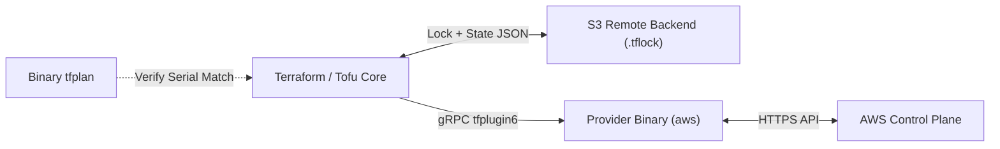
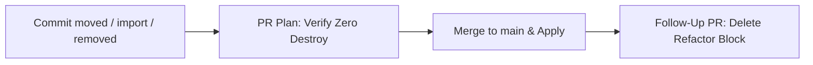

---
tags:
  - software-engineering
  - devops
  - terraform
  - opentofu
  - iac
  - aws
created: 2026-11-13
updated: 2026-11-13
status: 🟢
level: mid-to-senior
---
# Terraform & OpenTofu Engineering Handbook

**Terraform** (and its CNCF/Linux Foundation MPL-2.0 fork **OpenTofu**) is a declarative infrastructure provisioning engine written in Go that compiles HCL2 specifications into a dependency Directed Acyclic Graph (DAG), reconciles live cloud attributes via out-of-process gRPC provider plugins, and persists resource bindings inside a versioned, lockable state backend.

> [!abstract] Scope & Vault Context
> This handbook covers Terraform/OpenTofu Core DAG internals, gRPC plugin execution, S3 native state locking (`use_lockfile = true`), OpenTofu client-side state encryption, ephemeral write-only secrets, zero-downtime `moved`/`import`/`removed` refactoring, complete multi-layer AWS ECS/RDS production modules, OIDC CI/CD automation, and emergency state surgery. For broader IaC governance, Packer golden images, OPA/Rego policy enforcement, and Argo CD GitOps pull reconciliation, see [[Programming/Software Engineering/DevOps/Infrastructure as Code|Infrastructure as Code]]. Related guides: [[Programming/Software Engineering/DevOps/Cloud Fundamentals|Cloud Fundamentals]], [[Programming/Software Engineering/DevOps/CI-CD|CI/CD]], [[Programming/Software Engineering/DevOps/GitHub Actions|GitHub Actions]], [[Programming/Software Engineering/DevOps/Kubernetes|Kubernetes]], and [[Programming/Software Engineering/DevOps/DevOps Complete Guide|DevOps Complete Guide]].

---

## 1. First-Principles Mechanics & Complete Architecture

### 1.1 HCL2 AST Parsing & Dependency DAG Construction (`terraform graph`)

When invoked, Core parses every `*.tf` file in the root module directory into an HCL2 Abstract Syntax Tree (AST), validates variable types and module signatures, and compiles an execution **Directed Acyclic Graph (DAG)**:

- **Graph Vertices:** Managed resources (`aws_subnet.private`), data sources (`data.aws_ssm_parameter.vpc_id`), input variables, local values, module calls, provider configurations, outputs, and ephemeral resources.
- **Graph Edges:** Attribute references (`vpc_id = aws_vpc.core.id`) establish directed edges from consumer to producer. During `destroy` or replacement, Core constructs reverse edges (destroy nodes execute in inverse topological order so subnets delete before their parent VPC).
- **Concurrent Traversal:** Core spawns a worker pool bounded by `-parallelism=N` (default `10`). Independent graph branches execute simultaneously; dependent nodes wait until upstream nodes resolve required outputs.

Inspect the compiled execution graph directly via Graphviz:

```bash
# Inspect plan-time DAG (includes destroy-before-create vs create-before-destroy edges)
terraform graph -type=plan | dot -Tsvg > plan-dag.svg
```

#### Implicit Dependencies vs. Explicit `depends_on` Anti-Pattern

- **Implicit Dependency (Preferred):** Referencing an exported attribute (`subnet_id = aws_subnet.private["a"].id`) creates a surgical edge between two specific resource instances. Unrelated sibling resources inside the same module execute in parallel without blocking.
- **Explicit `depends_on` Anti-Pattern:** Placing `depends_on = [module.network]` on a downstream module forces Core to serialize execution until **every** resource inside `module.network` finishes, collapsing DAG parallelism. Worse, `depends_on` forces Core to treat downstream module inputs from `module.network` as `(known after apply)` during updates, frequently triggering conservative spurious replacements. Reserve `depends_on` exclusively for **hidden runtime side-effect dependencies** invisible in HCL attributes (e.g., an `aws_iam_role_policy_attachment` required before an `aws_ecs_service` or `aws_lambda_function` executes an AWS API call during creation).

### 1.2 gRPC Provider Plugin Protocol (`tfplugin6`)

Terraform and OpenTofu Core contain zero cloud vendor API logic. Every cloud provider (`hashicorp/aws`, `hashicorp/kubernetes`, `integrations/github`) compiles into a separate binary downloaded into `.terraform/providers/`. Core spawns each provider as a local OS child process over HashiCorp `go-plugin`, communicating via **gRPC** (`tfplugin5` / `tfplugin6`):

1. `GetProviderSchema`: Core fetches attribute schemas, sensitivity flags, and `ForceNew` requirements.
2. `ConfigureProvider`: Passes credentials, region, assume-role ARN, and `default_tags`.
3. `ReadResource` (Refresh Phase): Queries live cloud APIs using the ID stored in `.tfstate` to refresh $G_{\text{observed}}$.
4. `PlanResourceChange` (Diff Phase): Provider compares prior state vs. proposed config and returns exact attribute diffs plus `requires_replace` paths.
5. `ApplyResourceChange` (Execution Phase): Provider executes create/update/delete HTTP calls against the cloud control plane and returns updated attributes, which Core checkpoints into `.tfstate`.



### 1.3 Execution Modes: `plan`, `apply`, `-refresh-only`, `-target`

| Command / Flag | Execution Sequence | Operational Contract & Hazard |
| :--- | :--- | :--- |
| `plan -out=tfplan` | Acquire lock $\to$ Refresh (`ReadResource`) $\to$ Compute DAG diff $\to$ Write binary `tfplan` $\to$ Release lock | Captures exact provider versions, input variables, and planned actions (`create`, `update`, `delete`, `replace`, `no-op`). |
| `apply tfplan` | Acquire lock $\to$ Verify backend state `serial` matches `tfplan` $\to$ Execute graph $\to$ Checkpoint state $\to$ Unlock | Applies **only** reviewed actions. Aborts safely if another apply incremented state `serial` between `plan` and `apply`. |
| `apply -refresh-only` | Acquire lock $\to$ Call `ReadResource` on all managed instances $\to$ Update `.tfstate` $\to$ Unlock | **Zero cloud mutations.** Synchronizes state to absorb approved external attributes (e.g., RDS auto minor patch) after code matches. |
| `apply -target=<addr>` | Restricts DAG traversal solely to `<addr>` and its upstream dependencies | **Break-glass emergency only** (e.g., breaking cyclic dependencies). Leaves codebase and state diverged until a full untargeted apply runs. |

### 1.4 State Anatomy, Checkpointing & Locking Internals

`.tfstate` is a versioned JSON database (`"version": 4`) mapping HCL resource addresses to real-world provider IDs, schema versions, attribute values, and dependency metadata:

```json
{
  "version": 4,
  "terraform_version": "1.11.2",
  "serial": 42,
  "lineage": "7b9f4e2a-9c3b-4d61-a19b-31b57e22c810",
  "outputs": {},
  "resources": [
    {
      "mode": "managed",
      "type": "aws_vpc",
      "name": "core",
      "provider": "provider[\"registry.terraform.io/hashicorp/aws\"]",
      "instances": [
        {
          "schema_version": 1,
          "attributes": { "id": "vpc-0a1b2c3d4e5f", "cidr_block": "10.0.0.0/16" },
          "dependencies": []
        }
      ]
    }
  ]
}
```

- **`serial`:** Monotonically incremented integer on every state push. Backends reject pushes carrying a stale base `serial`, preventing silent concurrent overwrite.
- **`lineage`:** Immutable UUID assigned when a state initializes. Prevents pushing a `dev` state file over a `prod` backend key.
- **Intermediate Checkpointing:** During long applies, Core checkpoints updated `.tfstate` periodically (every few seconds/resources) so an infrastructure crash preserves already-created resource IDs. However, killing Core mid-flight during a single resource `Create` API call (`SIGKILL` / CI OOM) can still leave that specific cloud resource created outside state.

### 1.5 Remote S3 Backend: Modern Native Locking (`use_lockfile = true`) vs. Legacy `dynamodb_table`

Historically, AWS S3 lacked atomic compare-and-swap primitives, forcing Terraform teams to provision an auxiliary AWS DynamoDB table (`dynamodb_table = "tf-locks"`) with partition key `LockID` solely to coordinate state locks.

Because Amazon S3 now natively supports **conditional writes** (`If-None-Match: "*"`), **Terraform 1.11+ (introduced experimentally in 1.10) and OpenTofu 1.10+** provide native S3 locking via `use_lockfile = true`—making `dynamodb_table` deprecated and eliminating DynamoDB infrastructure entirely.

```hcl
terraform {
  required_version = ">= 1.11.0"

  backend "s3" {
    bucket       = "acme-prod-tfstate-us-east-1"
    key          = "prod/02-data/terraform.tfstate"
    region       = "us-east-1"
    encrypt      = true
    kms_key_id   = "arn:aws:kms:us-east-1:111122223333:key/8d3f221a-90c1-4e91-b012-7b9f4e2a9c3b"
    use_lockfile = true # Atomic S3 conditional PUT creating <key>.tflock; zero DynamoDB required
  }
}
```

#### How `use_lockfile = true` Works Under the Hood

1. Before `plan` or `apply`, Core constructs the lock object key by appending `.tflock` to the state key (`prod/02-data/terraform.tfstate.tflock`).
2. Core issues an S3 `PutObject` HTTP request carrying header `If-None-Match: "*"` and a JSON payload recording the Lock ID UUID, operation type, caller identity, and timestamp.
3. S3 atomically checks whether `<key>.tflock` exists. If absent, S3 writes `.tflock` (`200 OK`) and grants the lock. If present, S3 immediately returns `412 Precondition Failed` (`ConditionalCheckFailed`), halting the competing runner without race conditions.
4. On completion, Core issues `DeleteObject` on `<key>.tflock`.
5. **Required IAM Permissions:** Unlike legacy DynamoDB setups where `s3:DeleteObject` was unnecessary for CI runners, **`use_lockfile = true` requires `s3:DeleteObject` scoped strictly to `*.tflock` keys** (never grant `s3:DeleteObject` on `*.tfstate`!):

```json
{
  "Version": "2012-10-17",
  "Statement": [
    {
      "Sid": "StateReadWriteNoDelete",
      "Effect": "Allow",
      "Action": ["s3:GetObject", "s3:PutObject"],
      "Resource": "arn:aws:s3:::acme-prod-tfstate-us-east-1/prod/02-data/terraform.tfstate"
    },
    {
      "Sid": "NativeLockfileLifecycle",
      "Effect": "Allow",
      "Action": ["s3:GetObject", "s3:PutObject", "s3:DeleteObject"],
      "Resource": "arn:aws:s3:::acme-prod-tfstate-us-east-1/prod/02-data/terraform.tfstate.tflock"
    },
    {
      "Sid": "BucketListPrefix",
      "Effect": "Allow",
      "Action": "s3:ListBucket",
      "Resource": "arn:aws:s3:::acme-prod-tfstate-us-east-1"
    }
  ]
}
```

| Backend Strategy | Atomic Lock Mechanism | Auxiliary Infrastructure | Migration & Operational Notes (2025–2026) |
| :--- | :--- | :--- | :--- |
| **AWS S3 (`use_lockfile = true`)** | S3 `PutObject` with `If-None-Match: "*"` on `.tflock` | **None** | GA in Terraform 1.11+ & OpenTofu 1.10+. Requires `s3:DeleteObject` on `*.tflock`. |
| **AWS S3 (`dynamodb_table`)** | DynamoDB `PutItem` with `attribute_not_exists(LockID)` | DynamoDB Table (`LockID`) | **Deprecated** in Terraform 1.10+/1.11+. Migrate via dual-lock transition phase. |
| **Google Cloud Storage (`gcs`)** | GCS object precondition (`ifGenerationMatch`) | None | Native atomic locking; enable GCS bucket object versioning. |
| **PostgreSQL (`pg`)** | `pg_advisory_lock` session lock | Managed Postgres DB | Effective in air-gapped/on-prem clusters lacking S3 conditional writes. |
| **HCP Terraform / Spacelift** | Control-plane run queue + workspace mutex | SaaS / Self-hosted runner | Eliminates direct developer/CI S3 bucket permissions altogether. |

#### Migrating Zero-Downtime from `dynamodb_table` to `use_lockfile = true`

Never flip all engineers instantly without overlap—if Engineer A runs old Terraform (`dynamodb_table` only) while Engineer B runs `use_lockfile = true` only, they lock different primitives and risk concurrent state corruption:

1. **Step 1 (Upgrade CLI & IAM):** Upgrade CI runners and local workstations to Terraform `>= 1.11.0` (or OpenTofu `>= 1.10.0`) and deploy the IAM rule allowing `s3:DeleteObject` on `*.tflock`.
2. **Step 2 (Dual Locking Bridge):** Temporarily configure **both** `use_lockfile = true` AND `dynamodb_table = "acme-tf-locks"` inside `backend "s3"`, then run `terraform init -reconfigure`. Core acquires **both** locks sequentially during this window so neither old nor new runners collide.
3. **Step 3 (Cutover):** Once every active branch/pipeline uses `use_lockfile = true`, delete `dynamodb_table`, run `terraform init -reconfigure`, and decommission the DynamoDB table.

#### OpenTofu Client-Side State & Plan Encryption (`1.7+`)

Standard Terraform relies exclusively on backend server-side encryption (SSE-KMS), meaning any identity granted `s3:GetObject` on the bucket receives decrypted plaintext JSON from AWS S3 transparently. **OpenTofu 1.7+** encrypts both `.tfstate` and saved `tfplan` files **client-side with AES-GCM** before leaving the runner process:

```hcl
# OpenTofu >= 1.7: client-side state + plan encryption via AWS KMS
terraform {
  encryption {
    key_provider "aws_kms" "state_key" {
      kms_key_id = "arn:aws:kms:us-east-1:111122223333:key/8d3f221a-90c1-4e91-b012-7b9f4e2a9c3b"
      region     = "us-east-1"
      key_spec   = "AES_256"
    }

    method "aes_gcm" "encrypted" {
      keys = key_provider.aws_kms.state_key
    }

    # Allows seamless reading of legacy plaintext state during initial migration
    method "unencrypted" "migrate" {}

    state {
      method   = method.aes_gcm.encrypted
      enforced = false # Flip to true after first successful encrypted state push
      fallback {
        method = method.unencrypted.migrate
      }
    }

    plan {
      method   = method.aes_gcm.encrypted
      enforced = true
    }
  }
}
```

### 1.6 Ephemeral Resources & Write-Only Attributes (Terraform 1.10–1.11+)

Historically, marking an input variable or resource output `sensitive = true` **only redacted terminal stdout**. Terraform still persisted every password, TLS private key, and database token in **plaintext JSON inside `.tfstate` and `tfplan`**.

**Terraform 1.10** introduced **`ephemeral` blocks**, and **Terraform 1.11** (followed by **OpenTofu 1.11**) introduced **write-only (`_wo`) resource attributes**:

- **`ephemeral` Blocks:** Execute strictly in process memory (`Open`, `Renew`, `Close` gRPC lifecycle) during `plan` and `apply`. Values produced by `ephemeral` blocks **cannot** be stored in `.tfstate`, exported in root `output` blocks, or saved into binary `tfplan` artifacts.
- **Write-Only (`_wo`) Arguments:** Managed resources expose non-persisted write-only arguments (`aws_db_instance.password_wo`, `aws_secretsmanager_secret_version.secret_string_wo`, `vault_generic_secret.data_json_wo`) paired with a stateful integer/string version trigger (`password_wo_version`, `secret_string_wo_version`). Because Core never stores `password_wo` in `.tfstate`, Core cannot diff its value—instead, incrementing `password_wo_version = 2` instructs Core to open the `ephemeral` secret and send the new credential to the cloud API without writing a single byte of the secret to disk or S3!

```hcl
# Terraform >= 1.11: Ephemeral password generated & synced to Secrets Manager + RDS with ZERO secret bytes in .tfstate
ephemeral "random_password" "db_master" {
  length           = 32
  special          = true
  override_special = "!#$%&*()-_=+[]{}<>:?"
}

resource "aws_secretsmanager_secret" "db_master" {
  name_prefix             = "prod-orders-db-master-"
  recovery_window_in_days = 7
}

resource "aws_secretsmanager_secret_version" "db_master" {
  secret_id = aws_secretsmanager_secret.db_master.id
  secret_string_wo = jsonencode({
    username = "orders_admin"
    password = ephemeral.random_password.db_master.result
  })
  secret_string_wo_version = var.secret_rotation_version
}

resource "aws_db_instance" "orders" {
  identifier          = "prod-orders-pg"
  engine              = "postgres"
  engine_version      = "16.4"
  instance_class      = "db.r6g.large"
  username            = "orders_admin"
  password_wo         = ephemeral.random_password.db_master.result
  password_wo_version = var.secret_rotation_version # Bump integer to rotate RDS + Secrets Manager atomically
  storage_encrypted   = true
}
```

*(Note: When referencing an external secret generated outside Terraform—such as an existing HashiCorp Vault KV entry or AWS Secrets Manager rotation—read it via `ephemeral "aws_secretsmanager_secret_version"` or `ephemeral "vault_kv_secret_v2"` to inject temporary provider/DB credentials without ever touching `.tfstate`.)*

---

## 2. Real-World Use Cases & Decision Matrix

### 2.1 Architectural Decision Matrices

#### Cross-Layer State Sharing Strategy

| Wiring Pattern | How It Works | Security & Coupling Trade-off | Verdict |
| :--- | :--- | :--- | :--- |
| **AWS SSM Parameter Store / Cloud Map** | Upstream layer writes `vpc_id`, `subnet_ids`, `rds_endpoint` to `/platform/<env>/...`; downstream reads `data "aws_ssm_parameter"` | Zero cross-state S3 read access; clean IAM path isolation; no schema coupling | **Default Production Standard** |
| **Native Cloud `data` Lookups** | Downstream queries `data "aws_vpc"` or `data "aws_subnets"` by deterministic tags | Minimal upstream changes; breaks if tags drift or duplicate VPCs exist | Good for read-only legacy brownfield discovery |
| **`terraform_remote_state`** | Downstream reads upstream `.tfstate` JSON directly via backend bucket `GetObject` | **High blast radius:** exposes *all* upstream state attributes/metadata and tightly couples IAM read grants | **Avoid across team/layer boundaries** |

#### State Partitioning & Environment Topology

| Topology Pattern | State Scope | Plan Speed & Blast Radius | When to Adopt |
| :--- | :--- | :--- | :--- |
| **Layered Root Directories** (`01-network`, `02-data`, `03-compute`) | `< 150` resources per state | Fast (`5–20 s`); lock failures stay isolated to one service/tier | **All persistent `dev`, `staging`, `prod` stacks** |
| **CLI Workspaces** (`terraform workspace`) | Shared `.tf` root across N state prefixes | Code refactors hit all workspaces at once; weak per-env IAM boundaries | **Ephemeral PR preview stacks only** |
| **Monolithic Account State** (`prod/terraform.tfstate`) | `1,000–5,000+` resources | Slow (`10+ min`); coarse admin IAM; single crashed apply locks all teams | **Never use in production** |

### 2.2 Six Concrete Engineering Scenarios

1. **Multi-AZ Core Network & Shared Data Tier (`01-network` + `02-data`):** Adopt layered Terraform/OpenTofu stacks with `prevent_destroy = true`, S3 `use_lockfile = true`, KMS encryption, and `ephemeral` + `_wo` credentials (or `manage_master_user_password = true`). Never co-locate VPC routing tables inside microservice app states.
2. **High-Velocity Microservice Compute (`03-compute`):** Provision ECS Services, ALB Target Groups, IAM Task Roles, and SQS queues in per-service Terraform stacks (`apps/orders/prod`). Delegate volatile container image tags and autoscaling `desired_count` to deployment pipelines using `lifecycle { ignore_changes = [task_definition, desired_count] }`.
3. **Brownfield Cloud Console Adoption:** When inheriting ClickOps-created RDS/VPC/IAM resources, use declarative `import {}` blocks + `terraform plan -generate-config-out=...` rather than rewriting from scratch or hacking raw `.tfstate` JSON.
4. **Zero-Downtime Module Extraction & Renaming:** Use `moved {}` blocks (to refactor `count` $\to$ `for_each` or extract child modules) and `removed { destroy = false }` + `import {}` (to migrate live resources between state files without dropping TCP connections).
5. **Automated PR Preview Environments:** Pair ephemeral workspaces (`pr-412`) in an isolated sandbox account with `ExpiresAt` tags and scheduled TTL reaping.
6. **When NOT to Use Terraform:** Do **not** manage Kubernetes application rollouts (`Deployment`, `ConfigMap`, `Ingress`) via Terraform `kubernetes_manifest` or `helm_release` when deploying 20+ times/day—use **Argo CD / Flux** GitOps controllers instead. Do **not** shell-patch running OS instances via `remote-exec` provisioners—bake immutable images with **Packer**.

---

## 3. Step-by-Step Practical Application (Production Multi-Layer AWS Stack)

Below is a complete, copy-pasteable multi-file **Terraform >= 1.11** production stack implementing a layered Multi-AZ AWS **RDS PostgreSQL (`ephemeral` + `password_wo`) + ECS Fargate Service** topology with native **`terraform test`** mocking and a **GitHub Actions OIDC PR Plan / Main Apply** workflow.

### 3.1 Production Repository Directory Layout

```text
infra/
├── .github/
│   └── workflows/
│       └── terraform-cicd.yml
├── policy/
│   └── security.rego
├── modules/
│   ├── rds-postgres/
│   │   ├── versions.tf
│   │   ├── variables.tf
│   │   ├── main.tf
│   │   ├── outputs.tf
│   │   └── tests/
│   │       └── rds.tftest.hcl
│   └── ecs-service/
│       ├── versions.tf
│       ├── variables.tf
│       ├── main.tf
│       └── outputs.tf
└── envs/
    └── prod/
        ├── 02-data/
        │   ├── backend.tf
        │   ├── providers.tf
        │   ├── variables.tf
        │   └── main.tf
        └── 03-compute/
            ├── backend.tf
            ├── providers.tf
            ├── variables.tf
            └── main.tf
```

### 3.2 Reusable Child Module: `modules/rds-postgres/`

#### `modules/rds-postgres/versions.tf`

Child modules **must never** declare `backend` blocks or concrete `provider "aws" { region = ... }` blocks—declare only version constraints:

```hcl
terraform {
  required_version = ">= 1.11.0"

  required_providers {
    aws = {
      source  = "hashicorp/aws"
      version = "~> 5.90"
    }
    random = {
      source  = "hashicorp/random"
      version = "~> 3.7"
    }
  }
}
```

#### `modules/rds-postgres/variables.tf`

Enforce domain invariants early with `validation {}` blocks:

```hcl
variable "name" {
  type        = string
  description = "Service identifier prefix for DB and security resources"

  validation {
    condition     = can(regex("^[a-z0-9-]{3,32}$", var.name))
    error_message = "name must be 3-32 lowercase alphanumeric characters or hyphens."
  }
}

variable "vpc_id" {
  type        = string
  description = "Target VPC ID passed from Layer 1 network outputs"
}

variable "private_subnet_ids" {
  type        = list(string)
  description = "At least two private subnet IDs spanning distinct AZs"

  validation {
    condition     = length(var.private_subnet_ids) >= 2
    error_message = "Production RDS requires at least 2 subnets across distinct Availability Zones."
  }
}

variable "allowed_cidr_blocks" {
  type        = list(string)
  description = "CIDR ranges permitted to reach PostgreSQL port 5432"

  validation {
    condition = alltrue([
      for cidr in var.allowed_cidr_blocks : cidr != "0.0.0.0/0" && can(cidrhost(cidr, 0))
    ])
    error_message = "allowed_cidr_blocks must contain valid non-public CIDR blocks."
  }
}

variable "instance_class" {
  type    = string
  default = "db.r6g.large"
}

variable "allocated_storage_gb" {
  type    = number
  default = 100
}

variable "kms_key_arn" {
  type        = string
  description = "Customer Managed KMS Key ARN for RDS and Secrets Manager encryption"
}

variable "secret_rotation_version" {
  type        = number
  default     = 1
  description = "Increment to rotate the write-only RDS master password cleanly"
}
```

#### `modules/rds-postgres/main.tf`

Uses `ephemeral "random_password"`, write-only `password_wo` / `secret_string_wo`, `name_prefix` + `create_before_destroy` SG rules, `prevent_destroy`, and `precondition` / `postcondition` verification:

```hcl
resource "aws_db_subnet_group" "this" {
  name_prefix = "${var.name}-db-subnets-"
  subnet_ids  = var.private_subnet_ids

  lifecycle {
    create_before_destroy = true
  }
}

resource "aws_security_group" "rds" {
  name_prefix = "${var.name}-rds-sg-"
  description = "PostgreSQL ingress security group for ${var.name}"
  vpc_id      = var.vpc_id

  lifecycle {
    create_before_destroy = true
  }
}

resource "aws_vpc_security_group_ingress_rule" "postgres" {
  for_each = toset(var.allowed_cidr_blocks)

  security_group_id = aws_security_group.rds.id
  description       = "Allow PostgreSQL from ${each.value}"
  ip_protocol       = "tcp"
  from_port         = 5432
  to_port           = 5432
  cidr_ipv4         = each.value
}

ephemeral "random_password" "master" {
  length           = 32
  special          = true
  override_special = "!#$%&*()-_=+[]{}:?"
}

resource "aws_secretsmanager_secret" "master" {
  name_prefix             = "${var.name}/rds-master-"
  kms_key_id              = var.kms_key_arn
  recovery_window_in_days = 7
}

resource "aws_secretsmanager_secret_version" "master" {
  secret_id = aws_secretsmanager_secret.master.id
  secret_string_wo = jsonencode({
    username = "app_admin"
    password = ephemeral.random_password.master.result
    engine   = "postgres"
    port     = 5432
    host     = aws_db_instance.this.address
  })
  secret_string_wo_version = var.secret_rotation_version
}

resource "aws_db_instance" "this" {
  identifier                      = "${var.name}-pg"
  engine                          = "postgres"
  engine_version                  = "16.4"
  instance_class                  = var.instance_class
  allocated_storage               = var.allocated_storage_gb
  max_allocated_storage           = var.allocated_storage_gb * 3
  storage_type                    = "gp3"
  storage_encrypted               = true
  kms_key_id                      = var.kms_key_arn
  multi_az                        = true
  publicly_accessible             = false
  db_subnet_group_name            = aws_db_subnet_group.this.name
  vpc_security_group_ids          = [aws_security_group.rds.id]
  username                        = "app_admin"
  password_wo                     = ephemeral.random_password.master.result
  password_wo_version             = var.secret_rotation_version
  backup_retention_period         = 30
  deletion_protection             = true
  skip_final_snapshot             = false
  final_snapshot_identifier       = "${var.name}-pg-final"
  enabled_cloudwatch_logs_exports = ["postgresql", "upgrade"]

  lifecycle {
    prevent_destroy = true
    ignore_changes  = [engine_version]

    precondition {
      condition     = startswith(var.instance_class, "db.")
      error_message = "RDS instance_class must start with 'db.'."
    }

    postcondition {
      condition     = self.storage_encrypted == true && self.publicly_accessible == false
      error_message = "RDS instance violated storage encryption or private access invariants."
    }
  }
}
```

#### `modules/rds-postgres/outputs.tf`

```hcl
output "db_endpoint" {
  value       = aws_db_instance.this.endpoint
  description = "Host:port endpoint of the PostgreSQL instance"
}

output "db_address" {
  value       = aws_db_instance.this.address
  description = "DNS hostname of the PostgreSQL instance"
}

output "master_secret_arn" {
  value       = aws_secretsmanager_secret.master.arn
  description = "Secrets Manager ARN holding database credentials"
}

output "rds_security_group_id" {
  value       = aws_security_group.rds.id
  description = "Security group ID protecting RDS"
}
```

#### Native Unit Test: `modules/rds-postgres/tests/rds.tftest.hcl`

Executes locally in milliseconds via `terraform test` using `mock_provider "aws"` with zero AWS credentials:

```hcl
mock_provider "aws" {
  mock_resource "aws_db_instance" {
    defaults = {
      address           = "orders-pg.mock.us-east-1.rds.amazonaws.com"
      endpoint          = "orders-pg.mock.us-east-1.rds.amazonaws.com:5432"
      storage_encrypted = true
    }
  }
}

mock_provider "random" {}

variables {
  name                 = "orders-prod"
  vpc_id               = "vpc-0123456789abcdef0"
  private_subnet_ids   = ["subnet-1111", "subnet-2222"]
  allowed_cidr_blocks  = ["10.20.10.0/24", "10.20.11.0/24"]
  kms_key_arn          = "arn:aws:kms:us-east-1:111122223333:key/8d3f221a-90c1-4e91-b012-7b9f4e2a9c3b"
}

run "verify_rds_security_and_ingress_expansion" {
  command = plan

  assert {
    condition     = aws_db_instance.this.storage_encrypted == true
    error_message = "RDS storage_encrypted must be enabled."
  }

  assert {
    condition     = aws_db_instance.this.multi_az == true
    error_message = "Production RDS must run in Multi-AZ mode."
  }

  assert {
    condition     = length(aws_vpc_security_group_ingress_rule.postgres) == 2
    error_message = "Expected exactly one ingress rule per allowed CIDR block."
  }
}

run "reject_public_cidr_validation" {
  command = plan

  variables {
    allowed_cidr_blocks = ["0.0.0.0/0"]
  }

  expect_failures = [var.allowed_cidr_blocks]
}
```

### 3.3 Reusable Child Module: `modules/ecs-service/`

#### `modules/ecs-service/versions.tf` & `variables.tf`

```hcl
# modules/ecs-service/versions.tf
terraform {
  required_version = ">= 1.11.0"

  required_providers {
    aws = {
      source  = "hashicorp/aws"
      version = "~> 5.90"
    }
  }
}
```

```hcl
# modules/ecs-service/variables.tf
variable "service_name" {
  type = string
}

variable "vpc_id" {
  type = string
}

variable "private_subnet_ids" {
  type = list(string)
}

variable "ecs_cluster_arn" {
  type = string
}

variable "alb_listener_arn" {
  type = string
}

variable "alb_security_group_id" {
  type = string
}

variable "host_header" {
  type = string
}

variable "container_image" {
  type = string
}

variable "db_secret_arn" {
  type = string
}

variable "desired_count" {
  type    = number
  default = 2
}
```

#### `modules/ecs-service/main.tf` & `outputs.tf`

```hcl
# modules/ecs-service/main.tf
resource "aws_cloudwatch_log_group" "app" {
  name              = "/ecs/${var.service_name}"
  retention_in_days = 30
}

resource "aws_security_group" "task" {
  name_prefix = "${var.service_name}-ecs-"
  description = "ECS task SG for ${var.service_name}"
  vpc_id      = var.vpc_id

  lifecycle {
    create_before_destroy = true
  }
}

resource "aws_vpc_security_group_ingress_rule" "from_alb" {
  security_group_id            = aws_security_group.task.id
  referenced_security_group_id = var.alb_security_group_id
  ip_protocol                  = "tcp"
  from_port                    = 8080
  to_port                      = 8080
}

resource "aws_vpc_security_group_egress_rule" "all_outbound" {
  security_group_id = aws_security_group.task.id
  ip_protocol       = "-1"
  cidr_ipv4         = "0.0.0.0/0"
}

resource "aws_lb_target_group" "app" {
  name_prefix = "${substr(var.service_name, 0, 6)}-"
  port        = 8080
  protocol    = "HTTP"
  target_type = "ip"
  vpc_id      = var.vpc_id

  health_check {
    path                = "/healthz"
    matcher             = "200"
    healthy_threshold   = 2
    unhealthy_threshold = 3
    interval            = 15
  }

  lifecycle {
    create_before_destroy = true
  }
}

resource "aws_lb_listener_rule" "app" {
  listener_arn = var.alb_listener_arn

  action {
    type             = "forward"
    target_group_arn = aws_lb_target_group.app.arn
  }

  condition {
    host_header {
      values = [var.host_header]
    }
  }
}

data "aws_iam_policy_document" "ecs_assume" {
  statement {
    actions = ["sts:AssumeRole"]
    principals {
      type        = "Service"
      identifiers = ["ecs-tasks.amazonaws.com"]
    }
  }
}

resource "aws_iam_role" "execution" {
  name_prefix        = "${var.service_name}-exec-"
  assume_role_policy = data.aws_iam_policy_document.ecs_assume.json

  lifecycle {
    create_before_destroy = true
  }
}

resource "aws_iam_role_policy_attachment" "exec_managed" {
  role       = aws_iam_role.execution.name
  policy_arn = "arn:aws:iam::aws:policy/service-role/AmazonECSTaskExecutionRolePolicy"
}

data "aws_iam_policy_document" "exec_secret" {
  statement {
    actions   = ["secretsmanager:GetSecretValue"]
    resources = [var.db_secret_arn]
  }
}

resource "aws_iam_role_policy" "exec_secret" {
  name   = "read-db-secret"
  role   = aws_iam_role.execution.id
  policy = data.aws_iam_policy_document.exec_secret.json
}

resource "aws_iam_role" "task" {
  name_prefix        = "${var.service_name}-task-"
  assume_role_policy = data.aws_iam_policy_document.ecs_assume.json

  lifecycle {
    create_before_destroy = true
  }
}

resource "aws_ecs_task_definition" "app" {
  family                   = var.service_name
  network_mode             = "awsvpc"
  requires_compatibilities = ["FARGATE"]
  cpu                      = "512"
  memory                   = "1024"
  execution_role_arn       = aws_iam_role.execution.arn
  task_role_arn            = aws_iam_role.task.arn

  container_definitions = jsonencode([
    {
      name      = var.service_name
      image     = var.container_image
      essential = true
      portMappings = [{
        containerPort = 8080
        protocol      = "tcp"
      }]
      secrets = [{
        name      = "DB_CREDENTIALS_JSON"
        valueFrom = var.db_secret_arn
      }]
      logConfiguration = {
        logDriver = "awslogs"
        options = {
          "awslogs-group"         = aws_cloudwatch_log_group.app.name
          "awslogs-region"        = "us-east-1"
          "awslogs-stream-prefix" = "ecs"
        }
      }
    }
  ])
}

resource "aws_ecs_service" "app" {
  name            = var.service_name
  cluster         = var.ecs_cluster_arn
  task_definition = aws_ecs_task_definition.app.arn
  desired_count   = var.desired_count
  launch_type     = "FARGATE"

  network_configuration {
    subnets          = var.private_subnet_ids
    security_groups  = [aws_security_group.task.id]
    assign_public_ip = false
  }

  load_balancer {
    target_group_arn = aws_lb_target_group.app.arn
    container_name   = var.service_name
    container_port   = 8080
  }

  depends_on = [aws_lb_listener_rule.app, aws_iam_role_policy.exec_secret]

  lifecycle {
    ignore_changes = [desired_count, task_definition]
  }
}

check "service_health_endpoint" {
  data "http" "health" {
    url = "https://${var.host_header}/healthz"
  }

  assert {
    condition     = data.http.health.status_code == 200
    error_message = "Service health check failed with status ${data.http.health.status_code}"
  }
}
```

```hcl
# modules/ecs-service/outputs.tf
output "ecs_service_name" {
  value = aws_ecs_service.app.name
}

output "task_security_group_id" {
  value = aws_security_group.task.id
}
```

### 3.4 Layered Root Stacks: `envs/prod/02-data/` & `envs/prod/03-compute/`

#### `envs/prod/02-data/backend.tf` & `providers.tf`

```hcl
# envs/prod/02-data/backend.tf
terraform {
  required_version = ">= 1.11.0"

  backend "s3" {
    bucket       = "acme-prod-tfstate-us-east-1"
    key          = "prod/02-data/terraform.tfstate"
    region       = "us-east-1"
    encrypt      = true
    kms_key_id   = "arn:aws:kms:us-east-1:111122223333:key/8d3f221a-90c1-4e91-b012-7b9f4e2a9c3b"
    use_lockfile = true
  }
}
```

```hcl
# envs/prod/02-data/providers.tf
provider "aws" {
  region = "us-east-1"

  default_tags {
    tags = {
      Environment = "prod"
      Layer       = "02-data"
      ManagedBy   = "terraform"
    }
  }
}
```

#### `envs/prod/02-data/main.tf` (Wiring Network Outputs via SSM Parameter Store)

```hcl
data "aws_ssm_parameter" "vpc_id" {
  name = "/platform/prod/network/vpc_id"
}

data "aws_ssm_parameter" "db_subnets" {
  name = "/platform/prod/network/db_subnet_ids"
}

data "aws_ssm_parameter" "app_cidrs" {
  name = "/platform/prod/network/app_subnet_cidrs"
}

data "aws_ssm_parameter" "kms_data_arn" {
  name = "/platform/prod/kms/data_key_arn"
}

module "orders_rds" {
  source = "../../../modules/rds-postgres"

  name                    = "orders-prod"
  vpc_id                  = data.aws_ssm_parameter.vpc_id.value
  private_subnet_ids      = jsondecode(data.aws_ssm_parameter.db_subnets.value)
  allowed_cidr_blocks     = jsondecode(data.aws_ssm_parameter.app_cidrs.value)
  kms_key_arn             = data.aws_ssm_parameter.kms_data_arn.value
  secret_rotation_version = 1
}

resource "aws_ssm_parameter" "orders_db_secret_arn" {
  name  = "/platform/prod/data/orders/secret_arn"
  type  = "String"
  value = module.orders_rds.master_secret_arn
}

resource "aws_ssm_parameter" "orders_db_endpoint" {
  name  = "/platform/prod/data/orders/endpoint"
  type  = "String"
  value = module.orders_rds.db_endpoint
}
```

#### `envs/prod/03-compute/main.tf` (Independent High-Churn App Stack)

```hcl
data "aws_ssm_parameter" "vpc_id" {
  name = "/platform/prod/network/vpc_id"
}

data "aws_ssm_parameter" "app_subnets" {
  name = "/platform/prod/network/app_subnet_ids"
}

data "aws_ssm_parameter" "ecs_cluster_arn" {
  name = "/platform/prod/platform/ecs_cluster_arn"
}

data "aws_ssm_parameter" "alb_listener_arn" {
  name = "/platform/prod/platform/alb_https_listener_arn"
}

data "aws_ssm_parameter" "alb_sg_id" {
  name = "/platform/prod/platform/alb_sg_id"
}

data "aws_ssm_parameter" "orders_db_secret_arn" {
  name = "/platform/prod/data/orders/secret_arn"
}

module "orders_api" {
  source = "../../../modules/ecs-service"

  service_name          = "orders-api"
  vpc_id                = data.aws_ssm_parameter.vpc_id.value
  private_subnet_ids    = jsondecode(data.aws_ssm_parameter.app_subnets.value)
  ecs_cluster_arn       = data.aws_ssm_parameter.ecs_cluster_arn.value
  alb_listener_arn      = data.aws_ssm_parameter.alb_listener_arn.value
  alb_security_group_id = data.aws_ssm_parameter.alb_sg_id.value
  host_header           = "orders.internal.acme.com"
  container_image       = "111122223333.dkr.ecr.us-east-1.amazonaws.com/orders-api:2.14.0"
  db_secret_arn         = data.aws_ssm_parameter.orders_db_secret_arn.value
  desired_count         = 4
}
```

### 3.5 GitHub Actions OIDC PR `plan` / Main `apply` Workflow

`.github/workflows/terraform-cicd.yml` separates read-only PR verification from protected `main` branch `apply`, enforces `cancel-in-progress: false` so active applies are never killed mid-flight, validates unit tests (`terraform test`) + OPA (`conftest`) against `tfplan.json`, and posts exact plan summaries on Pull Requests:

```yaml
name: Terraform Layered CI/CD

on:
  pull_request:
    branches: [main]
    paths:
      - "modules/**"
      - "envs/prod/**"
      - "policy/**"
  push:
    branches: [main]
    paths:
      - "envs/prod/**"

permissions:
  id-token: write
  contents: read
  pull-requests: write

jobs:
  validate-and-unit-test:
    name: Format, TFLint & Mocked Module Tests
    runs-on: ubuntu-latest
    steps:
      - uses: actions/checkout@v4

      - uses: hashicorp/setup-terraform@v3
        with:
          terraform_version: "1.11.2"
          terraform_wrapper: false

      - name: Check Formatting
        run: terraform fmt -check -recursive

      - name: Run Native Mocked Module Unit Tests
        working-directory: modules/rds-postgres
        run: |
          terraform init -backend=false
          terraform test

      - uses: terraform-linters/setup-tflint@v4
        with:
          tflint_version: v0.55.0

      - name: Run TFLint Recursive Check
        run: tflint --init && tflint --recursive

  plan-pr:
    name: OIDC Plan (${{ matrix.stack }})
    if: github.event_name == 'pull_request'
    needs: validate-and-unit-test
    runs-on: ubuntu-latest
    strategy:
      fail-fast: false
      matrix:
        stack:
          - envs/prod/02-data
          - envs/prod/03-compute
    steps:
      - uses: actions/checkout@v4

      - name: Assume Read-Only Plan IAM Role via OIDC
        uses: aws-actions/configure-aws-credentials@v4
        with:
          role-to-assume: ${{ secrets.AWS_OIDC_TF_PLAN_ROLE_ARN }}
          aws-region: us-east-1

      - uses: hashicorp/setup-terraform@v3
        with:
          terraform_version: "1.11.2"
          terraform_wrapper: false

      - name: Install Conftest
        run: |
          CONFTEST_VER="0.56.0"
          curl -sSL "https://github.com/open-policy-agent/conftest/releases/download/v${CONFTEST_VER}/conftest_${CONFTEST_VER}_Linux_x86_64.tar.gz" -o /tmp/conftest.tar.gz
          tar -xzf /tmp/conftest.tar.gz -C /usr/local/bin conftest

      - name: Terraform Init & Plan
        id: plan
        working-directory: ${{ matrix.stack }}
        run: |
          terraform init -input=false
          terraform plan -input=false -no-color -out=tfplan > plan.txt
          terraform show -json tfplan > tfplan.json
          conftest test tfplan.json --policy ../../../policy/

      - name: Post Plan Output to PR Comment
        uses: actions/github-script@v7
        with:
          script: |
            const fs = require("fs");
            const stack = "${{ matrix.stack }}";
            const raw = fs.readFileSync(`${stack}/plan.txt`, "utf8");
            const truncated = raw.length > 60000 ? raw.slice(0, 60000) + "\n... (truncated)" : raw;
            const body = `### Terraform Plan: \`${stack}\`\n\n\`\`\`hcl\n${truncated}\n\`\`\``;
            await github.rest.issues.createComment({
              owner: context.repo.owner,
              repo: context.repo.name,
              issue_number: context.issue.number,
              body
            });

  apply-main:
    name: OIDC Apply (${{ matrix.stack }})
    if: github.event_name == 'push' && github.ref == 'refs/heads/main'
    needs: validate-and-unit-test
    runs-on: ubuntu-latest
    environment: prod-infra-apply # Requires manual reviewer approval in GitHub Environment settings
    concurrency:
      group: tf-apply-${{ matrix.stack }}
      cancel-in-progress: false # CRITICAL: never SIGTERM/SIGKILL a running terraform apply
    strategy:
      max-parallel: 1
      matrix:
        stack:
          - envs/prod/02-data
          - envs/prod/03-compute
    steps:
      - uses: actions/checkout@v4

      - name: Assume Protected Apply IAM Role via OIDC
        uses: aws-actions/configure-aws-credentials@v4
        with:
          role-to-assume: ${{ secrets.AWS_OIDC_TF_APPLY_ROLE_ARN }}
          aws-region: us-east-1

      - uses: hashicorp/setup-terraform@v3
        with:
          terraform_version: "1.11.2"
          terraform_wrapper: false

      - name: Install Conftest
        run: |
          CONFTEST_VER="0.56.0"
          curl -sSL "https://github.com/open-policy-agent/conftest/releases/download/v${CONFTEST_VER}/conftest_${CONFTEST_VER}_Linux_x86_64.tar.gz" -o /tmp/conftest.tar.gz
          tar -xzf /tmp/conftest.tar.gz -C /usr/local/bin conftest

      - name: Init, Plan, Policy Check & Apply
        working-directory: ${{ matrix.stack }}
        run: |
          terraform init -input=false
          terraform plan -input=false -no-color -out=tfplan
          terraform show -json tfplan > tfplan.json
          conftest test tfplan.json --policy ../../../policy/
          terraform apply -input=false -auto-approve tfplan
```

> [!warning] Plan Artifact Confidentiality
> Saved binary `tfplan` files contain input variables, computed outputs, and sensitive attribute values unless every secret passes exclusively through `ephemeral` + `_wo` arguments. Never upload raw `tfplan` files as broadly readable GitHub Actions artifacts without encryption; generate plans ephemerally inside the protected runner or encrypt them via OpenTofu `plan` encryption / KMS envelope encryption with `< 24h` retention.

---

## 4. Complete HCL Construct Reference & Edge Cases

### 4.1 `count` Index Fragility vs. `for_each` Key Stability

`count` addresses resource instances by dense numeric array index (`[0]`, `[1]`, `[2]`). Removing an entry from the beginning or middle of an input list shifts every subsequent index down by one, triggering cascading destroy-and-recreate diffs on stateful resources:

```hcl
# ANTI-PATTERN: removing "us-east-1a" shifts [1]->[0] and [2]->[1], replacing live subnets!
resource "aws_subnet" "bad" {
  count             = length(var.azs)
  vpc_id            = aws_vpc.core.id
  availability_zone = var.azs[count.index]
  cidr_block        = cidrsubnet(aws_vpc.core.cidr_block, 4, count.index)
}

# PRODUCTION PATTERN: map key stability isolates edits to the single target key
resource "aws_subnet" "private" {
  for_each = var.private_subnets # { "us-east-1a" = "10.0.1.0/24", "us-east-1b" = "10.0.2.0/24" }

  vpc_id            = aws_vpc.core.id
  availability_zone = each.key
  cidr_block        = each.value
}
```

#### Two Subtle `for_each` Edge Cases

1. **`Invalid for_each argument` (`(known after apply)` keys):** Terraform must know the exact map/set keys *during `plan`* to build the resource graph. Using a resource ID returned only after creation as a `for_each` map key (`for_each = toset(aws_subnet.private[*].id)`) fails during `plan`. Fix by keying the map on statically known identifiers (`"subnet-a"`, `"subnet-b"`) while keeping the computed `.id` inside the map **value**.
2. **Sensitive Values in `for_each` Keys:** Terraform strictly forbids sensitive values in `for_each` collections because resource addresses (`aws_iam_user.this["alice"]`) are logged in plaintext across CLI diffs and `.tfstate` indexes. Never pass `sensitive()` strings or secret attributes as `for_each` keys or sets.
3. **OpenTofu `enabled` Meta-Argument (OpenTofu `1.11+`):** Replaces `count = var.create ? 1 : 0` boolean hacks cleanly (`enabled = var.create_bastion`), removing `[0]` array indexing everywhere across resource references and outputs.

### 4.2 HCL Data Shaping & Contract Validation

Transform nested structures cleanly using `flatten()`, `for`, `dynamic`, `try()`, and `can()`:

```hcl
locals {
  ingress_rules = {
    for item in flatten([
      for svc, cfg in var.services : [
        for port in cfg.ports : {
          key  = "${svc}-${port}"
          port = port
          cidr = cfg.source_cidr
        }
      ]
    ]) : item.key => item
  }
}

resource "aws_vpc_security_group_ingress_rule" "app" {
  for_each = local.ingress_rules

  security_group_id = aws_security_group.app.id
  ip_protocol       = "tcp"
  from_port         = each.value.port
  to_port           = each.value.port
  cidr_ipv4         = each.value.cidr
}
```

| Validation Construct | Evaluation Phase | Failure Behavior | Best Use Case |
| :--- | :--- | :--- | :--- |
| `variable { validation {} }` | Variable binding (pre-graph) | Immediate hard error | CIDR regex/syntax checks (`can(cidrhost(var.cidr, 0))`), enum bounds. |
| `lifecycle { precondition {} }` | Pre-resource plan/apply | Hard error halting execution | Cross-input or `data` checks (e.g., verify AMI CPU arch matches EC2 instance family). |
| `lifecycle { postcondition {} }` | Post-`Read`/`Create`/`Update` | Hard error stopping apply | Verify live `self` guarantees (`self.storage_encrypted == true`). |
| `check {}` (TF `1.5+`) | Final step of `plan`/`apply` | **Non-blocking Warning** | Continuous health checks (live HTTP `/healthz` or DNS resolution). |

### 4.3 `lifecycle` Meta-Arguments, `terraform_data` & Name-Collision Traps

- **`create_before_destroy = true` Name-Collision Trap:** Cloud resources enforcing unique `name` constraints (AWS Security Groups, IAM Roles, Launch Templates, Target Groups, KMS Aliases) **fail during `create_before_destroy`** because the old resource still holds `name = "prod-api-sg"` when Core calls `Create` on the replacement! Always specify **`name_prefix`** (`name_prefix = "prod-api-sg-"`) whenever `create_before_destroy = true` is active.
- **`prevent_destroy = true` Deletion Bypass:** Removing the entire `resource` block from `.tf` files removes the `lifecycle { prevent_destroy = true }` stanza with it—allowing deletion! Always backstop `prevent_destroy` with AWS Organizations SCPs or IAM `Deny` policies on `rds:DeleteDBInstance` / `s3:DeleteBucket` / `kms:ScheduleKeyDeletion`. (Note: OpenTofu `1.12+` supports variable expressions inside `prevent_destroy = var.is_prod`.)
- **`replace_triggered_by` + `terraform_data` (TF `1.4+`):** Replaces legacy `null_resource` (`hashicorp/null` provider no longer needed!). Triggers resource replacement cleanly when a computed dependency or config hash changes:

```hcl
resource "terraform_data" "config_version" {
  input = sha256(file("${path.module}/app-config.json"))
}

resource "aws_instance" "worker" {
  ami           = data.aws_ami.golden.id
  instance_type = "c7g.large"

  lifecycle {
    replace_triggered_by = [terraform_data.config_version]
  }
}
```

### 4.4 Declarative State Refactoring Blocks (`moved`, `import`, `removed`)

Prefer declarative Git-reviewed refactoring blocks over imperative `terraform state` CLI edits:

| Block & Min Version | Purpose | Lifecycle Workflow |
| :--- | :--- | :--- |
| `moved { from = ... to = ... }` (TF `1.1+`) | Rename resource/module address or migrate `count` $\to$ `for_each` without destruction | Add `moved` $\to$ verify `0 destroy` in PR plan $\to$ merge & apply $\to$ remove `moved` block in follow-up PR. |
| `import { to = ... id = ... }` (TF `1.5+`) | Adopt unmanaged live cloud resource into `.tfstate` declaratively | Add `import {}` $\to$ run `terraform plan -generate-config-out=gen.tf` $\to$ scrub HCL $\to$ apply until `No changes`. |
| `removed { from = ... lifecycle { destroy = false } }` (TF `1.7+`) | Drop resource from `.tfstate` cleanly while keeping live cloud infrastructure running | Delete `resource` block $\to$ add `removed {}` (`destroy = false`) $\to$ apply $\to$ remove block cleanly. |



### 4.5 Module Supply-Chain Pinning & `.terraform.lock.hcl`

- **Pin Child Module Versions:** Pin private registry modules (`version = "~> 3.2.0"`) or Git sources to immutable **commit SHAs** (`source = "git::https://github.com/acme/tf-modules.git//vpc?ref=e4f1a9c"`). Never reference mutable `?ref=main`.
- **Multi-Architecture Provider Checksums (`.terraform.lock.hcl`):** Commit `.terraform.lock.hcl` to Git. If developers initialize providers on Apple Silicon (`darwin_arm64`) and CI runs on Linux (`linux_amd64`), lockfiles lacking `linux_amd64` `h1:` hashes fail `terraform init -lockfile=readonly` in CI. Generate unified hashes upfront:

```bash
terraform providers lock \
  -platform=linux_amd64 \
  -platform=linux_arm64 \
  -platform=darwin_arm64
```

- **Cross-Region Child Module Aliases (`configuration_aliases`):** Never place `provider "aws" { region = "us-west-2" }` inside a reusable child module. Declare `configuration_aliases = [aws.dr]` inside the child module's `required_providers` block and pass `providers = { aws = aws, aws.dr = aws.us_west_2 }` from the root module.

---

## 5. Production State Surgery & Outage Playbook

Execute CLI state surgery commands **only** when declarative `moved`/`import`/`removed` blocks cannot run cleanly (e.g., corrupted state JSON, crashed mid-apply orphans, stale locks). **Always pull a timestamped backup first:** `terraform state pull > backup-$(date +%s).tfstate`.

| CLI Command | Effect on `.tfstate` | Effect on Cloud | Production Rule |
| :--- | :--- | :--- | :--- |
| `terraform state list` | Read-only | None | Enumerate exact state addresses (`module.data.aws_db_instance.this`). |
| `terraform state show <addr>` | Read-only | None | Inspect provider ID and full state attributes for one instance. |
| `terraform state mv <src> <dst>` | Re-indexes address in state | None | Emergency rename when `moved {}` cannot span cross-state/special constraints. |
| `terraform state rm <addr>` | Deletes binding from state | **None (resource keeps running)** | Drops resource from management without destroying it (prefer `removed {}` in Git). |
| `terraform apply -replace="<addr>"` | Marks single instance for replacement | Recreates instance on apply | Replaces deprecated `terraform taint` safely inside a reviewed plan. |
| `terraform force-unlock <LOCK_ID>` | Deletes backend `.tflock` / DynamoDB item | None | **High risk:** verify zero active processes/API calls hold the lock before running. |
| `terraform state pull` / `push` | Downloads / overwrites raw JSON | None | Last-resort recovery; verify `lineage` and increment `serial` carefully. |

### Production Failure Triage Matrix

| Production Symptom | Root Cause | Diagnostic Commands | Exact Recovery Sequence |
| :--- | :--- | :--- | :--- |
| **`Error acquiring the state lock` (`ConditionalCheckFailed` on `.tflock`)** | CI runner killed mid-apply (`SIGKILL` / OOM) or two pipelines ran simultaneously | Check GitHub Actions active runs; verify `Created` timestamp & runner host in error output; inspect CloudTrail for active `Apply` role mutations over last 15 min | 1. Confirm zero active runners/API calls.<br>2. `terraform state pull > pre-unlock.tfstate`.<br>3. `terraform force-unlock <LOCK_ID>`.<br>4. Run `terraform plan -refresh-only` to check for partial orphans.<br>5. Enforce `concurrency: cancel-in-progress: false`. |
| **`EntityAlreadyExists` / `InvalidGroup.Duplicate` after crashed `apply`** | Crashed apply created the cloud resource right before Core checkpointed `.tfstate` | `terraform state list \| grep <name>`<br>Describe resource in AWS CLI to verify exact ID | Adopt the created resource via `import { to = <addr> id = "<id>" }` (or `terraform import`), then run `terraform plan` to confirm convergence. |
| **Corrupted / Accidentally Truncated `.tfstate` in S3** | Bad manual `state push` or buggy CLI version overwrote state JSON | `aws s3api list-object-versions --bucket acme-prod-tfstate --prefix prod/02-data/terraform.tfstate` | Download last known good `VersionId` via `aws s3api get-object --version-id ...`, inspect `serial`, restore object in S3 (or bump `serial` by +1 and run `terraform state push`), then run `terraform plan -refresh-only`. |
| **Plan shows unexpected `-/+ destroy and then create replacement` on RDS/VPC** | Changed immutable (`ForceNew`) attribute (`availability_zone`, `kms_key_id`, `name`, or SG `description`) | Read exact `# forces replacement` line in `terraform plan` output | **Halt apply immediately.** Revert `ForceNew` change or refactor with `name_prefix` + `create_before_destroy` / `moved` / manual Blue-Green cutover before re-planning. |
| **CI fails `terraform init`: `provider registry.terraform.io/hashicorp/aws: locked provider does not match`** | `.terraform.lock.hcl` committed from `darwin_arm64` Mac missing `linux_amd64` `h1:` hashes | Inspect `.terraform.lock.hcl` `hashes = [...]` block | Run `terraform providers lock -platform=linux_amd64 -platform=darwin_arm64` locally and commit updated `.terraform.lock.hcl`. |
| **`Error: Invalid for_each argument` (`The "for_each" map includes keys derived from resource attributes...`)** | `for_each` map key or `toset()` element depends on `(known after apply)` resource attribute | Locate the `for_each` expression referenced in error stack trace | Replace dynamic keys with deterministic static map keys (`{ "app-a" = aws_subnet.a.id }`) keeping computed IDs strictly in map values. |

---

## 6. Worked Exercises

### Exercise 1: Fixing a `count`-Index Destruction Disaster with `moved`

**Scenario:** A production network module defines private subnets using `count`:

```hcl
variable "azs" {
  default = ["us-east-1a", "us-east-1b", "us-east-1c"]
}

resource "aws_subnet" "private" {
  count             = length(var.azs)
  vpc_id            = aws_vpc.main.id
  availability_zone = var.azs[count.index]
  cidr_block        = cidrsubnet("10.0.0.0/16", 8, count.index)
}
```

An engineer needs to decommission `"us-east-1a"` and edits `azs` to `["us-east-1b", "us-east-1c"]`. Running `terraform plan` shows:
- `aws_subnet.private[0]` **must be replaced** (`availability_zone`: `"us-east-1a"` $\to$ `"us-east-1b"`),
- `aws_subnet.private[1]` **must be replaced** (`"us-east-1b"` $\to$ `"us-east-1c"`),
- `aws_subnet.private[2]` **will be destroyed** (`"us-east-1c"`).
**All three production subnets** (and every attached NAT Gateway / ENI / EKS node) would be destroyed!

**Task:** Refactor the resource safely from `count` to `for_each` using declarative `moved` blocks so zero live subnets are destroyed during migration, then cleanly decommission *only* `"us-east-1a"`.

---

### Solution 1

**Step 1 — Migrate `count` $\to$ `for_each` with Zero Infrastructure Changes:**
Preserve the exact existing CIDR-to-AZ mapping as a map keyed by AZ name, rewrite the resource with `for_each`, and add explicit `moved` blocks mapping old integer indices `[0..2]` to string keys:

```hcl
variable "private_subnets" {
  type = map(string)
  default = {
    "us-east-1a" = "10.0.0.0/24"
    "us-east-1b" = "10.0.1.0/24"
    "us-east-1c" = "10.0.2.0/24"
  }
}

resource "aws_subnet" "private" {
  for_each          = var.private_subnets
  vpc_id            = aws_vpc.main.id
  availability_zone = each.key
  cidr_block        = each.value
}

moved {
  from = aws_subnet.private[0]
  to   = aws_subnet.private["us-east-1a"]
}

moved {
  from = aws_subnet.private[1]
  to   = aws_subnet.private["us-east-1b"]
}

moved {
  from = aws_subnet.private[2]
  to   = aws_subnet.private["us-east-1c"]
}
```

Run `terraform plan`: output confirms **`0 to add, 0 to change, 0 to destroy`** (only state re-indexing). Apply and merge Step 1.

**Step 2 — Decommission `"us-east-1a"` Safely:**
Remove `"us-east-1a" = "10.0.0.0/24"` from `var.private_subnets` (and clean up the `moved` blocks once all environments have applied Step 1). Running `terraform plan` now shows:
- `aws_subnet.private["us-east-1a"]` **will be destroyed**
- `aws_subnet.private["us-east-1b"]` and `["us-east-1c"]` **unchanged** (`10.0.1.0/24` and `10.0.2.0/24` remain intact).

---

### Exercise 2: Adopting Brownfield Production AWS RDS via `import`

**Scenario:** A critical PostgreSQL RDS instance (`identifier = "prod-core-db"`) was created manually in the AWS Console two years ago (`db.r6g.large`, `allocated_storage = 500`, `deletion_protection = true`, `multi_az = true`, custom subnet group `prod-db-subnets`). You must adopt it into Terraform with **zero downtime**, **zero replacement**, and **zero plaintext master password stored in `.tfstate`**.

**Task:** Detail the declarative `import {}` workflow, configuration generation cleanup, secret handling, and verification criteria.

---

### Solution 2

**Step 1 — Declare the `import` Block and Generate Draft HCL:**
Create `imports.tf` (note: RDS import ID is the DB `identifier`, not its ARN):

```hcl
import {
  to = aws_db_instance.core
  id = "prod-core-db"
}
```

Run:
```bash
terraform plan -generate-config-out=generated_rds.tf
```

**Step 2 — Scrub Generated Config & Enforce Protection Invariants:**
`-generate-config-out` emits every current attribute returned by the AWS API, including conflicting, deprecated, or computed-only fields (`snapshot_identifier`, `storage_encrypted` conflicts, explicit `availability_zone` colliding with `multi_az = true`). Clean `generated_rds.tf` into `rds.tf` keeping only declarative inputs:

```hcl
resource "aws_db_instance" "core" {
  identifier                  = "prod-core-db"
  engine                      = "postgres"
  engine_version              = "16.4"
  instance_class              = "db.r6g.large"
  allocated_storage           = 500
  storage_type                = "gp3"
  storage_encrypted           = true
  kms_key_id                  = data.aws_kms_key.rds.arn
  multi_az                    = true
  db_subnet_group_name        = aws_db_subnet_group.core.name
  vpc_security_group_ids      = [aws_security_group.rds.id]
  parameter_group_name        = aws_db_parameter_group.core.name
  backup_retention_period     = 30
  deletion_protection         = true
  skip_final_snapshot         = false
  final_snapshot_identifier   = "prod-core-db-final"
  manage_master_user_password = true # Delegates master secret rotation to AWS Secrets Manager

  lifecycle {
    prevent_destroy = true
    ignore_changes = [
      engine_version, # Allow AWS minor auto-upgrades without triggering drift conflicts
      password,       # Ensure legacy password attribute never triggers unwanted updates
    ]
  }
}
```

*Note on Secrets:* Because the database already exists, Terraform's `ReadResource` during `import` does **not** receive the plaintext password from AWS RDS APIs. Enabling `manage_master_user_password = true` (or using `ephemeral` + `password_wo` if managing custom Secrets Manager rotation on Terraform 1.11+) guarantees zero plaintext database credentials ever enter `.tfstate`.

**Step 3 — Verify Zero-Mutation Plan & Apply:**
Run `terraform plan`: confirm output reads **`Plan: 1 to import, 0 to add, 0 to change, 0 to destroy`** (or `~` only if intentionally enabling `manage_master_user_password`, which updates metadata in-place with zero reboot). Run `terraform apply`, verify `terraform plan` prints `No changes`, and remove `imports.tf` in a follow-up PR.

---

### Exercise 3: Resolving `create_before_destroy` Name-Collision Error

**Scenario:** Your API service uses the following Security Group configuration. An engineer changes `description` (a `ForceNew` attribute on `aws_security_group`) and runs `terraform apply`:

```hcl
resource "aws_security_group" "api" {
  name        = "prod-api-sg"
  description = "API ingress v2" # Changed from v1 -> triggers ForceNew replacement
  vpc_id      = aws_vpc.core.id

  ingress {
    from_port   = 443
    to_port     = 443
    protocol    = "tcp"
    cidr_blocks = ["10.0.0.0/8"]
  }

  lifecycle {
    create_before_destroy = true
  }
}
```

The apply fails with:
`Error: creating Security Group (prod-api-sg): InvalidGroup.Duplicate: The security group 'prod-api-sg' already exists for VPC 'vpc-0abc...'`

**Task:** Explain the exact root cause and write the zero-downtime refactor that fixes both the immediate collision and the underlying architectural design smell.

---

### Solution 3

**Root Cause:**
1. `description` on `aws_security_group` is immutable (`ForceNew`). Changing it forces replacement.
2. Because `create_before_destroy = true` is set, Terraform executes `Create` *before* `Destroy`.
3. While the existing SG still holds `name = "prod-api-sg"` inside the VPC, AWS rejects creating a second SG with the identical `name = "prod-api-sg"`. (Identical collisions occur on `aws_iam_role`, `aws_launch_template`, `aws_lb_target_group`, and `aws_kms_alias`).

**Zero-Downtime Fix:**
1. **Replace `name` with `name_prefix`:** When `name_prefix = "prod-api-sg-"` is used instead of `name = "prod-api-sg"`, Terraform generates a unique timestamped suffix (`prod-api-sg-20261113201542...`). During replacement, the newly generated name does **not** collide with the existing `"prod-api-sg"`. Core creates the new SG, updates all ALB/ENI attachments to the new SG ID, and then deletes the old `"prod-api-sg"`.
2. **Eliminate Inline `ingress {}` Blocks:** Separate rules into standalone `aws_vpc_security_group_ingress_rule` / `aws_vpc_security_group_egress_rule` resources. Changing a port, CIDR, or rule description updates *only* the individual rule resource in-place without forcing full Security Group replacement or disturbing ENI attachments.

```hcl
resource "aws_security_group" "api" {
  name_prefix = "prod-api-sg-"
  description = "API service security group"
  vpc_id      = aws_vpc.core.id

  lifecycle {
    create_before_destroy = true
  }
}

resource "aws_vpc_security_group_ingress_rule" "api_https" {
  security_group_id = aws_security_group.api.id
  description       = "Internal HTTPS traffic"
  ip_protocol       = "tcp"
  from_port         = 443
  to_port           = 443
  cidr_ipv4         = "10.0.0.0/8"
}
```

---

### Exercise 4: Troubleshooting `Error acquiring the state lock` & Safe `force-unlock`

**Scenario:** A GitHub Actions `apply` workflow was canceled/OOM-killed mid-run while modifying `prod/eks/terraform.tfstate`. Every subsequent PR plan fails with:

```text
Error: Error acquiring the state lock

Error message: operation error S3: PutObject, ConditionalCheckFailed / PreconditionFailed
Lock Info:
  ID:        9f8a12b4-7c3d-4e91-b012-4d3f221a90c1
  Path:      acme-prod-tfstate/prod/eks/terraform.tfstate.tflock
  Operation: OperationTypeApply
  Who:       runner@fv-az918-42
  Version:   1.11.2
  Created:   2026-11-13 19:42:11.832145 +0000 UTC
```

**Task:** Detail the mandatory 5-step safety protocol before and after running `terraform force-unlock`, plus the CI pipeline fix to prevent recurrence.

---

### Solution 4

**Never run `force-unlock` blindly.** Breaking a live lock held by an active `apply` causes concurrent state writes and silent resource corruption.

**5-Step Safe Unlock Protocol:**
1. **Verify Process Termination:** Check GitHub Actions UI / self-hosted runner fleet (`runner@fv-az918-42`) and `Created` timestamp (`19:42:11 UTC`) to confirm the workflow job is genuinely `failed`/`cancelled` and zero background `terraform`/`tofu` processes are still running.
2. **Audit Recent Control-Plane Activity:** Query AWS CloudTrail (filter by the CI Apply IAM Role ARN over the last 15 minutes) to confirm no provider API mutations (`CreateNodegroup`, `UpdateClusterConfig`) are still being emitted.
3. **Backup Current State:** Pull and preserve the last known good remote state snapshot before touching locks:
   ```bash
   terraform state pull > pre-unlock-backup-$(date +%s).tfstate
   ```
4. **Release Lock & Reconcile Orphaned Partial Resources:**
   ```bash
   terraform force-unlock 9f8a12b4-7c3d-4e91-b012-4d3f221a90c1
   terraform plan -refresh-only
   ```
   Inspect whether the crashed apply created a cloud resource *before* checkpointing it into state (if subsequent `terraform plan` fails with `EntityAlreadyExists`, `import` the orphaned resource via `import {}` or clean it up manually).
5. **Fix CI Pipeline Root Causes:**
   - Set GitHub Actions `concurrency: { group: "tf-prod-eks", cancel-in-progress: false }` so new commits queue rather than sending `SIGTERM`/`SIGKILL` to an active `apply`.
   - Increase runner RAM or split oversized states into smaller layers so the OOM killer cannot terminate provider subprocesses mid-apply.

---

### Exercise 5: Splitting a Monolithic State via `removed` + `import`

**Scenario:** `infra/monolith/terraform.tfstate` currently owns both Layer 1 (`aws_vpc.core`, `aws_subnet.app`) and Layer 3 (`aws_ecs_cluster.prod`, `aws_ecs_service.orders`, `aws_ecs_task_definition.orders`). You must extract `aws_ecs_service.orders` and `aws_ecs_task_definition.orders` into a dedicated `apps/orders/terraform.tfstate` repository with **zero dropped ECS tasks** and **zero manual `state push` edits**.

**Task:** Write the exact two-stack migration plan using declarative `removed` and `import` blocks.

---

### Solution 5

**Phase 1 — Freeze & Detach from `infra/monolith` (`removed {}`):**
1. Announce a brief freeze on PRs targeting `orders` ECS service.
2. Delete the `aws_ecs_service.orders` and `aws_ecs_task_definition.orders` blocks from `infra/monolith` and replace them with declarative `removed` blocks (`destroy = false`):

```hcl
# In infra/monolith/removed.tf
removed {
  from = aws_ecs_service.orders
  lifecycle {
    destroy = false
  }
}

removed {
  from = aws_ecs_task_definition.orders
  lifecycle {
    destroy = false
  }
}
```

3. Run `terraform plan` in `infra/monolith`: verify Terraform reports **`0 to add, 0 to change, 0 to destroy`** (noting both resources will be *forgotten* from state).
4. Run `terraform apply`: live ECS tasks keep running undisturbed; state no longer tracks `orders`.
5. Delete `removed.tf` in a follow-up cleanup PR.

**Phase 2 — Adopt into `apps/orders` (`import {}`):**
1. In `apps/orders`, read upstream dependencies via SSM/data lookups (`data "aws_ecs_cluster" "prod"`, `data "aws_subnets" "app"`).
2. Add exact matching `aws_ecs_task_definition.orders` and `aws_ecs_service.orders` HCL blocks alongside `import` blocks (note: AWS provider import ID for `aws_ecs_service` is `cluster_name/service_name`; for `aws_ecs_task_definition`, it is the full ARN):

```hcl
# In apps/orders/imports.tf
import {
  to = aws_ecs_task_definition.orders
  id = "arn:aws:ecs:us-east-1:111122223333:task-definition/orders:48"
}

import {
  to = aws_ecs_service.orders
  id = "prod-cluster/orders"
}
```

3. Run `terraform plan` in `apps/orders`: verify **`Plan: 2 to import, 0 to add, 0 to change, 0 to destroy`**. Fix any drift or add `lifecycle { ignore_changes = [desired_count] }` **before** running `apply`.
4. Run `terraform apply`, confirm `terraform plan` returns `No changes`, and delete `imports.tf` in a cleanup PR.

---

### Exercise 6: Migrating Legacy `dynamodb_table` Locking & Plaintext DB Secrets to Terraform 1.11+

**Scenario:** A legacy `envs/prod/data` stack running Terraform `1.8.5` currently exhibits two production risks:
1. `backend "s3"` relies on `dynamodb_table = "prod-tf-locks"`, and the security team wants to eliminate the DynamoDB lock table using Terraform `1.11+` native S3 locking (`use_lockfile = true`) across a 12-person platform team with zero split-brain race conditions.
2. `aws_db_instance.analytics` currently embeds `password = random_password.analytics.result`, leaking the live database password in plaintext inside `terraform.tfstate`.

**Task:** Write the exact zero-downtime migration plan for both (a) locking backend cutover and (b) scrubbing the plaintext database secret out of `.tfstate` using `ephemeral` + `password_wo` (without triggering database replacement or unexpected password downtime for running apps).

---

### Solution 6

**Part A — Zero-Downtime Backend Lock Migration (`dynamodb_table` $\to$ `use_lockfile = true`):**
1. Update CI runners and enforce `required_version = ">= 1.11.0"` via PR after updating the CI IAM policy to allow `s3:GetObject`, `s3:PutObject`, `s3:DeleteObject` strictly on `arn:aws:s3:::acme-prod-tfstate/prod/data/terraform.tfstate.tflock`.
2. **Bridge Release:** Configure **both** `use_lockfile = true` and `dynamodb_table = "prod-tf-locks"` in `backend "s3"`, run `terraform init -reconfigure`, and verify `.tflock` acquisition in S3 logs. Because both locks are acquired, any lingering local `1.8` client still hits DynamoDB while `1.11` clients lock both.
3. **Final Cutover:** Once all PR branches merge past `1.11.0`, remove `dynamodb_table = "prod-tf-locks"`, run `terraform init -reconfigure`, and decommission the DynamoDB table.

**Part B — Scrubbing Plaintext Secrets from `.tfstate` (`ephemeral` + `password_wo`):**
1. **Replace `resource "random_password"` with `ephemeral "random_password"`** and switch `aws_db_instance.analytics` from `password` to `password_wo` + `password_wo_version` (simultaneously updating the Secrets Manager secret read by ECS/Lambda apps via `secret_string_wo` so apps pull the rotated credential smoothly or execute an immediate secret reload):

```hcl
ephemeral "random_password" "analytics" {
  length           = 32
  special          = true
  override_special = "!#$%&*()-_=+[]{}:?"
}

resource "aws_db_instance" "analytics" {
  identifier          = "prod-analytics-pg"
  engine              = "postgres"
  instance_class      = "db.r6g.large"
  username            = "analytics_admin"
  password_wo         = ephemeral.random_password.analytics.result
  password_wo_version = 1
  storage_encrypted   = true
}

removed {
  from = random_password.analytics
  lifecycle {
    destroy = false
  }
}
```

2. **Verify Plan Behavior:** Running `terraform plan` updates `password` in-place via `password_wo` (zero instance replacement!), removes the old stateful `random_password.analytics` JSON entry from `.tfstate` cleanly via `removed {}`, and writes **zero plaintext password bytes** into the new `.tfstate` revision.
3. **Purge Old State History (Compliance Step):** Because S3 Object Versioning retains historical state versions containing the old password, rotate the DB password (`password_wo_version = 2` once apps fetch from Secrets Manager) so historical `.tfstate` revisions only contain invalidated credentials.

---

## Related Notes

- [[Programming/Software Engineering/DevOps/Infrastructure as Code|Infrastructure as Code]]
- [[Programming/Software Engineering/DevOps/Cloud Fundamentals|Cloud Fundamentals]]
- [[Programming/Software Engineering/DevOps/CI-CD|CI/CD]]
- [[Programming/Software Engineering/DevOps/GitHub Actions|GitHub Actions]]
- [[Programming/Software Engineering/DevOps/Kubernetes|Kubernetes]]
- [[Programming/Software Engineering/DevOps/DevOps Complete Guide|Back to DevOps Hub]]
