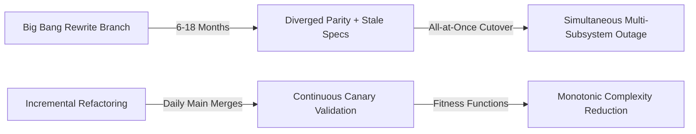
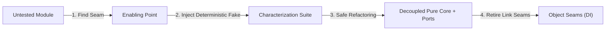
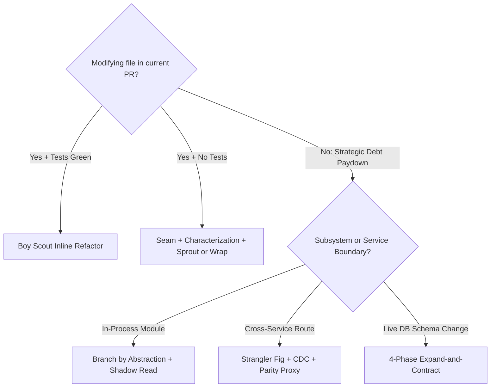
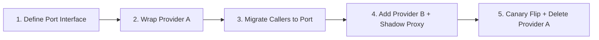
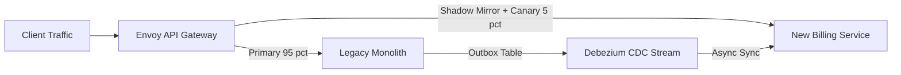
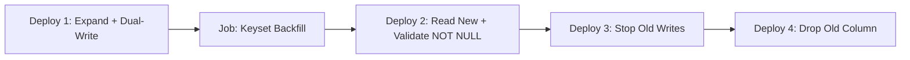

---
tags:
  - software-engineering
  - refactoring
  - legacy-code
  - evolutionary-architecture
  - dashboard
created: 2026-01-02
updated: 2026-11-13
status: 🟢
level: mid-to-senior
---
# Refactoring Complete Guide

> [!abstract] Vault Navigation
> Complete code-evolution and legacy-modernization handbook within [[Programming/Software Engineering/Software Engineering Roadmap|Software Engineering Roadmap]]. Integrates [[Programming/Software Engineering/Clean Code/Code Smells|Code Smells]], [[Programming/Software Engineering/SOLID/SOLID Principles Complete Guide|SOLID Principles Complete Guide]], [[Programming/Software Engineering/Design Patterns/Design Patterns Complete Guide|Design Patterns Complete Guide]], [[Programming/Software Engineering/Testing/Testing Complete Guide|Testing Complete Guide]], [[Programming/Software Engineering/Clean Architecture/Clean Architecture Complete Guide|Clean Architecture Complete Guide]], and [[Programming/Software Engineering/SDLC/Release Engineering & Migrations|Release Engineering & Migrations]].

**Refactoring** (Martin Fowler) is a disciplined sequence of **behavior-preserving structural transformations** applied to existing code to reduce coupling, isolate change axes, and restore engineering throughput without modifying externally observable program semantics. At architectural and storage layers, refactoring extends into continuous subsystem replacement (**Branch by Abstraction**, **Strangler Fig**) and multi-deployment schema evolution (**Expand-and-Contract**).

> [!info] Kent Beck's Two Hats Discipline
> Never mix structural refactoring and behavioral modification within the same edit cycle or pull request commit:
> - **Refactoring Hat**: Restructure control flow, module boundaries, or internal representations while the existing behavioral test suite remains green after every atomic step. Zero observable feature changes or bug fixes occur under this hat.
> - **Feature / Bugfix Hat**: Write new failing tests and implement new domain rules or bug corrections against clean seams without simultaneously rearranging unrelated subsystems.
> Combining both hats creates unreviewable diffs, entangles regressions with cosmetic edits, and destroys `git bisect` signal during production incidents.

---

## 1. First-Principles Mechanics & Legacy Code Theory

### 1.1 Semantics-Preserving AST Transformations vs. Big Bang Rewrites

Formally, a refactoring transformation $T: P \rightarrow P'$ is **semantics-preserving** with respect to a behavioral boundary $B$ if, for every valid input state $x$ and environment trace $E$ observable across $B$, executing $P'(x, E)$ produces identical outputs, state mutations, and error transitions as $P(x, E)$. In practice, equivalence is bounded to the documented public contract—replacing an $O(N^2)$ loop with an $O(N)$ hash lookup changes internal heap allocation and execution time, yet preserves output equivalence at the function boundary.

Modern refactoring engines (TypeScript Language Service, JetBrains PSI, Roslyn, `ts-morph`) achieve safe transformations by manipulating the **Abstract Syntax Tree (AST)** paired with **lexical scope resolution** and the **Control-Flow Graph (CFG)** rather than performing raw text substitution:

1. **Scope and Shadowing Verification**: Before renaming symbol `taxRate` to `rate`, the compiler checks lexical environments across closures, destructured bindings, and nested blocks. If an inner scope already binds `rate`, AST renaming either aborts with a capture conflict or alpha-renames the inner binding rather than silently shadowing the reference.
2. **Data-Flow & Side-Effect Analysis**: Extracting lines $L_i \dots L_j$ into a standalone function requires computing live-in variables (parameters needed by the slice) and live-out variables (mutations or values read after $L_j$). If two local variables are both reassigned inside the extracted slice, pure single-return extraction is invalid without returning a tuple/record or isolating side effects first.
3. **Call-Graph & Type Dispatch**: Extracting an interface or relocating a method updates every resolved reference through the compiler's symbol table, preventing orphaned dynamic calls or mismatched union narrowings that regex find-and-replace misses.

#### Why "Big Bang Rewrites" Fail Mechanically

Teams overwhelmed by tangled legacy codebases frequently propose halting feature work or spinning up a parallel "v2 rewrite" team. Big Bang rewrites fail predictably due to four concrete systems mechanics:

- **Specification Amnesia & Hyrum's Law**: Legacy production systems accumulate years of undocumented edge cases—vendor payload quirks, regulatory rounding exceptions, timezone DST workarounds, and race-condition patches. Requirements documents rarely capture this implicit contract. As Hyrum's Law states, with sufficient consumers, every observable quirk of the legacy system becomes depended upon downstream. A greenfield rewrite starts from 0% of this empirical knowledge and re-discovers each outage only after cutover.
- **Divergent Target Drift**: While the rewrite team spends 9–18 months rebuilding core capabilities, the business continues shipping features, compliance fixes, and hotfixes into the legacy production branch. The semantic parity gap $\Delta(P_{\text{legacy}}, P_{\text{v2}})$ widens continuously, forcing an endless chase that delays cutover indefinitely.
- **Zero Production Feedback Loop**: Long-lived rewrite branches operate outside live production traffic patterns—missing real query skew, connection-pool saturation modes, malformed historical database rows, and downstream consumer timeouts.
- **All-or-Nothing Cutover Blast Radius**: Flipping 100% of traffic onto an unproven system triggers simultaneous failures across authentication, persistence, serialization, and edge cases, leaving engineers unable to isolate which subsystem broke and forcing chaotic rollbacks with split-brain database state.



#### Incremental Refactoring vs. Evolutionary Architecture

- **Incremental Refactoring** upgrades local code clarity and module coupling inside small, continuous PRs merged to `main` alongside feature delivery.
- **Evolutionary Architecture** (Ford, Parsons, Sadalage) extends incrementalism to system-wide topology by encoding architectural invariants as automated **Fitness Functions** executed in CI/CD—such as `dependency-cruiser` forbidding domain-to-ORM imports, cyclomatic complexity ceilings per file, Pact consumer contract gates, and shadow-traffic parity assertions. Instead of defending design through manual architecture review boards, fitness functions turn structural coupling regressions into failing CI builds.

### 1.2 Characterization Testing & Approval Testing (Golden Master)

Michael Feathers (*Working Effectively with Legacy Code*) defines **legacy code** strictly and operationally: **code without automated tests**. Regardless of whether code was written five years ago in Java or yesterday in TypeScript, modifying untested modules leaves you guessing whether existing execution paths remain intact.

Because legacy code often lacks accurate specifications, you cannot start by writing standard "assert expected specification" unit tests—you often do not know all valid branches, and fixing quirks prematurely breaks downstream callers. Instead, you write **Characterization Tests** that record what the existing implementation **actually does today**.

#### The 4-Step Characterization Protocol

1. **Locate or Create a Seam**: Wrap non-deterministic I/O (system clock, database queries, HTTP clients) behind a temporary seam so the target module executes deterministically in memory.
2. **Probe With a Sentinel Assertion**: Invoke the target function with representative inputs and assert an intentionally wrong dummy expectation (e.g., `expect(output).toEqual('__PROBE__')`).
3. **Pin the Observed Behavior**: Execute the test runner, inspect the exact returned object, mutated properties, thrown error class/message, and recorded side-effect calls, and replace `'__PROBE__'` with the observed output. Repeat across boundary inputs (`0`, negative values, empty arrays, missing optional fields, rounding midpoints).
4. **Separate Discovery from Defect Correction**: Commit the passing characterization suite first. If you uncover a clear bug (such as an off-by-one tax rate), document it with a comment or ticket and **keep it pinned** during structural refactoring; fix the business defect only in a dedicated subsequent commit once the clean structure is locked down.

#### Approval Testing (Golden Master) for Combinatorial Legacy Logic

When a 300-line legacy function contains 8 nested conditional flags ($2^8 = 256$ branch combinations), writing hand-crafted assertions for every case is error-prone. **Approval Testing** (Golden Master) sweeps a Cartesian product of boundary inputs through the untouched legacy code, serializes the deterministic output matrix to disk (or Vitest inline/file snapshot), and validates zero behavioral drift on every structural edit.

```typescript
// tests/legacy/pricing-golden-master.spec.ts
import { describe, it, expect } from 'vitest';
import { legacyCalculateQuote } from '../../src/legacy/pricing';

describe('Legacy pricing Golden Master characterization', () => {
  it('locks down all combinations of tier, subtotal, coupon, and region', () => {
    const tiers = ['FREE', 'PRO', 'ENTERPRISE', 'UNKNOWN'] as const;
    const subtotals = [0, 99, 100, 5000, 10001] as const;
    const coupons = [null, '', 'SAVE10', 'EXPIRED', 'VIP50'] as const;
    const regions = ['US-CA', 'EU-DE', 'JP', 'XX'] as const;

    const matrixResults: Array<{
      input: Record<string, unknown>;
      outcome: unknown;
    }> = [];

    for (const tier of tiers) {
      for (const subtotalCents of subtotals) {
        for (const coupon of coupons) {
          for (const region of regions) {
            const input = { tier, subtotalCents, coupon, region };
            try {
              const quote = legacyCalculateQuote(tier, subtotalCents, coupon, region);
              matrixResults.push({ input, outcome: { ok: true, quote } });
            } catch (err) {
              const message = err instanceof Error ? err.message : String(err);
              matrixResults.push({ input, outcome: { ok: false, error: message } });
            }
          }
        }
      }
    }

    // Snapshot captures all 400 combinatorial outputs atomically.
    // Any unintended semantic drift during refactoring fails this diff immediately.
    expect(matrixResults).toMatchSnapshot();
  });
});
```

Verify branch coverage right after running the Golden Master (`vitest run --coverage`). If uncovered lines remain inside `pricing.ts`, add the missing input predicates to the matrix arrays until every reachable branch is pinned.

### 1.3 Feathers' Seam Model: Object, Link, and Compile Seams

To test tightly coupled legacy code without performing a dangerous upfront rewrite, you exploit **Seams**:

- **Seam**: A point in a program where you can **alter execution behavior without editing the code at that call site**.
- **Enabling Point**: The specific mechanism where you select *which* behavior runs at the seam (for example, overriding a method in a test subclass, passing a dependency to a constructor, or swapping a module path in a test runner).



#### 1. Object Seams (Polymorphism & Dependency Injection)

An **Object Seam** relies on method dispatch or interface polymorphism: two callers execute the same line `this.clock.now()` or `this.saveOrder(record)`, while runtime polymorphism resolves which implementation executes.

- **Extraction Move (`Extract and Override Call`)**: When a legacy method invokes a static global directly (`const now = Date.now()` or `await GlobalDb.insert(row)`), move that single line into a `protected` method (`protected nowMs(): number { return Date.now(); }`). In the test suite, subclass the legacy class and `override nowMs()` to return a fixed epoch timestamp. Zero external callers or signatures change.
- **Target State (`Extract Interface` + `Parameterize Constructor`)**: Once characterization tests pass, promote the `protected` methods onto explicit TypeScript interfaces (`Clock`, `OrderRepository`) injected via the constructor with production defaults.

#### 2. Link Seams (Module Resolution & Linker Interception)

A **Link Seam** alters which target implementation resolves across a static `import`, dynamic linker symbol, or package lookup boundary without changing the calling file's source code.

- **JavaScript / TypeScript**: `vi.mock('../infra/global-db')`, Jest module mappers, Node `--import` loader hooks, or `package.json` `exports` / conditional subpath imports.
- **Python**: `unittest.mock.patch('module.db_client')` or `monkeypatch.setattr`.
- **C / C++ / JVM**: Linking against a stub `.o` object file in test builds, `LD_PRELOAD` ELF shared-library symbol interposition, or overriding test classpath JAR order.

**Engineering Hazard**: Link Seams silently rely on global module-cache state. In parallel test runners or monorepo graph transformations, `vi.mock` hoisting breaks if a module is imported transitively before the mock activates, and it provides zero compiler type-checking if the real dependency's signature drifts. Treat Link Seams strictly as **temporary scaffolding** to pin behavior on untestable singletons; remove them once Object Seams are in place.

#### 3. Compile / Preprocessing Seams

A **Compile Seam** substitutes text or source AST variants prior to compilation—historically C/C++ `#ifdef TESTING` / `#define malloc test_malloc`, or modern TypeScript `tsconfig.test.json` compiler `paths` aliases redirecting `@infra/mailer` to a stub directory during test builds.

**Engineering Hazard**: Conditional compilation creates **divergent code under test**—the test binary no longer compiles the exact production AST, hiding header/type mismatches and dead-branch bugs until production builds run. Prefer Object Seams exclusively in managed runtimes; reserve Compile Seams only for C/C++ hardware-register or OS-syscall boundaries where virtual dispatch is forbidden.

| Seam Category | Enabling Mechanism | Compiler Type Safety | Parallel Test Isolation | Recommended Lifecycle |
|---|---|---|---|---|
| **Object Seam** | Constructor DI, Interface Port, `protected` subclass override | **Full**: compiler enforces contract parity | **High**: each test instantiates isolated fakes | **Permanent target architecture** |
| **Link Seam** | `vi.mock`, `monkeypatch`, `LD_PRELOAD`, classpath order | **Low**: mock shapes easily drift from real exports | **Poor**: pollutes shared module registry | **Temporary entry bridge only** |
| **Compile Seam** | `#ifdef`, C macros, `tsconfig` path overrides | **Split**: test graph differs from prod binary | **Medium**: isolated per build target | **Last resort** (embedded C/C++ hardware I/O) |

### 1.4 Technical Debt Economics & Quantitative Prioritization (Churn $\times$ Complexity)

Technical debt behaves like financial leverage with two distinct terms:

- **Debt Principal ($P$)**: The one-time engineering effort required to refactor a module into clean, tested, decoupled abstractions.
- **Debt Interest ($I$)**: The recurring velocity tax paid every week teams modify that module—longer PR cycle times, cognitive overload, merge conflicts, manual QA cycles, and production regressions.

$$\text{Refactoring ROI} = \frac{\sum_{t=1}^{H} I(t) - P}{P}$$

A 2,000-line legacy billing exporter with cyclomatic complexity $45$ that changes **zero times per year** incurs **zero ongoing interest** ($I = 0$). Spending three sprints refactoring it yields negative ROI because you pay Principal $P$ while saving zero future engineering hours. Conversely, a 600-line checkout orchestrator modified in **42 commits over 90 days** with cyclomatic complexity $38$ charges compounding interest on every sprint.

#### Prioritizing via Git Churn $\times$ Complexity Hotspots

Behavioral code analysis (Adam Tornhill, *Your Code as a Crime Scene*) identifies high-interest modules objectively by multiplying **change frequency (Git churn)** by **structural complexity**. Files with high churn *and* high complexity sit in the critical Quadrant I hotspot zone. Additionally, **Temporal Coupling** (two files modified together in $> 40\%$ of commits despite having no direct code dependency) exposes hidden architectural copy-paste or shotgun surgery across module boundaries.

Below is a zero-dependency Node.js CLI analyzer (`scripts/analyze-hotspots.mjs`) that mines local Git history, computes McCabe control-flow complexity across `.ts`/`.tsx`/`.js` files, calculates normalized Hotspot Priority Scores, and detects top temporally coupled file pairs:

```javascript
// scripts/analyze-hotspots.mjs
import { execFileSync } from 'node:child_process';
import fs from 'node:fs';
import path from 'node:path';

const SINCE_WINDOW = process.argv[2] ?? '180 days ago';
const TARGET_EXTS = new Set(['.ts', '.tsx', '.js', '.jsx']);

function gitNumstatLines(sinceWindow) {
  const raw = execFileSync(
    'git',
    ['log', `--since=${sinceWindow}`, '--no-merges', '--numstat', '--format=__COMMIT__%H'],
    { encoding: 'utf8', maxBuffer: 64 * 1024 * 1024 }
  );
  return raw.split(/\r?\n/);
}

function estimateCyclomaticComplexity(source) {
  // Strip block/line comments and string literals to avoid false branch hits
  const stripped = source
    .replace(/\/\*[\s\S]*?\*\//g, '')
    .replace(/\/\/.*$/gm, '')
    .replace(/(["'`])(?:\\.|(?!\1).)*\1/g, '""');

  const branchTokens = stripped.match(
    /\b(if|else\s+if|for|while|case|catch)\b|&&|\|\||\?\?|\?(?![.:])/g
  );
  return 1 + (branchTokens ? branchTokens.length : 0);
}

function analyzeRepository(sinceWindow) {
  const lines = gitNumstatLines(sinceWindow);
  const fileStats = new Map();
  const commitFiles = [];
  let currentSet = new Set();

  for (const line of lines) {
    if (line.startsWith('__COMMIT__')) {
      if (currentSet.size > 1 && currentSet.size <= 25) {
        commitFiles.push([...currentSet].sort());
      }
      currentSet = new Set();
      continue;
    }
    const match = /^(\d+|-)\t(\d+|-)\t(.+)$/.exec(line);
    if (!match) continue;

    const added = match[1] === '-' ? 0 : Number(match[1]);
    const deleted = match[2] === '-' ? 0 : Number(match[2]);
    const filePath = match[3];
    if (!TARGET_EXTS.has(path.extname(filePath))) continue;
    if (!fs.existsSync(filePath)) continue; // Skip deleted files

    currentSet.add(filePath);
    const prev = fileStats.get(filePath) ?? { commits: 0, linesChurned: 0 };
    prev.commits += 1;
    prev.linesChurned += added + deleted;
    fileStats.set(filePath, prev);
  }
  if (currentSet.size > 1 && currentSet.size <= 25) {
    commitFiles.push([...currentSet].sort());
  }

  const maxCommits = Math.max(1, ...[...fileStats.values()].map((s) => s.commits));
  const scored = [];

  for (const [filePath, stat] of fileStats.entries()) {
    const content = fs.readFileSync(filePath, 'utf8');
    const loc = content.split(/\r?\n/).length;
    const complexity = estimateCyclomaticComplexity(content);
    scored.push({ filePath, commits: stat.commits, linesChurned: stat.linesChurned, loc, complexity });
  }

  const maxComplexity = Math.max(1, ...scored.map((r) => r.complexity));
  for (const row of scored) {
    const normChurn = row.commits / maxCommits;
    const normComplexity = row.complexity / maxComplexity;
    row.hotspotScore = Number((normChurn * normComplexity * 100).toFixed(2));
  }
  scored.sort((a, b) => b.hotspotScore - a.hotspotScore);

  // Compute temporal coupling pairs (co-changed across >= 4 commits)
  const pairCounts = new Map();
  for (const filesInCommit of commitFiles) {
    for (let i = 0; i < filesInCommit.length; i += 1) {
      for (let j = i + 1; j < filesInCommit.length; j += 1) {
        const key = `${filesInCommit[i]}::${filesInCommit[j]}`;
        pairCounts.set(key, (pairCounts.get(key) ?? 0) + 1);
      }
    }
  }

  const coupledPairs = [];
  for (const [key, sharedCommits] of pairCounts.entries()) {
    if (sharedCommits < 4) continue;
    const [fileA, fileB] = key.split('::');
    const minCommits = Math.min(fileStats.get(fileA).commits, fileStats.get(fileB).commits);
    const couplingRatio = Number((sharedCommits / minCommits).toFixed(2));
    if (couplingRatio >= 0.45) {
      coupledPairs.push({ fileA, fileB, sharedCommits, couplingRatio });
    }
  }
  coupledPairs.sort((a, b) => b.sharedCommits - a.sharedCommits);

  return { hotspots: scored.slice(0, 15), coupledPairs: coupledPairs.slice(0, 10) };
}

const report = analyzeRepository(SINCE_WINDOW);
console.log(`=== Top Refactoring Hotspots (window: ${SINCE_WINDOW}) ===`);
console.table(report.hotspots);
console.log('=== High Temporal Coupling Pairs (Shotgun Surgery Signals) ===');
console.table(report.coupledPairs);
```

Run `node scripts/analyze-hotspots.mjs "90 days ago"` before quarterly roadmap planning. Files sitting in the top 10 by `hotspotScore` justify dedicated Debt Principal paydown; high-complexity files missing from the list remain untouched until active product work hits them.

---

## 2. Decision Matrix & Strategy Playbook

Selecting the wrong refactoring scope either wastes sprints over-engineering stable code or causes outages by attacking deeply coupled boundaries without containment seams.



### 2.1 Strategy Selection Matrix

| Strategy | Triggering Condition | Preconditions & Safety Harness | Rollback Mechanism | Typical Duration |
|---|---|---|---|---|
| **Inline Micro-Refactor (`Boy Scout Rule`)** | Code touched during active feature/bugfix shows localized smells (long method, deep nesting, primitive clump) | Existing fast unit/integration test suite covers target lines; separate commit from feature edit | `git revert` single commit | 15 mins – 4 hours |
| **Tactical Isolation (`Sprout` / `Wrap` / `Extract & Override`)** | Must add urgent rule or fix defect inside a 500-line untested God Class | Create minimal Object Seam (`Extract & Override`) + write Characterization Tests on affected slice | Toggle caller / revert single commit | 0.5 – 2 days |
| **Branch by Abstraction** | Swapping core internal engine (ORM, search SDK, pricing engine, payment provider) across 10–100 call sites in one repo | Unified Port interface, constructor DI, Feature Flag, optional `ShadowComparingProxy` | Instant runtime feature flag flip (`100% -> 0%`) without redeploy | 1 – 4 weeks (continuous `main` merges) |
| **Strangler Fig + Shadow Traffic** | Extracting bounded domains out of a monolith into standalone service/runtime without feature freeze | L7 Routing Proxy (Envoy/Nginx/Kong), Outbox/Debezium CDC sync, asynchronous parity comparator | Instant L7 gateway route weight shift (`100% -> 0%` back to monolith) | 1 – 6 months slice-by-slice |
| **Expand-and-Contract (Parallel Change)** | Breaking DB schema refactor (column rename, column split, `INT -> BIGINT`, table split) under live $N / N-1$ pods | 4 separate deployments, dual-write repo or DB trigger, keyset-paginated backfill, `lock_timeout` | Keep old column/writes intact until Phase 4; instant app rollback in Phases 1–3 | 2 – 4 deploy cycles |

### 2.2 Detailed Execution Criteria

1. **Boy Scout Rule (Opportunistic Hygiene)**: Apply only to files your current task already touches. Never turn a 50-line bugfix PR into a 1,400-line cross-module sweep; keep refactoring commits isolated from functional commits inside the PR so reviewers verify behavioral parity cleanly.
2. **Sprout Method / Sprout Class**: When adding a new discount or compliance validation rule to an untested 400-line handler, do **not** inline 40 lines of `if/else` into the existing method. Write the new logic in a pure, fully unit-tested `Sprout` function/class (`calculateHolidaySurcharge()`), then invoke it via a single line at the insertion site in the legacy method.
3. **Wrap Method / Wrap Class (Decorator)**: When every caller of `processPayment()` needs newly introduced idempotency checks, audit logging, or metrics emission without rewriting the legacy body, rename `processPayment()` to `processPaymentInternal()` and wrap it inside a clean outer `processPayment()`—or wrap the legacy class inside a Decorator implementing the same interface.
4. **Branch by Abstraction**: Always choose this **before** reaching for microservices when replacing an in-process dependency. Keeping `main` continuously green eliminates merge-conflict hell while enabling dark-read parity validation in production.
5. **Strangler Fig**: Reserve this for true organizational scaling boundaries, independent runtime requirements (e.g., moving ML inference or high-throughput ingestion out of a Ruby/PHP monolith into Go/Rust), or breaking a shared database into bounded-context ownership.

### 2.3 Explicit Stop Criteria (When NOT to Refactor)

- **Scheduled Decommission**: Any module/service slated for retirement within 1–2 quarters receives security patches only.
- **Zero Churn / Zero Interest Zone**: Stable, tested-by-usage utility or legacy report adapter untouched for $> 12$ months.
- **Active Production Outage**: During Sev-1 mitigation, execute minimal surgical rollbacks or hotfixes; defer structural cleanup to post-incident follow-up.
- **Zero Verification Oracle**: Never start moving code across files before establishing either automated characterization tests, deterministic shadow parity, or repeatable contract verification.

### 2.4 Refactoring Anti-Patterns

- **Speculative Generality ("Framework Building")**: Introducing 5 abstract factories, generic repository base classes, and event buses around a problem with one concrete requirement violates YAGNI and inflates change cost. Apply the **Rule of Three**: duplicate twice cleanly if uncertain; extract the shared abstraction only on the third concrete variation when the true shared axis is visible.
- **Distributed Big Ball of Mud**: Splitting a tightly coupled monolith into microservices *before* refactoring logical module seams inside the monolith turns fast in-memory method calls into slow, failure-prone distributed network calls requiring distributed transactions across shared tables. Decouple module boundaries inside the monolith first (Modular Monolith), then extract along clean interfaces via Strangler Fig.

---

## 3. Complete Hands-On Multi-Stage Legacy Refactoring Workshop (TypeScript + Vitest)

This workshop walks through refactoring a production-style legacy billing module end to end without breaking 22 existing callers or introducing silent billing regressions.

### Project Directory Layout (Target Evolution)

```text
src/billing/
  legacy/
    legacy-globals.ts                 # Existing singletons wrapped by adapters
    legacy-order-billing-processor.ts # Stage 0 -> Stage 2 seams -> Stage 3 thin facade -> Stage 4 deleted
  domain/
    money.ts                          # Stage 3 Value Object (integer minor units + currency)
    tax-rate.ts                       # Stage 3 Value Object (basis points, zero float drift)
    pricing-policies.ts               # Stage 3 Strategy Map (jurisdiction tax + discount rules)
    quote-calculator.ts               # Stage 3 Pure Split-Phase core
  ports/
    billing-ports.ts                  # Stage 2/3 Clock, Config, Repository, Audit interfaces
  infra/
    legacy-port-adapters.ts           # Stage 2 default adapters wrapping legacy singletons
  application/
    order-billing-service.ts          # Stage 3 clean use-case orchestrator
tests/billing/
  legacy-order-billing.characterization.spec.ts # Stage 1 characterization suite
  order-billing.domain.spec.ts                  # Stage 4 pure domain + service unit suite
```

### Stage 0: The Untested Legacy Baseline

Below is a realistic 115-line legacy processor exhibiting five intersecting hazards: hidden static/global state (`Date.now()`, `process.env`, `LegacyDbPool`, `LegacyAuditLogger`), 5-level conditional nesting, hidden mutation of the caller's `rawOrder` object, IEEE-754 floating-point tax/discount arithmetic, and swallowed database exceptions that mask outages as generic failures.

```typescript
// src/billing/legacy/legacy-globals.ts
export interface LegacyDbResult {
  readonly invoiceId: string;
}

export const LegacyDbPool = {
  async execute(sql: string, params: ReadonlyArray<unknown>): Promise<LegacyDbResult> {
    if (!sql.includes('INSERT')) {
      throw new Error('Unsupported legacy query');
    }
    return { invoiceId: `INV-${String(params[0])}-${Date.now()}` };
  },
};

export const LegacyAuditLogger = {
  async append(eventType: string, payload: Record<string, unknown>): Promise<void> {
    process.stdout.write(`${eventType}:${JSON.stringify(payload)}\n`);
  },
};
```

```typescript
// src/billing/legacy/legacy-order-billing-processor.ts (Stage 0: Untouched Legacy)
import { LegacyAuditLogger, LegacyDbPool } from './legacy-globals';

export interface LegacyLineItem {
  sku: string;
  unitPriceCents: number;
  qty: number;
  discountedCents?: number;
}

export interface LegacyRawOrder {
  orderId: string;
  customerId: string;
  tier: string;
  currency: string;
  couponCode?: string | null;
  items: LegacyLineItem[];
  status?: string;
  processedAtEpochMs?: number;
}

export interface LegacyBillingOutcome {
  ok: boolean;
  invoiceId: string | null;
  totalCents: number;
  error?: string;
}

export class LegacyOrderBillingProcessor {
  async process(rawOrder: LegacyRawOrder): Promise<LegacyBillingOutcome> {
    try {
      if (rawOrder && rawOrder.orderId && rawOrder.items && rawOrder.items.length > 0) {
        const now = new Date();
        const dayOfWeek = now.getUTCDay();
        const isMonthEnd = new Date(Date.UTC(now.getUTCFullYear(), now.getUTCMonth() + 1, 0)).getUTCDate() === now.getUTCDate();
        const jurisdiction = process.env.TAX_JURISDICTION ?? 'US_CA';
        const capEnv = Number(process.env.LEGACY_DISCOUNT_CAP_CENTS ?? '10000');

        let subtotalCents = 0;
        for (const item of rawOrder.items) {
          if (item.qty > 0 && item.unitPriceCents >= 0) {
            let lineCents = item.unitPriceCents * item.qty;
            if (rawOrder.currency === 'EUR') {
              lineCents = Math.round(lineCents * 1.08);
            } else if (rawOrder.currency === 'GBP') {
              lineCents = Math.round(lineCents * 1.27);
            } else if (rawOrder.currency !== 'USD') {
              return { ok: false, invoiceId: null, totalCents: 0, error: 'UNSUPPORTED_CURRENCY' };
            }

            if (rawOrder.tier === 'VIP') {
              const vipOff = Math.round(lineCents * 0.12);
              lineCents = lineCents - vipOff;
            }
            // Hidden mutation relied upon by legacy PDF exporter downstream
            item.discountedCents = lineCents;
            subtotalCents += lineCents;
          } else {
            return { ok: false, invoiceId: null, totalCents: 0, error: 'INVALID_LINE_ITEM' };
          }
        }

        let promoDiscount = 0;
        if (rawOrder.couponCode === 'SAVE20' && subtotalCents >= 5000) {
          promoDiscount = Math.round(subtotalCents * 0.2);
        } else if (dayOfWeek === 5) {
          // Historical Friday 5% promo stacks unless SAVE20 applied
          promoDiscount = Math.round(subtotalCents * 0.05);
        }
        if (isMonthEnd && rawOrder.tier === 'ENTERPRISE') {
          promoDiscount += 1500;
        }
        if (promoDiscount > capEnv) {
          promoDiscount = capEnv;
        }

        const netCents = Math.max(0, subtotalCents - promoDiscount);
        let taxRate = 0.0725;
        if (jurisdiction === 'US_CA') {
          taxRate = 0.0825;
        } else if (jurisdiction === 'EU_DE') {
          taxRate = 0.19;
        } else if (jurisdiction === 'UK') {
          taxRate = 0.2;
        }

        const taxCents = Math.round(netCents * taxRate);
        const totalCents = netCents + taxCents;

        const dbRes = await LegacyDbPool.execute(
          'INSERT INTO invoices (order_id, customer_id, total_cents) VALUES ($1, $2, $3)',
          [rawOrder.orderId, rawOrder.customerId, totalCents]
        );
        await LegacyAuditLogger.append('INVOICE_ISSUED', {
          orderId: rawOrder.orderId,
          invoiceId: dbRes.invoiceId,
          totalCents,
        });

        // Hidden input mutations
        rawOrder.status = 'BILLED';
        rawOrder.processedAtEpochMs = now.getTime();

        return { ok: true, invoiceId: dbRes.invoiceId, totalCents };
      }
      return { ok: false, invoiceId: null, totalCents: 0, error: 'EMPTY_ORDER' };
    } catch {
      // Swallowed DB / Audit / runtime errors returned as opaque failure!
      return { ok: false, invoiceId: null, totalCents: 0, error: 'BILLING_FAILED' };
    }
  }
}
```

Do **not** extract helpers, replace `Math.round`, or remove the `rawOrder` mutation yet. First, create non-invasive seams so you can record exact legacy behavior under Vitest.

### Stage 1: Minimal Seams & Characterization Testing (Zero Logic Edits)

Apply **Extract and Override Call** exclusively to the four non-deterministic boundaries (`now()`, `getJurisdiction()`, `getDiscountCapCents()`, `persistInvoice()`, `recordAudit()`). Every arithmetic expression, conditional branch, and object mutation remains byte-for-byte intact.

```typescript
// src/billing/legacy/legacy-order-billing-processor.ts (Stage 1: Minimal Protected Hooks)
import { LegacyAuditLogger, LegacyDbPool } from './legacy-globals';

export interface LegacyLineItem {
  sku: string;
  unitPriceCents: number;
  qty: number;
  discountedCents?: number;
}

export interface LegacyRawOrder {
  orderId: string;
  customerId: string;
  tier: string;
  currency: string;
  couponCode?: string | null;
  items: LegacyLineItem[];
  status?: string;
  processedAtEpochMs?: number;
}

export interface LegacyBillingOutcome {
  ok: boolean;
  invoiceId: string | null;
  totalCents: number;
  error?: string;
}

export class LegacyOrderBillingProcessor {
  async process(rawOrder: LegacyRawOrder): Promise<LegacyBillingOutcome> {
    try {
      if (rawOrder && rawOrder.orderId && rawOrder.items && rawOrder.items.length > 0) {
        const now = this.currentDate();
        const dayOfWeek = now.getUTCDay();
        const isMonthEnd =
          new Date(Date.UTC(now.getUTCFullYear(), now.getUTCMonth() + 1, 0)).getUTCDate() ===
          now.getUTCDate();
        const jurisdiction = this.readJurisdiction();
        const capEnv = this.readDiscountCapCents();

        let subtotalCents = 0;
        for (const item of rawOrder.items) {
          if (item.qty > 0 && item.unitPriceCents >= 0) {
            let lineCents = item.unitPriceCents * item.qty;
            if (rawOrder.currency === 'EUR') {
              lineCents = Math.round(lineCents * 1.08);
            } else if (rawOrder.currency === 'GBP') {
              lineCents = Math.round(lineCents * 1.27);
            } else if (rawOrder.currency !== 'USD') {
              return { ok: false, invoiceId: null, totalCents: 0, error: 'UNSUPPORTED_CURRENCY' };
            }

            if (rawOrder.tier === 'VIP') {
              const vipOff = Math.round(lineCents * 0.12);
              lineCents = lineCents - vipOff;
            }
            item.discountedCents = lineCents;
            subtotalCents += lineCents;
          } else {
            return { ok: false, invoiceId: null, totalCents: 0, error: 'INVALID_LINE_ITEM' };
          }
        }

        let promoDiscount = 0;
        if (rawOrder.couponCode === 'SAVE20' && subtotalCents >= 5000) {
          promoDiscount = Math.round(subtotalCents * 0.2);
        } else if (dayOfWeek === 5) {
          promoDiscount = Math.round(subtotalCents * 0.05);
        }
        if (isMonthEnd && rawOrder.tier === 'ENTERPRISE') {
          promoDiscount += 1500;
        }
        if (promoDiscount > capEnv) {
          promoDiscount = capEnv;
        }

        const netCents = Math.max(0, subtotalCents - promoDiscount);
        let taxRate = 0.0725;
        if (jurisdiction === 'US_CA') {
          taxRate = 0.0825;
        } else if (jurisdiction === 'EU_DE') {
          taxRate = 0.19;
        } else if (jurisdiction === 'UK') {
          taxRate = 0.2;
        }

        const taxCents = Math.round(netCents * taxRate);
        const totalCents = netCents + taxCents;

        const invoiceId = await this.persistInvoice(rawOrder.orderId, rawOrder.customerId, totalCents);
        await this.recordAudit('INVOICE_ISSUED', {
          orderId: rawOrder.orderId,
          invoiceId,
          totalCents,
        });

        rawOrder.status = 'BILLED';
        rawOrder.processedAtEpochMs = now.getTime();

        return { ok: true, invoiceId, totalCents };
      }
      return { ok: false, invoiceId: null, totalCents: 0, error: 'EMPTY_ORDER' };
    } catch {
      return { ok: false, invoiceId: null, totalCents: 0, error: 'BILLING_FAILED' };
    }
  }

  protected currentDate(): Date {
    return new Date();
  }

  protected readJurisdiction(): string {
    return process.env.TAX_JURISDICTION ?? 'US_CA';
  }

  protected readDiscountCapCents(): number {
    return Number(process.env.LEGACY_DISCOUNT_CAP_CENTS ?? '10000');
  }

  protected async persistInvoice(
    orderId: string,
    customerId: string,
    totalCents: number
  ): Promise<string> {
    const res = await LegacyDbPool.execute(
      'INSERT INTO invoices (order_id, customer_id, total_cents) VALUES ($1, $2, $3)',
      [orderId, customerId, totalCents]
    );
    return res.invoiceId;
  }

  protected async recordAudit(eventType: string, payload: Record<string, unknown>): Promise<void> {
    await LegacyAuditLogger.append(eventType, payload);
  }
}
```

Now write the **Characterization Test Suite** pinning every observed quirk (Friday promo stacking, month-end Enterprise bonus, currency conversion rounding, input mutation, and swallowed DB exceptions):

```typescript
// tests/billing/legacy-order-billing.characterization.spec.ts
import { describe, it, expect } from 'vitest';
import {
  LegacyOrderBillingProcessor,
  LegacyRawOrder,
} from '../../src/billing/legacy/legacy-order-billing-processor';

class TestableLegacyBillingProcessor extends LegacyOrderBillingProcessor {
  public persistedCalls: Array<{ orderId: string; customerId: string; totalCents: number }> = [];
  public auditEvents: Array<{ eventType: string; payload: Record<string, unknown> }> = [];
  public shouldThrowOnDb = false;

  constructor(
    private readonly fixedIsoDate: string,
    private readonly jurisdiction = 'US_CA',
    private readonly discountCapCents = 10_000
  ) {
    super();
  }

  protected override currentDate(): Date {
    return new Date(this.fixedIsoDate);
  }

  protected override readJurisdiction(): string {
    return this.jurisdiction;
  }

  protected override readDiscountCapCents(): number {
    return this.discountCapCents;
  }

  protected override async persistInvoice(
    orderId: string,
    customerId: string,
    totalCents: number
  ): Promise<string> {
    if (this.shouldThrowOnDb) {
      throw new Error('ECONNREFUSED');
    }
    this.persistedCalls.push({ orderId, customerId, totalCents });
    return `INV-TEST-${orderId}`;
  }

  protected override async recordAudit(
    eventType: string,
    payload: Record<string, unknown>
  ): Promise<void> {
    this.auditEvents.push({ eventType, payload });
  }
}

describe('LegacyOrderBillingProcessor Characterization Suite', () => {
  it('applies EUR conversion, VIP 12% line discount, US_CA tax, and mutates rawOrder in place', async () => {
    // 2026-11-10 is Tuesday (dayOfWeek = 2, not month end)
    const sut = new TestableLegacyBillingProcessor('2026-11-10T12:00:00Z', 'US_CA');
    const order: LegacyRawOrder = {
      orderId: 'ORD-1',
      customerId: 'CUST-9',
      tier: 'VIP',
      currency: 'EUR',
      items: [{ sku: 'A1', unitPriceCents: 1000, qty: 2 }],
    };

    const result = await sut.process(order);

    // Observed trace: 2000 * 1.08 = 2160; VIP 12% off = 259 -> 1901; tax = Math.round(1901 * 0.0825) = 157 -> 2058
    expect(result).toEqual({ ok: true, invoiceId: 'INV-TEST-ORD-1', totalCents: 2058 });
    expect(order.items[0].discountedCents).toBe(1901);
    expect(order.status).toBe('BILLED');
    expect(order.processedAtEpochMs).toBe(Date.parse('2026-11-10T12:00:00Z'));
    expect(sut.persistedCalls).toEqual([{ orderId: 'ORD-1', customerId: 'CUST-9', totalCents: 2058 }]);
  });

  it('applies Friday 5% discount when SAVE20 is absent and caps total discount', async () => {
    // 2026-11-13 is Friday (dayOfWeek = 5)
    const sut = new TestableLegacyBillingProcessor('2026-11-13T09:00:00Z', 'UK', 300);
    const order: LegacyRawOrder = {
      orderId: 'ORD-2',
      customerId: 'CUST-10',
      tier: 'STANDARD',
      currency: 'USD',
      items: [{ sku: 'B1', unitPriceCents: 10000, qty: 1 }],
    };

    const result = await sut.process(order);

    // 5% of 10000 = 500, capped to 300 -> net 9700 -> UK 20% tax 1940 -> total 11640
    expect(result).toEqual({ ok: true, invoiceId: 'INV-TEST-ORD-2', totalCents: 11640 });
  });

  it('stacks month-end ENTERPRISE bonus onto Friday promo without SAVE20', async () => {
    // 2026-07-31 is Friday AND last day of July
    const sut = new TestableLegacyBillingProcessor('2026-07-31T23:59:00Z', 'DEFAULT', 10_000);
    const order: LegacyRawOrder = {
      orderId: 'ORD-3',
      customerId: 'CUST-ENT',
      tier: 'ENTERPRISE',
      currency: 'USD',
      items: [{ sku: 'C1', unitPriceCents: 4000, qty: 1 }],
    };

    const result = await sut.process(order);

    // Friday 5% (200) + Enterprise month-end (1500) = 1700 -> net 2300 -> fallback 7.25% tax (167) -> 2467
    expect(result).toEqual({ ok: true, invoiceId: 'INV-TEST-ORD-3', totalCents: 2467 });
  });

  it('swallows DB errors and returns BILLING_FAILED outcome without mutating order status', async () => {
    const sut = new TestableLegacyBillingProcessor('2026-11-10T12:00:00Z', 'US_CA');
    sut.shouldThrowOnDb = true;
    const order: LegacyRawOrder = {
      orderId: 'ORD-4',
      customerId: 'CUST-11',
      tier: 'STANDARD',
      currency: 'USD',
      items: [{ sku: 'D1', unitPriceCents: 500, qty: 1 }],
    };

    const result = await sut.process(order);

    expect(result).toEqual({ ok: false, invoiceId: null, totalCents: 0, error: 'BILLING_FAILED' });
    expect(order.status).toBeUndefined();
  });

  it('rejects empty items or invalid currency deterministically', async () => {
    const sut = new TestableLegacyBillingProcessor('2026-11-10T12:00:00Z');
    expect(
      await sut.process({
        orderId: 'ORD-5',
        customerId: 'C1',
        tier: 'STANDARD',
        currency: 'USD',
        items: [],
      })
    ).toEqual({ ok: false, invoiceId: null, totalCents: 0, error: 'EMPTY_ORDER' });

    expect(
      await sut.process({
        orderId: 'ORD-6',
        customerId: 'C1',
        tier: 'STANDARD',
        currency: 'JPY',
        items: [{ sku: 'X', unitPriceCents: 100, qty: 1 }],
      })
    ).toEqual({ ok: false, invoiceId: null, totalCents: 0, error: 'UNSUPPORTED_CURRENCY' });
  });
});
```

### Stage 2: Introduce Explicit Port Interfaces via Parameterized Constructor

Subclassing (`TestableLegacyBillingProcessor`) was only our temporary foothold. Promote the `protected` methods onto proper **Port interfaces** (`Extract Interface` + `Parameterize Constructor`) while defaulting constructor dependencies to the legacy global adapters so every existing `new LegacyOrderBillingProcessor()` call site compiles and runs unchanged.

```typescript
// src/billing/ports/billing-ports.ts
export interface Clock {
  now(): Date;
}

export interface BillingConfigProvider {
  getTaxJurisdiction(): string;
  getDiscountCapCents(): number;
}

export interface OrderLedgerRepository {
  saveInvoice(record: {
    readonly orderId: string;
    readonly customerId: string;
    readonly totalCents: number;
  }): Promise<string>;
}

export interface AuditSink {
  record(eventType: string, payload: Record<string, unknown>): Promise<void>;
}

export interface BillingDependencies {
  readonly clock: Clock;
  readonly config: BillingConfigProvider;
  readonly ledger: OrderLedgerRepository;
  readonly audit: AuditSink;
}
```

```typescript
// src/billing/infra/legacy-port-adapters.ts
import { LegacyAuditLogger, LegacyDbPool } from '../legacy/legacy-globals';
import { BillingDependencies } from '../ports/billing-ports';

export function createLegacyBillingDependencies(): BillingDependencies {
  return {
    clock: {
      now: () => new Date(),
    },
    config: {
      getTaxJurisdiction: () => process.env.TAX_JURISDICTION ?? 'US_CA',
      getDiscountCapCents: () => Number(process.env.LEGACY_DISCOUNT_CAP_CENTS ?? '10000'),
    },
    ledger: {
      saveInvoice: async ({ orderId, customerId, totalCents }) => {
        const res = await LegacyDbPool.execute(
          'INSERT INTO invoices (order_id, customer_id, total_cents) VALUES ($1, $2, $3)',
          [orderId, customerId, totalCents]
        );
        return res.invoiceId;
      },
    },
    audit: {
      record: async (eventType, payload) => {
        await LegacyAuditLogger.append(eventType, payload);
      },
    },
  };
}
```

Inject `BillingDependencies` via **Parameterize Constructor** (`constructor(deps: Partial<BillingDependencies> = {})`) inside `LegacyOrderBillingProcessor` while keeping the `protected` hooks delegating to `this.legacyDefaults`:

```typescript
// Stage 2 constructor seam inside LegacyOrderBillingProcessor
const resolvedDeps: BillingDependencies = {
  ...createLegacyBillingDependencies(),
  ...deps,
};
```

Now unit tests pass deterministic fakes via constructor DI with zero inheritance (`new LegacyOrderBillingProcessor({ clock: fixedClock, ledger: inMemoryLedger })`), while all 22 production callers instantiating `new LegacyOrderBillingProcessor()` continue binding to legacy singletons unchanged.

### Stage 3: Domain Extraction (Value Objects, Split Phase, Guard Clauses & Strategy Map)

Now protected by the green characterization suite, decompose the 100-line God Method cleanly:

1. **Replace Primitive with Value Object (`Money`, `TaxRate`)**: Store exact integer minor units (`cents`) and integer basis points (`bps`, where $8.25\% = 825\text{ bps}$) to prevent IEEE-754 floating-point drift, while enforcing invariants (`NaN`, negative minor units, currency mismatch) at construction boundaries.
2. **Replace Conditional with Polymorphism / Strategy Map**: Replace jurisdiction `if/else if` branching with a typed `Record<TaxJurisdiction, TaxRate>` registry, and currency FX conversion with an explicit lookup table.
3. **Split Phase + Guard Clauses**: Separate **Phase 1 (`parseOrderRequest`)** $\rightarrow$ **Phase 2 (`calculateOrderQuote`, 100% pure, zero side effects, zero mutation)** $\rightarrow$ **Phase 3 (`OrderBillingService.billOrder`, explicit typed Result distinguishing domain validation vs infrastructure fault)**.
4. **Compatibility Facade (`LegacyOrderBillingProcessor`)**: Keep the legacy class temporarily as a thin delegating adapter translating clean `OrderBillingService` outputs back into the legacy mutated `rawOrder` contract for any unmigrated downstream caller.

```typescript
// src/billing/domain/money.ts
export type CurrencyCode = 'USD' | 'EUR' | 'GBP';

export class Money {
  private constructor(
    public readonly cents: number,
    public readonly currency: CurrencyCode
  ) {
    if (!Number.isSafeInteger(cents)) {
      throw new RangeError(`Money cents must be a safe integer, got ${cents}`);
    }
  }

  static fromCents(cents: number, currency: CurrencyCode): Money {
    return new Money(cents, currency);
  }

  static zero(currency: CurrencyCode): Money {
    return new Money(0, currency);
  }

  add(other: Money): Money {
    this.assertSameCurrency(other);
    return new Money(this.cents + other.cents, this.currency);
  }

  subtract(other: Money): Money {
    this.assertSameCurrency(other);
    return new Money(this.cents - other.cents, this.currency);
  }

  subtractFloorZero(other: Money): Money {
    this.assertSameCurrency(other);
    return new Money(Math.max(0, this.cents - other.cents), this.currency);
  }

  multiplyByPercentRoundHalfUp(basisPoints: number): Money {
    // Compute exact percentage in integer arithmetic before standard Math.round parity
    const scaled = (this.cents * basisPoints) / 10_000;
    return new Money(Math.round(scaled), this.currency);
  }

  convertToUsd(fxBasisPoints: number): Money {
    const converted = Math.round((this.cents * fxBasisPoints) / 10_000);
    return new Money(converted, 'USD');
  }

  private assertSameCurrency(other: Money): void {
    if (this.currency !== other.currency) {
      throw new Error(`Currency mismatch: ${this.currency} vs ${other.currency}`);
    }
  }
}
```

```typescript
// src/billing/domain/tax-rate.ts
import { Money } from './money';

export class TaxRate {
  private constructor(public readonly basisPoints: number) {
    if (!Number.isInteger(basisPoints) || basisPoints < 0 || basisPoints > 10_000) {
      throw new RangeError(`Invalid tax basisPoints: ${basisPoints}`);
    }
  }

  static fromBasisPoints(basisPoints: number): TaxRate {
    return new TaxRate(basisPoints);
  }

  applyTo(netAmount: Money): Money {
    return netAmount.multiplyByPercentRoundHalfUp(this.basisPoints);
  }
}
```

```typescript
// src/billing/domain/pricing-policies.ts
import { CurrencyCode, Money } from './money';
import { TaxRate } from './tax-rate';

export type CustomerTier = 'STANDARD' | 'VIP' | 'ENTERPRISE';
export type TaxJurisdiction = 'US_CA' | 'EU_DE' | 'UK' | 'DEFAULT';

const FX_TO_USD_BPS: Record<CurrencyCode, number> = {
  USD: 10_000,
  EUR: 10_800, // 1.08
  GBP: 12_700, // 1.27
};

const TAX_RATE_BY_JURISDICTION: Record<TaxJurisdiction, TaxRate> = {
  US_CA: TaxRate.fromBasisPoints(825),   // 8.25%
  EU_DE: TaxRate.fromBasisPoints(1900),  // 19.00%
  UK: TaxRate.fromBasisPoints(2000),     // 20.00%
  DEFAULT: TaxRate.fromBasisPoints(725), // 7.25%
};

export function resolveFxBasisPoints(currency: CurrencyCode): number {
  return FX_TO_USD_BPS[currency];
}

export function resolveTaxRate(jurisdiction: string): TaxRate {
  if (jurisdiction in TAX_RATE_BY_JURISDICTION) {
    return TAX_RATE_BY_JURISDICTION[jurisdiction as TaxJurisdiction];
  }
  return TAX_RATE_BY_JURISDICTION.DEFAULT;
}

export function applyTierLineDiscount(lineUsd: Money, tier: CustomerTier): Money {
  if (tier !== 'VIP') return lineUsd;
  const vipOff = lineUsd.multiplyByPercentRoundHalfUp(1200); // 12%
  return lineUsd.subtract(vipOff);
}

export function computePromoDiscountUsd(params: {
  readonly subtotalUsd: Money;
  readonly couponCode: string | null;
  readonly tier: CustomerTier;
  readonly now: Date;
  readonly discountCapCents: number;
}): Money {
  const { subtotalUsd, couponCode, tier, now, discountCapCents } = params;
  const dayOfWeek = now.getUTCDay();
  const lastDayOfMonth = new Date(Date.UTC(now.getUTCFullYear(), now.getUTCMonth() + 1, 0)).getUTCDate();
  const isMonthEnd = now.getUTCDate() === lastDayOfMonth;

  let discountCents = 0;
  if (couponCode === 'SAVE20' && subtotalUsd.cents >= 5000) {
    discountCents = subtotalUsd.multiplyByPercentRoundHalfUp(2000).cents;
  } else if (dayOfWeek === 5) {
    discountCents = subtotalUsd.multiplyByPercentRoundHalfUp(500).cents;
  }

  if (isMonthEnd && tier === 'ENTERPRISE') {
    discountCents += 1500;
  }

  const cappedCents = Math.min(discountCents, discountCapCents);
  return Money.fromCents(cappedCents, 'USD');
}
```

```typescript
// src/billing/domain/quote-calculator.ts
import { CurrencyCode, Money } from './money';
import {
  applyTierLineDiscount,
  computePromoDiscountUsd,
  CustomerTier,
  resolveFxBasisPoints,
  resolveTaxRate,
} from './pricing-policies';

export interface ValidatedLineItem {
  readonly sku: string;
  readonly unitPrice: Money;
  readonly qty: number;
}

export interface ValidatedBillingRequest {
  readonly orderId: string;
  readonly customerId: string;
  readonly tier: CustomerTier;
  readonly currency: CurrencyCode;
  readonly couponCode: string | null;
  readonly items: ReadonlyArray<ValidatedLineItem>;
}

export interface QuoteBreakdown {
  readonly discountedLineCents: ReadonlyArray<number>;
  readonly subtotalUsd: Money;
  readonly promoDiscountUsd: Money;
  readonly netUsd: Money;
  readonly taxUsd: Money;
  readonly totalUsd: Money;
}

export type ValidationErrorCode =
  | 'EMPTY_ORDER'
  | 'INVALID_LINE_ITEM'
  | 'UNSUPPORTED_CURRENCY';

export type ParseResult =
  | { readonly ok: true; readonly request: ValidatedBillingRequest }
  | { readonly ok: false; readonly error: ValidationErrorCode };

function normalizeTier(rawTier: string): CustomerTier {
  if (rawTier === 'VIP' || rawTier === 'ENTERPRISE') return rawTier;
  return 'STANDARD';
}

function isSupportedCurrency(value: string): value is CurrencyCode {
  return value === 'USD' || value === 'EUR' || value === 'GBP';
}

// Phase 1: Pure validation & parsing (never mutates input)
export function parseBillingRequest(raw: {
  readonly orderId?: string;
  readonly customerId: string;
  readonly tier: string;
  readonly currency: string;
  readonly couponCode?: string | null;
  readonly items?: ReadonlyArray<{ readonly sku: string; readonly unitPriceCents: number; readonly qty: number }>;
}): ParseResult {
  if (!raw || !raw.orderId || !raw.items || raw.items.length === 0) {
    return { ok: false, error: 'EMPTY_ORDER' };
  }

  const currencyStr = raw.currency;
  const validatedItems: ValidatedLineItem[] = [];

  for (const item of raw.items) {
    if (item.qty <= 0 || item.unitPriceCents < 0) {
      return { ok: false, error: 'INVALID_LINE_ITEM' };
    }
    if (!isSupportedCurrency(currencyStr)) {
      return { ok: false, error: 'UNSUPPORTED_CURRENCY' };
    }
    validatedItems.push({
      sku: item.sku,
      unitPrice: Money.fromCents(item.unitPriceCents, currencyStr),
      qty: item.qty,
    });
  }

  return {
    ok: true,
    request: {
      orderId: raw.orderId,
      customerId: raw.customerId,
      tier: normalizeTier(raw.tier),
      currency: currencyStr as CurrencyCode,
      couponCode: raw.couponCode ?? null,
      items: validatedItems,
    },
  };
}

// Phase 2: Pure domain pricing calculation (100% deterministic, zero I/O)
export function calculateOrderQuote(
  request: ValidatedBillingRequest,
  context: {
    readonly now: Date;
    readonly jurisdiction: string;
    readonly discountCapCents: number;
  }
): QuoteBreakdown {
  const fxBps = resolveFxBasisPoints(request.currency);
  const discountedLineCents: number[] = [];
  let subtotalUsd = Money.zero('USD');

  for (const item of request.items) {
    const rawLine = Money.fromCents(item.unitPrice.cents * item.qty, request.currency);
    const convertedUsd = rawLine.convertToUsd(fxBps);
    const discountedUsd = applyTierLineDiscount(convertedUsd, request.tier);

    discountedLineCents.push(discountedUsd.cents);
    subtotalUsd = subtotalUsd.add(discountedUsd);
  }

  const promoDiscountUsd = computePromoDiscountUsd({
    subtotalUsd,
    couponCode: request.couponCode,
    tier: request.tier,
    now: context.now,
    discountCapCents: context.discountCapCents,
  });

  const netUsd = subtotalUsd.subtractFloorZero(promoDiscountUsd);
  const taxRate = resolveTaxRate(context.jurisdiction);
  const taxUsd = taxRate.applyTo(netUsd);
  const totalUsd = netUsd.add(taxUsd);

  return {
    discountedLineCents,
    subtotalUsd,
    promoDiscountUsd,
    netUsd,
    taxUsd,
    totalUsd,
  };
}
```

```typescript
// src/billing/application/order-billing-service.ts
import {
  calculateOrderQuote,
  parseBillingRequest,
  QuoteBreakdown,
  ValidationErrorCode,
} from '../domain/quote-calculator';
import { BillingDependencies } from '../ports/billing-ports';

export type BillOrderResult =
  | {
      readonly status: 'BILLED';
      readonly invoiceId: string;
      readonly quote: QuoteBreakdown;
      readonly billedAt: Date;
    }
  | {
      readonly status: 'VALIDATION_ERROR';
      readonly code: ValidationErrorCode;
    };

export class BillingPersistenceError extends Error {
  constructor(message: string, public readonly causeError: unknown) {
    super(message);
    this.name = 'BillingPersistenceError';
  }
}

export class OrderBillingService {
  constructor(private readonly deps: BillingDependencies) {}

  async billOrder(rawInput: {
    readonly orderId?: string;
    readonly customerId: string;
    readonly tier: string;
    readonly currency: string;
    readonly couponCode?: string | null;
    readonly items?: ReadonlyArray<{ readonly sku: string; readonly unitPriceCents: number; readonly qty: number }>;
  }): Promise<BillOrderResult> {
    const parsed = parseBillingRequest(rawInput);
    if (!parsed.ok) {
      return { status: 'VALIDATION_ERROR', code: parsed.error };
    }

    const billedAt = this.deps.clock.now();
    const quote = calculateOrderQuote(parsed.request, {
      now: billedAt,
      jurisdiction: this.deps.config.getTaxJurisdiction(),
      discountCapCents: this.deps.config.getDiscountCapCents(),
    });

    let invoiceId: string;
    try {
      invoiceId = await this.deps.ledger.saveInvoice({
        orderId: parsed.request.orderId,
        customerId: parsed.request.customerId,
        totalCents: quote.totalUsd.cents,
      });
    } catch (err) {
      // Never swallow infrastructure faults: surface explicit typed exception for retries/alerting
      throw new BillingPersistenceError(
        `Failed to persist invoice for order ${parsed.request.orderId}`,
        err
      );
    }

    await this.deps.audit.record('INVOICE_ISSUED', {
      orderId: parsed.request.orderId,
      invoiceId,
      totalCents: quote.totalUsd.cents,
    });

    return {
      status: 'BILLED',
      invoiceId,
      quote,
      billedAt,
    };
  }
}
```

Now look at how `LegacyOrderBillingProcessor` shrinks into a **100% backward-compatible Facade** preserving the exact characterization test expectations (including legacy `rawOrder` mutation and swallowed `BILLING_FAILED` return shape) while delegating 100% of business logic to `OrderBillingService`!

```typescript
// src/billing/legacy/legacy-order-billing-processor.ts (Stage 3: Thin Compatibility Facade)
import { OrderBillingService } from '../application/order-billing-service';
import { createLegacyBillingDependencies } from '../infra/legacy-port-adapters';
import { BillingDependencies } from '../ports/billing-ports';

export interface LegacyLineItem {
  sku: string;
  unitPriceCents: number;
  qty: number;
  discountedCents?: number;
}

export interface LegacyRawOrder {
  orderId: string;
  customerId: string;
  tier: string;
  currency: string;
  couponCode?: string | null;
  items: LegacyLineItem[];
  status?: string;
  processedAtEpochMs?: number;
}

export interface LegacyBillingOutcome {
  ok: boolean;
  invoiceId: string | null;
  totalCents: number;
  error?: string;
}

/**
 * @deprecated Migrate callers to OrderBillingService.billOrder().
 * Preserved temporarily to maintain legacy in-place mutation and swallowed-error contract.
 */
export class LegacyOrderBillingProcessor {
  private readonly service: OrderBillingService;
  private readonly legacyDefaults: BillingDependencies;

  constructor(deps: Partial<BillingDependencies> = {}) {
    this.legacyDefaults = createLegacyBillingDependencies();
    this.service = new OrderBillingService({
      clock: deps.clock ?? { now: () => this.currentDate() },
      config: deps.config ?? {
        getTaxJurisdiction: () => this.readJurisdiction(),
        getDiscountCapCents: () => this.readDiscountCapCents(),
      },
      ledger: deps.ledger ?? {
        saveInvoice: ({ orderId, customerId, totalCents }) =>
          this.persistInvoice(orderId, customerId, totalCents),
      },
      audit: deps.audit ?? {
        record: (eventType, payload) => this.recordAudit(eventType, payload),
      },
    });
  }

  async process(rawOrder: LegacyRawOrder): Promise<LegacyBillingOutcome> {
    try {
      const outcome = await this.service.billOrder(rawOrder);
      if (outcome.status === 'VALIDATION_ERROR') {
        return { ok: false, invoiceId: null, totalCents: 0, error: outcome.code };
      }

      // Preserve legacy hidden mutations strictly inside deprecated bridge
      rawOrder.items.forEach((item, index) => {
        item.discountedCents = outcome.quote.discountedLineCents[index];
      });
      rawOrder.status = 'BILLED';
      rawOrder.processedAtEpochMs = outcome.billedAt.getTime();

      return {
        ok: true,
        invoiceId: outcome.invoiceId,
        totalCents: outcome.quote.totalUsd.cents,
      };
    } catch {
      return { ok: false, invoiceId: null, totalCents: 0, error: 'BILLING_FAILED' };
    }
  }

  protected currentDate(): Date {
    return this.legacyDefaults.clock.now();
  }

  protected readJurisdiction(): string {
    return this.legacyDefaults.config.getTaxJurisdiction();
  }

  protected readDiscountCapCents(): number {
    return this.legacyDefaults.config.getDiscountCapCents();
  }

  protected async persistInvoice(
    orderId: string,
    customerId: string,
    totalCents: number
  ): Promise<string> {
    return this.legacyDefaults.ledger.saveInvoice({
      orderId,
      customerId,
      totalCents,
    });
  }

  protected async recordAudit(eventType: string, payload: Record<string, unknown>): Promise<void> {
    await this.legacyDefaults.audit.record(eventType, payload);
  }
}
```

Re-run `vitest run tests/billing/legacy-order-billing.characterization.spec.ts`: every Stage 1 characterization test passes without modifying a single assertion. Inspect one subtle equivalence boundary between Stage 0 and Stage 3: in Stage 0, the `for (const item of rawOrder.items)` loop validated and mutated `item.discountedCents` on item 0 *before* discovering item 1 was invalid (`INVALID_LINE_ITEM`). In Stage 3, `parseBillingRequest` validates all items upfront before computing discounts, eliminating partial-mutation corruption on rejected orders while maintaining 100% output equivalence across valid orders and error codes.

### Stage 4: Clean Domain Unit Test Suite & Legacy Bridge Removal

With the legacy facade holding all 22 callers safe during incremental migration, write clean, fast unit tests directly against the decoupled Value Objects, pure quote engine, and `OrderBillingService`:

```typescript
// tests/billing/order-billing.domain.spec.ts
import { describe, it, expect, vi } from 'vitest';
import {
  BillingPersistenceError,
  OrderBillingService,
} from '../../src/billing/application/order-billing-service';
import { Money } from '../../src/billing/domain/money';
import { calculateOrderQuote, parseBillingRequest } from '../../src/billing/domain/quote-calculator';
import { BillingDependencies } from '../../src/billing/ports/billing-ports';

function buildTestDeps(overrides: Partial<BillingDependencies> = {}): BillingDependencies {
  return {
    clock: overrides.clock ?? { now: () => new Date('2026-11-10T12:00:00Z') },
    config: overrides.config ?? {
      getTaxJurisdiction: () => 'US_CA',
      getDiscountCapCents: () => 10_000,
    },
    ledger: overrides.ledger ?? {
      saveInvoice: vi.fn(async ({ orderId }) => `INV-${orderId}`),
    },
    audit: overrides.audit ?? {
      record: vi.fn(async () => undefined),
    },
  };
}

describe('Money Value Object', () => {
  it('enforces safe integer minor units and rejects cross-currency arithmetic', () => {
    expect(() => Money.fromCents(12.5, 'USD')).toThrow(RangeError);
    const usd = Money.fromCents(1000, 'USD');
    const eur = Money.fromCents(1000, 'EUR');
    expect(() => usd.add(eur)).toThrow(/Currency mismatch/);
  });

  it('converts EUR and applies basis-point rounding deterministically', () => {
    const eur = Money.fromCents(2000, 'EUR');
    expect(eur.convertToUsd(10_800).cents).toBe(2160);
  });
});

describe('calculateOrderQuote pure domain function', () => {
  it('does not mutate caller input objects and computes deterministic breakdown', () => {
    const rawInput = Object.freeze({
      orderId: 'ORD-100',
      customerId: 'CUST-5',
      tier: 'VIP',
      currency: 'EUR',
      items: Object.freeze([Object.freeze({ sku: 'SKU-1', unitPriceCents: 1000, qty: 2 })]),
    });

    const parsed = parseBillingRequest(rawInput);
    expect(parsed.ok).toBe(true);
    if (!parsed.ok) return;

    const quote = calculateOrderQuote(parsed.request, {
      now: new Date('2026-11-10T12:00:00Z'),
      jurisdiction: 'US_CA',
      discountCapCents: 10_000,
    });

    expect(quote.subtotalUsd.cents).toBe(1901);
    expect(quote.taxUsd.cents).toBe(157);
    expect(quote.totalUsd.cents).toBe(2058);
  });
});

describe('OrderBillingService', () => {
  it('returns typed validation errors without invoking persistence or audit', async () => {
    const deps = buildTestDeps();
    const service = new OrderBillingService(deps);

    const res = await service.billOrder({
      orderId: 'ORD-EMPTY',
      customerId: 'CUST-1',
      tier: 'STANDARD',
      currency: 'USD',
      items: [],
    });

    expect(res).toEqual({ status: 'VALIDATION_ERROR', code: 'EMPTY_ORDER' });
    expect(deps.ledger.saveInvoice).not.toHaveBeenCalled();
    expect(deps.audit.record).not.toHaveBeenCalled();
  });

  it('surfaces BillingPersistenceError when database write fails instead of swallowing', async () => {
    const deps = buildTestDeps({
      ledger: {
        saveInvoice: async () => {
          throw new Error('PG_CONNECTION_TIMEOUT');
        },
      },
    });
    const service = new OrderBillingService(deps);

    await expect(
      service.billOrder({
        orderId: 'ORD-FAIL',
        customerId: 'CUST-1',
        tier: 'STANDARD',
        currency: 'USD',
        items: [{ sku: 'SKU-1', unitPriceCents: 500, qty: 1 }],
      })
    ).rejects.toThrow(BillingPersistenceError);
    expect(deps.audit.record).not.toHaveBeenCalled();
  });
});
```

#### Safe Bridge Removal Checklist

1. **Migrate Callers Incrementally**: Update the 22 downstream call sites in small PRs from `LegacyOrderBillingProcessor` to `OrderBillingService` (reading `outcome.quote.discountedLineCents` directly from the returned immutable `QuoteBreakdown` instead of relying on hidden `rawOrder` mutation).
2. **Verify Zero Remaining References**: Run `npx tsc --noEmit` and `rg "LegacyOrderBillingProcessor" src/` until only the deprecated file and characterization test reference it.
3. **Delete the Bridge**: Remove `src/billing/legacy/legacy-order-billing-processor.ts` and `tests/billing/legacy-order-billing.characterization.spec.ts` once `order-billing.domain.spec.ts` asserts every retained domain invariant.

---

## 4. Architectural-Scale & Database Zero-Downtime Refactoring

### 4.1 Branch by Abstraction (In-Process Engine Replacement with Shadow-Read Diffing)

When replacing a core subsystem across dozens of internal callers (such as swapping `PostgresLikeSearchAdapter` for `OpenSearchAdapter`, or switching payment gateway SDKs), long-lived feature branches cause continuous merge conflicts. **Branch by Abstraction** keeps `main` continuously deployable across five controlled steps:



Below is a production-grade implementation for migrating product search from **Provider A** (`PostgresSearchProvider`) to **Provider B** (`OpenSearchProvider`) using **Shadow-Read Diffing** and **Canary Feature Flags**:

```typescript
// src/search/product-search-port.ts
export interface ProductSearchQuery {
  readonly tenantId: string;
  readonly term: string;
  readonly limit: number;
  readonly offset: number;
}

export interface ProductSearchHit {
  readonly productId: string;
  readonly sku: string;
  readonly priceCents: number;
}

export interface ProductSearchPage {
  readonly totalHits: number;
  readonly items: ReadonlyArray<ProductSearchHit>;
}

export interface ProductSearchPort {
  search(query: ProductSearchQuery, signal?: AbortSignal): Promise<ProductSearchPage>;
}

export interface SearchFeatureFlags {
  getRolloutPercentage(flagKey: string, tenantId: string): number; // 0..100
  isShadowCompareEnabled(flagKey: string): boolean;
}

export interface SearchTelemetry {
  incrementCounter(metric: string, labels: Record<string, string>): void;
  recordDurationMs(metric: string, ms: number, labels: Record<string, string>): void;
  logParityDiff(diff: {
    readonly tenantId: string;
    readonly term: string;
    readonly totalDelta: number;
    readonly missingInCandidate: ReadonlyArray<string>;
    readonly extraInCandidate: ReadonlyArray<string>;
  }): void;
}
```

```typescript
// src/search/shadow-comparing-search-proxy.ts
import {
  ProductSearchPage,
  ProductSearchPort,
  ProductSearchQuery,
  SearchFeatureFlags,
  SearchTelemetry,
} from './product-search-port';

function stableBucket(tenantId: string): number {
  let hash = 2166136261;
  for (let i = 0; i < tenantId.length; i += 1) {
    hash ^= tenantId.charCodeAt(i);
    hash = Math.imul(hash, 16777619);
  }
  return (hash >>> 0) % 100;
}

export class ShadowComparingSearchProxy implements ProductSearchPort {
  constructor(
    private readonly providerA: ProductSearchPort, // Legacy PostgreSQL LIKE adapter
    private readonly providerB: ProductSearchPort, // Target OpenSearch adapter
    private readonly flags: SearchFeatureFlags,
    private readonly telemetry: SearchTelemetry,
    private readonly shadowTimeoutMs = 150
  ) {}

  async search(query: ProductSearchQuery, signal?: AbortSignal): Promise<ProductSearchPage> {
    const rolloutPct = this.flags.getRolloutPercentage('search_provider_b_pct', query.tenantId);
    const useCandidateAsPrimary = stableBucket(query.tenantId) < rolloutPct;
    const primary = useCandidateAsPrimary ? this.providerB : this.providerA;
    const shadow = useCandidateAsPrimary ? this.providerA : this.providerB;
    const primaryLabel = useCandidateAsPrimary ? 'provider_b' : 'provider_a';

    const startPrimary = performance.now();
    let primaryResult: ProductSearchPage;

    try {
      primaryResult = await primary.search(query, signal);
      this.telemetry.recordDurationMs('search_latency_ms', performance.now() - startPrimary, {
        provider: primaryLabel,
        role: 'primary',
      });
    } catch (err) {
      // Automatic safety fallback when canary Provider B throws during rollout
      if (useCandidateAsPrimary) {
        this.telemetry.incrementCounter('search_canary_fallback_total', { reason: 'primary_error' });
        return this.providerA.search(query, signal);
      }
      throw err;
    }

    if (this.flags.isShadowCompareEnabled('search_shadow_compare')) {
      // Fire-and-forget shadow validation bounded strictly by timeout; never blocks caller P99
      void this.runShadowComparison(query, primaryResult, shadow, primaryLabel);
    }

    return primaryResult;
  }

  private async runShadowComparison(
    query: ProductSearchQuery,
    primaryResult: ProductSearchPage,
    shadow: ProductSearchPort,
    primaryLabel: string
  ): Promise<void> {
    const shadowLabel = primaryLabel === 'provider_b' ? 'provider_a' : 'provider_b';
    const shadowSignal = AbortSignal.timeout(this.shadowTimeoutMs);
    const startShadow = performance.now();

    try {
      const shadowResult = await shadow.search(query, shadowSignal);
      this.telemetry.recordDurationMs('search_latency_ms', performance.now() - startShadow, {
        provider: shadowLabel,
        role: 'shadow',
      });

      const primaryIds = new Set(primaryResult.items.map((i) => i.productId));
      const shadowIds = new Set(shadowResult.items.map((i) => i.productId));

      const missingInCandidate = [...primaryIds].filter((id) => !shadowIds.has(id));
      const extraInCandidate = [...shadowIds].filter((id) => !primaryIds.has(id));
      const totalDelta = shadowResult.totalHits - primaryResult.totalHits;

      if (totalDelta !== 0 || missingInCandidate.length > 0 || extraInCandidate.length > 0) {
        this.telemetry.incrementCounter('search_shadow_mismatch_total', { primary: primaryLabel });
        this.telemetry.logParityDiff({
          tenantId: query.tenantId,
          term: query.term,
          totalDelta,
          missingInCandidate,
          extraInCandidate,
        });
      } else {
        this.telemetry.incrementCounter('search_shadow_match_total', { primary: primaryLabel });
      }
    } catch {
      this.telemetry.incrementCounter('search_shadow_error_total', { provider: shadowLabel });
    }
  }
}
```

#### Rollout Protocol via `ShadowComparingSearchProxy`

1. Deploy with `search_provider_b_pct = 0` and `search_shadow_compare = true`. User responses come 100% from Provider A while mismatches log asynchronously under a strict 150 ms budget.
2. Fix indexing gaps or analyzer mismatches exposed by `logParityDiff` until `search_shadow_mismatch_total / search_shadow_match_total < 0.001`.
3. Ramp `search_provider_b_pct` (`1` $\rightarrow$ `5` $\rightarrow$ `25` $\rightarrow$ `100`). Any exception in Provider B triggers instant automatic fallback to Provider A on that request while the feature flag flips back to `0` in $< 5$ seconds.
4. Once at `100%` for one full release cycle, replace the proxy binding at the Composition Root with `OpenSearchAdapter` directly and delete `PostgresSearchProvider` + `ShadowComparingSearchProxy`.

### 4.2 Strangler Fig at Service Boundaries (API Gateway + CDC Outbox + Parity Proxy)

When migrating an entire domain slice (such as invoicing or pricing quotes) out of a legacy monolith into an independent service, **Strangler Fig** combines three infrastructure building blocks: an **L7 Intercepting Edge Proxy**, **CDC / Transactional Outbox** data synchronization, and **Asynchronous Dark-Traffic Mirroring**.



#### Edge Proxy Traffic Mirroring & Canary Cutover (Envoy Configuration)

Envoy natively mirrors live production `GET` (and idempotent read) requests to the new service cluster while discarding the mirrored response and never slowing down the client response:

```yaml
# envoy-strangler-route.yaml
static_resources:
  clusters:
    - name: legacy_monolith
      type: STRICT_DNS
      lb_policy: ROUND_ROBIN
      load_assignment:
        cluster_name: legacy_monolith
        endpoints:
          - lb_endpoints:
              - endpoint:
                  address:
                    socket_address: { address: monolith.internal, port_value: 8080 }
    - name: new_billing_service
      type: STRICT_DNS
      lb_policy: ROUND_ROBIN
      load_assignment:
        cluster_name: new_billing_service
        endpoints:
          - lb_endpoints:
              - endpoint:
                  address:
                    socket_address: { address: billing-v2.internal, port_value: 8080 }
```

In the HTTP route virtual host, mirror `10%` of read traffic during dark launch, then shift weighted routing cleanly with instant rollback (`legacy_monolith: 100` / `new_billing_service: 0`):

```yaml
routes:
  - match:
      prefix: "/v1/quotes"
    route:
      weighted_clusters:
        clusters:
          - name: legacy_monolith
            weight: 95
          - name: new_billing_service
            weight: 5
      request_mirror_policies:
        - cluster: new_billing_service
          runtime_fraction:
            default_value: { numerator: 10, denominator: HUNDRED }
            runtime_key: "routing.quotes.shadow_percent"
      timeout: 2s
      retry_policy:
        retry_on: "connect-failure,refused-stream,503"
        num_retries: 1
```

#### Eliminating Dual-Write Split-Brain with Transactional Outbox + CDC

Never update the Monolith database and call the New Service over HTTP inside one request without coordination: if the HTTP call succeeds and the Monolith SQL transaction rolls back (or vice versa), both databases diverge permanently. Instead, persist an Outbox event inside the **exact same ACID transaction** in the Monolith database and replicate changes reliably via Debezium CDC:

```sql
-- Executed atomically inside Monolith checkout transaction
BEGIN;

INSERT INTO legacy_orders (id, customer_id, currency, total_cents, updated_at)
VALUES ($1, $2, $3, $4, NOW())
ON CONFLICT (id) DO UPDATE
  SET total_cents = EXCLUDED.total_cents, updated_at = NOW();

INSERT INTO outbox_events (event_id, aggregate_type, aggregate_id, event_type, payload, created_at)
VALUES (
  gen_random_uuid(),
  'Order',
  $1,
  'OrderUpserted.v1',
  jsonb_build_object('orderId', $1, 'customerId', $2, 'currency', $3, 'totalCents', $4),
  NOW()
);

COMMIT;
```

- **Read Slice Cutover**: While the Monolith owns writes, Debezium streams `outbox_events` into Kafka/NATS, and the New Service builds its read projection idempotently (deduplicating on `event_id`).
- **Write Slice Cutover**: Once read parity hits `100%`, pause or drain write cutover cleanly by inverting ownership—New Service becomes authoritative writer (`POST /v1/invoices`), optionally publishing reverse CDC projection events back to the Monolith read table until legacy monolith readers are retired.

### 4.3 Parallel Change / Expand-Contract Database Refactoring (4 Deploy Phases)

Under Kubernetes rolling deployments, pods running version $V_{N-1}$ and version $V_N$ execute SQL against the **same live PostgreSQL database simultaneously**. Executing `ALTER TABLE users RENAME COLUMN full_name TO first_name` or changing `amount INT` to `amount BIGINT` in a single deployment breaks all running $V_{N-1}$ pods (`UndefinedColumn 42703`) or stalls traffic behind an `ACCESS EXCLUSIVE` lock queue (see [[Programming/Software Engineering/SDLC/Release Engineering & Migrations|Release Engineering & Migrations]]).

Every incompatible schema refactor executes across **4 separate deploy phases**:



Consider two concurrent production changes on table `customers` and `invoices`:
1. Splitting `customers.full_name TEXT` into `first_name TEXT` and `last_name TEXT`.
2. Widening `invoices.amount_cents INTEGER` into `amount_minor BIGINT` (preventing 32-bit signed overflow above `$21.4M`).

#### Phase 1 — Expand Schema + Dual-Write Code (Deploy #1)

Add new columns strictly as **nullable**, create concurrent indexes **outside transaction blocks**, and enforce `lock_timeout` so DDL never queues behind slow reporting queries.

```sql
-- migration_001_expand.sql (Part A: runs in transaction with strict lock timeout)
SET lock_timeout = '2s';
SET statement_timeout = '5s';

ALTER TABLE customers
  ADD COLUMN IF NOT EXISTS first_name TEXT,
  ADD COLUMN IF NOT EXISTS last_name TEXT;

ALTER TABLE invoices
  ADD COLUMN IF NOT EXISTS amount_minor BIGINT;
```

```sql
-- migration_001_expand_index.sql (Part B: MUST run OUTSIDE BEGIN...COMMIT)
SET lock_timeout = '2s';
CREATE INDEX CONCURRENTLY IF NOT EXISTS idx_customers_name_backfill
  ON customers (id)
  WHERE first_name IS NULL;
```

Deploy Application $V_N$: writes **both** old and new columns on every `INSERT` and `UPDATE`, while **still reading** from old columns (`full_name`, `amount_cents`).

```typescript
// src/infra/customer-repository.ts (Phase 1 Dual-Write, Read Old)
export interface SqlPool {
  query<T = Record<string, unknown>>(sql: string, params: ReadonlyArray<unknown>): Promise<{ rows: T[] }>;
}

export function splitFullName(fullName: string): { firstName: string; lastName: string } {
  const trimmed = fullName.trim();
  const idx = trimmed.indexOf(' ');
  if (idx === -1) return { firstName: trimmed, lastName: '' };
  return { firstName: trimmed.slice(0, idx), lastName: trimmed.slice(idx + 1).trim() };
}

export class CustomerRepositoryPhase1 {
  constructor(private readonly db: SqlPool) {}

  async upsertCustomer(id: string, firstName: string, lastName: string): Promise<void> {
    const legacyFullName = `${firstName} ${lastName}`.trim();
    await this.db.query(
      `INSERT INTO customers (id, full_name, first_name, last_name)
       VALUES ($1, $2, $3, $4)
       ON CONFLICT (id) DO UPDATE SET
         full_name = EXCLUDED.full_name,
         first_name = EXCLUDED.first_name,
         last_name = EXCLUDED.last_name`,
      [id, legacyFullName, firstName, lastName]
    );
  }

  async findCustomerName(id: string): Promise<{ firstName: string; lastName: string } | null> {
    const res = await this.db.query<{ full_name: string }>(
      `SELECT full_name FROM customers WHERE id = $1`,
      [id]
    );
    if (res.rows.length === 0) return null;
    return splitFullName(res.rows[0].full_name);
  }
}
```

#### Phase 2 — Throttled, Idempotent Keyset Backfill (After 100% $V_{N-1}$ Termination)

Wait until every old $V_{N-1}$ pod has exited so zero legacy writers insert unbackfilled rows. Never execute an unbounded `UPDATE customers SET ...` across millions of rows (holding row locks, saturating WAL, inflating replica lag, and causing MVCC bloat). Use a resumable keyset-paginated batch worker checking replica lag:

```typescript
// scripts/backfill-customers-and-invoices.ts
import { SqlPool, splitFullName } from '../src/infra/customer-repository';

function sleep(ms: number): Promise<void> {
  return new Promise((resolve) => setTimeout(resolve, ms));
}

export async function backfillCustomers(db: SqlPool, batchSize = 1000): Promise<number> {
  let cursorId = '';
  let totalUpdated = 0;

  while (true) {
    // Pause if streaming replicas lag > 1000ms to protect read-replica SLOs
    const lagCheck = await db.query<{ max_lag_ms: number }>(
      `SELECT COALESCE(MAX(EXTRACT(EPOCH FROM replay_lag) * 1000), 0)::int AS max_lag_ms
       FROM pg_stat_replication`,
      []
    );
    if ((lagCheck.rows[0]?.max_lag_ms ?? 0) > 1000) {
      await sleep(1000);
      continue;
    }

    const batch = await db.query<{ id: string; full_name: string }>(
      `SELECT id, full_name
       FROM customers
       WHERE id > $1 AND first_name IS NULL
       ORDER BY id ASC
       LIMIT $2`,
      [cursorId, batchSize]
    );

    if (batch.rows.length === 0) break;

    const ids: string[] = [];
    const firstNames: string[] = [];
    const lastNames: string[] = [];

    for (const row of batch.rows) {
      const parsed = splitFullName(row.full_name ?? '');
      ids.push(row.id);
      firstNames.push(parsed.firstName);
      lastNames.push(parsed.lastName);
      cursorId = row.id;
    }

    // Only update rows STILL NULL so we never overwrite newer concurrent Phase-1 dual-writes
    await db.query(
      `UPDATE customers AS c
       SET first_name = v.first_name,
           last_name = v.last_name
       FROM unnest($1::text[], $2::text[], $3::text[]) AS v(id, first_name, last_name)
       WHERE c.id = v.id AND c.first_name IS NULL`,
      [ids, firstNames, lastNames]
    );

    totalUpdated += batch.rows.length;
    await sleep(75); // Pace WAL generation and autovacuum headroom
  }

  return totalUpdated;
}
```

#### Phase 3 — Switch Reads + Non-Blocking Constraint Validation (Deploy #2)

Verify zero remaining `NULL` rows, deploy Application $V_{N+1}$ reading from `first_name`/`last_name` and `amount_minor` while still dual-writing old columns (enabling instant rollback to $V_N$). Optionally log dark-read diffs comparing `full_name` vs `first_name + ' ' + last_name` before enforcing `NOT NULL` safely without blocking table writes:

```sql
-- migration_002_validate_constraints.sql
SET lock_timeout = '2s';

-- Step 1: Instant metadata check constraint (blocks writes only for ~1ms)
ALTER TABLE customers
  ADD CONSTRAINT chk_customers_first_name_not_null CHECK (first_name IS NOT NULL) NOT VALID,
  ADD CONSTRAINT chk_customers_last_name_not_null CHECK (last_name IS NOT NULL) NOT VALID;

ALTER TABLE invoices
  ADD CONSTRAINT chk_invoices_amount_minor_not_null CHECK (amount_minor IS NOT NULL) NOT VALID;

-- Step 2: Background scan under SHARE UPDATE EXCLUSIVE (concurrent SELECT/INSERT/UPDATE allowed)
ALTER TABLE customers VALIDATE CONSTRAINT chk_customers_first_name_not_null;
ALTER TABLE customers VALIDATE CONSTRAINT chk_customers_last_name_not_null;
ALTER TABLE invoices VALIDATE CONSTRAINT chk_invoices_amount_minor_not_null;

-- Step 3: On PostgreSQL 12+, SET NOT NULL sees validated CHECK constraints and skips full-table scan
ALTER TABLE customers
  ALTER COLUMN first_name SET NOT NULL,
  ALTER COLUMN last_name SET NOT NULL;
ALTER TABLE invoices
  ALTER COLUMN amount_minor SET NOT NULL;

ALTER TABLE customers
  DROP CONSTRAINT chk_customers_first_name_not_null,
  DROP CONSTRAINT chk_customers_last_name_not_null;
ALTER TABLE invoices
  DROP CONSTRAINT chk_invoices_amount_minor_not_null;
```

#### Phase 4 — Contract Schema Safely (Deploy #3 $\rightarrow$ Bake $\rightarrow$ Deploy #4)

1. **Drop `NOT NULL` on legacy columns first**: Before removing writes to `full_name` or `amount_cents`, run `ALTER TABLE customers ALTER COLUMN full_name DROP NOT NULL; ALTER TABLE invoices ALTER COLUMN amount_cents DROP NOT NULL;`. Otherwise, Deploy #3 (`INSERT` omitting legacy columns) fails `NOT NULL` violations.
2. **Deploy Application $V_{N+2}$ (Stop Old Writes)**: Code now reads and writes exclusively `first_name`, `last_name`, and `amount_minor`.
3. **Bake & Contract Migration**: After the rollback window closes (e.g., 7 days with zero rollbacks), execute final cleanup under `lock_timeout`:

```sql
-- migration_003_contract.sql
SET lock_timeout = '2s';
DROP INDEX CONCURRENTLY IF EXISTS idx_customers_name_backfill;

ALTER TABLE customers DROP COLUMN IF EXISTS full_name;
ALTER TABLE invoices DROP COLUMN IF EXISTS amount_cents;
```

### 4.4 Automated Large-Scale AST Codemods with `ts-morph`

Manually updating 500 files when migrating a core internal API signature creates painful merge conflicts and subtle typos. Regex replacements corrupt multi-line nested argument expressions (`legacyClient.charge(getId(), computeTotal(a, b), 'USD')`), miss aliased imports, or edit string literals.

Use **`ts-morph`** (a typed wrapper over the official TypeScript Compiler AST and `TypeChecker`) to verify symbol provenance before rewriting call expressions and updating imports safely:

```typescript
// codemods/migrate-legacy-charge.ts
import { CallExpression, Node, Project, SyntaxKind } from 'ts-morph';

export interface CodemodSummary {
  readonly modifiedFiles: ReadonlyArray<string>;
  readonly transformedCallCount: number;
}

function isTargetLegacyChargeCall(callExpr: CallExpression): boolean {
  const expr = callExpr.getExpression();
  if (!Node.isPropertyAccessExpression(expr)) return false;
  if (expr.getName() !== 'charge') return false;

  // Use TypeScript TypeChecker to verify the receiver is truly LegacyBillingClient (not StripeClient.charge)
  const receiverType = expr.getExpression().getType();
  const symbol = receiverType.getSymbol() ?? receiverType.getAliasSymbol();
  return symbol?.getName() === 'LegacyBillingClient';
}

export function runChargeApiCodemod(project: Project, dryRun = false): CodemodSummary {
  const modifiedFiles: string[] = [];
  let transformedCallCount = 0;

  for (const sourceFile of project.getSourceFiles()) {
    let fileChanged = false;
    const callExpressions = sourceFile.getDescendantsOfKind(SyntaxKind.CallExpression);

    // Reverse document order prevents AST node offset invalidation when replacing nested calls
    for (const callExpr of [...callExpressions].reverse()) {
      if (!isTargetLegacyChargeCall(callExpr)) continue;

      const args = callExpr.getArguments();
      if (args.length !== 3) continue;

      const [userIdArg, centsArg, currencyArg] = args.map((a) => a.getText());
      const propAccess = callExpr.getExpression();
      if (!Node.isPropertyAccessExpression(propAccess)) continue;

      const receiverText = propAccess.getExpression().getText();
      callExpr.replaceWithText(
        `${receiverText}.chargeMoney({ customerId: ${userIdArg}, money: Money.fromCents(${centsArg}, ${currencyArg}) })`
      );

      fileChanged = true;
      transformedCallCount += 1;
    }

    if (fileChanged) {
      const hasMoneyImport = sourceFile.getImportDeclarations().some((imp) =>
        imp.getNamedImports().some((ni) => ni.getName() === 'Money')
      );
      if (!hasMoneyImport) {
        sourceFile.addImportDeclaration({
          namedImports: ['Money'],
          moduleSpecifier: '@billing/domain/money',
        });
      }
      modifiedFiles.push(sourceFile.getFilePath());
    }
  }

  if (!dryRun && modifiedFiles.length > 0) {
    project.saveSync();
  }

  return { modifiedFiles, transformedCallCount };
}
```

Test every codemod against edge cases (multi-line arguments, unrelated `.charge()` methods on other classes, existing `Money` imports) inside an in-memory `ts-morph` Vitest suite before executing across the repository:

```typescript
// tests/codemods/migrate-legacy-charge.spec.ts
import { describe, it, expect } from 'vitest';
import { Project } from 'ts-morph';
import { runChargeApiCodemod } from '../../codemods/migrate-legacy-charge';

describe('migrate-legacy-charge AST codemod', () => {
  it('rewrites LegacyBillingClient.charge calls while ignoring unrelated .charge methods', () => {
    const project = new Project({ useInMemoryFileSystem: true });

    project.createSourceFile(
      'src/legacy-client.ts',
      `export class LegacyBillingClient {
         charge(userId: string, cents: number, currency: string): Promise<void> {
           return Promise.resolve();
         }
         chargeMoney(input: { customerId: string; money: unknown }): Promise<void> {
           return Promise.resolve();
         }
       }
       export class ThirdPartyGateway {
         charge(token: string, amount: number, meta: string): void {}
       }`
    );

    const target = project.createSourceFile(
      'src/checkout.ts',
      `import { LegacyBillingClient, ThirdPartyGateway } from './legacy-client';
       export async function submit(
         client: LegacyBillingClient,
         other: ThirdPartyGateway
       ) {
         other.charge('tok_1', 500, 'ignored');
         await client.charge(
           getCustomerId(),
           subtotal + tax,
           'USD'
         );
       }
       function getCustomerId() { return 'C1'; }
       const subtotal = 100;
       const tax = 10;`
    );

    const summary = runChargeApiCodemod(project, true);

    expect(summary.transformedCallCount).toBe(1);
    expect(summary.modifiedFiles).toEqual(['/src/checkout.ts']);
    const output = target.getFullText();
    expect(output).toContain(`import { Money } from "@billing/domain/money";`);
    expect(output).toContain(`other.charge('tok_1', 500, 'ignored');`);
    expect(output).toContain(
      `client.chargeMoney({ customerId: getCustomerId(), money: Money.fromCents(subtotal + tax, 'USD') })`
    );
  });
});
```

---

## 5. Refactoring Catalog Reference Matrix & Production Operations Playbook

### 5.1 Complete Fowler Refactoring Catalog Quick-Reference Matrix

Every atomic refactoring has an **exact inverse transformation**. Knowing both directions prevents dogmatic over-engineering (e.g., applying **Inline Function** or **Collapse Hierarchy** when a speculative abstraction stops paying its indirection cost).

| Category | Refactoring Move | Trigger / Smell Diagnosed | Exact Atomic Mechanics | Exact Inverse Move |
|---|---|---|---|---|
| **Composing Methods** | **Extract Function** | Long method ($> 25$ lines), section comments, duplicate expression | Move coherent slice to named function; pass live-in vars; return single value/record | **Inline Function** |
| **Composing Methods** | **Split Phase** | Parsing, calculation, and I/O formatting interleaved in one loop | Stage 1 parses into typed intermediate data; Stage 2 computes pure result; Stage 3 persists/formats | **Combine Functions into Transform** |
| **Composing Methods** | **Replace Temp with Query** | Mutable local temp (`let basePrice = ...`) blocks function extraction | Extract calculation into pure helper/getter called wherever temp was read | **Extract Variable** |
| **Simplifying Conditionals** | **Replace Nested Conditional with Guard Clauses** | Deep `if/else` pyramid hiding nominal path behind 3–5 indentation levels | Invert boundary failures to `return` / `throw` early at depth 1 | **Consolidate Conditional Expression** |
| **Simplifying Conditionals** | **Replace Conditional with Polymorphism / Strategy Map** | Repeated `switch (type)` duplicated across $\ge 2$ modules | Define Strategy contract/map keyed by discriminant; isolate each variant's rules | **Remove Subclass / Collapse Strategy** |
| **Simplifying Conditionals** | **Decompose Conditional** | Complex boolean expression `if (date.before(SUMMER_START) && ...)` | Extract predicate (`isSummer(date)`) and branch arms into named domain helpers | **Inline Function** |
| **Moving Features** | **Move Function / Field** | **Feature Envy**: method touches 5 properties of `Account` vs 0 of `this` | Copy method onto target owning class/module, delegate from old site, migrate callers | **Move Function** (reverse direction) |
| **Moving Features** | **Extract Class** | **God Class / Divergent Change**: $\text{LCOM4} \ge 2$ along distinct actor axes | Move cohesive subset of fields + methods into new class held by composition | **Inline Class** |
| **Moving Features** | **Hide Delegate** | **Message Chains**: `order.getCustomer().getAddress().getZip()` | Add delegating method `order.shippingZip()` insulating callers from chain topology | **Remove Middle Man** |
| **Organizing Data** | **Replace Primitive with Value Object** | **Primitive Obsession**: raw `number`/`string` for money, currency, email, bps | Wrap primitive inside immutable class validating invariants at construction | **Replace Object with Primitive** |
| **Organizing Data** | **Introduce Parameter Object** | **Data Clumps**: `(startDate, endDate)` or `(lat, lng)` passed repeatedly together | Group co-occurring params into immutable `DateRange` / `GeoPoint` record | **Preserve Whole Object** (reverse unpack) |
| **API & Generalization** | **Parameterize Function** | Two functions differ only by a hardcoded literal (`tenPercentOff`, `fivePercentOff`) | Merge into one function accepting explicit typed parameter (`discountRate`) | **Remove Flag Argument** (split specialized APIs) |
| **API & Generalization** | **Replace Inheritance with Delegation** | **Refused Bequest / LSP Violation**: subclass throws on inherited parent methods | Hold parent instance in private field; expose only valid forwarded methods | **Replace Delegation with Inheritance** |
| **Legacy Entry** | **Extract and Override Call** | Static global (`Date.now()`, `GlobalDb.query`) prevents unit isolation | Move single static call into `protected` method; override in test subclass | **Parameterize Constructor** (upgrade to DI Port) |

Cross-reference structural code-smell triggers in [[Programming/Software Engineering/Clean Code/Code Smells|Code Smells]] and design invariants in [[Programming/Software Engineering/SOLID/SOLID Principles Complete Guide|SOLID Principles Complete Guide]].

### 5.2 Production Debugging & Operations Playbook

#### Incident 1: Subtle 1-Cent Arithmetic Drift After Replacing Float Math With `Money`

- **Symptom**: Shadow parity diffs or customer invoice reconciliation reports show 1-cent mismatches on `0.2%` of multi-line orders after migrating raw `number * 0.0825` logic to integer-cent `Money` objects.
- **Root Cause**: Legacy code applied `Math.round()` at different intermediate stages (e.g., per line item vs summed floating-point subtotal) or used JavaScript half-up rounding (`Math.round(-1.5) === -1`, `Math.round(2.5) === 3`) while the refactored library applied banker's rounding (round-half-to-even) or scaled intermediate FX rates before summing.
- **Diagnostic Commands / Checks**:
  - Run deterministic shadow diff comparing `Math.abs(legacyTotalCents - refactoredTotalCents)` across 10,000 historical production invoices replayed from read replica.
  - Inspect exact rounding step boundaries in legacy AST (`Math.round`, `Math.floor`, `.toFixed(2)`).
- **Exact Fix**: Match the legacy intermediate rounding order explicitly inside the pure refactored phase during initial equivalence migration (and cover midpoint cases such as `125` cents $\times 10\%$ or `1005` cents $\times 8.25\%$ inside Golden Master tests). Only change rounding rules (e.g., migrating to banker's rounding or per-invoice tax rounding) in a separate product-approved release note.

#### Incident 2: Silent Downstream Regression From Eliminating Hidden Input Mutation

- **Symptom**: Unit tests on `OrderBillingService` pass 100%, yet after deleting `LegacyOrderBillingProcessor`, downstream PDF generation or webhook handlers emit `undefined` fields (`item.discountedCents` missing).
- **Root Cause**: A downstream module implicitly depended on the legacy method mutating fields on the input object passed by reference—invisible in static TypeScript types when properties are optional (`discountedCents?: number`).
- **Diagnostic Commands / Checks**:
  - Enable `Object.freeze(deepCopy)` on input objects inside characterization and integration tests to catch unexpected property writes immediately with `TypeError: Cannot assign to read only property`.
  - Search all call sites via `ts-morph` or `rg "\.discountedCents|\.processedAtEpochMs"` before deleting any compatibility facade.
- **Exact Fix**: Return an explicit immutable `QuoteBreakdown` / `BillOrderResult` record carrying computed fields, update every downstream reader to consume the returned result property, and assert input immutability via `Object.freeze()` in domain unit tests.

#### Incident 3: Flaky Parallel Vitest Suites From `vi.mock` Link Seams

- **Symptom**: Tests pass when run individually (`vitest run file.spec.ts`) but fail intermittently with mock leaks or `Cannot redefine property` errors in full parallel CI runs.
- **Root Cause**: **Link Seams** (`vi.mock`, `vi.spyOn` on module namespace exports, mutating `process.env` globally without restoration) mutate module-level shared state inside worker threads when tests execute concurrently or share module graphs under `--no-isolate`.
- **Diagnostic Commands / Checks**:
  - Reproduce deterministically with `npx vitest run --sequence.shuffle --pool=threads`.
  - Search test files for `vi.mock(` and `process.env.` mutations.
- **Exact Fix**: Replace Link Seams with constructor **Object Seams** (`Clock`, `BillingConfigProvider`, `OrderLedgerRepository`). Each test instantiates its own isolated in-memory fake instance—achieving zero shared mutable state and 100% safe parallel execution.

#### Incident 4: PostgreSQL `ACCESS EXCLUSIVE` Lock-Queue Pileup During Expand/Contract

- **Symptom**: During Phase 1 `ALTER TABLE` or Phase 4 `DROP COLUMN`, API p99 latency spikes to timeouts and `pgbouncer` connections exhaust within seconds (`503 Service Unavailable`), even though the DDL itself takes $< 5\text{ms}$ on staging.
- **Root Cause**: A long-running analytics `SELECT` or idle transaction holds `ACCESS SHARE` on the table. The migration's `ALTER TABLE` requests `ACCESS EXCLUSIVE`, blocks behind the analytics query, and forces **every incoming application `SELECT`/`INSERT`/`UPDATE`** to queue behind the waiting DDL.
- **Diagnostic SQL Query**:
```sql
SELECT
  blocked.pid AS blocked_pid,
  blocked.state AS blocked_state,
  LEFT(blocked.query, 80) AS blocked_query,
  blocker.pid AS blocker_pid,
  blocker.state AS blocker_state,
  NOW() - blocker.query_start AS blocker_age,
  LEFT(blocker.query, 80) AS blocker_query
FROM pg_stat_activity blocked
JOIN pg_locks blocked_locks ON blocked_locks.pid = blocked.pid AND NOT blocked_locks.granted
JOIN pg_locks blocker_locks
  ON blocker_locks.locktype = blocked_locks.locktype
  AND blocker_locks.relation IS NOT DISTINCT FROM blocked_locks.relation
  AND blocker_locks.pid != blocked.pid
  AND blocker_locks.granted
JOIN pg_stat_activity blocker ON blocker.pid = blocker_locks.pid
ORDER BY blocker_age DESC;
```
- **Exact Fix**: Always execute production DDL with `SET lock_timeout = '2s'; SET statement_timeout = '5s';` wrapped in an exponential-backoff retry loop (cancel the migration attempt before queues form rather than poisoning live traffic). Terminate rogue idle blockers only after verifying owner safety (`SELECT pg_terminate_backend(<blocker_pid>);`).

#### Incident 5: Shadow-Traffic Fanout Saturating Connection Pools & Raising Primary Latency

- **Symptom**: Enabling `ShadowComparingSearchProxy` causes primary Provider A P99 latency to climb from 22 ms to 400 ms and exhausts Node `undici` / HTTP keep-alive sockets.
- **Root Cause**: Provider B stalls for 5–10 seconds without a client abort signal, holding open sockets and Node event-loop closures across thousands of unawaited background promises—or retry loops amplify shadow QPS by $3\times$.
- **Diagnostic Checks**:
  - Inspect `search_shadow_error_total` and Node active handle/socket metrics (`process._getActiveRequests()`, `undici` pool pending queue depth, Envoy `upstream_cx_active`).
- **Exact Fix**: Enforce `AbortSignal.timeout(150)` on every shadow request, disable client retries (`num_retries: 0`) on shadow calls, bound concurrent in-flight shadow requests with a non-blocking semaphore (drop shadow evaluation immediately when `inFlightShadow >= maxShadowConcurrency`), and emit a drop counter metric rather than queuing unbounded memory.

#### Incident 6: Runtime `ReferenceError` From Circular Module Imports After `Extract Class`

- **Symptom**: Moving a helper or extracting a domain service triggers `ReferenceError: Cannot access 'InventoryService' before initialization` or `undefined` class inheritance at startup despite `tsc --noEmit` succeeding.
- **Root Cause**: Bidirectional runtime imports (`order.service.ts` $\leftrightarrow$ `inventory.service.ts`) evaluate in a single pass under CommonJS/ESM, leaving one module's exports in the Temporal Dead Zone (TDZ) when top-level class evaluation executes.
- **Diagnostic Command**:
  - Run `npx madge --circular --extensions ts src/` in CI as an architectural fitness function.
- **Exact Fix**: Break the cycle via **Dependency Inversion** (`Extract Interface` into a shared leaf `ports/` module with zero runtime dependencies) or decouple side effects onto an asynchronous event bus (`OrderPlaced` event).

---

## 6. Worked Exercises & Complete Solutions

### Exercise 1: Decomposing a Legacy Async Callback / Pyramid-of-Doom God Function

You inherit a Node.js legacy fulfillment function mixing nested `(err, res)` callbacks, inline file/HTTP I/O, sequential loops, and zero error boundaries. Refactor it using **Promisification**, **Split Phase**, **Guard Clauses**, **Object Seams**, and **Bounded Concurrency** without losing error context:

```typescript
// Legacy callback pyramid
export function dispatchWarehouseLabels(
  orderId: string,
  cb: (err: Error | null, count?: number) => void
): void {
  legacyOrderRepo.getById(orderId, (err, order) => {
    if (err) return cb(err);
    if (!order || order.status !== 'PAID') {
      return cb(new Error('Order not dispatchable'));
    }
    legacyWarehouseApi.fetchActiveWarehouses((whErr, warehouses) => {
      if (whErr) return cb(whErr);
      let sent = 0;
      let failed = false;
      if (!warehouses || warehouses.length === 0) return cb(null, 0);
      for (const wh of warehouses) {
        if (wh.region === order.region) {
          legacyMailer.sendCallback(wh.email, `LABEL:${order.id}`, (mailErr) => {
            if (mailErr && !failed) {
              failed = true;
              return cb(mailErr);
            }
            sent += 1;
            if (sent === warehouses.filter((w) => w.region === order.region).length && !failed) {
              cb(null, sent);
            }
          });
        }
      }
    });
  });
}
```

### Solution 1

Notice the hidden bug in the legacy callback code: if zero warehouses match `wh.region === order.region`, the callback `cb` **never fires at all** (hanging requests forever!), and firing all `sendCallback` calls simultaneously triggers unbounded socket storms.

1. **Define clean Object Seam Ports** (`OrderReader`, `WarehouseDirectory`, `LabelNotifier`) and wrap legacy callback APIs at the infrastructure adapter boundary via `new Promise` (or `util.promisify`).
2. **Apply Guard Clauses & Split Phase**: Fetch & filter synchronously/declaratively before dispatching notifications through a bounded concurrency pool (`concurrency = 5`).
3. **Preserve caller compatibility** if needed via a thin callback bridge (`callbackify` / `.then/.catch` wrapper) until callers adopt `Promise<number>`.

```typescript
// Ports (Object Seams)
export interface DispatchOrder {
  readonly id: string;
  readonly status: string;
  readonly region: string;
}

export interface Warehouse {
  readonly id: string;
  readonly region: string;
  readonly email: string;
}

export interface FulfillmentDeps {
  readonly orders: { getById(orderId: string): Promise<DispatchOrder | null> };
  readonly warehouses: { fetchActive(): Promise<ReadonlyArray<Warehouse>> };
  readonly notifier: { sendLabel(email: string, payload: string): Promise<void> };
}

async function mapWithConcurrency<T, R>(
  items: ReadonlyArray<T>,
  limit: number,
  worker: (item: T) => Promise<R>
): Promise<R[]> {
  const results = new Array<R>(items.length);
  let nextIndex = 0;

  async function runWorker(): Promise<void> {
    while (nextIndex < items.length) {
      const idx = nextIndex;
      nextIndex += 1;
      results[idx] = await worker(items[idx]);
    }
  }

  const workers = Array.from({ length: Math.min(limit, items.length) }, () => runWorker());
  await Promise.all(workers);
  return results;
}

// Phase 1 (Validate) -> Phase 2 (Select Regional Targets) -> Phase 3 (Bounded Dispatch)
export class WarehouseLabelDispatcher {
  constructor(private readonly deps: FulfillmentDeps) {}

  async dispatch(orderId: string): Promise<number> {
    const order = await this.deps.orders.getById(orderId);
    if (!order || order.status !== 'PAID') {
      throw new Error(`Order ${orderId} is not dispatchable`);
    }

    const activeWarehouses = await this.deps.warehouses.fetchActive();
    const regionalTargets = activeWarehouses.filter((w) => w.region === order.region);
    if (regionalTargets.length === 0) {
      return 0; // Explicitly resolves 0 instead of hanging callback forever
    }

    await mapWithConcurrency(regionalTargets, 5, (wh) =>
      this.deps.notifier.sendLabel(wh.email, `LABEL:${order.id}`)
    );

    return regionalTargets.length;
  }
}

// Temporary callback compatibility wrapper for unmigrated callers
export function dispatchWarehouseLabelsLegacyBridge(
  dispatcher: WarehouseLabelDispatcher,
  orderId: string,
  cb: (err: Error | null, count?: number) => void
): void {
  dispatcher.dispatch(orderId).then(
    (count) => cb(null, count),
    (err) => cb(err instanceof Error ? err : new Error(String(err)))
  );
}
```

---

### Exercise 2: Breaking Circular Dependencies Between Two Tightly Coupled Modules

In an e-commerce monolith, `OrderService` imports `InventoryService` directly to reserve stock, while `InventoryService` imports `OrderService` directly to auto-cancel backordered orders when stock write-offs occur. `npx madge --circular --extensions ts src/` reports a cycle (`order.service.ts -> inventory.service.ts -> order.service.ts`), causing `ReferenceError: Cannot access 'OrderService' before initialization` in ESM runtime tests. Refactor both modules to eliminate the cycle permanently.

### Solution 2

Circular module graphs cannot be fixed by lazy imports or moving declarations around—the coupling exists because both concrete modules violate the **Dependency Inversion Principle** ([[Programming/Software Engineering/SOLID/Dependency Inversion|Dependency Inversion]]). Break the cycle by introducing a consumer-owned Port (`StockReservationPort`) or decoupling the reverse callback onto a domain event/handler (`StockDepletedHandler`).

```typescript
// 1. Leaf domain contracts (zero imports from services -> breaks cycle completely)
// src/inventory/ports/stock-events.ts
export interface StockReservationPort {
  reserve(sku: string, quantity: number): Promise<boolean>;
}

export interface StockWriteOffNotifier {
  onSkuWrittenOff(sku: string): Promise<void>;
}

// 2. OrderService depends ONLY on the StockReservationPort abstraction
// src/orders/order.service.ts
export interface OrderRecord {
  readonly orderId: string;
  readonly sku: string;
  status: 'CONFIRMED' | 'BACKORDER_CANCELLED';
}

export class OrderService implements StockWriteOffNotifier {
  private readonly orders = new Map<string, OrderRecord>();

  constructor(private readonly stockPort: StockReservationPort) {}

  async placeOrder(orderId: string, sku: string, qty: number): Promise<void> {
    const reserved = await this.stockPort.reserve(sku, qty);
    if (!reserved) {
      throw new Error(`Insufficient stock for SKU ${sku}`);
    }
    this.orders.set(orderId, { orderId, sku, status: 'CONFIRMED' });
  }

  async onSkuWrittenOff(sku: string): Promise<void> {
    for (const order of this.orders.values()) {
      if (order.sku === sku && order.status === 'CONFIRMED') {
        order.status = 'BACKORDER_CANCELLED';
      }
    }
  }

  getOrderStatus(orderId: string): OrderRecord['status'] | undefined {
    return this.orders.get(orderId)?.status;
  }
}

// 3. InventoryService depends ONLY on StockWriteOffNotifier abstraction
// src/inventory/inventory.service.ts
export class InventoryService implements StockReservationPort {
  private readonly listeners: StockWriteOffNotifier[] = [];
  private readonly stockBySku = new Map<string, number>([['SKU-1', 10]]);

  registerWriteOffListener(listener: StockWriteOffNotifier): void {
    this.listeners.push(listener);
  }

  async reserve(sku: string, quantity: number): Promise<boolean> {
    const available = this.stockBySku.get(sku) ?? 0;
    if (available < quantity) return false;
    this.stockBySku.set(sku, available - quantity);
    return true;
  }

  async writeOffDamagedBatch(sku: string): Promise<void> {
    this.stockBySku.set(sku, 0);
    await Promise.all(this.listeners.map((listener) => listener.onSkuWrittenOff(sku)));
  }
}

// 4. Composition Root wires dependencies acyclicly at startup
// src/bootstrap/container.ts
export function buildModules(): { orderService: OrderService; inventoryService: InventoryService } {
  const inventoryService = new InventoryService();
  const orderService = new OrderService(inventoryService);
  inventoryService.registerWriteOffListener(orderService);
  return { orderService, inventoryService };
}
```

Dependency graph verification (`npx madge --circular --extensions ts src/`): `OrderService -> ports`, `InventoryService -> ports`, `container -> OrderService & InventoryService`. **Zero cycles** remain at compile time or runtime.

---

### Exercise 3: Zero-Downtime DB Column Split & Type Widening Migration

A high-traffic billing table `accounts` (120M rows) stores `contact_blob TEXT` formatted as `"alice@example.com|+15550109"` and `credit_limit_cents INTEGER` (approaching 32-bit `INT` overflow). You must split `contact_blob` into `email TEXT NOT NULL` and `phone TEXT NOT NULL`, and widen `credit_limit_cents` to `credit_limit_minor BIGINT NOT NULL`, with zero dropped requests during $N / N-1$ Kubernetes rolling updates. Write all 4 SQL migrations and the Phase 1/3 TypeScript repository changes.

### Solution 3

Execute across **4 independent deploys**:

```sql
-- Deploy 1 Migration (Expand): additive nullable columns + non-blocking backfill index
-- Part A (transactional)
SET lock_timeout = '2s';
SET statement_timeout = '5s';

ALTER TABLE accounts
  ADD COLUMN IF NOT EXISTS email TEXT,
  ADD COLUMN IF NOT EXISTS phone TEXT,
  ADD COLUMN IF NOT EXISTS credit_limit_minor BIGINT;
```

```sql
-- Part B (non-transactional)
SET lock_timeout = '2s';
CREATE INDEX CONCURRENTLY IF NOT EXISTS idx_accounts_pending_backfill
  ON accounts (id)
  WHERE email IS NULL OR credit_limit_minor IS NULL;
```

```typescript
// Deploy 1 Code (Dual-Write both old and new columns, Read Old)
export interface AccountDb {
  query<T = Record<string, unknown>>(sql: string, params: ReadonlyArray<unknown>): Promise<{ rows: T[] }>;
}

export function parseContactBlob(blob: string): { email: string; phone: string } {
  const [email = '', phone = ''] = blob.split('|');
  return { email: email.trim(), phone: phone.trim() };
}

export class AccountRepositoryV1 {
  constructor(private readonly db: AccountDb) {}

  async saveAccount(id: string, email: string, phone: string, creditLimitMinor: bigint): Promise<void> {
    const legacyBlob = `${email}|${phone}`;
    // Clamp legacy 32-bit INT column only while legacy readers still inspect it
    const legacyInt = creditLimitMinor > 2_147_483_647n ? 2_147_483_647 : Number(creditLimitMinor);

    await this.db.query(
      `INSERT INTO accounts (id, contact_blob, credit_limit_cents, email, phone, credit_limit_minor)
       VALUES ($1, $2, $3, $4, $5, $6)
       ON CONFLICT (id) DO UPDATE SET
         contact_blob = EXCLUDED.contact_blob,
         credit_limit_cents = EXCLUDED.credit_limit_cents,
         email = EXCLUDED.email,
         phone = EXCLUDED.phone,
         credit_limit_minor = EXCLUDED.credit_limit_minor`,
      [id, legacyBlob, legacyInt, email, phone, creditLimitMinor.toString()]
    );
  }
}
```

```sql
-- Phase 2 Backfill Query (executed in keyset batches of 1000 rows after old pods exit)
WITH batch AS (
  SELECT id, contact_blob, credit_limit_cents
  FROM accounts
  WHERE id > $1 AND (email IS NULL OR credit_limit_minor IS NULL)
  ORDER BY id ASC
  LIMIT 1000
)
UPDATE accounts AS a
SET
  email = COALESCE(a.email, SPLIT_PART(b.contact_blob, '|', 1)),
  phone = COALESCE(a.phone, SPLIT_PART(b.contact_blob, '|', 2)),
  credit_limit_minor = COALESCE(a.credit_limit_minor, b.credit_limit_cents::bigint)
FROM batch b
WHERE a.id = b.id;
```

```sql
-- Deploy 2 Migration (after reads flip to email/phone/credit_limit_minor in App V2):
-- Enforce NOT NULL safely without full-table write locks
SET lock_timeout = '2s';

ALTER TABLE accounts
  ADD CONSTRAINT chk_accounts_email_nn CHECK (email IS NOT NULL) NOT VALID,
  ADD CONSTRAINT chk_accounts_phone_nn CHECK (phone IS NOT NULL) NOT VALID,
  ADD CONSTRAINT chk_accounts_credit_nn CHECK (credit_limit_minor IS NOT NULL) NOT VALID;

ALTER TABLE accounts VALIDATE CONSTRAINT chk_accounts_email_nn;
ALTER TABLE accounts VALIDATE CONSTRAINT chk_accounts_phone_nn;
ALTER TABLE accounts VALIDATE CONSTRAINT chk_accounts_credit_nn;

ALTER TABLE accounts
  ALTER COLUMN email SET NOT NULL,
  ALTER COLUMN phone SET NOT NULL,
  ALTER COLUMN credit_limit_minor SET NOT NULL;

ALTER TABLE accounts
  DROP CONSTRAINT chk_accounts_email_nn,
  DROP CONSTRAINT chk_accounts_phone_nn,
  DROP CONSTRAINT chk_accounts_credit_nn;
```

```sql
-- Deploy 3: App V3 stops writing contact_blob & credit_limit_cents (drop NOT NULL on old cols first if present)
-- Deploy 4 (after rollback bake window): Contract
SET lock_timeout = '2s';
DROP INDEX CONCURRENTLY IF EXISTS idx_accounts_pending_backfill;

ALTER TABLE accounts
  DROP COLUMN IF EXISTS contact_blob,
  DROP COLUMN IF EXISTS credit_limit_cents;
```

---

### Exercise 4: Building a Branch-by-Abstraction Shadow-Diff Harness With Circuit-Breaker Shedding

You are migrating dynamic freight pricing from `LegacyFreightEngine` to `WasmFreightEngine` behind `FreightPricingPort`. Implement `ShadowFreightPricingProxy` that:
1. Serves `LegacyFreightEngine` deterministically when feature flag is `0%`.
2. Runs `WasmFreightEngine` asynchronously with a 100 ms `AbortSignal.timeout`.
3. Protects Node worker stability by shedding shadow evaluations via an explicit max-concurrency limit (`maxInFlight = 20`) and a circuit breaker that opens for 30 seconds if shadow error rate exceeds 5%.
4. Include a Vitest unit test proving shadow failures and slow timeouts never fail or delay primary responses.

### Solution 4

```typescript
// src/freight/shadow-freight-proxy.ts
export interface FreightQuoteRequest {
  readonly routeId: string;
  readonly weightGrams: number;
  readonly hazmat: boolean;
}

export interface FreightQuote {
  readonly priceCents: number;
  readonly transitDays: number;
}

export interface FreightPricingPort {
  quote(req: FreightQuoteRequest, signal?: AbortSignal): Promise<FreightQuote>;
}

export interface ProxyClock {
  nowMs(): number;
}

export interface ShadowMetrics {
  onMatch(): void;
  onMismatch(deltaCents: number): void;
  onShadowError(): void;
  onShadowShed(): void;
}

export class ShadowFreightPricingProxy implements FreightPricingPort {
  private inFlightShadow = 0;
  private recentOutcomes: boolean[] = []; // true = success, false = error
  private circuitOpenUntilMs = 0;

  constructor(
    private readonly primary: FreightPricingPort,
    private readonly shadow: FreightPricingPort,
    private readonly metrics: ShadowMetrics,
    private readonly clock: ProxyClock = { nowMs: () => Date.now() },
    private readonly options = { timeoutMs: 100, maxInFlight: 20, cooldownMs: 30_000 }
  ) {}

  async quote(req: FreightQuoteRequest, signal?: AbortSignal): Promise<FreightQuote> {
    const primaryQuote = await this.primary.quote(req, signal);
    this.dispatchShadow(req, primaryQuote);
    return primaryQuote;
  }

  private dispatchShadow(req: FreightQuoteRequest, primaryQuote: FreightQuote): void {
    const now = this.clock.nowMs();
    if (now < this.circuitOpenUntilMs || this.inFlightShadow >= this.options.maxInFlight) {
      this.metrics.onShadowShed();
      return;
    }

    this.inFlightShadow += 1;
    const shadowSignal = AbortSignal.timeout(this.options.timeoutMs);

    void this.shadow
      .quote(req, shadowSignal)
      .then((shadowQuote) => {
        this.recordOutcome(true);
        const delta = shadowQuote.priceCents - primaryQuote.priceCents;
        if (delta === 0 && shadowQuote.transitDays === primaryQuote.transitDays) {
          this.metrics.onMatch();
        } else {
          this.metrics.onMismatch(delta);
        }
      })
      .catch(() => {
        this.recordOutcome(false);
        this.metrics.onShadowError();
      })
      .finally(() => {
        this.inFlightShadow -= 1;
      });
  }

  private recordOutcome(ok: boolean): void {
    this.recentOutcomes.push(ok);
    if (this.recentOutcomes.length > 40) {
      this.recentOutcomes.shift();
    }
    if (this.recentOutcomes.length >= 20) {
      const failures = this.recentOutcomes.filter((x) => !x).length;
      if (failures / this.recentOutcomes.length > 0.05) {
        this.circuitOpenUntilMs = this.clock.nowMs() + this.options.cooldownMs;
        this.recentOutcomes = [];
      }
    }
  }
}
```

```typescript
// tests/freight/shadow-freight-proxy.spec.ts
import { describe, it, expect, vi } from 'vitest';
import {
  FreightPricingPort,
  ShadowFreightPricingProxy,
  ShadowMetrics,
} from '../../src/freight/shadow-freight-proxy';

describe('ShadowFreightPricingProxy', () => {
  it('returns primary response immediately even when shadow fails and trips circuit breaker', async () => {
    const primary: FreightPricingPort = {
      quote: async () => ({ priceCents: 4500, transitDays: 3 }),
    };
    const shadow: FreightPricingPort = {
      quote: async () => {
        throw new Error('WASM_PANIC');
      },
    };
    const metrics: ShadowMetrics = {
      onMatch: vi.fn(),
      onMismatch: vi.fn(),
      onShadowError: vi.fn(),
      onShadowShed: vi.fn(),
    };

    let nowMs = 1_000_000;
    const proxy = new ShadowFreightPricingProxy(
      primary,
      shadow,
      metrics,
      { nowMs: () => nowMs },
      { timeoutMs: 100, maxInFlight: 20, cooldownMs: 30_000 }
    );

    // Run 25 calls: first 20 fail and open circuit, remaining 5 shed cleanly without invoking shadow
    for (let i = 0; i < 25; i += 1) {
      const res = await proxy.quote({ routeId: 'US-EAST', weightGrams: 500, hazmat: false });
      expect(res).toEqual({ priceCents: 4500, transitDays: 3 });
      await new Promise((r) => setTimeout(r, 0));
    }

    expect(metrics.onShadowError).toHaveBeenCalledTimes(20);
    expect(metrics.onShadowShed).toHaveBeenCalledTimes(5);

    // Advance past 30s cooldown: shadow executes again
    nowMs += 31_000;
    await proxy.quote({ routeId: 'US-EAST', weightGrams: 500, hazmat: false });
    await new Promise((r) => setTimeout(r, 0));
    expect(metrics.onShadowError).toHaveBeenCalledTimes(21);
  });
});
```

---

### Exercise 5: Writing a Type-Checked `ts-morph` Codemod to Replace Boolean Flag Arguments

Apply **Remove Flag Argument** across a UI component library where `renderButton(label, isPrimary, isDisabled)` causes boolean-trap bugs (`renderButton('Save', true, false)`). Write a type-checked `ts-morph` codemod that transforms calls where `isPrimary` is a boolean literal `true` or `false` into `renderPrimaryButton(label, { disabled: ... })` or `renderSecondaryButton(label, { disabled: ... })`, skips calls where `isPrimary` is a dynamic runtime expression (logging them for manual review), and verifies both cases in Vitest.

### Solution 5

```typescript
// codemods/remove-button-flag-arg.ts
import { Node, Project, SyntaxKind } from 'ts-morph';

export interface FlagRemovalReport {
  readonly transformedCount: number;
  readonly skippedDynamicFiles: ReadonlyArray<{ file: string; line: number; text: string }>;
}

export function removeButtonFlagArgCodemod(project: Project): FlagRemovalReport {
  let transformedCount = 0;
  const skippedDynamicFiles: Array<{ file: string; line: number; text: string }> = [];

  for (const sourceFile of project.getSourceFiles()) {
    const calls = sourceFile.getDescendantsOfKind(SyntaxKind.CallExpression);
    const addedImports = new Set<string>();

    for (const call of [...calls].reverse()) {
      const callee = call.getExpression();
      if (!Node.isIdentifier(callee) || callee.getText() !== 'renderButton') continue;

      // Confirm symbol declaration originates from ui-buttons module
      const decls = callee.getSymbol()?.getDeclarations() ?? [];
      const isTargetFn = decls.some((d) => d.getSourceFile().getFilePath().endsWith('ui-buttons.ts'));
      if (!isTargetFn) continue;

      const args = call.getArguments();
      if (args.length !== 3) continue;

      const [labelArg, isPrimaryArg, isDisabledArg] = args;
      if (isPrimaryArg.getKind() !== SyntaxKind.TrueKeyword && isPrimaryArg.getKind() !== SyntaxKind.FalseKeyword) {
        skippedDynamicFiles.push({
          file: sourceFile.getFilePath(),
          line: call.getStartLineNumber(),
          text: call.getText(),
        });
        continue;
      }

      const targetFnName =
        isPrimaryArg.getKind() === SyntaxKind.TrueKeyword
          ? 'renderPrimaryButton'
          : 'renderSecondaryButton';

      call.replaceWithText(
        `${targetFnName}(${labelArg.getText()}, { disabled: ${isDisabledArg.getText()} })`
      );
      addedImports.add(targetFnName);
      transformedCount += 1;
    }

    if (addedImports.size > 0) {
      const uiImport = sourceFile
        .getImportDeclarations()
        .find((imp) => imp.getModuleSpecifierValue().endsWith('ui-buttons'));
      if (uiImport) {
        for (const fnName of addedImports) {
          if (!uiImport.getNamedImports().some((ni) => ni.getName() === fnName)) {
            uiImport.addNamedImport(fnName);
          }
        }
        // Drop legacy renderButton import only if no dynamic call sites remain
        const remainingCalls = sourceFile
          .getDescendantsOfKind(SyntaxKind.Identifier)
          .filter((id) => id.getText() === 'renderButton' && !Node.isImportSpecifier(id.getParent()));
        if (remainingCalls.length === 0) {
          uiImport
            .getNamedImports()
            .find((ni) => ni.getName() === 'renderButton')
            ?.remove();
        }
      }
    }
  }

  return { transformedCount, skippedDynamicFiles };
}
```

```typescript
// tests/codemods/remove-button-flag-arg.spec.ts
import { describe, it, expect } from 'vitest';
import { Project } from 'ts-morph';
import { removeButtonFlagArgCodemod } from '../../codemods/remove-button-flag-arg';

describe('removeButtonFlagArgCodemod', () => {
  it('rewrites static boolean flags and reports dynamic call sites for manual review', () => {
    const project = new Project({ useInMemoryFileSystem: true });
    project.createSourceFile(
      'src/ui-buttons.ts',
      `export function renderButton(label: string, isPrimary: boolean, isDisabled: boolean): string {
         return label;
       }
       export function renderPrimaryButton(label: string, opts: { disabled: boolean }): string {
         return label;
       }
       export function renderSecondaryButton(label: string, opts: { disabled: boolean }): string {
         return label;
       }`
    );

    const view = project.createSourceFile(
      'src/toolbar.ts',
      `import { renderButton } from './ui-buttons';
       export function renderToolbar(isAdmin: boolean) {
         const a = renderButton('Save', true, false);
         const b = renderButton('Cancel', false, true);
         const c = renderButton('Deploy', isAdmin, false);
         return [a, b, c];
       }`
    );

    const report = removeButtonFlagArgCodemod(project);

    expect(report.transformedCount).toBe(2);
    expect(report.skippedDynamicFiles).toHaveLength(1);
    expect(report.skippedDynamicFiles[0].text).toContain('isAdmin');

    const updated = view.getFullText();
    expect(updated).toContain(`renderPrimaryButton('Save', { disabled: false })`);
    expect(updated).toContain(`renderSecondaryButton('Cancel', { disabled: true })`);
    expect(updated).toContain(`import { renderButton, renderPrimaryButton, renderSecondaryButton }`);
  });
});
```

---

### Exercise 6: Pinning & Eliminating Hidden Temporal Coupling and Module-Global State in a Retry Worker

A legacy webhook retry worker relies on module-scoped mutable state (`let lastRunAt = 0;`), reads `process.env.MAX_RETRY_AGE_MS`, calls `Date.now()` directly, and aborts the entire batch on the first HTTP `502` error inside a sequential `for` loop. Pin its behavior using **Extract and Override Call** + Vitest fake timers, then refactor it into an isolated, idempotent, constructor-injected `WebhookRetryWorker` returning explicit per-item outcomes.

```typescript
// Legacy module
let lastRunAt = 0;

export async function runWebhookRetries(
  fetchDueJobs: () => Promise<Array<{ id: string; url: string; createdAtMs: number }>>,
  deliver: (url: string) => Promise<void>
): Promise<number> {
  const now = Date.now();
  const maxAge = Number(process.env.MAX_RETRY_AGE_MS ?? '86400000');
  if (now - lastRunAt < 5000) return 0; // Hidden global cooldown coupling!
  lastRunAt = now;

  const jobs = await fetchDueJobs();
  let deliveredCount = 0;
  for (const job of jobs) {
    if (now - job.createdAtMs <= maxAge) {
      await deliver(job.url); // Aborts entire batch on 1 failure
      deliveredCount += 1;
    }
  }
  return deliveredCount;
}
```

### Solution 6

1. **Pinning Legacy Temporal Behavior**: Because `lastRunAt` lives in module scope and `Date.now()` is hardcoded, Vitest's `vi.useFakeTimers()` (`vi.setSystemTime(...)` / `vi.advanceTimersByTime(5000)`) controls time deterministically while pinning the 5-second cooldown behavior first before replacing the module variable.
2. **Refactor Target**: Move `lastRunAt` into explicit instance/store state (`CooldownGate` or instance property injected via `Clock`), inject `maxRetryAgeMs` via config, process items via bounded `Promise.allSettled` so one upstream `502` no longer starves healthy customer webhooks, and return `{ skippedByCooldown, succeededIds, failedIds }`.

```typescript
// src/webhooks/webhook-retry-worker.ts
export interface RetryJob {
  readonly id: string;
  readonly url: string;
  readonly createdAtMs: number;
}

export interface RetryWorkerDeps {
  readonly clock: { nowMs(): number };
  readonly fetchDueJobs: () => Promise<ReadonlyArray<RetryJob>>;
  readonly deliver: (url: string) => Promise<void>;
  readonly config: { readonly maxAgeMs: number; readonly cooldownMs: number };
}

export interface RetryBatchReport {
  readonly skippedByCooldown: boolean;
  readonly succeededIds: ReadonlyArray<string>;
  readonly failedIds: ReadonlyArray<string>;
}

export class WebhookRetryWorker {
  private lastRunAtMs: number | null = null;

  constructor(private readonly deps: RetryWorkerDeps) {}

  async runBatch(): Promise<RetryBatchReport> {
    const nowMs = this.deps.clock.nowMs();
    if (this.lastRunAtMs !== null && nowMs - this.lastRunAtMs < this.deps.config.cooldownMs) {
      return { skippedByCooldown: true, succeededIds: [], failedIds: [] };
    }
    this.lastRunAtMs = nowMs;

    const jobs = await this.deps.fetchDueJobs();
    const eligible = jobs.filter((j) => nowMs - j.createdAtMs <= this.deps.config.maxAgeMs);

    const outcomes = await Promise.allSettled(
      eligible.map(async (job) => {
        await this.deps.deliver(job.url);
        return job.id;
      })
    );

    const succeededIds: string[] = [];
    const failedIds: string[] = [];
    outcomes.forEach((outcome, index) => {
      if (outcome.status === 'fulfilled') {
        succeededIds.push(outcome.value);
      } else {
        failedIds.push(eligible[index].id);
      }
    });

    return { skippedByCooldown: false, succeededIds, failedIds };
  }
}
```

```typescript
// tests/webhooks/webhook-retry-worker.spec.ts
import { describe, it, expect, vi } from 'vitest';
import { WebhookRetryWorker } from '../../src/webhooks/webhook-retry-worker';

describe('WebhookRetryWorker', () => {
  it('enforces cooldown via Clock Seam and isolates individual delivery failures', async () => {
    let fakeNowMs = 100_000;
    const deliver = vi.fn(async (url: string) => {
      if (url.includes('broken')) throw new Error('502 Bad Gateway');
    });

    const worker = new WebhookRetryWorker({
      clock: { nowMs: () => fakeNowMs },
      config: { maxAgeMs: 60_000, cooldownMs: 5_000 },
      fetchDueJobs: async () => [
        { id: 'J1', url: 'https://ok.example/hook', createdAtMs: 90_000 },
        { id: 'J2', url: 'https://broken.example/hook', createdAtMs: 95_000 },
        { id: 'J3', url: 'https://expired.example/hook', createdAtMs: 10_000 },
      ],
      deliver,
    });

    const first = await worker.runBatch();
    expect(first).toEqual({
      skippedByCooldown: false,
      succeededIds: ['J1'],
      failedIds: ['J2'],
    });

    // Immediate re-invocation within 5000ms window skips deterministically
    fakeNowMs += 2_000;
    const second = await worker.runBatch();
    expect(second).toEqual({ skippedByCooldown: true, succeededIds: [], failedIds: [] });

    // Advancing past cooldown enables execution again without shared module globals
    fakeNowMs += 3_000;
    const third = await worker.runBatch();
    expect(third.skippedByCooldown).toBe(false);
  });
});
```

---

← [[Programming/Software Engineering/Software Engineering Roadmap|Back to Software Engineering]]
