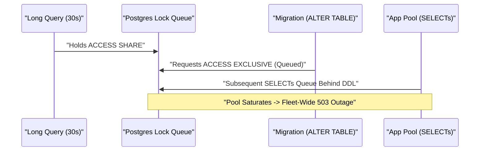
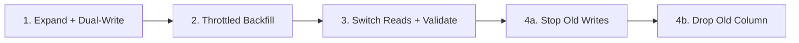
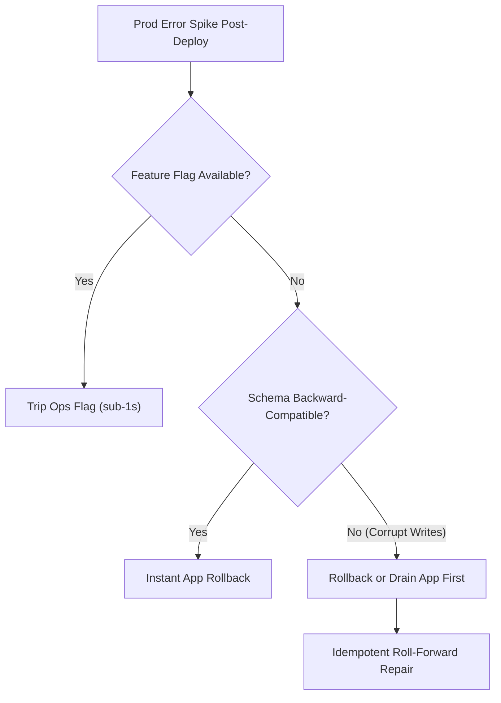

---
tags:
  - software-engineering
  - sdlc
  - release-engineering
  - database-migrations
  - api-evolution
created: 2026-11-13
updated: 2026-11-13
status: 🟢
level: mid-to-senior
---
# Release Engineering & Zero-Downtime Migrations

> [!abstract] Vault Navigation
> Companion operational guide to [[Programming/Software Engineering/SDLC/SDLC Complete Guide|SDLC Complete Guide]] within [[Programming/Software Engineering/Software Engineering Roadmap|Software Engineering Roadmap]]. Integrates closely with [[Programming/Software Engineering/System Design/API Design|API Design]], [[Programming/Software Engineering/DevOps/CI-CD|CI/CD]], [[Programming/Software Engineering/DevOps/GitHub Actions|GitHub Actions]], [[Programming/Software Engineering/DevOps/Kubernetes|Kubernetes]], [[Programming/Software Engineering/DevOps/Observability|Observability]], and [[Programming/Software Engineering/Database Design/Database Design Complete Guide|Database Design Complete Guide]].

Zero-downtime delivery requires coordinating stateful database schemas, wire contracts across distributed producers and consumers, and cryptographically verifiable immutable artifacts under concurrent $N / N-1$ execution. A release or schema migration is production-safe only when old and new application binaries execute simultaneously against the same live storage engines without lock-queue stalls, serialization faults, or irreversible state corruption.

---

## 1. First-Principles Mechanics: Release Versioning, Provenance & Zero-Downtime Evolution

### 1.1 Release Versioning Semantics: SemVer 2.0, CalVer & SHA-Pinned Artifacts

Versioning conveys compatibility guarantees to downstream callers while content digests guarantee byte-level identity across deployment environments.

| Scheme | Format & Semantics | Compatibility Guarantee | Optimal Domain Fit | Common Misuse Trap |
|---|---|---|---|---|
| **SemVer 2.0.0** | `MAJOR.MINOR.PATCH[-rc.N][+build]` | `MAJOR` = breaking contract; `MINOR` = additive backward-compatible; `PATCH` = backward-compatible fix (`0.y.z` carries zero stability guarantee) | Public SDKs, internal shared packages, versioned REST/gRPC APIs | Bumping `PATCH` on subtle wire changes or omitting pre-`1.0` instability notice |
| **CalVer** | `YYYY.MM.MICRO` or `YYYY.0M.PATCH` | Encodes release date/train window rather than strict API compatibility (`Ubuntu 24.04`, `Stripe API 2026-08-15`) | Continuously delivered SaaS releases, monthly release trains, long-term date-stamped API snapshots | Using CalVer for npm/Cargo libraries where dependency solvers rely on SemVer caret ranges (`^2.1.0`) |
| **Immutable Digest (SHA-Pinned)** | `ghcr.io/acme/api@sha256:9f86d0...` | Cryptographic hash over exact OCI manifest and filesystem layers; zero mutability | Every Kubernetes, ECS, and Cloud Run deployment across `staging -> canary -> prod` | Deploying mutable `:latest`, `:staging`, or even unpinned `:v1.4.2` tags that registry pushes can overwrite |

**Build Once, Promote Everywhere**: Compile binaries and OCI container images **once** on trunk CI, verify them, and promote the identical `@sha256:` content-addressable digest across `dev -> staging -> canary -> prod`. Rebuilding per environment introduces toolchain drift, invalidates test parity, and breaks cryptographic provenance signatures.

### 1.2 Trunk-Based Release Branches, Release Trains & Artifact Provenance

- **Continuous Release (Pure TBD)**: Every green commit on `main` builds one immutable `@sha256:` digest, triggers automated canary analysis, and enters production independently behind dark **OpenFeature** flags.
- **Release Trains**: Fixed calendar cuts (for example, Tuesday `14:00 UTC`) branch `release/v2026.11` from `main`. **Strict Train Rule**: The train never waits for delayed features—incomplete work merges dark behind feature flags or waits for the next train.
- **Scaled TBD Hotfix Invariant**: When supporting external versioned releases (`release/v2.4`), never commit a hotfix directly to `release/v2.4` first. Land and verify the fix on `main`, then backport via `git cherry-pick -x <sha>` onto active release branches; otherwise subsequent upgrades reintroduce the fixed defect.
- **Artifact Signing & Provenance**: Attach cycloneDX/SPDX **SBOMs** (`--sbom=true`), SLSA build provenance attestations signed via Sigstore OIDC keyless identity (`actions/attest-build-provenance` / `cosign`), and enforce **Kyverno** / **Sigstore Policy Controller** admission checks in Kubernetes rejecting unsigned or untrusted digests.

### 1.3 The $N / N-1$ Rolling Deployment Constraint

During a Kubernetes rolling update, canary ramp, or blue-green target flip, instances running previous code ($V_{N-1}$) and new code ($V_N$) read and write against the **exact same live database** and exchange RPC/Kafka messages concurrently. Single-step destructive migrations violate this invariant immediately:

- **`DROP COLUMN` or `RENAME COLUMN`**: Draining $V_{N-1}$ pods execute `SELECT` / `INSERT` referencing the deleted column name and fail with PostgreSQL `UndefinedColumn` (`42703`).
- **Adding `NOT NULL` without a constant default**: Running $V_{N-1}$ pods issue `INSERT` statements omitting the new column, crashing on `NotNullViolation` (`23502`).
- **Coupling code deploy and schema contraction**: Even if contraction runs *after* pods roll out, rolling back ($V_N \rightarrow V_{N-1}$) crashes instantaneously once $V_{N-1}$ queries a dropped column.

### 1.4 PostgreSQL Lock Queue Physics & Non-Blocking DDL Rules

PostgreSQL DDL outages rarely stem from DDL runtime alone; they arise from **FIFO lock-queue amplification** saturating application connection pools within seconds.

| PostgreSQL Lock Mode | Acquired By | Conflicts With | Production Impact |
|---|---|---|---|
| **`ACCESS SHARE`** | `SELECT` | `ACCESS EXCLUSIVE` | Safe concurrent reads |
| **`ROW EXCLUSIVE`** | `INSERT`, `UPDATE`, `DELETE` | `SHARE`, `SHARE ROW EXCLUSIVE`, `EXCLUSIVE`, `ACCESS EXCLUSIVE` | Standard concurrent OLTP writes |
| **`SHARE UPDATE EXCLUSIVE`** | `CREATE INDEX CONCURRENTLY`, `ALTER TABLE ... VALIDATE CONSTRAINT`, `VACUUM` | `SHARE UPDATE EXCLUSIVE` and stronger | **Allows concurrent reads and writes** |
| **`SHARE`** | Non-concurrent `CREATE INDEX` | `ROW EXCLUSIVE` and stronger | **Blocks all writes** across table scan duration |
| **`SHARE ROW EXCLUSIVE`** | `ADD CONSTRAINT ... CHECK / FOREIGN KEY` (without `NOT VALID`) | `ROW EXCLUSIVE` and stronger | **Blocks all writes** on parent and child tables |
| **`ACCESS EXCLUSIVE`** | `ALTER TABLE` (`ADD/DROP/RENAME COLUMN`, `ALTER TYPE`, `SET NOT NULL` without pre-validated check) | **Every lock mode (including `ACCESS SHARE`)** | **Blocks all reads and writes** |

#### The FIFO Lock-Queue Pileup Mechanism
1. A slow analytics report or idle-in-transaction session holds `ACCESS SHARE` on `orders` for 30 seconds.
2. A migration issues `ALTER TABLE orders ...` requesting `ACCESS EXCLUSIVE`. It waits in the lock queue behind the 30s query.
3. PostgreSQL enforces **fair FIFO lock queueing** to prevent writer starvation: every *new* incoming `SELECT` (`ACCESS SHARE`) and `UPDATE` (`ROW EXCLUSIVE`) queues **behind** the waiting `ACCESS EXCLUSIVE` request.
4. Application connection pools (`max = 100`) saturate completely in `< 3s`, collapsing API availability into `503 Service Unavailable`.



#### Four Mandatory PostgreSQL DDL Safety Rules

1. **Enforce `lock_timeout` + `statement_timeout` with Bounded Retries**: Never execute unguarded DDL. Set `SET lock_timeout = '2s';` so any queued DDL aborts cleanly (`55P03`) before starving `SELECT`s, releasing queued readers immediately, and retry after exponential backoff with jitter.
2. **`CREATE INDEX CONCURRENTLY` Outside Transactions**: Standard `CREATE INDEX` acquires `SHARE` (blocking all writes). Always run `CREATE INDEX CONCURRENTLY IF NOT EXISTS ...` **outside** any `BEGIN...COMMIT` block. Because `CONCURRENTLY` waits across two MVCC transaction snapshots without blocking writes, if it fails (e.g., unique key collision or deadlock), it leaves behind an **`INVALID`** index (`pg_index.indisvalid = false`) that adds write overhead while serving zero queries—inspect and run `DROP INDEX CONCURRENTLY`, resolve duplicates, and recreate.
3. **Constant vs Volatile `ADD COLUMN ... DEFAULT` (PostgreSQL 11+)**:
   - **Constant Default**: `ALTER TABLE orders ADD COLUMN is_archived BOOLEAN NOT NULL DEFAULT false;` executes in $O(1)$ metadata time by persisting the value in `pg_attribute.attmissingval` without rewriting heap pages. It still acquires a brief `ACCESS EXCLUSIVE` lock, so `lock_timeout` retry protection remains mandatory.
   - **Volatile Default / Type Rewrite**: `DEFAULT gen_random_uuid()`, `DEFAULT clock_timestamp()`, or incompatible type conversions (`INT -> BIGINT`) rewrite every heap page under `ACCESS EXCLUSIVE`. Use Expand-and-Contract instead.
4. **Non-Blocking Constraints (`NOT VALID` $\rightarrow$ `VALIDATE CONSTRAINT`)**:
   - Adding a `FOREIGN KEY` or `CHECK` directly holds `SHARE ROW EXCLUSIVE` across a full table scan. Always add it with **`NOT VALID`** (sub-millisecond metadata lock; immediately enforces the rule on all *new/updated* writes while skipping existing rows), then run **`ALTER TABLE ... VALIDATE CONSTRAINT ...`** in a subsequent command (`SHARE UPDATE EXCLUSIVE`, allowing concurrent `SELECT`, `INSERT`, `UPDATE`, and `DELETE`).
   - **`NOT NULL` Workaround (PostgreSQL 12–17)**: Running `ALTER COLUMN col SET NOT NULL` directly scans the entire table under `ACCESS EXCLUSIVE`. Instead: (a) add `CHECK (col IS NOT NULL) NOT VALID`, (b) run `VALIDATE CONSTRAINT`, and (c) execute `SET NOT NULL` (PostgreSQL 12+ detects the validated check constraint, skips the full scan, upgrades metadata in milliseconds, and lets you drop the redundant check constraint afterward; PostgreSQL 18 adds native `NOT NULL ... NOT VALID` syntax).

### 1.5 The 4-Phase Expand-and-Contract Protocol & Zero-Downtime Backfills

Every incompatible schema mutation (`rename`, `split`, `merge`, `INT4 -> BIGINT`, `UUIDv7` key migration, table normalization) must execute across separate, independently reversible deployments:



1. **Phase 1 — Expand (Additive Schema + Dual-Write)**: Add nullable target columns/tables and concurrent indexes. Deploy $V_N$ writing to **both** old and new structures while reading strictly from the old column. (If legacy external writers still touch the table, attach an idempotent `BEFORE INSERT OR UPDATE` PostgreSQL trigger syncing old $\rightarrow$ new until every writer upgrades). Wait until 100% of $V_{N-1}$ pods exit so zero stale writers generate unbackfilled gaps.
2. **Phase 2 — Throttled, Resumable Keyset Backfill**: Never execute a monolithic `UPDATE table SET new_col = ...` over millions of rows (which locks rows, floods WAL, explodes read-replica lag, and creates millions of MVCC dead tuples). Iterate using **keyset pagination** (`WHERE id > $cursor AND new_col IS NULL ORDER BY id LIMIT 1000 FOR UPDATE SKIP LOCKED`), monitor `pg_stat_replication` `replay_lag`, back off dynamically when replica lag exceeds `1s`, and trigger periodic `VACUUM (ANALYZE)` to prevent table bloat.
3. **Phase 3 — Dark-Read Parity Check $\rightarrow$ Switch Reads $\rightarrow$ Validate Constraints**: Optionally execute dark-read comparisons (read both columns, serve old, log mismatches) until parity reaches 100%. Deploy $V_{N+1}$ (or flip an OpenFeature toggle) reading from the new column while continuing dual-writes so rollback to $V_N$ remains instant. Attach non-blocking `NOT VALID` $\rightarrow$ `VALIDATE CONSTRAINT` $\rightarrow$ `SET NOT NULL`.
4. **Phase 4 — Contract (Stop Old Writes $\rightarrow$ Bake $\rightarrow$ Drop Old)**: Drop `NOT NULL` from the deprecated column first so $V_{N+2}$ omits it safely; deploy $V_{N+2}$ reading and writing exclusively the new column; bake for a multi-day rollback safety window; finally run `DROP COLUMN` under `lock_timeout` as a standalone cleanup migration.

---

## 2. Real-World Use Cases & Engineering Decision Matrix

| Production Migration / Release Scenario | Recommended Strategy | Avoided Anti-Pattern | Key Trade-Off & Operational Guardrail |
|---|---|---|---|
| **Adding Required Boolean / Status Column to 80M-Row OLTP Table** | PG 11+ `ADD COLUMN ... DEFAULT <const>` under `lock_timeout = '2s'` retry loop | `ALTER TABLE` without `lock_timeout` or running inside manual maintenance window | $O(1)$ metadata update; retry loop avoids queueing behind analytics `SELECT`s |
| **Renaming / Splitting Column or Enforcing `NOT NULL` on Computed Values** | **4-Phase Expand-and-Contract** + `CHECK ... NOT VALID` $\rightarrow$ `VALIDATE CONSTRAINT` | Single-deploy `RENAME COLUMN` or `ALTER COLUMN SET NOT NULL` full scan | Requires 3–4 small deploys over days, eliminating `42703` rolling errors and multi-minute lock outages |
| **Widening Primary / Foreign Keys (`INT4 -> BIGINT`) or Migrating to `UUIDv7`** | Dual-column shadow key (`id_v2 BIGINT`) + `BEFORE` sync trigger + keyset backfill + `CREATE UNIQUE INDEX CONCURRENTLY` + atomic view/rename cutover | `ALTER TABLE ... ALTER COLUMN id TYPE BIGINT` (full table rewrite holding `ACCESS EXCLUSIVE` for hours) | Higher initial schema coordination; avoids hours of total write/read downtime near 2.14B integer exhaustion |
| **Splitting Monolithic `orders` Table into `orders` + `order_line_items`** | Expand target normalized table + dual-write repository/trigger + keyset backfill + shadow read comparator + OpenFeature cutover | Big-bang offline ETL cutover or cross-table triggers without `SKIP LOCKED` backfill | Reversible at every phase via feature flag before final table contraction |
| **Rolling Out Risky Payment / Pricing Refactor Behind Dark Code** | **OpenFeature** dynamic flag + **Async Shadow Parity Verification** | Long-lived Git feature branch (`feature/pricing-v2`) or blind `50%` traffic cutover | `v1` p99 latency stays isolated while `v2` parity diffs verify correctness on live traffic |
| **Automating Multi-Package Monorepo Releases vs Single Microservice Versioning** | **Changesets** (`@changesets/cli`) for multi-package npm/TS monorepos; **release-please** + Conventional Commits for single-service repos | Manual `package.json` edits and handwritten `CHANGELOG.md` tags | Deterministic SemVer bumps and automated PR release trains without branch drift |

---

## 3. Step-by-Step Production Code, DDLs & Release Automation

### 3.1 Lock-Safe PostgreSQL Expand-and-Contract DDL Phases (`db/migrations/`)

Demonstrating a zero-downtime `users.full_name` split and foreign-key enforcement without blocking OLTP queries:

```sql
-- Phase 1 (Migration 0041_expand_user_names.sql — Transactional OK, guarded by lock_timeout)
SET lock_timeout = '2s';
SET statement_timeout = '5s';

ALTER TABLE users
  ADD COLUMN IF NOT EXISTS first_name TEXT,
  ADD COLUMN IF NOT EXISTS last_name TEXT;
```

```sql
-- Phase 1b (Migration 0042_concurrent_name_index.sql — MUST execute OUTSIDE BEGIN..COMMIT!)
-- directive:no-transaction
SET statement_timeout = '0';
CREATE INDEX CONCURRENTLY IF NOT EXISTS idx_users_last_name_active
  ON users (last_name)
  WHERE deleted_at IS NULL;
```

```sql
-- Phase 1c (Optional DB trigger when legacy external writers cannot be upgraded immediately)
CREATE OR REPLACE FUNCTION sync_user_split_names() RETURNS trigger AS $$
DECLARE
  cleaned TEXT;
  space_pos INT;
BEGIN
  IF NEW.first_name IS NULL AND NEW.full_name IS NOT NULL THEN
    cleaned := btrim(NEW.full_name);
    space_pos := position(' ' IN cleaned);
    IF space_pos > 0 THEN
      NEW.first_name := left(cleaned, space_pos - 1);
      NEW.last_name := btrim(substring(cleaned FROM space_pos + 1));
    ELSE
      NEW.first_name := cleaned;
      NEW.last_name := '';
    END IF;
  END IF;
  RETURN NEW;
END;
$$ LANGUAGE plpgsql;

SET lock_timeout = '2s';
DROP TRIGGER IF EXISTS trg_users_sync_split_names ON users;
CREATE TRIGGER trg_users_sync_split_names
  BEFORE INSERT OR UPDATE ON users
  FOR EACH ROW EXECUTE FUNCTION sync_user_split_names();
```

```sql
-- Phase 3 (Migration 0043_validate_user_names_nn.sql — Post-backfill & post-V2 deploy)
-- Step A: Instant NOT VALID constraints (enforced immediately on new writes)
SET lock_timeout = '2s';
SET statement_timeout = '5s';
ALTER TABLE users
  ADD CONSTRAINT chk_users_first_name_nn CHECK (first_name IS NOT NULL) NOT VALID,
  ADD CONSTRAINT chk_users_last_name_nn CHECK (last_name IS NOT NULL) NOT VALID;

-- Step B: Concurrent full validation (SHARE UPDATE EXCLUSIVE — reads & writes proceed freely)
SET lock_timeout = '0';
SET statement_timeout = '0';
ALTER TABLE users VALIDATE CONSTRAINT chk_users_first_name_nn;
ALTER TABLE users VALIDATE CONSTRAINT chk_users_last_name_nn;

-- Step C: PG 12+ instantaneous metadata SET NOT NULL + relax old column for Phase 4
SET lock_timeout = '2s';
SET statement_timeout = '5s';
ALTER TABLE users
  ALTER COLUMN first_name SET NOT NULL,
  ALTER COLUMN last_name SET NOT NULL,
  ALTER COLUMN full_name DROP NOT NULL;

ALTER TABLE users
  DROP CONSTRAINT chk_users_first_name_nn,
  DROP CONSTRAINT chk_users_last_name_nn;
```

```sql
-- Phase 4 (Migration 0044_contract_drop_full_name.sql — Run ONLY after V4 bakes cleanly)
SET lock_timeout = '2s';
SET statement_timeout = '5s';
DROP TRIGGER IF EXISTS trg_users_sync_split_names ON users;
DROP FUNCTION IF EXISTS sync_user_split_names();
ALTER TABLE users DROP COLUMN IF EXISTS full_name;
```

### 3.2 Lock-Timeout Retry Migration Runner (`scripts/migrate-with-lock-retry.ts`)

Standard ORM runners fail immediately or hang without retries when hitting brief `ACCESS EXCLUSIVE` contention. This production TypeScript runner parses `-- directive:no-transaction` markers cleanly, retries PostgreSQL `55P03` (`lock_not_available`) and `57014` (`query_canceled`) errors with bounded jittered exponential backoff, and logs active blocking PIDs from `pg_locks`:

```typescript
// scripts/migrate-with-lock-retry.ts
import { readFileSync } from "node:fs";
import { Pool, type PoolClient } from "pg";

interface MigrationOptions {
  maxAttempts: number;
  baseDelayMs: number;
  maxDelayMs: number;
}

const RETRYABLE_PG_CODES = new Set([
  "55P03", // lock_not_available (lock_timeout exceeded)
  "57014", // query_canceled (statement_timeout exceeded)
  "40P01", // deadlock_detected
]);

function sleep(ms: number): Promise<void> {
  return new Promise((resolve) => setTimeout(resolve, ms));
}

async function logActiveBlockers(client: PoolClient): Promise<void> {
  const { rows } = await client.query<{
    blocked_pid: number;
    blocking_pid: number;
    blocking_state: string;
    blocking_duration_s: number;
    blocking_query: string;
  }>(`
    SELECT
      blocked.pid AS blocked_pid,
      blocker.pid AS blocking_pid,
      blocker.state AS blocking_state,
      ROUND(EXTRACT(EPOCH FROM (clock_timestamp() - blocker.query_start))::numeric, 2) AS blocking_duration_s,
      LEFT(blocker.query, 180) AS blocking_query
    FROM pg_stat_activity blocked
    CROSS JOIN LATERAL unnest(pg_blocking_pids(blocked.pid)) AS blocker_pid(pid)
    JOIN pg_stat_activity blocker ON blocker.pid = blocker_pid.pid
    WHERE blocked.pid <> pg_backend_pid()
    LIMIT 10;
  `);

  if (rows.length > 0) {
    console.warn("Active PostgreSQL lock blockers detected:", JSON.stringify(rows));
  }
}

export async function runMigrationWithRetry(
  pool: Pool,
  sqlFilePath: string,
  opts: MigrationOptions = { maxAttempts: 8, baseDelayMs: 500, maxDelayMs: 15_000 }
): Promise<void> {
  const sql = readFileSync(sqlFilePath, "utf8");
  const isNonTransactional = sql.includes("-- directive:no-transaction");

  for (let attempt = 1; attempt <= opts.maxAttempts; attempt++) {
    const client = await pool.connect();
    try {
      if (isNonTransactional) {
        // Autocommit mode required for CREATE/DROP INDEX CONCURRENTLY and VACUUM
        const statements = sql
          .split(/;\s*(?:\r?\n|$)/)
          .map((s) => s.trim())
          .filter((s) => s.length > 0 && !s.startsWith("--"));

        for (const stmt of statements) {
          await client.query(stmt);
        }
      } else {
        await client.query("BEGIN");
        await client.query(sql);
        await client.query("COMMIT");
      }
      console.log(`Migration succeeded: ${sqlFilePath} (attempt ${attempt}/${opts.maxAttempts})`);
      return;
    } catch (error: unknown) {
      if (!isNonTransactional) {
        await client.query("ROLLBACK").catch(() => undefined);
      }

      const pgCode = (error as { code?: string })?.code;
      if (pgCode && RETRYABLE_PG_CODES.has(pgCode) && attempt < opts.maxAttempts) {
        await logActiveBlockers(client).catch(() => undefined);
        const expDelay = Math.min(opts.maxDelayMs, opts.baseDelayMs * 2 ** (attempt - 1));
        const jitter = Math.floor(Math.random() * 400);
        console.warn(
          `Migration ${sqlFilePath} hit retryable PG error ${pgCode} on attempt ${attempt}; backing off ${expDelay + jitter}ms`
        );
        await sleep(expDelay + jitter);
        continue;
      }
      throw error;
    } finally {
      client.release();
    }
  }
}
```

### 3.3 Dual-Write / Dual-Read Repository Adapter & Lag-Throttled Keyset Backfill Worker

Application repositories enforce $N / N-1$ compatibility by executing dual-writes during Expand and toggling read paths via OpenFeature before contracting:

```typescript
// src/repositories/user-account.repository.ts
import type { Pool } from "pg";
import type { Client as OpenFeatureClient } from "@openfeature/server-sdk";

export interface UserProfile {
  id: string;
  email: string;
  firstName: string;
  lastName: string;
}

export function splitFullName(fullName: string): { firstName: string; lastName: string } {
  const clean = fullName.trim();
  const spaceIdx = clean.indexOf(" ");
  if (spaceIdx === -1) {
    return { firstName: clean, lastName: "" };
  }
  return {
    firstName: clean.slice(0, spaceIdx),
    lastName: clean.slice(spaceIdx + 1).trim(),
  };
}

export class UserAccountRepository {
  constructor(
    private readonly pool: Pool,
    private readonly flags: OpenFeatureClient
  ) {}

  async createUser(id: string, email: string, fullName: string): Promise<void> {
    const { firstName, lastName } = splitFullName(fullName);
    // Phase 1-3: Dual-write both legacy and expanded columns so rollback to V_{N-1} stays valid
    await this.pool.query(
      `INSERT INTO users (id, email, full_name, first_name, last_name)
       VALUES ($1, $2, $3, $4, $5)`,
      [id, email, fullName.trim(), firstName, lastName]
    );
  }

  async findUserById(id: string, tenantTier: string): Promise<UserProfile | null> {
    const readSplitColumns = await this.flags.getBooleanValue("read-split-user-names", false, {
      targetingKey: id,
      tenantTier,
    });

    const { rows } = await this.pool.query<{
      id: string;
      email: string;
      full_name: string | null;
      first_name: string | null;
      last_name: string | null;
    }>(
      `SELECT id, email, full_name, first_name, last_name
       FROM users
       WHERE id = $1 AND deleted_at IS NULL`,
      [id]
    );

    const row = rows[0];
    if (!row) return null;

    const legacyParsed = splitFullName(row.full_name ?? "");
    const splitParsed = {
      firstName: row.first_name ?? legacyParsed.firstName,
      lastName: row.last_name ?? legacyParsed.lastName,
    };

    if (readSplitColumns) {
      return { id: row.id, email: row.email, ...splitParsed };
    }
    return { id: row.id, email: row.email, ...legacyParsed };
  }
}
```

And the companion **Lag-Throttled, Resumable Keyset Backfill Worker** (`src/migrations/backfill-worker.ts`) continuously monitors `pg_stat_replication` `replay_lag` on the primary database and pauses cleanly whenever replication lag threatens read-replica staleness:

```typescript
// src/migrations/backfill-worker.ts
import { Pool } from "pg";

interface BackfillConfig {
  batchSize: number;
  baseSleepMs: number;
  maxReplicaLagMs: number;
  lagPauseMs: number;
  vacuumEveryBatches: number;
}

const sleep = (ms: number): Promise<void> => new Promise((r) => setTimeout(r, ms));

async function getMaxReplicaLagMs(pool: Pool): Promise<number> {
  const { rows } = await pool.query<{ max_lag_ms: number }>(`
    SELECT COALESCE(
      MAX(EXTRACT(EPOCH FROM replay_lag) * 1000),
      0
    )::float8 AS max_lag_ms
    FROM pg_stat_replication;
  `);
  return rows[0]?.max_lag_ms ?? 0;
}

export async function runThrottledNameBackfill(
  pool: Pool,
  cfg: BackfillConfig = {
    batchSize: 1000,
    baseSleepMs: 75,
    maxReplicaLagMs: 1000,
    lagPauseMs: 2000,
    vacuumEveryBatches: 250,
  }
): Promise<number> {
  let cursorId = 0;
  let totalUpdated = 0;
  let batches = 0;

  while (true) {
    const lagMs = await getMaxReplicaLagMs(pool);
    if (lagMs > cfg.maxReplicaLagMs) {
      console.warn(`Replica lag ${lagMs.toFixed(0)}ms exceeds ${cfg.maxReplicaLagMs}ms; throttling.`);
      await sleep(cfg.lagPauseMs);
      continue;
    }

    const { rows } = await pool.query<{ updated_count: string; max_id: string }>(
      `
      WITH batch AS (
        SELECT id, btrim(full_name) AS clean_name
        FROM users
        WHERE id > $1
          AND (first_name IS NULL OR last_name IS NULL)
        ORDER BY id ASC
        LIMIT $2
        FOR UPDATE SKIP LOCKED
      ),
      updated AS (
        UPDATE users u
        SET first_name = COALESCE(NULLIF(split_part(b.clean_name, ' ', 1), ''), ''),
            last_name  = CASE
              WHEN position(' ' IN b.clean_name) > 0
              THEN btrim(substring(b.clean_name FROM position(' ' IN b.clean_name) + 1))
              ELSE ''
            END
        FROM batch b
        WHERE u.id = b.id
        RETURNING u.id
      )
      SELECT COUNT(*)::text AS updated_count,
             COALESCE(MAX(id), $1)::text AS max_id
      FROM updated;
      `,
      [cursorId, cfg.batchSize]
    );

    const updatedCount = Number(rows[0].updated_count);
    const maxId = Number(rows[0].max_id);

    if (updatedCount === 0) {
      // Confirm no locked rows were skipped behind cursorId
      const check = await pool.query<{ id: string }>(
        `SELECT id::text FROM users WHERE first_name IS NULL OR last_name IS NULL ORDER BY id ASC LIMIT 1`
      );
      if (check.rows.length === 0) {
        console.log(`Backfill completed cleanly. Total rows updated: ${totalUpdated}`);
        return totalUpdated;
      }
      cursorId = Number(check.rows[0].id) - 1;
      await sleep(cfg.baseSleepMs);
      continue;
    }

    totalUpdated += updatedCount;
    cursorId = maxId;
    batches += 1;

    if (batches % cfg.vacuumEveryBatches === 0) {
      await pool.query("VACUUM (ANALYZE) users;");
    }
    await sleep(cfg.baseSleepMs);
  }
}
```

### 3.4 OpenFeature Dark-Launch & Async Shadow Parity Comparator (`src/flags/openfeature-rollout.ts`)

Evaluate feature flags locally using **OpenFeature** (vendor-neutral CNCF standard keeping code independent of LaunchDarkly, Split, Flagsmith, or Unleash), and execute **dark shadow reads** asynchronously without blocking `v1` latency:

```typescript
// src/flags/openfeature-rollout.ts
import { OpenFeature, InMemoryProvider, type EvaluationContext } from "@openfeature/server-sdk";

const flagDefinitions = {
  "pricing-v2-shadow": {
    disabled: false,
    variants: { on: true, off: false },
    defaultVariant: "on",
  },
  "pricing-v2-active": {
    disabled: false,
    variants: { on: true, off: false },
    defaultVariant: "off",
    contextEvaluator: (ctx: EvaluationContext) => {
      return ctx.cohort === "internal-canary" ? "on" : "off";
    },
  },
};

export async function initFeatureFlags(): Promise<void> {
  await OpenFeature.setProviderAndWait(new InMemoryProvider(flagDefinitions));
}

export interface QuoteResult {
  subtotalCents: number;
  taxCents: number;
  totalCents: number;
}

export async function calculateQuoteWithDarkParity(
  orderId: string,
  cohort: string,
  legacyCalc: () => Promise<QuoteResult>,
  candidateCalc: () => Promise<QuoteResult>,
  onMismatch: (diff: { orderId: string; legacy: QuoteResult; candidate: QuoteResult }) => void
): Promise<QuoteResult> {
  const client = OpenFeature.getClient("checkout");
  const ctx: EvaluationContext = { targetingKey: orderId, cohort };

  const serveV2 = await client.getBooleanValue("pricing-v2-active", false, ctx);
  if (serveV2) {
    return candidateCalc();
  }

  // Always return synchronous legacy response immediately; isolate candidate shadow check
  const legacyResult = await legacyCalc();
  const shadowEnabled = await client.getBooleanValue("pricing-v2-shadow", false, ctx);

  if (shadowEnabled) {
    // Fire-and-forget bounded parity check; never fail or slow live checkout
    void Promise.race([
      candidateCalc(),
      new Promise<never>((_, reject) =>
        setTimeout(() => reject(new Error("Shadow candidate timed out")), 500)
      ),
    ])
      .then((candidateResult) => {
        if (
          candidateResult.totalCents !== legacyResult.totalCents ||
          candidateResult.taxCents !== legacyResult.taxCents
        ) {
          onMismatch({ orderId, legacy: legacyResult, candidate: candidateResult });
        }
      })
      .catch((err: unknown) => {
        console.warn(`Shadow calculation failed for order=${orderId}:`, err);
      });
  }

  return legacyResult;
}
```

### 3.5 Automated Release Train Workflow (`.github/workflows/release-train.yml` & `.changeset/config.json`)

Automates monorepo SemVer changelog PRs via **Changesets**, validates **Pact** `can-i-deploy` contract compatibility before rollout, builds and signs immutable `@sha256:` OCI images via OIDC, and gates production on post-deploy synthetic health checks:

```json
{
  "$schema": "https://unpkg.com/@changesets/config@3.0.3/schema.json",
  "changelog": "@changesets/cli/changelog",
  "commit": false,
  "fixed": [],
  "linked": [],
  "access": "restricted",
  "baseBranch": "main",
  "updateInternalDependencies": "patch",
  "ignore": ["@acme/e2e-harness"]
}
```

```yaml
# .github/workflows/release-train.yml
name: Release Train & Progressive Deploy

on:
  push:
    branches: [main]
  workflow_dispatch:
    inputs:
      promote_sha:
        description: "Immutable commit SHA to re-verify and promote"
        required: false
        type: string

permissions: {}

concurrency:
  group: release-train-main
  cancel-in-progress: false

jobs:
  version-and-changelog:
    runs-on: ubuntu-24.04
    permissions:
      contents: write
      pull-requests: write
    outputs:
      published: ${{ steps.changesets.outputs.published }}
    steps:
      - uses: actions/checkout@11bd71901bbe5b1630ceea73d27597364c9af683 # v4.2.2
        with:
          fetch-depth: 0

      - uses: pnpm/action-setup@b906affcce14559ad1aafd4ab0e942779e9f58b1 # v4

      - uses: actions/setup-node@49933ea5288caeca8642d1e84afbd3f7d6820020 # v4.4.0
        with:
          node-version: "22"
          cache: "pnpm"

      - run: pnpm install --frozen-lockfile --ignore-scripts

      - name: Create Version Packages PR or Tag Releases
        id: changesets
        uses: changesets/action@63a615b9cd06ba9a3e6d13796c7fbcb080a60a0b # v1.4.8
        with:
          version: pnpm changeset version
          publish: pnpm -r --filter "./packages/*" publish --no-git-checks
          title: "chore(release): version packages"
          commit: "chore(release): version packages"
        env:
          GITHUB_TOKEN: ${{ secrets.GITHUB_TOKEN }}
          NPM_TOKEN: ${{ secrets.NPM_PUBLISH_TOKEN }}

  build-sign-and-contract-check:
    needs: [version-and-changelog]
    runs-on: ubuntu-24.04
    permissions:
      contents: read
      packages: write
      id-token: write
      attestations: write
    outputs:
      image_ref: ${{ steps.emit.outputs.image_ref }}
    steps:
      - uses: actions/checkout@11bd71901bbe5b1630ceea73d27597364c9af683 # v4.2.2

      - name: Verify Pact Broker deployment safety matrix
        env:
          PACT_BROKER_BASE_URL: ${{ vars.PACT_BROKER_URL }}
          PACT_BROKER_TOKEN: ${{ secrets.PACT_BROKER_TOKEN }}
          GIT_SHA: ${{ inputs.promote_sha || github.sha }}
        run: |
          npx pact-broker can-i-deploy \
            --pacticipant orders-api \
            --version "$GIT_SHA" \
            --to-environment production

      - uses: docker/setup-buildx-action@f95db51fddba0c2d1ec667646a06c2ce06100226 # v3.3.0

      - uses: docker/login-action@9780b0c442fcf1117ad29c078b54714114f5b9b4 # v3.3.0
        with:
          registry: ghcr.io
          username: ${{ github.actor }}
          password: ${{ secrets.GITHUB_TOKEN }}

      - id: build
        uses: docker/build-push-action@263435318d21b8e681c14492fe198d362a7d2c83 # v6.18.0
        with:
          context: .
          push: true
          tags: ghcr.io/${{ github.repository }}/orders-api:sha-${{ github.sha }}
          provenance: mode=max
          sbom: true
          cache-from: type=gha,scope=orders-api
          cache-to: type=gha,mode=max,scope=orders-api

      - uses: actions/attest-build-provenance@897ed5eab6ed058a474202017ada7f40bfa52940 # v1.4.3
        with:
          subject-name: ghcr.io/${{ github.repository }}/orders-api
          subject-digest: ${{ steps.build.outputs.digest }}
          push-to-registry: true

      - id: emit
        env:
          BASE: ghcr.io/${{ github.repository }}/orders-api
          DIGEST: ${{ steps.build.outputs.digest }}
        run: echo "image_ref=${BASE}@${DIGEST}" >> "$GITHUB_OUTPUT"

  deploy-production-canary:
    needs: [build-sign-and-contract-check]
    runs-on: ubuntu-24.04
    environment:
      name: production
      url: https://orders.acme.internal
    concurrency:
      group: deploy-orders-production
      cancel-in-progress: false
    permissions:
      id-token: write
      contents: read
    steps:
      - uses: actions/checkout@11bd71901bbe5b1630ceea73d27597364c9af683 # v4.2.2

      - uses: aws-actions/configure-aws-credentials@e3dd6a429d7300a6a4c196c26e071d42e0343502 # v4.0.2
        with:
          role-to-assume: arn:aws:iam::123456789012:role/gha-orders-prod-deploy
          aws-region: us-east-1

      - name: Run lock-safe PostgreSQL expand migrations
        env:
          DATABASE_URL: ${{ secrets.PROD_MIGRATION_DB_URL }}
        run: |
          npx tsx scripts/migrate-with-lock-retry.ts db/migrations/latest.sql

      - name: Update Argo Rollout image digest and wait for Automated Canary Analysis
        env:
          IMAGE_REF: ${{ needs.build-sign-and-contract-check.outputs.image_ref }}
        run: |
          aws eks update-kubeconfig --name prod-us-east-1 --region us-east-1
          kubectl argo rollouts set image orders-api orders-api="$IMAGE_REF" -n orders
          kubectl argo rollouts status orders-api -n orders --timeout 15m
```

---

## 4. Complete API, Tooling & Compatibility Reference

### 4.1 API & Wire Contract Evolution Rules (REST, Protobuf, GraphQL, CDC)

Zero-downtime distributed upgrades require both **Backward Compatibility** (new consumer decodes old producer messages) and **Forward Compatibility** (old consumer safely ignores unknown fields emitted by new producers). In event brokers like Kafka with Schema Registry, enforce **`FULL_TRANSITIVE`** compatibility across independent producer/consumer upgrade schedules.

> [!info] Hyrum's Law
> *"With a sufficient number of users of an API, it does not matter what you promise in the contract: all observable behaviors of your system will be depended on by somebody."* — Undocumented JSON field ordering, HTTP error phrasing, or response timing silently harden into implicit dependencies.

| Protocol | Safe Additive Changes | Breaking Changes (Version or Expand-Contract) | Mandatory Guardrail |
|---|---|---|---|
| **REST / JSON** | Add new route; add *optional* input field with server default; append new JSON response keys | Rename/delete field; change scalar type (`"12"` $\leftrightarrow$ `12`); tighten optional input to required; narrow enum output | Clients must implement **Tolerant Reader** (ignore unrecognized keys); emit RFC 8594 `Deprecation` and `Sunset` headers on deprecated paths |
| **Protobuf / gRPC** | Append field with **fresh unused tag number**; rename local field identifier; declare `reserved` on retired fields | **Reuse deleted tag number**; change wire tag ID; mutate incompatible wire types (`int64` $\leftrightarrow$ `string`); omit `UNSPECIFIED = 0` enum sentinel | Always declare `reserved <tags>;` and `reserved "<names>";`; gate PRs with `buf breaking --against '.git#branch=main'` |
| **GraphQL** | Add new types, queries, or nullable fields; annotate old fields `@deprecated(reason: "...")` | Narrow nullable return to non-null (`T` $\rightarrow$ `T!`); tighten optional argument to required; drop field before zero usage | Instrument resolver field metrics; delete `@deprecated` fields only after 0 calls over full retention window |

#### Protobuf Wire Tags, Zero-Defaults & Reservation
Protobuf encodes `(tag_number << 3) | wire_type` rather than field names on the wire. Reusing retired tag `3` causes lagging consumers or replayed Kafka records to interpret raw bytes under mismatched types, corrupting data silently. Moreover, `proto3` assigns `0` as the default for missing scalar/enum fields—if enum `0` represents a valid business state (`SETTLED = 0`), an uninitialized struct marks unpaid transactions settled.

```protobuf
syntax = "proto3";
package payments.v1;

enum PaymentStatus {
  PAYMENT_STATUS_UNSPECIFIED = 0; // Safe sentinel preventing uninitialized zero-state corruption
  PAYMENT_STATUS_PENDING = 1;
  PAYMENT_STATUS_SETTLED = 2;
  PAYMENT_STATUS_FAILED = 3;
}

message PaymentSettled {
  reserved 3, 7;                  // Permanently retire deleted field tags
  reserved "legacy_card_token";   // Prevent JSON/code symbol reuse

  string event_id = 1;
  int64 amount_minor_units = 2;
  string currency = 4;
  PaymentStatus status = 5;
  optional int64 fee_minor_units = 6; // Explicit presence tracking (has_fee_minor_units)
}
```

#### Consumer-Driven Contract Testing (CDC / Pact) & HTTP Sunset Lifecycle
- **Pact CDC Verification**: Instead of fragile 30-microservice staging environments ($O(N^2)$ coupling), consumers generate minimal contracts (`pact.json`) against local mocks and upload them to a **Pact Broker**. Provider CI replays contracts for **all currently deployed production consumers** and blocks incompatible releases via `pact-broker can-i-deploy`. See [[Programming/Software Engineering/Testing/Testing Complete Guide|Testing Complete Guide]].
- **RFC 8594 API Deprecation Timelines**: Never remove `/v1/orders` overnight. At `T+0`, launch `/v2/orders` and inject HTTP response headers `Deprecation: @1780000000` (RFC 9745 Unix timestamp), `Sunset: Sat, 15 May 2027 00:00:00 GMT`, and `Link: <https://docs.acme.dev/v2>; rel="deprecation"`; notify active API key owners at `T+30d` / `T+90d`; return `410 Gone` only after telemetry confirms zero active callers or scheduled contractual cutoff passes.

### 4.2 ORM & Migration Runner Traps (`Prisma`, `Drizzle`, `Flyway`, `Liquibase`)

| Tool | Production Trap | Underlying Cause | Mandatory Mitigation |
|---|---|---|---|
| **Prisma Migrate** | `CREATE INDEX CONCURRENTLY` crashes with `ERROR: CREATE INDEX CONCURRENTLY cannot run inside a transaction block` | Prisma wraps each `migration.sql` inside an automatic `BEGIN...COMMIT` transaction | Create concurrent indexes via dedicated post-migration non-transactional runner (`scripts/migrate-with-lock-retry.ts`), or mark custom SQL outside Prisma Migrate when concurrent builds are needed |
| **Prisma / Drizzle Diff Generators** | Auto-generating `DROP COLUMN` + `ADD COLUMN` on field renames or silent `ALTER COLUMN TYPE` rewrites | Declarative schema diffs compare final AST states without knowing Expand-and-Contract intent | **Never** run `prisma db push` or blind `drizzle-kit push` in prod; manually inspect and edit generated SQL into 4-phase migrations with `SET lock_timeout = '2s';` |
| **Flyway** | Partial failure leaves `flyway_schema_history` marked `success = false`, blocking all subsequent deploys; `CONCURRENTLY` errors inside default txn | Flyway defaults to single-transaction execution per file and verifies SHA checksums strictly | Add `-- flyway:executeInTransaction=false` header for `CONCURRENTLY` scripts; run `flyway repair` only after verifying idempotent DB state |
| **Liquibase** | Killed migration pod leaves `DATABASECHANGELOGLOCK` `LOCKED = true` forever, stalling every future deployment | Pod received `SIGKILL` / OOM before releasing lock row | Set `liquibase.hub`/changelog lock wait timeouts cleanly; verify no live migration PID runs in `pg_stat_activity` before running `liquibase release-locks` |

### 4.3 Live PostgreSQL Lock, Index & Lag Diagnostic SQL Reference

```sql
-- 1. Inspect currently blocked queries and the exact blocking sessions
SELECT
  blocked.pid AS blocked_pid,
  now() - blocked.query_start AS blocked_for,
  LEFT(blocked.query, 100) AS blocked_query,
  blocker.pid AS blocker_pid,
  blocker.state AS blocker_state,
  now() - blocker.state_change AS blocker_idle_for,
  LEFT(blocker.query, 100) AS blocker_query
FROM pg_stat_activity blocked
CROSS JOIN LATERAL unnest(pg_blocking_pids(blocked.pid)) AS bp(pid)
JOIN pg_stat_activity blocker ON blocker.pid = bp.pid
ORDER BY blocked_for DESC;

-- 2. Detect failed/INVALID concurrent indexes wasting write IOPS
SELECT
  n.nspname AS schema_name,
  c.relname AS index_name,
  t.relname AS table_name,
  i.indisvalid,
  i.indisready
FROM pg_index i
JOIN pg_class c ON c.oid = i.indexrelid
JOIN pg_class t ON t.oid = i.indrelid
JOIN pg_namespace n ON n.oid = c.relnamespace
WHERE NOT i.indisvalid;

-- 3. Check live read-replica WAL replay lag and table dead-tuple bloat during backfills
SELECT client_addr, state, write_lag, flush_lag, replay_lag,
       pg_wal_lsn_diff(pg_current_wal_lsn(), replay_lsn) AS replay_lag_bytes
FROM pg_stat_replication;

SELECT relname, n_live_tup, n_dead_tup, last_autovacuum, last_autoanalyze
FROM pg_stat_user_tables
WHERE relname IN ('users', 'orders', 'transactions');
```

### 4.4 Deterministic Rollback vs Roll-Forward Decision Protocol

Stateless compute containers (`v2.4.1 -> v2.4.0`) revert in seconds whenever database schemas and wire contracts stay backward-compatible. **Stateful destructive database mutations never roll back cleanly.** Executing an ORM `down` migration (`DROP COLUMN`, `DROP TABLE`) during an outage erases live transactions persisted by healthy traffic during the incident window.



| Incident Scenario | Deterministic Action | Execution Protocol | Why Naive Alternative Fails |
|---|---|---|---|
| **Code regression; additive/compatible DB schema** | **Flip Feature Flag or Rollback App Digest** | Disable release flag in `< 1s` or revert deployment to previous `@sha256:` image | Hacking a rushed forward hotfix inflates MTTR and risks compounding bugs |
| **Migration aborted cleanly on `lock_timeout` (`55P03`)** | **Halt Deploy + Fix DDL Lock Safety** | Leave live app untouched; examine `pg_blocking_pids`, convert DDL to `CONCURRENTLY` / `NOT VALID` | Increasing `lock_timeout` blindly risks total connection-pool exhaustion |
| **New pods wrote corrupted column values (schema intact)** | **Rollback App First $\rightarrow$ Roll-Forward Repair** | Roll back pods immediately to halt corrupt writes; execute idempotent, window-bounded repair script; ship fixed code + test | Running `migrate down` drops columns and permanently destroys valid data created concurrently |
| **Destructive DDL (`DROP COLUMN`/`DROP TABLE`) already committed** | **Roll-Forward Hotfix or PITR Snapshot Restore** | Restore dropped structure from WAL Point-in-Time Recovery (PITR) clone / logical replica and merge lost rows cleanly | Automated `down` scripts cannot recreate lost heap data |

---

## 5. Production Debugging & Failure Recovery Playbook

| Symptom | Root Cause | Exact Diagnostic Command / Query | Immediate Mitigation & Permanent Fix |
|---|---|---|---|
| **API throws `503` and pools hit `100%` seconds after migration starts** | `ALTER TABLE` waiting behind a long query holds `ACCESS EXCLUSIVE` queue position, blocking all incoming `SELECT`s | Run blocking-PID query on `pg_stat_activity` + `pg_blocking_pids()` | Terminate the stuck migration PID (`SELECT pg_terminate_backend(<ddl_pid>);`) or long idle blocker immediately; enforce `SET lock_timeout = '2s';` in migration runner |
| **Query planner ignores new index; writes run slower** | Earlier `CREATE INDEX CONCURRENTLY` failed mid-build and left an **`INVALID`** index entry | Query `pg_index WHERE NOT indisvalid` | Run `DROP INDEX CONCURRENTLY IF EXISTS <idx_name>;`, resolve any unique constraint violations, and re-run `CREATE INDEX CONCURRENTLY` outside transactions |
| **Read replicas fall minutes behind or drop connections during backfill** | Monolithic or unthrottled backfill floods WAL generation faster than replica replay | Query `pg_stat_replication` (`replay_lag`, `replay_lag_bytes`) and `pg_stat_user_tables` (`n_dead_tup`) | Pause worker immediately; switch to `LIMIT 1000` keyset pagination with `FOR UPDATE SKIP LOCKED`, `replay_lag > 1s` throttling, and periodic `VACUUM (ANALYZE)` |
| **Rolling update or rollback throws SQL `42703 UndefinedColumn` or `23502`** | Code and schema violated $N / N-1$ compatibility (dropped/renamed column before $V_{N-1}$ exited, or `NOT NULL` added before $V_N$ rolled out) | Inspect pod image revisions (`kubectl get pods -o wide`) vs latest applied migration in schema history | Roll forward $V_N$ if column addition was omitted, or temporarily re-add nullable column / drop `NOT NULL` constraint; enforce 4-Phase Expand-and-Contract |
| **Migration pipeline stuck on `Waiting for changelog lock` indefinitely** | Previous Liquibase/Flyway container died (`SIGKILL`/OOM) before unlocking metadata lock table | Check `SELECT * FROM databasechangeloglock;` alongside `pg_stat_activity` confirming zero active migration sessions | Run `liquibase release-locks` (only after verifying no active migration process exists) and configure graceful termination traps |
| **Canary passes global `5xx <= 0.5%` gate while crashing all iOS checkouts** | Aggregated global error metric masked a `2%–4%` regression concentrated in a minority client/region cohort | Query Prometheus broken down by dimension (`sum by (client_platform, region) (...)`) | Partition Argo Rollouts `AnalysisTemplate` checks per critical cohort (`ios`, `android`, `web`), compare `canary - stable` delta, and include `clamp_min(..., 1)` |

---

## 6. Worked Exercises & Solutions

### Exercise 1: Zero-Downtime `users.full_name` Split Across 42M Rows & 12k QPS

Your production PostgreSQL 15 database holds a `users` table with **42 million rows** sustaining **12,000 QPS** across 30 rolling Kubernetes API pods. Product requirements mandate splitting `users.full_name` (`TEXT NOT NULL`) into `first_name` and `last_name` (`TEXT NOT NULL`), eventually dropping `full_name`.
1. Specify the exact multi-phase deployment order (Schema DDL vs Application Versions $V_1 \rightarrow V_2 \rightarrow V_3 \rightarrow V_4$).
2. Write the lock-safe SQL migrations for Phases 1, 3, and 4.
3. Write the throttled, resumable keyset backfill SQL query handling single-word names and locked OLTP rows safely.

### Solution 1

1. **Deployment Sequence (Strict Ordering)**:
   - **Deploy 1 (DB — Phase 1 Expand)**: Add `first_name TEXT NULL` and `last_name TEXT NULL` (instant metadata change under `lock_timeout = '2s'`).
   - **Deploy 2 (App $V_2$ — Dual-Write, Read Old)**: Code continues reading `full_name` while populating both `full_name` and `(first_name, last_name)` on every `INSERT` / `UPDATE`. Wait until 100% of 30 pods run $V_2$.
   - **Run Job (Backfill — Phase 2)**: Execute throttled keyset batch worker for existing rows where `first_name IS NULL`.
   - **Deploy 3 (App $V_3$ — Switch Reads)**: Read `(first_name, last_name)` (with dark parity validation beforehand) while maintaining dual-writes to `full_name` so instant rollback to $V_2$ stays safe.
   - **Deploy 4 (DB — Phase 3 Non-Blocking Constraints)**: Add `CHECK (... IS NOT NULL) NOT VALID` $\rightarrow$ `VALIDATE CONSTRAINT` $\rightarrow$ `SET NOT NULL` (and `ALTER COLUMN full_name DROP NOT NULL`).
   - **Deploy 5 (App $V_4$ — Stop Writing `full_name`)**: Read and write exclusively `first_name` and `last_name`. Bake 7 days.
   - **Deploy 6 (DB — Phase 4 Contract)**: `ALTER TABLE users DROP COLUMN IF EXISTS full_name;`.
2. **Lock-Safe PostgreSQL Migrations**: (Shown in Section 3.1 Migrations `0041`, `0043`, and `0044`, using `SET lock_timeout = '2s';`, `NOT VALID`, `VALIDATE CONSTRAINT`, and dropping `full_name` `NOT NULL` prior to $V_4$).
3. **Throttled Keyset Backfill Query (`SKIP LOCKED` + Single-Word Safe)**:
   Using `split_part` and `position(' ' IN ...)` guarantees `last_name` defaults to `''` rather than `NULL` for single-token names like `"Cher"`, satisfying subsequent `NOT NULL` validation:

```sql
WITH batch AS (
  SELECT id, btrim(full_name) AS clean_name
  FROM users
  WHERE id > $1
    AND (first_name IS NULL OR last_name IS NULL)
  ORDER BY id ASC
  LIMIT $2
  FOR UPDATE SKIP LOCKED
)
UPDATE users u
SET first_name = COALESCE(NULLIF(split_part(b.clean_name, ' ', 1), ''), ''),
    last_name  = CASE
      WHEN position(' ' IN b.clean_name) > 0
      THEN btrim(substring(b.clean_name FROM position(' ' IN b.clean_name) + 1))
      ELSE ''
    END
FROM batch b
WHERE u.id = b.id
RETURNING u.id;
```

---

### Exercise 2: Diagnosing & Fixing a Blocking `ALTER TABLE` Outage

During peak traffic on PostgreSQL 15, an engineer runs the following migration against a **90-million-row `transactions` table**:

```sql
BEGIN;
ALTER TABLE transactions
  ADD COLUMN risk_score INT NOT NULL DEFAULT (floor(random() * 100)::int),
  ADD CONSTRAINT fk_tx_merchant FOREIGN KEY (merchant_id) REFERENCES merchants(id);
CREATE INDEX idx_tx_merchant_created ON transactions (merchant_id, created_at);
COMMIT;
```

Within 8 seconds, all API pods throw `503 Service Unavailable`, connection pools hit `500/500`, and simple primary-key lookups (`SELECT * FROM transactions WHERE id = $1`) time out.
1. Diagnose **all 4 distinct root causes** inside this script and explain why primary-key `SELECT`s hung.
2. Rewrite the migration into safe, non-blocking production phases.

### Solution 2

1. **Four Root Causes**:
   - **Volatile `DEFAULT` Triggers Full Heap Rewrite Under `ACCESS EXCLUSIVE`**: Unlike constant defaults in PG 11+, `floor(random() * 100)::int` evaluates per row, forcing PostgreSQL to rewrite all 90M rows on disk under `ACCESS EXCLUSIVE`.
   - **Missing `lock_timeout` Triggers FIFO Queue Starvation**: Every incoming `SELECT` (`ACCESS SHARE`) queues behind the `ACCESS EXCLUSIVE` request in FIFO order, saturating all 500 API connections in seconds.
   - **Unguarded `ADD CONSTRAINT ... FOREIGN KEY` Locks Two Tables**: Validating the FK synchronously acquires `SHARE ROW EXCLUSIVE` on both `transactions` and `merchants`, blocking all writes across both tables during the 90M-row scan.
   - **Non-Concurrent `CREATE INDEX` Inside `BEGIN...COMMIT`**: `CREATE INDEX` holds `SHARE` blocking all writes, and bundling all DDL inside one `BEGIN...COMMIT` holds `ACCESS EXCLUSIVE` across the entire transaction lifetime until `COMMIT`.
2. **Safe Non-Blocking Production Rewrite**:

```sql
-- Step 1: Metadata-only nullable expansion with lock_timeout retry
SET lock_timeout = '2s';
SET statement_timeout = '5s';
ALTER TABLE transactions ADD COLUMN IF NOT EXISTS risk_score INT;

-- Step 2a: Instant NOT VALID Foreign Key
SET lock_timeout = '2s';
SET statement_timeout = '5s';
ALTER TABLE transactions
  ADD CONSTRAINT fk_tx_merchant
  FOREIGN KEY (merchant_id) REFERENCES merchants(id) NOT VALID;

-- Step 2b: Concurrent validation (SHARE UPDATE EXCLUSIVE — reads/writes proceed)
SET lock_timeout = '0';
SET statement_timeout = '0';
ALTER TABLE transactions VALIDATE CONSTRAINT fk_tx_merchant;

-- Step 3 (Autocommit outside transaction): Concurrent index build
CREATE INDEX CONCURRENTLY IF NOT EXISTS idx_tx_merchant_created
  ON transactions (merchant_id, created_at);
```

---

### Exercise 3: Backwards- & Forwards-Compatible Protobuf Event Evolution

A Kafka topic `orders.events` uses Protobuf v3 (`OrderCreated`) governed by **`FULL_TRANSITIVE`** compatibility:

```protobuf
enum OrderStatus {
  CREATED = 0;
  PAID = 1;
}

message OrderCreated {
  string order_id = 1;
  double amount_dollars = 2;
  OrderStatus status = 3;
}
```

Requirements: migrate `double amount_dollars` to integer minor units (`int64 amount_cents`) + `string currency`, and add `CANCELLED` status. **Constraint**: Consumer A deploys monthly, Consumer B deploys daily, and Kafka retains 30 days of historical events for replay.
1. Identify the wire-compatibility traps in overwriting tag `2` or altering enum `0`.
2. Write the safe `OrderCreated` v2 `.proto` schema.
3. Specify the exact multi-deploy rollout order across Producer, Consumer A, and Consumer B.

### Solution 3

1. **Compatibility Traps**:
   - **Tag `2` Type Mutation**: Changing tag `2` from `double` (wire type `1`) to `int64` (wire type `0`) causes wire parsing failures and corrupts 30-day historical event replay.
   - **Enum `0` Modification & Unknown Enum Handling**: Re-assigning `0` (`CREATED = 0`) breaks decoding of all stored Kafka events. Appending `CANCELLED = 2` is wire-compatible only after consumers safely handle unrecognized enum integers.
2. **Safe Evolved Schema (`OrderCreated` v2)**:

```protobuf
syntax = "proto3";
package orders.v1;

enum OrderStatus {
  CREATED = 0;    // Preserved to maintain 30-day historical replay parity
  PAID = 1;
  CANCELLED = 2;  // Appended at end; never renumber 0 or 1
}

message OrderCreated {
  string order_id = 1;
  double amount_dollars = 2 [deprecated = true];
  OrderStatus status = 3;
  optional int64 amount_cents = 4; // proto3 optional grants has_amount_cents() presence check
  string currency = 5;
}
```

3. **Rollout Sequence**:
   - Register v2 schema in Schema Registry (`FULL_TRANSITIVE` passes cleanly).
   - Deploy **Consumer B and Consumer A first** supporting `CANCELLED`, reading `amount_cents` when `has_amount_cents()` is true, and falling back to `Math.round(amount_dollars * 100)` for older 30-day events.
   - Deploy **Producer** dual-populating both `(amount_cents, currency)` and legacy `amount_dollars`. Emit `CANCELLED` only after Consumer A's monthly deploy confirms rollout.
   - After 30-day retention flushes legacy `amount_dollars`-only events and zero consumers read tag `2`, stop populating `amount_dollars`, wait 30 days, then add `reserved 2;`.

---

### Exercise 4: Rollback vs Roll-Forward Under Partial Data Corruption

Your team deploys `checkout-service:v3.8.0` to a `25%` Canary alongside an additive migration creating `coupon_redemptions_v2`. After 14 minutes, telemetry detects that `v3.8.0` inverted `discount_cents` (`+500` instead of `-500`), corrupting **1,800 orders** in `orders.discount_cents` and `coupon_redemptions_v2` while `v3.7.4` pods simultaneously wrote 5,400 valid orders. An on-call engineer proposes running `db-migrate down` (`DROP TABLE coupon_redemptions_v2;`) and rolling pods back to `v3.7.4`.
1. Explain why running `db-migrate down` is catastrophic.
2. Provide the exact chronological recovery plan balancing mitigation, audit preservation, and idempotent repair.

### Solution 4

1. **Why `db-migrate down` Fails**:
   - `DROP TABLE coupon_redemptions_v2` permanently erases audit records for all 1,800 orders processed during the failure window.
   - Dropping `coupon_redemptions_v2` fails to fix inverted signs persisted inside the shared `orders` table.
   - Any draining `v3.8.0` pods crash mid-flight with `UndefinedTable` 500s.
2. **Chronological Recovery Plan**:
   - **Step 1 (`< 1m` Mitigation)**: Shift canary ingress traffic immediately to `0% v3.8.0 / 100% v3.7.4` (or disable `coupon_v2_engine` ops flag). Leave the database schema untouched.
   - **Step 2 (Quarantine)**: Identify exact affected rows bounded by the canary window (`created_at BETWEEN ...`) and invariant breach (`discount_cents > 0`), joined against `coupon_redemptions_v2` to isolate the 1,800 orders without touching valid `v3.7.4` rows.
   - **Step 3 (Idempotent Roll-Forward Repair)**: Execute a peer-reviewed batched repair setting `discount_cents = -ABS(discount_cents)` (idempotent across retries), recalculate order totals, and emit compensating ledger adjustments/refunds for already-captured payments.
   - **Step 4 (Hardening)**: Add `ALTER TABLE orders ADD CONSTRAINT chk_discount_nonpositive CHECK (discount_cents <= 0) NOT VALID;` + `VALIDATE CONSTRAINT`, add regression tests, and ship `v3.8.1`.

---

### Exercise 5: Zero-Downtime `INT4 -> BIGINT` Primary & Foreign Key Upgrade (500M Rows)

A high-throughput PostgreSQL `orders` table (`id SERIAL PRIMARY KEY`, currently at `1.92 billion` out of `2.147 billion` signed `INT4` max!) is referenced by `order_items(order_id INT NOT NULL REFERENCES orders(id))` (`500 million` rows, `8,000 TPS`).
1. Explain why `ALTER TABLE orders ALTER COLUMN id TYPE BIGINT; ALTER TABLE order_items ALTER COLUMN order_id TYPE BIGINT;` causes a catastrophic hours-long outage.
2. Design the complete zero-downtime Expand-and-Contract plan (including dual-column `BIGINT` shadow keys, `BEFORE` sync trigger, concurrent unique indexes, keyset backfill, and final atomic rename swap).

### Solution 5

1. **Why Direct `ALTER TYPE` Fails**: Changing `INT4` (4 bytes) to `INT8`/`BIGINT` (8 bytes) alters physical tuple layout on every single row across `500M+` rows and rebuilds every attached index while holding `ACCESS EXCLUSIVE` on both `orders` and `order_items` simultaneously—taking the entire business offline for hours.
2. **Zero-Downtime `INT4 -> BIGINT` Plan**:
   - **Phase 1 (Expand + Sequence Upgrade)**:
     - Upgrade sequence directly (instantaneous): `ALTER SEQUENCE orders_id_seq AS BIGINT;`.
     - Add nullable `id_v2 BIGINT` on `orders` and `order_id_v2 BIGINT` on `order_items` under `lock_timeout = '2s'`.
     - Attach lightweight `BEFORE INSERT OR UPDATE` triggers populating `NEW.id_v2 := NEW.id` on `orders` and `NEW.order_id_v2 := NEW.order_id` on `order_items` so all live writes stay synced regardless of pod version.
   - **Phase 2 (Throttled Keyset Backfill)**:
     - Run lag-throttled keyset batch workers (`LIMIT 5000 FOR UPDATE SKIP LOCKED`) populating `id_v2 = id` and `order_id_v2 = order_id` until zero `NULL` rows remain.
   - **Phase 3 (Concurrent Indexes + Non-Blocking Constraints)**:
     - Build `CREATE UNIQUE INDEX CONCURRENTLY idx_orders_id_v2_uq ON orders (id_v2);` and `CREATE INDEX CONCURRENTLY idx_order_items_order_id_v2 ON order_items (order_id_v2);`.
     - Add `CHECK (id_v2 IS NOT NULL) NOT VALID` / `CHECK (order_id_v2 IS NOT NULL) NOT VALID` and `FOREIGN KEY (order_id_v2) REFERENCES orders(id_v2) NOT VALID`, validate concurrently (`VALIDATE CONSTRAINT`), and upgrade `SET NOT NULL`.
   - **Phase 4 (Atomic Metadata Cutover & Contraction)**:
     - During a controlled low-traffic checkpoint (`< 2s` `lock_timeout` retry loop), run an atomic metadata rename transaction updating triggers/defaults, swapping `orders` primary key cleanly via `ADD PRIMARY KEY USING INDEX idx_orders_id_v2_uq` (after dropping dependent FK pointing to old `id`, replacing with validated `id_v2` FK, and renaming `id -> id_legacy`, `id_v2 -> id`), then drop `id_legacy` in a trailing migration once post-cutover bake passes cleanly. *(Verify application code uses 64-bit integers/BigInt strings in JSON before passing `2,147,483,647`!)*.

---

### Exercise 6: Prisma Concurrent Index Crash, Changesets Failure & Canary Cohort Blindness

Three release failures strike during a weekly train:
1. A Prisma migration (`20261113_add_idx/migration.sql`) containing `CREATE INDEX CONCURRENTLY idx_payments_status ON payments(status);` crashes in CI with `ERROR: CREATE INDEX CONCURRENTLY cannot run inside a transaction block`.
2. A TypeScript monorepo using `changesets/action` opens a `Version Packages` PR, merges it, and runs `pnpm publish`, yet internal workspace dependency `@acme/shared-types` fails to install cleanly for consumers because `workspace:*` leaked into the published `package.json`.
3. An Argo Rollouts canary passes its global `error-rate-5xx <= 0.5%` Prometheus check at `5%` weight (`1,000 req/s` total; `50 req/s` canary), promotes `v2` to `100%`, and breaks **`4.0%` of iOS checkouts** (`X-Client: ios`, representing `10%` of traffic, while Android/Web remained at baseline `0.05%` error rate).

Calculate the blended canary error rate explaining why the global check passed, and provide the exact fixes for all three failures.

### Solution 6

1. **Prisma `CREATE INDEX CONCURRENTLY` Transaction Trap**:
   - **Root Cause**: Prisma Migrate executes every `migration.sql` inside an explicit `BEGIN...COMMIT` transaction block, which PostgreSQL prohibits for `CONCURRENTLY` index builds.
   - **Fix**: Execute concurrent indexes outside Prisma's transactional runner via a dedicated non-transactional migration step (`scripts/migrate-with-lock-retry.ts` flagged `-- directive:no-transaction`), then register or verify schema parity cleanly.
2. **`workspace:*` Leak During Monorepo Publish**:
   - **Root Cause**: Running raw `npm publish` instead of `pnpm -r publish` (which automatically rewrites `workspace:*` protocol specifiers to concrete resolved SemVer strings like `^1.4.2` during tarball packing) leaked unresolvable `workspace:*` references into the published registry manifest.
   - **Fix**: Configure `changesets/action` `publish:` strictly with `pnpm changeset publish` or `pnpm -r --filter "./packages/*" publish --no-git-checks` so `pnpm` translates workspace protocols before uploading tarballs.
3. **Canary Cohort Blindness Math & `AnalysisTemplate` Fix**:
   - **Blended Error Rate Calculation**:
     $$\text{Blended 5xx} = (0.10 \times 0.04) + (0.90 \times 0.0005) = 0.004 + 0.00045 = \mathbf{0.445\%}$$
     Because `0.445% <= 0.50%`, the global average passed and promoted the broken iOS build to 100%!
   - **Fixed Per-Cohort `AnalysisTemplate` Query**: Compute max failure rate *by client cohort* relative to stable baseline with denominator safety (`clamp_min`):

```yaml
apiVersion: argoproj.io/v1alpha1
kind: AnalysisTemplate
metadata:
  name: checkout-cohort-5xx-delta
spec:
  metrics:
    - name: max-cohort-5xx-delta
      interval: 2m
      count: 4
      failureLimit: 1
      successCondition: result[0] <= 0.003
      provider:
        prometheus:
          address: http://prometheus.monitoring:9090
          query: |
            max(
              (
                sum by (client_platform) (rate(http_requests_total{service="checkout-canary",status=~"5.."}[2m]))
                /
                clamp_min(sum by (client_platform) (rate(http_requests_total{service="checkout-canary"}[2m])), 50)
              )
              -
              (
                sum by (client_platform) (rate(http_requests_total{service="checkout-stable",status=~"5.."}[2m]))
                /
                clamp_min(sum by (client_platform) (rate(http_requests_total{service="checkout-stable"}[2m])), 50)
              )
            )
```

---

## Related Notes
- [[Programming/Software Engineering/SDLC/SDLC Complete Guide|SDLC Complete Guide]]
- [[Programming/Software Engineering/Software Engineering Roadmap|Software Engineering Roadmap]]
- [[Programming/Software Engineering/System Design/API Design|API Design]]
- [[Programming/Software Engineering/DevOps/CI-CD|CI/CD]]
- [[Programming/Software Engineering/DevOps/GitHub Actions|GitHub Actions]]
- [[Programming/Software Engineering/DevOps/Pipeline Design|Pipeline Design]]
- [[Programming/Software Engineering/DevOps/Kubernetes|Kubernetes]]
- [[Programming/Software Engineering/DevOps/Observability|Observability]]
- [[Programming/Software Engineering/Database Design/Database Design Complete Guide|Database Design Complete Guide]]
- [[Programming/Software Engineering/Database Design/Transactions|Transactions]]
- [[Programming/Software Engineering/Database Design/Replication|Replication]]
- [[Programming/Software Engineering/Testing/Testing Complete Guide|Testing Complete Guide]]
