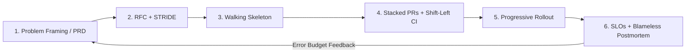
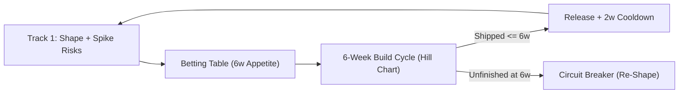
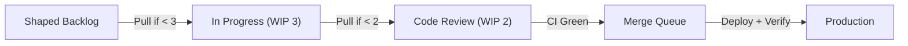
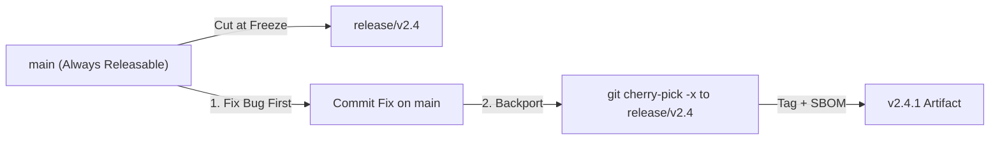
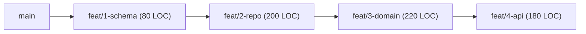
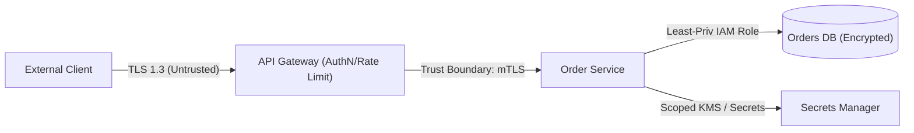
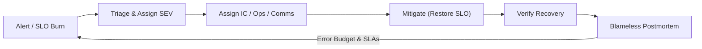

---
tags:
  - software-engineering
  - sdlc
  - delivery-flow
  - architecture-governance
  - incident-management
created: 2026-11-13
updated: 2026-11-13
status: 🟢
level: mid-to-senior
---
# Software Development Lifecycle (SDLC) Complete Guide

> [!abstract] Vault Navigation
> Core engineering lifecycle handbook within [[Programming/Software Engineering/Software Engineering Roadmap|Software Engineering Roadmap]]. Companion operational guide: [[Programming/Software Engineering/SDLC/Release Engineering & Migrations|Release Engineering & Migrations]].

The Software Development Lifecycle (SDLC) governs how technical organizations convert system requirements into verified, observable production behavior while bounding operational risk, coordination cost, and queueing delay. At senior and staff levels, SDLC engineering moves beyond sprint rituals to designing socio-technical feedback loops: problem framing, asynchronous architectural governance, queueing-theoretic Work-In-Progress (WIP) control, shift-left verification, evolutionary fitness functions, progressive delivery, and blame-free reliability loops tied to error budgets.

---

## 1. First-Principles Mechanics: End-to-End Lifecycle & Flow Physics

### 1.1 The Staff-Grade Engineering Delivery Pipeline

Modern high-velocity software organizations do not hand off specifications sequentially between disconnected silos. They run a continuous, closed-loop lifecycle where discovery reduces product risk before implementation, walking skeletons validate runtime boundaries early, and telemetry governs release pacing.



1. **Problem Framing & PRD**: Quantify baseline failure, customer friction, and business constraints *before* selecting technical mechanisms. Define non-goals and measurable success criteria (latency, conversion, error reduction, cost ceiling).
2. **RFC / Architecture Design Doc**: Resolve cross-team contracts, data models, failure modes, and STRIDE security boundaries asynchronously in writing before investing weeks of code.
3. **Walking Skeleton**: Build and deploy the thinnest end-to-end vertical slice across real infrastructure (API route $\rightarrow$ auth middleware $\rightarrow$ database migration $\rightarrow$ CI/CD deploy $\rightarrow$ OTel trace) behind a dark feature flag. Proving deployment wiring on Day 2 prevents Week 6 integration surprises.
4. **Short-Lived Trunk Integration & Shift-Left Gates**: Decompose work into `< 250 LOC` stacked PRs validated automatically by fast unit tests, Testcontainers DB suites, SAST/SCA scanners, and architectural fitness functions (`dependency-cruiser`, `bundlewatch`, lock-safety linters).
5. **Progressive Rollout**: Decouple deployment from release via OpenFeature flags and Canary traffic ramps gated by Automated Canary Analysis (ACA).
6. **Reliability Governance**: Monitor SLO burn rates; run structured Incident Command System (ICS) responses and blameless postmortems whose SMART remediation actions gate future release velocity when monthly error budgets exhaust.

### 1.2 Delivery Topologies: Waterfall, Scrum, Kanban, Shape Up & Dual-Track Discovery

Delivery methodologies optimize fundamentally different constraints: regulatory auditability, short-horizon predictability, continuous interrupt flow, or fixed-time scope shaping under high uncertainty.

| Model | Cycle Mechanics & Cadence | Feedback Latency | Primary Failure Modes | Optimal Domain Fit |
|---|---|---|---|---|
| **Waterfall** | Sequential gated phases: Requirements $\rightarrow$ Design $\rightarrow$ Build $\rightarrow$ Verify $\rightarrow$ Ops | $O(T_{\text{project}})$; defects surface at end of integration | Late architectural invalidation; exponential rework cost; phase-gate inventory pileup | Frozen hardware interfaces, fixed-bid regulatory builds with zero spec drift |
| **V-Model** | Parallel verification legs paired to each spec tier (Req $\leftrightarrow$ System Test, LLD $\leftrightarrow$ Unit Test) | Late system integration; unit verification fast | Heavy doc inertia; brittle against product discovery; high unintegrated WIP | Safety-critical embedded systems requiring bidirectional traceability (**DO-178C**, **ISO 26262**, **IEC 62304**) |
| **Scrum** | Fixed sprints (1–4 weeks) with locked sprint goal, backlog grooming, velocity tracking | 1 sprint + release lag | Mini-waterfalls inside sprints; story-point inflation; mid-sprint thrashing from ops interrupts | Cross-functional feature teams with relatively stable short-horizon priorities |
| **Kanban** | Continuous pull-based flow bounded by per-column **WIP limits** and Service Level Expectations (SLE) | Per-item Cycle Time (hours–days) | Lack of milestone convergence; silent stall if WIP caps are ignored | Platform teams, SRE/on-call triage, maintenance queues, continuous SaaS pipelines |
| **Shape Up** | Fixed 6-week build cycles + 2-week cooldown; **fixed time, variable scope ("appetite")**, shaped pitches | End of 6-week cycle (internal scope validation earlier) | Under-shaped pitches hide technical traps that trip the 6-week circuit breaker; skipped cooldowns build debt | High-uncertainty product R&D requiring uninterrupted multi-week engineering autonomy |

#### Shape Up & Dual-Track Discovery Internals
Standard estimation ("How long will X take?") anchors scope first and lets schedules slip indefinitely. **Shape Up** inverts the constraint: leadership sets a strict **Appetite** (`Small Batch: 1–2 weeks` or `Big Batch: 6 weeks`) representing how much engineering time a problem is *worth*, then senior engineers and product designers shape a bounded solution at the right abstraction level:

- **Dual-Track Discovery & Delivery**: While delivery teams execute committed cycles (Track 2), a small discovery pod (PM + Staff Engineer + Designer, Track 1) prototypes risky APIs, runs database cardinality checks, and interviews users to retire technical and product unknowns *before* betting.
- **Pitch Components**: Every shaped pitch specifies: (1) *Problem* (concrete baseline evidence), (2) *Appetite* (hard time box), (3) *Solution* (**Breadboarding** workflows and **Fat-Marker Sketches**—deliberately coarse to grant implementers UI/code autonomy while proving structural feasibility), (4) *Rabbit Holes* (explicit edge cases spiked and patched in advance), and (5) *No-Gos* (features intentionally cut).
- **Scopes & Hill Charts**: Rather than a flat ticket list, builders organize a project into vertical **Scopes** tracked on a **Hill Chart**: the left uphill slope tracks *"figuring things out"* (unknowns, schema risk, third-party integration spikes), while the right downhill slope tracks *"known execution"* (writing tests, wiring remaining handlers). A scope stuck uphill past Week 3 triggers immediate scope reduction rather than silent schedule drift.
- **The 6-Week Circuit Breaker & 2-Week Cooldown**: If a project fails to ship within 6 weeks, it does **not** automatically roll into Week 7; the circuit breaker trips and forces explicit re-shaping at the next Betting Table. The mandatory **2-week Cooldown** between cycles provides unscheduled capacity for bug triage, dependency upgrades, technical debt repayment, and discovery spikes.



#### Kanban Pull Mechanics & Column WIP Limits
Kanban enforces stability not by predicting 2-week velocities, but by capping active inventory per workflow column and refusing new pulls upstream when a downstream bottleneck saturates:



When `Code Review (WIP 2)` hits its ceiling of 2 open PRs, engineers stop pulling new items from `Shaped Backlog` and swarm on reviewing or unblocking in-flight PRs—directly preserving Little's Law ($W = L / \lambda$).

### 1.3 Queueing Theory for Engineering Flow

Software delivery pipelines behave as stochastic queueing networks rather than deterministic assembly lines. Optimizing individual developer busy-time destroys end-to-end delivery speed.

#### Little's Law
For any stable queueing system over a measurement window, average inventory ($L$), completion throughput ($\lambda$), and average traversal duration ($W$) satisfy:

$$L = \lambda \cdot W \quad \Longleftrightarrow \quad W = \frac{L}{\lambda}$$

- **$L$ (Work In Progress / WIP)**: Active items started (in-progress branches, open PRs, queued QA items) and not yet released to production.
- **$\lambda$ (Throughput)**: Completed deliverables reaching production per unit time (e.g., PRs merged & deployed per week).
- **$W$ (Cycle Time)**: Elapsed wall-clock time from active work start (`commit` or `In Progress`) to production deployment (**Lead Time** extends $W$ backward to initial ticket creation/intake).

> [!warning] Fundamental Flow Invariant
> Under fixed team throughput ($\lambda$), doubling active WIP ($L$) strictly doubles Cycle Time ($W$). Injecting additional concurrent initiatives into a saturated team never increases delivery rate; it fragments attention, compounds review latency, and slows every in-flight deliverable proportionally.

#### Kingman's Formula (VUT Equation) & The 100% Utilization Trap
Queue wait time ($W_q$) in a single-stage queue scales nonlinearly with arrival variability ($c_a$), service-time variability ($c_s$), and resource utilization ($\rho = \lambda / \mu$):

$$W_q \approx \left(\frac{c_a^2 + c_s^2}{2}\right) \cdot \left(\frac{\rho}{1 - \rho}\right) \cdot t_s$$

Where $t_s = 1/\mu$ is mean active processing time and $c_a, c_s$ are coefficients of variation ($\sigma / \mu$). As utilization $\rho \rightarrow 1.0$:
- At $\rho = 0.50$, the utilization multiplier $\frac{\rho}{1-\rho} = 1\times$.
- At $\rho = 0.80$, wait time climbs to $4\times$.
- At $\rho = 0.95$, wait time explodes to $19\times$.
- At $\rho = 1.00$, queue depth and Cycle Time diverge toward infinity ($\infty$) upon any variance spike (production incident, flaky CI runner, sick leave, upstream schema block).

Mandating "100% developer utilization" removes the slack capacity required to absorb variance, collapsing throughput and driving Lead Time upward. High-performing teams deliberately plan feature work at $\rho \approx 0.70\text{–}0.80$, reserving 20–30% buffer capacity for code reviews, incidents, mentoring, and refactoring.

#### Flow Efficiency & Batch Size Dynamics
$$\text{Flow Efficiency} = \frac{\text{Active Value-Add Time}}{\text{Total Cycle Time (Active + Queue Wait Time)}}$$

Most enterprise engineering organizations operate at **5%–15% Flow Efficiency**; 85%–95% of a ticket's lifetime is spent waiting in code review queues, shared staging locks, manual QA handoffs, or Change Advisory Boards. Halving active coding time yields negligible Lead Time gains compared to removing queue wait states.

Small batch sizes reduce both service variance ($c_s$) and combinatorial risk:
1. **Quadratic Conflict Growth**: With $N$ long-lived parallel branches touching shared modules, pairwise conflict surfaces scale quadratically:
   $$\binom{N}{2} = \frac{N(N-1)}{2} \in O(N^2)$$
2. **Fault Isolation**: Locating a production regression across a 50-commit release batch demands slow multi-PR bisection under interaction noise, whereas a single-commit continuous deployment pinpoints the fault immediately. See [[Programming/Software Engineering/DevOps/Pipeline Design|Pipeline Design]] for build parallelization mechanics.

---

## 2. Real-World Use Cases & Governance Decision Matrix

| Engineering Scenario | Recommended SDLC Pattern | Avoided Anti-Pattern | Key Trade-Off & Exit Criteria |
|---|---|---|---|
| **Uncertain R&D Initiative (New Billing Engine / AI Workflow)** | **Dual-Track Discovery + Shape Up (6-Week Appetite)** | Fixed-scope Waterfall Gantt chart or blind Scrum story-point guessing | Fixed 6-week circuit breaker protects budget; requires disciplined pre-cycle shaping by senior staff |
| **Platform, SRE & Shared Infra Team Handling Mixed Planned + Urgent Work** | **Kanban with Column WIP Limits + Explicit Interrupt Lane** | Fixed 2-week Scrum sprints collapsing whenever prod pages arrive | Eliminates sprint commitment resets; demands strict enforcement of column WIP limits & aging-WIP alerts |
| **Safety-Critical Embedded, Medical, or Regulated Financial Core** | **V-Model Traceability Matrix + Scaled TBD (`release/vX.Y`) + Automated Audit Logs** | Informal startup ad-hoc deployments without traceable test linkage | Higher documentation/verification overhead required for ISO 26262 / SOC2 / PCI compliance |
| **Cross-Team Architecture Change (New Event Contract, Auth Model, Storage Engine)** | **Full Written RFC + STRIDE Threat Model + Walking Skeleton** | Solo engineering implementation or "ask forgiveness after 4,000-LOC PR" | 2–5 day upfront async review prevents multi-month incompatible integrations |
| **Single-Team Implementation Choice (ORM Selection, Cache Eviction Strategy)** | **Lightweight Git ADR (`docs/adr/NNNN-*.md`) in PR** | Multi-week Org Architecture Review Board meetings for local choices | Fast local autonomy paired with permanent protection against Chesterton's Fence |

---

## 3. Step-by-Step Production Artifacts, Templates & Automation

A production engineering organization encodes its SDLC invariants directly inside version control so governance executes automatically on every pull request rather than relying on tribal memory.

### Repository Governance Layout

```text
.github/
  CODEOWNERS
  pull_request_template.md
  workflows/
    fitness-functions.yml
docs/
  adr/
    0014-transactional-outbox.md
  pitches/
    0000-template.md
  postmortems/
    0000-template.md
  rfcs/
    0000-template.md
scripts/
  flow-metrics.ts
.dependency-cruiser.cjs
bundlewatch.config.json
```

### 3.1 Production RFC Template (`docs/rfcs/0000-template.md`)

```markdown
# RFC-XXXX: [Concise Technical Title]

- **Author(s):** [@handle]
- **Status:** Draft | In Review | Accepted | Implemented | Superseded
- **Target Services:** [orders-api, payments-worker]
- **Created / Target Sign-Off:** YYYY-MM-DD / YYYY-MM-DD
- **Reviewers Required:** [Domain Staff Eng, Security Eng, SRE Lead]

## 1. Context & Problem Statement
- Quantify current baseline pain (p99 latency, error rate, monthly cloud spend, on-call pages/week, engineering bottleneck).
- Link supporting telemetry dashboards, incidents, or customer metrics.

## 2. Goals & Non-Goals
### Goals
- Measurable functional and operational outcomes (e.g., "Reduce checkout p99 below 120ms at 5k RPS").
### Non-Goals
- Explicit exclusions preventing scope creep (e.g., "Multi-region active-active writes are out of scope for Phase 1").

## 3. Hard Constraints & SLOs
- **Availability / Latency SLO:** 99.95% success rate; p95 < 80ms; p99 < 150ms.
- **Durability / Consistency:** Zero lost financial ledger writes (RPO = 0); idempotent consumer replay.
- **Compliance & Budget Ceiling:** PII stays inside `eu-central-1`; incremental infra cost <= $1,200/month.

## 4. Proposed Architecture & Data Contracts
- Include concise component topology and sequence flow.
- Specify exact API schemas (OpenAPI/Protobuf), PostgreSQL DDL transitions, and N/N-1 rolling compatibility guarantees.

## 5. Alternatives Considered & Rejected
| Option | Latency / Throughput | Consistency / Failure Mode | Cost & Complexity | Why Accepted / Rejected |
|---|---|---|---|---|
| **Option A (Selected)** | ... | ... | ... | ... |
| **Option B** | ... | ... | ... | ... |
| **Option C (Status Quo)** | ... | ... | ... | ... |

## 6. Failure Modes, Blast Radius & Mitigation
- **Dependency Down (Redis / Kafka / PSP):** Timeout budget (`500ms`), circuit breaker threshold, graceful degradation path.
- **Backpressure / Retry Storm:** Queue depth ceiling, exponential backoff + jitter, DLQ replay procedure.
- **Kill-Switch / Rollback Plan:** OpenFeature flag key (`flag_key`), safe stateless rollback or Expand-and-Contract step.

## 7. Security & Privacy (STRIDE Summary)
- Document trust boundary crossings, AuthN/AuthZ enforcement, PII redaction, and secret lifecycle.

## 8. Implementation Milestones & Observability Plan
- **Walking Skeleton:** Target Date
- **Shadow / Canary Ramp:** 1% -> 10% -> 100% metrics & burn-rate alerts
- **Cleanup / Legacy Decommission:** Date to remove dual-write and temporary flags

## 9. Sign-Off Checklist
- [ ] Domain Architecture Owner approved
- [ ] Security / STRIDE review completed
- [ ] SRE / On-Call runbooks & alerts reviewed
```

### 3.2 Production ADR Template (`docs/adr/0014-transactional-outbox.md`)

Unlike RFCs (which align teams *before* building), ADRs live permanently alongside source code (`docs/adr/`), remain immutable once `Accepted`, and prevent **Chesterton's Fence**—future engineers removing critical invariants without understanding historical failure trade-offs.

```markdown
# ADR-0014: Use Transactional Outbox for Order Event Publishing

- **Status:** Accepted (2026-11-13)
- **Deciders:** Checkout Platform, Payments Core
- **Supersedes:** None

## Context
Checkout must atomically persist an order row in PostgreSQL and publish an `OrderCreated`
event to Kafka. Dual-writing directly inside the request handler creates split-brain state
if the broker times out after DB commit or if the pod crashes between commit and produce.

## Decision
Adopt the **Transactional Outbox** pattern: write `orders` and `outbox_events` inside the
same ACID PostgreSQL transaction, then relay events asynchronously via Debezium CDC.

## Alternatives Rejected
1. **Direct Dual-Write + Retries**: Violates atomicity on pod OOM or network partition.
2. **Distributed 2PC (XA Transactions)**: Unacceptable coordinator latency and unsupported across
   managed Kafka + PostgreSQL topologies.

## Consequences
- **Positive:** Eliminates lost-event split-brain; enables deterministic replay from outbox/WAL.
- **Negative:** Introduces asynchronous propagation lag (~50–200ms); downstream consumers must
  be **idempotent** to handle at-least-once delivery duplicates.
- **Operational Obligation:** Monitor Debezium replication slot WAL retention to prevent disk exhaustion.
```

### 3.3 Blameless Postmortem Template (`docs/postmortems/0000-template.md`)

```markdown
# Incident Postmortem: INC-XXXX — [Brief Impact Summary]

- **Severity:** SEV1 | SEV2 | SEV3
- **Incident Commander (IC):** @name | **Ops Lead:** @name | **Comms:** @name | **Scribe:** @name
- **Duration:** YYYY-MM-DD HH:MM UTC to HH:MM UTC (`XX minutes`)
- **Detection Latency (TTD):** `XXm` | **Mitigation Latency (TTM):** `XXm`
- **SLO Error Budget Consumed:** `XX%` of 30-day 99.95% budget (`Release Freeze Triggered: Yes/No`)

## 1. Customer & System Impact
- Quantify failed requests, affected tenants/regions, revenue/data impact, and support ticket volume.

## 2. Normalized UTC Timeline
- `HH:MM UTC` — Trigger event (e.g., release `sha-91a2c` deployed or traffic spike began).
- `HH:MM UTC` — First symptom visible in telemetry; alert firing timestamp.
- `HH:MM UTC` — Incident declared; ICS roles assigned.
- `HH:MM UTC` — Mitigation applied (flag toggled / traffic drained / rollback completed).
- `HH:MM UTC` — SLOs verified green for 15 consecutive minutes; incident resolved.

## 3. Contributing Factors (Multi-Factor Systems Analysis)
*(Inspect system defenses rather than blaming individuals:)*
- **Trigger:** What immediate condition initiated the anomaly?
- **Failed Prevention Guardrail:** Why did CI, code review, or staging fail to stop it?
- **Detection Gap:** Why did automated burn-rate alerts lag or miss the signal?
- **Amplifier:** What caused blast radius expansion (missing timeout, retry storm, stale ops flag)?

## 4. Where We Got Lucky
- Document mitigating coincidences that prevented worse damage (e.g., occurred off-peak, manual override caught lag).

## 5. SMART Remediation Action Items
| ID | Priority | Action Description | Owner | Ticket | Target SLA | Verification Criteria |
|---|---|---|---|---|---|---|
| AI-1 | **P0** | Add lock_timeout CI linter rejecting unbounded ALTER TABLE | @eng | JIRA-401 | +7 days | CI fails on test migration without lock_timeout |
| AI-2 | **P0** | Replace 15m static alert with 2%/1h burn-rate rule | @sre | JIRA-402 | +7 days | Alert fires under <3m in chaos drill |
| AI-3 | **P1** | Add per-endpoint circuit breaker and load-shedding flag | @api | JIRA-405 | +21 days | Verified via k6 fault injection test |
```

### 3.4 Shape Up Pitch Template (`docs/pitches/0000-template.md`)

```markdown
# Pitch: [Feature / Initiative Name]

- **Appetite:** Small Batch (2 Weeks) | Big Batch (6 Weeks)
- **Authors:** [@product-lead, @staff-engineer]
- **Target Cycle:** Cycle-YYYY-CX

## 1. Problem (Raw Customer & Telemetry Evidence)
- Link exact customer drop-off funnel, support burden, or operational bottleneck (never a generic wish list).

## 2. Solution Breadboard & Boundaries
- **Places -> Affordances -> Connections:**
  - `Invoice List` -> `[Export CSV]` -> `POST /v1/exports (async)` -> `Email Link / Download Modal`
- **Technical Spine:** Reuse existing S3 presigned URL worker; stream PostgreSQL cursor in 5,000-row chunks.

## 3. Rabbit Holes (Spiked & Eliminated Risks)
- **Timeout on 2M-row exports:** Sync HTTP request times out at 30s; scoped strictly to async background worker + email/poll notification.
- **DB replica lag:** Route export `SELECT` strictly to dedicated analytics read replica with `statement_timeout = '120s'`.

## 4. No-Gos (Explicitly Out of Scope)
- Custom per-column PDF formatting, live Excel pivot templates, and scheduled recurring exports.
```

### 3.5 Blast-Radius Code Governance: `.github/CODEOWNERS`, PR Template & Fitness Functions

Route high-risk files (`db/migrations/`, `infra/`, `packages/auth/`, `api/proto/`) to specialized domain owners automatically while avoiding over-broad root `*` bottlenecks on routine changes:

```text
# .github/CODEOWNERS
# Default domain routing (require 1 domain owner, avoid single-person bottlenecks)
/services/orders/          @acme/orders-eng
/services/billing/         @acme/billing-eng
/apps/web/                 @acme/web-eng

# High blast-radius paths require cross-functional specialist approval
/db/migrations/            @acme/database-reliability
/infra/                    @acme/platform-infra
/packages/auth/            @acme/appsec
/api/proto/                @acme/api-stewards
/.github/workflows/        @acme/platform-security
```

```markdown
<!-- .github/pull_request_template.md -->
## Summary & Linked Context
- Ticket / RFC / ADR:

## Change Classification & Compatibility
- [ ] Net logic diff is under ~250 LOC (or broken into stacked PRs)
- [ ] **N / N-1 Rolling Safe:** Verified safe when old pods and new pods share the live DB concurrently
- [ ] **Schema Migration:** Uses `lock_timeout`, `CONCURRENTLY`, and Expand-and-Contract (no blocking `DROP`/`RENAME`)
- [ ] **Rollback Plan:** Feature flag key (`...`) or instant container rollback verified

## Verification Evidence
- Tests added/updated (unit / Testcontainers / contract):
- Telemetry added (logs, metrics, trace attributes):
```

Automated **Architectural Fitness Functions** enforce structural invariants directly in PR CI (`.dependency-cruiser.cjs` blocks domain entities from importing HTTP/database adapters or crossing bounded-context internals; `bundlewatch.config.json` caps frontend JS bundle growth; `.github/workflows/fitness-functions.yml` flags oversized PR diffs and missing migration lock guards):

```javascript
// .dependency-cruiser.cjs
/** @type {import('dependency-cruiser').IConfiguration} */
module.exports = {
  forbidden: [
    {
      name: "domain-must-remain-framework-pure",
      severity: "error",
      comment: "Domain core cannot import Express, Prisma, Fastify, or AWS SDK adapters.",
      from: { path: "^src/domain/" },
      to: { path: "^(src/infrastructure|node_modules/(@prisma|express|fastify|@aws-sdk))" },
    },
    {
      name: "no-cross-module-internal-imports",
      severity: "error",
      comment: "Modules may only import sibling public index.ts barrels, never internal files.",
      from: { path: "^src/modules/([^/]+)/" },
      to: { path: "^src/modules/(?!$1/)[^/]+/internal/" },
    },
    {
      name: "no-circular-module-dependencies",
      severity: "error",
      from: {},
      to: { circular: true },
    },
  ],
};
```

```json
{
  "files": [
    {
      "path": "apps/web/.next/static/chunks/pages/_app-*.js",
      "maxSize": "180kB"
    },
    {
      "path": "apps/web/.next/static/chunks/main-*.js",
      "maxSize": "95kB"
    }
  ],
  "defaultCompression": "gzip"
}
```

```yaml
# .github/workflows/fitness-functions.yml
name: PR Architecture & Change Fitness Functions
on:
  pull_request:
    branches: [main]

permissions: {}

jobs:
  fitness-gates:
    runs-on: ubuntu-24.04
    permissions:
      contents: read
      pull-requests: read
    steps:
      - uses: actions/checkout@11bd71901bbe5b1630ceea73d27597364c9af683 # v4.2.2
        with:
          fetch-depth: 0

      - uses: actions/setup-node@49933ea5288caeca8642d1e84afbd3f7d6820020 # v4.4.0
        with:
          node-version: "22"

      - name: Check net diff size budget (< 400 non-test/non-lock LOC)
        env:
          BASE_SHA: ${{ github.event.pull_request.base.sha }}
          HEAD_SHA: ${{ github.event.pull_request.head.sha }}
        run: |
          set -euo pipefail
          CHANGED_LOC=$(git diff --numstat "$BASE_SHA...$HEAD_SHA" -- \
            ':!pnpm-lock.yaml' ':!package-lock.json' ':!*.snap' ':!dist/**' \
            | awk '{ added += $1; deleted += $2 } END { print added + deleted + 0 }')
          echo "Net changed lines (excluding lockfiles/snapshots): ${CHANGED_LOC}"
          if (( CHANGED_LOC > 500 )); then
            echo "::warning::PR changes ${CHANGED_LOC} lines (>500). Split into stacked PRs to preserve review defect detection."
          fi

      - name: Enforce SQL migration lock-safety policy
        env:
          BASE_SHA: ${{ github.event.pull_request.base.sha }}
          HEAD_SHA: ${{ github.event.pull_request.head.sha }}
        run: |
          set -euo pipefail
          SQL_FILES=$(git diff --name-only --diff-filter=AM "$BASE_SHA...$HEAD_SHA" -- 'db/migrations/*.sql' || true)
          for file in $SQL_FILES; do
            if grep -Eqi '\b(ALTER\s+TABLE|CREATE\s+INDEX)\b' "$file"; then
              if grep -Eqi 'CREATE\s+INDEX\s+(?!CONCURRENTLY)' "$file"; then
                echo "ERROR: ${file} creates a blocking non-concurrent index." >&2
                exit 1
              fi
              if grep -Eqi 'ALTER\s+TABLE' "$file" && ! grep -Eqi 'SET\s+lock_timeout' "$file"; then
                echo "ERROR: ${file} runs ALTER TABLE without SET lock_timeout." >&2
                exit 1
              fi
            fi
          done

      - name: Run dependency-cruiser architectural boundary check
        run: |
          npm ci --ignore-scripts
          npx depcruise src --config .dependency-cruiser.cjs
```

### 3.6 Little's Law & WIP Flow Triage Calculator (`scripts/flow-metrics.ts`)

Run this script in weekly engineering operations reviews (or CI cron jobs) against exported GitHub PR / Jira issue timestamps to compute empirical WIP $L$, weekly throughput $\lambda$, p50/p85/p95 Cycle Time $W$, Flow Efficiency, implied Kingman wait inflation, and aging WIP bottlenecks before Lead Time silently collapses:

```typescript
// scripts/flow-metrics.ts
export interface WorkItemTelemetry {
  id: string;
  title: string;
  author: string;
  startedAtIso: string;
  completedAtIso: string | null; // null => currently active WIP
  activeTouchHours: number;      // measured coding + review active work hours
  currentStage: "in_progress" | "in_review" | "qa_wait" | "done";
}

export interface FlowReport {
  windowDays: number;
  activeWipCount: number;
  throughputPerWeek: number;
  littlesLawImpliedWeeks: number;
  p50CycleDays: number;
  p85CycleDays: number;
  p95CycleDays: number;
  meanFlowEfficiencyPct: number;
  agingWipItems: Array<{ id: string; stage: string; ageDays: number; title: string }>;
}

const MS_PER_HOUR = 3_600_000;
const MS_PER_DAY = 86_400_000;

function percentile(sorted: number[], p: number): number {
  if (sorted.length === 0) return 0;
  const idx = Math.ceil((p / 100) * sorted.length) - 1;
  return sorted[Math.max(0, Math.min(sorted.length - 1, idx))];
}

export function computeFlowMetrics(
  items: WorkItemTelemetry[],
  now: Date = new Date(),
  windowDays = 28,
  agingThresholdDays = 7
): FlowReport {
  const windowStartMs = now.getTime() - windowDays * MS_PER_DAY;
  const activeItems = items.filter((item) => item.completedAtIso === null);

  const completedInWindow = items.filter((item) => {
    if (!item.completedAtIso) return false;
    const completedMs = Date.parse(item.completedAtIso);
    return completedMs >= windowStartMs && completedMs <= now.getTime();
  });

  const cycleDaysList = completedInWindow
    .map((item) => {
      const startMs = Date.parse(item.startedAtIso);
      const endMs = Date.parse(item.completedAtIso!);
      return Math.max(0, (endMs - startMs) / MS_PER_DAY);
    })
    .sort((a, b) => a - b);

  const flowEfficiencies = completedInWindow.map((item) => {
    const totalHours = Math.max(
      0.5,
      (Date.parse(item.completedAtIso!) - Date.parse(item.startedAtIso)) / MS_PER_HOUR
    );
    return Math.min(100, (item.activeTouchHours / totalHours) * 100);
  });

  const throughputPerWeek = completedInWindow.length / (windowDays / 7);
  const activeWipCount = activeItems.length;
  const littlesLawImpliedWeeks =
    throughputPerWeek > 0 ? activeWipCount / throughputPerWeek : Number.POSITIVE_INFINITY;

  const agingWipItems = activeItems
    .map((item) => ({
      id: item.id,
      stage: item.currentStage,
      ageDays: Number(((now.getTime() - Date.parse(item.startedAtIso)) / MS_PER_DAY).toFixed(1)),
      title: item.title,
    }))
    .filter((entry) => entry.ageDays >= agingThresholdDays)
    .sort((a, b) => b.ageDays - a.ageDays);

  const meanFlowEfficiencyPct =
    flowEfficiencies.length > 0
      ? Number(
          (flowEfficiencies.reduce((acc, val) => acc + val, 0) / flowEfficiencies.length).toFixed(1)
        )
      : 0;

  return {
    windowDays,
    activeWipCount,
    throughputPerWeek: Number(throughputPerWeek.toFixed(2)),
    littlesLawImpliedWeeks: Number(littlesLawImpliedWeeks.toFixed(2)),
    p50CycleDays: Number(percentile(cycleDaysList, 50).toFixed(2)),
    p85CycleDays: Number(percentile(cycleDaysList, 85).toFixed(2)),
    p95CycleDays: Number(percentile(cycleDaysList, 95).toFixed(2)),
    meanFlowEfficiencyPct,
    agingWipItems,
  };
}

// Runnable CLI entrypoint: npx tsx scripts/flow-metrics.ts telemetry.json 28 7
async function main(): Promise<void> {
  const fs = await import("node:fs");
  const filePath = process.argv[2];
  if (!filePath) {
    console.error("Usage: npx tsx scripts/flow-metrics.ts <telemetry.json> [windowDays=28] [agingDays=7]");
    process.exit(1);
  }
  const windowDays = Number(process.argv[3] ?? 28);
  const agingDays = Number(process.argv[4] ?? 7);
  const payload = JSON.parse(fs.readFileSync(filePath, "utf8")) as WorkItemTelemetry[];
  const report = computeFlowMetrics(payload, new Date(), windowDays, agingDays);

  console.log("=== Engineering Flow & Little's Law Report ===");
  console.log(`Active WIP (L):       ${report.activeWipCount} items`);
  console.log(`Throughput (lambda):  ${report.throughputPerWeek} items/week`);
  console.log(`Implied Cycle Time:   ${report.littlesLawImpliedWeeks} weeks`);
  console.log(`Cycle Time p50/p85:   ${report.p50CycleDays}d / ${report.p85CycleDays}d (p95: ${report.p95CycleDays}d)`);
  console.log(`Mean Flow Efficiency: ${report.meanFlowEfficiencyPct}%`);
  if (report.agingWipItems.length > 0) {
    console.log("\nAging WIP Escalations:");
    for (const item of report.agingWipItems) {
      console.log(`- [${item.ageDays}d] ${item.id} (${item.stage}): ${item.title}`);
    }
    process.exitCode = 2;
  }
}

if (require.main === module) {
  void main();
}
```

Example weekly triage output flagging review queue saturation before SLA breach:

```text
=== Engineering Flow & Little's Law Report ===
Active WIP (L):       14 items
Throughput (lambda):  4.25 items/week
Implied Cycle Time:   3.29 weeks
Cycle Time p50/p85:   9.4d / 18.2d (p95: 24.5d)
Mean Flow Efficiency: 11.4%

Aging WIP Escalations:
- [14.2d] PR-1184 (in_review): Add idempotent settlement retry queue
- [11.0d] PR-1192 (qa_wait): Partition audit_logs table by quarter
```

---

## 4. Complete Engineering Lifecycle Reference & Edge Cases

### 4.1 Branching Strategy, Merge Queues & Feature Decoupling

Branching models govern integration latency, merge conflict probability, and deployment automation capability. See [[Programming/Software Engineering/DevOps/Git|Git]] and [[Programming/Software Engineering/DevOps/CI-CD|CI/CD]] for low-level Git internals and Merge Queue mechanics.

- **Trunk-Based Development (TBD)**: Engineers integrate into `main` at least daily via direct commits or short-lived branches (`< 24h` lifespan). `main` remains continuously deployable behind automated CI gates and **Merge Queues** (speculative testing of batched PRs against updated `main` HEAD to prevent semantic merge breaks).
- **GitFlow Failure Mode**: Maintaining parallel long-lived `develop`, `release/*`, and multi-week `feature/*` branches defers integration, creates $O(N^2)$ merge-conflict spikes at release freeze, duplicates CI builds, and breaks continuous deployment for multi-tenant web SaaS.
- **Scaled TBD (When Release Branches Are Valid)**: Release branches (`release/v2.4`) are justified exclusively when shipping **versioned artifacts outside continuous server control** (air-gapped enterprise LTS appliances, embedded firmware, mobile binaries in store review, multi-major-version SDKs).



> [!danger] Scaled TBD Hotfix Invariant
> Never commit a hotfix directly to `release/v2.4` first. Fix and verify on `main`, then `git cherry-pick -x` backward onto active release branches. Fixing directly on a release branch causes silent regressions when customers upgrade to `v2.5`.

#### Decoupling Deployment from Release & Feature Flag Hygiene
- **Deployment** pushes verified artifacts to production servers (reversible, frequent, zero visible change when dark).
- **Release** activates customer-facing behavior (cohort exposure, gradual rollout).

| Flag Type | Expected Lifespan | Dynamism & Scope | Engineering Purpose & Example |
|---|---|---|---|
| **Release Toggle** | Short (days–weeks) | Static config or runtime flag | Merge incomplete code safely to `main` (dark launch) without exposing unfinished UI/endpoints |
| **Ops / Circuit-Breaker Toggle** | Long / Permanent | Real-time dynamic (`< 1s` sync) | Load shedding during incidents (disable non-critical ML recommendations under DB CPU saturation) |
| **Experimentation Toggle** | Medium (1–6 weeks) | Dynamic + deterministic cohort hash | A/B testing (`hash(user_id + flag_key) % 100`) guaranteeing sticky cohort assignment |
| **Permission / Entitlement Toggle** | Permanent | Dynamic (tenant subscription store) | Enterprise plan tiers, beta cohorts, regional compliance gating |

**Stale-Flag Debt & Blast Radius**: Every boolean flag doubles potential runtime execution paths ($2^k$ states for $k$ flags). Uncleaned flags accumulate dead code and create catastrophic reactivation bugs (e.g., Knight Capital's $440M loss stemmed partly from repurposing a dormant flag key across unevenly updated servers). Enforce mandatory metadata (`owner`, `type`, `ttl_days`), keep flag checks **thin at architectural boundaries** (routers, DI factories—never deep inside domain entities), test both flag states while active, and file cleanup PRs immediately upon 100% rollout.

#### Branch by Abstraction
Replace multi-quarter components (ORMs, payment gateways, storage engines) on `main` without long-lived branches:
1. Define an abstraction interface (`PaymentGateway`) over the existing legacy implementation.
2. Migrate callers incrementally to depend on the interface.
3. Implement the target adapter (`StripeV2Gateway`) behind the same interface via small daily PRs.
4. Wire an OpenFeature shadow/canary router inside the DI factory to verify parity and ramp traffic (`1% -> 10% -> 100%`).
5. Delete the legacy implementation once the error-free bake window completes.

### 4.2 Code Review Engineering: Stacked PRs, Small Diff Science & Conventional Comments

Empirical code review studies (Cisco/SmartBear, Google Engineering Practices) show defect detection density holds high up to **~200–300 LOC** and collapses sharply past 400 LOC as reviewers switch from invariant verification to passive skimming.

#### Stacked PR Mechanics & Git Rebase Flow
When a feature inherently spans database migration, repository layer, domain use case, and API/UI wiring (`~1,000 LOC`), decompose it into **stacked PRs** (`PR-1` $\rightarrow$ `PR-2` $\rightarrow$ `PR-3` $\rightarrow$ `PR-4`), each independently reviewable and mergeable:
- `PR-1` (`feat/1-schema`): Additive nullable schema migration + non-blocking index (`< 80 LOC`).
- `PR-2` (`feat/2-repo`): Repository read/write methods + Testcontainers integration tests (`< 200 LOC`), targeting `feat/1-schema`.
- `PR-3` (`feat/3-domain`): Domain logic + unit tests behind dark Release Toggle (`< 220 LOC`), targeting `feat/2-repo`.
- `PR-4` (`feat/4-api`): API route/UI wiring + feature flag activation test (`< 180 LOC`), targeting `feat/3-domain`.



When `PR-1` squash-merges into `main`, raw `git merge` pulls duplicate squashed history into `PR-2`. Re-anchor `PR-2` and every child branch cleanly using `git rebase --onto` (or automate via Graphite / `gh-stack`):

```bash
# After feat/1-schema squash-merges into main (old tip saved as old-b1):
git fetch origin main
git rebase --onto origin/main old-b1 feat/2-repo
git rebase --onto feat/2-repo old-b2 feat/3-domain
git rebase --onto feat/3-domain old-b3 feat/4-api
git push --force-with-lease origin feat/2-repo feat/3-domain feat/4-api
```

#### Conventional Comments Protocol
Eliminate review ambiguity and tone friction by prefixing every PR comment with explicit intent:
- `issue (blocking):` Correctness bug, race condition, security flaw, missing idempotency, lock-unsafe DDL. Blocks merge.
- `suggestion (non-blocking):` Cleaner design or readability improvement; author chooses whether to apply now or defer.
- `nit:` Trivial naming or phrasing preference; never blocks approval.
- `question:` Clarifying domain assumption before approval (`non-blocking` or `blocking` explicitly stated).
- `praise:` Highlighting strong test design, clean invariants, or helpful refactoring.

**Senior Review Audit Checklist**:
1. **Invariants & Edge Cases**: Nulls, empty sets, integer overflow, UTC/DST boundary shifts, cursor pagination stability, partial batch failures.
2. **Concurrency & Idempotency**: TOCTOU (check-then-act) races, missing unique constraints, non-idempotent webhook/retry handlers.
3. **Resource & Timeout Lifecycles**: Swallowed errors, missing HTTP/DB timeouts, unbounded memory slices, leaked DB connections.
4. **Schema & Wire Compatibility**: Safe under $N/N-1$ rolling deploys (see [[Programming/Software Engineering/SDLC/Release Engineering & Migrations|Release Engineering & Migrations]]).
5. **Test Signal**: Tests verify behavioral contracts and negative paths via real DB/ephemeral doubles rather than brittle mocks (see [[Programming/Software Engineering/Testing/Testing Complete Guide|Testing Complete Guide]]).

### 4.3 Shift-Left Security & Threat Modeling (STRIDE)

Pre-release penetration testing discovers architectural trust-boundary flaws after implementation, forcing costly rewrites. Embedding **STRIDE** during the RFC phase eliminates structural flaws before implementation begins.



| Threat Category | Property Violated | Concrete Production Vector | Architectural Mitigation |
|---|---|---|---|
| **S — Spoofing** | Authentication | Forged webhooks; JWT `alg: none`; SSRF reaching cloud IMDS (`169.254.169.254`) | Mutual TLS (mTLS); HMAC-SHA256 + timestamp replay window; OIDC short-lived JWTs; IMDSv2 + egress allowlists |
| **T — Tampering** | Integrity | Mass assignment overwriting `role: admin`; SQL/command injection; MITM edits | Strict schema allowlisting (Zod/Pydantic); parameterized SQL; TLS 1.3; signed CI artifacts |
| **R — Repudiation** | Auditability | Actor denies destructive mutation; logs missing correlation IDs or writable by app | Append-only audit events (`actor_id`, `tenant_id`, `trace_id`, UTC timestamp) shipped to immutable sink |
| **I — Information Disclosure** | Confidentiality | BOLA/IDOR (`/orders/102` accessible across tenants); PII/JWTs in logs; open buckets | Mandatory tenant predicate on every query; PII log redaction; KMS envelope encryption; clean error messages |
| **D — Denial of Service** | Availability | Unbounded JSON payloads; ReDoS regexes; unindexed `%term%` scans; retry storms | Payload/timeout budgets; token-bucket rate limits; circuit breakers; exponential backoff + jitter |
| **E — Elevation of Privilege** | Authorization | Missing RBAC check; wildcard IAM (`s3:*`); root containers (`UID 0`) | Fail-closed authz middleware; resource-scoped IAM ARNs; non-root read-only rootfs containers |

### 4.4 Engineering Metrics Without Goodhart's Law (DORA, SPACE & Flow)

> [!warning] Goodhart's Law
> *"When a measure becomes a target, it ceases to be a good measure."* — Tying developer evaluations to proxy counts (LOC, commit counts, PR counts, story points) breaks collaboration and encourages gaming.

| Metric Framework | Core Dimensions | Operational Purpose | Gaming Anti-Pattern to Guard Against |
|---|---|---|---|
| **DORA Four Keys** | **Deployment Frequency**, **Lead Time for Changes**, **Change Failure Rate**, **Failed Deployment Recovery Time** (+ Rework Rate) | Evaluates pipeline delivery speed coupled strictly with production stability | Splitting no-op commits to inflate DF; hiding prod fixes outside incident trackers to suppress CFR |
| **SPACE** | **Satisfaction**, **Performance**, **Activity**, **Communication**, **Efficiency** | Balances throughput against developer burnout, review depth, and deep-work focus | Using Activity counts alone for individual ranking; ignoring qualitative developer friction |
| **Flow Framework** | **Flow Velocity**, **Flow Time**, **Flow Efficiency**, **Flow Load (WIP)**, **Flow Distribution** | Exposes queue bottlenecks and tracks capacity split across Features vs Defects vs Tech Debt/Risk | Letting Flow Load (WIP) grow uncapped while celebrating early ticket starts |

### 4.5 Incident Management Lifecycle, ICS Roles, Swiss Cheese Model & Error Budgets

Link operational telemetry directly with [[Programming/Software Engineering/DevOps/Observability|Observability]] (metrics, traces, structured logs, multi-window SLO burn-rate alerts).



#### Severity Classification Matrix (`SEV1`–`SEV4`)

| Severity | Blast Radius & Symptoms | Ack & Comms Cadence SLA | ICS & Escalation Protocol |
|---|---|---|---|
| **SEV1 (Critical)** | Complete core outage, active data loss/corruption, security breach, revenue path halted | Immediate 24/7 page; ack `< 5–15m`; external status + exec updates every `15–30m` | Full ICS activated; **hard freeze on unrelated deployments** |
| **SEV2 (Major)** | Partial major degradation, severe latency burning `> 10x` error budget, degraded fallback | Immediate on-call page; ack `< 15–30m`; stakeholder updates every `30–60m` | IC + Ops Lead active; Comms Lead assigned if customer-visible |
| **SEV3 (Minor)** | Localized single-tenant/non-critical flaw, clean automated workaround, minor lag | Business-hours triage; ack `< 4h`; daily status summary | Single responder; escalate immediately to SEV2 if burn rate accelerates |
| **SEV4 (Cosmetic / Low)** | Non-functional UI glitch, dev-only tooling snag, zero SLO impact | Standard backlog triage (`< 1–3 business days`) | Regular ticket workflow; no ICS bridge |

#### Incident Command System (ICS) Roles & Handoffs
Ad-hoc debugging in noisy channels causes bystander diffusion, conflicting restarts, and stakeholder interruptions:
1. **Incident Commander (IC)**: Single decision authority—sets severity, delegates roles, approves high-impact mitigations (failover, load shedding, rollback). **Strict Rule**: The IC never executes SSH commands, SQL edits, or deep log grepping; hands-on debugging destroys situational awareness.
2. **Operations Lead (Ops Lead)**: Directs technical responders investigating telemetry and applying approved mitigations; reports concise factual state to the IC.
3. **Communications Lead (Comms Lead)**: Publishes internal updates and external status-page communications on strict cadence, shielding responders from executive status pings.
4. **Scribe**: Captures timestamped UTC events, executed commands, hypothesis results, and state transitions verbatim for the postmortem.
5. **Fatigue Handoff Invariant**: Rotate IC and Ops Lead every **4 hours** during prolonged SEV1s via structured 5-minute verbal handoff (*current hypothesis, actions taken, active risks, next checkpoint*).

> [!danger] Cardinal Operational Invariant: Mitigation First, Forensics Second
> When customer SLOs are burning, restoring service takes absolute precedence over forensic root-cause analysis. Roll back the suspect release or trip the ops kill-switch immediately—capture volatile heap/thread dumps asynchronously only when rollback would destroy critical diagnostic state.

#### Swiss Cheese Model vs Linear 5-Whys & Preventing Action-Item Rot
Human error ("engineer merged bad migration") is a **symptom of missing systemic defenses**, never a valid root cause.
- **Why Naive 5-Whys Fails Distributed Systems**: Forcing a single linear chain of five causes selects an arbitrary branch and misses concurrent latent failures (e.g., James Reason's **Swiss Cheese Model**: an incident occurs only when holes align across multiple defense layers—PR linter gap + missing staging data parity + disabled rate limit + slow 15m alert threshold).
- **Preventing Postmortem Action Items from Rotting**: Postmortems fail when remediation tickets enter an unprioritized backlog and decay until the same outage repeats. Enforce three structural controls:
  1. **Error Budget Release Freeze**: When a rolling 28/30-day SLO error budget hits zero, all feature deployments freeze automatically (security and reliability commits only) until all **P0/P1 postmortem items** close and burn stabilizes.
  2. **Strict Remediation SLAs**: `P0` guardrails close within `7 days`; `P1` within `30 days`. Unresolved overdue items escalate automatically to Engineering VP/Director weekly reliability review.
  3. **Automated Verification Gate**: Never mark a remediation action done until its preventive test/alert/linter fires cleanly in CI or chaos testing.

#### Error Budget Governance Math & Production Readiness Review (PRR)
Quantify reliability risk explicitly using rolling 30-day (`43,200 minutes`) SLO Error Budgets:

| SLO Target | Monthly Error Budget | Allowed Bad Requests (per `10M` reqs) | Freeze Policy Trigger |
|---|---|---|---|
| **99.9%** | `43.20 minutes` | `10,000` failed requests | Budget `< 0%` halts non-reliability releases; requires VP sign-off for emergency business launches |
| **99.95%** | `21.60 minutes` | `5,000` failed requests | Single incident consuming `> 20%` (`4.3m`) mandates formal written postmortem + P0 guardrail SLA |
| **99.99%** | `4.32 minutes` | `1,000` failed requests | Requires multi-AZ active-active failover, zero manual SSH deploys, and automated canary rollbacks |

Before promoting any new Tier-1 service or architectural overhaul past Walking Skeleton into live customer traffic, enforce a formal **Production Readiness Review (PRR)**:
1. **Capacity & Load Proof**: k6 / Locust load test verified at `2x` peak forecast with p99 within SLO and bounded DB pool utilization (`< 70%`).
2. **Failure & Rollback Drill**: Executed live rollback and primary DB failover in staging, confirming zero data corruption and sub-5-minute recovery.
3. **Observability & Alerting**: Structured JSON wide events (`trace_id`, `tenant_id`), multi-window burn-rate alerts routed to on-call PagerDuty, and golden-signal Grafana dashboards linked to runbooks.
4. **Security & Lifecycle Hygiene**: STRIDE mitigations implemented, secrets injected via OIDC/Vault (zero static keys), and non-root containers verified.

---

## 5. Production SDLC Operations & Bottleneck Triage Playbook

| Symptom | Root Cause | Diagnostic Telemetry / Audit | Structural Remediation |
|---|---|---|---|
| **PRs sit waiting 3–5 days in `In Review`; Lead Time spikes** | Huge diffs (`>600 LOC`), single-owner `CODEOWNERS` bottlenecks, no WIP cap on active branches | Run `scripts/flow-metrics.ts` (`agingWipItems` in `in_review`, Flow Efficiency `< 10%`) | Cap PR diffs `< 250 LOC` via stacked PRs; route `CODEOWNERS` to team groups (`>= 3` reviewers); enforce review SLAs (`< 4h` first response) |
| **`main` breaks daily even with green PR checks** | Concurrent PRs create semantic conflicts against stale `main` | Audit reverted commits on `main` (`git log --grep=Revert`) | Enable GitHub **Merge Queue** with `merge_group` CI triggers so speculative combined commits pass before fast-forward |
| **Feature flag code causes outage months after feature launch** | Expired Release Toggles never cleaned up; dormant flag accidentally toggled or collided | Audit flag registry for `created_at > 30d` at `100%` rollout | Enforce mandatory `ttl_days` metadata, automated Slack cleanup reminders, and quarterly dead-flag deletion sprints |
| **Repeat incidents occur from previously identified failure modes** | Postmortem actions treated as optional `P2` backlog tickets with no SLO enforcement | Audit open postmortem JIRA items older than 30 days | Tie **Error Budget Exhaustion** to automatic feature freezes; track `P0/P1` postmortem SLA completion in weekly leadership ops review |
| **Shape Up / Sprint cycles routinely miss deadlines at Week 6** | Unshaped pitches carrying unresolved architectural unknowns ("uphill rabbit holes") | Inspect Hill Chart scopes stuck uphill past cycle midpoint | Institute Track-1 technical spikes *before* betting; cut non-essential scopes aggressively using the 6-week Circuit Breaker |
| **High unit test coverage (`90%+`) paired with rising Change Failure Rate (`> 15%`)** | Heavy mockist tests asserting internal implementation rather than DB/wire contracts | Review incident escape bugs vs test suite structure | Shift testing investment toward Testcontainers DB integration suites, Pact contract tests, and canary verification |

---

## 6. Worked Exercises

### Exercise 1: Queueing Math — Little's Law & Kingman's Asymptote

A 6-engineer platform team observes the following Kanban metrics over an 8-week baseline:
- Average completion throughput: $\lambda = 3.0\text{ tickets/week}$
- Average active Work In Progress: $L = 18\text{ tickets}$
- Measured mean active engineering + review touch time per ticket: $t_s = 1.5\text{ days}$ ($0.30\text{ work-weeks}$, assuming 5 workdays/week)
- System utilization: $\rho = 0.92$, with arrival and service coefficients of variation $c_a = 1.1$ and $c_s = 1.2$.

Compute:
1. Current average Cycle Time ($W$) in weeks and days, and current Flow Efficiency.
2. Theoretical queue wait time ($W_q$) using Kingman's VUT approximation.
3. New Cycle Time ($W'$) and Flow Efficiency if the team enforces a strict board WIP limit of $L' = 6$ tickets (assuming reduced context-switching raises throughput modestly to $\lambda' = 3.5\text{ tickets/week}$, while $t_s = 1.5\text{ days}$ remains constant).

### Solution 1

1. **Current Cycle Time ($W$) & Flow Efficiency**:
   By Little's Law ($L = \lambda \cdot W$):
   $$W = \frac{L}{\lambda} = \frac{18\text{ tickets}}{3.0\text{ tickets/week}} = 6.0\text{ weeks} = 30.0\text{ workdays}$$
   Flow Efficiency:
   $$\text{Flow Efficiency} = \frac{t_s}{W} = \frac{1.5\text{ days}}{30.0\text{ days}} = 0.05 = 5.0\%$$
   *(95% of every ticket's lifetime is spent queued or blocked by context-switching).*

2. **Kingman's Queue Wait Time ($W_q$)**:
   $$W_q \approx \left(\frac{c_a^2 + c_s^2}{2}\right) \cdot \left(\frac{\rho}{1 - \rho}\right) \cdot t_s$$
   Compute each factor:
   - Variability factor: $\frac{1.1^2 + 1.2^2}{2} = \frac{1.21 + 1.44}{2} = 1.325$
   - Utilization factor: $\frac{0.92}{1 - 0.92} = \frac{0.92}{0.08} = 11.5$
   - Queue wait time:
     $$W_q \approx 1.325 \times 11.5 \times 1.5\text{ days} = 22.86\text{ days}$$
   - Total expected single-stage traversal ($W_q + t_s$): $22.86 + 1.5 = 24.36\text{ days}$ ($\approx 4.87\text{ weeks}$).

3. **Post-WIP-Cap Cycle Time ($W'$) & New Flow Efficiency**:
   With $L' = 6$ and $\lambda' = 3.5\text{ tickets/week}$:
   $$W' = \frac{L'}{\lambda'} = \frac{6}{3.5} \approx 1.714\text{ weeks} = 8.57\text{ workdays}$$
   $$\text{Flow Efficiency}' = \frac{1.5\text{ days}}{8.57\text{ days}} \approx 17.5\%$$
   **Conclusion**: Cutting WIP by $3\times$ slashed Cycle Time by **$3.5\times$** ($30.0\text{ days} \rightarrow 8.57\text{ days}$) and tripled Flow Efficiency without adding headcount.

---

### Exercise 2: RFC Design Trade-Offs & STRIDE Threat Model (`POST /v1/webhooks/payments`)

You are authoring the RFC for `POST /v1/webhooks/payments` to ingest asynchronous settlement webhooks from an external Payment Service Provider (PSP), mark orders `PAID` in PostgreSQL, and publish an `OrderPaid` domain event.
1. Write the **Alternatives Considered** trade-off table comparing: (A) Direct Synchronous DB Update inside HTTP handler, (B) Signature-Verified Fast-Ack Queue / Transactional Outbox, and (C) Active PSP Polling Only.
2. Perform a complete **STRIDE** threat model across all 6 categories, specifying concrete attack vectors and precise architectural mitigations.

### Solution 2

#### 1. RFC Alternatives Trade-Off Matrix

| Architecture Option | Latency & Backpressure Behavior | Consistency & Reliability | Operational Complexity | Verdict |
|---|---|---|---|---|
| **A. Direct Sync Processing in HTTP Handler** | Couples HTTP timeouts ($2\text{–}5\text{s}$) to DB locks/broker calls; triggers PSP retry storms on spikes | Split-brain failure if DB commits `PAID` and event broker fails | Low initial setup; severe tail-latency fragility | **Rejected**: Violates decoupling; risks cascading PSP retries |
| **B. Verify Signature $\rightarrow$ Idempotent Outbox $\rightarrow$ `200 OK`** | Sub-20ms ingestion decoupled from worker latency; absorbs webhook bursts smoothly | Atomic DB state + `psp_event_id` unique key delivers **effective-once transition** | Moderate (worker/CDC + DLQ metrics) | **Accepted**: Bounded latency, retry-safe, auditable |
| **C. Active Polling Only (No Webhooks)** | High settlement lag; burns PSP rate limits on idle checks | Simple pull loop, degrades real-time checkout UX | High wasted API quota at scale | **Rejected** as primary; keep as hourly reconciliation fallback |

#### 2. STRIDE Threat Model (`POST /v1/webhooks/payments`)

| STRIDE Letter | Concrete Threat Vector | Engineering Mitigation |
|---|---|---|
| **S — Spoofing** | Attacker posts forged `payment.succeeded` JSON directly to public URL | Verify PSP **HMAC-SHA256** signature over **raw unparsed body** using constant-time equality (`timingSafeEqual`), enforce TLS 1.3, and validate source IP allowlists |
| **T — Tampering** | Replay attack re-sending valid captured webhook or altering payload amounts | Reject signed timestamps outside tight skew window (`\|now - ts\| <= 300s`); enforce unique `psp_event_id` DB constraint (`ON CONFLICT DO NOTHING`) |
| **R — Repudiation** | Dispute over why/when an order transitioned to `PAID` | Persist immutable audit metadata (`psp_event_id`, `signature_valid`, `received_at_utc`, `order_id`, `trace_id`) in append-only table |
| **I — Info Disclosure** | Errors leak signature verification diffs, stack traces, or customer PII | Return generic `400`/`401` with zero cryptographic detail; redact headers, secrets, and PII in structured logger |
| **D — Denial of Service** | Massive JSON payloads (`100MB`), slowloris connections, or retry storms exhausting DB pool | Enforce edge body limit ($64\text{KB}$), strict read/write timeouts ($2\text{s}$), per-route rate limits, and fast-ack queue buffering |
| **E — Elevation of Privilege** | Deserialization gadget or handler sharing superuser DB role | Validate JSON strictly against typed schema (strip unknown keys); execute worker with least-privilege DB role scoped strictly to `orders` + `webhook_events` |

---

### Exercise 3: Diagnosing Lead Time Collapse Under "100% Utilization"

A 12-person product division enforces two management rules:
- Every engineer must stay **100% allocated** to sprint tickets (zero slack time).
- Features are split into siloed subtasks (`Backend Task` $\rightarrow$ `Frontend Task` $\rightarrow$ `QA Verification Task`), and product managers regularly inject urgent mid-sprint tickets without removing existing commitments.

Over 4 quarters, reported sprint story points stayed flat, yet **Lead Time tripled** (`5 days -> 16 days`) and **Change Failure Rate jumped** from `4%` to `18%`. Diagnose the exact mechanisms and prescribe 4 structural fixes.

### Solution 3

#### Root-Cause Diagnosis
1. **Kingman's Utilization Explosion ($\rho \rightarrow 1.0$)**: Running engineers and QA at 100% planned allocation leaves zero slack capacity for unplanned urgent arrivals ($c_a$ spikes). As $\rho \rightarrow 1$, the $\frac{\rho}{1-\rho}$ queue multiplier blows up wait times across every handoff.
2. **Siloed Multi-Stage Queue Multiplication**: Splitting features into sequential Backend $\rightarrow$ Frontend $\rightarrow$ QA subtasks multiplies queue boundaries ($W_{\text{total}} = \sum W_{q,i} + \sum t_{s,i}$). Engineers pull new Backend tasks rather than waiting idle on QA, driving system-wide **WIP ($L$)** upward while zero end-to-end features finish.
3. **Goodhart's Law Masking Collapse**: Flat story-point velocity masked reality through quiet point inflation and partial credit for unfinished backend subtasks stalled in QA queues.
4. **Batch Size & Defect Feedback Spiral**: Long-lived unmerged BE/FE branches created $O(N^2)$ merge conflicts and rushed end-of-sprint QA, driving CFR from `4%` to `18%`—which injected even more rework load into an already saturated queue.

#### Structural Fixes
1. **Enforce Explicit WIP Limits & Vertical Slicing**: Replace BE/FE/QA subtasks with vertical end-to-end slices capped by a board WIP limit ($\text{WIP} \le \text{Team Size}$). When QA backs up, engineers stop starting new tickets and swarm on testing/automation.
2. **Reserve 20% Slack / Interrupt Capacity**: Plan feature work to $\rho \approx 0.75\text{–}0.80$ and enforce strict **one-in, one-out scope replacement** for urgent mid-sprint interrupts.
3. **Retire Velocity Targets; Track DORA + Flow Metrics**: Track team-level Lead Time, CFR, Deployment Frequency, Flow Efficiency, and aging WIP.
4. **Automate Verification & Enforce TBD (`< 24h` PRs)**: Move integration/contract suites into PR CI and adopt Trunk-Based Development + OpenFeature flags.

---

### Exercise 4: Constructing a Blameless Postmortem from Noisy Logs

Reconstruct a blameless postmortem from these chaotic incident notes:
- `14:05 EST`: Deploy `v4.12.0` of `billing-api` rolls out (`50%` traffic).
- `14:07 EST`: Engineer A notices `checkout` latency climbing in Grafana, drops message in `#eng-random`.
- `14:29 EST`: PagerDuty fires `SEV1` (Prometheus scrape `5m` + alert `for: 15m`).
- `14:33 EST`: 14 engineers join `#inc-409`; no IC assigned. Two engineers run `kubectl rollout undo` and manual SQL `DELETE` on `billing_locks` simultaneously.
- `14:38 EST`: Junior engineer mentions flipping an undocumented ops flag `skip_rate_limit=true` 3 days ago during a load test and forgetting to revert it.
- `14:44 EST`: Traffic collapses further because an unindexed `SELECT * FROM invoices WHERE customer_ref = ?` added in `v4.12.0` locks DB CPU at `100%` under retry storm.
- `14:52 EST`: Senior SRE takes IC, stops manual SQL edits, rolls back `v4.12.0` completely, re-enables rate limiting, and DB recovers.

Tasks:
1. Build a normalized **UTC Timeline** separating detection delay from mitigation time.
2. Replace individual blame with a **Swiss Cheese / Multi-Factor Contributing Analysis**.
3. Propose **4 SMART Remediation Actions** bound to an SLO Error Budget policy.

### Solution 4

#### 1. Normalized UTC Timeline (`EST = UTC-5`)
- **`19:05 UTC`**: `billing-api:v4.12.0` rolls to 50% of pods (introduces unindexed `invoices.customer_ref` query).
- **`19:07 UTC`**: Latency spike begins (`+22m` silent alert lag while noted informally in `#eng-random`).
- **`19:29 UTC`**: PagerDuty SEV1 fires after `5m` scrape + `15m` evaluation window.
- **`19:33 UTC`**: Uncoordinated response in `#inc-409` (no ICS roles; conflicting rollback + manual SQL mutations).
- **`19:38 UTC`**: Discovery that ops flag `skip_rate_limit=true` remained active from test 3 days prior.
- **`19:44 UTC`**: Client retry storm hits unindexed sequential scan unimpeded by rate limits; DB CPU hits `100%`.
- **`19:52 UTC`**: Senior SRE assumes **IC**, halts ad-hoc SQL edits, completes rollback to `v4.11.x`, and sets `skip_rate_limit=false`. DB CPU drops below `30%`; SLOs stabilize.
- **Metrics**: Total Duration = **47 min**; **TTD** = **24 min**; **TTM (post-page)** = **23 min**.

#### 2. Multi-Factor Contributing Analysis (Swiss Cheese Defense Gaps)
- **Latent Defense Failure (Flag Drift)**: `skip_rate_limit` lacked mandatory TTL expiration and environment isolation, allowing a load-test override to persist silently in production.
- **Pre-Merge CI Guardrail Gap**: Schema/query checks lacked automated `EXPLAIN` or index verification on `invoices`, and staging dataset cardinality failed to surface sequential-scan CPU saturation.
- **Observability Detection Lag**: A coarse `5m` scrape plus `for: 15m` static rule left responders unpaged for 24 minutes while customer traffic burned error budget.
- **Command & Control Gap**: Absence of automated ICS role declaration caused 14 responders to execute conflicting mutations concurrently.

#### 3. SMART Remediation Actions & Error Budget Policy
*(Policy: Incident consumed 140% of the monthly 99.9% Error Budget; feature releases on `billing-api` freeze immediately until all `P0`/`P1` items ship.)*
1. **[P0] Ops Flag Auto-Expiration**: Enforce maximum 4-hour TTL + automated PagerDuty/Slack drift alert on prod ops overrides — *Owner: Platform Eng, Due: +7 days*.
2. **[P0] Multi-Window Burn-Rate Alerts**: Replace `20m` static threshold with `2%/1h` and `5%/6h` SLO burn-rate alerts (`1m` scrape) targeting `TTD < 3m` — *Owner: SRE, Due: +7 days*.
3. **[P1] Concurrent Index + CI `EXPLAIN` Gate**: Create `CONCURRENTLY` index on `invoices(customer_ref)` and add CI test failing on sequential scans over seeded 100k-row test tables — *Owner: Billing Lead, Due: +14 days*.
4. **[P1] Automated ICS Bot & Prod SQL Guardrail**: Deploy Slack `/incident` auto-assigning IC/Ops/Comms/Scribe and revoke interactive prod `DELETE` roles — *Owner: Infra Security, Due: +21 days*.

---

### Exercise 5: Branching & Feature-Gating Architecture Decision

Your company operates two products:
- **Product A**: Multi-tenant cloud SaaS billing API deployed to AWS EKS 15 times/day across 3 regions.
- **Product B**: Air-gapped on-premises Kubernetes security appliance shipped to banking customers as quarterly Long-Term Support (LTS) releases (`v4.1.x`, `v4.2.x`), where customers apply critical CVE patches months apart.

Design the branching, integration, and feature-gating architecture for both products, and explain how CVE patches must flow in Product B to prevent catastrophic regressions.

### Solution 5

| Dimension | Product A (Multi-Tenant Cloud SaaS) | Product B (Air-Gapped On-Prem Enterprise LTS) |
|---|---|---|
| **Branching Model** | **Pure Trunk-Based Development (TBD)**: `< 24h` feature branches merging to `main` via **Merge Queue** | **Scaled TBD**: All development lands on `main`; cut `release/v4.1`, `release/v4.2` branches *only* at quarterly LTS freeze |
| **Why Not GitFlow?** | Long-lived `develop`/`release` branches double CI latency, trigger $O(N^2)$ conflicts, and kill 15x/day delivery | Long-lived feature branches cause integration hell; release branches exist solely to patch **old customer versions** |
| **Gating Mechanism** | Dynamic **OpenFeature Flags** + **Branch by Abstraction** for multi-quarter refactors | Static Helm-chart / compile flags; never depend on external SaaS flag planes inside air-gapped banks |
| **Artifact & Delivery** | Immutable OCI `@sha256:` digests via automated Canary progressive rollout | Signed immutable container bundles + Helm charts + **SBOM (SPDX)** + **Cosign** attestations (`v4.1.4`) |

**Product B Zero-Regression Hotfix Invariant**:
1. Implement and test the CVE patch on `main` first.
2. Backport via `git cherry-pick -x <sha>` onto `release/v4.2` and `release/v4.1`, run full LTS CI on each branch, and emit `v4.2.3` and `v4.1.9`.
3. Fixing directly on `release/v4.1` first risks forgetting the forward merge to `main`, causing the patched CVE to **reappear silently** when banks upgrade to `v4.2.0` or `v4.3.0`.

---

### Exercise 6: Decomposing a 1,800-LOC Monolithic PR into Stacked PRs & Fitness Gates

An engineer opens a single `1,850-LOC` PR (`feat/v2-refund-engine`) combining:
1. `ALTER TABLE refunds ADD COLUMN provider_ref TEXT NOT NULL;`
2. Direct import inside `src/domain/refund.ts` from `src/infrastructure/stripe-client.ts` (bypassing `RefundGateway` port).
3. New `RefundProcessor` service + unit tests + React frontend refund modal (`+180 KB` gzipped heavy PDF dependency bundled into `_app.js`).
4. Updates to `.github/workflows/deploy.yml` and `db/migrations/`.

1. Identify **4 SDLC, architectural, and operational risks** in merging this PR as written.
2. Decompose the work into a safe **4-PR Stacked Deployment Sequence** (under `250 LOC` per PR, N/N-1 rolling safe).
3. Explain which automated governance gates (`CODEOWNERS`, `dependency-cruiser`, `bundlewatch`, SQL lock linter) catch each violation before human review time is wasted.

### Solution 6

1. **Four Risks Identified**:
   - **Review Attention Collapse (`1,850 LOC`)**: Reviewers skim large diffs, missing subtle edge cases in idempotency and failure handling.
   - **N/N-1 Production Outage (`NOT NULL` Without Default / Expand)**: Rolling pods running $V_{N-1}$ crash with `23502` on `INSERT INTO refunds` omitting `provider_ref`, and adding `NOT NULL` acquires `ACCESS EXCLUSIVE`.
   - **Domain Coupling Violation**: Importing `stripe-client.ts` directly inside `src/domain/refund.ts` breaks Hexagonal/Clean Architecture dependency inversion, coupling business logic to vendor SDK types.
   - **Frontend Bundle Regression & Unreviewed Infra Change**: Adding `+180 KB` into `_app.js` slows every route load globally, while mixing `.github/workflows/` changes inside a feature PR expands security blast radius.

2. **Safe 4-PR Stacked Sequence**:
   - **Stack PR 1 (`~60 LOC` — Expand Schema + `RefundGateway` Port)**: Add `provider_ref TEXT NULL` with `SET lock_timeout = '2s'`, plus pure domain `RefundGateway` interface. Reviewed by `@acme/database-reliability` via `CODEOWNERS`.
   - **Stack PR 2 (`~210 LOC` — Infrastructure Adapter + Dual-Write)**: Implement `StripeRefundAdapter` in `src/infrastructure/` and dual-write `provider_ref` safely while $V_{N-1}$ pods finish draining.
   - **Stack PR 3 (`~220 LOC` — Domain Engine + Dark Flag)**: Implement `RefundProcessor` depending strictly on `RefundGateway`, gated behind an OpenFeature Release Toggle (`refund_engine_v2`).
   - **Stack PR 4 (`~170 LOC` — Frontend Lazy-Loaded UI + Cleanup)**: Wire UI behind flag with dynamic `import()` code-splitting so `_app.js` stays under `180 kB`.

3. **Automated Fitness Gate Enforcement**:
   - **`fitness-functions.yml` SQL Lock Linter**: Rejects PR 1 immediately if `ALTER TABLE` lacks `SET lock_timeout`.
   - **`dependency-cruiser` (`domain-must-remain-framework-pure`)**: Fails CI in seconds on `src/domain/refund.ts` importing `src/infrastructure/stripe-client.ts`.
   - **`bundlewatch`**: Fails CI if `_app-*.js` exceeds `180 kB` gzipped, forcing lazy-loading before reviewer inspection.
   - **`CODEOWNERS`**: Automatically blocks merge without `@acme/database-reliability` on `/db/migrations/` and `@acme/platform-security` on `/.github/workflows/`.

---

## Related Notes
- [[Programming/Software Engineering/SDLC/Release Engineering & Migrations|Release Engineering & Migrations]]
- [[Programming/Software Engineering/Software Engineering Roadmap|Software Engineering Roadmap]]
- [[Programming/Software Engineering/DevOps/DevOps Complete Guide|DevOps Complete Guide]]
- [[Programming/Software Engineering/DevOps/CI-CD|CI/CD]]
- [[Programming/Software Engineering/DevOps/Pipeline Design|Pipeline Design]]
- [[Programming/Software Engineering/DevOps/GitHub Actions|GitHub Actions]]
- [[Programming/Software Engineering/DevOps/Observability|Observability]]
- [[Programming/Software Engineering/Testing/Testing Complete Guide|Testing Complete Guide]]
- [[Programming/Software Engineering/System Design/API Design|API Design]]
- [[Programming/Software Engineering/Clean Architecture/Clean Architecture Complete Guide|Clean Architecture Complete Guide]]
