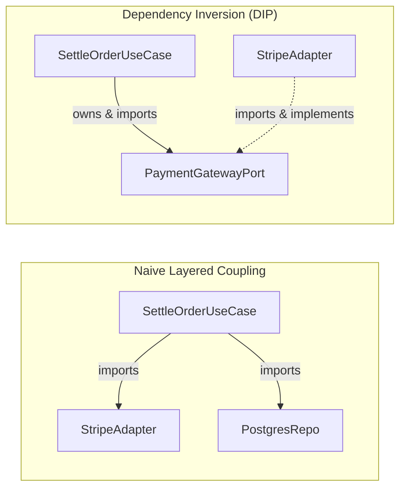
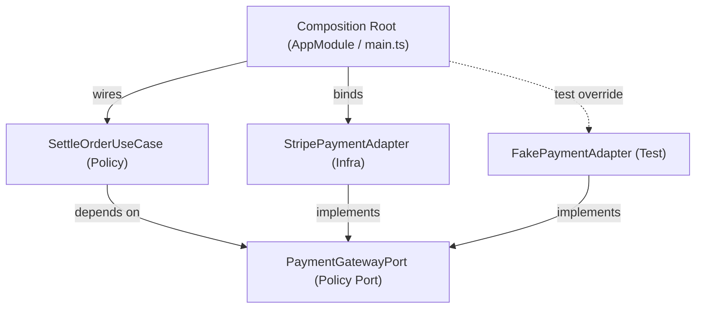
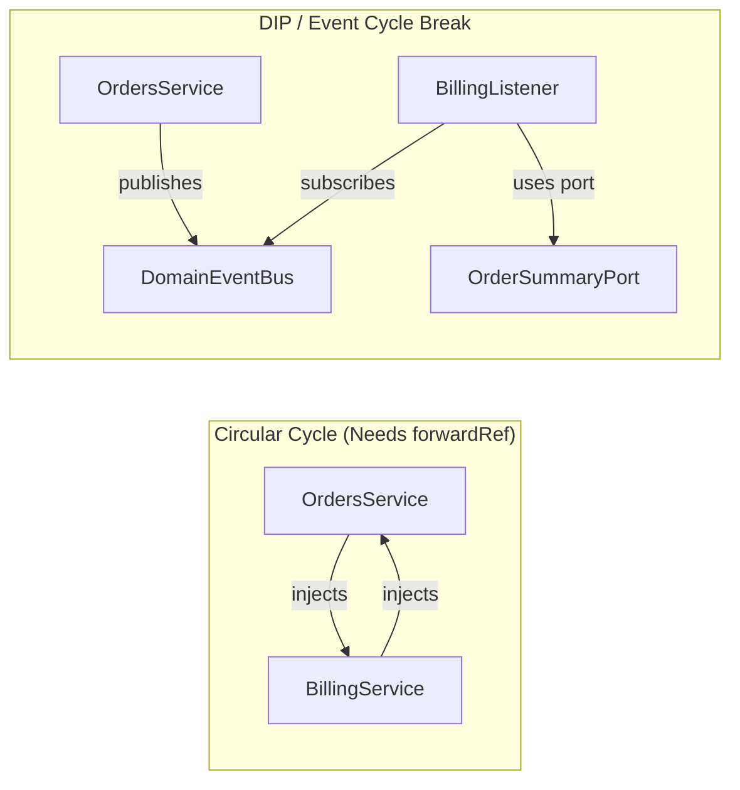

---
tags:
  - software-engineering
  - solid
  - dependency-inversion
  - dependency-injection
  - nestjs
  - typescript
created: 2026-01-02
updated: 2026-11-13
status: 🟢
level: mid-to-senior
---
# Dependency Inversion Principle (DIP)

> [!abstract] Vault Navigation
> Part of [[Programming/Software Engineering/SOLID/SOLID Principles Complete Guide|SOLID Principles Complete Guide]]. Foundational mechanism behind [[Programming/Software Engineering/Clean Architecture/Dependency Rule|Dependency Rule]], [[Programming/Software Engineering/Architectural Patterns/Hexagonal Architecture|Hexagonal Architecture]], and [[Programming/Software Engineering/Design Patterns/Structural/Adapter|Adapter]]. Pairs directly with [[Programming/Software Engineering/SOLID/Interface Segregation Principle|Interface Segregation Principle]] and [[Programming/Software Engineering/SOLID/Open-Closed Principle|Open-Closed Principle]].

1. **High-level policy modules must not depend on low-level detail modules.** Both must depend on abstractions.
2. **Abstractions must not depend on details.** Details (databases, payment SDKs, HTTP frameworks, clocks, message brokers) must depend on abstractions.

---

## 1. First-Principles Mechanics & Complete Architecture

### 1.1 Inverting the Source Dependency Graph vs Runtime Control Flow

In naive layered systems, high-level domain policies import and instantiate low-level technical mechanisms directly (`SettleOrderUseCase` imports `StripeClient` and `PgPool`). Because source-code `import` edges point downward from policy toward volatile infrastructure, every breaking change in a database driver, ORM version, or payment vendor SDK ripples upward into core revenue rules, and unit testing business invariants requires spinning up sockets, HTTP servers, or brittle monkey-patches.

The **Dependency Inversion Principle (DIP)** breaks this coupling by inserting an abstract boundary—a **Port Interface**—owned by the high-level policy module:

- **Runtime Control Flow**: `Controller -> SettleOrderUseCase -> PaymentGatewayPort.charge() -> vtable / object dispatch -> StripePaymentGatewayAdapter.charge() -> Stripe HTTPS API`. Control still flows from policy out to infrastructure at runtime.
- **Compile-Time Source Dependency**: `StripePaymentGatewayAdapter` imports `PaymentGatewayPort` and domain value types (`ChargeCommand`, `ChargeReceipt`) from the policy layer. `SettleOrderUseCase` holds zero `import` statements pointing to `stripe`, `pg`, `nodemailer`, or `infrastructure/`. Both compile-time dependencies and release-impact arrows point **inward** toward business policy.



### 1.2 DIP vs Dependency Injection (DI) vs IoC Container

Mid-level engineers routinely conflate three distinct concepts. Treating them as synonyms leads to architectures that use an IoC container everywhere while violating DIP completely:

| Concept | Category | Primary Responsibility | Can Exist Without the Others? |
|---|---|---|---|
| **Dependency Inversion (DIP)** | **Architectural Principle** | Ensures high-level policy owns stable port interfaces using domain-pure signatures; infrastructure implements them inward | Yes: achievable with Pure DI and plain function/constructor arguments without any container |
| **Dependency Injection (DI)** | **Wiring Technique** | Supplies collaborator instances from outside a class (`constructor(gateway)`) instead of calling `new Stripe()` or `Singleton.getInstance()` inside it | Yes: you can inject concrete `StripeClient` or `PrismaService` via DI while still violating DIP |
| **IoC Container** | **Framework Runtime Engine** | Automates object graph construction, token resolution (`@Inject(TOKEN)`), provider scopes (`DEFAULT`, `REQUEST`, `TRANSIENT`), and lifecycle hooks (`OnModuleInit`, `OnModuleDestroy`) | Yes: many NestJS/Spring apps use an IoC container to wire concrete low-level classes directly into services with zero DIP boundaries |

Injecting `PrismaService` into `SettleOrderUseCase` via NestJS constructor injection is **DI + IoC**, yet it **violates DIP** whenever `SettleOrderUseCase` imports `PrismaService` from `@prisma/client` or infrastructure modules directly. True DIP demands that `SettleOrderUseCase` depend solely on a policy-owned `OrderRepositoryPort` interface.

### 1.3 Why Policy Must Own the Interface (And Why SDK Types Leak DIP)

Extracting an interface is insufficient unless two strict ownership invariants hold:

1. **Package Ownership**: If `infrastructure/stripe/stripe-gateway.ts` exports `export interface IPaymentGateway`, and `application/settle-order.use-case.ts` imports it from `../infrastructure/stripe/stripe-gateway`, source dependencies still point from policy into `infrastructure/`. Moving or deleting the Stripe adapter package breaks the domain build. The port interface (`payment-gateway.port.ts`) must reside inside `application/ports/` or `domain/ports/`.
2. **Signature Purity (Anti-Corruption Boundary)**: If `PaymentGatewayPort` imports a vendor SDK type (`import type Stripe from 'stripe'`), even inside an interface located in `application/ports/`, DIP breaks immediately:

```typescript
// BROKEN DIP: Port lives in application/ports/, but leaks Stripe SDK types
import type Stripe from 'stripe';

export interface LeakyPaymentGatewayPort {
  charge(params: Stripe.PaymentIntentCreateParams): Promise<Stripe.PaymentIntent>;
}
```

Inspect what goes wrong when `LeakyPaymentGatewayPort` ships to production:
- Every unit test for `SettleOrderUseCase` must fabricate a massive `Stripe.PaymentIntent` object with 40+ irrelevant Stripe fields (`latest_charge`, `automatic_payment_methods`, `next_action`, `livemode`).
- Upgrading `stripe` from v14 to v17 alters `Stripe.PaymentIntentCreateParams` and breaks domain business-logic compilation.
- Adding Adyen or PayPal as a secondary payment rail forces refactoring every domain caller because the port speaks Stripe's exact parameter vocabulary (`payment_method_types`, `confirm: true`).

Instead, the policy module owns both the port interface and clean domain command/result contracts (`ChargeCommand`, `ChargeReceipt`, `PaymentDeclinedError`). The infrastructure adapter translates between domain vocabulary and Stripe's HTTP schema.

### 1.4 The Composition Root Pattern

If high-level policies cannot instantiate `StripePaymentGatewayAdapter` or `PostgresOrderRepository`, where do concrete implementations get constructed and wired together? Exclusively at the **Composition Root**—the single outermost bootstrap location near the process entry point (`src/main.ts` / `src/app.module.ts`).

- Only the Composition Root imports **both** `application` use cases and `infrastructure` adapters.
- Domain and application modules never call `container.get(...)` or import concrete infrastructure classes.
- Switching between production Postgres/Stripe adapters and local in-memory fakes for deterministic testing changes **only** the Composition Root bindings—zero lines of business policy change.



---

## 2. Real-World Use Cases & Decision Matrix

### 2.1 Injection Mechanisms Compared

Choosing how dependencies enter a module determines testability, compile-time safety, and runtime reliability:

| Mechanism | Mechanics | Compile-Time Safety | Primary Use Case & Verdict |
|---|---|---|---|
| **Constructor Injection** | Required collaborators declared in `constructor(private readonly gateway: PaymentGatewayPort)` | Highest (`private readonly`, guaranteed initialized) | **Default choice** for 95% of services, use cases, and adapters |
| **Parameterized Factory Injection** | Inject a typed resolver (`resolve(region: Region): PaymentGatewayPort`) built at Composition Root | High (caller receives narrow typed port, never raw container) | **Recommended** when runtime inputs (tenant config, country, currency) select the adapter dynamically |
| **Method Injection** | Pass per-call context (`execute(cmd, signal: AbortSignal)`) as a method argument | High (zero hidden object state) | **Recommended** for per-request cancellation signals, tracing spans, and stateless strategies |
| **Property / Setter Injection** | Mutate fields post-construction (`service.gateway = ...`) | Poor (fields risk remaining `undefined` at runtime) | **Avoid**; use only inside legacy frameworks blocking constructor signatures |
| **Service Locator Anti-Pattern** | Policy pulls dependencies globally (`ServiceLocator.get('Payment')` or injecting NestJS `ModuleRef` into use cases) | None (missing bindings explode at runtime, hidden dependency signature) | **Banned in domain/policy layers**; obscures dependency graph and corrupts test isolation |

### 2.2 Pure DI (Manual Composition Root) vs IoC Container

TypeScript applications do not inherently require a reflection-based IoC container to practice DIP. Evaluate both approaches across operational constraints:

| Dimension | Pure DI (Explicit Factory in `main.ts`) | IoC Container (NestJS / InversifyJS / Spring) |
|---|---|---|
| **Compile-Time Verification** | **100% static (`tsc`)**: missing argument fails compilation before boot | **Runtime resolution**: missing token binding throws `UnknownDependenciesException` at boot or runtime |
| **Cold-Start Latency** | $0\text{ms}$ reflection overhead; ideal for AWS Lambda & Cloudflare Workers | Scans `reflect-metadata` and walks module graph during container initialization |
| **Tree-Shaking & Bundle Size** | Static imports let `esbuild` / `rollup` eliminate dead adapters cleanly | Reflection decorators and dynamic module registries keep broader dependency graphs alive |
| **Circular Dependencies** | Impossible to construct accidentally in nested constructor calls | Can hide behind `forwardRef(() => ...)` lazy proxies, masking architectural cycles |
| **Cross-Cutting AOP & Lifecycle** | Manual wrapper functions and explicit shutdown arrays | Built-in `OnModuleInit`, `OnModuleDestroy`, Guards, Interceptors, and `Test.createTestingModule().overrideProvider()` |
| **Best Fit** | Microservices with 5–40 classes, serverless handlers, shared libraries | Large multi-team enterprise backends relying on NestJS HTTP/gRPC/CLI module infrastructure |

### 2.3 NestJS Token Injection Mechanics (Why Interfaces Require `@Inject`)

TypeScript interfaces (`export interface PaymentGatewayPort`) exist solely during compilation. When `tsc` emits JavaScript, interfaces disappear completely (`0` bytes in `.js` output). Even with `"emitDecoratorMetadata": true`, TypeScript emits `design:paramtypes: [Object]` for any constructor parameter typed as an interface.

Consequently, NestJS cannot infer which provider satisfies `gateway: PaymentGatewayPort` unless you provide a runtime **Injection Token**:

1. **`Symbol` Token + `@Inject(PAYMENT_GATEWAY_PORT)` (Recommended)**: Collision-proof across packages, decouples runtime token identity cleanly, pairs cleanly with `interface` contracts.
2. **String Token (`@Inject('PAYMENT_GATEWAY')`)**: Works at runtime, but risks silent key collisions across independent modules if two teams pick `'LOGGER'` or `'CACHE'`.
3. **`abstract class` Port Token**: Because ES classes survive JS emit, `abstract class PaymentGatewayPort` acts simultaneously as a TypeScript type **and** a runtime NestJS DI token without `@Inject(...)`. Trade-off: forces subclasses to use single-inheritance `extends` (or carefully honor every method via `implements`), coupling ports slightly closer to JS class emission—making `Symbol` + `interface` cleaner for multi-role ISP composition.

### 2.4 When NOT to Apply DIP (Over-Abstraction Guardrail)

DIP pays dividends at **volatile I/O, vendor, and cross-bounded-context seams**. Do not wrap stable standard-library primitives or pure in-memory business calculations behind interfaces:

- **Do NOT abstract**: `node:crypto` hashing helpers, `Intl.NumberFormat`, pure `Money.add()` domain value methods, tax bracket formulas, or internal domain entities (`Order`). Creating `IMoneyCalculator` or `IStringTrimService` with a single unchanging implementation adds pure ceremony without isolating any volatile boundary.
- **DO abstract**: Relational databases, Redis caches, payment processors (`Stripe`, `Adyen`), email/SMS providers (`SES`, `SendGrid`), object storage (`S3`), external HTTP microservices, non-deterministic clocks (`ClockPort`), and ID/UUID generators when deterministic replay matters.

---

## 3. Step-by-Step Practical Application: End-to-End NestJS Order Settlement & Notification Vertical

Below is a complete, production-structured TypeScript + NestJS vertical implementing **Order Settlement & Customer Receipt Notification** with strict DIP boundaries:

- **Domain & Application Layers** import zero frameworks or external SDKs (not even `@nestjs/common` inside `SettleOrderUseCase` or domain entities!).
- **Policy-Owned Ports** use clean domain objects—zero Stripe, Postgres, or AWS SES types leak inward.
- **Infrastructure Adapters** implement ports inward, translate vendor exceptions into domain failures, and enforce idempotency.
- **NestJS Composition Root** wires Symbol tokens inside `OrdersModule` and exposes clean `.overrideProvider()` hooks for integration tests.

### 3.1 Production Project Structure

```text
src/
  orders/
    domain/
      order.entity.ts
      settlement.errors.ts
    application/
      ports/
        order-repository.port.ts
        payment-gateway.port.ts
        notification-dispatcher.port.ts
        clock.port.ts
        tokens.ts
      settle-order.use-case.ts
    infrastructure/
      adapters/
        stripe-payment-gateway.adapter.ts
        postgres-order.repository.ts
        ses-notification.adapter.ts
        system-clock.adapter.ts
      testing/
        in-memory-order.repository.ts
        fake-payment-gateway.adapter.ts
        recording-notification.adapter.ts
        fixed-clock.adapter.ts
    orders.controller.ts
    orders.module.ts
  test/
    settle-order.use-case.spec.ts
    orders.integration.spec.ts
```

### 3.2 Domain Layer (Pure Business Rules & Errors)

```typescript
// src/orders/domain/settlement.errors.ts
export class OrderNotFoundError extends Error {
  constructor(public readonly orderId: string) {
    super(`Order "${orderId}" was not found`);
    this.name = 'OrderNotFoundError';
  }
}

export class OrderAlreadySettledError extends Error {
  constructor(public readonly orderId: string, public readonly transactionId: string) {
    super(`Order "${orderId}" is already settled under transaction "${transactionId}"`);
    this.name = 'OrderAlreadySettledError';
  }
}

export class PaymentDeclinedError extends Error {
  constructor(public readonly reasonCode: string, message: string) {
    super(`Payment declined (${reasonCode}): ${message}`);
    this.name = 'PaymentDeclinedError';
  }
}

export class PaymentGatewayUnavailableError extends Error {
  constructor(message: string) {
    super(`Payment gateway temporarily unavailable: ${message}`);
    this.name = 'PaymentGatewayUnavailableError';
  }
}
```

```typescript
// src/orders/domain/order.entity.ts
import { OrderAlreadySettledError } from './settlement.errors';

export type OrderStatus = 'PENDING' | 'SETTLED' | 'PAYMENT_FAILED';

export interface OrderSnapshot {
  readonly id: string;
  readonly customerId: string;
  readonly customerEmail: string;
  readonly amountCents: number;
  readonly currency: 'USD' | 'EUR' | 'GBP';
  readonly status: OrderStatus;
  readonly paymentTransactionId: string | null;
  readonly lastFailureReason: string | null;
  readonly settledAt: Date | null;
}

export class Order {
  private constructor(private props: OrderSnapshot) {
    if (!Number.isInteger(props.amountCents) || props.amountCents <= 0) {
      throw new RangeError(`Order amountCents must be a positive integer; received ${props.amountCents}`);
    }
  }

  static reconstitute(snapshot: OrderSnapshot): Order {
    return new Order({ ...snapshot });
  }

  get id(): string {
    return this.props.id;
  }

  get customerId(): string {
    return this.props.customerId;
  }

  get customerEmail(): string {
    return this.props.customerEmail;
  }

  get amountCents(): number {
    return this.props.amountCents;
  }

  get currency(): 'USD' | 'EUR' | 'GBP' {
    return this.props.currency;
  }

  get status(): OrderStatus {
    return this.props.status;
  }

  get paymentTransactionId(): string | null {
    return this.props.paymentTransactionId;
  }

  assertSettleable(): void {
    if (this.props.status === 'SETTLED' && this.props.paymentTransactionId) {
      throw new OrderAlreadySettledError(this.props.id, this.props.paymentTransactionId);
    }
  }

  markSettled(transactionId: string, settledAt: Date): void {
    this.assertSettleable();
    this.props = {
      ...this.props,
      status: 'SETTLED',
      paymentTransactionId: transactionId,
      lastFailureReason: null,
      settledAt,
    };
  }

  markPaymentFailed(reasonCode: string): void {
    if (this.props.status === 'SETTLED') {
      throw new OrderAlreadySettledError(
        this.props.id,
        this.props.paymentTransactionId ?? 'unknown',
      );
    }
    this.props = {
      ...this.props,
      status: 'PAYMENT_FAILED',
      lastFailureReason: reasonCode,
    };
  }

  toSnapshot(): OrderSnapshot {
    return { ...this.props };
  }
}
```

### 3.3 Application Ports & Tokens (Policy-Owned, Zero SDK Imports)

Notice how `PaymentGatewayPort`, `OrderRepositoryPort`, `NotificationDispatcherPort`, and `ClockPort` live strictly inside `src/orders/application/ports/` and are segregated by role per [[Programming/Software Engineering/SOLID/Interface Segregation Principle|Interface Segregation Principle]]:

```typescript
// src/orders/application/ports/order-repository.port.ts
import type { Order } from '../../domain/order.entity';

export interface OrderRepositoryPort {
  findById(orderId: string): Promise<Order | null>;
  save(order: Order): Promise<void>;
}
```

```typescript
// src/orders/application/ports/payment-gateway.port.ts
export interface ChargeCommand {
  readonly orderId: string;
  readonly customerId: string;
  readonly amountCents: number;
  readonly currency: 'USD' | 'EUR' | 'GBP';
  readonly paymentMethodToken: string;
  readonly idempotencyKey: string;
}

export interface ChargeReceipt {
  readonly transactionId: string;
  readonly authorizedAmountCents: number;
  readonly capturedAt: Date;
}

export interface PaymentGatewayPort {
  charge(command: ChargeCommand): Promise<ChargeReceipt>;
}
```

```typescript
// src/orders/application/ports/notification-dispatcher.port.ts
export interface OrderSettledReceiptEmail {
  readonly recipientEmail: string;
  readonly orderId: string;
  readonly amountCents: number;
  readonly currency: 'USD' | 'EUR' | 'GBP';
  readonly transactionId: string;
  readonly settledAt: Date;
}

export interface NotificationDispatcherPort {
  sendSettlementReceipt(payload: OrderSettledReceiptEmail): Promise<void>;
}
```

```typescript
// src/orders/application/ports/clock.port.ts
export interface ClockPort {
  now(): Date;
}
```

```typescript
// src/orders/application/ports/tokens.ts
export const ORDER_REPOSITORY_PORT = Symbol('ORDER_REPOSITORY_PORT');
export const PAYMENT_GATEWAY_PORT = Symbol('PAYMENT_GATEWAY_PORT');
export const NOTIFICATION_DISPATCHER_PORT = Symbol('NOTIFICATION_DISPATCHER_PORT');
export const CLOCK_PORT = Symbol('CLOCK_PORT');
```

### 3.4 High-Level Policy Use Case (`SettleOrderUseCase`)

Notice `SettleOrderUseCase` imports **zero NestJS decorators**, **zero Stripe packages**, and **zero database clients**. Wiring happens cleanly in the NestJS Composition Root (`OrdersModule`) via `useFactory` + `inject`, keeping domain application logic 100% framework-agnostic (or if a team prefers `@Inject(TOKEN)` constructor decorators inside NestJS services, that works seamlessly too—both options are shown clearly in Section 4.1):

```typescript
// src/orders/application/settle-order.use-case.ts
import {
  OrderNotFoundError,
  PaymentDeclinedError,
} from '../domain/settlement.errors';
import type { ClockPort } from './ports/clock.port';
import type { NotificationDispatcherPort } from './ports/notification-dispatcher.port';
import type { OrderRepositoryPort } from './ports/order-repository.port';
import type { PaymentGatewayPort } from './ports/payment-gateway.port';

export interface SettleOrderInput {
  readonly orderId: string;
  readonly paymentMethodToken: string;
  readonly idempotencyKey: string;
}

export interface SettleOrderOutput {
  readonly orderId: string;
  readonly transactionId: string;
  readonly settledAtIso: string;
}

export class SettleOrderUseCase {
  constructor(
    private readonly orders: OrderRepositoryPort,
    private readonly paymentGateway: PaymentGatewayPort,
    private readonly notifications: NotificationDispatcherPort,
    private readonly clock: ClockPort,
  ) {}

  async execute(input: SettleOrderInput): Promise<SettleOrderOutput> {
    const order = await this.orders.findById(input.orderId);
    if (!order) {
      throw new OrderNotFoundError(input.orderId);
    }

    order.assertSettleable();

    try {
      const receipt = await this.paymentGateway.charge({
        orderId: order.id,
        customerId: order.customerId,
        amountCents: order.amountCents,
        currency: order.currency,
        paymentMethodToken: input.paymentMethodToken,
        idempotencyKey: input.idempotencyKey,
      });

      const settledAt = this.clock.now();
      order.markSettled(receipt.transactionId, settledAt);
      await this.orders.save(order);

      await this.notifications.sendSettlementReceipt({
        recipientEmail: order.customerEmail,
        orderId: order.id,
        amountCents: order.amountCents,
        currency: order.currency,
        transactionId: receipt.transactionId,
        settledAt,
      });

      return {
        orderId: order.id,
        transactionId: receipt.transactionId,
        settledAtIso: settledAt.toISOString(),
      };
    } catch (error) {
      if (error instanceof PaymentDeclinedError) {
        order.markPaymentFailed(error.reasonCode);
        await this.orders.save(order);
      }
      throw error;
    }
  }
}
```

### 3.5 Infrastructure Adapters (Stripe, Postgres, SES, System Clock)

Every adapter depends **inward** on the policy ports and translates external SDK exceptions and schemas at the boundary:

```typescript
// src/orders/infrastructure/adapters/stripe-payment-gateway.adapter.ts
import type {
  ChargeCommand,
  ChargeReceipt,
  PaymentGatewayPort,
} from '../../application/ports/payment-gateway.port';
import {
  PaymentDeclinedError,
  PaymentGatewayUnavailableError,
} from '../../domain/settlement.errors';

export interface StripeSdkLike {
  paymentIntents: {
    create(
      params: {
        amount: number;
        currency: string;
        customer: string;
        payment_method: string;
        confirm: boolean;
        metadata: Record<string, string>;
      },
      options: { idempotencyKey: string },
    ): Promise<{
      id: string;
      status: string;
      amount_received: number;
      created: number;
    }>;
  };
}

interface StripeErrorLike {
  type?: string;
  decline_code?: string;
  message?: string;
  statusCode?: number;
}

export class StripePaymentGatewayAdapter implements PaymentGatewayPort {
  constructor(private readonly stripe: StripeSdkLike) {}

  async charge(command: ChargeCommand): Promise<ChargeReceipt> {
    try {
      const intent = await this.stripe.paymentIntents.create(
        {
          amount: command.amountCents,
          currency: command.currency.toLowerCase(),
          customer: command.customerId,
          payment_method: command.paymentMethodToken,
          confirm: true,
          metadata: { orderId: command.orderId },
        },
        { idempotencyKey: command.idempotencyKey },
      );

      if (intent.status !== 'succeeded') {
        throw new PaymentDeclinedError(
          intent.status,
          `Stripe PaymentIntent "${intent.id}" ended in status "${intent.status}"`,
        );
      }

      return {
        transactionId: intent.id,
        authorizedAmountCents: intent.amount_received,
        capturedAt: new Date(intent.created * 1000),
      };
    } catch (rawError) {
      if (rawError instanceof PaymentDeclinedError) {
        throw rawError;
      }
      const err = rawError as StripeErrorLike;
      if (err.type === 'StripeCardError') {
        throw new PaymentDeclinedError(
          err.decline_code ?? 'card_declined',
          err.message ?? 'Card authorization failed',
        );
      }
      throw new PaymentGatewayUnavailableError(err.message ?? 'Unexpected Stripe transport error');
    }
  }
}
```

```typescript
// src/orders/infrastructure/adapters/postgres-order.repository.ts
import type { OrderRepositoryPort } from '../../application/ports/order-repository.port';
import { Order, type OrderStatus } from '../../domain/order.entity';

export interface PgPoolLike {
  query<Row extends Record<string, unknown>>(
    sql: string,
    params: ReadonlyArray<unknown>,
  ): Promise<{ rows: ReadonlyArray<Row> }>;
}

interface OrderDbRow extends Record<string, unknown> {
  id: string;
  customer_id: string;
  customer_email: string;
  amount_cents: number;
  currency: 'USD' | 'EUR' | 'GBP';
  status: OrderStatus;
  payment_transaction_id: string | null;
  last_failure_reason: string | null;
  settled_at: Date | null;
}

export class PostgresOrderRepository implements OrderRepositoryPort {
  constructor(private readonly pool: PgPoolLike) {}

  async findById(orderId: string): Promise<Order | null> {
    const result = await this.pool.query<OrderDbRow>(
      `SELECT id, customer_id, customer_email, amount_cents, currency, status,
              payment_transaction_id, last_failure_reason, settled_at
       FROM orders WHERE id = $1 LIMIT 1`,
      [orderId],
    );
    const row = result.rows[0];
    if (!row) {
      return null;
    }
    return Order.reconstitute({
      id: row.id,
      customerId: row.customer_id,
      customerEmail: row.customer_email,
      amountCents: Number(row.amount_cents),
      currency: row.currency,
      status: row.status,
      paymentTransactionId: row.payment_transaction_id,
      lastFailureReason: row.last_failure_reason,
      settledAt: row.settled_at ? new Date(row.settled_at) : null,
    });
  }

  async save(order: Order): Promise<void> {
    const snap = order.toSnapshot();
    await this.pool.query(
      `INSERT INTO orders (
         id, customer_id, customer_email, amount_cents, currency, status,
         payment_transaction_id, last_failure_reason, settled_at
       ) VALUES ($1, $2, $3, $4, $5, $6, $7, $8, $9)
       ON CONFLICT (id) DO UPDATE SET
         status = EXCLUDED.status,
         payment_transaction_id = EXCLUDED.payment_transaction_id,
         last_failure_reason = EXCLUDED.last_failure_reason,
         settled_at = EXCLUDED.settled_at`,
      [
        snap.id,
        snap.customerId,
        snap.customerEmail,
        snap.amountCents,
        snap.currency,
        snap.status,
        snap.paymentTransactionId,
        snap.lastFailureReason,
        snap.settledAt,
      ],
    );
  }
}
```

```typescript
// src/orders/infrastructure/adapters/ses-notification.adapter.ts
import type {
  NotificationDispatcherPort,
  OrderSettledReceiptEmail,
} from '../../application/ports/notification-dispatcher.port';

export interface EmailTransportLike {
  sendEmail(input: {
    from: string;
    to: string;
    subject: string;
    textBody: string;
  }): Promise<{ messageId: string }>;
}

export class SesNotificationAdapter implements NotificationDispatcherPort {
  constructor(
    private readonly transport: EmailTransportLike,
    private readonly senderAddress: string,
  ) {}

  async sendSettlementReceipt(payload: OrderSettledReceiptEmail): Promise<void> {
    const formattedAmount = (payload.amountCents / 100).toFixed(2);
    await this.transport.sendEmail({
      from: this.senderAddress,
      to: payload.recipientEmail,
      subject: `Payment Receipt for Order ${payload.orderId}`,
      textBody: [
        `Order ${payload.orderId} has been settled.`,
        `Amount: ${formattedAmount} ${payload.currency}`,
        `Transaction ID: ${payload.transactionId}`,
        `Timestamp: ${payload.settledAt.toISOString()}`,
      ].join('\n'),
    });
  }
}
```

```typescript
// src/orders/infrastructure/adapters/system-clock.adapter.ts
import type { ClockPort } from '../../application/ports/clock.port';

export class SystemClockAdapter implements ClockPort {
  now(): Date {
    return new Date();
  }
}
```

### 3.6 Deterministic In-Memory Test Fakes

Real stateful fakes (rather than brittle call-verification mocks) verify true state transitions, idempotency behavior, and failure persistence without touching Postgres, Stripe, or SES:

```typescript
// src/orders/infrastructure/testing/in-memory-order.repository.ts
import type { OrderRepositoryPort } from '../../application/ports/order-repository.port';
import { Order } from '../../domain/order.entity';

export class InMemoryOrderRepository implements OrderRepositoryPort {
  private readonly records = new Map<string, ReturnType<Order['toSnapshot']>>();

  seed(order: Order): void {
    this.records.set(order.id, order.toSnapshot());
  }

  async findById(orderId: string): Promise<Order | null> {
    const snap = this.records.get(orderId);
    return snap ? Order.reconstitute(snap) : null;
  }

  async save(order: Order): Promise<void> {
    this.records.set(order.id, order.toSnapshot());
  }
}
```

```typescript
// src/orders/infrastructure/testing/fake-payment-gateway.adapter.ts
import type {
  ChargeCommand,
  ChargeReceipt,
  PaymentGatewayPort,
} from '../../application/ports/payment-gateway.port';
import {
  PaymentDeclinedError,
  PaymentGatewayUnavailableError,
} from '../../domain/settlement.errors';

export class FakePaymentGatewayAdapter implements PaymentGatewayPort {
  private readonly seenIdempotencyKeys = new Map<string, ChargeReceipt>();
  private nextFailure: { kind: 'DECLINE' | 'UNAVAILABLE'; code: string; message: string } | null = null;
  private sequence = 0;

  failNextWithDecline(code: string, message: string): void {
    this.nextFailure = { kind: 'DECLINE', code, message };
  }

  failNextWithOutage(message: string): void {
    this.nextFailure = { kind: 'UNAVAILABLE', code: 'outage', message };
  }

  async charge(command: ChargeCommand): Promise<ChargeReceipt> {
    const cached = this.seenIdempotencyKeys.get(command.idempotencyKey);
    if (cached) {
      return cached;
    }

    if (this.nextFailure) {
      const failure = this.nextFailure;
      this.nextFailure = null;
      if (failure.kind === 'DECLINE') {
        throw new PaymentDeclinedError(failure.code, failure.message);
      }
      throw new PaymentGatewayUnavailableError(failure.message);
    }

    this.sequence += 1;
    const receipt: ChargeReceipt = {
      transactionId: `pi_fake_${this.sequence}`,
      authorizedAmountCents: command.amountCents,
      capturedAt: new Date('2026-11-13T12:00:00Z'),
    };
    this.seenIdempotencyKeys.set(command.idempotencyKey, receipt);
    return receipt;
  }
}
```

```typescript
// src/orders/infrastructure/testing/recording-notification.adapter.ts
import type {
  NotificationDispatcherPort,
  OrderSettledReceiptEmail,
} from '../../application/ports/notification-dispatcher.port';

export class RecordingNotificationAdapter implements NotificationDispatcherPort {
  public readonly sentReceipts: OrderSettledReceiptEmail[] = [];

  async sendSettlementReceipt(payload: OrderSettledReceiptEmail): Promise<void> {
    this.sentReceipts.push(payload);
  }
}
```

```typescript
// src/orders/infrastructure/testing/fixed-clock.adapter.ts
import type { ClockPort } from '../../application/ports/clock.port';

export class FixedClockAdapter implements ClockPort {
  constructor(private current: Date) {}

  setNow(next: Date): void {
    this.current = next;
  }

  now(): Date {
    return new Date(this.current.getTime());
  }
}
```

### 3.7 NestJS HTTP Controller and Composition Root (`OrdersModule`)

`OrdersController` translates HTTP routes and domain exceptions to HTTP status codes, while `OrdersModule` serves as the Composition Root binding every Symbol port token to its concrete adapter:

```typescript
// src/orders/orders.controller.ts
import {
  BadGatewayException,
  Body,
  ConflictException,
  Controller,
  HttpCode,
  NotFoundException,
  Param,
  Post,
  UnprocessableEntityException,
} from '@nestjs/common';
import { SettleOrderUseCase, type SettleOrderOutput } from './application/settle-order.use-case';
import {
  OrderAlreadySettledError,
  OrderNotFoundError,
  PaymentDeclinedError,
  PaymentGatewayUnavailableError,
} from './domain/settlement.errors';

export interface SettleOrderRequestDto {
  readonly paymentMethodToken: string;
  readonly idempotencyKey: string;
}

@Controller('orders')
export class OrdersController {
  constructor(private readonly settleOrder: SettleOrderUseCase) {}

  @Post(':orderId/settle')
  @HttpCode(200)
  async settle(
    @Param('orderId') orderId: string,
    @Body() body: SettleOrderRequestDto,
  ): Promise<SettleOrderOutput> {
    try {
      return await this.settleOrder.execute({
        orderId,
        paymentMethodToken: body.paymentMethodToken,
        idempotencyKey: body.idempotencyKey,
      });
    } catch (error) {
      if (error instanceof OrderNotFoundError) {
        throw new NotFoundException(error.message);
      }
      if (error instanceof OrderAlreadySettledError) {
        throw new ConflictException(error.message);
      }
      if (error instanceof PaymentDeclinedError) {
        throw new UnprocessableEntityException({
          code: error.reasonCode,
          message: error.message,
        });
      }
      if (error instanceof PaymentGatewayUnavailableError) {
        throw new BadGatewayException(error.message);
      }
      throw error;
    }
  }
}
```

```typescript
// src/orders/orders.module.ts
import { Module } from '@nestjs/common';
import {
  CLOCK_PORT,
  NOTIFICATION_DISPATCHER_PORT,
  ORDER_REPOSITORY_PORT,
  PAYMENT_GATEWAY_PORT,
} from './application/ports/tokens';
import type { ClockPort } from './application/ports/clock.port';
import type { NotificationDispatcherPort } from './application/ports/notification-dispatcher.port';
import type { OrderRepositoryPort } from './application/ports/order-repository.port';
import type { PaymentGatewayPort } from './application/ports/payment-gateway.port';
import { SettleOrderUseCase } from './application/settle-order.use-case';
import { PostgresOrderRepository, type PgPoolLike } from './infrastructure/adapters/postgres-order.repository';
import { SesNotificationAdapter, type EmailTransportLike } from './infrastructure/adapters/ses-notification.adapter';
import { StripePaymentGatewayAdapter, type StripeSdkLike } from './infrastructure/adapters/stripe-payment-gateway.adapter';
import { SystemClockAdapter } from './infrastructure/adapters/system-clock.adapter';
import { OrdersController } from './orders.controller';

export const PG_POOL = Symbol('PG_POOL');
export const STRIPE_SDK = Symbol('STRIPE_SDK');
export const EMAIL_TRANSPORT = Symbol('EMAIL_TRANSPORT');

@Module({
  controllers: [OrdersController],
  providers: [
    {
      provide: ORDER_REPOSITORY_PORT,
      useFactory: (pool: PgPoolLike) => new PostgresOrderRepository(pool),
      inject: [PG_POOL],
    },
    {
      provide: PAYMENT_GATEWAY_PORT,
      useFactory: (stripe: StripeSdkLike) => new StripePaymentGatewayAdapter(stripe),
      inject: [STRIPE_SDK],
    },
    {
      provide: NOTIFICATION_DISPATCHER_PORT,
      useFactory: (transport: EmailTransportLike) =>
        new SesNotificationAdapter(transport, process.env.RECEIPT_FROM_EMAIL ?? 'billing@acme.example'),
      inject: [EMAIL_TRANSPORT],
    },
    {
      provide: CLOCK_PORT,
      useClass: SystemClockAdapter,
    },
    {
      provide: SettleOrderUseCase,
      useFactory: (
        orders: OrderRepositoryPort,
        gateway: PaymentGatewayPort,
        notifications: NotificationDispatcherPort,
        clock: ClockPort,
      ) => new SettleOrderUseCase(orders, gateway, notifications, clock),
      inject: [
        ORDER_REPOSITORY_PORT,
        PAYMENT_GATEWAY_PORT,
        NOTIFICATION_DISPATCHER_PORT,
        CLOCK_PORT,
      ],
    },
  ],
  exports: [SettleOrderUseCase],
})
export class OrdersModule {}
```

### 3.8 Pure Unit Test & NestJS Integration Test

Because `SettleOrderUseCase` depends solely on policy-owned ports, pure unit tests run in `< 5ms` with zero NestJS container overhead, while NestJS integration tests override only external I/O tokens cleanly:

```typescript
// test/settle-order.use-case.spec.ts
import assert from 'node:assert/strict';
import { describe, it } from 'node:test';
import { SettleOrderUseCase } from '../src/orders/application/settle-order.use-case';
import { Order } from '../src/orders/domain/order.entity';
import {
  OrderAlreadySettledError,
  PaymentDeclinedError,
} from '../src/orders/domain/settlement.errors';
import { FakePaymentGatewayAdapter } from '../src/orders/infrastructure/testing/fake-payment-gateway.adapter';
import { FixedClockAdapter } from '../src/orders/infrastructure/testing/fixed-clock.adapter';
import { InMemoryOrderRepository } from '../src/orders/infrastructure/testing/in-memory-order.repository';
import { RecordingNotificationAdapter } from '../src/orders/infrastructure/testing/recording-notification.adapter';

describe('SettleOrderUseCase (Pure Domain + Fakes)', () => {
  it('settles a pending order, persists transaction ID, and emails receipt', async () => {
    const orders = new InMemoryOrderRepository();
    const gateway = new FakePaymentGatewayAdapter();
    const notifications = new RecordingNotificationAdapter();
    const clock = new FixedClockAdapter(new Date('2026-11-13T18:30:00Z'));

    orders.seed(
      Order.reconstitute({
        id: 'ord-100',
        customerId: 'cus-55',
        customerEmail: 'buyer@example.com',
        amountCents: 4999,
        currency: 'USD',
        status: 'PENDING',
        paymentTransactionId: null,
        lastFailureReason: null,
        settledAt: null,
      }),
    );

    const useCase = new SettleOrderUseCase(orders, gateway, notifications, clock);
    const output = await useCase.execute({
      orderId: 'ord-100',
      paymentMethodToken: 'pm_card_visa',
      idempotencyKey: 'idem-100',
    });

    assert.equal(output.transactionId, 'pi_fake_1');
    assert.equal(output.settledAtIso, '2026-11-13T18:30:00.000Z');

    const stored = await orders.findById('ord-100');
    assert.equal(stored?.status, 'SETTLED');
    assert.equal(notifications.sentReceipts.length, 1);
    assert.equal(notifications.sentReceipts[0].recipientEmail, 'buyer@example.com');

    await assert.rejects(
      () =>
        useCase.execute({
          orderId: 'ord-100',
          paymentMethodToken: 'pm_card_visa',
          idempotencyKey: 'idem-101',
        }),
      OrderAlreadySettledError,
    );
  });

  it('records PAYMENT_FAILED state and skips receipt email when card is declined', async () => {
    const orders = new InMemoryOrderRepository();
    const gateway = new FakePaymentGatewayAdapter();
    const notifications = new RecordingNotificationAdapter();
    const clock = new FixedClockAdapter(new Date('2026-11-13T18:30:00Z'));

    orders.seed(
      Order.reconstitute({
        id: 'ord-101',
        customerId: 'cus-56',
        customerEmail: 'declined@example.com',
        amountCents: 1200,
        currency: 'EUR',
        status: 'PENDING',
        paymentTransactionId: null,
        lastFailureReason: null,
        settledAt: null,
      }),
    );

    gateway.failNextWithDecline('insufficient_funds', 'Card balance too low');
    const useCase = new SettleOrderUseCase(orders, gateway, notifications, clock);

    await assert.rejects(
      () =>
        useCase.execute({
          orderId: 'ord-101',
          paymentMethodToken: 'pm_card_declined',
          idempotencyKey: 'idem-102',
        }),
      PaymentDeclinedError,
    );

    const stored = await orders.findById('ord-101');
    assert.equal(stored?.status, 'PAYMENT_FAILED');
    assert.equal(stored?.toSnapshot().lastFailureReason, 'insufficient_funds');
    assert.equal(notifications.sentReceipts.length, 0);
  });
});
```

```typescript
// test/orders.integration.spec.ts
import assert from 'node:assert/strict';
import { describe, it } from 'node:test';
import { UnprocessableEntityException } from '@nestjs/common';
import { Test } from '@nestjs/testing';
import {
  CLOCK_PORT,
  NOTIFICATION_DISPATCHER_PORT,
  ORDER_REPOSITORY_PORT,
  PAYMENT_GATEWAY_PORT,
} from '../src/orders/application/ports/tokens';
import { Order } from '../src/orders/domain/order.entity';
import { FakePaymentGatewayAdapter } from '../src/orders/infrastructure/testing/fake-payment-gateway.adapter';
import { FixedClockAdapter } from '../src/orders/infrastructure/testing/fixed-clock.adapter';
import { InMemoryOrderRepository } from '../src/orders/infrastructure/testing/in-memory-order.repository';
import { RecordingNotificationAdapter } from '../src/orders/infrastructure/testing/recording-notification.adapter';
import { OrdersController } from '../src/orders/orders.controller';
import {
  EMAIL_TRANSPORT,
  OrdersModule,
  PG_POOL,
  STRIPE_SDK,
} from '../src/orders/orders.module';

describe('OrdersModule DI Wiring Integration', () => {
  it('resolves OrdersController cleanly with port overrides and maps domain errors to HTTP', async () => {
    const inMemoryRepo = new InMemoryOrderRepository();
    const fakeGateway = new FakePaymentGatewayAdapter();
    const recordingNotifier = new RecordingNotificationAdapter();
    const fixedClock = new FixedClockAdapter(new Date('2026-11-13T20:00:00Z'));

    inMemoryRepo.seed(
      Order.reconstitute({
        id: 'ord-200',
        customerId: 'cus-99',
        customerEmail: 'ops@example.com',
        amountCents: 2500,
        currency: 'GBP',
        status: 'PENDING',
        paymentTransactionId: null,
        lastFailureReason: null,
        settledAt: null,
      }),
    );

    const moduleRef = await Test.createTestingModule({
      imports: [OrdersModule],
    })
      .overrideProvider(PG_POOL).useValue({})
      .overrideProvider(STRIPE_SDK).useValue({})
      .overrideProvider(EMAIL_TRANSPORT).useValue({})
      .overrideProvider(ORDER_REPOSITORY_PORT).useValue(inMemoryRepo)
      .overrideProvider(PAYMENT_GATEWAY_PORT).useValue(fakeGateway)
      .overrideProvider(NOTIFICATION_DISPATCHER_PORT).useValue(recordingNotifier)
      .overrideProvider(CLOCK_PORT).useValue(fixedClock)
      .compile();

    const controller = moduleRef.get(OrdersController);
    fakeGateway.failNextWithDecline('expired_card', 'Card expired');

    await assert.rejects(
      () =>
        controller.settle('ord-200', {
          paymentMethodToken: 'pm_expired',
          idempotencyKey: 'idem-200',
        }),
      UnprocessableEntityException,
    );

    const retryResult = await controller.settle('ord-200', {
      paymentMethodToken: 'pm_valid',
      idempotencyKey: 'idem-201',
    });

    assert.equal(retryResult.transactionId, 'pi_fake_1');
    assert.equal(recordingNotifier.sentReceipts.length, 1);
    await moduleRef.close();
  });
});
```

---

## 4. Complete Framework Reference & Edge Cases

### 4.1 Direct `@Inject(TOKEN)` Constructor Binding vs Framework-Pure `useFactory`

In [[Programming/Backend/NestJS Complete Guide|NestJS]], teams choose between two valid DIP wiring idioms:

1. **Framework-Pure Use Cases + `useFactory` in Module** (shown in `SettleOrderUseCase` above): Use cases import zero NestJS decorators (`@Injectable`, `@Inject`). They run identically in NestJS, Fastify, AWS Lambda, or standalone CLI scripts, and test directly via `new SettleOrderUseCase(...)`.
2. **`@Injectable()` + `@Inject(TOKEN)` on Constructor Parameters**: Convenient when NestJS owns the entire service boundary and modules auto-register classes without writing manual `useFactory` blocks:

```typescript
import { Inject, Injectable } from '@nestjs/common';
import type { PaymentGatewayPort } from './ports/payment-gateway.port';
import { PAYMENT_GATEWAY_PORT } from './ports/tokens';

@Injectable()
export class RefundOrderService {
  constructor(
    @Inject(PAYMENT_GATEWAY_PORT)
    private readonly gateway: PaymentGatewayPort,
  ) {}
}
```

Both approaches uphold DIP as long as the port interface (`PaymentGatewayPort`) lives in the policy layer and uses zero infrastructure SDK types.

### 4.2 Eliminating Circular Dependencies Without `forwardRef`

In NestJS and TypeScript codebases, circular dependencies (`OrdersModule` <-> `BillingModule`) occur when `OrdersService` needs to issue an invoice via `BillingService`, and `BillingService` injects `OrdersService` to look up order line items. Using `forwardRef(() => BillingService)` is an architectural band-aid: it forces lazy proxy instantiation, breaks if either constructor inspects fields eagerly, and creates fragile Jest module-hoisting failures.



Three deterministic ways to eradicate cycles permanently:
1. **Interface Extraction (DIP)**: `Billing` needs order summaries, so `Billing` defines `OrderSummaryLookupPort` inside `billing/ports/`. `OrdersModule` exports an adapter implementing `OrderSummaryLookupPort` (which reads DB directly rather than injecting the full `OrdersService` orchestrator), or extract shared persistence read ports into a lower `OrderDataModule` imported by both.
2. **In-Process Domain Events ([[Programming/Software Engineering/Architectural Patterns/Event-Driven Architecture|Event-Driven Architecture]])**: `OrdersService` emits `OrderSettledEvent` through an event bus (`EventEmitter2` or transactional outbox). `BillingModule` listens for `OrderSettledEvent` and issues the invoice asynchronously—`OrdersModule` holds **zero** knowledge of `BillingModule`.
3. **Orchestrator / Mediator Service**: Move the multi-module workflow into a dedicated `CheckoutCoordinator` module that imports both `OrdersModule` and `BillingModule` cleanly as a directed acyclic graph (DAG).

### 4.3 Provider Lifetimes, NestJS Scope Bubbling, and the Captive Dependency Bug

Every DI system manages three lifetime scopes:
- **`Scope.DEFAULT` (Singleton)**: Instantiated once per container (`Pool`, `Config`, stateless `UseCase`).
- **`Scope.REQUEST`**: Instantiated fresh per incoming HTTP request (`RequestTraceContext`, per-request `EntityManager`).
- **`Scope.TRANSIENT`**: Instantiated fresh for every consumer injection point.

> [!danger] Captive Dependency Trap & NestJS Scope Bubbling
> In non-bubbling containers (InversifyJS, .NET `IServiceCollection`, manual Singletons), injecting a `REQUEST`-scoped object into a `DEFAULT` Singleton captures Request 1's instance permanently—leaking Tenant A's `tenantId` or closed SQL transaction to Tenant B! Conversely, in NestJS, injecting **one** `Scope.REQUEST` provider into `SettleOrderUseCase` causes **scope bubbling**: NestJS silently converts `SettleOrderUseCase`, `OrdersController`, and upstream services into `REQUEST`-scoped providers re-instantiated on **every single HTTP request**, crushing throughput and causing memory/GC spikes.

**Invariant**: A dependency's lifetime must always be $\ge$ the lifetime of its consumer. Pass per-request data (`tenantId`, `traceId`, `DbTransaction`) explicitly as **method parameters** (`execute(cmd, ctx)`), or use a Singleton `TraceContextAccessor` backed by Node.js `AsyncLocalStorage` rather than constructor-injecting `Scope.REQUEST` objects.

### 4.4 Parameterized Factory Injection (Multi-Region / Multi-Tenant Routing)

When runtime request parameters determine *which* adapter executes (`US` uses Stripe US keys; `EU` uses Adyen SEPA), avoid injecting NestJS `ModuleRef` (Service Locator) into domain services! Instead, build a typed factory/resolver at the Composition Root:

```typescript
// application/ports/regional-gateway-resolver.port.ts
import type { PaymentGatewayPort } from './payment-gateway.port';

export type BillingRegion = 'US' | 'EU';

export interface PaymentGatewayResolverPort {
  forRegion(region: BillingRegion): PaymentGatewayPort;
}

// infrastructure/adapters/map-payment-gateway.resolver.ts
export class MapPaymentGatewayResolver implements PaymentGatewayResolverPort {
  constructor(private readonly gateways: ReadonlyMap<BillingRegion, PaymentGatewayPort>) {}

  forRegion(region: BillingRegion): PaymentGatewayPort {
    const gateway = this.gateways.get(region);
    if (!gateway) {
      throw new Error(`No payment gateway configured for billing region "${region}"`);
    }
    return gateway;
  }
}
```

The Composition Root populates `new Map([['US', stripeUsAdapter], ['EU', adyenEuAdapter]])`, keeping `SettleOrderUseCase` statically typed, testable with a 2-line map fake, and decoupled from the IoC container.

### 4.5 Async Bootstrap Configuration and Graceful Drain

Adapters holding TCP pools (`pg.Pool`, Redis, Kafka) require validated configuration before boot and clean draining on `SIGTERM`. Wire validated configuration via `useFactory` and implement `OnModuleDestroy` strictly on infrastructure adapters (never inside pure domain classes!):

```typescript
import { Injectable, type OnModuleDestroy } from '@nestjs/common';

@Injectable()
export class ManagedPgPool implements OnModuleDestroy {
  constructor(private readonly pool: { end(): Promise<void> }) {}

  async onModuleDestroy(): Promise<void> {
    await this.pool.end();
  }
}
```

### 4.6 Subtle Edge Cases

1. **Barrel-File Import Cycles Causing `undefined` Token Resolution**:
   If `ports/index.ts` re-exports both `tokens.ts` and a class decorated with `@Inject(PAYMENT_GATEWAY_PORT)` from the same barrel, circular module evaluation in CommonJS/ESM can evaluate `@Inject(undefined)` at decorator runtime—producing `Nest can't resolve dependencies of ... (?)`. Always import tokens directly from `./ports/tokens` rather than giant module barrels.
2. **Constructor Over-Injection ("9-Parameter Use Case")**:
   If a use case constructor takes 8–10 ports, DIP is working as an early diagnostic alarm revealing an [[Programming/Software Engineering/SOLID/Single Responsibility|SRP]] violation: split side effects (`sendReceipt`, `updateAnalytics`, `syncCrm`) out into async domain event handlers.
3. **Temporal Coupling via `.init()` Methods**:
   Never construct an uninitialized adapter requiring callers to remember `await adapter.connect()` before invoking port methods. Perform async connection handshakes inside `async useFactory` in the NestJS Composition Root or inside `OnModuleInit` so any injected port instance is valid from construction time.

---

## 5. Production Debugging, Profiling & Operations Playbook

| Symptom | Root Cause | Exact Diagnostic Command / Tool | Concrete Fix |
|---|---|---|---|
| **Boot crash: `Nest can't resolve dependencies of SettleOrderUseCase (?)`** | Forgotten `@Inject(TOKEN)` on erased TS interface, missing `exports: [TOKEN]` in imported module, or barrel import cycle yielding `undefined` token | Run `npx madge --circular --extensions ts src/` and inspect module `providers`/`exports` arrays | Import token directly from `ports/tokens.ts`; verify exporting module includes token in `exports`; match `@Inject(TOKEN)` |
| **Throughput drops 60% and V8 heap GC spikes after adding request logger/context** | Adding `Scope.REQUEST` to one provider bubbled across `SettleOrderUseCase` and `OrdersController`, reinstantiating the tree per HTTP call | Profile constructor allocation counts via `node --inspect` Chrome DevTools Allocation Timeline or `clinic flame -- node dist/main.js` | Switch back to `Scope.DEFAULT` singleton; carry `requestId`/`tenantId` via method parameter or Node `AsyncLocalStorage` |
| **Cross-tenant data leakage (`Tenant A` credentials used on `Tenant B` request)** | Captive dependency: a Singleton holds a captured `REQUEST`-scoped context object or mutable field across async calls | Audit constructor dependencies of all `Scope.DEFAULT` classes (`rg "Scope\.REQUEST" src/`) | Remove `REQUEST`-scoped field from Singleton; pass tenant context explicitly per call |
| **Upgrading `stripe` or `@prisma/client` breaks unit test compilation in `domain/`** | Leaky DIP: port interfaces imported vendor SDK types (`Stripe.PaymentIntent`, `Prisma.OrderWhereInput`) | `rg "from '(stripe\|@prisma\|aws-sdk\|@aws-sdk)" src/**/ports/ src/**/domain/` | Replace vendor signatures in `ports/` with domain-owned DTOs and map inside `infrastructure/adapters/` |
| **Browser or Edge Worker bundle fails with `Module not found: Can't resolve 'pg'`** | Shared module imported a concrete infrastructure adapter or Composition Root instead of depending strictly on type-only ports | `npx esbuild src/client.ts --bundle --metafile=meta.json` and enforce `eslint-plugin-boundaries` / `dependency-cruiser` | Move concrete imports exclusively to server Composition Root (`main.ts` / server module); keep shared code strictly on `import type` ports |

### Enforcing Architectural Boundaries Automatically (`dependency-cruiser`)

Prevent DIP regressions in CI by failing builds whenever `domain/` or `application/` imports `infrastructure/`:

```json
{
  "forbidden": [
    {
      "name": "no-infra-in-domain-or-application",
      "severity": "error",
      "from": { "path": "^src/.+/(domain|application)/" },
      "to": { "path": "^src/.+/infrastructure/|node_modules/(stripe|pg|@aws-sdk)" }
    }
  ]
}
```

Run `npx depcruise src --config .dependency-cruiser.json` in CI so any outward dependency edge or vendor SDK leak inside domain ports fails the pull request automatically.

---

## 6. Worked Exercises

### Exercise 1: Detecting and Fixing "Fake DIP" and Leaky SDK Types

Inspect this directory layout and code, diagnose every DIP violation, and refactor into true policy-owned DIP:

```typescript
// src/infrastructure/prisma-order.repo.ts
import type { Order as PrismaOrder, Prisma } from '@prisma/client';

export interface IOrderRepo {
  create(data: Prisma.OrderCreateInput): Promise<PrismaOrder>;
}

// src/domain/checkout.service.ts
import type Stripe from 'stripe';
import type { IOrderRepo } from '../infrastructure/prisma-order.repo';

export interface IPaymentClient {
  charge(args: Stripe.ChargeCreateParams): Promise<Stripe.Response<Stripe.Charge>>;
}

export class CheckoutService {
  constructor(
    private readonly repo: IOrderRepo,
    private readonly payments: IPaymentClient,
  ) {}
}
```

### Solution 1

1. **Three Distinct DIP Violations**:
   - **Wrong Port Ownership**: `IOrderRepo` lives inside `src/infrastructure/`, forcing `src/domain/checkout.service.ts` to maintain a physical import edge pointing outward into `infrastructure/`.
   - **ORM Type Leakage**: `IOrderRepo.create` exposes `Prisma.OrderCreateInput` and returns `PrismaOrder`, coupling domain policies to Prisma's schema generator.
   - **Vendor SDK Leakage**: `IPaymentClient.charge` exposes `Stripe.ChargeCreateParams` and `Stripe.Response<Stripe.Charge>`, coupling domain callers directly to Stripe's SDK version.
2. **True DIP Refactor**:

```typescript
// src/domain/ports/order-repository.port.ts (Policy-owned, zero Prisma imports)
export interface DomainOrder {
  readonly id: string;
  readonly customerId: string;
  readonly totalCents: number;
  readonly currency: 'USD' | 'EUR';
}

export interface OrderRepositoryPort {
  saveNew(order: DomainOrder): Promise<void>;
}

// src/domain/ports/payment-client.port.ts (Policy-owned, zero Stripe imports)
export interface ChargeInput {
  readonly amountCents: number;
  readonly currency: 'USD' | 'EUR';
  readonly sourceToken: string;
}

export interface ChargeResult {
  readonly chargeId: string;
}

export interface PaymentClientPort {
  charge(input: ChargeInput): Promise<ChargeResult>;
}

// src/domain/checkout.service.ts (Pure domain policy)
export class CheckoutService {
  constructor(
    private readonly orders: OrderRepositoryPort,
    private readonly payments: PaymentClientPort,
  ) {}

  async checkout(order: DomainOrder, sourceToken: string): Promise<string> {
    const receipt = await this.payments.charge({
      amountCents: order.totalCents,
      currency: order.currency,
      sourceToken,
    });
    await this.orders.saveNew(order);
    return receipt.chargeId;
  }
}

// src/infrastructure/prisma-order.adapter.ts (Depends INWARD on domain port)
export interface PrismaClientLike {
  order: {
    create(args: { data: { id: string; customerId: string; totalCents: number; currency: string } }): Promise<unknown>;
  };
}

export class PrismaOrderAdapter implements OrderRepositoryPort {
  constructor(private readonly prisma: PrismaClientLike) {}

  async saveNew(order: DomainOrder): Promise<void> {
    await this.prisma.order.create({
      data: {
        id: order.id,
        customerId: order.customerId,
        totalCents: order.totalCents,
        currency: order.currency,
      },
    });
  }
}
```

---

### Exercise 2: Refactoring Untestable Static Coupling to Pure DI

Refactor `SubscriptionRenewalJob` so it conforms to DIP with Pure DI, deterministic time, and zero network/database calls in unit tests:

```typescript
export class LegacySubscriptionRenewalJob {
  async run(): Promise<number> {
    const subs = await PostgresSingleton.getInstance().query<{
      id: string;
      customerId: string;
      amountCents: number;
    }>('SELECT id, customer_id AS "customerId", amount_cents AS "amountCents" FROM subscriptions WHERE next_bill_at <= NOW()');

    let renewed = 0;
    for (const sub of subs) {
      await StripeStaticClient.charge(sub.customerId, sub.amountCents);
      const nextBillAt = new Date(Date.now() + 30 * 86_400_000);
      await PostgresSingleton.getInstance().query(
        'UPDATE subscriptions SET next_bill_at = $1 WHERE id = $2',
        [nextBillAt, sub.id],
      );
      renewed += 1;
    }
    return renewed;
  }
}
```

### Solution 2

Extract policy-owned ports (`DueSubscriptionStore`, `SubscriptionCharger`, `() => Date`), inject them via constructor, wire real adapters inside a Pure DI Composition Root, and test deterministically in memory:

```typescript
// application/ports/renewal.ports.ts
export interface DueSubscription {
  readonly id: string;
  readonly customerId: string;
  readonly amountCents: number;
}

export interface DueSubscriptionStore {
  findDueSubscriptions(asOf: Date): Promise<ReadonlyArray<DueSubscription>>;
  markRenewed(subscriptionId: string, nextBillAt: Date): Promise<void>;
}

export interface SubscriptionCharger {
  charge(customerId: string, amountCents: number): Promise<void>;
}

// application/subscription-renewal.job.ts
export class SubscriptionRenewalJob {
  constructor(
    private readonly store: DueSubscriptionStore,
    private readonly charger: SubscriptionCharger,
    private readonly now: () => Date,
  ) {}

  async run(): Promise<number> {
    const asOf = this.now();
    const due = await this.store.findDueSubscriptions(asOf);
    const nextBillAt = new Date(asOf.getTime() + 30 * 86_400_000);
    let renewed = 0;

    for (const sub of due) {
      await this.charger.charge(sub.customerId, sub.amountCents);
      await this.store.markRenewed(sub.id, nextBillAt);
      renewed += 1;
    }
    return renewed;
  }
}

// Pure DI Composition Root (main.ts)
export function buildRenewalJob(
  store: DueSubscriptionStore,
  charger: SubscriptionCharger,
): SubscriptionRenewalJob {
  return new SubscriptionRenewalJob(store, charger, () => new Date());
}
```

In tests, passing an in-memory `DueSubscriptionStore`, a recording `SubscriptionCharger`, and `() => new Date('2026-11-01T00:00:00Z')` verifies the exact `nextBillAt` (`2026-12-01T00:00:00.000Z`) deterministically with zero timers or SQL sockets.

---

### Exercise 3: Breaking a `forwardRef` Circular Dependency in NestJS

Currently, `OrdersService` injects `@Inject(forwardRef(() => BillingService))` to trigger invoice creation when an order completes, while `BillingService` injects `@Inject(forwardRef(() => OrdersService))` to fetch customer tax exemptions and order line totals. Eliminate both `forwardRef` hacks cleanly using DIP.

### Solution 3

Break the bidirectional runtime cycle by inverting ownership via a policy-owned port or domain event:

1. **Decide Primary Owner**: `OrdersService` should not directly orchestrate `BillingService`'s internal workflow, OR if `OrdersService` synchronously needs an invoice ID, `Orders` defines `InvoiceIssuerPort` inside `orders/ports/invoice-issuer.port.ts` taking all needed order lines/tax data in the command—so `Billing` **never needs to call back into `OrdersService`**!
2. **Event-Driven Alternative (Zero Module Coupling)**:

```typescript
// shared-kernel/events/order-settled.event.ts (zero service dependencies)
export interface OrderSettledEvent {
  readonly orderId: string;
  readonly customerId: string;
  readonly totalCents: number;
  readonly taxExempt: boolean;
}

export interface DomainEventPublisher {
  publishOrderSettled(event: OrderSettledEvent): Promise<void>;
}

// orders/orders.service.ts depends ONLY on DomainEventPublisher
export class OrdersService {
  constructor(private readonly events: DomainEventPublisher) {}

  async completeOrder(orderId: string, customerId: string, totalCents: number, taxExempt: boolean): Promise<void> {
    await this.events.publishOrderSettled({ orderId, customerId, totalCents, taxExempt });
  }
}

// billing/billing-listener.service.ts reacts to OrderSettledEvent without importing OrdersService
export class BillingOrderSettledListener {
  private readonly issuedInvoices: string[] = [];

  async handle(event: OrderSettledEvent): Promise<void> {
    const taxCents = event.taxExempt ? 0 : Math.round(event.totalCents * 0.1);
    this.issuedInvoices.push(`inv_${event.orderId}_${taxCents}`);
  }
}
```

Both `forwardRef` wrappers vanish completely, module dependency becomes a strict DAG, and `madge --circular` reports zero cycles.

---

### Exercise 4: Debugging a Captive Dependency and Scope Bubbling Incident

In a NestJS API, an engineer sets `RequestContext` to `@Injectable({ scope: Scope.REQUEST })` to store `tenantId` and `correlationId`, then injects `RequestContext` into a `DEFAULT` Singleton `AuditLogService` and into `OrderService`. After deployment:
1. Latency triples and Node GC pauses surge under moderate load.
2. In a separate legacy microservice using InversifyJS Singleton registration for `AuditLogService`, users sporadically see **Tenant A's `tenantId`** written into **Tenant B's audit logs**.

Explain both failure modes precisely and provide the production fix.

### Solution 4

1. **Root Cause Analysis**:
   - **NestJS Scope Bubbling**: NestJS automatically bubbles `Scope.REQUEST` upward to every consumer injecting a `REQUEST`-scoped provider. Thus `AuditLogService`, `OrderService`, and `OrdersController` silently lost Singleton caching and started reinstantiating the entire object graph on every HTTP request, driving CPU/GC overhead.
   - **Inversify / Custom Singleton Captive Dependency**: When the container does not bubble scopes upward, resolving `AuditLogService` as Singleton on Request 1 permanently captures Request 1's `RequestContext` reference inside `AuditLogService`'s constructor field, leaking Tenant A's identity across all future requests.
2. **Production Fix**: Keep `AuditLogService` strictly `Scope.DEFAULT` (Singleton) and replace `Scope.REQUEST` injection with either explicit method parameters or Node.js `AsyncLocalStorage`:

```typescript
// infrastructure/context/async-request-context.ts
import { AsyncLocalStorage } from 'node:async_hooks';

export interface RequestMetadata {
  readonly tenantId: string;
  readonly correlationId: string;
}

export interface RequestContextAccessorPort {
  current(): RequestMetadata;
}

export class AsyncLocalRequestContext implements RequestContextAccessorPort {
  private readonly als = new AsyncLocalStorage<RequestMetadata>();

  runWithContext<T>(metadata: RequestMetadata, fn: () => Promise<T>): Promise<T> {
    return this.als.run(metadata, fn);
  }

  current(): RequestMetadata {
    const store = this.als.getStore();
    if (!store) {
      throw new Error('RequestMetadata accessed outside active request scope');
    }
    return store;
  }
}
```

`AsyncLocalRequestContext` is registered once as a Singleton (`Scope.DEFAULT`), propagates safely across `await` boundaries per async execution chain, eliminates scope bubbling, and prevents cross-tenant leakage.

---

### Exercise 5: Designing a Multi-Region Parameterized Factory Without Service Locator

An e-commerce service computes regional sales taxes using `UsTaxAdapter` (for `'US'`) and `EuVatAdapter` (for `'EU'`). A developer proposes injecting NestJS `ModuleRef` directly into `CalculateCartTotalUseCase` and calling `this.moduleRef.get(region === 'US' ? UsTaxAdapter : EuVatAdapter)`. Critique this Service Locator anti-pattern and implement a DIP-compliant parameterized factory.

### Solution 5

1. **Critique**: Injecting `ModuleRef` turns `CalculateCartTotalUseCase` into a Service Locator coupled directly to `@nestjs/core` and concrete infrastructure classes (`UsTaxAdapter`, `EuVatAdapter`). Unit tests now require spinning up a NestJS `TestingModule` just to calculate cart totals, and missing adapter registrations fail only when a specific `region` arrives in production.
2. **DIP-Compliant Parameterized Factory**:

```typescript
// application/ports/tax-calculator.port.ts
export type TaxRegion = 'US' | 'EU';

export interface TaxCalculatorPort {
  calculateTaxCents(subtotalCents: number): Promise<number>;
}

export interface TaxCalculatorFactoryPort {
  forRegion(region: TaxRegion): TaxCalculatorPort;
}

// application/calculate-cart-total.use-case.ts
export class CalculateCartTotalUseCase {
  constructor(private readonly taxFactory: TaxCalculatorFactoryPort) {}

  async execute(region: TaxRegion, subtotalCents: number): Promise<number> {
    const calculator = this.taxFactory.forRegion(region);
    const taxCents = await calculator.calculateTaxCents(subtotalCents);
    return subtotalCents + taxCents;
  }
}

// infrastructure/tax-calculator-map.factory.ts (Wired at Composition Root)
export class MapTaxCalculatorFactory implements TaxCalculatorFactoryPort {
  constructor(private readonly registry: ReadonlyMap<TaxRegion, TaxCalculatorPort>) {}

  forRegion(region: TaxRegion): TaxCalculatorPort {
    const impl = this.registry.get(region);
    if (!impl) {
      throw new Error(`Unsupported tax region "${region}"`);
    }
    return impl;
  }
}
```

Now `CalculateCartTotalUseCase` has zero NestJS runtime imports and tests cleanly with an inline `MapTaxCalculatorFactory` in under 1 millisecond.

---

### Exercise 6: Pure DI vs IoC Container Architecture Decision

You are architecting two greenfield TypeScript workloads:
- **Workload A**: An AWS Lambda webhook signature verifier + SQS enqueuer targeting `< 120ms` cold start, with 10 total classes.
- **Workload B**: A 45-module modular monolith HTTP/gRPC backend using NestJS request guards, OpenTelemetry interceptors, Zod validation pipes, and multi-module integration tests.

Recommend Pure DI or an IoC Container for each workload and justify mechanically.

### Solution 6

1. **Workload A (AWS Lambda Webhook Receiver) -> Choose Pure DI**:
   - **Mechanics**: Reflection metadata (`reflect-metadata`) and runtime container graph traversal add 30–80 ms to Node.js Lambda cold starts and inhibit full `esbuild` tree-shaking. With 10 classes, a single `createWebhookHandler(env)` function in `src/lambda.ts` constructs concrete `HmacSignatureVerifier`, `SqsEventPublisher`, and `HandleWebhookUseCase` statically in 15 lines—yielding $0\text{ms}$ DI overhead, full `tsc` compile-time wiring validation, and minimal `.zip` bundle size.
2. **Workload B (45-Module Modular Monolith) -> Choose NestJS IoC Container + Symbol DIP Ports**:
   - **Mechanics**: Managing 45 modules with automated `OnModuleDestroy` database pool shutdown, request-scoped HTTP guards, interceptors, and clean integration test `.overrideProvider(PAYMENT_GATEWAY_PORT)` across hundreds of providers justifies the container's startup scan cost (paid once at container boot, not per request). Strict DIP Symbol ports keep domain use cases decoupled from NestJS infrastructure even inside an IoC-managed monolith.

---

← [[Programming/Software Engineering/SOLID/SOLID Principles Complete Guide|Back to SOLID]]
