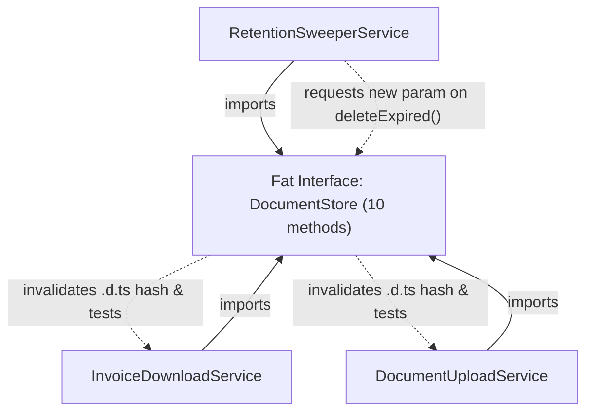
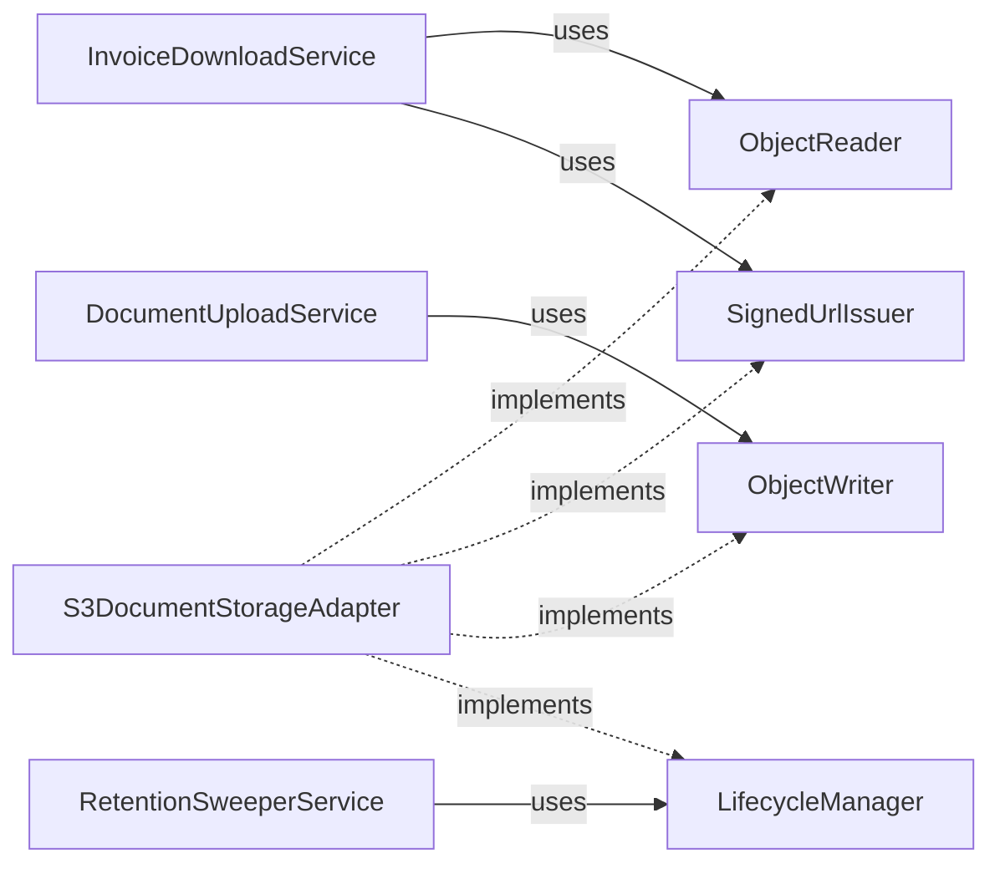

---
tags:
  - software-engineering
  - solid
  - isp
  - typescript
  - nestjs
created: 2026-01-02
updated: 2026-11-13
status: 🟢
level: mid-to-senior
---
# Interface Segregation Principle (ISP)

> [!abstract] Vault Navigation
> Part of [[Programming/Software Engineering/SOLID/SOLID Principles Complete Guide|SOLID Principles Complete Guide]]. Reinforces [[Programming/Software Engineering/SOLID/Single Responsibility|Single Responsibility]], [[Programming/Software Engineering/SOLID/Liskov Substitution Principle|Liskov Substitution Principle]], and [[Programming/Software Engineering/SOLID/Dependency Inversion|Dependency Inversion]]. Applied across [[Programming/Software Engineering/Architectural Patterns/Hexagonal Architecture|Hexagonal Architecture]], [[Programming/Software Engineering/Architectural Patterns/CQRS|CQRS]], and [[Programming/Software Engineering/Testing/Mocking|Mocking]].

**"Clients should not be forced to depend upon interfaces that they do not use."** — Robert C. Martin

When an interface aggregates operations belonging to multiple unrelated consumers into a single monolithic contract (a **fat interface** or **header interface**), every consumer becomes transitively coupled to the requirements of every other consumer. Changing a method signature for an administrative cleanup job forces read-only billing services to re-type-check, rebuild, redeploy, and update dozens of irrelevant test doubles.

---

## 1. First-Principles Mechanics & Complete Architecture

### 1.1 Why Fat Interfaces Create Transitive Coupling

The Interface Segregation Principle addresses a specific structural failure mode in typed and modular systems: **the fan-out of source-code and binary dependencies through shared abstractions**. Consider an infrastructure abstraction `DocumentStore` that exposes 10 methods covering reads, multipart uploads, pre-signed URL generation, retention policy mutations, and bucket-wide storage metrics. Suppose three independent application services consume `DocumentStore`:

- `InvoiceDownloadService` calls only `getObject()` and `createSignedUrl()`.
- `DocumentUploadService` calls only `putObject()`.
- `RetentionSweeperService` calls only `listObjects()` and `deleteExpired()`.

Even though `InvoiceDownloadService` never invokes `deleteExpired()`, its source file imports `DocumentStore`, which references every parameter type, return type, and option object required by `deleteExpired()` and `putObject()`. Every dependency graph tool—whether a C++ linker, a Rust compiler (`rustc`), a Java compiler (`javac`), a Go package resolver, or TypeScript's `tsc --build` with `composite` project references—treats an `import` edge to `DocumentStore` as a dependency on the entire transitive surface of that interface.



### 1.2 Compile-Time, Type-Check, and Monorepo Build Invalidation

In modern TypeScript monorepos managed by `tsc -b`, Turborepo, or Nx, packages compile into `.js` artifacts plus `.d.ts` declaration files and `.tsbuildinfo` incremental caches. TypeScript determines downstream rebuild necessity by hashing exported type signatures in `.d.ts` files.

1. **Signature Hash Mutation**: Suppose `RetentionSweeperService` requires adding `dryRun: boolean` and a `RetentionAuditMetadata` parameter to `deleteExpired(prefix, options)`.
2. **Declaration Propagation**: Rebuilding the shared `@acme/storage` package mutates `document-store.port.d.ts`.
3. **Downstream Cache Miss**: Because `@acme/invoices` imports `DocumentStore` from `@acme/storage`, Turborepo sees a changed input hash for `@acme/storage` and invalidates the build, lint, and unit-test cache for `@acme/invoices`, `@acme/uploads`, and every other package importing the fat interface—even though zero call sites inside `@acme/invoices` changed behavior.
4. **Type-Check Failures on Test Doubles**: Any test file constructing an inline literal satisfying `DocumentStore` fails `tsc` with `TS2322` or `TS2345` because its stub for `deleteExpired` no longer matches the updated signature.

When instead each consumer depends on its own narrow **Role Interface**, adding `RetentionAuditMetadata` to `LifecycleManager` touches only `lifecycle-manager.port.ts` and `RetentionSweeperService`. Neither `ObjectReader` nor `SignedUrlIssuer` changes byte-for-byte in emitted `.d.ts` declarations.

### 1.3 Bundle-Size and Tree-Shaking Failure Mechanics

In serverless runtimes (AWS Lambda, Cloudflare Workers, Vercel Edge Functions) and browser bundles (`esbuild`, `rollup`, `webpack`), code size directly determines cold-start latency and time-to-interactive. Fat interfaces frequently accompany fat **facade classes** (`CloudStorageClient`) that implement all capabilities inside a single ES class or barrel export:

- **Class Prototype Retention**: Bundlers perform static tree-shaking at module export granularity, not across individual methods on a class prototype. When `InvoiceDownloadService` imports `CloudStorageClient`—or receives an instance built via a factory importing `CloudStorageClient`—the bundler cannot prove which methods on `CloudStorageClient.prototype` are dynamically accessed via bracket lookup or reflection, so it retains the entire class body and every dependency imported at the top of that file (multipart XML parsers, KMS encryption helpers, archive lifecycle serializers).
- **Barrel-File Coupling**: Exporting `ObjectReader`, `ObjectWriter`, `SignedUrlIssuer`, and `LifecycleManager` concrete adapters from a single `index.ts` file without `"sideEffects": false` forces bundlers to evaluate initialization code across unrelated adapters.
- **Segregated Role Adapters**: Splitting adapters or factory imports along the same Role Interface boundaries allows an edge function that only needs `SignedUrlIssuer` (an HMAC-SHA256 signer using Web Crypto) to bundle **12 KB** instead of pulling in **4.2 MB** of full AWS S3 XML stream parsers and multipart upload state machines.

### 1.4 Forced `NotImplementedError` and Liskov Substitution Violations

A fat interface directly triggers violations of the [[Programming/Software Engineering/SOLID/Liskov Substitution Principle|Liskov Substitution Principle]]. When a subsystem introduces a specialized implementation—such as a read-only SQL replica repository, a mocked local filesystem viewer, or an immutable append-only WORM archive—that cannot legally perform deletions or lifecycle mutations, implementing a fat 10-method `DocumentStore` leaves only two bad options:

```typescript
export class ReadOnlyReplicaDocumentStore implements DocumentStore {
  async getObject(key: string): Promise<Uint8Array | null> {
    return this.fetchFromReplica(key);
  }

  async putObject(): Promise<void> {
    throw new Error('NotImplementedError: read-only replica cannot write');
  }

  async deleteExpired(): Promise<number> {
    throw new Error('NotImplementedError: read-only replica cannot delete');
  }

  async setBucketLifecycle(): Promise<void> {
    throw new Error('NotImplementedError: read-only replica cannot mutate lifecycle rules');
  }

  private async fetchFromReplica(key: string): Promise<Uint8Array | null> {
    return new TextEncoder().encode(`replica:${key}`);
  }
}
```

Any caller receiving `DocumentStore` assumes every method on the contract is valid. Substituting `ReadOnlyReplicaDocumentStore` compiles cleanly yet crashes in production whenever a code path calls `putObject()` or `deleteExpired()`. Segregating `ObjectReader` from `ObjectWriter` and `LifecycleManager` lets `ReadOnlyReplicaDocumentStore` implement **only** `ObjectReader`, turning impossible runtime calls into immediate compile-time errors.

### 1.5 Mock-Explosion Mechanics in Automated Test Suites

Suppose a fat `DocumentStore` has $M = 12$ methods and $C = 8$ services depend on it, each calling only $1$ or $2$ methods.

1. **Fixture Bloat**: Every unit test instantiating a service must pass a valid `DocumentStore` object. Developers either write 40 lines of dummy stub methods per test file (`putObject: jest.fn()`, `setBucketLifecycle: jest.fn()`, `listBuckets: jest.fn()`) or share a mutable global `createMockDocumentStore()` helper that drifts out of sync with real behavior.
2. **Unsafe Type Casts**: Tired of maintaining 12 dummy methods, engineers write `{ getObject: async () => payload } as unknown as DocumentStore`. That cast disables TypeScript's structural verifier completely: if a refactor inside `InvoiceDownloadService` later starts calling `createSignedUrl()`, the test compiles, runs, and blows up at runtime with `TypeError: this.store.createSignedUrl is not a function`—or worse, passes in a broken mock factory returning `undefined` silently.
3. **Brittle Blast Radius**: Adding one parameter to `setRetentionPolicy()` forces modifying test fixtures across all 8 services, creating massive pull-request diffs for unrelated teams.

### 1.6 Role Interfaces vs Header Interfaces

Martin Fowler formalized the distinction that drives ISP in production architecture:

| Dimension | Header Interface (Anti-Pattern) | Role Interface (ISP) |
|---|---|---|
| **Origin** | Generated mechanically from a large concrete class (`class S3Client` -> `interface IS3Client`) | Defined by each **consumer module** from the specific collaboration it requires |
| **Granularity** | Mirrors 100% of provider capabilities (15–40 methods) | Captures one cohesive client role (1–4 closely related methods) |
| **Ownership** | Lives alongside infrastructure/provider code | Lives inside application/policy layer (or consumer package) |
| **Implementers** | Only one giant facade can realistically implement all methods | Multiple specialized or composed adapters implement only the roles they support |
| **Test Double Cost** | Heavy mocking libraries or unsafe `as unknown as` casts | Plain 3-line typed object literals checked strictly by `tsc` |



Notice the architectural synergy with [[Programming/Software Engineering/SOLID/Dependency Inversion|Dependency Inversion]]: ISP determines **how small and focused each port interface should be**, while DIP determines **who owns those port interfaces** (the high-level policy/consumer layer) and **which direction source imports point** (infrastructure depends inward on the ports).

---

## 2. Real-World Use Cases & Decision Matrix

Applying ISP indiscriminately produces hyper-fragmented codebases; failing to apply it produces monolithic coupling. Evaluate each architectural boundary against real consumer divergence.

| Architectural Scenario | Segregate or Keep Cohesive? | Recommended Pattern | Key Engineering Trade-Off |
|---|---|---|---|
| **Backend Services & Cloud SDKs** (`S3`, `Stripe`, `Twilio`) | **Segregate strictly** | Consumer-owned Role Ports (`ObjectReader`, `ObjectWriter`, `SignedUrlIssuer`) + shared composed adapter | Prevents accidental destructive calls (`delete`), shrinks mocks, isolates SDK upgrades |
| **CQRS Persistence Boundary** (`Order` queries vs mutations) | **Segregate strictly** | Split `OrderReader` (read DTOs / replica DB) from `OrderWriter` (write aggregate / primary DB) | Enables read-replica scaling and distinct schemas; requires eventual-consistency awareness if split physically |
| **TypeScript Narrow Parameter Views** | **Segregate when widening hurts** | Narrow structural interface at caller boundary (or `Pick<T, K>` strictly within same package) | Zero runtime overhead; `Pick` across package boundaries still retains source import coupling |
| **React Component Props** | **Segregate strictly** | Pass minimal primitive/sub-slice props (`userName`, `avatarUrl`) rather than fat domain entities | Prevents cascade re-renders in `React.memo` and isolates UI components from API schema churn |
| **Microservice OpenAPI / gRPC SDKs** | **Segregate per bounded context** | Wrap generated 40-RPC client behind narrow client-owned ports (`InvoiceLookupClient`) | Stops protobuf descriptor bloat and decouples service teams from unrelated RPC deprecations |
| **Atomic Data Structures / Cohesive Caches** | **Keep cohesive** | Single `Stack<T>` or `CacheStore` (`get`, `set`, `delete`) when one caller role uses all ops | Avoids intersection-type clutter (`Readable & Writable & Deletable`) when roles never diverge |

### 2.1 CQRS Read vs Write Port Splitting

In [[Programming/Software Engineering/Architectural Patterns/CQRS|CQRS]], query handlers and command handlers represent fundamentally different actors with distinct latency, consistency, and scaling constraints:

- **Command Path (`OrderWriter`)**: Loads full domain aggregates from the primary transactional database, enforces invariants (`Order.confirm()`), emits outbox events, and persists state atomically.
- **Query Path (`OrderReader` / `OrderAnalyticsReader`)**: Projects denormalized read models directly from read replicas, materialized views, or Elasticsearch indexes without instantiating domain entity behavior.

Injecting a fat `OrderRepository` (containing both `save()`, `deleteById()`, and `searchDashboardRows()`) into a dashboard reporting controller grants a read-only HTTP GET handler compile-time access to `.deleteById()` and forces query tests to mock transactional persistence methods. Segregating `OrderReader` and `OrderWriter` enforces read/write isolation in the type system itself.

### 2.2 TypeScript Structural Typing: Narrow Interfaces vs `Pick<T, K>`

TypeScript uses **structural subtyping** (duck typing verified at compile time): a class `PostgresOrderStore` satisfies `interface OrderReader { findById(id: string): Promise<Order | null> }` automatically whenever its methods have compatible signatures—even without an `implements OrderReader` clause. Engineers leverage this in two distinct ways:

1. **Consumer-Owned Role Interface (Recommended Across Module Boundaries)**:
   The consumer declares `export interface OrderReader { findById(id: string): Promise<Order | null>; }` locally without importing the provider file at all. Zero compile-time dependency edge exists from consumer to provider.
2. **`Pick<FatType, 'methodA' | 'methodB'>` (Acceptable Only Inside One Module)**:
   Useful when narrowing an object already imported within the same module boundary (such as restricting a helper function to `Pick<RequestContext, 'tenantId' | 'traceId'>`). **Warning**: If `PackageA` writes `type NarrowReader = Pick<FatStoreFromPackageB, 'get'>`, `PackageA` still statically imports `PackageB`, preserving transitive `.d.ts` build invalidation! Use independent role interfaces across package boundaries.

### 2.3 Frontend Component Prop Segregation

Passing an entire 25-field `OrderDetailsResponse` or `AuthUser` object into a leaf component (`<StatusBadge order={order} />` or `<UserAvatar user={user} />`) creates two measurable problems in [[Programming/Frontend/React Patterns Guide|React]]:

1. **Unnecessary Re-Renders**: When `order.trackingNotes` updates in parent state, `order` becomes a new object reference. Even wrapped in `React.memo(StatusBadge)`, shallow prop comparison detects `prevProps.order !== nextProps.order` and re-renders `StatusBadge` unnecessarily. Segregating props to `interface StatusBadgeProps { status: OrderStatus; updatedAtIso: string; }` allows `React.memo` to skip rendering whenever status remains unchanged.
2. **Test and Storybook Coupling**: Rendering `<UserAvatar>` in Vitest or Storybook should not require constructing a 25-field `User` fixture including `billingAddress`, `mfaRecoveryCodes`, and `subscriptionTier`.

### 2.4 Microservice OpenAPI / gRPC Client SDK Slimming

Generated gRPC or OpenAPI TypeScript clients typically expose one giant client class containing every endpoint exposed by a remote service (for example, `IdentityServiceClient` with 38 RPCs covering login, SAML SSO, SCIM provisioning, billing seat sync, and audit export). Injecting `IdentityServiceClient` directly into an API Gateway rate-limiter that only calls `verifyAccessToken()` drags 38 request/response DTO definitions into the gateway's bundle, couples the gateway's CI pipeline to every breaking protobuf bump in SCIM provisioning, and lets any gateway developer accidentally call `deleteOrganization()`. Wrap the generated SDK behind slim consumer-owned role adapters (`AccessTokenVerifier`, `UserDirectoryReader`) inside your infrastructure layer.

### 2.5 When NOT to Split: The Over-Segregation Anti-Pattern

ISP optimizes along **divergent consumer roles**, not along individual method counts. Never mechanically explode every method into a single-method interface (`KeyReadable`, `KeyWritable`, `KeyDeletable`, `KeyTtlReadable`) when every realistic consumer operates on them as one cohesive capability:

- **Cohesive Capability (`CacheStore`)**: A cache-aside decorator inherently reads, writes, and invalidates keys as one role. Splitting `CacheStore` into 4 micro-interfaces forces constructor signatures like `cache: KeyReadable & KeyWritable & KeyDeletable & KeyTtlReadable`, increasing noise with zero decoupling benefit.
- **Rule of Thumb**: Split an interface when **at least two distinct consumers use disjoint subsets of methods**, or when **security / least-privilege boundaries** prohibit a caller from possessing destructive capabilities (such as read-only reporting vs administrative purge).

---

## 3. Step-by-Step Practical Application: Multi-File TypeScript & NestJS Refactor

We now refactor a real-world bloated `DocumentStore` storage subsystem and its three enterprise consumers inside a NestJS + TypeScript service.

### 3.1 The Anti-Pattern (Before Refactor)

Below is the legacy monolithic `DocumentStore` contract, its consumer `InvoiceDownloadService`, and the brittle test double forced upon every test suite:

```typescript
// BEFORE: src/legacy/document-store.interface.ts (Fat Interface Anti-Pattern)
export interface LegacyObjectMetadata {
  key: string;
  sizeBytes: number;
  etag: string;
  contentType: string;
  lastModified: Date;
}

export interface LegacyLifecycleRule {
  prefix: string;
  expireAfterDays: number;
}

export interface LegacyBucketStats {
  totalObjects: number;
  totalBytes: number;
}

export interface LegacyDocumentStore {
  getObject(key: string): Promise<Uint8Array | null>;
  headObject(key: string): Promise<LegacyObjectMetadata | null>;
  listObjects(prefix: string, maxKeys: number): Promise<ReadonlyArray<LegacyObjectMetadata>>;
  putObject(key: string, body: Uint8Array, contentType: string): Promise<{ etag: string }>;
  copyObject(sourceKey: string, destinationKey: string): Promise<void>;
  deleteObject(key: string): Promise<void>;
  deleteObjectsBatch(keys: ReadonlyArray<string>): Promise<number>;
  createSignedDownloadUrl(key: string, ttlSeconds: number): Promise<string>;
  createSignedUploadUrl(key: string, contentType: string, ttlSeconds: number): Promise<string>;
  applyLifecycleRule(rule: LegacyLifecycleRule): Promise<void>;
  getBucketStats(): Promise<LegacyBucketStats>;
}
```

Every consumer—even a simple invoice link generator—inherits all 11 methods, forcing tests like this:

```typescript
// BEFORE: src/legacy/invoice-download.service.spec.ts (Mock Explosion & Unsafe Cast)
import { LegacyDocumentStore } from './document-store.interface';

class LegacyInvoiceDownloadService {
  constructor(private readonly store: LegacyDocumentStore) {}

  async getInvoiceLink(invoiceId: string): Promise<string> {
    const meta = await this.store.headObject(`invoices/${invoiceId}.pdf`);
    if (!meta) {
      throw new Error(`Invoice ${invoiceId} not found`);
    }
    return this.store.createSignedDownloadUrl(`invoices/${invoiceId}.pdf`, 300);
  }
}

// 30+ lines of dead stubs or unsafe `as unknown as LegacyDocumentStore` casts
function createBloatedLegacyStub(): LegacyDocumentStore {
  return {
    getObject: async () => new Uint8Array(),
    headObject: async () => ({
      key: 'invoices/inv-1.pdf',
      sizeBytes: 1024,
      etag: 'abc',
      contentType: 'application/pdf',
      lastModified: new Date('2026-01-01T00:00:00Z'),
    }),
    listObjects: async () => { throw new Error('Unused stub'); },
    putObject: async () => { throw new Error('Unused stub'); },
    copyObject: async () => { throw new Error('Unused stub'); },
    deleteObject: async () => { throw new Error('Unused stub'); },
    deleteObjectsBatch: async () => { throw new Error('Unused stub'); },
    createSignedDownloadUrl: async (k) => `https://cdn.example.com/${k}?sig=ok`,
    createSignedUploadUrl: async () => { throw new Error('Unused stub'); },
    applyLifecycleRule: async () => { throw new Error('Unused stub'); },
    getBucketStats: async () => { throw new Error('Unused stub'); },
  };
}
```

### 3.2 Refactored Production Project Layout

Segregating along real caller capabilities yields four focused Role Ports implemented by one concrete infrastructure adapter and wired through NestJS `useExisting` token aliasing:

```text
src/
  storage/
    ports/
      object-reader.port.ts
      object-writer.port.ts
      signed-url-issuer.port.ts
      lifecycle-manager.port.ts
      tokens.ts
    adapters/
      s3-document-storage.adapter.ts
      in-memory-document-storage.fake.ts
    storage.module.ts
  invoices/
    invoice-download.service.ts
    invoice-download.service.spec.ts
  compliance/
    retention-sweeper.service.ts
    retention-sweeper.service.spec.ts
  ingestion/
    document-upload.service.ts
    document-upload.service.spec.ts
```

### 3.3 Segregated Role Ports and DI Tokens

Notice that zero AWS SDK types (`GetObjectCommandOutput`, `S3Client`) appear anywhere inside `src/storage/ports/`. Every signature uses clean, domain-owned contracts:

```typescript
// src/storage/ports/object-reader.port.ts
export interface ObjectMetadata {
  readonly key: string;
  readonly sizeBytes: number;
  readonly etag: string;
  readonly contentType: string;
  readonly lastModified: Date;
}

export interface StoredObject {
  readonly metadata: ObjectMetadata;
  readonly body: Uint8Array;
}

export interface ObjectReader {
  getObject(key: string): Promise<StoredObject | null>;
  headObject(key: string): Promise<ObjectMetadata | null>;
  listObjects(prefix: string, maxKeys: number): Promise<ReadonlyArray<ObjectMetadata>>;
}
```

```typescript
// src/storage/ports/object-writer.port.ts
export interface PutObjectInput {
  readonly key: string;
  readonly body: Uint8Array;
  readonly contentType: string;
  readonly checksumSha256?: string;
}

export interface PutObjectReceipt {
  readonly key: string;
  readonly etag: string;
  readonly sizeBytes: number;
}

export interface ObjectWriter {
  putObject(input: PutObjectInput): Promise<PutObjectReceipt>;
}
```

```typescript
// src/storage/ports/signed-url-issuer.port.ts
export interface SignedUrlOptions {
  readonly key: string;
  readonly ttlSeconds: number;
  readonly downloadFilename?: string;
}

export interface SignedUrlIssuer {
  createSignedDownloadUrl(options: SignedUrlOptions): Promise<string>;
}
```

```typescript
// src/storage/ports/lifecycle-manager.port.ts
export interface RetentionSweepResult {
  readonly deletedKeys: ReadonlyArray<string>;
  readonly scannedCount: number;
}

export interface LifecycleManager {
  deleteObject(key: string): Promise<boolean>;
  deleteExpiredBefore(prefix: string, cutoffDate: Date, dryRun: boolean): Promise<RetentionSweepResult>;
}
```

```typescript
// src/storage/ports/tokens.ts
export const OBJECT_READER = Symbol('OBJECT_READER');
export const OBJECT_WRITER = Symbol('OBJECT_WRITER');
export const SIGNED_URL_ISSUER = Symbol('SIGNED_URL_ISSUER');
export const LIFECYCLE_MANAGER = Symbol('LIFECYCLE_MANAGER');
```

### 3.4 Concrete Composed Adapter & Stateful Test Fake

A single production adapter implements all four Role Interfaces cleanly while translating vendor SDK exceptions and payloads internally. Let's include a clean typed client boundary so the adapter works cleanly with AWS SDK v3-style command transport and deterministic HMAC signing without stub ellipses:

```typescript
// src/storage/adapters/s3-document-storage.adapter.ts
import { createHash, createHmac } from 'node:crypto';
import { Injectable } from '@nestjs/common';
import type { ObjectMetadata, ObjectReader, StoredObject } from '../ports/object-reader.port';
import type { ObjectWriter, PutObjectInput, PutObjectReceipt } from '../ports/object-writer.port';
import type { SignedUrlIssuer, SignedUrlOptions } from '../ports/signed-url-issuer.port';
import type { LifecycleManager, RetentionSweepResult } from '../ports/lifecycle-manager.port';

export interface S3TransportClient {
  getObject(bucket: string, key: string): Promise<{
    body: Uint8Array;
    contentType: string;
    etag: string;
    lastModified: Date;
  } | null>;
  headObject(bucket: string, key: string): Promise<{
    sizeBytes: number;
    contentType: string;
    etag: string;
    lastModified: Date;
  } | null>;
  listObjects(bucket: string, prefix: string, maxKeys: number): Promise<ReadonlyArray<{
    key: string;
    sizeBytes: number;
    contentType: string;
    etag: string;
    lastModified: Date;
  }>>;
  putObject(bucket: string, key: string, body: Uint8Array, contentType: string): Promise<{ etag: string }>;
  deleteObject(bucket: string, key: string): Promise<boolean>;
}

export interface S3AdapterConfig {
  readonly bucket: string;
  readonly publicCdnBaseUrl: string;
  readonly signingSecret: string;
}

@Injectable()
export class S3DocumentStorageAdapter
  implements ObjectReader, ObjectWriter, SignedUrlIssuer, LifecycleManager
{
  constructor(
    private readonly s3: S3TransportClient,
    private readonly config: S3AdapterConfig,
  ) {}

  async getObject(key: string): Promise<StoredObject | null> {
    this.assertValidKey(key);
    const res = await this.s3.getObject(this.config.bucket, key);
    if (!res) {
      return null;
    }
    return {
      metadata: {
        key,
        sizeBytes: res.body.byteLength,
        etag: res.etag,
        contentType: res.contentType,
        lastModified: res.lastModified,
      },
      body: res.body,
    };
  }

  async headObject(key: string): Promise<ObjectMetadata | null> {
    this.assertValidKey(key);
    const head = await this.s3.headObject(this.config.bucket, key);
    if (!head) {
      return null;
    }
    return {
      key,
      sizeBytes: head.sizeBytes,
      etag: head.etag,
      contentType: head.contentType,
      lastModified: head.lastModified,
    };
  }

  async listObjects(prefix: string, maxKeys: number): Promise<ReadonlyArray<ObjectMetadata>> {
    if (maxKeys <= 0 || maxKeys > 1000) {
      throw new RangeError(`maxKeys must be between 1 and 1000; received ${maxKeys}`);
    }
    const entries = await this.s3.listObjects(this.config.bucket, prefix, maxKeys);
    return entries.map((item) => ({
      key: item.key,
      sizeBytes: item.sizeBytes,
      etag: item.etag,
      contentType: item.contentType,
      lastModified: item.lastModified,
    }));
  }

  async putObject(input: PutObjectInput): Promise<PutObjectReceipt> {
    this.assertValidKey(input.key);
    if (input.checksumSha256) {
      const actualDigest = createHash('sha256').update(input.body).digest('hex');
      if (actualDigest !== input.checksumSha256) {
        throw new Error(
          `SHA-256 mismatch for key "${input.key}": expected ${input.checksumSha256}, got ${actualDigest}`,
        );
      }
    }
    const { etag } = await this.s3.putObject(
      this.config.bucket,
      input.key,
      input.body,
      input.contentType,
    );
    return {
      key: input.key,
      etag,
      sizeBytes: input.body.byteLength,
    };
  }

  async createSignedDownloadUrl(options: SignedUrlOptions): Promise<string> {
    this.assertValidKey(options.key);
    if (options.ttlSeconds < 10 || options.ttlSeconds > 604_800) {
      throw new RangeError(`ttlSeconds out of bounds [10, 604800]: ${options.ttlSeconds}`);
    }
    const expiresAtEpochSec = Math.floor(Date.now() / 1000) + options.ttlSeconds;
    const encodedKey = encodeURIComponent(options.key);
    const canonicalPayload = `${this.config.bucket}:${encodedKey}:${expiresAtEpochSec}`;
    const signature = createHmac('sha256', this.config.signingSecret)
      .update(canonicalPayload)
      .digest('hex');

    const url = new URL(`${this.config.publicCdnBaseUrl.replace(/\/$/, '')}/${encodedKey}`);
    url.searchParams.set('expires', String(expiresAtEpochSec));
    url.searchParams.set('sig', signature);
    if (options.downloadFilename) {
      url.searchParams.set('filename', options.downloadFilename);
    }
    return url.toString();
  }

  async deleteObject(key: string): Promise<boolean> {
    this.assertValidKey(key);
    return this.s3.deleteObject(this.config.bucket, key);
  }

  async deleteExpiredBefore(
    prefix: string,
    cutoffDate: Date,
    dryRun: boolean,
  ): Promise<RetentionSweepResult> {
    const objects = await this.listObjects(prefix, 1000);
    const expired = objects.filter((item) => item.lastModified.getTime() < cutoffDate.getTime());
    const deletedKeys: string[] = [];

    for (const item of expired) {
      if (!dryRun) {
        await this.s3.deleteObject(this.config.bucket, item.key);
      }
      deletedKeys.push(item.key);
    }
    return {
      deletedKeys,
      scannedCount: objects.length,
    };
  }

  private assertValidKey(key: string): void {
    if (!key || key.startsWith('/') || key.includes('..')) {
      throw new Error(`Invalid object key "${key}"`);
    }
  }
}
```

For fast local execution and contract-accurate integration testing without AWS or LocalStack, pair the production adapter with an in-memory fake implementing the identical role contracts:

```typescript
// src/storage/adapters/in-memory-document-storage.fake.ts
import { createHash } from 'node:crypto';
import type { ObjectMetadata, ObjectReader, StoredObject } from '../ports/object-reader.port';
import type { ObjectWriter, PutObjectInput, PutObjectReceipt } from '../ports/object-writer.port';
import type { SignedUrlIssuer, SignedUrlOptions } from '../ports/signed-url-issuer.port';
import type { LifecycleManager, RetentionSweepResult } from '../ports/lifecycle-manager.port';

interface InternalEntry {
  body: Uint8Array;
  metadata: ObjectMetadata;
}

export class InMemoryDocumentStorageFake
  implements ObjectReader, ObjectWriter, SignedUrlIssuer, LifecycleManager
{
  private readonly store = new Map<string, InternalEntry>();

  constructor(private readonly now: () => Date = () => new Date()) {}

  async getObject(key: string): Promise<StoredObject | null> {
    const entry = this.store.get(key);
    if (!entry) {
      return null;
    }
    return {
      metadata: entry.metadata,
      body: new Uint8Array(entry.body),
    };
  }

  async headObject(key: string): Promise<ObjectMetadata | null> {
    return this.store.get(key)?.metadata ?? null;
  }

  async listObjects(prefix: string, maxKeys: number): Promise<ReadonlyArray<ObjectMetadata>> {
    const matched: ObjectMetadata[] = [];
    for (const [key, entry] of this.store.entries()) {
      if (key.startsWith(prefix)) {
        matched.push(entry.metadata);
        if (matched.length >= maxKeys) {
          break;
        }
      }
    }
    return matched;
  }

  async putObject(input: PutObjectInput): Promise<PutObjectReceipt> {
    const digest = createHash('sha256').update(input.body).digest('hex');
    if (input.checksumSha256 && digest !== input.checksumSha256) {
      throw new Error(`SHA-256 mismatch for key "${input.key}"`);
    }
    const etag = digest.slice(0, 16);
    const copy = new Uint8Array(input.body);
    this.store.set(input.key, {
      body: copy,
      metadata: {
        key: input.key,
        sizeBytes: copy.byteLength,
        etag,
        contentType: input.contentType,
        lastModified: this.now(),
      },
    });
    return { key: input.key, etag, sizeBytes: copy.byteLength };
  }

  async createSignedDownloadUrl(options: SignedUrlOptions): Promise<string> {
    const encoded = encodeURIComponent(options.key);
    return `https://fake-cdn.local/${encoded}?ttl=${options.ttlSeconds}`;
  }

  async deleteObject(key: string): Promise<boolean> {
    return this.store.delete(key);
  }

  async deleteExpiredBefore(
    prefix: string,
    cutoffDate: Date,
    dryRun: boolean,
  ): Promise<RetentionSweepResult> {
    const candidates = await this.listObjects(prefix, 1000);
    const deletedKeys: string[] = [];
    for (const meta of candidates) {
      if (meta.lastModified.getTime() < cutoffDate.getTime()) {
        if (!dryRun) {
          this.store.delete(meta.key);
        }
        deletedKeys.push(meta.key);
      }
    }
    return { deletedKeys, scannedCount: candidates.length };
  }
}
```

### 3.5 NestJS Module Wiring with `useExisting` Aliasing

In [[Programming/Backend/NestJS Complete Guide|NestJS]], registering four role tokens must share **one** adapter instance (`S3DocumentStorageAdapter`) rather than instantiating four independent instances via `useClass`. Using `useExisting` guarantees singleton sharing across all segregated role tokens:

```typescript
// src/storage/storage.module.ts
import { Module } from '@nestjs/common';
import {
  LIFECYCLE_MANAGER,
  OBJECT_READER,
  OBJECT_WRITER,
  SIGNED_URL_ISSUER,
} from './ports/tokens';
import {
  S3DocumentStorageAdapter,
  type S3AdapterConfig,
  type S3TransportClient,
} from './adapters/s3-document-storage.adapter';

export const S3_TRANSPORT_CLIENT = Symbol('S3_TRANSPORT_CLIENT');
export const S3_ADAPTER_CONFIG = Symbol('S3_ADAPTER_CONFIG');

@Module({
  providers: [
    {
      provide: S3_ADAPTER_CONFIG,
      useFactory: (): S3AdapterConfig => ({
        bucket: process.env.DOCS_BUCKET ?? 'acme-prod-documents',
        publicCdnBaseUrl: process.env.DOCS_CDN_URL ?? 'https://cdn.acme.example',
        signingSecret: process.env.DOCS_SIGNING_SECRET ?? 'dev-local-secret-change-in-prod',
      }),
    },
    {
      provide: S3DocumentStorageAdapter,
      useFactory: (client: S3TransportClient, config: S3AdapterConfig) =>
        new S3DocumentStorageAdapter(client, config),
      inject: [S3_TRANSPORT_CLIENT, S3_ADAPTER_CONFIG],
    },
    { provide: OBJECT_READER, useExisting: S3DocumentStorageAdapter },
    { provide: OBJECT_WRITER, useExisting: S3DocumentStorageAdapter },
    { provide: SIGNED_URL_ISSUER, useExisting: S3DocumentStorageAdapter },
    { provide: LIFECYCLE_MANAGER, useExisting: S3DocumentStorageAdapter },
  ],
  exports: [OBJECT_READER, OBJECT_WRITER, SIGNED_URL_ISSUER, LIFECYCLE_MANAGER],
})
export class StorageModule {}
```

### 3.6 Consumer Services Receiving Only Needed Capabilities

Each consumer injects solely the narrow Role Interfaces required for its business workflow:

```typescript
// src/invoices/invoice-download.service.ts
import { Inject, Injectable, NotFoundException } from '@nestjs/common';
import type { ObjectReader } from '../storage/ports/object-reader.port';
import type { SignedUrlIssuer } from '../storage/ports/signed-url-issuer.port';
import { OBJECT_READER, SIGNED_URL_ISSUER } from '../storage/ports/tokens';

@Injectable()
export class InvoiceDownloadService {
  constructor(
    @Inject(OBJECT_READER) private readonly reader: ObjectReader,
    @Inject(SIGNED_URL_ISSUER) private readonly signer: SignedUrlIssuer,
  ) {}

  async generateDownloadLink(tenantId: string, invoiceNumber: string): Promise<string> {
    const key = `tenants/${tenantId}/invoices/${invoiceNumber}.pdf`;
    const meta = await this.reader.headObject(key);
    if (!meta) {
      throw new NotFoundException(`Invoice ${invoiceNumber} does not exist`);
    }
    return this.signer.createSignedDownloadUrl({
      key,
      ttlSeconds: 300,
      downloadFilename: `${invoiceNumber}.pdf`,
    });
  }
}
```

```typescript
// src/compliance/retention-sweeper.service.ts
import { Inject, Injectable } from '@nestjs/common';
import type { LifecycleManager, RetentionSweepResult } from '../storage/ports/lifecycle-manager.port';
import { LIFECYCLE_MANAGER } from '../storage/ports/tokens';

@Injectable()
export class RetentionSweeperService {
  constructor(
    @Inject(LIFECYCLE_MANAGER) private readonly lifecycle: LifecycleManager,
  ) {}

  async purgeOldAuditArchives(retentionDays: number, dryRun: boolean, now: Date): Promise<RetentionSweepResult> {
    if (retentionDays < 30) {
      throw new Error(`Compliance floor forbids retention < 30 days (got ${retentionDays})`);
    }
    const cutoff = new Date(now.getTime() - retentionDays * 86_400_000);
    return this.lifecycle.deleteExpiredBefore('audit-archives/', cutoff, dryRun);
  }
}
```

```typescript
// src/ingestion/document-upload.service.ts
import { createHash } from 'node:crypto';
import { Inject, Injectable } from '@nestjs/common';
import type { ObjectWriter, PutObjectReceipt } from '../storage/ports/object-writer.port';
import { OBJECT_WRITER } from '../storage/ports/tokens';

@Injectable()
export class DocumentUploadService {
  constructor(@Inject(OBJECT_WRITER) private readonly writer: ObjectWriter) {}

  async storeVerifiedPdf(tenantId: string, docId: string, pdfBytes: Uint8Array): Promise<PutObjectReceipt> {
    if (pdfBytes.byteLength === 0) {
      throw new Error('Cannot store empty PDF payload');
    }
    const sha256 = createHash('sha256').update(pdfBytes).digest('hex');
    return this.writer.putObject({
      key: `tenants/${tenantId}/documents/${docId}.pdf`,
      body: pdfBytes,
      contentType: 'application/pdf',
      checksumSha256: sha256,
    });
  }
}
```

### 3.7 Lean Unit Tests with Zero Dummy Stubs

Observe how cleanly `InvoiceDownloadService` and `RetentionSweeperService` are tested with strict TypeScript verification and zero mock boilerplate:

```typescript
// src/invoices/invoice-download.service.spec.ts
import assert from 'node:assert/strict';
import { describe, it } from 'node:test';
import { NotFoundException } from '@nestjs/common';
import type { ObjectMetadata, ObjectReader } from '../storage/ports/object-reader.port';
import type { SignedUrlIssuer } from '../storage/ports/signed-url-issuer.port';
import { InvoiceDownloadService } from './invoice-download.service';

describe('InvoiceDownloadService', () => {
  it('issues a 5-minute signed download URL when the invoice exists', async () => {
    const metadata: ObjectMetadata = {
      key: 'tenants/t-42/invoices/INV-100.pdf',
      sizeBytes: 24_576,
      etag: 'e8f9a1',
      contentType: 'application/pdf',
      lastModified: new Date('2026-10-01T12:00:00Z'),
    };
    const reader: ObjectReader = {
      getObject: async () => null,
      headObject: async (key) => (key === metadata.key ? metadata : null),
      listObjects: async () => [],
    };
    const signer: SignedUrlIssuer = {
      createSignedDownloadUrl: async ({ key, ttlSeconds, downloadFilename }) =>
        `https://cdn.test/${key}?ttl=${ttlSeconds}&file=${downloadFilename}`,
    };

    const service = new InvoiceDownloadService(reader, signer);
    const link = await service.generateDownloadLink('t-42', 'INV-100');

    assert.equal(
      link,
      'https://cdn.test/tenants/t-42/invoices/INV-100.pdf?ttl=300&file=INV-100.pdf',
    );
  });

  it('throws NotFoundException and never signs URLs for missing invoices', async () => {
    let signCalled = false;
    const reader: ObjectReader = {
      getObject: async () => null,
      headObject: async () => null,
      listObjects: async () => [],
    };
    const signer: SignedUrlIssuer = {
      createSignedDownloadUrl: async () => {
        signCalled = true;
        return 'should-not-happen';
      },
    };

    const service = new InvoiceDownloadService(reader, signer);
    await assert.rejects(
      () => service.generateDownloadLink('t-42', 'INV-404'),
      NotFoundException,
    );
    assert.equal(signCalled, false);
  });
});
```

Notice we can shrink `reader` even further if `InvoiceDownloadService` defines a 1-method consumer-owned port `InvoiceExistenceChecker { headObject(key: string): Promise<ObjectMetadata | null> }` right inside `src/invoices/`—eliminating even `getObject` and `listObjects` from its test double!

```typescript
// src/compliance/retention-sweeper.service.spec.ts
import assert from 'node:assert/strict';
import { describe, it } from 'node:test';
import { InMemoryDocumentStorageFake } from '../storage/adapters/in-memory-document-storage.fake';
import { RetentionSweeperService } from './retention-sweeper.service';

describe('RetentionSweeperService', () => {
  it('deletes only archives older than the retention threshold when dryRun is false', async () => {
    let clockTime = new Date('2026-01-01T00:00:00Z');
    const storage = new InMemoryDocumentStorageFake(() => clockTime);

    await storage.putObject({
      key: 'audit-archives/2026-01/old.json',
      body: new Uint8Array([1, 2, 3]),
      contentType: 'application/json',
    });

    clockTime = new Date('2026-06-01T00:00:00Z');
    await storage.putObject({
      key: 'audit-archives/2026-06/recent.json',
      body: new Uint8Array([4, 5, 6]),
      contentType: 'application/json',
    });

    const sweeper = new RetentionSweeperService(storage);
    const result = await sweeper.purgeOldAuditArchives(90, false, new Date('2026-06-15T00:00:00Z'));

    assert.deepEqual(result.deletedKeys, ['audit-archives/2026-01/old.json']);
    assert.equal(await storage.headObject('audit-archives/2026-01/old.json'), null);
    assert.notEqual(await storage.headObject('audit-archives/2026-06/recent.json'), null);
  });

  it('rejects retention policies below the 30-day compliance floor', async () => {
    const storage = new InMemoryDocumentStorageFake();
    const sweeper = new RetentionSweeperService(storage);
    await assert.rejects(
      () => sweeper.purgeOldAuditArchives(14, true, new Date('2026-06-15T00:00:00Z')),
      /Compliance floor forbids retention < 30 days/,
    );
  });
});
```

```typescript
// src/ingestion/document-upload.service.spec.ts
import assert from 'node:assert/strict';
import { describe, it } from 'node:test';
import type { ObjectWriter, PutObjectInput } from '../storage/ports/object-writer.port';
import { DocumentUploadService } from './document-upload.service';

describe('DocumentUploadService', () => {
  it('computes SHA-256 and delegates persistence strictly via ObjectWriter', async () => {
    const captured: PutObjectInput[] = [];
    const writer: ObjectWriter = {
      putObject: async (input) => {
        captured.push(input);
        return { key: input.key, etag: 'etag-1', sizeBytes: input.body.byteLength };
      },
    };

    const service = new DocumentUploadService(writer);
    const receipt = await service.storeVerifiedPdf('t-7', 'contract-9', new Uint8Array([37, 80, 68, 70]));

    assert.equal(receipt.key, 'tenants/t-7/documents/contract-9.pdf');
    assert.equal(captured.length, 1);
    assert.equal(captured[0].checksumSha256?.length, 64);
  });
});
```

---

## 4. Complete Framework Reference, Patterns & Edge Cases

### 4.1 NestJS `useExisting` vs `useClass` Instance Explosion

When binding multiple Role Interface tokens to one concrete adapter in NestJS, using `useClass` instead of `useExisting` creates a subtle production defect:

```typescript
// BAD: Creates 4 separate S3DocumentStorageAdapter instances (and 4 HTTP/TLS agent pools!)
providers: [
  { provide: OBJECT_READER, useClass: S3DocumentStorageAdapter },
  { provide: OBJECT_WRITER, useClass: S3DocumentStorageAdapter },
  { provide: SIGNED_URL_ISSUER, useClass: S3DocumentStorageAdapter },
  { provide: LIFECYCLE_MANAGER, useClass: S3DocumentStorageAdapter },
]

// GOOD: Instantiates S3DocumentStorageAdapter ONCE and aliases all 4 tokens to it
providers: [
  S3DocumentStorageAdapter,
  { provide: OBJECT_READER, useExisting: S3DocumentStorageAdapter },
  { provide: OBJECT_WRITER, useExisting: S3DocumentStorageAdapter },
  { provide: SIGNED_URL_ISSUER, useExisting: S3DocumentStorageAdapter },
  { provide: LIFECYCLE_MANAGER, useExisting: S3DocumentStorageAdapter },
]
```

With `useExisting`, any in-memory cache, circuit breaker state, rate-limiter bucket, or underlying HTTP keep-alive pool inside `S3DocumentStorageAdapter` is cleanly shared across every consumer role.

### 4.2 Interface Composition vs Interface Inheritance

There are two ways to serve an orchestration service that legitimately needs multiple capabilities:

1. **Multi-Role Injection (Preferred)**: Inject distinct roles `(private readonly reader: ObjectReader, private readonly writer: ObjectWriter)`. This keeps each dependency explicitly inspectable and lets read-only and write-heavy adapters vary independently later (for instance, routing `ObjectReader` to CloudFront CDN and `ObjectWriter` directly to S3 origin).
2. **Intersection or Composite Interface (`interface ReadWriteObjectStore extends ObjectReader, ObjectWriter {}`)**: Acceptable only when a single downstream consumer genuinely requires atomic read-modify-write parity against the **same** backing store (e.g., transactional state sync). Never create a global `AllStorageOperations` composite interface exported back to every service, or you silently reconstruct the fat interface you eliminated.

### 4.3 Security & Principle of Least Privilege via Type Signatures

ISP doubles as a compile-time **capability security** boundary:
- `RetentionSweeperService` only accepts `LifecycleManager`. Even if a developer accidentally introduces a bug inside `RetentionSweeperService`, the class holds no reference to `ObjectReader.getObject()`, making it structurally impossible for a metadata retention cron to read sensitive customer PDF bytes or exfiltrate signed URLs.
- `DocumentUploadService` only accepts `ObjectWriter`, preventing an ingestion worker from invoking `deleteObject()` or enumerating other tenants via `listObjects()`.

### 4.4 Subtle Edge Cases and Language Traps

1. **Optional Method Anti-Pattern (`delete?(key: string): Promise<void>`)**:
   Marking methods optional on a fat interface (`delete?: ...`) tries to dodge `NotImplementedError`, but forces every caller to write defensive runtime `if (!store.delete)` checks everywhere and turns capability guarantees into runtime uncertainty. Split into an explicit `DeletableStorage` interface instead.
2. **Generic Variance Traps (`Reader<T>` vs `Writer<T>`)**:
   Read-only ports (`get(): Promise<T>`) are **covariant** in `T` (`Reader<PdfInvoice>` is assignable to `Reader<Document>`). Write-only ports (`save(item: T): Promise<void>`) are **contravariant** in `T` (`Writer<Document>` is assignable to `Writer<PdfInvoice>`). Combining read and write into one `Store<T>` forces `T` to become **invariant**, preventing polymorphic reuse across subtype hierarchies! Splitting `Reader<T>` and `Writer<T>` unlocks full variance safety in TypeScript (`strictFunctionTypes: true`).
3. **Excess Property Checking on Narrow Parameter Interfaces**:
   In TypeScript, passing a **fresh object literal** with extra keys into a narrow parameter interface triggers `TS2353` (`Object literal may only specify known properties`), whereas passing a typed variable holding the larger object passes structurally without errors. Always test helper functions with variable bindings or document narrow DTO interfaces cleanly.
4. **Cross-Boundary `Pick<T, K>` Coupling**:
   Writing `export type BillingReader = Pick<MegaBillingService, 'getInvoice'>` inside `@acme/orders` keeps an explicit compile-time import edge to `@acme/billing`'s implementation file, breaking monorepo incremental cache isolation. Define `export interface InvoiceLookupPort` natively inside `@acme/orders` instead.

---

## 5. Production Debugging, Profiling & Operations Playbook

| Symptom | Root Cause | Exact Diagnostic Command / Tool | Concrete Fix |
|---|---|---|---|
| **Editing one admin method triggers rebuild + test runs across 30+ unrelated monorepo packages** | Fat `SharedStore` / header interface exported from core package invalidates `.d.ts` hashes downstream | `npx turbo run typecheck --dry=json` or `npx tsc -b --verbose --extendedDiagnostics` | Extract consumer-owned Role Interfaces inside each consuming package or split into separate `.port.ts` entrypoints |
| **Serverless Lambda / Edge function bundle balloons to >5 MB despite calling only 1 method** | Single fat facade class (`CloudStorageClient`) or non-tree-shakeable barrel `index.ts` drags heavy upload/XML dependencies | `npx esbuild src/handler.ts --bundle --metafile=meta.json` then `npx esbuild-visualizer` or inspect `meta.json` inputs | Split concrete class into role-focused adapters (`SignedUrlSigner` vs `S3MultipartUploader`) and mark `"sideEffects": false` |
| **Production runtime crash `NotImplementedError` or `TypeError: store.purge is not a function`** | Read-only adapter forced to implement fat interface via stubs, or unit test bypassed `tsc` using `as unknown as FatInterface` | `rg "NotImplemented|as unknown as|as any" src/` and enforce `@typescript-eslint/consistent-type-assertions` | Segregate the fat interface into `ObjectReader` / `PurgeableStore`; remove every `as unknown as` mock cast |
| **Socket exhaustion / duplicated connection pools after splitting NestJS DI tokens** | 4 role tokens registered with `useClass: S3Adapter` instead of `useExisting: S3Adapter` | Inspect constructor call count in startup logs or inspect `process._getActiveHandles()` / heap snapshot via `node --inspect` | Bind the concrete adapter once and register each role token via `{ provide: TOKEN, useExisting: ConcreteAdapter }` |
| **React data table drops below 20 FPS on hover/toast updates** | Row components accept full fat `OrderAggregate` prop, breaking `React.memo` shallow equality checks | React DevTools Profiler ("Record why each component rendered while profiling") | Segregate component props into narrow primitive/value fields (`id`, `status`, `formattedTotal`) |

### Automated CI Guardrails for ISP Compliance

Add these rules to ESLint and TypeScript configuration to catch ISP regressions before merge:

```json
{
  "compilerOptions": {
    "strict": true,
    "strictFunctionTypes": true,
    "composite": true,
    "declaration": true
  }
}
```

In `.eslintrc` / `eslint.config.mjs`, ban unsafe mock casts (`@typescript-eslint/no-explicit-any` and `consistent-type-assertions: { assertionStyle: 'as', objectLiteralTypeAssertions: 'never' }`) so engineers can never hide a bloated 15-method interface behind `{ headObject: ... } as unknown as FatStore`.

---

## 6. Worked Exercises

### Exercise 1: Refactoring a Fat Telemetry & Admin Client into Consumer Roles

A shared observability module exports this single interface injected across business services, process shutdown runners, and live admin config endpoints:

```typescript
export interface TelemetryClient {
  incrementCounter(name: string, tags?: Record<string, string>): void;
  recordHistogramMs(name: string, valueMs: number, tags?: Record<string, string>): void;
  startSpan(operationName: string): { end(): void };
  flushAndShutdown(timeoutMs: number): Promise<void>;
  setSamplingRate(ratio: number): void;
  exportPrometheusText(): Promise<string>;
}
```

Identify all distinct consumer roles, design the segregated interfaces, write a concrete `OpenTelemetryAdapter` implementing them, and show a business service (`CheckoutService`) plus a unit test using zero dummy stubs.

### Solution 1

There are **four distinct consumer roles** corresponding to four completely separate operational actors:
1. **Application Instrumentation (`MetricsTracer`)**: `incrementCounter`, `recordHistogramMs`, `startSpan`. Used by every domain/application service.
2. **Process Lifecycle Runner (`TelemetryShutdownHook`)**: `flushAndShutdown`. Used solely by `SIGTERM` / NestJS `OnApplicationShutdown`.
3. **Runtime Control Plane (`SamplingController`)**: `setSamplingRate`. Used only by dynamic feature-flag/admin endpoints.
4. **Scrape Endpoint (`MetricsScrapeExporter`)**: `exportPrometheusText`. Used only by `/metrics`.

```typescript
// ports/telemetry.ports.ts
export interface TelemetrySpan {
  end(): void;
}

export interface MetricsTracer {
  incrementCounter(name: string, tags?: Record<string, string>): void;
  recordHistogramMs(name: string, valueMs: number, tags?: Record<string, string>): void;
  startSpan(operationName: string): TelemetrySpan;
}

export interface TelemetryShutdownHook {
  flushAndShutdown(timeoutMs: number): Promise<void>;
}

export interface SamplingController {
  setSamplingRate(ratio: number): void;
}

export interface MetricsScrapeExporter {
  exportPrometheusText(): Promise<string>;
}

// adapters/in-memory-telemetry.adapter.ts
export class OpenTelemetryAdapter
  implements MetricsTracer, TelemetryShutdownHook, SamplingController, MetricsScrapeExporter
{
  private samplingRate = 1.0;
  private readonly counters = new Map<string, number>();
  private readonly timings: Array<{ name: string; valueMs: number }> = [];

  incrementCounter(name: string): void {
    this.counters.set(name, (this.counters.get(name) ?? 0) + 1);
  }

  recordHistogramMs(name: string, valueMs: number): void {
    this.timings.push({ name, valueMs });
  }

  startSpan(operationName: string): TelemetrySpan {
    const startMs = performance.now();
    return {
      end: () => {
        this.recordHistogramMs(`${operationName}.duration_ms`, performance.now() - startMs);
      },
    };
  }

  setSamplingRate(ratio: number): void {
    if (ratio < 0 || ratio > 1) {
      throw new RangeError(`Sampling rate must be within [0, 1]; received ${ratio}`);
    }
    this.samplingRate = ratio;
  }

  async exportPrometheusText(): Promise<string> {
    const lines = [`# sampling_rate ${this.samplingRate}`];
    for (const [k, v] of this.counters.entries()) {
      lines.push(`${k} ${v}`);
    }
    return lines.join('\n');
  }

  async flushAndShutdown(_timeoutMs: number): Promise<void> {
    this.counters.clear();
    this.timings.length = 0;
  }
}

// CheckoutService depends ONLY on MetricsTracer—cannot call flushAndShutdown or setSamplingRate
export class CheckoutTelemetryService {
  constructor(private readonly telemetry: MetricsTracer) {}

  recordSuccess(durationMs: number): void {
    const span = this.telemetry.startSpan('checkout.complete');
    this.telemetry.incrementCounter('checkout_success_total');
    this.telemetry.recordHistogramMs('checkout_latency_ms', durationMs);
    span.end();
  }
}
```

Unit testing `CheckoutTelemetryService` requires only a 3-method `MetricsTracer` object—zero Prometheus formatting, sampling validation, or shutdown stubs.

---

### Exercise 2: Splitting a Fat Repository into CQRS Read/Write Ports with Aliasing vs Separate Pools

An e-commerce monolith passes a 9-method `OrderRepository` into both `OrderDashboardController` (GET reporting endpoint) and `CancelOrderUseCase` (state mutation). Refactor the persistence ports so:
1. `OrderDashboardController` uses a read-only `OrderQueryPort` routed to a read-replica DB pool.
2. `CancelOrderUseCase` uses `OrderReadPort` + `OrderWritePort` targeting the primary DB pool cleanly via NestJS DI.

### Solution 2

Because the query path targets a **read replica** (`REPLICA_DB_POOL`) while transactional commands target the **primary DB** (`PRIMARY_DB_POOL`), do NOT alias both to the same adapter instance! Separate the adapters cleanly:

```typescript
// orders/ports/order-ports.ts
export interface OrderSummaryRow {
  readonly id: string;
  readonly customerEmail: string;
  readonly totalCents: number;
  readonly status: 'PENDING' | 'PAID' | 'CANCELLED';
}

export interface OrderQueryPort {
  listRecentForTenant(tenantId: string, limit: number): Promise<ReadonlyArray<OrderSummaryRow>>;
}

export interface MutableOrderRecord {
  readonly id: string;
  status: 'PENDING' | 'PAID' | 'CANCELLED';
  cancelledAt: Date | null;
}

export interface OrderCommandLookupPort {
  findForUpdate(orderId: string): Promise<MutableOrderRecord | null>;
}

export interface OrderWritePort {
  save(order: MutableOrderRecord): Promise<void>;
}

export const ORDER_QUERY_PORT = Symbol('ORDER_QUERY_PORT');
export const ORDER_COMMAND_LOOKUP_PORT = Symbol('ORDER_COMMAND_LOOKUP_PORT');
export const ORDER_WRITE_PORT = Symbol('ORDER_WRITE_PORT');
```

```typescript
// orders/infrastructure/primary-order.repository.ts
import { Injectable } from '@nestjs/common';
import type { MutableOrderRecord, OrderCommandLookupPort, OrderWritePort } from '../ports/order-ports';

export interface SqlExecutor {
  query<T>(sql: string, params: ReadonlyArray<unknown>): Promise<ReadonlyArray<T>>;
}

@Injectable()
export class PrimaryOrderRepository implements OrderCommandLookupPort, OrderWritePort {
  constructor(private readonly primaryDb: SqlExecutor) {}

  async findForUpdate(orderId: string): Promise<MutableOrderRecord | null> {
    const rows = await this.primaryDb.query<MutableOrderRecord>(
      'SELECT id, status, cancelled_at AS "cancelledAt" FROM orders WHERE id = $1',
      [orderId],
    );
    return rows[0] ?? null;
  }

  async save(order: MutableOrderRecord): Promise<void> {
    await this.primaryDb.query(
      'UPDATE orders SET status = $2, cancelled_at = $3 WHERE id = $1',
      [order.id, order.status, order.cancelledAt],
    );
  }
}

@Injectable()
export class ReplicaOrderQueryRepository implements OrderQueryPort {
  constructor(private readonly replicaDb: SqlExecutor) {}

  async listRecentForTenant(tenantId: string, limit: number): Promise<ReadonlyArray<OrderSummaryRow>> {
    return this.replicaDb.query<OrderSummaryRow>(
      'SELECT id, customer_email AS "customerEmail", total_cents AS "totalCents", status FROM orders WHERE tenant_id = $1 ORDER BY created_at DESC LIMIT $2',
      [tenantId, limit],
    );
  }
}
```

In `OrdersModule`, `ORDER_COMMAND_LOOKUP_PORT` and `ORDER_WRITE_PORT` share `useExisting: PrimaryOrderRepository` (backed by the primary pool), while `ORDER_QUERY_PORT` binds `ReplicaOrderQueryRepository` (backed by the read replica).

---

### Exercise 3: Fixing Bundle-Size & Tree-Shaking Bloat in an Edge Worker

A Cloudflare Worker edge function only verifies short-lived download tokens, yet importing `StorageFacade` from `@acme/storage` swells the compiled worker from 14 KB to 3.8 MB because `StorageFacade` imports `excel-report-exporter` and `s3-multipart-uploader` inside the same class file. Explain why `esbuild` cannot tree-shake those dependencies and provide the ISP + module refactor.

### Solution 3

1. **Root Cause**: `esbuild` eliminates unused ES **module exports**, not unused **methods on a single instantiated class**. When a facade class `StorageFacade` contains `exportCsvReport()` and `uploadMultipart()` alongside `verifySignedToken()`, importing and instantiating `StorageFacade` forces `esbuild` to retain the entire class definition and every top-level `import` referenced by any method inside that file.
2. **Refactor**: Segregate both the Role Interfaces and the concrete role implementations into dedicated files with `"sideEffects": false`:
   - `@acme/storage/signed-token` exports `SignedTokenVerifier` interface + lightweight `HmacTokenVerifier` (uses only Web Crypto `crypto.subtle`, 0 external npm dependencies).
   - `@acme/storage/multipart` exports `MultipartUploader` interface + `S3MultipartUploader`.
   - `@acme/storage/reporting` exports `UsageReportExporter` interface + `ExcelUsageExporter`.
   The edge function imports strictly from `@acme/storage/signed-token`, dropping the compiled bundle from 3.8 MB down to ~14 KB.

---

### Exercise 4: React Prop Segregation and `React.memo` Re-Render Elimination

Inspect this component setup and fix both the ISP violation and the resulting UI performance regression:

```typescript
export interface FullOrderViewModel {
  id: string;
  customerName: string;
  status: 'PENDING' | 'SHIPPED';
  totalFormatted: string;
  shippingAddress: string;
  internalAuditTrail: string[];
  lastHoveredAtMs: number;
}

export function OrderStatusBadge(props: { order: FullOrderViewModel }) {
  return `<span data-status="${props.order.status}">${props.order.status}</span>`;
}
```

### Solution 4

1. **Diagnosis**: `OrderStatusBadge` depends on a 7-field `FullOrderViewModel` while reading only `order.status`. Any mouse hover updating `lastHoveredAtMs` or appending to `internalAuditTrail` creates a new `order` object reference, forcing `OrderStatusBadge` (even if memoized) to re-render across every visible table row and forcing unit tests to construct fake `shippingAddress` and `internalAuditTrail` arrays.
2. **Segregated Prop Fix**: Define a narrow component-owned prop interface containing strictly the primitive/immutable slice needed:

```typescript
export interface OrderStatusBadgeProps {
  readonly status: 'PENDING' | 'SHIPPED';
}

export function renderOrderStatusBadge(props: OrderStatusBadgeProps): string {
  return `<span data-status="${props.status}">${props.status}</span>`;
}
```

In React (`React.memo(OrderStatusBadge)`), passing `status={order.status}` ensures primitive string equality (`'PENDING' === 'PENDING'`) skips re-rendering whenever unrelated fields on `order` mutate.

---

### Exercise 5: Slimming a 14-RPC Generated Microservice Client

Your Checkout service receives a generated `BillingGrpcClient` containing 14 RPCs (`getInvoice`, `listInvoices`, `createCreditNote`, `voidInvoice`, `updateTaxSettings`, `exportAuditCsv`, `rotateWebhookSecret`, etc.). `CheckoutReceiptService` only calls `getInvoice(invoiceId)`. Show how to apply ISP without polluting `CheckoutReceiptService` with protobuf message classes (`GetInvoiceRequest`, `InvoiceProto`).

### Solution 5

Define a consumer-owned Role Port using clean domain types inside the Checkout module, and wrap `BillingGrpcClient` in a narrow Anti-Corruption Adapter inside `checkout/infrastructure/`:

```typescript
// checkout/ports/invoice-lookup.port.ts (Consumer-owned; zero gRPC / protobuf imports)
export interface InvoiceReceiptSummary {
  readonly invoiceId: string;
  readonly totalCents: number;
  readonly currency: string;
  readonly pdfDownloadUrl: string;
}

export interface InvoiceLookupPort {
  findInvoiceReceipt(invoiceId: string): Promise<InvoiceReceiptSummary | null>;
}

// checkout/infrastructure/grpc-invoice-lookup.adapter.ts
export interface GeneratedBillingGrpcStub {
  getInvoice(req: { invoice_id: string }): Promise<{
    found: boolean;
    invoice_id: string;
    amount_minor: number;
    currency_code: string;
    pdf_url: string;
  }>;
}

export class GrpcInvoiceLookupAdapter implements InvoiceLookupPort {
  constructor(private readonly grpcClient: GeneratedBillingGrpcStub) {}

  async findInvoiceReceipt(invoiceId: string): Promise<InvoiceReceiptSummary | null> {
    const reply = await this.grpcClient.getInvoice({ invoice_id: invoiceId });
    if (!reply.found) {
      return null;
    }
    return {
      invoiceId: reply.invoice_id,
      totalCents: reply.amount_minor,
      currency: reply.currency_code,
      pdfDownloadUrl: reply.pdf_url,
    };
  }
}

// checkout/application/checkout-receipt.service.ts
export class CheckoutReceiptService {
  constructor(private readonly invoices: InvoiceLookupPort) {}

  async buildReceiptMessage(invoiceId: string): Promise<string> {
    const invoice = await this.invoices.findInvoiceReceipt(invoiceId);
    if (!invoice) {
      throw new Error(`Missing invoice ${invoiceId}`);
    }
    return `Invoice ${invoice.invoiceId}: ${invoice.totalCents} ${invoice.currency} (${invoice.pdfDownloadUrl})`;
  }
}
```

Now deprecating or changing `rotateWebhookSecret` in Billing's `.proto` file never touches Checkout's business logic or unit tests.

---

### Exercise 6: Diagnosing and Fixing Over-Segregation

An engineer breaks a Redis cache abstraction into four interfaces (`KeyReadable`, `KeyWritable`, `KeyDeletable`, `KeyExistsCheckable`), forcing every cache-aside decorator across the codebase to declare:
`constructor(private readonly cache: KeyReadable & KeyWritable & KeyDeletable & KeyExistsCheckable)`
Critique this design using ISP first principles and produce the right role boundaries.

### Solution 6

1. **Critique**: ISP says clients should not depend on methods *they do not use*. When a cache-aside decorator genuinely uses `get`, `set`, `delete`, and `exists` together as a **single cohesive role**, splitting those four methods into separate micro-interfaces produces intersection-type boilerplate (`A & B & C & D`) without isolating any real consumer! Every caller still imports and couples to all four types simultaneously.
2. **Cohesive Fix**: Identify the actual distinct actors in the application:
   - **Health/Metrics Inspector (`ReadOnlyCache`)**: needs only `get` and `exists`.
   - **Application Cache Decorator (`CacheStore`)**: extends `ReadOnlyCache` with `set` and `delete`.

```typescript
export interface ReadOnlyCache {
  get<T>(key: string): Promise<T | null>;
  exists(key: string): Promise<boolean>;
}

export interface CacheStore extends ReadOnlyCache {
  set<T>(key: string, value: T, ttlSeconds: number): Promise<void>;
  delete(key: string): Promise<boolean>;
}
```

Health diagnostics accept `ReadOnlyCache` (preventing accidental cache poisoning or key deletion), while application decorators accept a single clean `CacheStore`.

---

← [[Programming/Software Engineering/SOLID/SOLID Principles Complete Guide|Back to SOLID]]
