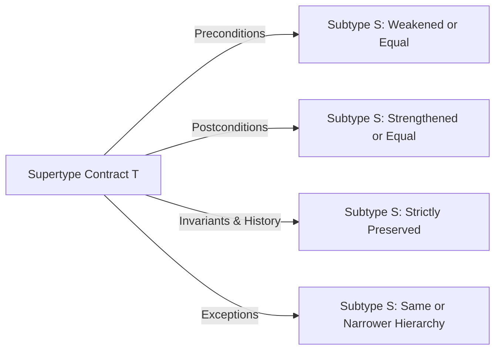

---
tags:
  - software-engineering
  - solid
  - lsp
  - type-systems
  - testing
created: 2026-01-02
updated: 2026-11-13
status: 🟢
level: mid-to-senior
---

# Liskov Substitution Principle (LSP)

> [!abstract] Vault Navigation
> Part of [[Programming/Software Engineering/SOLID/SOLID Principles Complete Guide|SOLID Principles Complete Guide]]. Guarantees behavioral soundness for [[Programming/Software Engineering/SOLID/Open-Closed Principle|Open-Closed Principle]], [[Programming/Software Engineering/SOLID/Dependency Inversion|Dependency Inversion]], [[Programming/Software Engineering/Design Patterns/Behavioral/Strategy|Strategy Pattern]], and [[Programming/Software Engineering/Design Patterns/Structural/Adapter|Adapter Pattern]], and pairs with capability splitting in [[Programming/Software Engineering/SOLID/Interface Segregation Principle|Interface Segregation Principle]].

Formulated formally by Barbara Liskov and Jeannette Wing (1994, *A Behavioral Notion of Subtyping*): **"Let $\phi(x)$ be a property provable about objects $x$ of type $T$. Then $\phi(y)$ should be true for objects $y$ of type $S$ where $S$ is a subtype of $T$."**

Syntactic subtyping—matching method names and TypeScript structural interfaces or Java `implements` declarations—is **necessary but completely insufficient**. LSP governs **behavioral subtyping (Design by Contract)**: every caller written solely against supertype $T$'s documented contract must execute correctly when handed any concrete subtype $S$ at runtime, without `instanceof` guards, defensive workarounds, or silent invariant corruption.

---

## 1. First-Principles Mechanics: Behavioral Subtyping & Variance Rules

### 1.1 The Five Formal Liskov–Wing Behavioral Rules

Consider a supertype contract $T$ and a subtype $S$ ($S <: T$) overriding method $m$:

1. **Preconditions Cannot Be Strengthened ($\text{Pre}_T \implies \text{Pre}_S$)**:
   - $S.m$ must accept **at least every input** accepted by $T.m$. It may weaken preconditions (accept broader inputs), never tighten them.
   - *Failure Example*: `PaymentGateway.charge(amountCents > 0)` overridden by `EnterpriseGateway.charge(amountCents >= 500)`. A checkout caller passing `250` crashes unexpectedly.
2. **Postconditions Cannot Be Weakened ($\text{Post}_S \implies \text{Post}_T$)**:
   - Upon normal return, $S.m$ must guarantee **at least every promise** made by $T.m$. It may strengthen promises (return tighter guarantees), never omit them.
   - *Failure Example*: `CachePort.set(key, val, ttlSeconds)` promises read-after-write visibility until `ttlSeconds` elapses; `NoOpCache` silently discards writes and returns `null` on immediate `get(key)`, breaking rate-limiters and idempotency keys.
3. **Invariants Must Be Preserved ($I_S \implies I_T$)**:
   - Every state invariant preserved across every constructor and method of $T$ must hold at all observable points in $S$.
   - *Classic Mechanics (Mutability Breaks Subtyping)*: Mathematically, every square is a rectangle. Behaviorally, a **mutable** `Square` violates `Rectangle`'s invariant that `setWidth(5)` leaves `height` unchanged (`area() === 5 * prevHeight`). Two sound designs resolve this: (a) keep `Rectangle` and `Square` as siblings implementing `interface Shape { area(): number }`, or (b) make both **immutable** (`withWidth(w): Rectangle` returns a new instance rather than mutating in place), which removes the state contradiction completely.
4. **History Constraint Must Be Preserved**:
   - Liskov and Wing introduced the **History Constraint** to rule out subtypes adding brand-new mutating methods that violate temporal state properties guaranteed by $T$.
   - *Example*: Suppose `ImmutableAuditLog` or `MonotonicCounter` guarantees that sequence numbers never decrease across any valid sequence of operations ($s_1.\text{value} \le s_2.\text{value}$). A subclass `ResettableCounter extends MonotonicCounter` adding `resetToZero()` compiles cleanly yet breaks any consumer holding a `MonotonicCounter` reference if another module calls `resetToZero()`.
5. **Signature & Exception Variance Rules**:
   - **Parameter Types (Contravariant)**: $S.m$ may accept supertypes of $T.m$'s parameters ($T_{param} <: S_{param}$), never narrower subtypes.
   - **Return Types (Covariant)**: $S.m$ may return a narrower subtype of $T.m$'s return type ($S_{ret} <: T_{ret}$).
   - **Exceptions (Covariant)**: $S.m$ may throw only exceptions that belong to the exception hierarchy declared/expected on $T.m$ (or none at all)—never brand-new unrelated exception classes that bypass caller `catch` blocks.



### 1.2 Mathematical Direction of Function Subtyping

For a function type $(P \to R)$, type theory defines subtyping $S \to R' <: T \to R$ iff:

$$T <: S \quad (\text{contravariant input}) \qquad \text{and} \qquad R' <: R \quad (\text{covariant output})$$

Why do parameter types flip direction? Callers hold a reference typed as $T \to R$ and only promise to supply arguments of type $T$. The concrete implementation $S \to R'$ must therefore handle *every possible* $T$, meaning its input parameter type $S$ must be at least as general as $T$ ($T <: S$). Conversely, the caller expects at least an $R$ back, so returning a more specific subtype $R'$ ($R' <: R$) satisfies all caller expectations.

---

## 2. Real-World Production Violations Beyond Rectangle/Square

In real TypeScript, Node.js, and React production codebases, LSP failures rarely look like geometry exercises; they erupt across infrastructure adapters, UI component wrappers, and distributed API clients.

### 2.1 Refused Bequest (`ReadOnlyList` / `ReadOnlyStorage` Throwing `UnsupportedOperation`)

A subtype inherits or implements a read-write port (`MutableList<T>` or `StoragePort`), then throws `UnsupportedOperationError` inside `push()`, `save()`, or `delete()`.
- **Why It Breaks Production**: Callers typed against `StoragePort` assume `delete(key)` succeeds or returns `boolean`; passing a `ReadOnlyArchiveAdapter` compiles and passes static checks, then crashes production background cleanup jobs with unhandled `500` errors. It also forces callers into `if (!(storage instanceof ReadOnlyArchiveAdapter))` guards, eroding [[Programming/Software Engineering/SOLID/Open-Closed Principle|OCP]].
- **Remediation**: Segregate read and write capabilities via [[Programming/Software Engineering/SOLID/Interface Segregation Principle|ISP]] (`ReadableBlobStorage` vs `WritableBlobStorage`). Never force read-only implementations to stub mutators.

### 2.2 Infrastructure Adapter Semantic Drift (`Cache`, `Storage` & `Clock` Violations)

1. **Silent TTL or Persistence Drift in `CacheAdapter`**:
   - An application defines `CachePort` with `set(key, value, ttlSeconds)` and relies on Redis in staging/prod while using an in-memory `MapCache` in integration tests—or a `NoOpCache` when Redis is disabled locally.
   - If `MapCache` ignores `ttlSeconds` (never expiring entries), expiration tests pass accidentally or memory leaks unboundedly in staging. Conversely, if `S3StorageAdapter` relies on S3 Lifecycle Policies (which run asynchronously up to **24–48 hours** after expiration!), calling `get(key)` after `ttlSeconds` returns stale data—violating the postcondition enforced by `RedisStorageAdapter` and `InMemoryStorageAdapter`!
   - **Fix**: Every adapter must enforce identical semantics at the boundary (e.g., `S3StorageAdapter` stores `expiresAtEpochMs` in object metadata and rejects/deletes expired objects synchronously on `get()` and `listKeys()`).
2. **Non-Monotonic `WallClock` Substituted for `MonotonicClock`**:
   - A rate limiter or circuit breaker accepts `Clock { nowMs(): number }` expecting monotonically increasing elapsed milliseconds to compute `elapsed = clock.nowMs() - startMs`.
   - Passing a wall-clock adapter (`() => Date.now()`) breaks monotonicity during NTP step adjustments or leap seconds: `elapsed` becomes negative, locking circuit breakers open permanently or triggering `setTimeout(..., -4200)`.
   - **Fix**: Distinguish `WallClock` (UTC timestamps for audit logs) from `MonotonicClock` (`() => performance.now()`, guaranteed non-decreasing).

### 2.3 React / UI Component Wrappers Breaking DOM Contracts

Custom Design System wrappers (`<Button>`, `<TextInput>`, `<DialogTrigger>`) frequently act as broken subtypes of native HTML elements (`JSX.IntrinsicElements['button']`):
- **Dropped `ref` Forwarding**: Wrapping `<button>` without forwarding `ref` breaks `Floating UI` positioning, Radix primitives (`asChild`), and `React Hook Form` focus management (`setFocus('email')` fails silently!).
- **Overwritten Event Handlers & Class Names**: Writing `<button {...props} onClick={handleAnalytics} className="btn-primary">` completely discards any caller-passed `props.onClick` or `props.className` (or vice versa if `className` precedes `{...props}`).
- **Swallowed ARIA / `disabled` Attributes**: A custom spinner mode that omits `aria-busy` or strips `disabled` permits double-form submissions.
- **Remediation**: Spread remaining DOM props (`...rest`), compose `onClick` (`onClick?.(event)`), merge `className`, and forward `ref` cleanly so `<PrimaryButton>` is 100% behaviorally substitutable for `<button>` (see [[Programming/Frontend/React Patterns Guide|React Patterns Guide]]).

### 2.4 Paginated & Idempotent API Client Drift

1. **Pagination Contract Breakage**: Suppose `UserDirectoryPort.listUsers({ cursor, limit })` promises to return up to `limit` distinct users sorted deterministically and a non-null `nextCursor` whenever more items exist. A legacy offset adapter silently caps `limit` at `25` while caller passed `limit: 100`. A pagination consumer checking `if (page.items.length < limit) break;` halts after page 1 and drops 90% of tenant users!
2. **Idempotency Violation**: `PaymentPort.charge({ orderId, idempotencyKey, amountCents })` promises retry safety. Substituting a legacy PSP adapter that ignores `idempotencyKey` breaks duplicate-charge protection during network timeouts.

### 2.5 Decision Matrix: Inheritance vs Composition vs Capability Segregation

| Scenario | LSP Compatibility | Recommended Pattern | Rationale |
| :--- | :--- | :--- | :--- |
| **`InMemory`, `Redis`, `S3` implementing `BlobStoragePort`** | Valid when semantics match | Shared Port + **Contract Test Suite** | Callers swap backends cleanly via DI; CI verifies parity |
| **`ReadOnlyStorage` vs `WritableStorage`** | Violates write preconditions/exceptions | **ISP Capability Segregation** | Split `ReadableStorage` from `WritableStorage`; compose when needed |
| **`Square` vs `Rectangle` (Mutable)** | Violates width/height independence | **Separate siblings** (`Shape`) or **Immutability** | Mutability turns geometric subset into behavioral contradiction |
| **`WallClock` vs `MonotonicClock`** | Violates History/Monotonicity | **Distinct nominal/branded types** | `Date.now()` jumps backward on NTP skew; `performance.now()` does not |
| **React `<IconButton>` wrapping `<button>`** | Valid if DOM contract preserved | **Forward `ref`, spread `...rest`, compose handlers** | Preserves focus, keyboard navigation, ARIA, and third-party hooks |

---

## 3. Step-by-Step Production Application: Reusable Storage Adapter Contract-Test Suite

Writing an interface `BlobStoragePort` does not prove `InMemoryStorageAdapter`, `RedisStorageAdapter`, and `S3StorageAdapter` obey identical behavioral contracts. The production pattern for enforcing LSP automatically in CI is a **parameterized Contract Test Suite (`createStorageAdapterContractTests`)** executed against every adapter implementation.

### 3.1 Project Directory Structure

```text
src/
└── storage/
    ├── contracts/
    │   ├── blob-storage.port.ts           # Strict behavioral port, invariants & typed errors
    │   └── storage-contract.suite.ts      # Reusable Vitest LSP contract suite
    ├── adapters/
    │   ├── in-memory-storage.adapter.ts   # Deterministic in-memory adapter
    │   ├── redis-storage.adapter.ts       # Redis adapter bridging key/TTL/NX semantics
    │   └── s3-storage.adapter.ts          # S3 adapter enforcing strict synchronous TTL
    └── __tests__/
        └── adapters.contract.spec.ts      # Executes shared contract suite across all 3 adapters
```

### 3.2 Strict Behavioral Port & Closed Exception Hierarchy (`src/storage/contracts/blob-storage.port.ts`)

```typescript
// src/storage/contracts/blob-storage.port.ts
export interface StorageClock {
  nowMs(): number;
}

export interface PutObjectOptions {
  /** Positive integer TTL in seconds. Omit for non-expiring object. */
  readonly ttlSeconds?: number;
  /** When true, fail with StoragePreconditionError if key already exists & is unexpired. */
  readonly ifNoneMatch?: boolean;
}

export interface StoredObject {
  readonly key: string;
  readonly data: Uint8Array;
  readonly updatedAtMs: number;
  readonly expiresAtMs: number | null;
}

export class StorageContractError extends Error {
  constructor(message: string) {
    super(message);
    this.name = 'StorageContractError';
  }
}

export class StorageKeyError extends StorageContractError {
  constructor(message: string) {
    super(message);
    this.name = 'StorageKeyError';
  }
}

export class StoragePreconditionError extends StorageContractError {
  constructor(key: string) {
    super(`Precondition failed: object already exists at key "${key}"`);
    this.name = 'StoragePreconditionError';
  }
}

export class StorageUnavailableError extends StorageContractError {
  constructor(message: string, public readonly causeError?: unknown) {
    super(message);
    this.name = 'StorageUnavailableError';
  }
}

/**
 * Behavioral Contract (LSP):
 * - Preconditions:
 *   1. key matches /^[a-zA-Z0-9._/-]{1,256}$/ and contains no ".." segments.
 *   2. options.ttlSeconds (when provided) is a finite positive integer >= 1.
 * - Postconditions:
 *   1. After put(key, bytes, opts) resolves, get(key) returns identical bytes until expired or deleted.
 *   2. Mutating caller-owned `bytes` after put() or mutating returned `StoredObject.data` never alters stored bytes.
 *   3. Expired objects MUST return `null` on get() and MUST NOT appear in listKeys().
 *   4. delete(key) is idempotent: returns `true` iff an unexpired object existed and was removed; `false` otherwise.
 *   5. listKeys(prefix) returns lexicographically sorted distinct keys matching prefix.
 * - Exceptions: ONLY StorageKeyError, StoragePreconditionError, or StorageUnavailableError.
 */
export interface BlobStoragePort {
  readonly put: (
    key: string,
    data: Uint8Array,
    options?: PutObjectOptions
  ) => Promise<void>;
  readonly get: (key: string) => Promise<StoredObject | null>;
  readonly delete: (key: string) => Promise<boolean>;
  readonly listKeys: (prefix?: string) => Promise<ReadonlyArray<string>>;
}

const VALID_KEY_REGEX = /^[a-zA-Z0-9._/-]{1,256}$/;

export function assertValidStorageKey(key: string): void {
  if (!VALID_KEY_REGEX.test(key) || key.includes('..') || key.startsWith('/')) {
    throw new StorageKeyError(`Invalid storage key: "${key}"`);
  }
}

export function assertValidPutOptions(options?: PutObjectOptions): void {
  if (!options) return;
  if (
    options.ttlSeconds !== undefined &&
    (!Number.isInteger(options.ttlSeconds) || options.ttlSeconds < 1)
  ) {
    throw new StorageKeyError(
      `ttlSeconds must be an integer >= 1, received ${String(options.ttlSeconds)}`
    );
  }
}
```

Notice we used **readonly function property syntax** (`readonly put: (...) => ...`) rather than method shorthand (`put(...): ...`) so TypeScript enforces strict contravariance on `BlobStoragePort` implementations!

### 3.3 Adapter 1: In-Memory Storage (`src/storage/adapters/in-memory-storage.adapter.ts`)

```typescript
// src/storage/adapters/in-memory-storage.adapter.ts
import {
  assertValidPutOptions,
  assertValidStorageKey,
  StoragePreconditionError,
  type BlobStoragePort,
  type PutObjectOptions,
  type StorageClock,
  type StoredObject,
} from '../contracts/blob-storage.port';

interface InternalEntry {
  readonly data: Uint8Array;
  readonly updatedAtMs: number;
  readonly expiresAtMs: number | null;
}

export class InMemoryStorageAdapter implements BlobStoragePort {
  private readonly store = new Map<string, InternalEntry>();

  constructor(private readonly clock: StorageClock) {}

  readonly put = async (
    key: string,
    data: Uint8Array,
    options?: PutObjectOptions
  ): Promise<void> => {
    assertValidStorageKey(key);
    assertValidPutOptions(options);

    const nowMs = this.clock.nowMs();
    const existing = this.readValidEntry(key, nowMs);
    if (options?.ifNoneMatch && existing !== null) {
      throw new StoragePreconditionError(key);
    }

    const expiresAtMs =
      options?.ttlSeconds !== undefined ? nowMs + options.ttlSeconds * 1_000 : null;

    // Defensive copy preserves immutability/history against caller mutations
    this.store.set(key, {
      data: Uint8Array.from(data),
      updatedAtMs: nowMs,
      expiresAtMs,
    });
  };

  readonly get = async (key: string): Promise<StoredObject | null> => {
    assertValidStorageKey(key);
    const entry = this.readValidEntry(key, this.clock.nowMs());
    if (!entry) return null;

    return {
      key,
      data: Uint8Array.from(entry.data),
      updatedAtMs: entry.updatedAtMs,
      expiresAtMs: entry.expiresAtMs,
    };
  };

  readonly delete = async (key: string): Promise<boolean> => {
    assertValidStorageKey(key);
    const entry = this.readValidEntry(key, this.clock.nowMs());
    if (!entry) {
      this.store.delete(key);
      return false;
    }
    return this.store.delete(key);
  };

  readonly listKeys = async (prefix = ''): Promise<ReadonlyArray<string>> => {
    const nowMs = this.clock.nowMs();
    const keys: string[] = [];
    for (const key of this.store.keys()) {
      if (!key.startsWith(prefix)) continue;
      if (this.readValidEntry(key, nowMs) !== null) {
        keys.push(key);
      }
    }
    return keys.sort((a, b) => a.localeCompare(b));
  };

  private readValidEntry(key: string, nowMs: number): InternalEntry | null {
    const entry = this.store.get(key);
    if (!entry) return null;
    if (entry.expiresAtMs !== null && nowMs >= entry.expiresAtMs) {
      this.store.delete(key);
      return null;
    }
    return entry;
  }
}
```

### 3.4 Adapter 2: Redis Storage (`src/storage/adapters/redis-storage.adapter.ts`)

`RedisStorageAdapter` translates raw Redis commands (`SET NX EX`, `GET`, `DEL`, `SCAN`) into the exact postconditions and closed exception types promised by `BlobStoragePort`.

```typescript
// src/storage/adapters/redis-storage.adapter.ts
import {
  assertValidPutOptions,
  assertValidStorageKey,
  StoragePreconditionError,
  StorageUnavailableError,
  type BlobStoragePort,
  type PutObjectOptions,
  type StorageClock,
  type StoredObject,
} from '../contracts/blob-storage.port';

export interface RedisClientLike {
  set(
    key: string,
    value: string,
    options?: { readonly exSeconds?: number; readonly nx?: boolean }
  ): Promise<'OK' | null>;
  get(key: string): Promise<string | null>;
  del(key: string): Promise<number>;
  scanPrefix(prefix: string): Promise<ReadonlyArray<string>>;
}

interface RedisSerializedEnvelope {
  readonly base64Data: string;
  readonly updatedAtMs: number;
  readonly expiresAtMs: number | null;
}

export class RedisStorageAdapter implements BlobStoragePort {
  constructor(
    private readonly redis: RedisClientLike,
    private readonly clock: StorageClock,
    private readonly keyPrefix = 'blob:'
  ) {}

  readonly put = async (
    key: string,
    data: Uint8Array,
    options?: PutObjectOptions
  ): Promise<void> => {
    assertValidStorageKey(key);
    assertValidPutOptions(options);

    const nowMs = this.clock.nowMs();
    const expiresAtMs =
      options?.ttlSeconds !== undefined ? nowMs + options.ttlSeconds * 1_000 : null;

    const envelope: RedisSerializedEnvelope = {
      base64Data: Buffer.from(data).toString('base64'),
      updatedAtMs: nowMs,
      expiresAtMs,
    };

    try {
      const result = await this.redis.set(
        this.namespaced(key),
        JSON.stringify(envelope),
        {
          exSeconds: options?.ttlSeconds,
          nx: options?.ifNoneMatch,
        }
      );

      if (options?.ifNoneMatch && result !== 'OK') {
        throw new StoragePreconditionError(key);
      }
    } catch (err: unknown) {
      if (err instanceof StoragePreconditionError) throw err;
      throw new StorageUnavailableError(`Redis put failed for key "${key}"`, err);
    }
  };

  readonly get = async (key: string): Promise<StoredObject | null> => {
    assertValidStorageKey(key);
    try {
      const raw = await this.redis.get(this.namespaced(key));
      if (raw === null) return null;

      const parsed = JSON.parse(raw) as RedisSerializedEnvelope;
      if (parsed.expiresAtMs !== null && this.clock.nowMs() >= parsed.expiresAtMs) {
        await this.redis.del(this.namespaced(key));
        return null;
      }

      return {
        key,
        data: Uint8Array.from(Buffer.from(parsed.base64Data, 'base64')),
        updatedAtMs: parsed.updatedAtMs,
        expiresAtMs: parsed.expiresAtMs,
      };
    } catch (err: unknown) {
      throw new StorageUnavailableError(`Redis get failed for key "${key}"`, err);
    }
  };

  readonly delete = async (key: string): Promise<boolean> => {
    assertValidStorageKey(key);
    try {
      const deletedCount = await this.redis.del(this.namespaced(key));
      return deletedCount > 0;
    } catch (err: unknown) {
      throw new StorageUnavailableError(`Redis delete failed for key "${key}"`, err);
    }
  };

  readonly listKeys = async (prefix = ''): Promise<ReadonlyArray<string>> => {
    try {
      const fullKeys = await this.redis.scanPrefix(`${this.keyPrefix}${prefix}`);
      const activeKeys: string[] = [];
      for (const fullKey of fullKeys) {
        const logicalKey = fullKey.slice(this.keyPrefix.length);
        // Re-verify active status so keys awaiting lazy expiration never leak into listKeys
        const obj = await this.get(logicalKey);
        if (obj !== null) {
          activeKeys.push(logicalKey);
        }
      }
      return [...new Set(activeKeys)].sort((a, b) => a.localeCompare(b));
    } catch (err: unknown) {
      if (err instanceof StorageUnavailableError) throw err;
      throw new StorageUnavailableError('Redis listKeys failed', err);
    }
  };

  private namespaced(key: string): string {
    return `${this.keyPrefix}${key}`;
  }
}
```

### 3.5 Adapter 3: S3 Storage Closing Semantic Gaps (`src/storage/adapters/s3-storage.adapter.ts`)

Because S3 Object Lifecycle rules delete expired objects asynchronously hours later and S3 `DeleteObject` returns `204` whether an object existed or not, a naive S3 wrapper silently breaks two LSP postconditions (`get()` returning expired objects, `delete()` always returning `true`). `S3StorageAdapter` explicitly enforces expiration metadata and existence checking so it remains 100% substitutable.

```typescript
// src/storage/adapters/s3-storage.adapter.ts
import {
  assertValidPutOptions,
  assertValidStorageKey,
  StoragePreconditionError,
  StorageUnavailableError,
  type BlobStoragePort,
  type PutObjectOptions,
  type StorageClock,
  type StoredObject,
} from '../contracts/blob-storage.port';

export interface S3ObjectRecord {
  readonly body: Uint8Array;
  readonly metadata: Readonly<Record<string, string>>;
}

export interface S3ClientLike {
  putObject(params: {
    readonly bucket: string;
    readonly key: string;
    readonly body: Uint8Array;
    readonly metadata: Readonly<Record<string, string>>;
    readonly ifNoneMatchStar?: boolean;
  }): Promise<void>;
  getObject(params: { readonly bucket: string; readonly key: string }): Promise<S3ObjectRecord | null>;
  deleteObject(params: { readonly bucket: string; readonly key: string }): Promise<void>;
  listKeys(params: { readonly bucket: string; readonly prefix: string }): Promise<ReadonlyArray<string>>;
}

export class S3PreconditionConflictError extends Error {
  constructor() {
    super('PreconditionFailed');
    this.name = 'PreconditionFailed';
  }
}

export class S3StorageAdapter implements BlobStoragePort {
  constructor(
    private readonly s3: S3ClientLike,
    private readonly bucket: string,
    private readonly clock: StorageClock
  ) {}

  readonly put = async (
    key: string,
    data: Uint8Array,
    options?: PutObjectOptions
  ): Promise<void> => {
    assertValidStorageKey(key);
    assertValidPutOptions(options);

    const nowMs = this.clock.nowMs();
    const expiresAtMs =
      options?.ttlSeconds !== undefined ? nowMs + options.ttlSeconds * 1_000 : null;

    // If existing S3 object has already expired lazily, purge it before conditional put
    if (options?.ifNoneMatch) {
      const existing = await this.get(key);
      if (existing !== null) {
        throw new StoragePreconditionError(key);
      }
    }

    try {
      await this.s3.putObject({
        bucket: this.bucket,
        key,
        body: Uint8Array.from(data),
        metadata: {
          'updated-at-ms': String(nowMs),
          'expires-at-ms': expiresAtMs === null ? '' : String(expiresAtMs),
        },
        ifNoneMatchStar: options?.ifNoneMatch,
      });
    } catch (err: unknown) {
      if (err instanceof S3PreconditionConflictError) {
        throw new StoragePreconditionError(key);
      }
      throw new StorageUnavailableError(`S3 putObject failed for "${key}"`, err);
    }
  };

  readonly get = async (key: string): Promise<StoredObject | null> => {
    assertValidStorageKey(key);
    try {
      const record = await this.s3.getObject({ bucket: this.bucket, key });
      if (!record) return null;

      const rawExp = record.metadata['expires-at-ms'];
      const expiresAtMs = rawExp ? Number(rawExp) : null;
      const updatedAtMs = Number(record.metadata['updated-at-ms'] ?? this.clock.nowMs());

      // Bridge S3 eventual lifecycle expiration synchronously to uphold LSP contract
      if (expiresAtMs !== null && this.clock.nowMs() >= expiresAtMs) {
        await this.s3.deleteObject({ bucket: this.bucket, key });
        return null;
      }

      return {
        key,
        data: Uint8Array.from(record.body),
        updatedAtMs,
        expiresAtMs,
      };
    } catch (err: unknown) {
      throw new StorageUnavailableError(`S3 getObject failed for "${key}"`, err);
    }
  };

  readonly delete = async (key: string): Promise<boolean> => {
    assertValidStorageKey(key);
    const active = await this.get(key);
    try {
      await this.s3.deleteObject({ bucket: this.bucket, key });
      return active !== null;
    } catch (err: unknown) {
      throw new StorageUnavailableError(`S3 deleteObject failed for "${key}"`, err);
    }
  };

  readonly listKeys = async (prefix = ''): Promise<ReadonlyArray<string>> => {
    try {
      const rawKeys = await this.s3.listKeys({ bucket: this.bucket, prefix });
      const active: string[] = [];
      for (const k of rawKeys) {
        if ((await this.get(k)) !== null) {
          active.push(k);
        }
      }
      return active.sort((a, b) => a.localeCompare(b));
    } catch (err: unknown) {
      if (err instanceof StorageUnavailableError) throw err;
      throw new StorageUnavailableError('S3 listKeys failed', err);
    }
  };
}
```

### 3.6 Reusable LSP Contract Test Suite (`src/storage/contracts/storage-contract.suite.ts`)

```typescript
// src/storage/contracts/storage-contract.suite.ts
import { beforeEach, describe, expect, it } from 'vitest';
import {
  StorageKeyError,
  StoragePreconditionError,
  type BlobStoragePort,
} from './blob-storage.port';

export interface StorageTestHarness {
  readonly adapter: BlobStoragePort;
  advanceTimeMs(deltaMs: number): void;
}

export function createStorageAdapterContractTests(
  adapterName: string,
  createHarness: () => Promise<StorageTestHarness> | StorageTestHarness
): void {
  describe(`BlobStoragePort LSP Contract Suite [${adapterName}]`, () => {
    let harness: StorageTestHarness;

    beforeEach(async () => {
      harness = await createHarness();
    });

    it('preserves exact binary payloads and enforces defensive copy immutability', async () => {
      const payload = new Uint8Array([10, 20, 30, 40]);
      await harness.adapter.put('tenants/t1/logo.bin', payload);

      // Mutate caller input buffer after put() -> stored bytes must stay isolated
      payload[0] = 255;

      const fetched = await harness.adapter.get('tenants/t1/logo.bin');
      expect(fetched).not.toBeNull();
      expect([...fetched!.data]).toEqual([10, 20, 30, 40]);

      // Mutate returned buffer -> subsequent read must stay uncorrupted
      fetched!.data[1] = 255;
      const fetchedAgain = await harness.adapter.get('tenants/t1/logo.bin');
      expect([...fetchedAgain!.data]).toEqual([10, 20, 30, 40]);
    });

    it('enforces identical key and TTL preconditions across all adapters', async () => {
      const bytes = new Uint8Array([1]);
      await expect(harness.adapter.put('', bytes)).rejects.toThrow(StorageKeyError);
      await expect(harness.adapter.put('../etc/passwd', bytes)).rejects.toThrow(StorageKeyError);
      await expect(harness.adapter.put('/leading-slash', bytes)).rejects.toThrow(StorageKeyError);
      await expect(harness.adapter.put('valid/key', bytes, { ttlSeconds: 0 })).rejects.toThrow(
        StorageKeyError
      );
      await expect(harness.adapter.put('valid/key', bytes, { ttlSeconds: -5 })).rejects.toThrow(
        StorageKeyError
      );
    });

    it('honors atomic ifNoneMatch without overwriting existing live objects', async () => {
      const v1 = new Uint8Array([1, 1]);
      const v2 = new Uint8Array([2, 2]);

      await harness.adapter.put('locks/job-1', v1, { ifNoneMatch: true });
      await expect(
        harness.adapter.put('locks/job-1', v2, { ifNoneMatch: true })
      ).rejects.toThrow(StoragePreconditionError);

      const current = await harness.adapter.get('locks/job-1');
      expect([...current!.data]).toEqual([1, 1]);
    });

    it('expires objects strictly at TTL boundary for get(), listKeys(), and ifNoneMatch', async () => {
      await harness.adapter.put('sessions/s1', new Uint8Array([9]), { ttlSeconds: 10 });

      harness.advanceTimeMs(9_999);
      expect(await harness.adapter.get('sessions/s1')).not.toBeNull();
      expect(await harness.adapter.listKeys('sessions/')).toEqual(['sessions/s1']);

      harness.advanceTimeMs(1); // Reaches 10,000ms exact TTL expiry
      expect(await harness.adapter.get('sessions/s1')).toBeNull();
      expect(await harness.adapter.listKeys('sessions/')).toEqual([]);

      // Expired object must permit a fresh conditional insert
      await expect(
        harness.adapter.put('sessions/s1', new Uint8Array([8]), { ifNoneMatch: true })
      ).resolves.toBeUndefined();
    });

    it('implements idempotent delete() semantics and deterministic sorted listKeys()', async () => {
      await harness.adapter.put('docs/c.txt', new Uint8Array([3]));
      await harness.adapter.put('docs/a.txt', new Uint8Array([1]));
      await harness.adapter.put('docs/b.txt', new Uint8Array([2]));

      expect(await harness.adapter.listKeys('docs/')).toEqual([
        'docs/a.txt',
        'docs/b.txt',
        'docs/c.txt',
      ]);

      expect(await harness.adapter.delete('docs/b.txt')).toBe(true);
      expect(await harness.adapter.delete('docs/b.txt')).toBe(false);
      expect(await harness.adapter.delete('docs/never-existed.txt')).toBe(false);
      expect(await harness.adapter.listKeys('docs/')).toEqual(['docs/a.txt', 'docs/c.txt']);
    });
  });
}
```

### 3.7 Running the Shared Suite Across All Adapters in CI (`src/storage/__tests__/adapters.contract.spec.ts`)

```typescript
// src/storage/__tests__/adapters.contract.spec.ts
import { InMemoryStorageAdapter } from '../adapters/in-memory-storage.adapter';
import {
  RedisStorageAdapter,
  type RedisClientLike,
} from '../adapters/redis-storage.adapter';
import {
  S3PreconditionConflictError,
  S3StorageAdapter,
  type S3ClientLike,
  type S3ObjectRecord,
} from '../adapters/s3-storage.adapter';
import type { StorageClock } from '../contracts/blob-storage.port';
import { createStorageAdapterContractTests } from '../contracts/storage-contract.suite';

function createFakeClock(initialMs = 1_700_000_000_000) {
  let now = initialMs;
  const clock: StorageClock = { nowMs: () => now };
  return {
    clock,
    advanceTimeMs: (delta: number) => {
      now += delta;
    },
  };
}

function createFakeRedis(clock: StorageClock): RedisClientLike {
  const entries = new Map<string, { value: string; expiresAtMs: number | null }>();
  return {
    async set(key, value, options) {
      const existing = entries.get(key);
      const isLive =
        existing !== undefined &&
        (existing.expiresAtMs === null || clock.nowMs() < existing.expiresAtMs);
      if (options?.nx && isLive) return null;
      entries.set(key, {
        value,
        expiresAtMs:
          options?.exSeconds !== undefined ? clock.nowMs() + options.exSeconds * 1_000 : null,
      });
      return 'OK';
    },
    async get(key) {
      const item = entries.get(key);
      if (!item) return null;
      if (item.expiresAtMs !== null && clock.nowMs() >= item.expiresAtMs) {
        entries.delete(key);
        return null;
      }
      return item.value;
    },
    async del(key) {
      return entries.delete(key) ? 1 : 0;
    },
    async scanPrefix(prefix) {
      return [...entries.keys()].filter((k) => k.startsWith(prefix));
    },
  };
}

function createFakeS3(): S3ClientLike {
  const bucketMap = new Map<string, S3ObjectRecord>();
  return {
    async putObject({ key, body, metadata, ifNoneMatchStar }) {
      if (ifNoneMatchStar && bucketMap.has(key)) {
        throw new S3PreconditionConflictError();
      }
      bucketMap.set(key, { body: Uint8Array.from(body), metadata: { ...metadata } });
    },
    async getObject({ key }) {
      const rec = bucketMap.get(key);
      return rec ? { body: Uint8Array.from(rec.body), metadata: { ...rec.metadata } } : null;
    },
    async deleteObject({ key }) {
      bucketMap.delete(key);
    },
    async listKeys({ prefix }) {
      return [...bucketMap.keys()].filter((k) => k.startsWith(prefix));
    },
  };
}

// CI automatically executes every LSP invariant against all 3 implementations
createStorageAdapterContractTests('InMemoryStorageAdapter', () => {
  const { clock, advanceTimeMs } = createFakeClock();
  return { adapter: new InMemoryStorageAdapter(clock), advanceTimeMs };
});

createStorageAdapterContractTests('RedisStorageAdapter', () => {
  const { clock, advanceTimeMs } = createFakeClock();
  return { adapter: new RedisStorageAdapter(createFakeRedis(clock), clock), advanceTimeMs };
});

createStorageAdapterContractTests('S3StorageAdapter', () => {
  const { clock, advanceTimeMs } = createFakeClock();
  return { adapter: new S3StorageAdapter(createFakeS3(), 'prod-blobs', clock), advanceTimeMs };
});
```

In full integration CI, swap `createFakeRedis` and `createFakeS3` with real Testcontainers (`redis:7-alpine` and `localstack/localstack`) so real network drivers and protocol errors are validated under the identical `createStorageAdapterContractTests` harness (see [[Programming/Software Engineering/Testing/Integration Testing|Integration Testing]]).

---

## 4. TypeScript Type-System Variance, Compiler Traps & Cross-Language Mechanics

Even with `"strict": true` enabled in `tsconfig.json`, TypeScript intentionally permits two unsound structural typing behaviors for legacy JavaScript/DOM ergonomics that routinely introduce LSP runtime crashes.

### 4.1 Method Shorthand Bivariance vs Function Property Contravariance

Under `strictFunctionTypes: true`:
- **Property function types** (`readonly handle: (x: Animal) => void`) are checked **contravariantly** (sound).
- **Method shorthand syntax** (`handle(x: Animal): void`) inside `interface` or `class` declarations remains **bivariant** so `Array<Dog>` can still be assigned to `Array<Animal>` (`push(x: T)`).

```typescript
class Animal {
  readonly kind = 'animal';
}
class Dog extends Animal {
  bark(): string {
    return 'woof';
  }
}

interface UnsoundMethodHandler {
  handle(a: Animal): void; // Bivariant parameter checking!
}

interface SoundPropertyHandler {
  readonly handle: (a: Animal) => void; // Strictly contravariant parameter checking
}

const dogOnly = (d: Dog): void => {
  d.bark();
};

// ❌ Compiles silently with method syntax — crashes when passed a plain Animal or Cat!
const unsafe: UnsoundMethodHandler = { handle: dogOnly };

// ✅ Compile-time error under strictFunctionTypes: Type 'Animal' is missing property 'bark'
// const safe: SoundPropertyHandler = { handle: dogOnly };
```

Enforce `@typescript-eslint/method-signature-style: ["error", "property"]` on interface ports to eliminate bivariant parameter narrowing across your entire codebase.

### 4.2 Mutable Array Covariance (`Dog[]` $\to$ `Animal[]`)

Mutable generic containers (`Array<T>`, `Map<K, V>`) are mathematically **invariant** because they both *produce* `T` (covariant reads) and *consume* `T` (contravariant writes). TypeScript treats `T[]` as covariant anyway:

```typescript
function appendGenericAnimal(list: Animal[]): void {
  list.push(new Animal());
}

const kennel: Dog[] = [new Dog()];
appendGenericAnimal(kennel); // Compiles cleanly in TS! Corrupts Dog[] with a plain Animal
// kennel[1].bark(); // 💥 Runtime TypeError: kennel[1].bark is not a function
```

**Fix**: Annotate read-only collection parameters as `readonly Animal[]` (`ReadonlyArray<Animal>`). Immutable containers have no mutators, making covariance 100% type-sound.

### 4.3 Async Promise Return & Error Swallowing Traps

Returning `Promise<T | null>` when the supertype promises `Promise<T>` (throwing a typed error on failure) violates postconditions silently. Similarly, catching and logging an error inside a subtype's `save()` method and returning `Promise<void>` without rethrowing deceives callers into committing downstream state assuming persistence succeeded.

### 4.4 Substitutable React Wrapper Components (`Button` Contract)

```tsx
import { forwardRef, type ComponentPropsWithoutRef } from 'react';

export interface PrimaryButtonProps extends ComponentPropsWithoutRef<'button'> {
  readonly isLoading?: boolean;
}

export const PrimaryButton = forwardRef<HTMLButtonElement, PrimaryButtonProps>(
  function PrimaryButton({ isLoading = false, disabled, className, onClick, children, ...rest }, ref) {
    const mergedClassName = ['btn-primary', className].filter(Boolean).join(' ');
    const effectiveDisabled = Boolean(disabled || isLoading);

    const handleClick: ComponentPropsWithoutRef<'button'>['onClick'] = (event) => {
      if (effectiveDisabled) {
        event.preventDefault();
        return;
      }
      onClick?.(event);
    };

    return (
      <button
        {...rest}
        ref={ref}
        type={rest.type ?? 'button'}
        disabled={effectiveDisabled}
        aria-busy={isLoading || undefined}
        className={mergedClassName}
        onClick={handleClick}
      >
        {children}
      </button>
    );
  }
);
```

Every native `<button>` contract (`ref` attachment for focus/tooltips, `aria-*`, `data-testid`, `onClick` composition, `className` composition, `disabled` guard) remains intact.

### 4.5 Cross-Language Behavioral Subtyping Comparison

| Language | Parameter / Return Variance Enforcement | Container Variance Trap | Explicit Tooling / Language Guard |
| :--- | :--- | :--- | :--- |
| **TypeScript** | Property arrows contravariant; method shorthand bivariant | `T[]` is covariant even though mutable | `strictFunctionTypes: true`, `readonly T[]`, ESLint `method-signature-style` |
| **Java** | Covariant returns supported; method params invariant (`@Override`) | `Dog[]` covariant (`ArrayStoreException` at runtime); `List<T>` invariant | Use `List<? extends T>` (read) and `List<? super T>` (write) |
| **Python (`mypy`/`pyright`)** | Enforces LSP contravariant params & covariant returns on overrides | `list[T]` invariant; `Sequence[T]` covariant | `@typing.override` (Python 3.12+) + `typing.Protocol` checks |
| **Go** | Implicit structural satisfaction; zero parameter/return variance | Slices `[]T` invariant (`[]Dog` cannot pass as `[]Animal`) | Document behavioral invariants (e.g., `io.Reader`) + table-driven contract suites |

---

## 5. Production Debugging, Profiling & Operations Playbook

### 5.1 Automated Codebase Audits & Compiler Hardening

```bash
# 1. Hunt for instanceof / constructor.name checks masking broken polymorphism
grep -rnE "instanceof |constructor\.name" src/ --include="*.ts" --include="*.tsx"

# 2. Hunt for Refused Bequest exception stubs inside adapters or subclasses
grep -rnE "NotImplemented|UnsupportedOperation|not implemented" src/ --include="*.ts"

# 3. Verify strict compiler & ESLint rules disallowing bivariant method signatures
npx tsc --noEmit --strict --strictFunctionTypes --noUncheckedIndexedAccess
```

Recommended `eslint.config.mjs` enforcement for TypeScript interfaces:

```javascript
rules: {
  '@typescript-eslint/method-signature-style': ['error', 'property'],
}
```

### 5.2 Triage Playbook

| Production Symptom | Underlying LSP Root Cause | Diagnostic Evidence | Remediation |
| :--- | :--- | :--- | :--- |
| **Rate limiter / lock permits duplicate bursts in staging/local** | `NoOpCache` or `MapCache` ignores TTL or read-after-write | Contract test fails on immediate `get()` or TTL expiry | Run `createCacheContractTests()` against every adapter in CI |
| **Cron / pagination sync silently drops records at page 1** | Subtype caps `limit` silently below requested page size | Logs show `items.length === 25` when `limit: 100` passed | Return explicit `nextCursor` and never terminate strictly on `length < limit` |
| **Runtime `TypeError: fn is not a function` in event bus** | Method shorthand allowed narrowing event payload subtype | TypeScript interface uses `onEvent(e: Base): void` | Switch interface to `readonly onEvent: (e: Base) => void` |
| **Negative durations / stuck circuit breakers on NTP sync** | Wall clock (`Date.now()`) injected into `MonotonicClock` port | Elapsed latency metrics report `< 0 ms` | Brand `MonotonicClock` separately and back with `performance.now()` |
| **`Radix` tooltip or `React Hook Form` focus fails on custom button** | UI wrapper component drops `ref` or overwrites `onClick` | `ref.current` stays `null` on mount | Forward `ref`, spread `...rest`, compose handlers and `className` |

---

## 6. Worked Exercises

### Exercise 1: Auditing Precondition, Postcondition & Exception Violations

Identify **three distinct LSP violations** in `VipBillingAccount` below and provide a compliant redesign:

```typescript
class BillingAccount {
  protected balanceCents = 10_000;

  /** @pre amountCents > 0 @post returns remaining balance >= 0 */
  charge(amountCents: number): number {
    if (amountCents <= 0) throw new InvalidAmountError();
    if (amountCents > this.balanceCents) throw new InsufficientFundsError();
    this.balanceCents -= amountCents;
    return this.balanceCents;
  }
}

class VipBillingAccount extends BillingAccount {
  private isFrozen = false;

  charge(amountCents: number): number {
    if (amountCents < 500) throw new MinimumChargeError();
    if (this.isFrozen) throw new AccountFrozenError();
    this.balanceCents -= amountCents;
    return this.balanceCents;
  }
}
```

### Solution 1

1. **Three Distinct LSP Violations**:
   - **Strengthened Precondition (`amountCents < 500`)**: `BillingAccount` guarantees acceptance of any `amountCents > 0`. Rejecting `1..499` cents breaks callers expecting micro-charges to succeed.
   - **Unannounced New Exception (`AccountFrozenError`)**: Callers written against `BillingAccount` only catch `InvalidAmountError` and `InsufficientFundsError`; an unanticipated `AccountFrozenError` leaks past error boundaries as an unhandled `500`.
   - **Weakened Postcondition & Broken Invariant (`balanceCents >= 0`)**: `VipBillingAccount` omits the `amountCents > this.balanceCents` guard, allowing `balanceCents` to turn negative.
2. **Compliant Fix**: Model minimum charges or overdraft credits explicitly as separate policy objects or declare a unified `BillingAccount` contract supporting explicit `AccountPolicy` rules and documented error hierarchies rather than silently mutating rules in subclasses.

---

### Exercise 2: Eliminating `instanceof` Chains in Polymorphic Loops

Whenever `instanceof` checks appear inside polymorphic loops, LSP has usually been broken. Refactor `exportMetrics` cleanly:

```typescript
function exportMetrics(exporters: MetricExporter[], data: MetricPoint[]) {
  for (const exp of exporters) {
    if (exp instanceof BufferedExporter) {
      exp.enqueue(data);
      exp.flush();
    } else {
      exp.send(data);
    }
  }
}
```

### Solution 2

`BufferedExporter` failed to satisfy `MetricExporter.send(data)`, forcing every caller to understand its private buffering lifecycle. Move internal buffering/flushing decisions behind `send(data)` so every exporter shares one uniform async contract:

```typescript
export interface MetricExporter {
  readonly send: (data: ReadonlyArray<MetricPoint>) => Promise<void>;
}

export class BufferedExporter implements MetricExporter {
  private buffer: MetricPoint[] = [];

  constructor(
    private readonly sink: (batch: ReadonlyArray<MetricPoint>) => Promise<void>,
    private readonly flushThreshold = 50
  ) {}

  readonly send = async (data: ReadonlyArray<MetricPoint>): Promise<void> => {
    this.buffer.push(...data);
    if (this.buffer.length >= this.flushThreshold) {
      const batch = this.buffer;
      this.buffer = [];
      await this.sink(batch);
    }
  };
}

export async function exportMetrics(
  exporters: ReadonlyArray<MetricExporter>,
  data: ReadonlyArray<MetricPoint>
): Promise<void> {
  await Promise.all(exporters.map((exp) => exp.send(data)));
}
```

---

### Exercise 3: Catching a TypeScript Structural Variance Crash at Compile Time

Explain why this snippet compiles cleanly under `"strict": true` yet throws a runtime `TypeError`, and provide two ways to make `tsc` reject it at compile time:

```typescript
interface EventListener {
  onEvent(payload: { id: string }): void;
}

class OrderCreatedListener implements EventListener {
  onEvent(payload: { id: string; totalCents: number }): void {
    console.log(payload.totalCents.toFixed(2));
  }
}

function dispatch(listener: EventListener) {
  listener.onEvent({ id: 'evt_1' });
}

dispatch(new OrderCreatedListener());
```

### Solution 3

1. **Compiler Root Cause**: `EventListener` declares `onEvent` using **method shorthand syntax**, which TypeScript checks **bivariantly** even under `strictFunctionTypes: true`. That allows `OrderCreatedListener` to silently **strengthen the input precondition** (demanding `totalCents`) while claiming compatibility with `{ id: string }`.
2. **Compile-Time Fixes**:
   - **Fix A (Property Function Syntax)**: Declare `readonly onEvent: (payload: { id: string }) => void;` inside `EventListener`. TypeScript immediately rejects `OrderCreatedListener` because `(payload: { id: string; totalCents: number }) => void` is not assignable to `(payload: { id: string }) => void`.
   - **Fix B (Generic Parameterization)**: Parameterize `interface EventListener<T extends { id: string }>` so `OrderCreatedListener implements EventListener<OrderCreatedPayload>` cannot be passed to `dispatch(listener: EventListener<{ id: string }>)`.

---

### Exercise 4: Auditing History Constraint Violations

`ImmutableConfigSnapshot` documents that `get(key: string): string` always returns the exact same value for a given key throughout an instance's lifetime. A teammate proposes `class HotReloadConfig extends ImmutableConfigSnapshot` adding a `reloadFromFile(): void` method that swaps internal values in place. Does this obey LSP?

### Solution 4

**No — violates Liskov's History Constraint.**
- Any consumer accepting an `ImmutableConfigSnapshot` reference is entitled to cache `snapshot.get('dbPoolMax')` in local fields or assume lock-free thread/async consistency between two consecutive reads inside one request.
- Injecting `HotReloadConfig` allows a background file watcher calling `reloadFromFile()` to mutate values observed through `ImmutableConfigSnapshot` mid-request, breaking temporal invariants.
- **Correct Design**: Keep `ImmutableConfigSnapshot` strictly immutable with no mutators, and model reloads via a separate `ConfigProvider` port (`current(): ImmutableConfigSnapshot`) that publishes *new* immutable snapshot instances cleanly on reload.

---

### Exercise 5: Repairing a Broken React `<SubmitButton>` Wrapper

Audit this React wrapper component and list four ways it breaks substitutability with a standard `<button>` element, then write the LSP-compliant version:

```tsx
export function SubmitButton(props: { label: string; onClick: () => void; loading?: boolean }) {
  return (
    <button className="btn" onClick={() => console.log('clicked')}>
      {props.loading ? 'Saving...' : props.label}
    </button>
  );
}
```

### Solution 5

1. **Four Behavioral Breakages**:
   - **Ignored Caller `onClick`**: Hardcodes `() => console.log('clicked')` and drops `props.onClick` completely!
   - **Missing `ref` Forwarding**: Form/tooltip libraries cannot focus or anchor to the underlying DOM button.
   - **Blocked Native Button Props**: Rejects `disabled`, `type="submit"`, `aria-*`, `data-testid`, and `className` overrides because it fails to extend `ComponentPropsWithoutRef<'button'>` and spread `...rest`.
   - **Missing Loading Disable & ARIA State**: Fails to set `disabled={loading}` and `aria-busy={loading}`, permitting duplicate submissions.
2. **LSP-Compliant Wrapper**:

```tsx
import { forwardRef, type ComponentPropsWithoutRef } from 'react';

export interface SubmitButtonProps extends ComponentPropsWithoutRef<'button'> {
  readonly label: string;
  readonly loading?: boolean;
}

export const SubmitButton = forwardRef<HTMLButtonElement, SubmitButtonProps>(
  function SubmitButton({ label, loading = false, disabled, className, onClick, ...rest }, ref) {
    const isBlocked = Boolean(disabled || loading);
    return (
      <button
        {...rest}
        ref={ref}
        type={rest.type ?? 'submit'}
        disabled={isBlocked}
        aria-busy={loading || undefined}
        className={['btn', className].filter(Boolean).join(' ')}
        onClick={(e) => {
          if (isBlocked) {
            e.preventDefault();
            return;
          }
          onClick?.(e);
        }}
      >
        {loading ? 'Saving...' : label}
      </button>
    );
  }
);
```

---

### Exercise 6: Diagnosing a Subtle Cache Adapter LSP Violation in a Rate Limiter

A sliding-window rate limiter relies on `CachePort.incrementWithTtl(key: string, ttlSeconds: number): Promise<number>` (contract: atomically increments counter, initializes TTL to `ttlSeconds` on creation, and returns the updated integer count $\ge 1$). Locally, engineers pass `NoOpCache` (returns `0` on every call); in staging, `MapCache` forgets to expire entries after `ttlSeconds`. Explain how both adapters violate LSP and write the Vitest contract assertion that catches both bugs immediately.

### Solution 6

1. **LSP Violations**:
   - **`NoOpCache` Weakens Postcondition**: Violates the explicit return postcondition (`count >= 1` and monotonic increment within TTL window), causing `if (count > maxRequests)` to **always evaluate `false`** and silently disable rate limiting if `NoOpCache` ever leaks outside local dev.
   - **`MapCache` Breaks Expiration Invariant**: Never evicts expired windows, turning a 60-second rate limiter into a permanent lockout after a user accumulates `maxRequests` calls over several days.
2. **Contract Test Catching Both Bugs**:

```typescript
import { describe, expect, it } from 'vitest';

export interface RateLimitCounterPort {
  readonly incrementWithTtl: (key: string, ttlSeconds: number) => Promise<number>;
}

export function createRateLimitCounterContractTests(
  name: string,
  createHarness: () => { port: RateLimitCounterPort; advanceMs: (ms: number) => void }
) {
  describe(`RateLimitCounterPort Contract [${name}]`, () => {
    it('increments monotonically >= 1 within window and resets after TTL expires', async () => {
      const { port, advanceMs } = createHarness();
      expect(await port.incrementWithTtl('ip:1.2.3.4', 60)).toBe(1);
      expect(await port.incrementWithTtl('ip:1.2.3.4', 60)).toBe(2);

      advanceMs(60_000);
      expect(await port.incrementWithTtl('ip:1.2.3.4', 60)).toBe(1);
    });
  });
}
```

Running this contract test against `NoOpCache` fails immediately on line 1 (`expected 0 to be 1`); running it against the buggy `MapCache` fails on the final assertion (`expected 3 to be 1`).

---

← [[Programming/Software Engineering/SOLID/SOLID Principles Complete Guide|Back to SOLID]]
