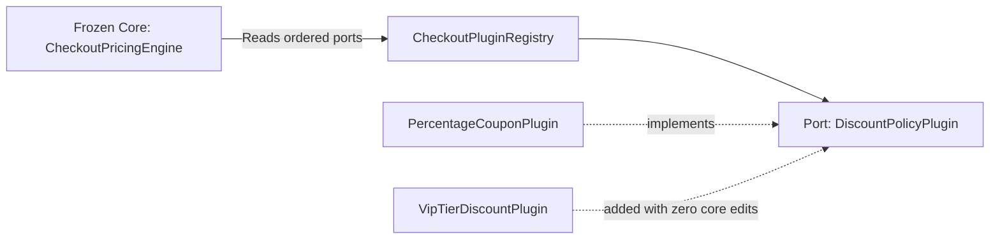

---
tags:
  - software-engineering
  - solid
  - ocp
  - extensibility
  - architecture
created: 2026-01-02
updated: 2026-11-13
status: 🟢
level: mid-to-senior
---

# Open-Closed Principle (OCP)

> [!abstract] Vault Navigation
> Part of [[Programming/Software Engineering/SOLID/SOLID Principles Complete Guide|SOLID Principles Complete Guide]]. Implemented via [[Programming/Software Engineering/Design Patterns/Behavioral/Strategy|Strategy Pattern]], [[Programming/Software Engineering/Design Patterns/Structural Patterns Catalog#Decorator|Decorator]], [[Programming/Software Engineering/Design Patterns/Behavioral/Observer|Observer Pattern]], [[Programming/Software Engineering/SOLID/Dependency Inversion|Dependency Inversion]], and enforced for behavioral safety by [[Programming/Software Engineering/SOLID/Liskov Substitution Principle|Liskov Substitution Principle]].

Coined by Bertrand Meyer (*Object-Oriented Software Construction*, 1988) and reformulated for modular dependency architectures by Robert C. Martin (1996 / *Clean Architecture*, 2017): **"Software entities (classes, modules, functions) should be open for extension, but closed for modification."** You should be able to introduce new behavior across module boundaries by **adding new plugin code**, without editing, recompiling, or risking regressions inside frozen, tested core business policies.

---

## 1. First-Principles Mechanics: Meyer vs Martin & Extension Architecture

### 1.1 Bertrand Meyer's Inheritance OCP (1988) vs Robert C. Martin's Polymorphic OCP (1996)

Although both formulations pursue behavioral stability under evolving requirements, their physical compilation and runtime mechanisms differ fundamentally:

1. **Meyer's Classical Inheritance Formulation (1988)**:
   - Meyer targeted statically compiled libraries distributed as immutable binaries. Once a module passed QA and shipped, its source code could not be edited directly; callers extended behavior by **subclassing (`extends`)** and overriding virtual methods while preserving the base contract.
   - **Structural Weakness (The Fragile Base-Class Problem)**: Implementation inheritance tightly couples every subclass to the superclass's internal execution sequence, `protected` mutable fields, and implicit `super.method()` call ordering. Changing a private caching field or helper call order inside the parent silently breaks subclasses at runtime—meaning the base class is not truly safe to evolve.
2. **Martin's Polymorphic / Dependency-Inversion Formulation (1996 / 2017)**:
   - Martin decoupled the stable **Core Policy** from volatile **Concrete Variants** using explicit abstract interfaces (ports), function contracts, and Composition Root dependency wiring (see [[Programming/Software Engineering/SOLID/Dependency Inversion|Dependency Inversion]]).
   - **Direction of Dependencies**: Core Policy depends *only* on narrow abstract interfaces (`DiscountPolicyPlugin`, `TaxPolicyPlugin`) declared inside the policy's own package. Concrete variants implement those interfaces from outside and are registered into a typed **Plugin Registry** or **DI Container** at startup. Adding a new rule produces **zero git diff** inside the core engine file.



### 1.2 Five Production Extension Mechanisms & Exact Runtime Control Flow

Modern TypeScript, Node.js, and distributed backend stacks realize OCP through five concrete patterns rather than class inheritance:

| Mechanism | Runtime Dispatch Mechanics | Typical Production Use Case | Core Architectural Trade-Off |
| :--- | :--- | :--- | :--- |
| **Strategy / Policy Registry** | Frozen engine iterates or keys a typed `Map<string, Policy>` / prioritized array | Pricing discounts, regional tax engines, payment gateway routing, notification transports | Zero core edits per variant; requires explicit ordering and duplicate-key guards |
| **Decorator Pipeline** | Higher-order wrappers implement same port `T`, delegating inward `next.execute()` | Retry backoff, circuit breakers, OpenTelemetry spans, response caching around HTTP/DB ports | Composes cross-cutting concerns cleanly; deep call stacks complicate step debugging |
| **Middleware Chain (Onion)** | Sequential `preHandler` / `use()` pipeline passing request context + `next()` | Fastify/Express/Hono auth, rate limiting, CORS, body parsing, structured audit logs | Order-sensitive execution; misaligned middleware sequence opens security bypasses |
| **Domain Event Subscribers** | Publisher emits immutable event (`OrderPaid`) to registered decoupled listeners | Loyalty points accrual, ERP invoice sync, CRM webhooks, analytics ingestion | Complete producer/consumer decoupling; demands idempotency & outbox durability |
| **Validated Plugin Registry** | Runtime JSON/tenant rule manifests validated via schema (`zod`) and bound to evaluators | Multi-tenant workflow engines, SaaS shipping brackets, dynamic webhook integrations | Empowers runtime/config extensibility; requires strict schema sandboxing |

### 1.3 The Expression Problem & TypeScript Exhaustiveness

Computer scientist Philip Wadler formalized the **Expression Problem** as a fundamental duality: *can you add both new data variants and new operations over those variants without recompiling existing code?* In single-dispatch OOP and functional TypeScript, two dual designs invert which axis is closed:

1. **Subtype Polymorphism / Plugin Registry (`interface Rule`)**:
   - **Open** to adding new **variants** (`VipTierDiscountPlugin`, `BundleDiscountPlugin`) without modifying existing plugins or the engine.
   - **Closed** against adding a brand-new required method (`explainAuditTrail()`) to the interface—every existing plugin class would have to be edited to implement the new method.
2. **Discriminated Union + Exhaustive `switch` (`type AstNode = Literal | BinaryOp`)**:
   - **Open** to adding new **operations / passes** (`evaluate()`, `optimizeConstants()`, `compileBytecode()`) in independent files without touching existing AST node structures.
   - **Closed** against adding a new variant (`UnaryNegation`) because every exhaustive `switch` across the codebase must handle the new discriminant—enforced at compile time via TypeScript's `never` check:

```typescript
export type PricingEvent =
  | { readonly kind: 'COUPON_APPLIED'; readonly code: string; readonly savedCents: number }
  | { readonly kind: 'TAX_ASSESSED'; readonly jurisdiction: string; readonly taxCents: number }
  | { readonly kind: 'SHIPPING_QUOTED'; readonly carrier: string; readonly rateCents: number };

export function assertNever(value: never): never {
  throw new Error(`Unhandled discriminated union member: ${JSON.stringify(value)}`);
}

export function formatPricingAuditLine(event: PricingEvent): string {
  switch (event.kind) {
    case 'COUPON_APPLIED':
      return `Coupon ${event.code}: -$${(event.savedCents / 100).toFixed(2)}`;
    case 'TAX_ASSESSED':
      return `Tax (${event.jurisdiction}): +$${(event.taxCents / 100).toFixed(2)}`;
    case 'SHIPPING_QUOTED':
      return `Shipping (${event.carrier}): +$${(event.rateCents / 100).toFixed(2)}`;
    default:
      // Compiler error if a new PricingEvent variant is added without handling it here
      return assertNever(event);
  }
}
```

### 1.4 No Module Is Closed Against Every Axis of Change

A foundational theorem of OCP (*Clean Architecture* / Martin 1996): **100% closure against arbitrary change is impossible.** If `CheckoutPricingEngine` is closed against adding new discount rules via `DiscountPolicyPlugin`, it remains open to modification if the fundamental domain model shifts from single-currency integer cents to multi-currency split settlements. You must perform **strategic axis selection**: pay abstraction complexity *only* along volatility vectors proven by domain requirements, regulatory cadence, or multi-team ownership.

---

## 2. Real-World Use Cases, Decision Matrix & The Over-Abstraction Trap

### 2.1 The Over-Abstraction Trap (Rule of Three, AHA & YAGNI)

Mechanical application of OCP creates **Speculative Generality** (see [[Programming/Software Engineering/Clean Code/Code Smells|Code Smells]]). Wrapping a single concrete calculation in `IDateFormatterStrategy`, `DateFormatterStrategyFactory`, and `DateFormatterRegistry` "just in case requirements change next year" incurs permanent costs:
- **Indirection Tax**: IDE "Go to Definition" lands on an interface instead of executable code, forcing developers to trace DI containers or runtime registration loops.
- **Wrong Seam Prediction**: Speculative abstractions almost always guess the wrong parameter signature; when a real second variant finally arrives, it needs additional context fields anyway, forcing you to refactor the speculative interface twice.
- **Rule of Three / AHA (Avoid Hasty Abstractions)**: Keep code concrete and direct on variant #1. When concrete variation #2 arrives along that exact axis (or on immediate product roadmap across tenants/vendors), refactor at that seam to close the core against variants #3, #4, and #N.

### 2.2 Six Concrete Engineering Scenarios

1. **Multi-Tenant Checkout Pricing, Discounts, Tax & Shipping Engine**: Marketing launches promo rules weekly, Finance updates state/VAT tax tables quarterly, and Logistics onboards new carriers monthly. **Adopt OCP immediately** using a typed **Plugin Registry + Multi-Provider DI** so each policy evolves independently without touching checkout totals aggregation.
2. **Cross-Cutting HTTP/RPC Infrastructure (Auth, Tracing, Rate Limiting, Compression)**: Every endpoint needs orthogonal cross-cutting behavior without cluttering business route handlers. **Adopt OCP via Middleware / Decorator Pipelines** (`Fastify` hooks, `NestJS` interceptors/guards).
3. **Multi-Vendor Integrations (Payment PSPs, SMS/Email Transports, Object Storage)**: Integrating Stripe, Adyen, and MercadoPago or S3 and GCS behind a shared domain contract. **Adopt Strategy Port + Registry** keyed by tenant or region.
4. **Internal Fixed-Format Report Exporter with 1 Concrete Output**: An internal CLI tool formats dates as `YYYY-MM-DD` for one compliance export. **DO NOT apply OCP.** Keep a single pure helper function until a genuine second format exists.
5. **Compiler / Workflow Engine with Fixed AST Nodes & Expanding Passes**: An expression evaluator (`Literal`, `Add`, `Multiply`) gains new optimization/serialization passes every sprint. **Use Discriminated Union + `assertNever`**, not polymorphic `Expr.compile()` interfaces.
6. **Post-Transaction Side Effects (Webhooks, CRM Sync, Loyalty Points)**: Checkout completion must trigger downstream notifications added by independent product squads. **Adopt Event Subscribers / Transactional Outbox Consumers** so core checkout stays closed against downstream notification churn.

### 2.3 Decision Matrix

| Engineering Scenario | Axis That Changes | Recommended Pattern | When NOT to Use It |
| :--- | :--- | :--- | :--- |
| **Checkout Discounts, Taxes & Shipping** | New pricing rules & jurisdictions | Typed **Plugin Registry** + Zod validation | Avoid if checkout has 1 flat fee with zero promo plans |
| **HTTP Auth, Metrics, Retries & Caching** | Cross-cutting transport policies | **Decorator / Middleware Chain** | Avoid wrapping trivial pure synchronous utilities |
| **Payment Gateways / Notification Channels** | New third-party vendor SDKs | **Strategy Map** + DI multi-provider | Avoid if locked to 1 vendor permanently |
| **AST Passes / Report Renderers (Fixed Types)** | New operations over stable data shapes | **Discriminated Union + `never` check** | Avoid when third-party teams must add new data shapes dynamically |
| **Order Lifecycle Side Effects** | Independent downstream consumers | **Event Subscriber / Outbox** | Avoid when strict synchronous ACID rollback across steps is required |

---

## 3. Step-by-Step Production Application: Extensible Checkout Pricing Engine

This complete TypeScript/Node production module implements an **Extensible Checkout Discount, Tax & Shipping Engine** supporting:
1. **Frozen Core Engine (`CheckoutPricingEngine`)** that performs zero concrete rule branching (`if/switch` on coupon codes or VIP tiers).
2. **Strict Zod Plugin Config Validation** ensuring dynamically registered JSON manifests or startup plugins cannot inject negative discount rates, invalid country codes, or malformed priorities.
3. **Typed Plugin Registry (`CheckoutPluginRegistry`)** with deterministic priority sorting, exclusive-stacking semantics, and runtime sealing (`seal()`).
4. **NestJS Multi-Provider DI Injection** (`@Inject` tokens collecting plugins automatically) AND **Fastify HTTP Runtime Registration + Quote Endpoints**.
5. **Zero-Modification Extension**: Adding a brand-new `VipTierDiscountPlugin` without editing a single line of `CheckoutPricingEngine` or `CheckoutPluginRegistry`.

### 3.1 Project Directory Structure

```text
src/
└── checkout/
    ├── contracts/
    │   └── pricing.contracts.ts           # Frozen core types & plugin interfaces
    ├── validation/
    │   └── plugin-manifest.schema.ts      # Zod runtime plugin configuration schemas
    ├── engine/
    │   ├── plugin-registry.ts             # Typed registry with priority ordering & seal()
    │   └── checkout-pricing.engine.ts     # Closed core pricing pipeline (0 rule branches)
    ├── plugins/
    │   ├── built-in.plugins.ts            # Coupon %, US State Tax, Flat Weight Shipping
    │   └── vip-tier-discount.plugin.ts    # New VIP Tier extension (0 core edits!)
    ├── nestjs/
    │   ├── checkout.tokens.ts             # Symbol multi-provider DI tokens
    │   └── checkout.module.ts             # NestJS DI wiring collecting multi-providers
    ├── fastify-server.ts                  # Fastify quote API + Zod-validated plugin route
    └── __tests__/
        └── checkout-engine.spec.ts        # Vitest unit, extension & contract tests
```

### 3.2 Frozen Core Contracts (`src/checkout/contracts/pricing.contracts.ts`)

```typescript
// src/checkout/contracts/pricing.contracts.ts
export type CustomerTier = 'STANDARD' | 'GOLD' | 'PLATINUM';

export interface CartLineItem {
  readonly sku: string;
  readonly category: 'PHYSICAL' | 'DIGITAL';
  readonly unitPriceCents: number;
  readonly quantity: number;
  readonly unitWeightGrams: number;
}

export interface ShippingAddress {
  readonly countryCode: string; // ISO-3166-1 alpha-2, e.g., "US"
  readonly stateCode: string;   // e.g., "CA", "NY"
}

export interface CheckoutCart {
  readonly cartId: string;
  readonly currency: 'USD';
  readonly customerTier: CustomerTier;
  readonly promoCodes: ReadonlyArray<string>;
  readonly shippingAddress: ShippingAddress;
  readonly items: ReadonlyArray<CartLineItem>;
}

export interface DiscountAdjustment {
  readonly pluginId: string;
  readonly description: string;
  readonly amountCents: number;
  readonly exclusive: boolean;
}

export interface TaxLine {
  readonly pluginId: string;
  readonly jurisdiction: string;
  readonly amountCents: number;
}

export interface ShippingQuote {
  readonly pluginId: string;
  readonly carrierLabel: string;
  readonly amountCents: number;
}

export interface DiscountEvaluationContext {
  readonly cart: CheckoutCart;
  readonly subtotalCents: number;
  readonly remainingDiscountableCents: number;
}

export interface TaxEvaluationContext {
  readonly cart: CheckoutCart;
  readonly taxableSubtotalCents: number;
}

export interface ShippingEvaluationContext {
  readonly cart: CheckoutCart;
  readonly postDiscountSubtotalCents: number;
  readonly totalPhysicalWeightGrams: number;
}

export interface DiscountPolicyPlugin {
  readonly id: string;
  readonly version: string;
  readonly priority: number; // Lower executes first
  evaluate(ctx: DiscountEvaluationContext): DiscountAdjustment | null;
}

export interface TaxPolicyPlugin {
  readonly id: string;
  readonly version: string;
  readonly priority: number;
  appliesTo(cart: CheckoutCart): boolean;
  evaluate(ctx: TaxEvaluationContext): TaxLine;
}

export interface ShippingRatePlugin {
  readonly id: string;
  readonly version: string;
  readonly priority: number;
  supports(ctx: ShippingEvaluationContext): boolean;
  quote(ctx: ShippingEvaluationContext): ShippingQuote;
}

export interface CheckoutQuote {
  readonly cartId: string;
  readonly subtotalCents: number;
  readonly appliedDiscounts: ReadonlyArray<DiscountAdjustment>;
  readonly totalDiscountCents: number;
  readonly appliedTaxes: ReadonlyArray<TaxLine>;
  readonly totalTaxCents: number;
  readonly selectedShipping: ShippingQuote | null;
  readonly grandTotalCents: number;
}
```

### 3.3 Strict Zod Schema Validation for Dynamic Plugins (`src/checkout/validation/plugin-manifest.schema.ts`)

Before any runtime plugin config (from SaaS tenant databases, Fastify admin endpoints, or JSON feature flags) enters the registry, Zod enforces exact numeric bounds, positive integer cents, and allowlisted rule types—eliminating runtime `NaN`, negative-price exploits, and prototype pollution.

```typescript
// src/checkout/validation/plugin-manifest.schema.ts
import { z } from 'zod';

const SafePluginIdSchema = z
  .string()
  .min(3)
  .max(64)
  .regex(/^[a-z0-9][a-z0-9._-]*$/, 'Plugin ID must use lowercase alphanumeric slug characters');

export const CouponPluginConfigSchema = z.object({
  kind: z.literal('PERCENTAGE_COUPON'),
  id: SafePluginIdSchema,
  version: z.string().regex(/^\d+\.\d+\.\d+$/),
  priority: z.number().int().min(1).max(1_000),
  promoCode: z.string().min(3).max(32).transform((v) => v.trim().toUpperCase()),
  percentOff: z.number().min(0.01).max(90),
  maxDiscountCents: z.number().int().positive().max(10_000_000),
  exclusive: z.boolean().default(false),
});

export const VipTierPluginConfigSchema = z.object({
  kind: z.literal('VIP_TIER_DISCOUNT'),
  id: SafePluginIdSchema,
  version: z.string().regex(/^\d+\.\d+\.\d+$/),
  priority: z.number().int().min(1).max(1_000),
  tierRatesBps: z.object({
    GOLD: z.number().int().min(0).max(5_000),
    PLATINUM: z.number().int().min(0).max(5_000),
  }),
  minSubtotalCents: z.number().int().nonnegative(),
  exclusive: z.boolean().default(false),
});

export const UsStateTaxPluginConfigSchema = z.object({
  kind: z.literal('US_STATE_TAX'),
  id: SafePluginIdSchema,
  version: z.string().regex(/^\d+\.\d+\.\d+$/),
  priority: z.number().int().min(1).max(1_000),
  stateCode: z.string().length(2).transform((v) => v.toUpperCase()),
  rateBps: z.number().int().min(0).max(2_500),
});

export const FlatWeightShippingConfigSchema = z.object({
  kind: z.literal('FLAT_WEIGHT_SHIPPING'),
  id: SafePluginIdSchema,
  version: z.string().regex(/^\d+\.\d+\.\d+$/),
  priority: z.number().int().min(1).max(1_000),
  countryCode: z.string().length(2).transform((v) => v.toUpperCase()),
  carrierLabel: z.string().min(2).max(64),
  baseFeeCents: z.number().int().nonnegative(),
  perKgCents: z.number().int().nonnegative(),
  freeOverSubtotalCents: z.number().int().positive().optional(),
});

export const RuntimePluginManifestSchema = z.discriminatedUnion('kind', [
  CouponPluginConfigSchema,
  VipTierPluginConfigSchema,
  UsStateTaxPluginConfigSchema,
  FlatWeightShippingConfigSchema,
]);

export type CouponPluginConfig = z.infer<typeof CouponPluginConfigSchema>;
export type VipTierPluginConfig = z.infer<typeof VipTierPluginConfigSchema>;
export type UsStateTaxPluginConfig = z.infer<typeof UsStateTaxPluginConfigSchema>;
export type FlatWeightShippingConfig = z.infer<typeof FlatWeightShippingConfigSchema>;
export type RuntimePluginManifest = z.infer<typeof RuntimePluginManifestSchema>;
```

### 3.4 Typed Plugin Registry (`src/checkout/engine/plugin-registry.ts`)

```typescript
// src/checkout/engine/plugin-registry.ts
import type {
  DiscountPolicyPlugin,
  ShippingRatePlugin,
  TaxPolicyPlugin,
} from '../contracts/pricing.contracts';

export class PluginRegistrationError extends Error {
  constructor(message: string) {
    super(message);
    this.name = 'PluginRegistrationError';
  }
}

export class CheckoutPluginRegistry {
  private readonly discountPlugins = new Map<string, DiscountPolicyPlugin>();
  private readonly taxPlugins = new Map<string, TaxPolicyPlugin>();
  private readonly shippingPlugins = new Map<string, ShippingRatePlugin>();
  private sealed = false;

  registerDiscount(plugin: DiscountPolicyPlugin): this {
    this.assertNotSealed();
    if (this.discountPlugins.has(plugin.id)) {
      throw new PluginRegistrationError(`Duplicate discount plugin id: ${plugin.id}`);
    }
    this.discountPlugins.set(plugin.id, plugin);
    return this;
  }

  registerTax(plugin: TaxPolicyPlugin): this {
    this.assertNotSealed();
    if (this.taxPlugins.has(plugin.id)) {
      throw new PluginRegistrationError(`Duplicate tax plugin id: ${plugin.id}`);
    }
    this.taxPlugins.set(plugin.id, plugin);
    return this;
  }

  registerShipping(plugin: ShippingRatePlugin): this {
    this.assertNotSealed();
    if (this.shippingPlugins.has(plugin.id)) {
      throw new PluginRegistrationError(`Duplicate shipping plugin id: ${plugin.id}`);
    }
    this.shippingPlugins.set(plugin.id, plugin);
    return this;
  }

  // Prevents accidental mid-request mutation once application startup completes
  seal(): this {
    this.sealed = true;
    return this;
  }

  isSealed(): boolean {
    return this.sealed;
  }

  getDiscounts(): ReadonlyArray<DiscountPolicyPlugin> {
    return [...this.discountPlugins.values()].sort(
      (a, b) => a.priority - b.priority || a.id.localeCompare(b.id)
    );
  }

  getTaxes(): ReadonlyArray<TaxPolicyPlugin> {
    return [...this.taxPlugins.values()].sort(
      (a, b) => a.priority - b.priority || a.id.localeCompare(b.id)
    );
  }

  getShippingRates(): ReadonlyArray<ShippingRatePlugin> {
    return [...this.shippingPlugins.values()].sort(
      (a, b) => a.priority - b.priority || a.id.localeCompare(b.id)
    );
  }

  listManifestIds(): {
    discounts: string[];
    taxes: string[];
    shipping: string[];
  } {
    return {
      discounts: this.getDiscounts().map((p) => `${p.id}@${p.version}`),
      taxes: this.getTaxes().map((p) => `${p.id}@${p.version}`),
      shipping: this.getShippingRates().map((p) => `${p.id}@${p.version}`),
    };
  }

  private assertNotSealed(): void {
    if (this.sealed) {
      throw new PluginRegistrationError('Cannot register plugins after registry is sealed');
    }
  }
}
```

### 3.5 Frozen Core Pricing Engine (`src/checkout/engine/checkout-pricing.engine.ts`)

Inspect `CheckoutPricingEngine` carefully: it contains **zero** references to coupon names, VIP tiers, US states, or carrier names. It executes a strict four-phase invariant pipeline (Subtotal $\to$ Prioritized Discounts with Exclusive/Floor Clamping $\to$ Taxable Base & Tax Plugins $\to$ Shipping Selection) and never needs modification when new business rules ship.

```typescript
// src/checkout/engine/checkout-pricing.engine.ts
import type {
  CheckoutCart,
  CheckoutQuote,
  DiscountAdjustment,
  ShippingQuote,
  TaxLine,
} from '../contracts/pricing.contracts';
import type { CheckoutPluginRegistry } from './plugin-registry';

export class InvalidCartError extends Error {
  constructor(message: string) {
    super(message);
    this.name = 'InvalidCartError';
  }
}

export class CheckoutPricingEngine {
  constructor(private readonly registry: CheckoutPluginRegistry) {}

  calculateQuote(cart: CheckoutCart): CheckoutQuote {
    this.validateCart(cart);

    const subtotalCents = cart.items.reduce(
      (sum, item) => sum + item.unitPriceCents * item.quantity,
      0
    );

    const appliedDiscounts: DiscountAdjustment[] = [];
    let remainingDiscountableCents = subtotalCents;

    for (const plugin of this.registry.getDiscounts()) {
      if (remainingDiscountableCents <= 0) break;

      const rawAdjustment = plugin.evaluate({
        cart,
        subtotalCents,
        remainingDiscountableCents,
      });

      if (!rawAdjustment || rawAdjustment.amountCents <= 0) continue;

      // Invariant: discount can never exceed remaining cart value (prevents negative totals)
      const clampedAmount = Math.min(rawAdjustment.amountCents, remainingDiscountableCents);
      appliedDiscounts.push({
        ...rawAdjustment,
        amountCents: clampedAmount,
      });
      remainingDiscountableCents -= clampedAmount;

      if (rawAdjustment.exclusive) {
        break;
      }
    }

    const totalDiscountCents = subtotalCents - remainingDiscountableCents;
    const postDiscountSubtotalCents = remainingDiscountableCents;

    const appliedTaxes: TaxLine[] = [];
    for (const taxPlugin of this.registry.getTaxes()) {
      if (!taxPlugin.appliesTo(cart)) continue;
      const line = taxPlugin.evaluate({
        cart,
        taxableSubtotalCents: postDiscountSubtotalCents,
      });
      if (line.amountCents >= 0) {
        appliedTaxes.push(line);
      }
    }

    const totalTaxCents = appliedTaxes.reduce((sum, t) => sum + t.amountCents, 0);

    const totalPhysicalWeightGrams = cart.items.reduce(
      (sum, item) =>
        item.category === 'PHYSICAL' ? sum + item.unitWeightGrams * item.quantity : sum,
      0
    );

    let selectedShipping: ShippingQuote | null = null;
    if (totalPhysicalWeightGrams > 0) {
      const shippingCtx = {
        cart,
        postDiscountSubtotalCents,
        totalPhysicalWeightGrams,
      };
      for (const shippingPlugin of this.registry.getShippingRates()) {
        if (shippingPlugin.supports(shippingCtx)) {
          selectedShipping = shippingPlugin.quote(shippingCtx);
          break;
        }
      }
    }

    const shippingCents = selectedShipping ? selectedShipping.amountCents : 0;
    const grandTotalCents = postDiscountSubtotalCents + totalTaxCents + shippingCents;

    return {
      cartId: cart.cartId,
      subtotalCents,
      appliedDiscounts,
      totalDiscountCents,
      appliedTaxes,
      totalTaxCents,
      selectedShipping,
      grandTotalCents,
    };
  }

  private validateCart(cart: CheckoutCart): void {
    if (!cart.cartId) {
      throw new InvalidCartError('Cart ID is required');
    }
    for (const item of cart.items) {
      if (!Number.isInteger(item.unitPriceCents) || item.unitPriceCents < 0) {
        throw new InvalidCartError(`Invalid unitPriceCents on SKU ${item.sku}`);
      }
      if (!Number.isInteger(item.quantity) || item.quantity <= 0) {
        throw new InvalidCartError(`Invalid quantity on SKU ${item.sku}`);
      }
      if (!Number.isInteger(item.unitWeightGrams) || item.unitWeightGrams < 0) {
        throw new InvalidCartError(`Invalid unitWeightGrams on SKU ${item.sku}`);
      }
    }
  }
}
```

### 3.6 Built-In Concrete Plugins & Factory (`src/checkout/plugins/built-in.plugins.ts`)

```typescript
// src/checkout/plugins/built-in.plugins.ts
import type {
  CheckoutCart,
  DiscountAdjustment,
  DiscountEvaluationContext,
  DiscountPolicyPlugin,
  ShippingEvaluationContext,
  ShippingQuote,
  ShippingRatePlugin,
  TaxEvaluationContext,
  TaxLine,
  TaxPolicyPlugin,
} from '../contracts/pricing.contracts';
import type {
  CouponPluginConfig,
  FlatWeightShippingConfig,
  UsStateTaxPluginConfig,
} from '../validation/plugin-manifest.schema';

export class PercentageCouponPlugin implements DiscountPolicyPlugin {
  readonly id: string;
  readonly version: string;
  readonly priority: number;

  constructor(private readonly config: CouponPluginConfig) {
    this.id = config.id;
    this.version = config.version;
    this.priority = config.priority;
  }

  evaluate(ctx: DiscountEvaluationContext): DiscountAdjustment | null {
    const hasMatchingCode = ctx.cart.promoCodes.some(
      (code) => code.trim().toUpperCase() === this.config.promoCode
    );
    if (!hasMatchingCode) return null;

    const rawDiscount = Math.round(
      (ctx.remainingDiscountableCents * this.config.percentOff) / 100
    );
    const capped = Math.min(rawDiscount, this.config.maxDiscountCents);
    if (capped <= 0) return null;

    return {
      pluginId: this.id,
      description: `Promo ${this.config.promoCode} (${this.config.percentOff}% off)`,
      amountCents: capped,
      exclusive: this.config.exclusive,
    };
  }
}

export class UsStateSalesTaxPlugin implements TaxPolicyPlugin {
  readonly id: string;
  readonly version: string;
  readonly priority: number;

  constructor(private readonly config: UsStateTaxPluginConfig) {
    this.id = config.id;
    this.version = config.version;
    this.priority = config.priority;
  }

  appliesTo(cart: CheckoutCart): boolean {
    return (
      cart.shippingAddress.countryCode.toUpperCase() === 'US' &&
      cart.shippingAddress.stateCode.toUpperCase() === this.config.stateCode
    );
  }

  evaluate(ctx: TaxEvaluationContext): TaxLine {
    const taxCents = Math.round((ctx.taxableSubtotalCents * this.config.rateBps) / 10_000);
    return {
      pluginId: this.id,
      jurisdiction: `US-${this.config.stateCode}`,
      amountCents: taxCents,
    };
  }
}

export class FlatWeightShippingPlugin implements ShippingRatePlugin {
  readonly id: string;
  readonly version: string;
  readonly priority: number;

  constructor(private readonly config: FlatWeightShippingConfig) {
    this.id = config.id;
    this.version = config.version;
    this.priority = config.priority;
  }

  supports(ctx: ShippingEvaluationContext): boolean {
    return ctx.cart.shippingAddress.countryCode.toUpperCase() === this.config.countryCode;
  }

  quote(ctx: ShippingEvaluationContext): ShippingQuote {
    if (
      this.config.freeOverSubtotalCents !== undefined &&
      ctx.postDiscountSubtotalCents >= this.config.freeOverSubtotalCents
    ) {
      return {
        pluginId: this.id,
        carrierLabel: `${this.config.carrierLabel} (Free Threshold)`,
        amountCents: 0,
      };
    }

    const billableKgs = Math.ceil(ctx.totalPhysicalWeightGrams / 1_000);
    const amountCents = this.config.baseFeeCents + billableKgs * this.config.perKgCents;
    return {
      pluginId: this.id,
      carrierLabel: this.config.carrierLabel,
      amountCents,
    };
  }
}
```

### 3.7 Zero-Modification Extension: `VipTierDiscountPlugin` (`src/checkout/plugins/vip-tier-discount.plugin.ts`)

When Product launches a new VIP Loyalty Tier discount (`GOLD` 10%, `PLATINUM` 15% over `$50`), the team writes **only this standalone plugin file** and wires it at the Composition Root—never modifying `CheckoutPricingEngine` or `CheckoutPluginRegistry`.

```typescript
// src/checkout/plugins/vip-tier-discount.plugin.ts
import type {
  DiscountAdjustment,
  DiscountEvaluationContext,
  DiscountPolicyPlugin,
} from '../contracts/pricing.contracts';
import type { VipTierPluginConfig } from '../validation/plugin-manifest.schema';

export class VipTierDiscountPlugin implements DiscountPolicyPlugin {
  readonly id: string;
  readonly version: string;
  readonly priority: number;

  constructor(private readonly config: VipTierPluginConfig) {
    this.id = config.id;
    this.version = config.version;
    this.priority = config.priority;
  }

  evaluate(ctx: DiscountEvaluationContext): DiscountAdjustment | null {
    const tier = ctx.cart.customerTier;
    if (tier === 'STANDARD') return null;
    if (ctx.subtotalCents < this.config.minSubtotalCents) return null;

    const rateBps = this.config.tierRatesBps[tier];
    if (rateBps <= 0) return null;

    const amountCents = Math.round((ctx.remainingDiscountableCents * rateBps) / 10_000);
    if (amountCents <= 0) return null;

    return {
      pluginId: this.id,
      description: `${tier} Loyalty Tier (${(rateBps / 100).toFixed(2)}% off)`,
      amountCents,
      exclusive: this.config.exclusive,
    };
  }
}
```

### 3.8 NestJS Multi-Provider DI Injection (`src/checkout/nestjs/checkout.tokens.ts` & `checkout.module.ts`)

```typescript
// src/checkout/nestjs/checkout.tokens.ts
export const CHECKOUT_PLUGIN_TOKENS = {
  DISCOUNT_PLUGINS: Symbol('CHECKOUT_DISCOUNT_PLUGINS'),
  TAX_PLUGINS: Symbol('CHECKOUT_TAX_PLUGINS'),
  SHIPPING_PLUGINS: Symbol('CHECKOUT_SHIPPING_PLUGINS'),
} as const;
```

```typescript
// src/checkout/nestjs/checkout.module.ts
import { Module } from '@nestjs/common';
import type {
  DiscountPolicyPlugin,
  ShippingRatePlugin,
  TaxPolicyPlugin,
} from '../contracts/pricing.contracts';
import { CheckoutPricingEngine } from '../engine/checkout-pricing.engine';
import { CheckoutPluginRegistry } from '../engine/plugin-registry';
import {
  FlatWeightShippingPlugin,
  PercentageCouponPlugin,
  UsStateSalesTaxPlugin,
} from '../plugins/built-in.plugins';
import { VipTierDiscountPlugin } from '../plugins/vip-tier-discount.plugin';
import {
  CouponPluginConfigSchema,
  FlatWeightShippingConfigSchema,
  UsStateTaxPluginConfigSchema,
  VipTierPluginConfigSchema,
} from '../validation/plugin-manifest.schema';
import { CHECKOUT_PLUGIN_TOKENS } from './checkout.tokens';

@Module({
  providers: [
    {
      provide: CHECKOUT_PLUGIN_TOKENS.DISCOUNT_PLUGINS,
      useFactory: (): ReadonlyArray<DiscountPolicyPlugin> => [
        new VipTierDiscountPlugin(
          VipTierPluginConfigSchema.parse({
            kind: 'VIP_TIER_DISCOUNT',
            id: 'vip-loyalty-tier',
            version: '1.0.0',
            priority: 10,
            tierRatesBps: { GOLD: 1_000, PLATINUM: 1_500 },
            minSubtotalCents: 5_000,
            exclusive: false,
          })
        ),
        new PercentageCouponPlugin(
          CouponPluginConfigSchema.parse({
            kind: 'PERCENTAGE_COUPON',
            id: 'promo-spring20',
            version: '1.0.0',
            priority: 20,
            promoCode: 'SPRING20',
            percentOff: 20,
            maxDiscountCents: 5_000,
            exclusive: false,
          })
        ),
      ],
    },
    {
      provide: CHECKOUT_PLUGIN_TOKENS.TAX_PLUGINS,
      useFactory: (): ReadonlyArray<TaxPolicyPlugin> => [
        new UsStateSalesTaxPlugin(
          UsStateTaxPluginConfigSchema.parse({
            kind: 'US_STATE_TAX',
            id: 'us-ca-sales-tax',
            version: '1.0.0',
            priority: 10,
            stateCode: 'CA',
            rateBps: 825,
          })
        ),
      ],
    },
    {
      provide: CHECKOUT_PLUGIN_TOKENS.SHIPPING_PLUGINS,
      useFactory: (): ReadonlyArray<ShippingRatePlugin> => [
        new FlatWeightShippingPlugin(
          FlatWeightShippingConfigSchema.parse({
            kind: 'FLAT_WEIGHT_SHIPPING',
            id: 'us-ground-parcel',
            version: '1.0.0',
            priority: 10,
            countryCode: 'US',
            carrierLabel: 'UPS Ground',
            baseFeeCents: 699,
            perKgCents: 200,
            freeOverSubtotalCents: 15_000,
          })
        ),
      ],
    },
    {
      provide: CheckoutPluginRegistry,
      inject: [
        CHECKOUT_PLUGIN_TOKENS.DISCOUNT_PLUGINS,
        CHECKOUT_PLUGIN_TOKENS.TAX_PLUGINS,
        CHECKOUT_PLUGIN_TOKENS.SHIPPING_PLUGINS,
      ],
      useFactory: (
        discounts: ReadonlyArray<DiscountPolicyPlugin>,
        taxes: ReadonlyArray<TaxPolicyPlugin>,
        shipping: ReadonlyArray<ShippingRatePlugin>
      ) => {
        const registry = new CheckoutPluginRegistry();
        for (const d of discounts) registry.registerDiscount(d);
        for (const t of taxes) registry.registerTax(t);
        for (const s of shipping) registry.registerShipping(s);
        return registry.seal();
      },
    },
    {
      provide: CheckoutPricingEngine,
      inject: [CheckoutPluginRegistry],
      useFactory: (registry: CheckoutPluginRegistry) => new CheckoutPricingEngine(registry),
    },
  ],
  exports: [CheckoutPricingEngine, CheckoutPluginRegistry],
})
export class CheckoutModule {}
```

### 3.9 Fastify Runtime Registration & Quote API (`src/checkout/fastify-server.ts`)

```typescript
// src/checkout/fastify-server.ts
import Fastify, { type FastifyInstance } from 'fastify';
import { z } from 'zod';
import { CheckoutPricingEngine, InvalidCartError } from './engine/checkout-pricing.engine';
import { CheckoutPluginRegistry, PluginRegistrationError } from './engine/plugin-registry';
import {
  FlatWeightShippingPlugin,
  PercentageCouponPlugin,
  UsStateSalesTaxPlugin,
} from './plugins/built-in.plugins';
import { VipTierDiscountPlugin } from './plugins/vip-tier-discount.plugin';
import {
  RuntimePluginManifestSchema,
  type RuntimePluginManifest,
} from './validation/plugin-manifest.schema';

const CheckoutQuoteRequestSchema = z.object({
  cartId: z.string().min(1),
  currency: z.literal('USD'),
  customerTier: z.enum(['STANDARD', 'GOLD', 'PLATINUM']),
  promoCodes: z.array(z.string()).max(5),
  shippingAddress: z.object({
    countryCode: z.string().length(2),
    stateCode: z.string().min(2).max(3),
  }),
  items: z
    .array(
      z.object({
        sku: z.string().min(1),
        category: z.enum(['PHYSICAL', 'DIGITAL']),
        unitPriceCents: z.number().int().nonnegative(),
        quantity: z.number().int().positive(),
        unitWeightGrams: z.number().int().nonnegative(),
      })
    )
    .min(1),
});

export function registerManifestPlugin(
  registry: CheckoutPluginRegistry,
  manifest: RuntimePluginManifest
): void {
  switch (manifest.kind) {
    case 'PERCENTAGE_COUPON':
      registry.registerDiscount(new PercentageCouponPlugin(manifest));
      break;
    case 'VIP_TIER_DISCOUNT':
      registry.registerDiscount(new VipTierDiscountPlugin(manifest));
      break;
    case 'US_STATE_TAX':
      registry.registerTax(new UsStateSalesTaxPlugin(manifest));
      break;
    case 'FLAT_WEIGHT_SHIPPING':
      registry.registerShipping(new FlatWeightShippingPlugin(manifest));
      break;
  }
}

export function buildCheckoutFastifyApp(
  initialManifests: ReadonlyArray<unknown>
): FastifyInstance {
  const app = Fastify({ logger: false });
  const registry = new CheckoutPluginRegistry();

  for (const rawManifest of initialManifests) {
    const validated = RuntimePluginManifestSchema.parse(rawManifest);
    registerManifestPlugin(registry, validated);
  }
  registry.seal();

  const engine = new CheckoutPricingEngine(registry);

  app.get('/v1/checkout/plugins', async () => registry.listManifestIds());

  app.post('/v1/checkout/quote', async (req, reply) => {
    const parsed = CheckoutQuoteRequestSchema.safeParse(req.body);
    if (!parsed.success) {
      return reply.status(400).send({ error: 'VALIDATION_ERROR', issues: parsed.error.issues });
    }
    try {
      const quote = engine.calculateQuote(parsed.data);
      return reply.status(200).send(quote);
    } catch (err: unknown) {
      if (err instanceof InvalidCartError) {
        return reply.status(400).send({ error: 'INVALID_CART', message: err.message });
      }
      if (err instanceof PluginRegistrationError) {
        return reply.status(409).send({ error: 'PLUGIN_CONFLICT', message: err.message });
      }
      throw err;
    }
  });

  return app;
}
```

### 3.10 Vitest Unit, Extension & Plugin Contract Tests (`src/checkout/__tests__/checkout-engine.spec.ts`)

```typescript
// src/checkout/__tests__/checkout-engine.spec.ts
import { describe, expect, it } from 'vitest';
import type { CheckoutCart, DiscountPolicyPlugin } from '../contracts/pricing.contracts';
import { CheckoutPricingEngine } from '../engine/checkout-pricing.engine';
import { CheckoutPluginRegistry, PluginRegistrationError } from '../engine/plugin-registry';
import { buildCheckoutFastifyApp } from '../fastify-server';
import {
  FlatWeightShippingPlugin,
  PercentageCouponPlugin,
  UsStateSalesTaxPlugin,
} from '../plugins/built-in.plugins';
import { VipTierDiscountPlugin } from '../plugins/vip-tier-discount.plugin';
import {
  CouponPluginConfigSchema,
  FlatWeightShippingConfigSchema,
  RuntimePluginManifestSchema,
  UsStateTaxPluginConfigSchema,
  VipTierPluginConfigSchema,
} from '../validation/plugin-manifest.schema';

function createBaseCart(overrides: Partial<CheckoutCart> = {}): CheckoutCart {
  return {
    cartId: 'cart_100',
    currency: 'USD',
    customerTier: 'STANDARD',
    promoCodes: [],
    shippingAddress: { countryCode: 'US', stateCode: 'CA' },
    items: [
      {
        sku: 'KB-MECH-01',
        category: 'PHYSICAL',
        unitPriceCents: 10_000, // $100.00
        quantity: 2,            // $200.00 subtotal
        unitWeightGrams: 1_200, // 2,400g total -> 3 billable kg
      },
    ],
    ...overrides,
  };
}

describe('Extensible Checkout Engine (OCP)', () => {
  it('stacks VIP Tier + Promo Coupon + CA Tax + Free Shipping threshold deterministically', () => {
    const registry = new CheckoutPluginRegistry()
      .registerDiscount(
        new VipTierDiscountPlugin(
          VipTierPluginConfigSchema.parse({
            kind: 'VIP_TIER_DISCOUNT',
            id: 'vip-loyalty',
            version: '1.0.0',
            priority: 10,
            tierRatesBps: { GOLD: 1_000, PLATINUM: 1_500 },
            minSubtotalCents: 5_000,
            exclusive: false,
          })
        )
      )
      .registerDiscount(
        new PercentageCouponPlugin(
          CouponPluginConfigSchema.parse({
            kind: 'PERCENTAGE_COUPON',
            id: 'promo-spring20',
            version: '1.0.0',
            priority: 20,
            promoCode: 'SPRING20',
            percentOff: 20,
            maxDiscountCents: 5_000,
            exclusive: false,
          })
        )
      )
      .registerTax(
        new UsStateSalesTaxPlugin(
          UsStateTaxPluginConfigSchema.parse({
            kind: 'US_STATE_TAX',
            id: 'tax-us-ca',
            version: '1.0.0',
            priority: 10,
            stateCode: 'CA',
            rateBps: 825,
          })
        )
      )
      .registerShipping(
        new FlatWeightShippingPlugin(
          FlatWeightShippingConfigSchema.parse({
            kind: 'FLAT_WEIGHT_SHIPPING',
            id: 'ship-us-ground',
            version: '1.0.0',
            priority: 10,
            countryCode: 'US',
            carrierLabel: 'UPS Ground',
            baseFeeCents: 699,
            perKgCents: 200,
            freeOverSubtotalCents: 15_000,
          })
        )
      )
      .seal();

    const engine = new CheckoutPricingEngine(registry);
    const quote = engine.calculateQuote(
      createBaseCart({ customerTier: 'PLATINUM', promoCodes: ['SPRING20'] })
    );

    // Subtotal: 20,000c
    // Priority 10 VIP PLATINUM (15% of 20,000) = 3,000c -> remaining 17,000c
    // Priority 20 SPRING20 (20% of 17,000) = 3,400c -> remaining 13,600c
    // CA Tax (8.25% of 13,600) = round(1122) = 1,122c
    // Post-discount 13,600 < 15,000 free threshold -> 699 + 3 * 200 = 1,299c shipping
    expect(quote.subtotalCents).toBe(20_000);
    expect(quote.totalDiscountCents).toBe(6_400);
    expect(quote.totalTaxCents).toBe(1_122);
    expect(quote.selectedShipping?.amountCents).toBe(1_299);
    expect(quote.grandTotalCents).toBe(16_021);
  });

  it('rejects malformed dynamic plugin manifests via Zod before registration', () => {
    expect(() =>
      RuntimePluginManifestSchema.parse({
        kind: 'PERCENTAGE_COUPON',
        id: '../hack',
        version: '1.0.0',
        priority: -5,
        promoCode: 'FREE',
        percentOff: 250,
        maxDiscountCents: -100,
      })
    ).toThrow();
  });

  it('clamps extreme discount plugins so grand total never drops below zero', () => {
    const roguePromo: DiscountPolicyPlugin = {
      id: 'mega-promo',
      version: '1.0.0',
      priority: 1,
      evaluate: () => ({
        pluginId: 'mega-promo',
        description: 'Flat $999 off',
        amountCents: 99_900,
        exclusive: true,
      }),
    };

    const registry = new CheckoutPluginRegistry().registerDiscount(roguePromo).seal();
    const engine = new CheckoutPricingEngine(registry);
    const quote = engine.calculateQuote(createBaseCart());

    expect(quote.totalDiscountCents).toBe(20_000);
    expect(quote.grandTotalCents).toBe(0);
  });

  it('prevents duplicate IDs and blocks late mutations once sealed', () => {
    const plugin: DiscountPolicyPlugin = {
      id: 'dup-check',
      version: '1.0.0',
      priority: 1,
      evaluate: () => null,
    };

    const registry = new CheckoutPluginRegistry().registerDiscount(plugin);
    expect(() => registry.registerDiscount(plugin)).toThrow(PluginRegistrationError);

    registry.seal();
    expect(() =>
      registry.registerDiscount({ ...plugin, id: 'late-plugin' })
    ).toThrow(PluginRegistrationError);
  });

  it('serves runtime-validated plugins cleanly over Fastify HTTP inject', async () => {
    const app = buildCheckoutFastifyApp([
      {
        kind: 'VIP_TIER_DISCOUNT',
        id: 'vip-tier-fast',
        version: '1.0.0',
        priority: 10,
        tierRatesBps: { GOLD: 1_000, PLATINUM: 1_500 },
        minSubtotalCents: 1_000,
      },
    ]);

    const res = await app.inject({
      method: 'POST',
      url: '/v1/checkout/quote',
      payload: createBaseCart({ customerTier: 'GOLD' }),
    });

    expect(res.statusCode).toBe(200);
    const body = res.json();
    expect(body.totalDiscountCents).toBe(2_000);
    expect(body.grandTotalCents).toBe(18_000);
    await app.close();
  });
});
```

---

## 4. Complete Construct Reference & Subtle Production Edge Cases

### 4.1 Plugin Ordering, Commutativity & Stacking Traps

Discounts and surcharges are **non-commutative** arithmetic operators: applying a `$20` fixed coupon *before* a `10%` VIP discount produces a different charge than applying `10%` *before* `$20`. If a `Map` iterates in insertion order rather than deterministic priority order, adding or refactoring module imports in NestJS silently changes customer invoices! Always enforce explicit `priority` integers with tie-breakers (`a.id.localeCompare(b.id)`) and explicit `exclusive` short-circuiting.

### 4.2 Middleware & Decorator Pipeline Ordering Bugs

In HTTP middleware and decorator pipelines, OCP closure breaks when execution order assumes hidden preconditions:
- **Rate Limiter vs JWT Authentication**: Placing `rateLimitMiddleware` *after* `jwtVerifyMiddleware` allows unauthenticated DDoS floods to exhaust CPU verifying invalid RSA/ECDSA signatures. Placing `rateLimitByIp` *before* auth and `rateLimitByTenant` *after* auth isolates both vectors cleanly.
- **Caching Decorator vs Tenant Isolation**: Wrapping a `ProductCatalogPort` with `CachingDecorator` outside `TenantScopeDecorator` without encoding `tenantId` inside the cache key causes cross-tenant cache poisoning.

### 4.3 Security Risks of Dynamic Plugin Loading

True dynamic loading (`import(userSuppliedPath)` or `vm.runInNewContext`) violates sandbox boundaries and opens Remote Code Execution (RCE). For multi-tenant SaaS extensibility:
- **Config-Driven Typed AST / Manifests**: Store declarative JSON configurations validated strictly by `zod` against registered safe evaluator classes (`RuntimePluginManifestSchema`), never raw JavaScript callbacks.
- **Out-of-Process Webhooks / Wasm**: If customers must write arbitrary logic, isolate execution across signed HTTP webhooks with HMAC-SHA256 verification and strict timeouts, or Wasm isolates—keeping the core Node process completely closed to untrusted code.

### 4.4 NestJS DI Multi-Provider Pitfalls

When splitting plugins across feature modules in NestJS (see [[Programming/Backend/NestJS Complete Guide|NestJS Complete Guide]]):
- **Token Collision**: Exporting providers with identical string tokens overwrites earlier registrations silently. Always define unique `Symbol` keys (`CHECKOUT_PLUGIN_TOKENS`) or use `@nestjs/core` `DiscoveryService` + custom `@CheckoutRule()` metadata decorators to collect plugins across imported modules cleanly without circular `forwardRef()`.

---

## 5. Production Debugging, Profiling & Operations Playbook

### 5.1 Detecting OCP Erosion Before It Ships

```bash
# 1. Spot files modified repeatedly alongside unrelated feature branches (OCP violation indicator)
git log --since="180 days ago" --name-only --pretty=format:"" \
  | grep -E '(pricing|checkout|notification|router).*\.ts$' \
  | sort | uniq -c | sort -rn

# 2. Scan for growing switch/if-else chains via ESLint complexity metrics
npx eslint src/ --rule 'complexity: ["warn", 10]'

# 3. Verify zero circular dependencies between core engine and concrete plugin directories
npx madge --circular --extensions ts src/checkout/
```

### 5.2 Runtime Profiling & Incident Triage

Because OCP moves behavior out of a central function into registered plugins or middleware chains, production latency spikes or missing discounts often stem from **plugin registration drift** or **one slow plugin in the chain**:
- **OpenTelemetry Per-Plugin Spans**: Wrap plugin evaluation inside the core loop with an explicit `plugin.id` span attribute (`checkout.plugin.id`, `checkout.plugin.duration_ms`) so Flamegraphs isolate slow or throwing extensions immediately without instrumenting individual plugins.
- **Startup Manifest Endpoint**: Expose registered plugin IDs + semantic versions (`registry.listManifestIds()`) in `/health/plugins` or structured startup logs to catch missing DI bindings or environment-specific config mismatches immediately after deployment.

| Production Symptom | Underlying OCP Root Cause | Diagnostic Signal | Remediation |
| :--- | :--- | :--- | :--- |
| **Customer invoice varies across pods** | `Map` iteration depends on module import order | Different `appliedDiscounts` order in logs | Sort registry deterministically by `(priority, id)` |
| **Every new promo code breaks unrelated checkout tests** | Core engine uses monolithic `switch` instead of plugins | Core file touched on every feature PR | Extract `DiscountPolicyPlugin` interface + registry |
| **Startup crash with duplicate key or late registration** | Plugin registered twice or after `seal()` | `PluginRegistrationError` stack trace | Centralize composition in NestJS `CheckoutModule` |
| **High P99 latency in middleware/hook pipeline** | Synchronous external call inside one registered plugin | OTel span shows 1 plugin taking 95% of loop time | Add `AbortSignal.timeout` or move side effect to async event subscriber |
| **Compiler misses new variant in pure pass** | Plain `if/else` chain without `never` check | Silent `undefined` return on new union variant | Add `assertNever(event)` in `switch` default branch |

---

## 6. Worked Exercises

### Exercise 1: Refactoring a Fragile Multi-Channel `NotificationService`

Refactor `NotificationService` below using a typed Transport Registry AND a Decorator adding exponential retry without modifying `NotificationService` itself:

```typescript
class NotificationService {
  async notify(channel: string, recipient: string, body: string): Promise<void> {
    if (channel === 'email') {
      await smtp.sendMail({ to: recipient, text: body });
    } else if (channel === 'sms') {
      await twilio.messages.create({ to: recipient, body });
    } else if (channel === 'push') {
      await fcm.send({ token: recipient, notification: { body } });
    } else {
      throw new Error(`Unsupported channel ${channel}`);
    }
  }
}
```

### Solution 1

```typescript
export interface NotificationTransport {
  send(recipient: string, body: string): Promise<void>;
}

export class UnsupportedChannelError extends Error {
  constructor(channel: string) {
    super(`Unsupported notification channel: ${channel}`);
    this.name = 'UnsupportedChannelError';
  }
}

// Closed core service: never modified when Slack, PagerDuty, or WhatsApp launch
export class NotificationService {
  constructor(private readonly transports: ReadonlyMap<string, NotificationTransport>) {}

  async notify(channel: string, recipient: string, body: string): Promise<void> {
    const transport = this.transports.get(channel);
    if (!transport) throw new UnsupportedChannelError(channel);
    await transport.send(recipient, body);
  }
}

// Decorator extending reliability behavior without editing concrete transports or core service
export class RetryingNotificationTransport implements NotificationTransport {
  constructor(
    private readonly inner: NotificationTransport,
    private readonly maxAttempts = 3
  ) {}

  async send(recipient: string, body: string): Promise<void> {
    let lastError: unknown;
    for (let attempt = 1; attempt <= this.maxAttempts; attempt++) {
      try {
        await this.inner.send(recipient, body);
        return;
      } catch (err: unknown) {
        lastError = err;
      }
    }
    throw lastError;
  }
}

export class SlackWebhookTransport implements NotificationTransport {
  constructor(private readonly webhookUrl: string) {}
  async send(channelId: string, body: string): Promise<void> {
    const res = await fetch(this.webhookUrl, {
      method: 'POST',
      headers: { 'Content-Type': 'application/json' },
      signal: AbortSignal.timeout(3_000),
      body: JSON.stringify({ channel: channelId, text: body }),
    });
    if (!res.ok) throw new Error(`Slack error ${res.status}`);
  }
}
```

---

### Exercise 2: Diagnosing Speculative Over-Engineering

An internal CLI batch script exports database rows to CSV using one fixed ISO date format (`YYYY-MM-DD`). An engineer proposes `IDateFormatterStrategy`, `IsoDateFormatterStrategy`, `DateFormatterFactory`, and `DateFormatterRegistry` *"so we are OCP-compliant if European formats ever arrive."* Should you approve this PR?

### Solution 2

**Reject as Speculative Generality (Violates AHA / YAGNI).**
- Only one concrete behavior exists today and there is zero scheduled requirement for runtime polymorphic date formatting.
- Introducing 4 files/abstractions for a 1-line `date.toISOString().slice(0, 10)` utility imposes permanent cognitive and wiring overhead without isolating any actual volatility.
- Wrap the formatting in a single pure function `formatExportDate(date: Date): string`; if a second format (`DD/MM/YYYY`) genuinely lands on the roadmap later, extract the seam then with full knowledge of the real signature needed.

---

### Exercise 3: Expression Problem Decision — Compiler Passes vs OOP Polymorphism

You maintain an expression AST (`Literal`, `Add`, `Multiply`) whose node types have remained unchanged for 3 years. Every sprint, the compiler team ships new passes (`evaluate()`, `prettyPrint()`, `foldConstants()`, `emitBytecode()`). Implement the first two passes using the correct OCP-aligned paradigm and explain why classical OOP interfaces are the wrong choice here.

### Solution 3

Use a **Discriminated Union + Exhaustive `never` Check**:
- Here, **operations** multiply while **node variants** are frozen.
- Classical OOP classes (`interface Expr { evaluate(): number; prettyPrint(): string; ... }`) force editing every AST class every sprint when a new pass arrives.
- With a discriminated union, each new pass resides in its own standalone file (`evaluate.ts`, `prettyPrint.ts`) with zero edits to existing AST definitions or existing passes.

```typescript
export type Expr =
  | { readonly kind: 'LITERAL'; readonly value: number }
  | { readonly kind: 'ADD'; readonly left: Expr; readonly right: Expr }
  | { readonly kind: 'MULTIPLY'; readonly left: Expr; readonly right: Expr };

function failExhaustive(node: never): never {
  throw new Error(`Unexpected AST node: ${JSON.stringify(node)}`);
}

export function evaluateExpr(expr: Expr): number {
  switch (expr.kind) {
    case 'LITERAL':
      return expr.value;
    case 'ADD':
      return evaluateExpr(expr.left) + evaluateExpr(expr.right);
    case 'MULTIPLY':
      return evaluateExpr(expr.left) * evaluateExpr(expr.right);
    default:
      return failExhaustive(expr);
  }
}

export function prettyPrintExpr(expr: Expr): string {
  switch (expr.kind) {
    case 'LITERAL':
      return String(expr.value);
    case 'ADD':
      return `(${prettyPrintExpr(expr.left)} + ${prettyPrintExpr(expr.right)})`;
    case 'MULTIPLY':
      return `(${prettyPrintExpr(expr.left)} * ${prettyPrintExpr(expr.right)})`;
    default:
      return failExhaustive(expr);
  }
}
```

---

### Exercise 4: Fixing a Non-Commutative Ordering Bug in an OCP Pipeline

A legacy pricing pipeline iterates an unsorted `Rule[]` array (`PercentOff`, `FlatCredit`, `SalesTax`). When someone reordered plugin registrations in `app.module.ts`, `SalesTax` executed *before* `FlatCredit`, overcharging customers tax on discounted amounts! Refactor the contract using **explicit execution phases** so registration order in DI can never distort financial precedence.

### Solution 4

Separate plugin capabilities into **explicit phase interfaces** (or tag plugins with strict `phase` enum + `priority` sort) rather than dumping heterogeneous concerns into one undifferentiated `Rule[]` bag:

```typescript
export interface PricingAccumulator {
  readonly subtotalCents: number;
  readonly discountCents: number;
  readonly taxCents: number;
}

export interface PhaseRule {
  readonly id: string;
  readonly phase: 'DISCOUNT' | 'TAX';
  readonly priority: number;
  apply(acc: PricingAccumulator): PricingAccumulator;
}

const PHASE_RANK: Record<PhaseRule['phase'], number> = {
  DISCOUNT: 1,
  TAX: 2,
};

export function runPhasedPricing(
  subtotalCents: number,
  rules: ReadonlyArray<PhaseRule>
): PricingAccumulator {
  // Deterministic phase-first ordering completely eliminates DI insertion-order bugs
  const ordered = [...rules].sort(
    (a, b) =>
      PHASE_RANK[a.phase] - PHASE_RANK[b.phase] ||
      a.priority - b.priority ||
      a.id.localeCompare(b.id)
  );

  let state: PricingAccumulator = { subtotalCents, discountCents: 0, taxCents: 0 };
  for (const rule of ordered) {
    state = rule.apply(state);
  }
  return state;
}
```

---

### Exercise 5: Converting a Monolithic Middleware Function into an OCP Chain

Refactor this tightly coupled request guard function so adding `IpAllowlistHook` or `AuditLogHook` requires zero edits to the core execution loop:

```typescript
async function handleRequest(req: HttpRequest): Promise<HttpResponse> {
  if (!req.headers['x-api-key']) return { status: 401, body: 'Unauthorized' };
  if (req.ipBlocked) return { status: 403, body: 'Forbidden' };
  return { status: 200, body: `OK:${req.path}` };
}
```

### Solution 5

Implement a **Middleware / Chain-of-Responsibility Pipeline** where the core pipeline runner composes ordered `HttpMiddleware` functions around the terminal handler:

```typescript
export interface HttpRequest {
  readonly path: string;
  readonly headers: Readonly<Record<string, string | undefined>>;
  readonly clientIp: string;
}

export interface HttpResponse {
  readonly status: number;
  readonly body: string;
}

export type NextHandler = (req: HttpRequest) => Promise<HttpResponse>;
export type HttpMiddleware = (req: HttpRequest, next: NextHandler) => Promise<HttpResponse>;

export function composeMiddlewarePipeline(
  middlewares: ReadonlyArray<HttpMiddleware>,
  terminal: NextHandler
): NextHandler {
  return middlewares.reduceRight<NextHandler>(
    (next, mw) => (req) => mw(req, next),
    terminal
  );
}

export const apiKeyMiddleware: HttpMiddleware = async (req, next) => {
  if (!req.headers['x-api-key']) return { status: 401, body: 'Unauthorized' };
  return next(req);
};

export const createIpAllowlistMiddleware = (allowedIps: ReadonlySet<string>): HttpMiddleware =>
  async (req, next) => {
    if (!allowedIps.has(req.clientIp)) return { status: 403, body: 'Forbidden' };
    return next(req);
  };
```

---

### Exercise 6: Designing an Extensible Webhook Signature Verifier Registry

A billing platform processes inbound webhooks from Stripe, GitHub, and Shopify—each using completely different HMAC signature headers and tolerance rules. Design an OCP-compliant `WebhookDispatcher` where onboarding a fourth vendor (`Linear`) adds only one new class and one Composition Root registration.

### Solution 6

```typescript
import { createHmac, timingSafeEqual } from 'node:crypto';

export interface InboundWebhookRequest {
  readonly provider: string;
  readonly rawBody: Buffer;
  readonly headers: Readonly<Record<string, string | undefined>>;
}

export interface WebhookSignatureVerifier {
  readonly provider: string;
  verify(req: InboundWebhookRequest): boolean;
}

export class WebhookVerificationError extends Error {
  constructor(provider: string) {
    super(`Invalid webhook signature for provider ${provider}`);
    this.name = 'WebhookVerificationError';
  }
}

// Closed dispatcher: zero provider-specific crypto branches
export class WebhookDispatcher {
  private readonly verifiers = new Map<string, WebhookSignatureVerifier>();

  constructor(verifiers: ReadonlyArray<WebhookSignatureVerifier>) {
    for (const v of verifiers) {
      if (this.verifiers.has(v.provider)) {
        throw new Error(`Duplicate webhook verifier: ${v.provider}`);
      }
      this.verifiers.set(v.provider, v);
    }
  }

  dispatch(req: InboundWebhookRequest): { accepted: true; provider: string } {
    const verifier = this.verifiers.get(req.provider);
    if (!verifier) {
      throw new Error(`Unsupported webhook provider: ${req.provider}`);
    }
    if (!verifier.verify(req)) {
      throw new WebhookVerificationError(req.provider);
    }
    return { accepted: true, provider: req.provider };
  }
}

// New extension added without editing WebhookDispatcher
export class LinearWebhookVerifier implements WebhookSignatureVerifier {
  readonly provider = 'linear';

  constructor(private readonly signingSecret: string) {}

  verify(req: InboundWebhookRequest): boolean {
    const signatureHex = req.headers['linear-signature'];
    if (!signatureHex) return false;
    const expectedHex = createHmac('sha256', this.signingSecret)
      .update(req.rawBody)
      .digest('hex');
    const a = Buffer.from(signatureHex, 'hex');
    const b = Buffer.from(expectedHex, 'hex');
    return a.length === b.length && timingSafeEqual(a, b);
  }
}
```

---

← [[Programming/Software Engineering/SOLID/SOLID Principles Complete Guide|Back to SOLID]]
