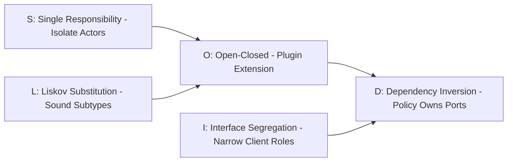

---
tags:
  - software-engineering
  - solid
  - dashboard
created: 2026-01-02
updated: 2026-11-13
status: 🟢
level: mid-to-senior
---
# SOLID Principles Complete Guide

> [!abstract] Vault Navigation
> Architectural design principles hub within [[Programming/Software Engineering/Software Engineering Roadmap|Software Engineering Roadmap]]. Bridges [[Programming/Software Engineering/Clean Code/Clean Code Complete Guide|Clean Code Complete Guide]], [[Programming/Software Engineering/Design Patterns/Design Patterns Complete Guide|Design Patterns Complete Guide]], and [[Programming/Software Engineering/Clean Architecture/Clean Architecture Complete Guide|Clean Architecture Complete Guide]].

SOLID is a set of five cohesive object-oriented and modular design heuristics formulated by Robert C. Martin (with foundational contributions from Barbara Liskov and Bertrand Meyer) to keep software **tolerant to change**, **independently testable**, and **decoupled along volatility boundaries**.

---

## The Five Principles

| Letter | Principle | Core Engineering Rule | Primary Failure Mode Prevented | Status |
|---|---|---|---|---|
| **S** | [[Programming/Software Engineering/SOLID/Single Responsibility\|Single Responsibility]] | One module = one **actor** (stakeholder axis of change) | Cross-team merge conflicts and unintended regressions across unrelated features | 🟢 |
| **O** | [[Programming/Software Engineering/SOLID/Open-Closed Principle\|Open-Closed Principle]] | Extend behavior via new plugins/strategies rather than editing stable policy | Fragile monolithic `switch`/`if` chains growing with every new variant | 🟢 |
| **L** | [[Programming/Software Engineering/SOLID/Liskov Substitution Principle\|Liskov Substitution Principle]] | Subtypes preserve contracts (pre/postconditions, invariants, exceptions) | Runtime crashes, `instanceof` guards, and silent contract violations under polymorphism | 🟢 |
| **I** | [[Programming/Software Engineering/SOLID/Interface Segregation Principle\|Interface Segregation Principle]] | Split fat interfaces into consumer-specific role ports | Recompilation cascades, mock bloat, and stubbed `NotImplementedError` methods | 🟢 |
| **D** | [[Programming/Software Engineering/SOLID/Dependency Inversion\|Dependency Inversion]] | High-level policy owns abstract ports; low-level adapters implement them | Domain logic tightly coupled to SQL drivers, vendor SDKs, and untestable globals | 🟢 |

---

## How the Principles Reinforce One Another

1. **SRP + ISP**: SRP separates modules by **who requests changes** (actors); ISP separates interfaces by **what each consumer calls**. Together they prevent one actor's requirement change from forcing unrelated callers to recompile or update mocks.
2. **OCP + DIP + LSP**: OCP demands stable policy modules extensible via abstractions; DIP ensures those abstractions are owned by the policy layer and implemented inward; LSP guarantees every concrete plugin honors the behavioral contract expected by the policy.

---

## Critical Mid-to-Senior Guardrail: Over-Abstraction Hazard

Applying SOLID mechanically without measuring real change volatility creates **speculative over-engineering**:

| Misapplication | Symptom | Engineering Reality |
|---|---|---|
| **Hyper-Fragmented SRP** | 1-method micro-classes (`UserEmailValidator`, `UserNameValidator`) for a single cohesive actor | Increases indirection and Shotgun Surgery without reducing coupling |
| **Speculative OCP** | `AbstractStrategyFactoryBuilder` wrapped around logic that has 1 implementation and no roadmap variants | Pays permanent abstraction tax; wait for **concrete variation** (Rule of Three / AHA) |
| **Dogmatic DIP** | Interfaces wrapping trivial, stable standard-library utilities (`IMathHelper`, `IStringFormatter`) | Adds boilerplate without decoupling any volatile boundary |
| **Over-Segregated ISP** | Splitting 3 tightly coupled methods used by the same consumer into 3 single-method interfaces | Forces awkward intersection types (`A & B & C`) everywhere |

> [!tip] Where SOLID Matters Most
> Apply strict SOLID boundaries at **architectural seams** (domain policy vs database, external payment/email APIs, plugin extension points, multi-team module boundaries). Keep internal pure domain helpers simple until variation actually arrives.

---

## Related Notes

- [[Programming/Software Engineering/Clean Architecture/Dependency Rule|Dependency Rule]]
- [[Programming/Software Engineering/Architectural Patterns/Hexagonal Architecture|Hexagonal Architecture]]
- [[Programming/Software Engineering/Refactoring/Refactoring Complete Guide|Refactoring Complete Guide]]
- [[Programming/Software Engineering/Design Patterns/Design Patterns Complete Guide|Design Patterns Complete Guide]]
- [[Programming/Software Engineering/Testing/TDD|TDD]]

---

← [[Programming/Software Engineering/Software Engineering Roadmap|Back to Software Engineering]]
