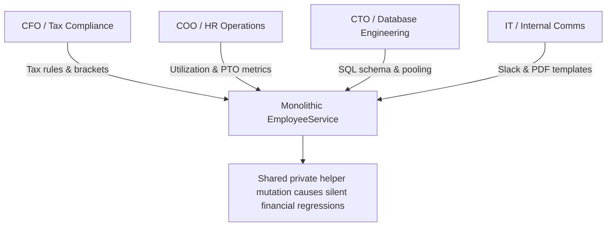
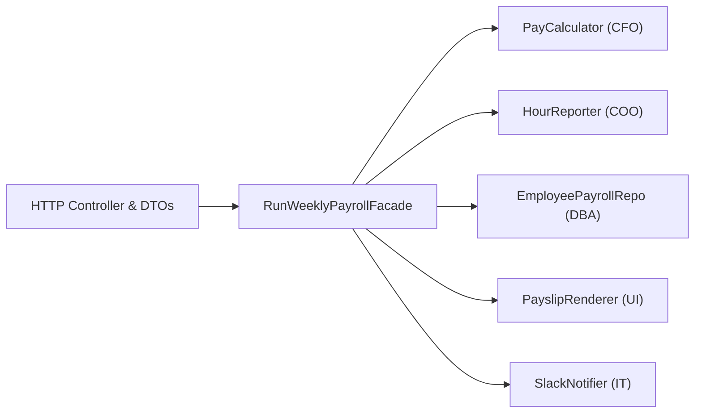

---
tags:
  - software-engineering
  - solid
  - srp
  - cohesion
  - architecture
created: 2026-01-02
updated: 2026-11-13
status: 🟢
level: mid-to-senior
---

# Single Responsibility Principle (SRP)

> [!abstract] Vault Navigation
> Part of [[Programming/Software Engineering/SOLID/SOLID Principles Complete Guide|SOLID Principles Complete Guide]]. Reinforces [[Programming/Software Engineering/SOLID/Interface Segregation Principle|Interface Segregation Principle]], [[Programming/Software Engineering/Clean Code/Classes, Objects & Formatting|Classes, Objects & Formatting]], [[Programming/Software Engineering/Clean Code/Code Smells|Code Smells]], [[Programming/Software Engineering/Clean Architecture/Entities & Use Cases|Entities & Use Cases]], and [[Programming/Software Engineering/Refactoring/Refactoring Complete Guide|Refactoring Complete Guide]].

Formulated by Robert C. Martin (*Clean Architecture*, 2017): **"A module should be responsible to one, and only one, actor."** In this formal definition, a **module** is a source file or a cohesive grouping of functions and data structures, and an **actor** is a cohesive group of users, stakeholders, or organizational roles that drive changes to a specific business or technical capability.

> [!warning] The Most Misunderstood Principle in Software Engineering
> **SRP does NOT mean "a class must have only one method" or "a module must do only one tiny thing."** Doing one thing is the rule for *functions* (see [[Programming/Software Engineering/Clean Code/Functions|Functions]]). An `Order` domain aggregate exposing `addLineItem()`, `removeLineItem()`, `applyPromotion()`, `confirm()`, and `cancel()` obeys SRP because every method mutates the same invariant boundary on behalf of the **exact same Commerce Policy actor**.

---

## 1. First-Principles Mechanics: Actors, Conway's Law & Cohesion

### 1.1 Historical Lineage: Parnas, DeMarco, Conway's Law & Martin

The Single Responsibility Principle synthesizes four foundational software engineering theorems rather than inventing an arbitrary coding style:

1. **Parnas Information Hiding (1972)**: David Parnas demonstrated in *On the Criteria to Be Used in Decomposing Systems into Modules* that decomposing a system along execution-flow steps couples every step to shared intermediate representations. Modules must instead hide **design decisions likely to change independently** (database schemas, tax algorithms, wire formats) behind narrow boundaries.
2. **DeMarco & Page-Jones Functional Cohesion (1978–1980)**: Structured design ranked module cohesion from *Coincidental* (worst) through *Procedural* and *Communicational* up to *Functional* (best). A module lacks cohesion when disjoint subsets of its routines touch disjoint subsets of state or serve unrelated system outputs.
3. **Conway's Law (1968)**: Melvin Conway observed that *"organizations which design systems are constrained to produce designs which are copies of the communication structures of these organizations."* When three departments—Finance/Payroll (CFO), HR Operations (COO), and Platform/DBA (CTO)—require changes inside the same source file, organizational friction manifests directly as Git merge conflicts, locked pull requests, and cross-team regression blasts.
4. **Martin's Actor Axis (2003 $\to$ 2017)**: In 2003 Martin phrased SRP as *"one reason to change."* Because junior engineers read "reason to change" as "one line of logic" and shattered cohesive entities into single-method classes, Martin sharpened the definition in *Clean Architecture* to **one actor**—grounding module boundaries explicitly in **who requests the change** rather than raw method counts.



### 1.2 Exact Mechanics of an Actor-Collision Failure

Consider an unseparated `Employee` or `PayrollService` class exposing `calculatePay()` (Finance/CFO), `reportHours()` (HR/COO), and `saveEmployee()` (DBA/CTO). Both `calculatePay()` and `reportHours()` read logged time entries and call a shared private helper `regularHours(entries)`.

1. **Initial State**: Both Finance and HR count standard weekday shifts up to 8 hours per day identically. An engineer notices duplicate loops and extracts `private regularHours()`.
2. **Requirement Divergence**: The CFO updates overtime tax compliance so unpaid training hours are excluded from `regularHours()` for payroll calculation. The developer runs the payroll unit test suite, sees green checks, and merges the PR.
3. **Silent Production Corruption**: `reportHours()` calls the exact same `regularHours()` helper. HR's weekly operational capacity dashboard drops by 12%, distorting staffing forecasts for weeks without throwing a single runtime exception or failing a Finance assertion.
4. **Coincidental vs True Duplication**: Notice that the two original `computeHours()` loops looked token-for-token identical, yet they represented **coincidental duplication**—two independent policies owned by separate actors whose business formulas happened to align at $t_0$. Sharing mutable helpers or unseparated modules across distinct actors turns independent policy evolution into silent data corruption.

### 1.3 Measuring Cohesion Rigorously: LCOM1, LCOM4 & Coupling

Senior engineers evaluate whether a class should be split using structural graph cohesion rather than counting lines or methods arbitrarily.

#### LCOM1 (Chidamber & Kemerer, 1994)

Let a class $C$ have $n$ methods $M_1, \dots, M_n$ and instance fields $F$. Let $P$ be the count of method pairs $(M_i, M_j)$ that access **disjoint** sets of instance fields ($F(M_i) \cap F(M_j) = \emptyset$), and let $Q$ be the count of method pairs that share at least one field ($F(M_i) \cap F(M_j) \neq \emptyset$):

$$\text{LCOM1} = \max(0, P - Q)$$

High $\text{LCOM1}$ means most methods operate on completely separate subsets of class state. However, $\text{LCOM1}$ penalizes valid helper decomposition where method `A` mutates field `x` through private helper `B` rather than touching `x` directly.

#### LCOM4 (Hitz & Montazeri, 1995)

**LCOM4** fixes $\text{LCOM1}$'s helper blind spot by constructing an undirected graph $G = (V, E)$:
- Vertices $V$ are the methods of class $C$ (excluding trivial constructors, getters, and setters).
- An edge $(M_i, M_j) \in E$ exists if **either** $M_i$ and $M_j$ access at least one common instance field, **or** $M_i$ calls $M_j$ (or vice versa).
- **LCOM4 equals the number of connected components in $G$**:
  - $\text{LCOM4} = 1$: Every behavioral method belongs to one connected cluster—the class is structurally cohesive.
  - $\text{LCOM4} \ge 2$: The class contains **disjoint responsibility islands** with zero shared fields or internal calls between them. Split each connected component into its own module unless all components explicitly serve the exact same actor.
  - $\text{LCOM4} = 0$: No behavioral methods touch instance state (either a pure namespace/static bag or an anemic data container).

#### Balancing Cohesion Against Micro-Fragmentation ("Ravioli Code")

Splitting along method boundaries instead of actor boundaries produces **Anemic Domain Models** and **Shotgun Surgery** (see [[Programming/Software Engineering/Clean Code/Code Smells|Code Smells]]):

| Signal | Under-Split (God Class / SRP Violation) | Balanced Actor-Aligned SRP | Over-Split (Ravioli Micro-Classes) |
| :--- | :--- | :--- | :--- |
| **Connected Components (`LCOM4`)** | $\ge 2$ disjoint field/dependency clusters | $1$ cohesive component per module | $1$ trivial method per class; state pushed out |
| **Dependency Constructor Count** | 6–14 injected ports (`DB`, `SMTP`, `PDF`, `Slack`, `Tax`) | 1–3 focused ports aligned to 1 actor | 1 dependency passed through 5 wrapper layers |
| **Single Requirement Change** | Forces editing a 1,500-line file shared by 4 teams | Isolated to 1–2 cohesive domain/adapter modules | Requires synchronized edits across 8 tiny files |
| **Encapsulation** | Public fields leaked or tangled private helpers | Entity protects invariants (`private` fields + mutators) | Raw setters exposed so external micro-services mutate state |
| **Unit Test Setup** | Requires mocking SQL, HTTP, clock, and mailer together | Pure domain tests run in $< 1\text{ ms}$ with zero mocks | Heavy DI container wiring just to test basic arithmetic |

### 1.4 Separating Architectural Slices Along Actor Boundaries

In a typical production backend service, SRP carves vertical capabilities into five distinct actor-aligned responsibilities:

1. **Presentation / Transport DTOs & Schema Validation**: Owned by API Consumers / Frontend / OpenAPI versioning. Handles HTTP headers, status codes, Zod/class-validator DTO parsing, and response serialization.
2. **Application Orchestration (Use Cases / Facades)**: Owned by Product Workflow Coordination. Acquires transactions/locks, loads snapshots from ports, invokes domain policies in sequence, and triggers side-effect ports. Contains **zero** SQL strings or tax math.
3. **Domain Entities & Business Policy Services**: Owned by Finance / Legal / Core Business Rules. Enforces state invariants, deterministic money arithmetic, and statutory formulas with zero external I/O.
4. **Persistence Queries & Mappers**: Owned by DBA / Storage Engineering. Translates domain snapshots to parameterized SQL, query hints, indexes, and optimistic concurrency checks (`WHERE version = $2`).
5. **Infrastructure & Notification Clients**: Owned by IT / Platform / Vendor Integrations. Wraps Slack webhooks, SendGrid SMTP, PDF binary generators, timeouts, retries, and circuit breakers.



---

## 2. Real-World Use Cases & Decision Matrix

Deciding when to split a module versus when to keep methods unified requires evaluating **organizational change frequency**, **state coupling**, and **deployment blast radius**.

### 2.1 Five Concrete Engineering Scenarios

1. **Multi-Departmental Payroll, Tax & HR Reporting Engine**: Finance updates overtime brackets quarterly; HR updates utilization categories monthly; DBA migrates PostgreSQL indexes independently; IT rotates Slack webhooks and PDF branding. **Adopt strict SRP separation** so each actor evolves and deploys independently without shared helper regressions.
2. **Core Domain Aggregate (`Order`, `Subscription`, `WalletLedger`)**: An `Order` class holds `items`, `status`, `currency`, and `discountCents` and exposes `addItem()`, `removeItem()`, `applyCoupon()`, `submit()`, and `cancel()`. **Keep unified in one class.** All five methods enforce shared invariants (`status === 'DRAFT'`, non-negative `totalCents`) on behalf of one actor (Core Commerce Policy). Splitting each method into `OrderItemAdder` and `OrderCanceler` destroys encapsulation.
3. **Fat HTTP Route Handler Mixing JWT Parsing, Business Math, SQL & Email**: A single Express/Fastify handler reads `req.headers.authorization`, calculates state sales tax, executes `INSERT INTO orders`, and sends a SendGrid receipt inline. **Split immediately.** IAM/Auth, API Transport, Tax Policy, Persistence, and Email Delivery change on independent schedules and require isolated failure handling (e.g., transactional outbox for email).
4. **Early-Stage Single-Actor CRUD Lookup (`FeatureFlagReader`)**: A 45-line service reads flag rows from Redis/Postgres for the Platform team with no business rules, no external notifications, and no second stakeholder. **DO NOT split into 6 files.** Keep `FeatureFlagRepository` + lightweight HTTP handler together until genuine complexity or a second actor emerges.
5. **Cross-Bounded-Context Shared Models (`CheckoutAddress` vs `WarehouseLabel`)**: Both Checkout and Warehouse Fulfillment store `street`, `city`, and `postalCode`. **DO NOT force them into one shared `AddressEntity` across services.** Checkout changes validation rules for Stripe AVS matching; Warehouse changes line lengths for Zebra thermal label printers. Sharing one class couples two incompatible actors (see [[Programming/Software Engineering/DDD/Strategic Design|DDD Strategic Design]]).

### 2.2 Decision Matrix

| Engineering Scenario | Distinct Actors | `LCOM4` / Coupling Signal | Architectural Decision | Consequence of Wrong Choice |
| :--- | :--- | :--- | :--- | :--- |
| **Payroll + HR + SQL + PDF + Slack** | 4–5 departments | `LCOM4 >= 3`; 5 external SDKs | Split into actor modules + Facade | Silent payroll bugs from HR edits; impossible unit testing |
| **Rich `Order` Aggregate Mutators** | 1 (Domain Policy) | `LCOM4 = 1`; shared `status` + `items` | Keep cohesive in 1 Entity class | Anemic model + Shotgun Surgery across 6 micro-classes |
| **HTTP Route with Inline SQL + SMTP** | 4–5 technical layers | Mixed I/O + validation + math | Separate Middleware, Use Case, Repo, Notifier | Partial failures (SQL commits while SMTP fails or vice versa) |
| **40-Line Internal Admin Lookup** | 1 (Internal Ops) | Small footprint; 1 DB table | Keep simple cohesive service | Premature DI boilerplate and file-hopping overhead |
| **Shared `User` Model Across Auth & Billing** | 2+ Bounded Contexts | High cross-team PR contention | Separate per-context DTO/Models | Tax ID schema change breaks OAuth login deserialization |

---

## 3. Step-by-Step Practical Application: Refactoring `PayrollAndEmployeeService`

This section demonstrates a complete production TypeScript/Node refactor from a monolithic God service into actor-aligned domain, application, persistence, presentation, and notification modules wired through NestJS DI and verified with Vitest.

### 3.1 Before: The Broken God `PayrollAndEmployeeService`

Audit the defects embedded inside this legacy class before reading the refactor:
- **Actor 1 (CFO / Tax Compliance)** owns statutory overtime thresholds (`> 40h` at `1.5x`) and tiered federal withholding rates.
- **Actor 2 (COO / HR Ops)** owns operational capacity reporting (`utilizationPct`, billable vs internal training hours).
- **Actor 3 (DBA / Persistence)** owns PostgreSQL queries, connection pooling, and transactional payroll ledger inserts.
- **Actor 4 (UI / Document Design)** owns payslip HTML/PDF formatting.
- **Actor 5 (IT / Internal Comms)** owns Slack webhook dispatch and HTTP retries.
- **Shared Helper Trap**: Both `calculateWeeklyPayCents()` and `generateUtilizationReport()` invoke `private computeRegularHours()`, guaranteeing that a CFO change to unpaid training treatment breaks HR dashboards.
- **Precision Bug**: Multiplying floating-point dollars/hours without integer rounding injects penny drift into financial ledgers.

```typescript
// ❌ ANTI-PATTERN: 5 actors coupled in one untestable God service
import { Pool } from 'pg';

interface RawTimeEntry {
  hours: number;
  category: 'BILLABLE' | 'TRAINING' | 'PTO';
}

export class PayrollAndEmployeeService {
  constructor(
    private readonly pgPool: Pool,
    private readonly slackWebhookUrl: string,
    private readonly companyBrandColor: string
  ) {}

  async processWeeklyEmployeeCycle(employeeId: string, weekIso: string): Promise<{
    netPayCents: number;
    utilizationPct: number;
    payslipHtml: string;
  }> {
    // Actor 3 (DBA): Raw SQL persistence mixed directly with business logic
    const empResult = await this.pgPool.query<{
      id: string;
      full_name: string;
      hourly_rate_cents: number;
      tax_bracket_bps: number;
      entries: RawTimeEntry[];
    }>(
      `SELECT e.id, e.full_name, e.hourly_rate_cents, e.tax_bracket_bps,
              COALESCE(json_agg(t.*) FILTER (WHERE t.id IS NOT NULL), '[]') AS entries
       FROM employees e
       LEFT JOIN time_entries t ON t.employee_id = e.id AND t.week_iso = $2
       WHERE e.id = $1
       GROUP BY e.id`,
      [employeeId, weekIso]
    );

    const row = empResult.rows[0];
    if (!row) {
      throw new Error(`Employee ${employeeId} not found`);
    }

    // Shared private helper trap coupling CFO & COO
    const regularHours = this.computeRegularHours(row.entries);
    const overtimeHours = Math.max(0, this.sumAllHours(row.entries) - 40);

    // Actor 1 (CFO): Financial pay & tax withholding
    const grossPay = regularHours * row.hourly_rate_cents + overtimeHours * row.hourly_rate_cents * 1.5;
    const taxWithheld = grossPay * (row.tax_bracket_bps / 10_000);
    const netPayCents = Math.round(grossPay - taxWithheld); // Floating intermediate values!

    // Actor 2 (COO): HR operational utilization metric
    const utilizationPct = Number(((regularHours / 40) * 100).toFixed(2));

    // Actor 3 (DBA): Ledger persistence
    await this.pgPool.query(
      `INSERT INTO payroll_runs (employee_id, week_iso, net_pay_cents, processed_at)
       VALUES ($1, $2, $3, NOW())`,
      [row.id, weekIso, netPayCents]
    );

    // Actor 4 (UI/Design): HTML Payslip rendering (raw string interpolation, XSS hazard)
    const payslipHtml = `
      <div style="border-top: 4px solid ${this.companyBrandColor}">
        <h1>Payslip for ${row.full_name}</h1>
        <p>Week: ${weekIso} | Net: $${(netPayCents / 100).toFixed(2)}</p>
      </div>
    `;

    // Actor 5 (IT): Slack notification coupled synchronously inside financial workflow
    await fetch(this.slackWebhookUrl, {
      method: 'POST',
      headers: { 'Content-Type': 'application/json' },
      body: JSON.stringify({
        text: `Processed payroll for ${row.full_name}: $${(netPayCents / 100).toFixed(2)}`,
      }),
    });

    return { netPayCents, utilizationPct, payslipHtml };
  }

  private computeRegularHours(entries: RawTimeEntry[]): number {
    // If CFO excludes TRAINING here, COO utilization silently collapses!
    return Math.min(40, entries.reduce((sum, e) => sum + e.hours, 0));
  }

  private sumAllHours(entries: RawTimeEntry[]): number {
    return entries.reduce((sum, e) => sum + e.hours, 0);
  }
}
```

### 3.2 Target Project Layout (Actor-Aligned Modules)

```text
src/
└── payroll/
    ├── domain/
    │   ├── employee.snapshot.ts          # Passive immutable data contracts
    │   ├── pay-calculator.service.ts     # Actor 1: CFO / Tax & Pay Policy
    │   └── hour-reporter.service.ts      # Actor 2: COO / HR Operations Metrics
    ├── application/
    │   ├── payroll.ports.ts              # Narrow consumer-owned infrastructure ports
    │   └── run-weekly-payroll.facade.ts  # Workflow coordinator & Facade
    ├── infrastructure/
    │   ├── employee-payroll.repository.ts # Actor 3: DBA / PostgreSQL queries
    │   └── slack-payroll.notifier.ts      # Actor 5: IT / Slack Webhook client
    ├── presentation/
    │   └── payslip-document.renderer.ts  # Actor 4: UI / Escaped Payslip renderer
    ├── payroll.module.ts                 # NestJS DI composition root
    └── __tests__/
        └── payroll.spec.ts               # Vitest pure domain + orchestration suite
```

### 3.3 After: Complete Actor-Aligned Production Implementation

#### Step 1: Shared Passive Domain Snapshots (`src/payroll/domain/employee.snapshot.ts`)

Notice these interfaces carry **zero behavioral methods** and **zero framework decorators**. They act as an immutable data transfer contract between actors.

```typescript
// src/payroll/domain/employee.snapshot.ts
export type TimeCategory = 'BILLABLE' | 'TRAINING' | 'PTO';

export interface TimeEntry {
  readonly id: string;
  readonly category: TimeCategory;
  readonly durationMinutes: number;
}

export interface EmployeePayrollSnapshot {
  readonly employeeId: string;
  readonly fullName: string;
  readonly hourlyRateCents: number;
  readonly taxBracketBps: number; // Basis points: 2200 = 22.00%
  readonly entries: ReadonlyArray<TimeEntry>;
}

export interface PayBreakdown {
  readonly employeeId: string;
  readonly weekIso: string;
  readonly regularMinutes: number;
  readonly overtimeMinutes: number;
  readonly grossPayCents: number;
  readonly taxWithheldCents: number;
  readonly netPayCents: number;
}

export interface TimesheetUtilizationReport {
  readonly employeeId: string;
  readonly weekIso: string;
  readonly billableMinutes: number;
  readonly trainingMinutes: number;
  readonly ptoMinutes: number;
  readonly capacityUtilizationPct: number;
}
```

#### Step 2: Actor 1 — CFO / Tax & Pay Policy (`src/payroll/domain/pay-calculator.service.ts`)

Every calculation operates on integer minutes and integer cents to prevent IEEE-754 floating-point drift, with zero database, HTTP, or UI dependencies.

```typescript
// src/payroll/domain/pay-calculator.service.ts
import type { EmployeePayrollSnapshot, PayBreakdown, TimeEntry } from './employee.snapshot';

const STANDARD_WEEK_MINUTES = 40 * 60; // 2,400 minutes
const OVERTIME_MULTIPLIER_NUM = 3;
const OVERTIME_MULTIPLIER_DEN = 2; // 1.5x expressed as exact rational fraction

export class InvalidPayrollInputError extends Error {
  constructor(message: string) {
    super(message);
    this.name = 'InvalidPayrollInputError';
  }
}

export class PayCalculatorService {
  calculateWeeklyPay(employee: EmployeePayrollSnapshot, weekIso: string): PayBreakdown {
    if (employee.hourlyRateCents < 0) {
      throw new InvalidPayrollInputError(`Negative hourly rate for ${employee.employeeId}`);
    }
    if (employee.taxBracketBps < 0 || employee.taxBracketBps > 10_000) {
      throw new InvalidPayrollInputError(`Invalid tax bracket bps: ${employee.taxBracketBps}`);
    }

    const compensableMinutes = this.computeCompensableMinutes(employee.entries);
    const regularMinutes = Math.min(STANDARD_WEEK_MINUTES, compensableMinutes);
    const overtimeMinutes = Math.max(0, compensableMinutes - STANDARD_WEEK_MINUTES);

    // Integer rounding at the exact boundary of cents conversion
    const regularPayCents = Math.round((regularMinutes * employee.hourlyRateCents) / 60);
    const overtimePayCents = Math.round(
      (overtimeMinutes * employee.hourlyRateCents * OVERTIME_MULTIPLIER_NUM) /
        (60 * OVERTIME_MULTIPLIER_DEN)
    );

    const grossPayCents = regularPayCents + overtimePayCents;
    const taxWithheldCents = Math.round((grossPayCents * employee.taxBracketBps) / 10_000);
    const netPayCents = grossPayCents - taxWithheldCents;

    return {
      employeeId: employee.employeeId,
      weekIso,
      regularMinutes,
      overtimeMinutes,
      grossPayCents,
      taxWithheldCents,
      netPayCents,
    };
  }

  // Owned strictly by CFO / Finance compliance rules
  private computeCompensableMinutes(entries: ReadonlyArray<TimeEntry>): number {
    let total = 0;
    for (const entry of entries) {
      if (entry.durationMinutes < 0) {
        throw new InvalidPayrollInputError(`Negative time entry duration: ${entry.id}`);
      }
      // Finance policy: BILLABLE and PTO are wage-compensable; unpaid TRAINING is excluded
      if (entry.category === 'BILLABLE' || entry.category === 'PTO') {
        total += entry.durationMinutes;
      }
    }
    return total;
  }
}
```

#### Step 3: Actor 2 — COO / HR Operations (`src/payroll/domain/hour-reporter.service.ts`)

Notice how `HourReporterService` independently aggregates `BILLABLE`, `TRAINING`, and `PTO` according to operational capacity definitions. Changes in `PayCalculatorService` can never silently corrupt HR reporting.

```typescript
// src/payroll/domain/hour-reporter.service.ts
import type {
  EmployeePayrollSnapshot,
  TimeEntry,
  TimesheetUtilizationReport,
} from './employee.snapshot';

const TARGET_WEEKLY_CAPACITY_MINUTES = 40 * 60;

export class HourReporterService {
  generateUtilizationReport(
    employee: EmployeePayrollSnapshot,
    weekIso: string
  ): TimesheetUtilizationReport {
    const breakdown = this.aggregateOperationalBuckets(employee.entries);
    const activeWorkMinutes = breakdown.billableMinutes + breakdown.trainingMinutes;
    const availableMinutes = Math.max(1, TARGET_WEEKLY_CAPACITY_MINUTES - breakdown.ptoMinutes);
    const capacityUtilizationPct = Number(
      ((activeWorkMinutes / availableMinutes) * 100).toFixed(2)
    );

    return {
      employeeId: employee.employeeId,
      weekIso,
      billableMinutes: breakdown.billableMinutes,
      trainingMinutes: breakdown.trainingMinutes,
      ptoMinutes: breakdown.ptoMinutes,
      capacityUtilizationPct,
    };
  }

  // Owned strictly by COO / HR capacity formulas—deliberately decoupled from Finance
  private aggregateOperationalBuckets(entries: ReadonlyArray<TimeEntry>): {
    billableMinutes: number;
    trainingMinutes: number;
    ptoMinutes: number;
  } {
    let billableMinutes = 0;
    let trainingMinutes = 0;
    let ptoMinutes = 0;

    for (const entry of entries) {
      if (entry.category === 'BILLABLE') billableMinutes += entry.durationMinutes;
      else if (entry.category === 'TRAINING') trainingMinutes += entry.durationMinutes;
      else if (entry.category === 'PTO') ptoMinutes += entry.durationMinutes;
    }

    return { billableMinutes, trainingMinutes, ptoMinutes };
  }
}
```

#### Step 4: Application Ports (`src/payroll/application/payroll.ports.ts`)

```typescript
// src/payroll/application/payroll.ports.ts
import type {
  EmployeePayrollSnapshot,
  PayBreakdown,
  TimesheetUtilizationReport,
} from '../domain/employee.snapshot';

export interface EmployeePayrollRepositoryPort {
  findSnapshotForWeek(
    employeeId: string,
    weekIso: string
  ): Promise<EmployeePayrollSnapshot | null>;
  savePayrollRun(breakdown: PayBreakdown, report: TimesheetUtilizationReport): Promise<void>;
}

export interface PayslipRendererPort {
  renderHtml(employeeFullName: string, breakdown: PayBreakdown): string;
}

export interface PayrollNotifierPort {
  notifyPayrollProcessed(employeeFullName: string, breakdown: PayBreakdown): Promise<void>;
}
```

#### Step 5: Actor 3 — DBA / Persistence (`src/payroll/infrastructure/employee-payroll.repository.ts`)

```typescript
// src/payroll/infrastructure/employee-payroll.repository.ts
import type { Pool } from 'pg';
import type { EmployeePayrollRepositoryPort } from '../application/payroll.ports';
import type {
  EmployeePayrollSnapshot,
  PayBreakdown,
  TimeCategory,
  TimesheetUtilizationReport,
} from '../domain/employee.snapshot';

interface JoinedEmployeeRow {
  id: string;
  full_name: string;
  hourly_rate_cents: number;
  tax_bracket_bps: number;
  entries: Array<{
    id: string;
    category: TimeCategory;
    duration_minutes: number;
  }>;
}

export class EmployeePayrollRepository implements EmployeePayrollRepositoryPort {
  constructor(private readonly pgPool: Pool) {}

  async findSnapshotForWeek(
    employeeId: string,
    weekIso: string
  ): Promise<EmployeePayrollSnapshot | null> {
    const result = await this.pgPool.query<JoinedEmployeeRow>(
      `SELECT e.id,
              e.full_name,
              e.hourly_rate_cents,
              e.tax_bracket_bps,
              COALESCE(
                json_agg(
                  json_build_object(
                    'id', t.id,
                    'category', t.category,
                    'duration_minutes', t.duration_minutes
                  )
                ) FILTER (WHERE t.id IS NOT NULL),
                '[]'::json
              ) AS entries
       FROM employees e
       LEFT JOIN time_entries t
         ON t.employee_id = e.id AND t.week_iso = $2
       WHERE e.id = $1
       GROUP BY e.id`,
      [employeeId, weekIso]
    );

    const row = result.rows[0];
    if (!row) return null;

    return {
      employeeId: row.id,
      fullName: row.full_name,
      hourlyRateCents: Number(row.hourly_rate_cents),
      taxBracketBps: Number(row.tax_bracket_bps),
      entries: row.entries.map((entry) => ({
        id: entry.id,
        category: entry.category,
        durationMinutes: Number(entry.duration_minutes),
      })),
    };
  }

  async savePayrollRun(
    breakdown: PayBreakdown,
    report: TimesheetUtilizationReport
  ): Promise<void> {
    await this.pgPool.query(
      `INSERT INTO payroll_runs (
         employee_id,
         week_iso,
         regular_minutes,
         overtime_minutes,
         gross_pay_cents,
         tax_withheld_cents,
         net_pay_cents,
         utilization_pct,
         processed_at
       )
       VALUES ($1, $2, $3, $4, $5, $6, $7, $8, NOW())
       ON CONFLICT (employee_id, week_iso) DO UPDATE SET
         net_pay_cents = EXCLUDED.net_pay_cents,
         tax_withheld_cents = EXCLUDED.tax_withheld_cents,
         utilization_pct = EXCLUDED.utilization_pct,
         processed_at = NOW()`,
      [
        breakdown.employeeId,
        breakdown.weekIso,
        breakdown.regularMinutes,
        breakdown.overtimeMinutes,
        breakdown.grossPayCents,
        breakdown.taxWithheldCents,
        breakdown.netPayCents,
        report.capacityUtilizationPct,
      ]
    );
  }
}
```

#### Step 6: Actor 4 — UI / Payslip Rendering (`src/payroll/presentation/payslip-document.renderer.ts`)

```typescript
// src/payroll/presentation/payslip-document.renderer.ts
import type { PayslipRendererPort } from '../application/payroll.ports';
import type { PayBreakdown } from '../domain/employee.snapshot';

function escapeHtml(raw: string): string {
  return raw
    .replace(/&/g, '&amp;')
    .replace(/</g, '&lt;')
    .replace(/>/g, '&gt;')
    .replace(/"/g, '&quot;')
    .replace(/'/g, '&#39;');
}

function formatUsd(cents: number): string {
  return `$${(cents / 100).toFixed(2)}`;
}

export class PayslipDocumentRenderer implements PayslipRendererPort {
  constructor(private readonly brandHexColor: string) {
    if (!/^#[0-9A-Fa-f]{6}$/.test(brandHexColor)) {
      throw new Error(`Invalid CSS brand color: ${brandHexColor}`);
    }
  }

  renderHtml(employeeFullName: string, breakdown: PayBreakdown): string {
    const safeName = escapeHtml(employeeFullName);
    const safeWeek = escapeHtml(breakdown.weekIso);

    return [
      `<section data-employee-id="${escapeHtml(breakdown.employeeId)}" style="border-top:4px solid ${this.brandHexColor};font-family:sans-serif">`,
      `  <h1>Payslip: ${safeName}</h1>`,
      `  <p>Billing Period: ${safeWeek}</p>`,
      `  <ul>`,
      `    <li>Gross Pay: ${formatUsd(breakdown.grossPayCents)}</li>`,
      `    <li>Tax Withheld: ${formatUsd(breakdown.taxWithheldCents)}</li>`,
      `    <li><strong>Net Pay: ${formatUsd(breakdown.netPayCents)}</strong></li>`,
      `  </ul>`,
      `</section>`,
    ].join('\n');
  }
}
```

#### Step 7: Actor 5 — IT / Slack Notification (`src/payroll/infrastructure/slack-payroll.notifier.ts`)

```typescript
// src/payroll/infrastructure/slack-payroll.notifier.ts
import type { PayrollNotifierPort } from '../application/payroll.ports';
import type { PayBreakdown } from '../domain/employee.snapshot';

export class NotificationDeliveryError extends Error {
  constructor(
    public readonly statusCode: number,
    message: string
  ) {
    super(message);
    this.name = 'NotificationDeliveryError';
  }
}

export class SlackPayrollNotifier implements PayrollNotifierPort {
  constructor(
    private readonly webhookUrl: string,
    private readonly timeoutMs = 3_000
  ) {}

  async notifyPayrollProcessed(
    employeeFullName: string,
    breakdown: PayBreakdown
  ): Promise<void> {
    const response = await fetch(this.webhookUrl, {
      method: 'POST',
      headers: { 'Content-Type': 'application/json' },
      signal: AbortSignal.timeout(this.timeoutMs),
      body: JSON.stringify({
        text: `Payroll completed for ${employeeFullName} (${breakdown.weekIso}): net $${(
          breakdown.netPayCents / 100
        ).toFixed(2)}`,
      }),
    });

    if (!response.ok) {
      throw new NotificationDeliveryError(
        response.status,
        `Slack webhook rejected payroll notification with HTTP ${response.status}`
      );
    }
  }
}
```

#### Step 8: Application Facade Orchestration (`src/payroll/application/run-weekly-payroll.facade.ts`)

The Facade owns **only orchestration**: loading the snapshot, passing it to isolated domain calculators, persisting the result, rendering the payslip, and emitting the notification without failing the committed payroll ledger if Slack is degraded.

```typescript
// src/payroll/application/run-weekly-payroll.facade.ts
import type { HourReporterService } from '../domain/hour-reporter.service';
import type { PayCalculatorService } from '../domain/pay-calculator.service';
import type { PayBreakdown, TimesheetUtilizationReport } from '../domain/employee.snapshot';
import type {
  EmployeePayrollRepositoryPort,
  PayrollNotifierPort,
  PayslipRendererPort,
} from './payroll.ports';

export class EmployeeNotFoundError extends Error {
  constructor(employeeId: string) {
    super(`Employee ${employeeId} was not found`);
    this.name = 'EmployeeNotFoundError';
  }
}

export interface RunWeeklyPayrollResult {
  readonly payBreakdown: PayBreakdown;
  readonly utilizationReport: TimesheetUtilizationReport;
  readonly payslipHtml: string;
  readonly notificationSent: boolean;
}

export class RunWeeklyPayrollFacade {
  constructor(
    private readonly repository: EmployeePayrollRepositoryPort,
    private readonly payCalculator: PayCalculatorService,
    private readonly hourReporter: HourReporterService,
    private readonly payslipRenderer: PayslipRendererPort,
    private readonly notifier: PayrollNotifierPort
  ) {}

  async execute(employeeId: string, weekIso: string): Promise<RunWeeklyPayrollResult> {
    const snapshot = await this.repository.findSnapshotForWeek(employeeId, weekIso);
    if (!snapshot) {
      throw new EmployeeNotFoundError(employeeId);
    }

    const payBreakdown = this.payCalculator.calculateWeeklyPay(snapshot, weekIso);
    const utilizationReport = this.hourReporter.generateUtilizationReport(snapshot, weekIso);

    await this.repository.savePayrollRun(payBreakdown, utilizationReport);
    const payslipHtml = this.payslipRenderer.renderHtml(snapshot.fullName, payBreakdown);

    let notificationSent = true;
    try {
      await this.notifier.notifyPayrollProcessed(snapshot.fullName, payBreakdown);
    } catch {
      // Slack outages must never roll back or crash an already persisted payroll ledger entry
      notificationSent = false;
    }

    return {
      payBreakdown,
      utilizationReport,
      payslipHtml,
      notificationSent,
    };
  }
}
```

#### Step 9: NestJS DI Wiring (`src/payroll/payroll.module.ts`)

```typescript
// src/payroll/payroll.module.ts
import { Module } from '@nestjs/common';
import type { Pool } from 'pg';
import { RunWeeklyPayrollFacade } from './application/run-weekly-payroll.facade';
import { HourReporterService } from './domain/hour-reporter.service';
import { PayCalculatorService } from './domain/pay-calculator.service';
import { EmployeePayrollRepository } from './infrastructure/employee-payroll.repository';
import { SlackPayrollNotifier } from './infrastructure/slack-payroll.notifier';
import { PayslipDocumentRenderer } from './presentation/payslip-document.renderer';

export const PAYROLL_TOKENS = {
  PG_POOL: Symbol('PAYROLL_PG_POOL'),
  REPOSITORY: Symbol('PAYROLL_REPOSITORY'),
  RENDERER: Symbol('PAYROLL_RENDERER'),
  NOTIFIER: Symbol('PAYROLL_NOTIFIER'),
} as const;

@Module({
  providers: [
    PayCalculatorService,
    HourReporterService,
    {
      provide: PAYROLL_TOKENS.REPOSITORY,
      inject: [PAYROLL_TOKENS.PG_POOL],
      useFactory: (pool: Pool) => new EmployeePayrollRepository(pool),
    },
    {
      provide: PAYROLL_TOKENS.RENDERER,
      useFactory: () =>
        new PayslipDocumentRenderer(process.env.BRAND_HEX_COLOR ?? '#0F172A'),
    },
    {
      provide: PAYROLL_TOKENS.NOTIFIER,
      useFactory: () =>
        new SlackPayrollNotifier(process.env.SLACK_PAYROLL_WEBHOOK_URL ?? ''),
    },
    {
      provide: RunWeeklyPayrollFacade,
      inject: [
        PAYROLL_TOKENS.REPOSITORY,
        PayCalculatorService,
        HourReporterService,
        PAYROLL_TOKENS.RENDERER,
        PAYROLL_TOKENS.NOTIFIER,
      ],
      useFactory: (repo, payCalc, hrReporter, renderer, notifier) =>
        new RunWeeklyPayrollFacade(repo, payCalc, hrReporter, renderer, notifier),
    },
  ],
  exports: [RunWeeklyPayrollFacade, PayCalculatorService, HourReporterService],
})
export class PayrollModule {}
```

#### Step 10: Vitest Unit & Orchestration Suite (`src/payroll/__tests__/payroll.spec.ts`)

```typescript
// src/payroll/__tests__/payroll.spec.ts
import { describe, expect, it, vi } from 'vitest';
import type {
  EmployeePayrollRepositoryPort,
  PayrollNotifierPort,
  PayslipRendererPort,
} from '../application/payroll.ports';
import {
  EmployeeNotFoundError,
  RunWeeklyPayrollFacade,
} from '../application/run-weekly-payroll.facade';
import type { EmployeePayrollSnapshot } from '../domain/employee.snapshot';
import { HourReporterService } from '../domain/hour-reporter.service';
import { PayCalculatorService } from '../domain/pay-calculator.service';
import { PayslipDocumentRenderer } from '../presentation/payslip-document.renderer';

function makeSnapshot(overrides: Partial<EmployeePayrollSnapshot> = {}): EmployeePayrollSnapshot {
  return {
    employeeId: 'emp_01',
    fullName: 'Ada <Admin>',
    hourlyRateCents: 5_000, // $50.00/hr
    taxBracketBps: 2_000,   // 20.00%
    entries: [
      { id: 't1', category: 'BILLABLE', durationMinutes: 2_400 }, // 40h
      { id: 't2', category: 'BILLABLE', durationMinutes: 240 },   // 4h overtime
      { id: 't3', category: 'TRAINING', durationMinutes: 300 },   // 5h unpaid training
    ],
    ...overrides,
  };
}

describe('Actor-aligned Payroll modules (SRP)', () => {
  it('computes CFO pay with exact integer cents excluding unpaid training', () => {
    const calculator = new PayCalculatorService();
    const breakdown = calculator.calculateWeeklyPay(makeSnapshot(), '2026-W46');

    // 40h * $50 = $2000 (200,000c); 4h * $75 = $300 (30,000c); gross = 230,000c
    expect(breakdown.regularMinutes).toBe(2_400);
    expect(breakdown.overtimeMinutes).toBe(240);
    expect(breakdown.grossPayCents).toBe(230_000);
    expect(breakdown.taxWithheldCents).toBe(46_000);
    expect(breakdown.netPayCents).toBe(184_000);
  });

  it('computes COO utilization independently including training hours', () => {
    const reporter = new HourReporterService();
    const report = reporter.generateUtilizationReport(makeSnapshot(), '2026-W46');

    // Active work = 2640 + 300 = 2940 mins out of 2400 capacity = 122.5%
    expect(report.billableMinutes).toBe(2_640);
    expect(report.trainingMinutes).toBe(300);
    expect(report.capacityUtilizationPct).toBe(122.5);
  });

  it('escapes HTML characters inside payslip presentation output', () => {
    const renderer = new PayslipDocumentRenderer('#1E293B');
    const calculator = new PayCalculatorService();
    const breakdown = calculator.calculateWeeklyPay(makeSnapshot(), '2026-W46');

    const html = renderer.renderHtml('Ada <Admin>', breakdown);
    expect(html).toContain('Ada &lt;Admin&gt;');
    expect(html).not.toContain('<Admin>');
    expect(html).toContain('$1840.00');
  });

  it('persists payroll even when Slack notifier throws a transient outage', async () => {
    const snapshot = makeSnapshot();
    const savePayrollRun = vi.fn(async () => undefined);
    const repo: EmployeePayrollRepositoryPort = {
      findSnapshotForWeek: vi.fn(async () => snapshot),
      savePayrollRun,
    };
    const renderer: PayslipRendererPort = new PayslipDocumentRenderer('#0F172A');
    const notifier: PayrollNotifierPort = {
      notifyPayrollProcessed: vi.fn(async () => {
        throw new Error('Slack 503');
      }),
    };

    const facade = new RunWeeklyPayrollFacade(
      repo,
      new PayCalculatorService(),
      new HourReporterService(),
      renderer,
      notifier
    );

    const result = await facade.execute('emp_01', '2026-W46');
    expect(savePayrollRun).toHaveBeenCalledTimes(1);
    expect(result.payBreakdown.netPayCents).toBe(184_000);
    expect(result.notificationSent).toBe(false);
  });

  it('throws EmployeeNotFoundError before running domain or notifier logic', async () => {
    const repo: EmployeePayrollRepositoryPort = {
      findSnapshotForWeek: vi.fn(async () => null),
      savePayrollRun: vi.fn(),
    };
    const notifier: PayrollNotifierPort = { notifyPayrollProcessed: vi.fn() };

    const facade = new RunWeeklyPayrollFacade(
      repo,
      new PayCalculatorService(),
      new HourReporterService(),
      new PayslipDocumentRenderer('#0F172A'),
      notifier
    );

    await expect(facade.execute('missing', '2026-W46')).rejects.toThrow(
      EmployeeNotFoundError
    );
    expect(repo.savePayrollRun).not.toHaveBeenCalled();
    expect(notifier.notifyPayrollProcessed).not.toHaveBeenCalled();
  });
});
```

---

## 4. Complete Construct Reference & Subtle Production Edge Cases

### 4.1 SRP at Module, Package & Frontend Scales

- **Common Closure Principle (CCP)**: At the package/monorepo level, SRP scales directly into the Common Closure Principle (*Clean Architecture*): *gather into the same package classes that change at the same times for the same reasons.* Keeping `PayCalculatorService` and `PayBreakdown` in a `payroll-finance` workspace while moving `SlackPayrollNotifier` into `comms-adapters` prevents a Slack SDK upgrade from forcing CI to re-validate Finance packages.
- **Barrel File (`index.ts`) Anti-Pattern**: Re-exporting domain policies, React UI components, and PostgreSQL repositories from one `src/payroll/index.ts` collapses physical separation. Bundlers (Webpack, Vite) and monorepo build graphs (Turborepo, Nx) treat the barrel as a single dependency fan-in hub, triggering transitive browser build errors (`Module not found: 'pg'`) and circular imports. Import directly from explicit actor submodules.
- **React & Frontend SRP**: Splitting a 600-line component that executes `fetch()` + form validation + analytics tracking + JSX table rendering into custom state/query hooks (`useBillingInvoices`) + pure presentational components (`InvoiceTable`) aligns with SRP: designers/accessibility engineers modify JSX without risking TanStack Query cache invalidation bugs (see [[Programming/Frontend/React Patterns Guide|React Patterns Guide]]).

### 4.2 Subtle Production Failure Modes

1. **ORM Entity Leakage Across Layers**: Annotating a single TypeScript class with `@Entity()` (TypeORM/MikroORM), `@ApiProperty()` (Swagger), and `@IsEmail()` (class-validator) merges **Persistence**, **HTTP Input Validation**, and **Domain State** into one God object. Renaming a database column accidentally breaks OpenAPI client SDKs; making a field optional for a `PATCH` endpoint breaks domain `NOT NULL` invariants.
2. **Hidden Write Side Effects Inside Query Methods**: A `getCartTotal()` helper that silently deletes expired promo codes from Redis or writes an audit row mixes Command and Query actors (violating Command-Query Separation and SRP). Read-heavy scaling (`READ REPLICA`) crashes immediately when a supposedly read-only method performs `UPDATE`.
3. **Synchronous Coupling to Auxiliary Actors**: Placing `await sendWelcomeEmail()` inside the same synchronous request step as `createUserAccount()` binds IAM reliability to SMTP latency. When SendGrid hits rate limits, user signups fail with HTTP `504`. Isolate non-critical actors asynchronously behind a transactional outbox or domain event queue.
4. **Shared Mutable Request Context Bags**: Passing a giant untyped `req.ctx` bag mutated by 8 middlewares hides true actor dependencies and breaks static analysis. Replace bags with narrow, immutable typed projections (`AuthenticatedPrincipal`, `TenantSettings`).

---

## 5. Production Debugging, Profiling & Operations Playbook

Senior engineers detect SRP decay empirically through repository forensics, AST cohesion scans, and CI blast-radius telemetry—long before a production outage occurs.

### 5.1 Forensic Commands & Diagnostics

```bash
# 1. Identify God-file hotspots with highest churn & multi-author collisions (last 90 days)
git log --since="90 days ago" --name-only --pretty=format:"" \
  | grep -E '\.(ts|tsx)$' \
  | sort | uniq -c | sort -rn | head -n 20

# 2. Measure unique authors editing the same file (Conway collision detector)
git log --since="180 days ago" --format="%ae" -- "src/payroll/payroll.service.ts" \
  | sort -u | wc -l

# 3. Detect circular dependencies caused by barrel exports or tangled God modules
npx madge --circular --extensions ts,tsx src/

# 4. Run tests strictly for affected modules to verify isolation works in CI
npx vitest related src/payroll/domain/pay-calculator.service.ts --run
```

### 5.2 Triage Playbook

| Production / Engineering Symptom | Underlying SRP Root Cause | Diagnostic Evidence | Exact Fix |
| :--- | :--- | :--- | :--- |
| **Unrelated UI/Email edit breaks financial calculations** | Shared helper inside multi-actor God class | `git log -p` shows helper touched by 2 departments | Duplicate coincidental helper into actor-owned domain modules |
| **Unit test requires 12 mocked DB/HTTP dependencies** | Domain logic coupled directly to I/O clients | Constructor takes `Pool`, `Redis`, `S3`, `Mailer` together | Extract pure domain service taking immutable snapshot; invert I/O via narrow ports |
| **Frequent Git merge conflicts in 1 central `service.ts`** | Multiple teams own features inside one file | `git log` author count $\ge 4$ on single service | Split vertically by actor/use-case (`CreateOrder`, `RefundOrder`) |
| **Browser bundle pulls Node `pg` / `fs` modules** | Barrel `index.ts` re-exports backend + shared DTOs | Webpack/Vite build tree points to `index.ts` | Delete mixed barrel file; split `contracts/` from `infrastructure/` |
| **1-line PR triggers full monorepo test re-run** | High fan-in God module (`LCOM4 >= 3`) | `nx affected:test` lights up unrelated apps | Decompose fat module along Common Closure boundaries |

---

## 6. Worked Exercises

### Exercise 1: Identifying Hidden Actor Collisions in an HTTP Route Handler

Audit this Fastify/Express checkout endpoint and list every distinct **actor** coupled inside it, identify the silent arithmetic bug, and design the actor-aligned separation:

```typescript
app.post('/orders', async (req, res) => {
  const user = await verifyJwt(req.headers.authorization);
  if (!user) return res.status(401).send();

  const items = req.body.items as Array<{ priceCents: number; qty: number }>;
  const taxRate = req.body.state === 'CA' ? 0.0825 : 0.05;
  const totalCents =
    items.reduce((s, i) => s + i.priceCents * i.qty, 0) * (1 + taxRate);

  await pgPool.query(
    'INSERT INTO orders (user_id, total_cents) VALUES ($1, $2)',
    [user.id, totalCents]
  );
  await sendgrid.send({
    to: user.email,
    subject: 'Receipt',
    html: `<h1>Total: ${totalCents}</h1>`,
  });
  res.status(201).json({ totalCents });
});
```

### Solution 1

1. **Five Colliding Actors**:
   - **Security / IAM**: `verifyJwt(req.headers.authorization)` token parsing and revocation checks.
   - **HTTP Transport / API Contract**: request body parsing (currently unvalidated!), HTTP status codes (`401`/`201`), and JSON response serialization.
   - **Finance / Tax Policy**: `taxRate` jurisdiction rules and order total arithmetic.
   - **Persistence / DBA**: raw SQL `INSERT INTO orders` plus parameter binding.
   - **Comms / Marketing**: SendGrid receipt template and external SMTP/API delivery.
2. **Hidden Production Bugs**:
   - `totalCents` multiplies by `1 + 0.0825` without `Math.round()`, producing fractional cents (e.g., `1082.5`) that fail PostgreSQL `INTEGER` column inserts!
   - Synchronous `sendgrid.send()` after `INSERT` means a SendGrid timeout returns `500` to the client even though the order was already inserted in PostgreSQL, prompting duplicate orders on retry.
3. **SRP Remediation**:

```typescript
// Pure domain policy (Finance actor)
export function calculateOrderTotalCents(
  items: ReadonlyArray<{ priceCents: number; qty: number }>,
  stateCode: string
): number {
  const subtotal = items.reduce((sum, item) => sum + item.priceCents * item.qty, 0);
  const taxBps = stateCode === 'CA' ? 825 : 500;
  const taxCents = Math.round((subtotal * taxBps) / 10_000);
  return subtotal + taxCents;
}

// Transport controller (HTTP actor) delegates to use case & Zod validation
export function registerOrderRoute(
  app: FastifyInstance,
  placeOrderUseCase: PlaceOrderUseCase
): void {
  app.post('/orders', { preHandler: [requireJwtAuth] }, async (req, reply) => {
    const parsed = CreateOrderDtoSchema.parse(req.body);
    const receipt = await placeOrderUseCase.execute(req.principal.userId, parsed);
    return reply.status(201).send(receipt);
  });
}
```

Inside `PlaceOrderUseCase`, `OrderRepository` inserts the order and an outbox notification record inside **one atomic SQL transaction**; a background outbox worker delivers the SendGrid receipt independently.

---

### Exercise 2: Diagnosing Over-Fragmentation (Fake SRP / Ravioli Code)

A mid-level engineer refactored `Invoice` into six separate injectable classes: `InvoiceNumberAssigner`, `InvoiceDateAssigner`, `InvoiceLineItemAdder`, `InvoiceSubtotalCalculator`, `InvoiceTaxCalculator`, and `InvoiceCreator`, arguing *"each class has 1 method so it obeys SRP."* Critique this design and write the balanced, cohesive domain model.

### Solution 2

1. **Architectural Critique**:
   - Conflates SRP (*one actor*) with *"one method per class."*
   - `InvoiceNumberAssigner`, `InvoiceDateAssigner`, `InvoiceLineItemAdder`, and `InvoiceSubtotalCalculator` all serve the **exact same Invoicing Domain actor** and mutate the same `Invoice` invariant boundary (cannot add line items after `ISSUED`, subtotal must equal sum of lines).
   - Splitting them forces `Invoice` to expose raw public setters (`setLines()`, `setStatus()`), destroying encapsulation and causing **Shotgun Surgery** whenever an invoice rule changes.
2. **Cohesive Alternative**:
   - Keep `Invoice` as a single cohesive Aggregate Root (`LCOM4 = 1`) enforcing state transitions and subtotal consistency internally.
   - Separate **only** genuinely distinct actors: `TaxJurisdictionPolicy` (regulatory/tax actor) and `InvoiceRepositoryPort` (DBA persistence actor).

```typescript
export interface TaxJurisdictionPolicy {
  calculateTaxCents(subtotalCents: number, jurisdiction: string): number;
}

export class Invoice {
  private status: 'DRAFT' | 'ISSUED' = 'DRAFT';
  private readonly lines: Array<{ sku: string; unitPriceCents: number; qty: number }> = [];

  constructor(
    public readonly id: string,
    public readonly issuedAtIso: string,
    private readonly jurisdiction: string
  ) {}

  addLineItem(sku: string, unitPriceCents: number, qty: number): void {
    if (this.status !== 'DRAFT') {
      throw new Error('Cannot mutate an issued invoice');
    }
    if (unitPriceCents < 0 || qty <= 0) {
      throw new Error('Invalid line item price or quantity');
    }
    this.lines.push({ sku, unitPriceCents, qty });
  }

  subtotalCents(): number {
    return this.lines.reduce((sum, l) => sum + l.unitPriceCents * l.qty, 0);
  }

  issue(taxPolicy: TaxJurisdictionPolicy): { subtotalCents: number; taxCents: number; totalCents: number } {
    if (this.status === 'ISSUED') throw new Error('Invoice already issued');
    if (this.lines.length === 0) throw new Error('Cannot issue an empty invoice');
    const subtotalCents = this.subtotalCents();
    const taxCents = taxPolicy.calculateTaxCents(subtotalCents, this.jurisdiction);
    this.status = 'ISSUED';
    return { subtotalCents, taxCents, totalCents: subtotalCents + taxCents };
  }
}
```

---

### Exercise 3: Resolving a Financial Regression from a Shared Private Helper

In a logistics platform, `Shipment` exposes `calculateEstimatedDeliveryDays()` (rendered on Marketing's checkout UI) and `calculateCarrierSlaPenaltyDays()` (used by Finance for carrier settlement penalties). Both call `private transitDays()`. Marketing requests showing optimistic customer ETAs by excluding weekend buffer days; an engineer updates `transitDays()`, and monthly carrier SLA penalty recoveries drop by $40{,}000$. Diagnose the SRP root cause and implement the clean refactor.

### Solution 3

1. **Root Cause**: `Shipment` merged two incompatible actors (**Customer Checkout UX / Marketing** and **Carrier Financial Settlement / Finance**) and bound them via a shared private helper `transitDays()`. Marketing's display formula silently altered Finance's contractual SLA arithmetic (**coincidental duplication** mistakenly consolidated).
2. **SRP Refactor**: Isolate an immutable `ShipmentRouteSnapshot` data contract and split `CustomerEtaEstimator` from `CarrierSlaEvaluator`, each owning its own transit-day formula independently.

```typescript
export interface ShipmentRouteSnapshot {
  readonly shipmentId: string;
  readonly baseRoadDays: number;
  readonly crossesWeekend: boolean;
  readonly actualDeliveredDays: number;
}

// Actor 1: Marketing / Checkout UX
export class CustomerEtaEstimator {
  estimateDisplayDays(route: ShipmentRouteSnapshot): number {
    // Marketing intentionally omits weekend buffer for optimistic checkout display
    return route.baseRoadDays;
  }
}

// Actor 2: Finance / Carrier Contract Settlement
export class CarrierSlaEvaluator {
  calculatePenaltyDays(route: ShipmentRouteSnapshot): number {
    const contractualAllowance = route.baseRoadDays + (route.crossesWeekend ? 2 : 0);
    return Math.max(0, route.actualDeliveredDays - contractualAllowance);
  }
}
```

---

### Exercise 4: Computing LCOM4 and Splitting by Connected Components

Compute **LCOM4** for `UserAccountManager` below, identify its exact connected components (ignoring constructors), and refactor it into cohesive actor-aligned modules:

```typescript
class UserAccountManager {
  private passwordHash = '';
  private failedLoginCount = 0;
  private smtpHost = 'smtp.internal';
  private mailerRetries = 3;

  verifyPassword(candidate: string): boolean {
    const ok = this.hash(candidate) === this.passwordHash;
    if (!ok) this.failedLoginCount += 1;
    return ok;
  }

  resetFailedLogins(): void {
    this.failedLoginCount = 0;
  }

  private hash(raw: string): string {
    return `sha256:${raw}`;
  }

  sendVerificationEmail(email: string, token: string): void {
    const host = this.smtpHost;
    console.log(`Sending via ${host} (retries=${this.mailerRetries}) to ${email}: ${token}`);
  }

  configureMailerRetries(retries: number): void {
    this.mailerRetries = retries;
  }
}
```

### Solution 4

1. **Graph & LCOM4 Calculation**:
   - Methods: $\{M_1: \text{verifyPassword}, M_2: \text{resetFailedLogins}, M_3: \text{hash}, M_4: \text{sendVerificationEmail}, M_5: \text{configureMailerRetries}\}$.
   - **Component 1 (IAM / Authentication)**: $\{M_1, M_2, M_3\}$ connected via `passwordHash`, `failedLoginCount`, and the call $M_1 \to M_3$.
   - **Component 2 (Email Infrastructure)**: $\{M_4, M_5\}$ connected via `mailerRetries` and `smtpHost`.
   - Zero fields or method calls connect Component 1 and Component 2. Therefore **$\text{LCOM4} = 2$**—an objective signal that two distinct actors are fused in one class.
2. **Refactored Split (`LCOM4 = 1` in both modules)**:

```typescript
export class CredentialAuthenticator {
  private failedLoginCount = 0;

  constructor(private readonly passwordHash: string) {}

  verifyPassword(candidate: string): boolean {
    const ok = this.hash(candidate) === this.passwordHash;
    if (!ok) this.failedLoginCount += 1;
    return ok;
  }

  resetFailedLogins(): void {
    this.failedLoginCount = 0;
  }

  private hash(raw: string): string {
    return `sha256:${raw}`;
  }
}

export class VerificationEmailSender {
  constructor(
    private readonly smtpHost: string,
    private mailerRetries = 3
  ) {}

  configureMailerRetries(retries: number): void {
    this.mailerRetries = retries;
  }

  sendVerificationEmail(email: string, token: string): void {
    console.log(
      `Sending via ${this.smtpHost} (retries=${this.mailerRetries}) to ${email}: ${token}`
    );
  }
}
```

---

### Exercise 5: Decoupling a Monolithic React + Data-Fetching + Telemetry Component

Identify the colliding actors in `BillingSummaryWidget.tsx` below and refactor it along React SRP boundaries (typed API client, state/query hook, telemetry port, and pure presentational component):

```tsx
export function BillingSummaryWidget({ tenantId }: { tenantId: string }) {
  const [invoices, setInvoices] = useState<Array<{ id: string; amountCents: number }>>([]);
  const [error, setError] = useState<string | null>(null);

  useEffect(() => {
    fetch(`/api/tenants/${tenantId}/invoices`)
      .then((r) => r.json())
      .then((data) => {
        setInvoices(data);
        window.analytics?.track('billing_widget_viewed', { tenantId, count: data.length });
      })
      .catch(() => setError('Failed to load invoices'));
  }, [tenantId]);

  if (error) return <div role="alert">{error}</div>;
  const total = invoices.reduce((s, inv) => s + inv.amountCents, 0);
  return (
    <section>
      <h2>Total Due: ${(total / 100).toFixed(2)}</h2>
      <ul>{invoices.map((i) => <li key={i.id}>${(i.amountCents / 100).toFixed(2)}</li>)}</ul>
    </section>
  );
}
```

### Solution 5

1. **Three Colliding Actors**:
   - **Backend HTTP Contract & Caching**: raw `fetch` URL formatting, response validation, and cancellation safety (`AbortController` is missing, creating race conditions on rapid `tenantId` switches).
   - **Product Analytics / Telemetry**: `window.analytics.track(...)` embedded inside the data-fetch promise chain.
   - **UI / Design System Presentation**: JSX markup, ARIA alerts, and currency formatting.
2. **Actor-Aligned React Refactor**:

```tsx
// 1. Transport actor: typed fetcher with AbortSignal
export interface InvoiceSummaryDto {
  readonly id: string;
  readonly amountCents: number;
}

export async function fetchTenantInvoices(
  tenantId: string,
  signal: AbortSignal
): Promise<ReadonlyArray<InvoiceSummaryDto>> {
  const res = await fetch(`/api/tenants/${encodeURIComponent(tenantId)}/invoices`, { signal });
  if (!res.ok) throw new Error(`HTTP ${res.status}`);
  return (await res.json()) as ReadonlyArray<InvoiceSummaryDto>;
}

// 2. Application / Hook actor: manages async lifecycle & cancellation
export function useTenantInvoices(
  tenantId: string,
  onLoaded?: (count: number) => void
) {
  const [invoices, setInvoices] = useState<ReadonlyArray<InvoiceSummaryDto>>([]);
  const [error, setError] = useState<string | null>(null);

  useEffect(() => {
    const controller = new AbortController();
    fetchTenantInvoices(tenantId, controller.signal)
      .then((data) => {
        setInvoices(data);
        setError(null);
        onLoaded?.(data.length);
      })
      .catch((err: unknown) => {
        if (err instanceof DOMException && err.name === 'AbortError') return;
        setError('Failed to load invoices');
      });
    return () => controller.abort();
  }, [tenantId, onLoaded]);

  return { invoices, error };
}

// 3. Presentation actor: pure deterministic JSX (trivially testable in Storybook/Vitest)
export function BillingSummaryView({
  invoices,
  error,
}: {
  invoices: ReadonlyArray<InvoiceSummaryDto>;
  error: string | null;
}) {
  if (error) return <div role="alert">{error}</div>;
  const totalCents = invoices.reduce((sum, inv) => sum + inv.amountCents, 0);
  return (
    <section>
      <h2>Total Due: ${(totalCents / 100).toFixed(2)}</h2>
      <ul>
        {invoices.map((inv) => (
          <li key={inv.id}>${(inv.amountCents / 100).toFixed(2)}</li>
        ))}
      </ul>
    </section>
  );
}
```

---

← [[Programming/Software Engineering/SOLID/SOLID Principles Complete Guide|Back to SOLID]]
