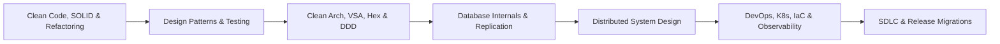

---
tags:
  - dashboard
  - software-engineering
  - roadmap
created: 2025-12-29
updated: 2026-11-13
status: 🟢
level: mid-to-senior
banner: "https://images.unsplash.com/photo-1555066931-4365d14bab8c?w=1200"
banner_y: 0.5
---
# Software Engineering Roadmap

> [!abstract] Curriculum Topology
> Parent Hub: [[Programming/Programming Hub|Programming Hub]]
> End-to-end engineering map spanning module-level code craftsmanship, architectural decoupling, domain modeling, automated verification, storage engine internals, distributed systems, platform automation, and release governance.

## Dependency Progression



---

## 1. Code Craftsmanship, Principles & Design

> [!info]+ Clean Code — [[Programming/Software Engineering/Clean Code/Clean Code Complete Guide|Clean Code Complete Guide]]
> Invariants for cohesion, naming, shallow control flow, structured error boundaries, and eliminating structural code smells.
> - [[Programming/Software Engineering/Clean Code/Meaningful Names|Meaningful Names]] · [[Programming/Software Engineering/Clean Code/Functions|Functions]] · [[Programming/Software Engineering/Clean Code/Comments|Comments]] · [[Programming/Software Engineering/Clean Code/Error Handling|Error Handling]] · [[Programming/Software Engineering/Clean Code/Code Smells|Code Smells]]

> [!info]+ SOLID Principles — [[Programming/Software Engineering/SOLID/SOLID Principles Complete Guide|SOLID Principles Complete Guide]]
> Coupling/cohesion boundaries, covariant/contravariant subtyping, capability segregation, and consumer-owned abstractions.
> - [[Programming/Software Engineering/SOLID/Single Responsibility|Single Responsibility]] · [[Programming/Software Engineering/SOLID/Open-Closed Principle|Open-Closed Principle]] · [[Programming/Software Engineering/SOLID/Liskov Substitution Principle|Liskov Substitution Principle]] · [[Programming/Software Engineering/SOLID/Interface Segregation Principle|Interface Segregation Principle]] · [[Programming/Software Engineering/SOLID/Dependency Inversion|Dependency Inversion]]

> [!info]+ Design Patterns & Refactoring — [[Programming/Software Engineering/Design Patterns/Design Patterns Complete Guide|Design Patterns]] · [[Programming/Software Engineering/Refactoring/Refactoring Complete Guide|Refactoring]]
> Structural wrappers, behavioral dispatch, modern TS/functional idioms, safe incremental mechanics, and Strangler Fig migrations.

---

## 2. Software Architecture, DDD & Verification

> [!info]+ Clean Architecture & Architectural Patterns — [[Programming/Software Engineering/Clean Architecture/Clean Architecture Complete Guide|Clean Architecture]] · [[Programming/Software Engineering/Architectural Patterns/Architectural Patterns Complete Guide|Architectural Patterns]]
> Dependency Rule, Composition Roots, Hexagonal Ports/Adapters, Vertical Slices, CQRS, Event Sourcing, Event-Driven Sagas, and Microservices resilience.

> [!info]+ Domain-Driven Design (DDD) — [[Programming/Software Engineering/DDD/Domain-Driven Design Complete Guide|Domain-Driven Design Complete Guide]]
> Core/Supporting/Generic capital allocation, Bounded Contexts, 9 Context Mapping patterns, EventStorming, and Vaughn Vernon Aggregate invariants.
> - [[Programming/Software Engineering/DDD/Strategic Design|Strategic Design]] · [[Programming/Software Engineering/DDD/Tactical Design & Building Blocks|Tactical Design & Building Blocks]]

> [!info]+ Automated Verification & Quality Engineering — [[Programming/Software Engineering/Testing/Testing Complete Guide|Testing Complete Guide]]
> Testing Trophy economics, Classical vs Mockist TDD, property-based & mutation testing, Testcontainers DB isolation, contract testing (Pact), Playwright, and k6 SLO load testing.
> - [[Programming/Software Engineering/Testing/TDD|TDD]] · [[Programming/Software Engineering/Testing/Unit Testing|Unit Testing]] · [[Programming/Software Engineering/Testing/Integration Testing|Integration Testing]] · [[Programming/Software Engineering/Testing/Mocking|Mocking]] · [[Programming/Software Engineering/Testing/E2E Testing|E2E Testing]]

---

## 3. Data Engines & Distributed System Design

> [!info]+ Database Engineering — [[Programming/Software Engineering/Database Design/Database Design Complete Guide|Database Design Complete Guide]]
> 8 KB heap pages, B+Tree vs LSM RUM trade-offs, MVCC/HOT/XID wraparound vs InnoDB Undo Logs, SSI vs Snapshot Isolation write skew, NoSQL access modeling, Consistent Hashing sharding, and WAL/Quorum/Raft replication.
> - [[Programming/Software Engineering/Database Design/Relational Databases|Relational Databases]] · [[Programming/Software Engineering/Database Design/Indexing|Indexing]] · [[Programming/Software Engineering/Database Design/Transactions|Transactions]] · [[Programming/Software Engineering/Database Design/Sharding|Sharding]] · [[Programming/Software Engineering/Database Design/Replication|Replication]]

> [!info]+ Distributed System Design — [[Programming/Software Engineering/System Design/System Design Complete Guide|System Design Complete Guide]] · [[Programming/Software Engineering/System Design/System Design Overview|System Design Overview]]
> USL/Little's Law, L4/L7 balancing, W-TinyLFU/stampede defense, CAP/PACELC/Raft/Fencing Tokens, Kafka ISR & Outbox CDC, distributed Lua rate limiters, API idempotency, CDN collapsing, and full architecture case studies.
> - **Core**: [[Programming/Software Engineering/System Design/Scalability|Scalability]] · [[Programming/Software Engineering/System Design/Load Balancing|Load Balancing]] · [[Programming/Software Engineering/System Design/Caching|Caching]] · [[Programming/Software Engineering/System Design/CAP Theorem|CAP Theorem]] · [[Programming/Software Engineering/System Design/Message Queues|Message Queues]] · [[Programming/Software Engineering/System Design/Rate Limiting|Rate Limiting]]
> - **Interfaces & Cases**: [[Programming/Software Engineering/System Design/API Design|API Design]] · [[Programming/Software Engineering/System Design/CDN|CDN]] · [[Programming/Software Engineering/System Design/ETL|ETL]] · [[Programming/Software Engineering/System Design/Cases/URL Shortener|URL Shortener]] · [[Programming/Software Engineering/System Design/Cases/Twitter Timeline|Twitter Timeline]] · [[Programming/Software Engineering/System Design/Cases/Chat Application|Chat Application]]

---

## 4. Platform Engineering, DevOps & SDLC

> [!info]+ DevOps, Containers, Kubernetes & Terraform — [[Programming/Software Engineering/DevOps/DevOps Complete Guide|DevOps Complete Guide]]
> OCI/BuildKit internals, Compose stacks, Kubernetes control plane/HPA/NetworkPolicy, declarative IaC & Terraform state/modules, AWS/GCP/Azure VPC & IAM, Firecracker Serverless, Prometheus/Loki/OTel, and SLSA CI/CD.
> - **Containers & K8s**: [[Programming/Software Engineering/DevOps/Docker|Docker]] · [[Programming/Software Engineering/DevOps/Docker Compose|Docker Compose]] · [[Programming/Software Engineering/DevOps/Kubernetes|Kubernetes]]
> - **IaC, Cloud & CI**: [[Programming/Software Engineering/DevOps/Infrastructure as Code|Infrastructure as Code]] · [[Programming/Software Engineering/DevOps/Terraform|Terraform]] · [[Programming/Software Engineering/DevOps/Cloud Fundamentals|Cloud Fundamentals]] · [[Programming/Software Engineering/DevOps/GitHub Actions|GitHub Actions]] · [[Programming/Software Engineering/DevOps/Pipeline Design|Pipeline Design]]
> - **Telemetry**: [[Programming/Software Engineering/DevOps/Monitoring|Monitoring]] · [[Programming/Software Engineering/DevOps/Logging|Logging]] · [[Programming/Software Engineering/DevOps/Observability|Observability]]

> [!info]+ Software Development Lifecycle & Release Governance — [[Programming/Software Engineering/SDLC/SDLC Complete Guide|SDLC Complete Guide]]
> Modern trunk-based workflows, RFCs/ADRs, Shift-Left AppSec/SAST/SCA, incident postmortems, DORA/SPACE metrics, feature flags, and Expand-and-Contract zero-downtime DB migrations.
> - [[Programming/Software Engineering/SDLC/SDLC Complete Guide|SDLC Complete Guide]] · [[Programming/Software Engineering/SDLC/Release Engineering & Migrations|Release Engineering & Migrations]]

---

## Domain Status Matrix

| Domain | Scope Readiness | Primary Hub |
|---|---|---|
| Clean Code, SOLID & Refactoring | 🟢 Complete | [[Programming/Software Engineering/Clean Code/Clean Code Complete Guide\|Clean Code]] · [[Programming/Software Engineering/SOLID/SOLID Principles Complete Guide\|SOLID]] · [[Programming/Software Engineering/Refactoring/Refactoring Complete Guide\|Refactoring]] |
| Design Patterns | 🟢 Complete | [[Programming/Software Engineering/Design Patterns/Design Patterns Complete Guide\|Design Patterns]] |
| Clean Architecture, Patterns & DDD | 🟢 Complete | [[Programming/Software Engineering/Clean Architecture/Clean Architecture Complete Guide\|Clean Architecture]] · [[Programming/Software Engineering/Architectural Patterns/Architectural Patterns Complete Guide\|Architectural Patterns]] · [[Programming/Software Engineering/DDD/Domain-Driven Design Complete Guide\|DDD]] |
| Automated Testing & Reliability | 🟢 Complete | [[Programming/Software Engineering/Testing/Testing Complete Guide\|Testing]] |
| Database Engineering | 🟢 Complete | [[Programming/Software Engineering/Database Design/Database Design Complete Guide\|Database Design]] |
| System Design & Case Studies | 🟢 Complete | [[Programming/Software Engineering/System Design/System Design Complete Guide\|System Design Complete Guide]] |
| DevOps, Docker, K8s & Terraform | 🟢 Complete | [[Programming/Software Engineering/DevOps/DevOps Complete Guide\|DevOps]] |
| SDLC & Release Engineering | 🟢 Complete | [[Programming/Software Engineering/SDLC/SDLC Complete Guide\|SDLC]] |

---

## Canonical Reference Works Mapped to Vault Guides

| Book / Spec | Author | Primary Concepts Encoded Here |
|---|---|---|
| *Designing Data-Intensive Applications* | Martin Kleppmann | LSM/B+Tree, SSI, Replication, Consensus, Stream/CDC |
| *A Philosophy of Software Design* | John Ousterhout | Deep modules, complexity amortization, strategic design |
| *Domain-Driven Design* & *Implementing DDD* | Eric Evans / Vaughn Vernon | Subdomains, Context Maps, Aggregates, Domain Events |
| *Unit Testing Principles, Practices & Patterns* | Vladimir Khorikov | 4 Pillars, managed vs unmanaged doubles, Testing Trophy |
| *Site Reliability Engineering* | Beyer et al. | Multi-window SLO burn rates, error budgets, Golden Signals |
| *Accelerate* | Forsgren, Humble, Kim | DORA 4 metrics, trunk-based CI/CD, small-batch safety |

---

## Recent Notes
```dataview
TABLE WITHOUT ID
	file.link as "Note",
	file.folder as "Domain"
FROM "Programming/Software Engineering"
WHERE !contains(file.name, "_Index")
SORT file.mtime desc
LIMIT 10
```

## Authoring Template
New atomic notes follow [[Templates/Programming Concept Template|Programming Concept Template]] · Back to [[Programming/Programming Hub|Programming Hub]]
