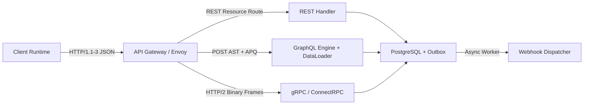
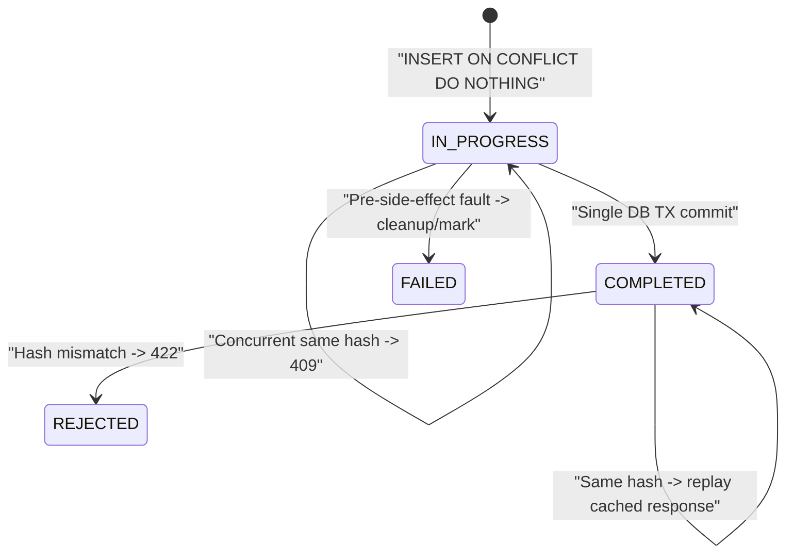

---
tags:
  - software-engineering
  - system-design
  - api-design
  - rest
  - graphql
  - grpc
  - webhooks
created: 2026-01-02
updated: 2026-11-13
status: 🟢
level: mid-to-senior
---
# API Design

> [!abstract] Vault Navigation
> Distributed interface specification under [[Programming/Software Engineering/System Design/System Design Overview|System Design Overview]] and [[Programming/Software Engineering/System Design/System Design Complete Guide|System Design Complete Guide]]. Integrates with [[Programming/Software Engineering/System Design/Caching|Caching]], [[Programming/Software Engineering/System Design/Load Balancing|Load Balancing]], [[Programming/Software Engineering/System Design/Rate Limiting|Rate Limiting]], [[Programming/Software Engineering/System Design/Message Queues|Message Queues]], [[Programming/Software Engineering/Database Design/Indexing|Indexing]], [[Programming/Software Engineering/Database Design/Transactions|Transactions]], [[Programming/Software Engineering/SDLC/Release Engineering & Migrations|Release Engineering & Migrations]], and [[Programming/Software Engineering/Architectural Patterns/Event-Driven Architecture|Event-Driven Architecture]].

Production APIs define wire contracts across untrusted networks where TCP packet drops, client retries, concurrent writers, independent service deployments, and malicious payloads are guaranteed. Designing resilient interfaces requires reasoning simultaneously about HTTP protocol state machines, ACID idempotency locking, B-tree keyset index traversal, AST cost bounding, binary wire evolution, and egress security isolation.

---

## 1. First-Principles Mechanics & Wire Architectures

### 1.1 Transport & Execution Pipeline Across Paradigms

Every network API sits atop TCP/TLS (or QUIC in HTTP/3) and converts application intent into serialized bytes over framing boundaries. The fundamental architectural divergence among REST, GraphQL, gRPC, and Webhooks lies in **where contract binding, query planning, and control flow live**:



- **REST (Resource-Oriented HTTP):** Binds operations directly to uniform HTTP semantics—URI targets identity, HTTP method declares safety/idempotency, headers negotiate caching and preconditions (`ETag`, `If-Match`, `Cache-Control`), and status codes expose transport/domain outcomes to intermediaries (CDNs, reverse proxies, client retry libraries) without inspecting the JSON body.
- **GraphQL (Query-Graph Execution Engine):** Moves read-shape selection from fixed server endpoints into a client-supplied Abstract Syntax Tree (AST). The server executes a deterministic four-stage pipeline: **Lex & Parse AST $\to$ Validate against SDL Types $\to$ Static Depth/Complexity Analysis $\to$ Top-Down Breadth-Batched Resolver Execution**. Because standard GraphQL uses `POST /graphql`, it bypasses default CDN/browser HTTP caches unless paired with Automatic Persisted Queries (APQ) over `GET`.
- **gRPC (Binary Multiplexed RPC over HTTP/2):** Replaces human-readable text payloads and loose JSON schemas with strongly typed `.proto` IDL contracts compiled into language-native stubs. Each RPC maps onto a single bidirectional HTTP/2 stream carrying length-prefixed binary Protobuf frames, using HPACK header compression and HTTP/2 `Trailers` frames to report execution status after body bytes finish streaming.
- **Webhooks (Inverted Push Event Delivery):** Inverts polling into outbound server-to-server HTTPS `POST` mutations triggered by committed domain state transitions. Because the server initiates requests to untrusted customer-controlled URLs, webhook engines shift from request-response latency optimization to queue isolation, cryptographic authenticity, SSRF containment, and bounded retry backpressure.

### 1.2 RESTful Semantics, Richardson Maturity & HTTP Method Invariants

#### Richardson Maturity Model in Production

- **Level 0 (POX / Single RPC Tunnel):** Exposes one endpoint (`POST /api/rpc`) with `{ "action": "getOrder", "id": 42 }`. Every request appears uncacheable and non-idempotent to proxies, rate limiters, and observability tooling.
- **Level 1 (Resource Addressing):** Splits entities into distinct URIs (`/orders`, `/orders/42`), yet continues tunneling reads and writes through `POST`.
- **Level 2 (HTTP Verbs, Status Codes & Preconditions):** The baseline standard for production REST APIs. Resources are addressed as plural nouns (`/v1/accounts/{account_id}/transfers`), nested sub-resources model ownership boundaries, non-CRUD state transitions map to explicit sub-resource nouns (`POST /v1/orders/{id}/cancellations` rather than `POST /v1/cancelOrder`), and outcomes use exact HTTP status codes.
- **Level 3 (HATEOAS Hypermedia Controls):** Responses embed state-machine links (`_links: { refund: { href: "/v1/charges/ch_9/refunds", method: "POST" } }`). Full HATEOAS coupling rarely survives heterogeneous mobile/SDK codegen; mature teams combine **Level 2 + OpenAPI 3.1 contract-first generation** with targeted hypermedia links for pagination (`next`, `prev`) and workflow transitions (`Location` on `201`/`202`).

#### Method Safety, Idempotency & Cacheability (RFC 9110)

| HTTP Method | Safe (No State Change) | Idempotent ($f(f(x)) \equiv f(x)$) | Default Cacheable | Production Semantics & Guardrails |
| :--- | :--- | :--- | :--- | :--- |
| `GET` | Yes | Yes | Yes | Retrieve resource representation; **never** mutate state or trigger billing side effects |
| `HEAD` | Yes | Yes | Yes | Identical headers/status to `GET` with zero response body; used for health/object-size checks |
| `OPTIONS` | Yes | Yes | No | CORS preflight and `Allow` capability discovery |
| `PUT` | No | Yes | No | Complete replacement at target URI (or idempotent creation if client assigns ID) |
| `DELETE` | No | Yes | No | Remove resource; repeat calls leave state unchanged (subsequent `404` or `204` is still idempotent) |
| `POST` | No | **No** (unless `Idempotency-Key`) | Only with explicit freshness | Create child resource or trigger non-idempotent workflow; requires `Idempotency-Key` for safe retries |
| `PATCH` | No | **No** (depends on patch doc) | No | Partial update (`RFC 7396` Merge Patch or `RFC 6902` JSON Patch); pair with `If-Match` |

> [!important] Idempotency Applies to Server State, Not Status Codes
> Sending `DELETE /v1/orders/42` twice is strictly idempotent even if call #1 returns `204 No Content` and call #2 returns `404 Not Found` (or `204` if soft-deleted). The invariant requires that $N$ identical requests produce the exact same persistent server state as $1$ request.

### 1.3 Exact HTTP Status Code Semantics

| Code | Name | Exact Trigger Condition & Required Headers |
| :--- | :--- | :--- |
| `200` | `OK` | Synchronous read (`GET`) or update (`PUT`/`PATCH`) returning a body representation |
| `201` | `Created` | Resource allocated via `POST`/`PUT`; **MUST** emit `Location: /v1/orders/ord_99` |
| `202` | `Accepted` | Work persisted to async queue; return `Location: /v1/jobs/job_81` and `Retry-After: 5` |
| `204` | `No Content` | Successful `DELETE` or state toggle returning zero bytes (`Content-Length` omitted) |
| `304` | `Not Modified` | Conditional `GET` matched `If-None-Match` (`ETag`) or `If-Modified-Since`; zero body |
| `307` / `308` | `Temporary` / `Permanent Redirect` | **Preserves HTTP method and body** (`POST` stays `POST`); prefer over `302`/`301` which browsers rewrite to `GET` |
| `400` | `Bad Request` | Malformed syntax: invalid JSON, bad UTF-8, invalid Content-Length, missing required transport framing |
| `401` | `Unauthorized` | Missing, expired, or invalid authentication credential; include `WWW-Authenticate` |
| `403` | `Forbidden` | Identity authenticated (`401` passed), but RBAC/ABAC/tenant ACL denies action |
| `404` vs `410` | `Not Found` vs `Gone` | `404` when resource absent (or intentionally masked for tenant isolation); `410` when permanently retired |
| `409` | `Conflict` | Domain state-machine conflict (cancelling shipped order), unique constraint collision, or concurrent in-flight `Idempotency-Key` |
| `412` | `Precondition Failed` | `If-Match` `ETag` does not match current resource version (optimistic concurrency lock failure) |
| `415` | `Unsupported Media Type` | Wrong `Content-Type` (e.g., sending `application/json` to an endpoint requiring `application/json-patch+json`) |
| `422` | `Unprocessable Content` | Valid JSON syntax, but fails domain/schema rules (negative amount, `Idempotency-Key` payload mismatch) |
| `428` | `Precondition Required` | Server refuses blind overwrite because `If-Match` header was omitted on mutation |
| `429` | `Too Many Requests` | Rate limit exhausted; emit `Retry-After` and IETF `RateLimit-Limit`, `RateLimit-Remaining`, `RateLimit-Reset` |
| `500` / `502` / `503` / `504` | Server / Upstream Errors | `500` unhandled fault; `502` corrupt upstream response; `503` overload shedding (`Retry-After`); `504` upstream timeout |

### 1.4 RFC 9457 Problem Details Error Schema

Ad-hoc JSON error wrappers (`{ "error": "bad input" }` or `{ "ok": false, "msg": "..." }`) break generic SDK error parsers and leak internal database errors when unhandled exceptions pass raw messages through. **RFC 9457** (`Content-Type: application/problem+json`, replacing RFC 7807) standardizes machine-readable error envelopes across all HTTP services:

```json
{
  "type": "https://api.acme.dev/problems/validation-error",
  "title": "Request Validation Failed",
  "status": 422,
  "detail": "Two fields violated order creation constraints.",
  "instance": "/v1/orders?trace=req_01JCF8X2K9",
  "trace_id": "4bf92f3577b34da6a3ce929d0e0e4736",
  "code": "ORDER_VALIDATION_ERROR",
  "errors": [
    {
      "pointer": "/items/0/quantity",
      "code": "MUST_BE_POSITIVE",
      "detail": "Quantity must be >= 1; received 0."
    },
    {
      "pointer": "/currency",
      "code": "UNSUPPORTED_CURRENCY",
      "detail": "Currency 'XYZ' is not an active ISO-4217 code."
    }
  ]
}
```

- **`type`:** A stable URI identifying the problem class (dereferencing to documentation is recommended; never embed dynamic IDs in `type`).
- **`title`:** Short, human-readable summary invariant across instances of the same `type`.
- **`status`:** Must match the HTTP status code on the wire so proxies and gateways parsing only JSON still observe the exact status.
- **`detail` & `instance`:** Occurrence-specific diagnostic explanation (scrubbed of SQL queries, stack traces, and credentials) and the request URI/event ID.
- **Extension Members (`trace_id`, `code`, `errors`):** Structured field-level failures using RFC 6901 JSON Pointers (`/items/0/quantity`) allow client forms to highlight invalid inputs programmatically.

### 1.5 API Versioning & Deprecation Lifecycle (RFC 8594 / RFC 9745)

| Strategy | Mechanism | Strengths | Failure Modes & Trade-Offs |
| :--- | :--- | :--- | :--- |
| **URI Path Versioning** (`/v1/orders`) | Major version embedded in route path | Explicit in logs, curl, OpenAPI docs, and CDN/API gateway routing without header inspection | URLs lose canonical permanence across major versions; tempts teams into copy-pasting entire controller trees |
| **Media-Type / Header Versioning** (`Accept: application/vnd.acme.v2+json`) | Content negotiation header selects serializer | Preserves clean canonical resource URIs | Requires `Vary: Accept` across caches (risking key splits); breaks naive browser links and debugging |
| **Date-Pinned Compatibility Transforms** (`X-API-Version: 2026-11-01`) | Stripe-style pinned version per account with request/response AST gates | Zero endpoint duplication; backwards-incompatible changes remain isolated inside declarative version gates over a single core domain model | Engineering cost of maintaining stacked bidirectional compatibility transformers for years; requires strict contract testing across all pinned dates |

**Deprecation & Sunset Protocol:** Before removing any endpoint or field, keep additive evolution first (add nullable fields, never mutate existing field types or rename keys in-place). When retiring an obsolete major version, emit **RFC 9745 `Deprecation`** (structured `@unix_timestamp` or boolean) and **RFC 8594 `Sunset`** (HTTP-date when `410 Gone` begins) alongside a migration link:

```http
HTTP/1.1 200 OK
Content-Type: application/json
Deprecation: @1782864000
Sunset: Wed, 01 Jul 2026 00:00:00 GMT
Link: <https://docs.acme.dev/migrations/2026-07>; rel="sunset"
```

---

## 2. Real-World Use Cases & Architectural Decision Matrix

Selecting a single API style across an entire enterprise creates chronic friction: mobile clients suffer REST over-fetching, internal service meshes choke on JSON serialization, and public browser clients break on raw gRPC HTTP/2 trailers.

| Dimension | REST (OpenAPI 3.1 + JSON) | GraphQL (SDL + APQ) | gRPC / ConnectRPC (Protobuf) | Webhooks (Async Push) |
| :--- | :--- | :--- | :--- | :--- |
| **Wire Payload** | UTF-8 JSON (Gzip/Brotli) | UTF-8 JSON (`POST` / APQ `GET`) | Compact TLV binary frames | UTF-8 JSON (`POST`) |
| **Schema Contract** | OpenAPI 3.1 + JSON Schema | GraphQL SDL + Runtime AST | `.proto` (`proto3`) + Buf lint | AsyncAPI / JSON Schema |
| **HTTP Caching** | Native (`ETag`, CDN, `s-maxage`) | Complex (requires APQ + `GET`) | None (RPC semantics) | N/A |
| **Streaming** | SSE / Chunked responses | Subscriptions (WS / SSE) | Native Server, Client, Bidi | N/A |
| **Browser Ergonomics** | Native (`fetch`) | Native (`fetch`) | Needs ConnectRPC or `grpc-web` | Server-to-server only |
| **Primary Hazard** | Endpoint sprawl; under/over-fetching | N+1 SQL storms; recursive cost DoS | L4 TCP LB pinning; tag reuse bugs | Retry storms; SSRF; out-of-order events |

### Concrete Engineering Decision Scenarios

1. **Public Multi-Tenant Payment & Ledger API (`REST + Idempotency-Key + RFC 9457`):**
   - **Adopt when:** External developers, mobile SDKs, and curl-driven integrations require transparent HTTP semantics, native `Idempotency-Key` retries, predictable rate limiting, and CDN-cacheable `GET` endpoints.
   - **Do NOT use:** High-frequency internal microservice RPC hops (>50k internal RPS per cluster) where JSON parsing burns 30–40% CPU.
2. **Backend-for-Frontend (BFF) Powering Rich Multi-Entity Web & Mobile Dashboards (`GraphQL + DataLoader + Persisted Queries`):**
   - **Adopt when:** Multiple client surfaces (iOS, Android, Web) display deeply nested views (`Order -> LineItems -> Product -> Inventory`) over varying bandwidths and need single-round-trip shape selection without maintaining 40 bespoke BFF endpoints.
   - **Do NOT use:** Simple CRUD microservices, binary file streaming, or public open APIs where exposing an arbitrary query AST without persisted allowlisting opens cost-amplification DoS vectors.
3. **Internal Low-Latency Polyglot Microservices (`gRPC + Protobuf + Envoy L7`):**
   - **Adopt when:** Go, Rust, Java, and TypeScript services exchange structured telemetry, ML inference vectors, or core ledger lookups requiring sub-millisecond serialization, strict backwards/forwards schema checks (`buf breaking`), bidirectional streaming, and automatic deadline propagation.
   - **Do NOT use:** Public third-party browser APIs directly (use **ConnectRPC** or a REST/JSON gateway at the edge).
4. **Browser Clients Calling Strongly-Typed RPC Services (`ConnectRPC`):**
   - **Adopt when:** Teams want `.proto` single-source-of-truth contracts from frontend TypeScript straight into backend Go/Node services **without** operating an Envoy `grpc-web` transcoding proxy, retaining curl/JSON inspectability in DevTools.
   - **Do NOT use:** When external REST/OpenAPI compliance or rich HTTP conditional caching (`304 Not Modified`, `If-Match`) is required across third-party integrators.
5. **Asynchronous Partner Notifications (`Transactional Outbox + HMAC Webhooks`):**
   - **Adopt when:** Long-running domain state changes (`payout.settled`, `invoice.payment_failed`) occur minutes or days after the initiating API request and external consumers must react without polling.
   - **Do NOT use:** Synchronous request-response workflows or intra-organization service buses (use Kafka, NATS, or SQS internally instead of HTTP webhook callbacks).

---

## 3. Step-by-Step Practical Application: Production Implementation

This section builds a complete, cohesive production API reference platform (`orders-api`) demonstrating PostgreSQL ACID idempotency, OCC `ETag`/`If-Match` mutations, RFC 7396/6902 patching, HMAC-signed keyset cursor pagination, per-request GraphQL `DataLoader` + depth/cost protection, `.proto` contract evolution, and SSRF-hardened dual-secret webhook delivery with integration tests.

### 3.1 Production Project Layout

```text
orders-api/
├── package.json
├── tsconfig.json
├── proto/
│   └── orders/v1/order.proto
├── db/
│   └── migrations/001_api_reliability.sql
├── src/
│   ├── lib/
│   │   ├── problem-details.ts      # RFC 9457 error builder
│   │   ├── patch.ts                # RFC 7396 Merge Patch & RFC 6902 JSON Patch
│   │   ├── cursor.ts               # HMAC-signed Base64URL keyset cursor codec
│   │   └── etag.ts                 # Strong/weak ETag parser & If-Match helpers
│   ├── middleware/
│   │   └── idempotency.ts          # Atomic PostgreSQL Idempotency-Key engine
│   ├── routes/
│   │   └── orders.ts               # Express/Fastify REST endpoints + OCC + pagination
│   ├── graphql/
│   │   ├── schema.graphql          # Relay Connection SDL
│   │   ├── dataloader.ts           # Per-request coalescing batch loader
│   │   └── security.ts             # AST depth/complexity analyzer + APQ allowlist
│   └── webhooks/
│       ├── ssrf-guard.ts           # Post-DNS IP CIDR verification agent
│       ├── dispatcher.ts           # Outbox worker, HMAC sign, circuit breaker
│       └── receiver.ts             # Raw-body dual-secret verify + anti-replay
└── tests/
    └── api.integration.test.ts     # End-to-end invariant test suite
```

### 3.2 PostgreSQL Schema for Idempotency, OCC, Pagination & Webhooks

```sql
-- db/migrations/001_api_reliability.sql
CREATE TYPE idempotency_state AS ENUM ('IN_PROGRESS', 'COMPLETED', 'FAILED');

CREATE TABLE orders (
    id              BIGINT GENERATED ALWAYS AS IDENTITY PRIMARY KEY,
    tenant_id       TEXT NOT NULL,
    customer_id     TEXT NOT NULL,
    status          TEXT NOT NULL CHECK (status IN ('PENDING', 'CONFIRMED', 'SHIPPED', 'CANCELLED')),
    total_cents     BIGINT NOT NULL CHECK (total_cents >= 0),
    currency        CHAR(3) NOT NULL,
    shipping_addr   JSONB NOT NULL,
    metadata        JSONB NOT NULL DEFAULT '{}'::jsonb,
    version         INTEGER NOT NULL DEFAULT 1,
    created_at      TIMESTAMPTZ NOT NULL DEFAULT now(),
    updated_at      TIMESTAMPTZ NOT NULL DEFAULT now()
);

-- Exact composite keyset index matching ORDER BY created_at DESC, id DESC
CREATE INDEX idx_orders_tenant_keyset
    ON orders (tenant_id, created_at DESC, id DESC);

-- Atomic ACID idempotency lock + cached response store
CREATE TABLE idempotency_keys (
    tenant_id        TEXT NOT NULL,
    idempotency_key  TEXT NOT NULL,
    request_method   TEXT NOT NULL,
    request_path     TEXT NOT NULL,
    request_hash     TEXT NOT NULL,
    state            idempotency_state NOT NULL DEFAULT 'IN_PROGRESS',
    response_status  INTEGER,
    response_headers JSONB,
    response_body    JSONB,
    locked_until     TIMESTAMPTZ NOT NULL,
    created_at       TIMESTAMPTZ NOT NULL DEFAULT now(),
    expires_at       TIMESTAMPTZ NOT NULL DEFAULT (now() + INTERVAL '24 hours'),
    PRIMARY KEY (tenant_id, idempotency_key)
);

CREATE INDEX idx_idempotency_expires_at ON idempotency_keys (expires_at);

-- Transactional Outbox for reliable async webhook emission
CREATE TABLE webhook_outbox (
    event_id        UUID PRIMARY KEY,
    tenant_id       TEXT NOT NULL,
    event_type      TEXT NOT NULL,
    payload         JSONB NOT NULL,
    created_at      TIMESTAMPTZ NOT NULL DEFAULT now(),
    published_at    TIMESTAMPTZ
);

CREATE INDEX idx_webhook_outbox_pending
    ON webhook_outbox (created_at ASC)
    WHERE published_at IS NULL;

-- Consumer-side webhook deduplication & version monotonicity log
CREATE TABLE processed_webhook_events (
    event_id        TEXT PRIMARY KEY,
    aggregate_id    TEXT NOT NULL,
    event_ts        TIMESTAMPTZ NOT NULL,
    processed_at    TIMESTAMPTZ NOT NULL DEFAULT now()
);
```

### 3.3 RFC 9457 Problem Details & RFC 7396 / RFC 6902 Patch Implementations

```typescript
// src/lib/problem-details.ts
import type { Response } from 'express';

export interface FieldValidationError {
  pointer: string;
  code: string;
  detail: string;
}

export interface ProblemDetails {
  type: string;
  title: string;
  status: number;
  detail: string;
  instance: string;
  trace_id?: string;
  code: string;
  errors?: FieldValidationError[];
}

export function sendProblem(res: Response, problem: ProblemDetails): void {
  res
    .status(problem.status)
    .setHeader('Content-Type', 'application/problem+json; charset=utf-8')
    .json(problem);
}
```

```typescript
// src/lib/patch.ts
export type JsonValue = string | number | boolean | null | JsonObject | JsonValue[];
export interface JsonObject { [key: string]: JsonValue; }

const FORBIDDEN_KEYS = new Set(['__proto__', 'constructor', 'prototype']);

function isPlainObject(val: unknown): val is JsonObject {
  return typeof val === 'object' && val !== null && !Array.isArray(val);
}

/**
 * RFC 7396 JSON Merge Patch.
 * - Top-level or nested keys mapped to `null` are deleted.
 * - Arrays are replaced atomically (cannot append/mutate individual elements).
 */
export function applyMergePatch(target: JsonValue, patch: JsonValue): JsonValue {
  if (!isPlainObject(patch)) {
    return structuredClone(patch);
  }
  const result: JsonObject = isPlainObject(target) ? structuredClone(target) : {};
  for (const [key, value] of Object.entries(patch)) {
    if (FORBIDDEN_KEYS.has(key)) {
      throw new Error(`Forbidden property key in merge patch: ${key}`);
    }
    if (value === null) {
      delete result[key];
    } else {
      result[key] = applyMergePatch(result[key] ?? {}, value);
    }
  }
  return result;
}

export type JsonPatchOp =
  | { op: 'add' | 'replace' | 'test'; path: string; value: JsonValue }
  | { op: 'remove'; path: string }
  | { op: 'move' | 'copy'; from: string; path: string };

function decodePointer(pointer: string): string[] {
  if (pointer === '') return [];
  if (!pointer.startsWith('/')) {
    throw new Error(`Invalid RFC 6901 JSON Pointer: ${pointer}`);
  }
  return pointer
    .slice(1)
    .split('/')
    .map((token) => {
      const unescaped = token.replace(/~1/g, '/').replace(/~0/g, '~');
      if (FORBIDDEN_KEYS.has(unescaped)) {
        throw new Error(`Forbidden JSON Pointer segment: ${unescaped}`);
      }
      return unescaped;
    });
}

function getAtPointer(root: JsonValue, tokens: string[]): JsonValue {
  let curr: JsonValue = root;
  for (const seg of tokens) {
    if (Array.isArray(curr)) {
      const idx = Number(seg);
      if (!Number.isInteger(idx) || idx < 0 || idx >= curr.length) {
        throw new Error(`Array index out of bounds: ${seg}`);
      }
      curr = curr[idx];
    } else if (isPlainObject(curr) && Object.prototype.hasOwnProperty.call(curr, seg)) {
      curr = curr[seg];
    } else {
      throw new Error(`Pointer path does not exist: /${tokens.join('/')}`);
    }
  }
  return curr;
}

function deepEquals(a: JsonValue, b: JsonValue): boolean {
  if (a === b) return true;
  if (typeof a !== typeof b || a === null || b === null) return false;
  if (Array.isArray(a) && Array.isArray(b)) {
    return a.length === b.length && a.every((v, idx) => deepEquals(v, b[idx]));
  }
  if (isPlainObject(a) && isPlainObject(b)) {
    const keysA = Object.keys(a);
    const keysB = Object.keys(b);
    return keysA.length === keysB.length && keysA.every((k) => k in b && deepEquals(a[k], b[k]));
  }
  return false;
}

function resolveParent(root: JsonValue, tokens: string[]): { parent: JsonObject | JsonValue[]; key: string } {
  if (tokens.length === 0) throw new Error('Cannot resolve parent of root document');
  const parent = getAtPointer(root, tokens.slice(0, -1));
  const key = tokens[tokens.length - 1];
  if (!Array.isArray(parent) && !isPlainObject(parent)) {
    throw new Error('Parent target is not a JSON container');
  }
  return { parent, key };
}

/**
 * RFC 6902 Atomic JSON Patch.
 * Executes against a deep clone; any failed `test` or invalid path rolls back cleanly.
 */
export function applyJsonPatch(target: JsonValue, operations: JsonPatchOp[]): JsonValue {
  let doc: JsonValue = structuredClone(target);

  for (const operation of operations) {
    const tokens = decodePointer(operation.path);
    switch (operation.op) {
      case 'test': {
        const current = getAtPointer(doc, tokens);
        if (!deepEquals(current, operation.value)) {
          throw new PatchTestFailedError(`JSON Patch test mismatch at ${operation.path}`);
        }
        break;
      }
      case 'add': {
        if (tokens.length === 0) {
          doc = structuredClone(operation.value);
          break;
        }
        const { parent, key } = resolveParent(doc, tokens);
        if (Array.isArray(parent)) {
          const idx = key === '-' ? parent.length : Number(key);
          if (!Number.isInteger(idx) || idx < 0 || idx > parent.length) {
            throw new Error(`Invalid array insert index: ${key}`);
          }
          parent.splice(idx, 0, structuredClone(operation.value));
        } else {
          parent[key] = structuredClone(operation.value);
        }
        break;
      }
      case 'remove': {
        const { parent, key } = resolveParent(doc, tokens);
        if (Array.isArray(parent)) {
          const idx = Number(key);
          if (!Number.isInteger(idx) || idx < 0 || idx >= parent.length) {
            throw new Error(`Invalid array remove index: ${key}`);
          }
          parent.splice(idx, 1);
        } else if (Object.prototype.hasOwnProperty.call(parent, key)) {
          delete parent[key];
        } else {
          throw new Error(`Cannot remove missing key: ${operation.path}`);
        }
        break;
      }
      case 'replace': {
        if (tokens.length === 0) {
          doc = structuredClone(operation.value);
          break;
        }
        const { parent, key } = resolveParent(doc, tokens);
        if (Array.isArray(parent)) {
          const idx = Number(key);
          if (!Number.isInteger(idx) || idx < 0 || idx >= parent.length) {
            throw new Error(`Invalid array replace index: ${key}`);
          }
          parent[idx] = structuredClone(operation.value);
        } else if (Object.prototype.hasOwnProperty.call(parent, key)) {
          parent[key] = structuredClone(operation.value);
        } else {
          throw new Error(`Target key for replace does not exist: ${operation.path}`);
        }
        break;
      }
      case 'copy':
      case 'move': {
        const sourceTokens = decodePointer(operation.from);
        const value = getAtPointer(doc, sourceTokens);
        if (operation.op === 'move') {
          doc = applyJsonPatch(doc, [
            { op: 'remove', path: operation.from },
            { op: 'add', path: operation.path, value },
          ]);
        } else {
          doc = applyJsonPatch(doc, [{ op: 'add', path: operation.path, value }]);
        }
        break;
      }
    }
  }
  return doc;
}

export class PatchTestFailedError extends Error {}
```

### 3.4 Atomic `Idempotency-Key` Middleware (PostgreSQL + Payload SHA-256)

A production idempotency engine must survive worker crashes mid-request (`locked_until` lease expiry), block concurrent duplicates (`409 Conflict`), reject accidental key reuse on altered payloads (`422`), and commit the finalized response atomically inside the **same database transaction** as the domain write.



```typescript
// src/middleware/idempotency.ts
import crypto from 'node:crypto';
import type { Request, Response } from 'express';
import type { Pool, PoolClient } from 'pg';
import { sendProblem } from '../lib/problem-details.js';

export interface IdempotentResult {
  status: number;
  headers?: Record<string, string>;
  body: unknown;
}

/**
 * Recursively sorts object keys so equivalent JSON payloads with reordered keys
 * produce an identical SHA-256 fingerprint.
 */
export function canonicalizeJson(value: unknown): string {
  if (value === null || typeof value !== 'object') {
    return JSON.stringify(value);
  }
  if (Array.isArray(value)) {
    return `[${value.map((item) => canonicalizeJson(item)).join(',')}]`;
  }
  const entries = Object.entries(value as Record<string, unknown>)
    .filter(([, v]) => v !== undefined)
    .sort(([a], [b]) => a.localeCompare(b));
  return `{${entries.map(([k, v]) => `${JSON.stringify(k)}:${canonicalizeJson(v)}`).join(',')}}`;
}

export function computeRequestFingerprint(method: string, path: string, body: unknown): string {
  const canonical = `${method.toUpperCase()}:${path}:${canonicalizeJson(body ?? null)}`;
  return crypto.createHash('sha256').update(canonical).digest('hex');
}

export async function executeIdempotent<T>(
  pool: Pool,
  req: Request,
  res: Response,
  tenantId: string,
  handler: (tx: PoolClient) => Promise<IdempotentResult>
): Promise<void> {
  const idempotencyKey = req.header('Idempotency-Key')?.trim();
  if (!idempotencyKey || idempotencyKey.length > 128) {
    sendProblem(res, {
      type: 'https://api.acme.dev/problems/missing-idempotency-key',
      title: 'Idempotency-Key Header Required',
      status: 400,
      detail: 'Provide a unique Idempotency-Key header (<= 128 chars) for mutation safety.',
      instance: req.originalUrl,
      code: 'IDEMPOTENCY_KEY_REQUIRED',
    });
    return;
  }

  const requestHash = computeRequestFingerprint(req.method, req.baseUrl + req.path, req.body);

  // Step 1: Acquire short-lived lock row before starting side effects
  const lockTx = await pool.connect();
  let lockOwned = false;
  try {
    await lockTx.query('BEGIN');
    const insertRes = await lockTx.query(
      `INSERT INTO idempotency_keys (
         tenant_id, idempotency_key, request_method, request_path,
         request_hash, state, locked_until
       )
       VALUES ($1, $2, $3, $4, $5, 'IN_PROGRESS', now() + INTERVAL '30 seconds')
       ON CONFLICT (tenant_id, idempotency_key) DO NOTHING
       RETURNING *`,
      [tenantId, idempotencyKey, req.method, req.baseUrl + req.path, requestHash]
    );

    if (insertRes.rowCount === 1) {
      lockOwned = true;
      await lockTx.query('COMMIT');
    } else {
      // Lock already exists: inspect under FOR UPDATE to prevent race during lease takeover
      const existingRes = await lockTx.query(
        `SELECT * FROM idempotency_keys
         WHERE tenant_id = $1 AND idempotency_key = $2
         FOR UPDATE`,
        [tenantId, idempotencyKey]
      );
      const existing = existingRes.rows[0];

      if (existing.request_hash !== requestHash) {
        await lockTx.query('COMMIT');
        sendProblem(res, {
          type: 'https://api.acme.dev/problems/idempotency-mismatch',
          title: 'Idempotency Key Payload Mismatch',
          status: 422,
          detail: 'Idempotency-Key was previously used with a different request payload.',
          instance: req.originalUrl,
          code: 'IDEMPOTENCY_PAYLOAD_MISMATCH',
        });
        return;
      }

      if (existing.state === 'COMPLETED') {
        await lockTx.query('COMMIT');
        if (existing.response_headers) {
          for (const [k, v] of Object.entries(existing.response_headers as Record<string, string>)) {
            res.setHeader(k, v);
          }
        }
        res.setHeader('Idempotency-Replayed', 'true');
        res.status(existing.response_status).json(existing.response_body);
        return;
      }

      const leaseExpired = new Date(existing.locked_until).getTime() < Date.now();
      if (existing.state === 'IN_PROGRESS' && !leaseExpired) {
        await lockTx.query('COMMIT');
        res.setHeader('Retry-After', '2');
        sendProblem(res, {
          type: 'https://api.acme.dev/problems/request-in-progress',
          title: 'Concurrent Idempotent Request In Flight',
          status: 409,
          detail: 'An identical request with this Idempotency-Key is currently executing.',
          instance: req.originalUrl,
          code: 'IDEMPOTENCY_CONCURRENT_IN_FLIGHT',
        });
        return;
      }

      // Lease expired (previous worker crashed) or explicit FAILED retryable state -> reclaim lock
      await lockTx.query(
        `UPDATE idempotency_keys
         SET state = 'IN_PROGRESS', locked_until = now() + INTERVAL '30 seconds'
         WHERE tenant_id = $1 AND idempotency_key = $2`,
        [tenantId, idempotencyKey]
      );
      lockOwned = true;
      await lockTx.query('COMMIT');
    }
  } catch (err) {
    await lockTx.query('ROLLBACK');
    throw err;
  } finally {
    lockTx.release();
  }

  if (!lockOwned) return;

  // Step 2: Execute business mutation AND persist response in ONE atomic ACID transaction
  const workTx = await pool.connect();
  try {
    await workTx.query('BEGIN');
    const result = await handler(workTx);

    await workTx.query(
      `UPDATE idempotency_keys
       SET state = 'COMPLETED',
           response_status = $3,
           response_headers = $4::jsonb,
           response_body = $5::jsonb
       WHERE tenant_id = $1 AND idempotency_key = $2`,
      [
        tenantId,
        idempotencyKey,
        result.status,
        JSON.stringify(result.headers ?? {}),
        JSON.stringify(result.body),
      ]
    );
    await workTx.query('COMMIT');

    if (result.headers) {
      for (const [k, v] of Object.entries(result.headers)) {
        res.setHeader(k, v);
      }
    }
    res.status(result.status).json(result.body);
  } catch (err) {
    await workTx.query('ROLLBACK');
    // Mark FAILED so an immediate retry can safely re-execute rather than waiting 30s lease
    await pool.query(
      `UPDATE idempotency_keys
       SET state = 'FAILED'
       WHERE tenant_id = $1 AND idempotency_key = $2 AND state = 'IN_PROGRESS'`,
      [tenantId, idempotencyKey]
    );
    throw err;
  } finally {
    workTx.release();
  }
}
```

### 3.5 `ETag` / `If-Match` OCC, Keyset Cursor Pagination & Routes

#### Why `OFFSET` Collapses at Scale vs Tuple Keyset Seeking

```sql
-- Anti-pattern: PostgreSQL scans & discards 1,000,000 index/heap pointers -> O(N + K)
SELECT id, created_at, total_cents
FROM orders
WHERE tenant_id = 'ten_88'
ORDER BY created_at DESC, id DESC
LIMIT 25 OFFSET 1000000;
```

1. **Linear I/O & CPU Cost:** Even with an index on `(tenant_id, created_at DESC, id DESC)`, B-trees do not track cumulative positional offsets per leaf node; PostgreSQL must traverse and heap-visibility-check all 1,000,025 rows.
2. **Live-Write Data Drift:** Inserting 3 new orders while a client transitions from page 1 to page 2 shifts row positions down by 3, causing the last 3 items of page 1 to appear again at the top of page 2. Deleting rows causes items to vanish skipped between pages.
3. **Why `(created_at, id)` Ties Matter:** Millisecond/microsecond collisions are guaranteed under bulk imports or concurrent transactions. Ordering strictly by `created_at DESC` leaves tie order undefined; adding a unique monotonic tiebreaker (`id DESC`) backed by `(tenant_id, created_at DESC, id DESC)` enforces a strict total ordering so `(created_at, id) < ($2, $3)` performs an $O(\log N + K)$ B-tree seek straight to the cursor boundary.

```typescript
// src/lib/cursor.ts
import crypto from 'node:crypto';

export interface KeysetCursor {
  ts: string; // ISO-8601 UTC timestamp
  id: string; // BigInt stringified to avoid IEEE-754 > 2^53 precision loss
}

export class InvalidCursorError extends Error {}

export function encodeCursor(cursor: KeysetCursor, hmacSecret: string): string {
  const payloadB64 = Buffer.from(JSON.stringify(cursor), 'utf8').toString('base64url');
  const sig = crypto.createHmac('sha256', hmacSecret).update(payloadB64).digest('base64url');
  return `${payloadB64}.${sig}`;
}

export function decodeCursor(token: string, hmacSecret: string): KeysetCursor {
  const parts = token.split('.');
  if (parts.length !== 2) throw new InvalidCursorError('Malformed cursor format');
  const [payloadB64, providedSig] = parts;

  const expectedSig = crypto.createHmac('sha256', hmacSecret).update(payloadB64).digest('base64url');
  const a = Buffer.from(providedSig, 'utf8');
  const b = Buffer.from(expectedSig, 'utf8');
  if (a.length !== b.length || !crypto.timingSafeEqual(a, b)) {
    throw new InvalidCursorError('Cursor signature mismatch');
  }

  let parsed: unknown;
  try {
    parsed = JSON.parse(Buffer.from(payloadB64, 'base64url').toString('utf8'));
  } catch {
    throw new InvalidCursorError('Invalid cursor payload JSON');
  }

  if (
    typeof parsed !== 'object' ||
    parsed === null ||
    typeof (parsed as KeysetCursor).ts !== 'string' ||
    typeof (parsed as KeysetCursor).id !== 'string' ||
    Number.isNaN(Date.parse((parsed as KeysetCursor).ts)) ||
    !/^\d+$/.test((parsed as KeysetCursor).id)
  ) {
    throw new InvalidCursorError('Invalid cursor fields');
  }
  return parsed as KeysetCursor;
}
```

```typescript
// src/lib/etag.ts
export function formatStrongVersionETag(version: number): string {
  return `"v${version}"`;
}

export function parseStrongVersionETag(ifMatchHeader: string | undefined): number | null {
  if (!ifMatchHeader) return null;
  const trimmed = ifMatchHeader.trim();
  // Reject weak ETags (W/"...") for write preconditions per RFC 9110 §13.1.1
  if (trimmed.startsWith('W/')) return null;
  const match = /^"v(\d+)"$/.exec(trimmed);
  return match ? Number(match[1]) : null;
}
```

```typescript
// src/routes/orders.ts
import crypto from 'node:crypto';
import express from 'express';
import type { Pool } from 'pg';
import { decodeCursor, encodeCursor, InvalidCursorError } from '../lib/cursor.js';
import { formatStrongVersionETag, parseStrongVersionETag } from '../lib/etag.js';
import { applyJsonPatch, applyMergePatch, PatchTestFailedError } from '../lib/patch.js';
import { sendProblem } from '../lib/problem-details.js';
import { executeIdempotent } from '../middleware/idempotency.js';

export function buildOrdersRouter(pool: Pool, cursorSecret: string): express.Router {
  const router = express.Router();

  // Keyset cursor paginated collection (never emits OFFSET or expensive COUNT(*))
  router.get('/v1/orders', async (req, res) => {
    const tenantId = req.header('X-Tenant-Id') ?? 'ten_default';
    const rawLimit = Number(req.query.limit ?? 25);
    const limit = Number.isInteger(rawLimit) && rawLimit >= 1 && rawLimit <= 100 ? rawLimit : 25;

    let cursor: { ts: string; id: string } | null = null;
    if (typeof req.query.cursor === 'string' && req.query.cursor.length > 0) {
      try {
        cursor = decodeCursor(req.query.cursor, cursorSecret);
      } catch (err) {
        if (err instanceof InvalidCursorError) {
          sendProblem(res, {
            type: 'https://api.acme.dev/problems/invalid-cursor',
            title: 'Invalid Pagination Cursor',
            status: 400,
            detail: err.message,
            instance: req.originalUrl,
            code: 'INVALID_CURSOR',
          });
          return;
        }
        throw err;
      }
    }

    const fetchCount = limit + 1;
    const queryResult = cursor
      ? await pool.query(
          `SELECT id::text, tenant_id, customer_id, status, total_cents::text, currency, version, created_at
           FROM orders
           WHERE tenant_id = $1 AND (created_at, id) < ($2::timestamptz, $3::bigint)
           ORDER BY created_at DESC, id DESC
           LIMIT $4`,
          [tenantId, cursor.ts, cursor.id, fetchCount]
        )
      : await pool.query(
          `SELECT id::text, tenant_id, customer_id, status, total_cents::text, currency, version, created_at
           FROM orders
           WHERE tenant_id = $1
           ORDER BY created_at DESC, id DESC
           LIMIT $2`,
          [tenantId, fetchCount]
        );

    const hasMore = queryResult.rows.length > limit;
    const items = hasMore ? queryResult.rows.slice(0, limit) : queryResult.rows;
    const last = items[items.length - 1];
    const nextCursor = hasMore && last
      ? encodeCursor({ ts: new Date(last.created_at).toISOString(), id: last.id }, cursorSecret)
      : null;

    res.status(200).json({ data: items, page_info: { has_more: hasMore, next_cursor: nextCursor } });
  });

  // Read single order emitting strong ETag for OCC
  router.get('/v1/orders/:id', async (req, res) => {
    const tenantId = req.header('X-Tenant-Id') ?? 'ten_default';
    const result = await pool.query(
      `SELECT id::text, tenant_id, customer_id, status, total_cents::text, currency,
              shipping_addr, metadata, version, created_at, updated_at
       FROM orders WHERE tenant_id = $1 AND id = $2`,
      [tenantId, req.params.id]
    );
    if (result.rowCount === 0) {
      sendProblem(res, {
        type: 'https://api.acme.dev/problems/order-not-found',
        title: 'Order Not Found',
        status: 404,
        detail: `Order ${req.params.id} does not exist.`,
        instance: req.originalUrl,
        code: 'ORDER_NOT_FOUND',
      });
      return;
    }
    const order = result.rows[0];
    const etag = formatStrongVersionETag(order.version);
    if (req.header('If-None-Match') === etag) {
      res.status(304).end();
      return;
    }
    res.setHeader('ETag', etag);
    res.status(200).json(order);
  });

  // Idempotent POST creation + Outbox event commit in same ACID transaction
  router.post('/v1/orders', async (req, res) => {
    const tenantId = req.header('X-Tenant-Id') ?? 'ten_default';
    await executeIdempotent(pool, req, res, tenantId, async (tx) => {
      const { customer_id, total_cents, currency, shipping_addr } = req.body;
      const inserted = await tx.query(
        `INSERT INTO orders (tenant_id, customer_id, status, total_cents, currency, shipping_addr)
         VALUES ($1, $2, 'PENDING', $3, $4, $5::jsonb)
         RETURNING id::text, tenant_id, customer_id, status, total_cents::text, currency, shipping_addr, version, created_at`,
        [tenantId, customer_id, total_cents, currency, JSON.stringify(shipping_addr)]
      );
      const order = inserted.rows[0];

      await tx.query(
        `INSERT INTO webhook_outbox (event_id, tenant_id, event_type, payload)
         VALUES ($1, $2, 'order.created', $3::jsonb)`,
        [crypto.randomUUID(), tenantId, JSON.stringify(order)]
      );

      return {
        status: 201,
        headers: {
          Location: `/v1/orders/${order.id}`,
          ETag: formatStrongVersionETag(order.version),
        },
        body: order,
      };
    });
  });

  // OCC-protected PATCH supporting both RFC 7396 Merge Patch & RFC 6902 JSON Patch
  router.patch('/v1/orders/:id', async (req, res) => {
    const tenantId = req.header('X-Tenant-Id') ?? 'ten_default';
    const ifMatchRaw = req.header('If-Match');
    if (!ifMatchRaw) {
      sendProblem(res, {
        type: 'https://api.acme.dev/problems/precondition-required',
        title: 'If-Match Header Required',
        status: 428,
        detail: 'Mutations require an explicit strong ETag in the If-Match header.',
        instance: req.originalUrl,
        code: 'PRECONDITION_REQUIRED',
      });
      return;
    }

    const expectedVersion = parseStrongVersionETag(ifMatchRaw);
    if (expectedVersion === null) {
      sendProblem(res, {
        type: 'https://api.acme.dev/problems/invalid-etag',
        title: 'Invalid Strong ETag',
        status: 400,
        detail: 'If-Match requires a strong ETag formatted as "v<version>".',
        instance: req.originalUrl,
        code: 'INVALID_ETAG',
      });
      return;
    }

    const contentType = req.header('Content-Type') ?? '';
    const tx = await pool.connect();
    try {
      await tx.query('BEGIN');
      const currentRes = await tx.query(
        `SELECT id::text, shipping_addr, metadata, version
         FROM orders WHERE tenant_id = $1 AND id = $2 FOR UPDATE`,
        [tenantId, req.params.id]
      );
      if (currentRes.rowCount === 0) {
        await tx.query('ROLLBACK');
        sendProblem(res, {
          type: 'https://api.acme.dev/problems/order-not-found',
          title: 'Order Not Found',
          status: 404,
          detail: `Order ${req.params.id} does not exist.`,
          instance: req.originalUrl,
          code: 'ORDER_NOT_FOUND',
        });
        return;
      }

      const current = currentRes.rows[0];
      if (current.version !== expectedVersion) {
        await tx.query('ROLLBACK');
        sendProblem(res, {
          type: 'https://api.acme.dev/problems/precondition-failed',
          title: 'Optimistic Concurrency Conflict',
          status: 412,
          detail: `Expected version v${expectedVersion}, current version is v${current.version}.`,
          instance: req.originalUrl,
          code: 'ETAG_MISMATCH',
        });
        return;
      }

      const doc = { shipping_addr: current.shipping_addr, metadata: current.metadata };
      let patched: { shipping_addr: unknown; metadata: unknown };
      if (contentType.includes('application/json-patch+json')) {
        patched = applyJsonPatch(doc, req.body) as typeof patched;
      } else if (contentType.includes('application/merge-patch+json')) {
        patched = applyMergePatch(doc, req.body) as typeof patched;
      } else {
        await tx.query('ROLLBACK');
        sendProblem(res, {
          type: 'https://api.acme.dev/problems/unsupported-media-type',
          title: 'Unsupported Patch Media Type',
          status: 415,
          detail: 'Use application/merge-patch+json (RFC 7396) or application/json-patch+json (RFC 6902).',
          instance: req.originalUrl,
          code: 'UNSUPPORTED_MEDIA_TYPE',
        });
        return;
      }

      const updated = await tx.query(
        `UPDATE orders
         SET shipping_addr = $1::jsonb,
             metadata = $2::jsonb,
             version = version + 1,
             updated_at = now()
         WHERE tenant_id = $3 AND id = $4 AND version = $5
         RETURNING id::text, tenant_id, customer_id, status, total_cents::text, currency,
                   shipping_addr, metadata, version, updated_at`,
        [
          JSON.stringify(patched.shipping_addr),
          JSON.stringify(patched.metadata),
          tenantId,
          req.params.id,
          expectedVersion,
        ]
      );

      await tx.query('COMMIT');
      const row = updated.rows[0];
      res.setHeader('ETag', formatStrongVersionETag(row.version));
      res.status(200).json(row);
    } catch (err) {
      await tx.query('ROLLBACK');
      if (err instanceof PatchTestFailedError) {
        sendProblem(res, {
          type: 'https://api.acme.dev/problems/patch-test-failed',
          title: 'JSON Patch Test Operation Failed',
          status: 422,
          detail: err.message,
          instance: req.originalUrl,
          code: 'PATCH_TEST_FAILED',
        });
        return;
      }
      throw err;
    } finally {
      tx.release();
    }
  });

  return router;
}
```

### 3.6 GraphQL Production Architecture: Relay SDL, Per-Request DataLoader & AST Cost Protection

#### Relay Cursor Connection SDL

```graphql
# src/graphql/schema.graphql
scalar DateTime

type PageInfo {
  hasNextPage: Boolean!
  hasPreviousPage: Boolean!
  startCursor: String
  endCursor: String
}

type User {
  id: ID!
  email: String!
  displayName: String!
}

type OrderEdge {
  cursor: String!
  node: Order!
}

type OrderConnection {
  edges: [OrderEdge!]!
  pageInfo: PageInfo!
}

type Order {
  id: ID!
  status: String!
  totalCents: Int!
  currency: String!
  createdAt: DateTime!
  customer: User!
}

type Query {
  order(id: ID!): Order
  # Bounded pagination argument is mandatory; unbounded [Order!]! lists are forbidden
  orders(first: Int! = 20, after: String): OrderConnection!
}
```

#### Per-Request `DataLoader` Coalescing Engine

```typescript
// src/graphql/dataloader.ts
import type { Pool } from 'pg';

export class BatchDataLoader<K, V> {
  private queue: Array<{
    key: K;
    resolve: (value: V | null) => void;
    reject: (reason: unknown) => void;
  }> = [];
  private cache = new Map<K, Promise<V | null>>();
  private scheduled = false;

  constructor(
    private readonly batchLoadFn: (keys: readonly K[]) => Promise<Array<V | Error | null>>,
    private readonly maxBatchSize = 250
  ) {}

  load(key: K): Promise<V | null> {
    const cached = this.cache.get(key);
    if (cached) return cached;

    const promise = new Promise<V | null>((resolve, reject) => {
      this.queue.push({ key, resolve, reject });
      if (!this.scheduled) {
        this.scheduled = true;
        queueMicrotask(() => this.dispatch());
      }
    });
    this.cache.set(key, promise);
    return promise;
  }

  private async dispatch(): Promise<void> {
    this.scheduled = false;
    const batch = this.queue.splice(0, this.queue.length);
    for (let i = 0; i < batch.length; i += this.maxBatchSize) {
      const slice = batch.slice(i, i + this.maxBatchSize);
      const keys = slice.map((item) => item.key);
      try {
        const results = await this.batchLoadFn(keys);
        if (results.length !== keys.length) {
          throw new Error(`DataLoader contract violation: expected ${keys.length} items, got ${results.length}`);
        }
        results.forEach((val, idx) => {
          if (val instanceof Error) {
            slice[idx].reject(val);
          } else {
            slice[idx].resolve(val);
          }
        });
      } catch (err) {
        slice.forEach((item) => item.reject(err));
      }
    }
  }
}

export interface UserRecord {
  id: string;
  email: string;
  displayName: string;
}

/**
 * MUST be instantiated fresh per incoming HTTP GraphQL request inside context factory.
 * Sharing a global loader leaks tenant memoized records across authorization boundaries.
 */
export function createRequestLoaders(pool: Pool, tenantId: string) {
  return {
    userById: new BatchDataLoader<string, UserRecord>(async (userIds) => {
      const uniqueIds = [...new Set(userIds)];
      const res = await pool.query<{ id: string; email: string; display_name: string }>(
        `SELECT id, email, display_name FROM users WHERE tenant_id = $1 AND id = ANY($2::text[])`,
        [tenantId, uniqueIds]
      );
      const byId = new Map(
        res.rows.map((r) => [r.id, { id: r.id, email: r.email, displayName: r.display_name }])
      );
      // Positional alignment guarantee: exact 1:1 length & order matching userIds
      return userIds.map((id) => byId.get(id) ?? null);
    }),
  };
}
```

#### AST Depth, Complexity Cost Analyzer & APQ Allowlisting

```typescript
// src/graphql/security.ts
import crypto from 'node:crypto';
import {
  Kind,
  type DocumentNode,
  type FieldNode,
  type FragmentDefinitionNode,
  type SelectionSetNode,
} from 'graphql';

const DEFAULT_MAX_DEPTH = 6;
const DEFAULT_MAX_COMPLEXITY = 1000;
const MAX_LIST_PAGE_SIZE = 50;

export function validateQueryComplexity(
  doc: DocumentNode,
  variables: Record<string, unknown> = {},
  maxDepth = DEFAULT_MAX_DEPTH,
  maxComplexity = DEFAULT_MAX_COMPLEXITY
): { depth: number; cost: number } {
  const fragments = new Map<string, FragmentDefinitionNode>();
  for (const def of doc.definitions) {
    if (def.kind === Kind.FRAGMENT_DEFINITION) {
      fragments.set(def.name.value, def);
    }
  }

  function extractMultiplier(field: FieldNode): number {
    const firstArg = field.arguments?.find((a) => a.name.value === 'first' || a.name.value === 'limit');
    if (!firstArg) return 1;
    let rawVal: unknown;
    if (firstArg.value.kind === Kind.INT) {
      rawVal = Number(firstArg.value.value);
    } else if (firstArg.value.kind === Kind.VARIABLE) {
      rawVal = variables[firstArg.value.name.value];
    }
    const n = typeof rawVal === 'number' && Number.isFinite(rawVal) ? rawVal : 20;
    if (n < 1 || n > MAX_LIST_PAGE_SIZE) {
      throw new Error(`Pagination bound violation on '${field.name.value}': allowed 1..${MAX_LIST_PAGE_SIZE}, got ${n}`);
    }
    return n;
  }

  function walkSelection(
    selectionSet: SelectionSetNode | undefined,
    depth: number,
    visitedFragments: Set<string>
  ): { maxBranchDepth: number; cost: number } {
    if (!selectionSet) return { maxBranchDepth: depth, cost: 0 };
    if (depth > maxDepth) {
      throw new Error(`Query depth ${depth} exceeds limit ${maxDepth}`);
    }

    let maxBranchDepth = depth;
    let totalCost = 0;

    for (const sel of selectionSet.selections) {
      if (sel.kind === Kind.FIELD) {
        const multiplier = extractMultiplier(sel);
        const child = walkSelection(sel.selectionSet, depth + 1, visitedFragments);
        maxBranchDepth = Math.max(maxBranchDepth, child.maxBranchDepth);
        // Scalar field cost = 1; list/object field multiplies child subtree by page size
        totalCost += 1 + multiplier * child.cost;
      } else if (sel.kind === Kind.INLINE_FRAGMENT) {
        const child = walkSelection(sel.selectionSet, depth, visitedFragments);
        maxBranchDepth = Math.max(maxBranchDepth, child.maxBranchDepth);
        totalCost += child.cost;
      } else if (sel.kind === Kind.FRAGMENT_SPREAD) {
        const fragName = sel.name.value;
        if (visitedFragments.has(fragName)) {
          throw new Error(`Cyclic fragment spread detected: ${fragName}`);
        }
        const frag = fragments.get(fragName);
        if (frag) {
          const nextVisited = new Set(visitedFragments);
          nextVisited.add(fragName);
          const child = walkSelection(frag.selectionSet, depth, nextVisited);
          maxBranchDepth = Math.max(maxBranchDepth, child.maxBranchDepth);
          totalCost += child.cost;
        }
      }
    }
    return { maxBranchDepth, cost: totalCost };
  }

  let peakDepth = 0;
  let totalCost = 0;
  for (const def of doc.definitions) {
    if (def.kind === Kind.OPERATION_DEFINITION) {
      const res = walkSelection(def.selectionSet, 0, new Set());
      peakDepth = Math.max(peakDepth, res.maxBranchDepth);
      totalCost += res.cost;
    }
  }

  if (totalCost > maxComplexity) {
    throw new Error(`Query complexity ${totalCost} exceeds budget ${maxComplexity}`);
  }
  return { depth: peakDepth, cost: totalCost };
}

/**
 * Strict Persisted Query Gate:
 * In production, reject arbitrary un-allowlisted query strings and introspection (__schema/__type).
 */
export function resolveAllowlistedOperation(
  allowlist: ReadonlyMap<string, string>,
  sha256Hash?: string,
  adHocQuery?: string,
  allowAdHoc = false
): string {
  if (sha256Hash) {
    const query = allowlist.get(sha256Hash);
    if (!query) throw new Error('PersistedQueryNotFound');
    return query;
  }
  if (!allowAdHoc || !adHocQuery) {
    throw new Error('Ad-hoc GraphQL execution is disabled in production; supply persisted query hash.');
  }
  const computed = crypto.createHash('sha256').update(adHocQuery, 'utf8').digest('hex');
  if (!allowlist.has(computed)) {
    throw new Error(`Operation hash ${computed} is not registered in the production allowlist.`);
  }
  return adHocQuery;
}
```

### 3.7 gRPC & Protobuf Contract Evolution + Wire Internals

```protobuf
// proto/orders/v1/order.proto
syntax = "proto3";
package orders.v1;

import "google/protobuf/field_mask.proto";
import "google/protobuf/timestamp.proto";

enum OrderStatus {
  ORDER_STATUS_UNSPECIFIED = 0; // Mandatory 0-tag sentinel
  ORDER_STATUS_PENDING = 1;
  ORDER_STATUS_CONFIRMED = 2;
  ORDER_STATUS_CANCELLED = 3;
}

message Order {
  // Permanently retire deleted tags and field names to prevent rolling-deploy corruption
  reserved 4, 9 to 11;
  reserved "legacy_discount_cents", "promo_code";

  string id = 1;
  int64 total_cents = 2;
  optional string coupon_id = 3; // Tracks explicit field presence vs "" empty string
  OrderStatus status = 5;
  sint32 loyalty_delta = 6;      // ZigZag-encoded for efficient negative deltas
  google.protobuf.Timestamp created_at = 7;
}

message UpdateOrderRequest {
  string id = 1;
  Order order = 2;
  // Disambiguates "omit field" vs "reset scalar to 0/false/empty" in proto3 partial updates
  google.protobuf.FieldMask update_mask = 3;
}

message WatchOrderEventsRequest {
  string tenant_id = 1;
  string after_event_id = 2;
}

message OrderEvent {
  string event_id = 1;
  Order order = 2;
}

service OrderService {
  rpc GetOrder(UpdateOrderRequest) returns (Order); // Unary
  rpc UpdateOrder(UpdateOrderRequest) returns (Order); // Unary with FieldMask
  rpc WatchOrderEvents(WatchOrderEventsRequest) returns (stream OrderEvent); // Server streaming
  rpc IngestTelemetry(stream OrderEvent) returns (UpdateOrderRequest); // Client streaming
  rpc SyncOrderStream(stream OrderEvent) returns (stream OrderEvent); // Bidirectional streaming
}
```

#### Bit-Level Varint & ZigZag Wire Breakdown

Protobuf omits string field keys on the wire, writing a base-128 **varint** tag before every present field:

$$\text{tag\_key} = (\text{field\_number} \ll 3) \mid \text{wire\_type}$$

| Wire Type | ID | Field Types | Wire Representation |
| :--- | :--- | :--- | :--- |
| `VARINT` | `0` | `int32`, `int64`, `uint32`, `uint64`, `sint*`, `bool`, `enum` | 7 payload bits/byte; MSB `1` = continuation bit (`1`–`10` bytes) |
| `I64` | `1` | `fixed64`, `sfixed64`, `double` | Fixed 8-byte little-endian IEEE-754 / raw integer |
| `LEN` | `2` | `string`, `bytes`, sub-messages, packed `repeated` | Varint byte length $L$, followed by $L$ raw payload bytes |
| `I32` | `5` | `fixed32`, `sfixed32`, `float` | Fixed 4-byte little-endian integer / float |

**Why Negative `int32` Consumes 10 Bytes vs `sint32` Taking 1 Byte:**
- In Protobuf, `int32` encodes negative numbers by sign-extending to 64-bit two's complement (`-1` = `0xFFFFFFFFFFFFFFFF`), emitting nine `0xFF` continuation bytes plus `0x01` = **10 bytes** for the value alone!
- `sint32` applies **ZigZag** encoding before varint serialization: $\text{zigzag}(n) = (n \ll 1) \oplus (n \gg 31)$, mapping $0 \to 0, -1 \to 1, 1 \to 2, -2 \to 3$. Thus `loyalty_delta = -1` (field tag `6`, wire type `0`: `(6 << 3) | 0 = 0x30`) encodes in just **2 bytes total**: `[0x30, 0x01]`.
- Use `fixed64` / `fixed32` whenever values consistently exceed $2^{56}$ (hashes, snowflaked 64-bit IDs) because varint needs 9–10 bytes at that magnitude whereas `fixed64` always takes 8 bytes.

#### `buf.yaml` Breaking-Change Enforcement & ConnectRPC Server Handler

```yaml
# proto/buf.yaml
version: v2
lint:
  use:
    - STANDARD
breaking:
  use:
    - WIRE_JSON # Prevents tag reuse, wire-type changes, and JSON field renames across deployments
```

```typescript
// src/grpc/connect-orders.ts (serves native HTTP/2 gRPC, gRPC-Web, and HTTP/1.1 JSON)
import type { ConnectRouter } from '@connectrpc/connect';
import { Code, ConnectError } from '@connectrpc/connect';
import type { Pool } from 'pg';
import { OrderService } from '../gen/orders/v1/order_connect.js';

export function registerOrderGrpcRoutes(router: ConnectRouter, pool: Pool): void {
  router.service(OrderService, {
    async getOrder(req, ctx) {
      if (!req.id) {
        throw new ConnectError('Order id is required', Code.InvalidArgument);
      }
      // Enforce caller-propagated gRPC deadline directly inside PostgreSQL statement timeout
      const remainingMs = ctx.timeoutMs ? Math.max(50, Math.min(ctx.timeoutMs(), 10_000)) : 5000;
      const client = await pool.connect();
      try {
        await client.query(`SET LOCAL statement_timeout = ${Math.floor(remainingMs)}`);
        const res = await client.query(`SELECT id, total_cents FROM orders WHERE id = $1`, [req.id]);
        if (res.rowCount === 0) {
          throw new ConnectError(`Order ${req.id} not found`, Code.NotFound);
        }
        return { id: String(res.rows[0].id), totalCents: BigInt(res.rows[0].total_cents) };
      } finally {
        client.release();
      }
    },
  });
}
```

### 3.8 Webhook Systems: SSRF-Safe Producer & Timing-Safe Consumer

```typescript
// src/webhooks/ssrf-guard.ts
import crypto from 'node:crypto';
import dns from 'node:dns/promises';
import http from 'node:http';
import https from 'node:https';
import net from 'node:net';

function ipv4ToInt(ip: string): number {
  return ip.split('.').reduce((acc, octet) => ((acc << 8) | Number(octet)) >>> 0, 0);
}

function isBlockedIpv4(ip: string): boolean {
  const val = ipv4ToInt(ip);
  const blockedRanges: Array<[number, number]> = [
    [ipv4ToInt('0.0.0.0'), 8],         // Current network
    [ipv4ToInt('10.0.0.0'), 8],        // RFC 1918 Private
    [ipv4ToInt('100.64.0.0'), 10],     // RFC 6598 Carrier-Grade NAT
    [ipv4ToInt('127.0.0.0'), 8],       // Loopback
    [ipv4ToInt('169.254.0.0'), 16],    // Link-local & AWS/GCP/Azure metadata (169.254.169.254)
    [ipv4ToInt('172.16.0.0'), 12],     // RFC 1918 Private
    [ipv4ToInt('192.168.0.0'), 16],    // RFC 1918 Private
    [ipv4ToInt('224.0.0.0'), 4],       // Multicast & Reserved
  ];
  return blockedRanges.some(([base, prefix]) => {
    const mask = (~((1 << (32 - prefix)) - 1)) >>> 0;
    return (val & mask) === (base & mask);
  });
}

function isBlockedIp(ip: string): boolean {
  if (net.isIPv4(ip)) return isBlockedIpv4(ip);
  const normalized = ip.toLowerCase();
  // Block ::1 loopback, :: unspecified, fe80:: link-local, fc00::/fd00:: ULA, and ::ffff:v4-mapped
  if (normalized === '::1' || normalized === '::') return true;
  if (normalized.startsWith('fe80:') || normalized.startsWith('fc') || normalized.startsWith('fd')) return true;
  if (normalized.startsWith('::ffff:')) {
    return isBlockedIpv4(normalized.slice('::ffff:'.length));
  }
  return false;
}

/**
 * Validates DNS resolution at TCP connect time so DNS rebinding (TTL=0 switching from public
 * to 169.254.169.254 between pre-flight check and actual socket write) is impossible.
 */
export function createSsrfSafeHttpsAgent(): https.Agent {
  return new https.Agent({
    lookup: (hostname, opts, cb) => {
      dns.lookup(hostname, { all: true }).then(
        (records) => {
          const safe = records.find((r) => !isBlockedIp(r.address));
          if (!safe) {
            cb(new Error(`SSRF blocked: ${hostname} resolved exclusively to restricted IP ranges`), '', 4);
            return;
          }
          if (opts.all) {
            cb(null, records.filter((r) => !isBlockedIp(r.address)));
          } else {
            cb(null, safe.address, safe.family);
          }
        },
        (err) => cb(err, '', 4)
      );
    },
  });
}

export async function dispatchSignedWebhook(
  targetUrl: string,
  payloadBuffer: Buffer,
  secrets: string[],
  timeoutMs = 5000
): Promise<{ statusCode: number }> {
  const url = new URL(targetUrl);
  if (url.protocol !== 'https:') {
    throw new Error('Webhook destinations must strictly use HTTPS');
  }

  const ts = Math.floor(Date.now() / 1000);
  const signedBytes = Buffer.concat([Buffer.from(`${ts}.`, 'utf8'), payloadBuffer]);
  // Dual-secret signing: emit signatures for both active and rotating previous secret
  const sigHeader = [
    `t=${ts}`,
    ...secrets.map((sec) => `v1=${crypto.createHmac('sha256', sec).update(signedBytes).digest('hex')}`),
  ].join(',');

  const agent = createSsrfSafeHttpsAgent();
  return new Promise((resolve, reject) => {
    const req = https.request(
      url,
      {
        method: 'POST',
        agent,
        timeout: timeoutMs,
        headers: {
          'Content-Type': 'application/json',
          'Content-Length': payloadBuffer.byteLength,
          'X-Acme-Signature': sigHeader,
          // Never follow 302 redirects automatically onto internal URLs
        },
      },
      (res: http.IncomingMessage) => {
        res.resume(); // Drain socket immediately
        const code = res.statusCode ?? 0;
        if (code >= 200 && code < 300) {
          resolve({ statusCode: code });
        } else {
          reject(new Error(`Non-2xx webhook response status: ${code}`));
        }
      }
    );
    req.on('timeout', () => req.destroy(new Error('Webhook delivery timeout')));
    req.on('error', reject);
    req.write(payloadBuffer);
    req.end();
  });
}
```

```typescript
// src/webhooks/dispatcher.ts
export interface EndpointCircuitState {
  consecutiveFailures: number;
  openUntilMs: number;
}

export class WebhookDeliveryCircuitBreaker {
  private circuits = new Map<string, EndpointCircuitState>();

  constructor(private readonly failureThreshold = 5, private readonly openDurationMs = 60_000) {}

  canAttempt(endpointId: string, nowMs = Date.now()): boolean {
    const state = this.circuits.get(endpointId);
    if (!state) return true;
    return nowMs >= state.openUntilMs;
  }

  recordSuccess(endpointId: string): void {
    this.circuits.delete(endpointId);
  }

  recordFailure(endpointId: string, nowMs = Date.now()): void {
    const prev = this.circuits.get(endpointId) ?? { consecutiveFailures: 0, openUntilMs: 0 };
    const nextFailures = prev.consecutiveFailures + 1;
    const openUntilMs = nextFailures >= this.failureThreshold ? nowMs + this.openDurationMs : 0;
    this.circuits.set(endpointId, { consecutiveFailures: nextFailures, openUntilMs });
  }
}

/**
 * Full-jitter exponential backoff preventing synchronized retry storms across tenants.
 */
export function computeJitteredBackoffMs(attempt: number, baseMs = 1000, capMs = 3_600_000): number {
  const maxDelay = Math.min(capMs, baseMs * Math.pow(2, attempt));
  return Math.floor(Math.random() * maxDelay);
}
```

```typescript
// src/webhooks/receiver.ts
import crypto from 'node:crypto';
import type { Pool } from 'pg';

export function verifyWebhookSignature(
  rawBody: Buffer,
  sigHeader: string,
  activeSecrets: string[],
  toleranceSec = 300,
  nowEpochSec = Math.floor(Date.now() / 1000)
): boolean {
  if (!sigHeader || activeSecrets.length === 0) return false;

  let timestamp: number | null = null;
  const v1Signatures: string[] = [];

  for (const part of sigHeader.split(',')) {
    const idx = part.indexOf('=');
    if (idx === -1) continue;
    const key = part.slice(0, idx).trim();
    const val = part.slice(idx + 1).trim();
    if (key === 't') timestamp = Number(val);
    if (key === 'v1') v1Signatures.push(val);
  }

  if (timestamp === null || !Number.isFinite(timestamp)) return false;
  if (Math.abs(nowEpochSec - timestamp) > toleranceSec) return false;
  if (v1Signatures.length === 0) return false;

  const signedPayload = Buffer.concat([Buffer.from(`${timestamp}.`, 'utf8'), rawBody]);

  // Dual-secret zero-downtime rotation: accept if ANY active secret matches ANY v1 signature
  return activeSecrets.some((secret) => {
    const expected = crypto.createHmac('sha256', secret).update(signedPayload).digest();
    return v1Signatures.some((hexSig) => {
      if (!/^[0-9a-f]+$/i.test(hexSig)) return false;
      const provided = Buffer.from(hexSig, 'hex');
      return expected.length === provided.length && crypto.timingSafeEqual(expected, provided);
    });
  });
}

/**
 * Guarantees exactly-once side effects and prevents out-of-order stale state overwrites.
 */
export async function consumeWebhookIdempotently(
  pool: Pool,
  event: { id: string; aggregate_id: string; created_at: string; status: string }
): Promise<'PROCESSED' | 'DUPLICATE' | 'STALE_OUT_OF_ORDER'> {
  const tx = await pool.connect();
  try {
    await tx.query('BEGIN');
    const dedup = await tx.query(
      `INSERT INTO processed_webhook_events (event_id, aggregate_id, event_ts)
       VALUES ($1, $2, $3::timestamptz)
       ON CONFLICT (event_id) DO NOTHING`,
      [event.id, event.aggregate_id, event.created_at]
    );
    if (dedup.rowCount === 0) {
      await tx.query('COMMIT');
      return 'DUPLICATE';
    }

    // Monotonicity check: only apply state change if event_ts >= latest recorded aggregate timestamp
    const newer = await tx.query(
      `SELECT 1 FROM processed_webhook_events
       WHERE aggregate_id = $1 AND event_ts > $2::timestamptz
       LIMIT 1`,
      [event.aggregate_id, event.created_at]
    );
    if ((newer.rowCount ?? 0) > 0) {
      await tx.query('COMMIT');
      return 'STALE_OUT_OF_ORDER';
    }

    await tx.query('COMMIT');
    return 'PROCESSED';
  } catch (err) {
    await tx.query('ROLLBACK');
    throw err;
  } finally {
    tx.release();
  }
}
```

### 3.9 Automated Contract & Reliability Integration Tests

```typescript
// tests/api.integration.test.ts
import assert from 'node:assert/strict';
import crypto from 'node:crypto';
import { describe, it } from 'node:test';
import { parse } from 'graphql';
import { decodeCursor, encodeCursor } from '../src/lib/cursor.js';
import { applyJsonPatch, applyMergePatch, PatchTestFailedError } from '../src/lib/patch.js';
import { validateQueryComplexity } from '../src/graphql/security.js';
import { verifyWebhookSignature } from '../src/webhooks/receiver.js';

describe('API Reliability & Security Invariants', () => {
  it('enforces RFC 6902 atomic test operations and blocks prototype pollution', () => {
    const base = { balance: 100, tags: ['rush'] };
    const updated = applyJsonPatch(base, [
      { op: 'test', path: '/balance', value: 100 },
      { op: 'replace', path: '/balance', value: 80 },
      { op: 'add', path: '/tags/-', value: 'verified' },
    ]);
    assert.deepEqual(updated, { balance: 80, tags: ['rush', 'verified'] });

    assert.throws(
      () => applyJsonPatch(base, [{ op: 'test', path: '/balance', value: 999 }]),
      PatchTestFailedError
    );
    assert.throws(
      () => applyMergePatch({}, JSON.parse('{"__proto__": {"admin": true}}')),
      /Forbidden property key/
    );
  });

  it('signs and detects tampered keyset pagination cursors', () => {
    const secret = 'cursor-signing-secret-v1';
    const token = encodeCursor({ ts: '2026-11-13T18:00:00.000Z', id: '9007199254740993' }, secret);
    const decoded = decodeCursor(token, secret);
    assert.equal(decoded.id, '9007199254740993'); // Exact BigInt string preserved

    const tampered = `${token.slice(0, -1)}A`;
    assert.throws(() => decodeCursor(tampered, secret), /Cursor signature mismatch/);
  });

  it('rejects multiplicative GraphQL amplification ASTs before execution', () => {
    const evilQuery = parse(`
      query Attack {
        orders(first: 50) {
          edges { node { id customer { id } } }
        }
      }
    `);
    const safe = validateQueryComplexity(evilQuery, {}, 6, 1000);
    assert.ok(safe.cost <= 1000);

    const oversizedQuery = parse(`
      query TooBig {
        orders(first: 50) {
          edges {
            node {
              a: customer { id email displayName }
              b: customer { id email displayName }
              c: customer { id email displayName }
              d: customer { id email displayName }
              e: customer { id email displayName }
            }
          }
        }
      }
    `);
    assert.throws(() => validateQueryComplexity(oversizedQuery, {}, 6, 1000), /exceeds budget/);
  });

  it('verifies dual-secret HMAC webhook signatures and rejects replay windows', () => {
    const oldSecret = 'whsec_old_123';
    const newSecret = 'whsec_new_456';
    const now = 1_763_050_000;
    const rawBody = Buffer.from('{"id":"evt_1","total_cents":5000}', 'utf8');
    const signed = Buffer.concat([Buffer.from(`${now}.`, 'utf8'), rawBody]);
    const oldSig = crypto.createHmac('sha256', oldSecret).update(signed).digest('hex');

    assert.equal(
      verifyWebhookSignature(rawBody, `t=${now},v1=${oldSig}`, [newSecret, oldSecret], 300, now + 45),
      true
    );
    assert.equal(
      verifyWebhookSignature(rawBody, `t=${now},v1=${oldSig}`, [newSecret, oldSecret], 300, now + 301),
      false
    );
  });
});
```

---

## 4. Complete Framework Reference, Edge Cases & Security Hardening

### 4.1 GraphQL Execution & Protection Reference

| Mechanism | Threat Prevented | Production Configuration |
| :--- | :--- | :--- |
| **Per-Request `DataLoader`** | N+1 SQL amplification inside nested edges | Instantiated inside HTTP context builder; SQL `WHERE id = ANY($1)` returning exact input-key positional length |
| **AST Depth Limit** | Cyclic relation recursion (`friend -> friend -> friend...`) | Hard cap `maxDepth = 6`; inspect fragment spreads for cycles before resolver execution |
| **Complexity Cost Budget** | Wide/deep fan-out multiplying list bounds (`50 x 50 x 50`) | Mandatory bounded `first` (`1..50`) on every Connection field; pre-execution AST budget `<= 1000` |
| **Strict Persisted Allowlist** | Arbitrary untrusted ASTs, alias batching (`a1: login ... a500: login`), DoS | Disable runtime introspection (`__schema`) in prod; extract SHA-256 hashes at CI build and reject unknown hashes |
| **Error Masking** | SQL constraint / stack trace leakage | Catch non-domain errors in `formatError`, log with `trace_id`, return sanitized `INTERNAL_SERVER_ERROR` extension |

### 4.2 gRPC Transport, Retries, Load Balancing & Browser Gateways

- **L4 Connection Pinning Trap:** Standard Kubernetes `Service` (`ClusterIP` / AWS NLB) performs Layer-4 TCP connection balancing. Because HTTP/2 multiplexes thousands of RPCs over one long-lived TCP socket, scaling a gRPC backend from 3 to 15 pods leaves 100% of existing client RPCs pinned onto the original 3 pods.
  - **Fix:** Deploy an **L7 Envoy/Linkerd sidecar or gateway** balancing per-HTTP/2-stream, OR configure client-side `xds://` / headless DNS `round_robin` coupled with server-side **`MAX_CONNECTION_AGE` (e.g., `5m` + jitter)** forcing graceful `GOAWAY` connection rotation.
- **Deadline Propagation (`grpc-timeout`):** Always instantiate root calls with explicit timeouts (`context.WithTimeout` in Go or `deadline` option in `@grpc/grpc-js`). gRPC serializes the remaining budget into the `grpc-timeout` HTTP/2 header on downstream hops. If Service A has 80ms remaining and Service B stalls for 90ms, Service C cancels its SQL query automatically rather than continuing wasted DB execution after the caller disconnected.
- **`grpc-status` Retry Classification:** Only retry `UNAVAILABLE` (safe transient transport drop—and **only** for idempotent RPCs unless an idempotency token is inside the protobuf request!) and `RESOURCE_EXHAUSTED` (respecting exponential backoff + jitter). Never retry `INVALID_ARGUMENT`, `NOT_FOUND`, `ALREADY_EXISTS`, `PERMISSION_DENIED`, or `FAILED_PRECONDITION`.
- **ConnectRPC vs Envoy `grpc-web`:** Standard browsers cannot read HTTP/2 trailers via `fetch` or construct raw 5-byte length-prefixed frames cleanly. **ConnectRPC** serves standard HTTP/1.1+JSON (`POST /orders.v1.OrderService/GetOrder`), `grpc-web`, and native HTTP/2 `gRPC` simultaneously from the same typed service handler—eliminating separate Envoy transcoding sidecars when web apps consume Protobuf contracts directly.

### 4.3 Subtle API Edge Cases & Concurrency Traps

1. **Idempotency Split-Brain Under Non-Transactional Side Effects:** If an API charges an external PSP (Stripe/Adyen) *after* acquiring `IN_PROGRESS`, and the database commit crashes *after* Stripe charged the card, marking the idempotency row `FAILED` without checking Stripe would double-charge on retry!
   - **Rule:** Always pass the client's `Idempotency-Key` downstream to the PSP as well, OR split into a two-step local transaction: commit local `PENDING` intent + Outbox record *first* (`202 Accepted` or fast worker), then dispatch the PSP request asynchronously using a deterministic PSP key (`charge_{order_id}`).
2. **RFC 7396 Merge Patch Null-Clear Ambiguity:** Sending `{"shipping_addr": null}` deletes `shipping_addr`, and patching any array (`{"items": [...]}`) overwrites the entire array. If clients need partial array edits or atomic optimistic invariants inside JSON documents, mandate **`application/json-patch+json` (RFC 6902)** with explicit `test` operations.
3. **JSON Number Precision Loss (`> 2^53 - 1`):** IEEE-754 double-precision floats in browser `JSON.parse()` silently round 64-bit SQL `BIGINT` / Snowflake IDs (`9007199254740993` becomes `9007199254740992`). Always serialize 64-bit IDs and currency minor units exceeding 53 bits as JSON **strings** (matching Protobuf `proto3` JSON mapping for `int64`).
4. **GraphQL Alias Batching Bypass:** Rate limiting HTTP requests to 60 RPM fails if an attacker sends one query containing 500 aliases `{ a1: verifyOtp(...) a2: verifyOtp(...) ... a500: verifyOtp(...) }`. Cost analyzers and per-field execution rate limiters must count every `FieldNode` invocation, not just top-level HTTP calls.

---

## 5. Production Debugging, Profiling & Operations Playbook

| Symptom | Root Cause | Diagnostic Command / Query | Exact Fix |
| :--- | :--- | :--- | :--- |
| **Client retries trigger `409 Conflict` permanently for 30+ min** | Worker crashed mid-handler while holding `IN_PROGRESS` lock without TTL/lease | `SELECT idempotency_key, state, locked_until FROM idempotency_keys WHERE state = 'IN_PROGRESS' AND locked_until < now();` | Enforce `locked_until` lease expiration in `executeIdempotent` plus cleanup cron purging `expires_at < now()` |
| **Deep cursor endpoint latency jumps from 2ms to 12s** | Missing composite index or planner falling back to sequential filter due to mismatched sort direction | `EXPLAIN (ANALYZE, BUFFERS) SELECT id FROM orders WHERE tenant_id='t1' AND (created_at, id) < ('2026-11-13T10:00Z', 500) ORDER BY created_at DESC, id DESC LIMIT 26;` | Create `CREATE INDEX CONCURRENTLY ... ON orders (tenant_id, created_at DESC, id DESC)` matching exact `ASC`/`DESC` order |
| **New autoscaled gRPC pods show 0% CPU while older pods OOM** | L4 TCP load balancer pinning client HTTP/2 sockets onto original pods | `ss -tnp \| grep :50051` (inspect socket concentration) & `kubectl top pods` | Switch service mesh to L7 Envoy HTTP/2 stream balancing or enable gRPC server `MAX_CONNECTION_AGE=300s` |
| **GraphQL service OOMs under normal QPS** | Unbounded nested lists or missing DataLoader causing $10^5$ heap objects per query | Enable Apollo/Envelop query trace span logging + `node --heap-prof` | Mandate Relay `first <= 50`, per-request `DataLoader`, and pre-execution AST complexity cap `<= 1000` |
| **Valid partner webhooks rejected with `401 Invalid Signature`** | Middleware parsed JSON before HMAC verification or secret rotation dropped previous secret | `curl -sv -X POST ...` comparing raw bytes vs `JSON.stringify(req.body)` | Capture raw `Buffer` via `express.raw` / `verify` hook prior to JSON parse and check `[currentSecret, prevSecret]` |
| **gRPC rolling deploy fails with `InvalidProtocolBufferException`** | Reused deleted `.proto` tag with incompatible wire type (`VARINT` $\to$ `LEN`) | `buf breaking --against '.git#branch=main'` in CI | Mark deleted tags/names `reserved` permanently; assign fresh unused tags and revert conflicting PR |

---

## 6. Comprehensive Worked Exercises

### Exercise 1: Payment Double-Charge & Lease-Deadlock Postmortem
A checkout API stores `Idempotency-Key` entries in Redis via `SET idemp:{key} {response} EX 86400` **after** charging Stripe and inserting into PostgreSQL. During a flash sale:
1. A user receives a `504 Gateway Timeout` from the load balancer after 10 seconds while Stripe is still processing, retries immediately with the same `Idempotency-Key`, and gets double-charged.
2. Another client reuses key `k_882` (originally a `$15.00` order) to submit a `$490.00` order and receives `200 OK` returning the `$15.00` receipt.
3. After switching to an `IN_PROGRESS` database lock without a lease column, an OOM-killed API pod leaves `k_991` stuck in `IN_PROGRESS` permanently, blocking the customer with `409 Conflict` forever.

Diagnose all three failure modes and write the exact SQL + TypeScript fix.

### Solution 1
**Root Diagnoses:**
1. **Check-Then-Act Unprotected Window:** Writing Redis *after* calling Stripe leaves a multi-second blind spot while Request #1 is executing. Request #2 sees no key in Redis and launches a second concurrent charge.
2. **Missing Payload SHA-256 Fingerprint:** Keying solely on `Idempotency-Key` ignores changed request attributes (`$490.00` vs `$15.00`), silently replaying stale receipts instead of rejecting client misuse.
3. **Unbounded Lock Without `locked_until` Lease:** If the process holding `IN_PROGRESS` dies via `SIGKILL` (`OOMKilled`), the `finally` cleanup block never runs, leaving the lock permanently wedged.

**Exact Fix:**
1. Use the `idempotency_keys` PostgreSQL table (`PRIMARY KEY (tenant_id, idempotency_key)`) storing `request_hash = SHA256(method + path + canonicalizeJson(body))` and `locked_until = now() + INTERVAL '30 seconds'`.
2. Acquire `IN_PROGRESS` atomically via `INSERT ... ON CONFLICT DO NOTHING` *before* external work (and forward the same `Idempotency-Key` to Stripe!).
3. On conflict:
   - Mismatched `request_hash` $\to$ **`422 Unprocessable Content`**.
   - `state = 'COMPLETED'` $\to$ replay cached status/headers/body.
   - `state = 'IN_PROGRESS'` and `locked_until > now()` $\to$ **`409 Conflict` + `Retry-After: 2`**.
   - `state = 'IN_PROGRESS'` and `locked_until <= now()` $\to$ reclaim under `SELECT ... FOR UPDATE`, check Stripe payment intent status idempotently, and commit final `COMPLETED` state atomically alongside the ledger row.

---

### Exercise 2: Offset Pagination Drift & Cursor Tampering Hardening
An audit-log API `GET /v1/audit-events?page=20000&limit=50` executes:
```sql
SELECT id, actor_id, action, created_at
FROM audit_events
WHERE org_id = $1
ORDER BY created_at DESC
LIMIT 50 OFFSET 999950;
```
On an 80M-row table indexed by `(org_id, created_at)`, deep pages take 14.5 seconds, concurrent inserts duplicate rows across pages, and when an engineer switches to raw `?after_ts=...` query parameters, malformed client inputs trigger PostgreSQL `22P02 invalid input syntax for type timestamp` `500` errors. Provide the complete fixed index, SQL query, and TypeScript cursor codec.

### Solution 2
**Root Causes:**
1. **`OFFSET 999950` $O(N)$ Scan:** PostgreSQL scans and heap-checks nearly 1 million index tuples before yielding 50 rows.
2. **Non-Unique Sort Key & Offset Shift:** Simultaneous events sharing identical `created_at` timestamps have non-deterministic ordering, and live inserts shift absolute row indices downward between page fetches.
3. **Unauthenticated Raw Parameters:** Letting clients supply unvalidated raw SQL column strings causes runtime DB type-cast exceptions (`500`).

**Fixed Index, SQL & HMAC Codec:**
```sql
CREATE INDEX CONCURRENTLY idx_audit_org_ts_id
    ON audit_events (org_id, created_at DESC, id DESC);

-- Seek directly to B-tree tuple in O(log N + K); request limit + 1 (51) for has_more
SELECT id::text, actor_id, action, created_at
FROM audit_events
WHERE org_id = $1
  AND (created_at, id) < ($2::timestamptz, $3::bigint)
ORDER BY created_at DESC, id DESC
LIMIT 51;
```
Wrap `{ ts, id }` in `encodeCursor` / `decodeCursor` (Section 3.5) with Base64URL + HMAC-SHA256 verification and strict regex/date validation returning `400 Bad Request` (`RFC 9457`) on invalid cursors, reducing p99 latency from 14.5s to ~2ms with zero drift.

---

### Exercise 3: GraphQL Recursive Query Amplification & Multi-Tenant Cache Leak
Given:
```graphql
type User { id: ID!, friends: [User!]!, posts: [Post!]! }
type Post { id: ID!, title: String!, author: User! }
type Query { user(id: ID!): User }
```
1. An attacker sends `{ user(id: "1") { friends { friends { posts { author { id } } } } } }` where each user has 100 friends and 40 posts. Compute exact SQL queries under naive resolvers vs `DataLoader`.
2. An engineer places `const userLoader = new DataLoader(...)` at module scope outside the HTTP request handler to "maximize caching." What catastrophic security bug occurs?
3. List and implement the complete 3-layer production defense.

### Solution 3
**1. SQL Query Math:**
- **Naive Resolvers:** `1` (`user`) + `1` (`friends` L1 $\to$ 100 users) + `100` (`friends` L2 $\to$ 10,000 users) + `10,000` (`posts` $\to$ 400,000 posts) + `400,000` (`author`) = **`410,102` SQL queries** from one HTTP request!
- **Per-Request `DataLoader`:** Collapses queries per AST breadth level into `1` (`user`) + `1` (`friends` L1) + `1` (`friends` L2) + `1` (`posts`) + `0–1` (`author`, mostly memoized) = **`4–5` SQL queries**, though **400,000 post objects still OOM the API heap** without pagination bounds!

**2. Module-Scope DataLoader Security Catastrophe:**
A singleton global `DataLoader` shares its internal `Map` forever across requests and tenants:
- Tenant B requesting `user("42")` receives Tenant A's memoized PII from cache (cross-tenant data breach).
- Updated user permissions/roles never reflect because `DataLoader` caches values indefinitely without TTL unless recreated per HTTP request.

**3. 3-Layer Production Defense:**
1. **Per-Request `DataLoader` Factory** (`createRequestLoaders(pool, tenantId)` in Section 3.6) scoped strictly to `(req, tenantId)` returning exact positional `keys.length` alignment.
2. **Bounded Relay Connections + Pre-Execution Cost Analyzer** (`validateQueryComplexity` in Section 3.6) enforcing `1 <= first <= 50`, `maxDepth <= 6`, and `cost <= 1000` before running any SQL.
3. **Production APQ / Persisted Allowlist** (`resolveAllowlistedOperation`) disabling runtime introspection and rejecting unknown query AST hashes.

---

### Exercise 4: Protobuf Rolling-Deploy Corruption & Envoy L4 Connection Pinning
1. During a refactor, a team deletes `int32 coupon_amount = 4;` from `Order.proto` and two releases later adds `string warehouse_code = 4;`. Explain the exact wire-level failure when old v1 producers talk to new v2 consumers (and vice versa), plus how to enforce prevention in CI.
2. After deploying 12 gRPC server pods behind a Kubernetes `ClusterIP` Service, 3 pods sit at 95% CPU while 9 freshly autoscaled pods sit at 2% CPU. Explain the transport mechanism causing this and give two production fixes.

### Solution 4
**1. Wire-Level Tag Collision:**
- Tag `4` shifts from wire type `0` (`VARINT`) to wire type `2` (`LEN`).
- **v1 Producer $\to$ v2 Consumer:** v1 writes `coupon_amount = 300` as tag byte `(4 << 3) | 0 = 0x20` followed by varint `0xAC 0x02`. v2 parses tag `4` expecting `LEN`; reading wire type `0` instead of `2` throws `InvalidProtocolBufferException: Protocol message tag had invalid wire type` (or misinterprets bytes as a huge string length prefix, truncating the stream).
- **CI Prevention:** Permanently mark deleted fields `reserved 4; reserved "coupon_amount";` (Section 3.7), assign `warehouse_code = 12;`, and gate every PR with `buf breaking --against '.git#branch=main'`.

**2. L4 TCP Pinning on HTTP/2:**
- Kubernetes `kube-proxy` `ClusterIP` balances **per TCP connection** (Layer 4). Because gRPC keeps one persistent multiplexed HTTP/2 TCP connection open indefinitely, all future RPC streams from existing clients remain pinned to the original 3 backend pods.
- **Production Fixes:**
  1. Route gRPC through an **L7 HTTP/2-aware proxy/mesh** (Envoy, Linkerd, Istio) which terminates client HTTP/2 streams and distributes individual RPC requests across all 12 endpoints.
  2. Pair headless Kubernetes DNS (`clusterIP: None`) + client-side `round_robin` / `xds` balancing with server-side **`MAX_CONNECTION_AGE` (e.g., `300s` + `30s` jitter)** triggering periodic graceful `GOAWAY` frames so clients re-resolve and spread across newly autoscaled pods.

---

### Exercise 5: Webhook SSRF DNS Rebinding & Out-of-Order State Corruption
Review a team's webhook delivery & receiver implementation:
- **Producer:** Resolves `dns.lookup(url.hostname)` to verify it is not `127.0.0.1` or `169.254.169.254`, then calls `fetch(url, { method: 'POST', redirect: 'follow' })`.
- **Consumer:** Parses `express.json()`, compares `hmacSha256(secret, JSON.stringify(req.body)) === req.headers['x-sig']`, and blindly overwrites `UPDATE invoices SET status = $1 WHERE id = $2`.

Identify all 6 security/correctness flaws and provide the corrected architecture.

### Solution 5
**6 Security & Reliability Flaws:**
1. **DNS Rebinding Race (TOCTOU):** Resolving DNS before `fetch()` allows an attacker's authoritative DNS server (`TTL=0`) to return `93.184.216.34` during the check and `169.254.169.254` (cloud IAM metadata endpoint) milliseconds later when `fetch()` actually opens the TCP socket. **Fix:** Validate IPs inside the custom `https.Agent` `lookup` callback at socket connect time (`createSsrfSafeHttpsAgent` in Section 3.8).
2. **`redirect: 'follow'` SSRF Bypass:** A public attacker URL returning `302 Location: http://169.254.169.254/latest/meta-data/` tricks `fetch()` into forwarding signed POST requests internally. **Fix:** Enforce HTTPS-only and strictly disable redirects (`redirect: 'manual'`, treating `3xx` as failure).
3. **`JSON.stringify(req.body)` Signature Mismatch:** Re-serialization alters whitespace, key ordering, and floating-point formatting (`10.0` $\to$ `10`), invalidating valid HMACs. **Fix:** Hash `${timestamp}.${rawBody}` over the exact unparsed `Buffer`.
4. **Missing Timestamp Anti-Replay Window:** Without verifying `|now - timestamp| <= 300s`, intercepted webhook payloads can be replayed forever.
5. **Non-Constant-Time String Equality (`===`) & Single Secret:** `===` leaks byte positions via timing side-channels and breaks zero-downtime key rotation. **Fix:** `crypto.timingSafeEqual` iterating over `[currentSecret, previousSecret]`.
6. **Missing Deduplication & Out-of-Order State Overwrites:** Without `processed_webhook_events` deduplication and monotonic timestamp/version checks (`consumeWebhookIdempotently` in Section 3.8), a delayed retry of `invoice.created` arriving *after* `invoice.paid` regresses an already-paid invoice back to `pending`.

---

← [[Programming/Software Engineering/System Design/System Design Overview|Back to System Design Overview]]
