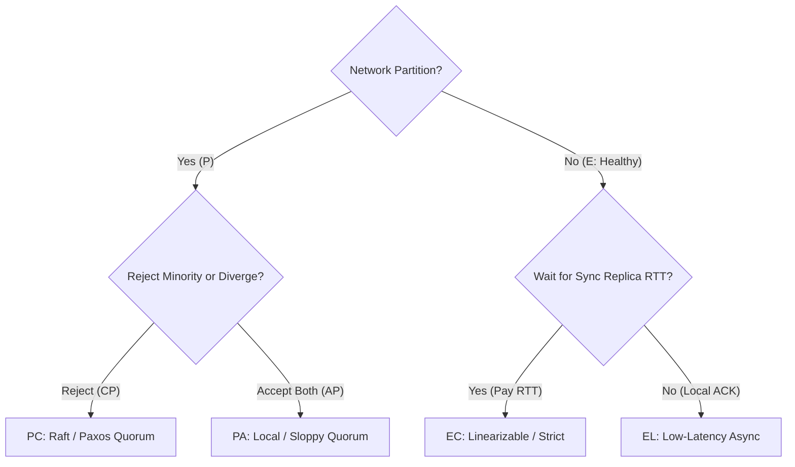
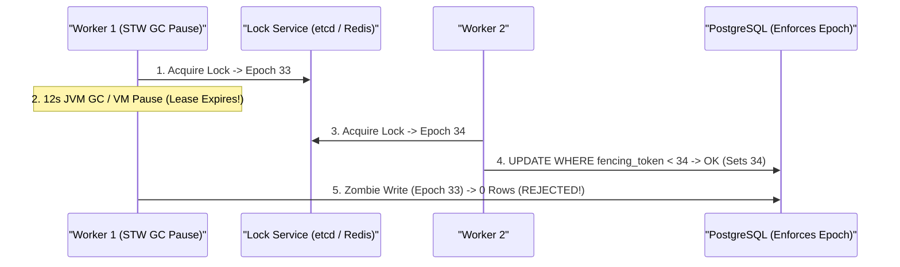

---
tags:
  - software-engineering
  - system-design
  - distributed-systems
  - consensus
  - cap-theorem
created: 2026-11-13
updated: 2026-11-13
status: 🟢
level: mid-to-senior
---

# CAP Theorem & Distributed Consensus

> [!abstract] Vault Navigation
> Core distributed systems handbook within [[Programming/Software Engineering/System Design/System Design Overview|System Design Overview]] and [[Programming/Software Engineering/System Design/System Design Complete Guide|System Design Complete Guide]]. Integrates with [[Programming/Software Engineering/System Design/Scalability|Scalability]], [[Programming/Software Engineering/System Design/Message Queues|Message Queues]], [[Programming/Software Engineering/Database Design/Relational Databases|Relational Databases]], [[Programming/Software Engineering/Database Design/NoSQL|NoSQL]], [[Programming/Software Engineering/Database Design/Replication|Replication]], [[Programming/Software Engineering/Database Design/Transactions|Transactions]], and [[Programming/Software Engineering/DevOps/Kubernetes|Kubernetes]].

Distributed databases replicate state across physically separated machines linked by asynchronous, lossy networks where switches drop packets, fibers cut, VM hypervisors stall vCPUs, and garbage collectors pause processes arbitrarily. CAP, PACELC, Raft consensus, logical clocks, CRDTs, and fencing tokens define the exact mathematical boundaries separating safe state machines from silent data corruption and split-brain divergence.

---

## 1. Formal CAP Theorem, Network Partitions & PACELC

### 1.1 Formal CAP Theorem (Brewer / Gilbert & Lynch, 2002)

In an asynchronous network model with unbounded message delay and arbitrary packet drops, a replicated shared read/write register cannot simultaneously guarantee all three properties:

| Property | Formal Gilbert & Lynch Definition | Frequent Engineering Misconception |
| :--- | :--- | :--- |
| **C — Consistency (Linearizability)** | Every read returns the value of the **most recent completed write** (or an explicit error), behaving as a **single atomic register** ordered in global real time | **NOT** ACID Consistency (foreign-key/balance domain invariants); ACID `C` is an application invariant, whereas CAP `C` is real-time single-copy recency |
| **A — Availability** | Every request received by a **non-failing node** MUST terminate in a non-error data response (cannot stall indefinitely or return `503` on minority partitions) | **NOT** uptime SLA ("99.99% availability"). A `CP` Raft cluster returning `503` from minority nodes during a split maintains 99.99% cluster SLA while **violating CAP Availability** |
| **P — Partition Tolerance** | The system continues executing despite arbitrary message loss or delay across network links separating nodes | **NOT optional**. Distributed networks drop packets and sever AZ links; "CA" only holds on a single non-replicated node or by halting the entire network |

#### Packet-Level Proof: Why "CA" Cannot Exist Over an Unreliable Network

Consider a two-node replicated cluster $\{G_1, G_2\}$ initially storing `x = 0`. Suppose an inter-rack fiber switch drops all TCP segments between $G_1$ and $G_2$ while clients still reach both nodes independently:
1. **$t_1$ — Client 1 sends `PUT x = 1` to $G_1$**:
   - $G_1$ attempts synchronous replication (`TCP SYN/PSH`) to $G_2$. No ACK returns. In an asynchronous network, $G_1$ **cannot distinguish** whether $G_2$ crashed permanently or the link merely partitioned!
   - *Choice*: If $G_1$ blocks indefinitely or rejects with `503` until $G_2$ replies, it immediately violates **Availability (`A`)** $\implies$ **CP**.
   - To preserve **Availability (`A`)**, $G_1$ must commit locally and return `200 OK` (`x = 1`) despite zero confirmation from $G_2$.
2. **$t_2 > t_1$ — Client 2 sends `GET x` to $G_2$**:
   - $G_2$ never received the replication packet (`x` is still `0` locally) and cannot reach $G_1$.
   - *Choice*: If $G_2$ rejects with `503`, it violates **Availability (`A`)**. If $G_2$ replies immediately to stay Available, it returns **stale `x = 0`** even though `PUT x = 1` already completed at $t_1 < t_2$—violating **Linearizability (`C`)** $\implies$ **AP**.

### 1.2 PACELC Theorem (Abadi, 2012)

CAP characterizes behavior **only during a partition** (`P`), which accounts for $< 0.1\%$ of cluster lifetime. During the $> 99.9\%$ healthy non-partitioned regime (`E`), replicated databases still face an unavoidable trade-off between **Latency (`L`)** (returning immediately from local memory) and **Consistency (`C`)** (paying cross-AZ/cross-region RTT for synchronous replication before ACK).

> **PACELC**: If **P**artition, trade **A**vailability vs **C**onsistency; **E**lse (normal operation), trade **L**atency vs **C**onsistency.



| System & Default Configuration | Classification | Partition Behavior (`P`) | Healthy Behavior (`E`) |
| :--- | :--- | :--- | :--- |
| **Google Spanner / CockroachDB / `etcd` / ZooKeeper** | **`PC / EC`** | Minority partition nodes refuse writes and linearizable reads (`Raft`/`Paxos` quorum) | Writes wait for quorum `fsync` + network RTT (`EC`); reads pay `ReadIndex` or lease/`commit-wait` overhead |
| **DynamoDB (default) / Cassandra (`ONE`) / Riak** | **`PA / EL`** | Every reachable node accepts reads & writes via sloppy quorums / local commits | Coordinator ACKs after writing locally (or $W=1$), replicating asynchronously (`< 2 ms` intra-region) |
| **Yahoo! PNUTS** | **`PC / EL`** | Each record designates a home master; non-master partitions cannot accept conflicting writes (`PC`) | Home master ACKs writes locally in `< 5 ms` without cross-DC sync RTT (`EL`), streaming updates asynchronously |
| **Cassandra (`ALL` / strict `QUORUM`, no hinted handoff)** | **`PC / EC` (Tunable)** | Strict `QUORUM` rejects operations when $< Q$ replicas reachable (`PC`) | Writes/reads block for $W/R$ quorum RTT (`EC`), though still subject to LWW clock skew |

### 1.3 Real-World Use Cases & Architectural Decision Matrix

| Engineering Scenario | Recommended Architecture | When NOT to Adopt It | Trade-Off vs Alternative |
| :--- | :--- | :--- | :--- |
| **Financial ledger, double-entry wallets, or inventory reservations** | **`PC / EC` Strict Serializability** (`CockroachDB`, `Spanner`, single-primary PostgreSQL `SERIALIZABLE`) | Telemetry counters, social likes, or offline mobile apps needing local writes during WAN disconnects | Zero double-spends or write skew vs higher cross-AZ/region quorum RTT and minority-partition unavailability |
| **Cluster coordination, service discovery, & leader election leases** | **`PC / EC` Linearizable Raft** (`etcd`, `ZooKeeper`, `Consul`) | High-throughput user session caches or multi-TB analytical blobs (`etcd` caps storage around `2–8 GB`) | Strong single-key linearizability + monotonic `mod_revision` fencing vs small state-size ceiling |
| **Multi-region shopping carts, collaborative metadata, & edge counters** | **`PA / EL` + State-Based CRDTs** (`OR-Set`, `PN-Counter`) | Balance invariants (`balance >= 0`) requiring cross-key atomic preconditions | `< 10 ms` local availability during inter-continental cuts vs metadata tag overhead and eventual convergence |
| **High-volume IoT telemetry, social feeds, & read-heavy SaaS profiles** | **`PA / EL` Async Replicas + Causal Session Tokens** | Banking, RBAC permission checks requiring sub-second global revocation | Near-linear horizontal scale + low latency vs bounded staleness window for non-author readers |
| **Cross-region user profile directory requiring single-master consistency** | **`PC / EL` Home-Master Routing** (per-tenant primary DB + async read followers) | Workloads where users roam continuously across continents writing from everywhere simultaneously | Local read speed + no split-brain writes vs write latency RTT back to home region on cross-region travel |

---

## 2. The Consistency Spectrum, Isolation Anomalies & CRDTs

### 2.1 Linearizability vs Serializability vs Strict Serializability

Confusing **Linearizability** (single-object real-time recency) with **Serializability** (multi-object transactional equivalence) causes subtle production financial and inventory bugs:

| Guarantee | Scope | Core Invariant | What It Prevents | What It STILL Allows |
| :--- | :--- | :--- | :--- | :--- |
| **Linearizability** | **Single object** (`GET`/`PUT` on 1 key) | If write $W(x)=v$ completes at wall-clock $t_1$, any read $R(x)$ starting at $t_2 > t_1$ observes $v$ (or a newer write) | Stale replica reads, time regression on one key | **Multi-object anomalies** (**Write Skew**, torn bank transfers across two keys) |
| **Serializability** | **Multi-object transactions** | Outcome of concurrent multi-key transactions equals *some* valid serial execution order | Write skew, lost updates, dirty/phantom reads | **Stale real-time reads** (a read-only transaction reading a 10-minute-old consistent snapshot is strictly serializable!) |
| **Strict Serializability (External Consistency)** | **Multi-object** + **real-time wall-clock order** | Multi-key ACID atomicity **and** if TX1 commits before TX2 starts in real time, TX2 strictly follows TX1 (`Spanner`, `CockroachDB`) | Both multi-key anomalies **and** stale reads | Highest cross-AZ/cross-region coordination RTT |

#### Concrete Counterexample Traces

1. **Pure Linearizability Allows Write Skew**: Keys `alice = true` and `bob = true` live in a strictly linearizable KV store (`etcd`). Invariant: `at least 1 doctor on call`.
   - TX1 reads `alice` (`true`), reads `bob` (`true`), sees `count = 2`, executes `PUT alice = false`.
   - Concurrently, TX2 reads `alice` (`true`), reads `bob` (`true`), sees `count = 2`, executes `PUT bob = false`.
   - Every single-key `GET`/`PUT` was linearizable, yet final state leaves `alice = false, bob = false` (**0 doctors on call**).
2. **Pure Serializability Allows Stale Time-Travel**: At `12:00:00`, TX1 updates `balance = 500` and commits. At `12:00:05`, TX2 begins and reads an isolated historical snapshot from `11:55:00` returning `balance = 0`. Putting TX2 *before* TX1 in the logical serial order `(TX2 -> TX1)` satisfies mathematical Serializability, even though it violates real-time causality!

### 2.2 Sequential, Causal & Client-Centric Session Guarantees

Moving down the consistency lattice drops coordination RTT overhead in geo-distributed systems:
1. **Sequential Consistency** (Lamport): All processes observe the *same global total order* of operations consistent with each single client's program order, without binding to external wall-clock start/end times.
2. **Causal Consistency**: Operations linked by happens-before causality ($A \to B$, e.g., creating a post then commenting on it, or reading $v_1$ before writing $v_2$) MUST appear in order $A$ before $B$ on *all* replicas. Concurrent independent writes ($C \parallel D$) may arrive in opposite orders at different regions.
3. **Client-Centric Session Guarantees** (layered cleanly atop `PA/EL` async replicas):
   - **Read-Your-Writes**: After a user commits write $W$, subsequent reads by *that user* always observe $W$ or newer (enforced via causal LSN/HLC tokens; see [[Programming/Software Engineering/System Design/Scalability|Scalability]]).
   - **Monotonic Reads**: If a user observes version $v_2$, no future read in that session ever regresses to $v_1$ (solved via consistent replica pinning per `user_id` or passing `min_version` tokens).
   - **Monotonic Writes / Writes Follow Reads**: Writes from the same session apply in issue order, and a reply written *after* reading message $M$ never becomes visible to other replicas before $M$ itself arrives (**Consistent Prefix**).

### 2.3 Eventual Consistency & Conflict-Free Replicated Data Types (CRDTs)

Under `PA/EL`, multiple partitioned regions accept concurrent mutations to the same key. Simple **Last-Write-Wins (LWW)** resolves conflicts by overwriting with the highest client timestamp—silently losing updates under NTP clock skew.

**State-Based CRDTs (CvRDTs)** model state as a mathematical join-semilattice where any two replicas merge via a `merge(a, b)` operator that is strictly:
- **Associative**: `(a ⊔ b) ⊔ c == a ⊔ (b ⊔ c)`
- **Commutative**: `a ⊔ b == b ⊔ a`
- **Idempotent**: `a ⊔ a == a` (duplicate/out-of-order gossip packets cause zero corruption!)

Below are complete runnable TypeScript implementations of **G-Counter**, **PN-Counter**, **LWW-Element-Set**, and **OR-Set (Observed-Remove Set)**:

```typescript
// src/crdt/crdts.ts — Production CvRDT Implementations (G-Counter, PN-Counter, LWW-Set, OR-Set)
import crypto from "node:crypto";

/**
 * 0. G-Counter (Grow-Only Counter): Tracks monotonic increments per replicaId.
 * Forms a bounded join-semilattice under element-wise max(local[i], remote[i]).
 */
export class GCounter {
  private readonly counts = new Map<string, number>();

  constructor(private readonly replicaId: string) {}

  increment(delta = 1): void {
    if (delta < 0) throw new Error("GCounter is grow-only; use PNCounter for decrements");
    this.counts.set(this.replicaId, (this.counts.get(this.replicaId) ?? 0) + delta);
  }

  value(): number {
    let total = 0;
    for (const v of this.counts.values()) total += v;
    return total;
  }

  merge(remote: GCounter): void {
    for (const [id, count] of remote.counts.entries()) {
      this.counts.set(id, Math.max(this.counts.get(id) ?? 0, count));
    }
  }
}

/**
 * 1. PN-Counter (Positive-Negative Counter): Supports concurrent distributed increment & decrement
 * without coordination locks by isolating per-replica monotonic vectors.
 */
export class PNCounter {
  private readonly p = new Map<string, number>(); // Increments per replicaId
  private readonly n = new Map<string, number>(); // Decrements per replicaId

  constructor(private readonly replicaId: string) {}

  increment(delta = 1): void {
    if (delta < 0) throw new Error("Use decrement() for negative delta");
    this.p.set(this.replicaId, (this.p.get(this.replicaId) ?? 0) + delta);
  }

  decrement(delta = 1): void {
    if (delta < 0) throw new Error("Delta must be non-negative");
    this.n.set(this.replicaId, (this.n.get(this.replicaId) ?? 0) + delta);
  }

  value(): number {
    let sumP = 0;
    let sumN = 0;
    for (const v of this.p.values()) sumP += v;
    for (const v of this.n.values()) sumN += v;
    return sumP - sumN;
  }

  /** Associative, commutative, idempotent join: component-wise max() */
  merge(remote: PNCounter): void {
    for (const [id, count] of remote.p.entries()) {
      this.p.set(id, Math.max(this.p.get(id) ?? 0, count));
    }
    for (const [id, count] of remote.n.entries()) {
      this.n.set(id, Math.max(this.n.get(id) ?? 0, count));
    }
  }
}

/**
 * 2. LWW-Element-Set: Tracks latest timestamp in addSet & removeSet per item.
 * Tie-break biases towards remove or add consistently across all replicas.
 * Warning: vulnerable to wall-clock skew unless paired with HLC timestamps!
 */
export class LWWElementSet<T extends string> {
  private readonly addMap = new Map<T, number>();
  private readonly removeMap = new Map<T, number>();

  add(item: T, ts: number): void {
    this.addMap.set(item, Math.max(this.addMap.get(item) ?? -Infinity, ts));
  }

  remove(item: T, ts: number): void {
    this.removeMap.set(item, Math.max(this.removeMap.get(item) ?? -Infinity, ts));
  }

  has(item: T): boolean {
    const addedAt = this.addMap.get(item);
    if (addedAt === undefined) return false;
    const removedAt = this.removeMap.get(item);
    // Strict > biases concurrent equal timestamps toward removal (safe default)
    return removedAt === undefined || addedAt > removedAt;
  }

  merge(remote: LWWElementSet<T>): void {
    for (const [k, ts] of remote.addMap.entries()) this.add(k, ts);
    for (const [k, ts] of remote.removeMap.entries()) this.remove(k, ts);
  }
}

/**
 * 3. OR-Set (Observed-Remove Set): Eliminates wall-clock dependency completely!
 * Concurrent add(x) || remove(x) preserves the newly added item ("add-wins" semantics)
 * because remove() ONLY tombstones add-tags already observed locally at remove time.
 */
export class ORSet<T extends string> {
  private readonly adds = new Map<T, Set<string>>();    // element -> Set<uniqueTag>
  private readonly tombstones = new Map<T, Set<string>>(); // element -> Set<removedTag>

  add(item: T): string {
    const tag = crypto.randomUUID();
    const set = this.adds.get(item) ?? new Set<string>();
    set.add(tag);
    this.adds.set(item, set);
    return tag;
  }

  remove(item: T): void {
    const observedTags = this.adds.get(item);
    if (!observedTags || observedTags.size === 0) return;

    const tomb = this.tombstones.get(item) ?? new Set<string>();
    for (const tag of observedTags) {
      tomb.add(tag); // Only tombstones tags seen by THIS replica!
    }
    this.tombstones.set(item, tomb);
  }

  elements(): T[] {
    const out: T[] = [];
    for (const [item, addTags] of this.adds.entries()) {
      const deadTags = this.tombstones.get(item);
      for (const tag of addTags) {
        if (!deadTags || !deadTags.has(tag)) {
          out.push(item);
          break;
        }
      }
    }
    return out;
  }

  merge(remote: ORSet<T>): void {
    for (const [item, rAdds] of remote.adds.entries()) {
      const local = this.adds.get(item) ?? new Set<string>();
      for (const t of rAdds) local.add(t);
      this.adds.set(item, local);
    }
    for (const [item, rTombs] of remote.tombstones.entries()) {
      const local = this.tombstones.get(item) ?? new Set<string>();
      for (const t of rTombs) local.add(t);
      this.tombstones.set(item, local);
    }
  }
}
```

### 2.4 Physical Clocks vs Lamport, Vector, TrueTime & Hybrid Logical Clocks (HLC)

Quartz oscillators drift by `10–50 ppm` ($\sim 1\text{–}4\text{ s/day}$), and NTP synchronization can step `CLOCK_REALTIME` **backward** mid-transaction. Never rely on `Date.now()` (`CLOCK_REALTIME`) for ordering distributed mutations; use `CLOCK_MONOTONIC` solely for local elapsed durations (`performance.now()` / `process.hrtime.bigint()`) and logical/hybrid clocks for distributed ordering.

| Clock Mechanism | Metadata Size | Captures Causal Order ($A \to B \implies C(A) < C(B)$) | Detects Concurrency ($A \parallel B$)? | Physical Wall-Clock Bounded? | Production System |
| :--- | :--- | :--- | :--- | :--- | :--- |
| **Lamport Clock** | $O(1)$ (`uint64`) | **Yes** ($C = \max(C_{\text{loc}}, C_{\text{msg}}) + 1$) | **No** ($C(A) < C(B) \not\implies A \to B$) | No | Event sequencing |
| **Vector Clock** | $O(N)$ ($N$ node counters) | **Yes** | **Yes** ($V_A \not\le V_B \land V_B \not\le V_A$) | No | Amazon Dynamo / Riak sibling resolution |
| **TrueTime** | `[earliest, latest]` | **Yes** (enforced via `commit-wait` $2\epsilon$) | N/A (global total order) | **Yes** ($\epsilon \le 7\text{ ms}$, GPS + Atomic) | Google Cloud Spanner |
| **Hybrid Logical Clock (HLC)** | $O(1)$ (`64-bit (l, c)`) | **Yes** | Tie-break order only (not full vector concurrency) | **Yes** ($\|l - \text{pt}\| \le \epsilon_{\max}$) | CockroachDB, YugabyteDB, MongoDB cluster time |

#### Vector Clock & Hybrid Logical Clock (HLC) Implementations

```typescript
// src/clocks/logical-clocks.ts — Vector Clock (Sibling Conflict Detection) & HLC
export type VectorMap = Record<string, number>;

export class VectorClock {
  private clock: VectorMap = {};

  constructor(private readonly nodeId: string, initial?: VectorMap) {
    if (initial) this.clock = { ...initial };
  }

  tick(): VectorMap {
    this.clock[this.nodeId] = (this.clock[this.nodeId] ?? 0) + 1;
    return { ...this.clock };
  }

  receive(remote: VectorMap): VectorMap {
    for (const [k, v] of Object.entries(remote)) {
      this.clock[k] = Math.max(this.clock[k] ?? 0, v);
    }
    return this.tick();
  }

  /** Compares two vector clocks: BEFORE (-1), AFTER (1), EQUAL (0), or CONCURRENT CONFLICT (null) */
  static compare(a: VectorMap, b: VectorMap): -1 | 0 | 1 | null {
    const keys = new Set([...Object.keys(a), ...Object.keys(b)]);
    let aLess = false;
    let bLess = false;
    for (const k of keys) {
      const va = a[k] ?? 0;
      const vb = b[k] ?? 0;
      if (va < vb) aLess = true;
      if (va > vb) bLess = true;
    }
    if (!aLess && !bLess) return 0;
    if (aLess && !bLess) return -1; // a -> b
    if (bLess && !aLess) return 1;  // b -> a
    return null; // a || b (concurrent divergence: keep both as siblings or merge via CRDT!)
  }
}

/**
 * Hybrid Logical Clock (Kulkarni et al.): packs physical upper-bound `l` + logical counter `c`.
 * Captures happens-before ordering in O(1) space while tracking wall-clock NTP time closely.
 */
export class HybridLogicalClock {
  private l = 0; // Highest physical time observed so far (ms)
  private c = 0; // Logical sub-millisecond counter

  constructor(private readonly maxClockOffsetMs = 500) {}

  now(physicalTimeMs = Date.now()): { l: number; c: number } {
    const prevL = this.l;
    this.l = Math.max(prevL, physicalTimeMs);
    this.c = this.l === prevL ? this.c + 1 : 0;
    return { l: this.l, c: this.c };
  }

  update(remote: { l: number; c: number }, physicalTimeMs = Date.now()): { l: number; c: number } {
    if (remote.l - physicalTimeMs > this.maxClockOffsetMs) {
      throw new Error(`Excessive clock skew detected: remote=${remote.l} vs local=${physicalTimeMs}`);
    }
    const prevL = this.l;
    this.l = Math.max(prevL, remote.l, physicalTimeMs);

    if (this.l === prevL && this.l === remote.l) {
      this.c = Math.max(this.c, remote.c) + 1;
    } else if (this.l === prevL) {
      this.c = this.c + 1;
    } else if (this.l === remote.l) {
      this.c = remote.c + 1;
    } else {
      this.c = 0;
    }
    return { l: this.l, c: this.c };
  }
}
```

- **Spanner TrueTime vs CockroachDB HLC**: Google Spanner deploys GPS receivers and Rubidium atomic clocks in every datacenter exposing bounded time `[earliest, latest]` with uncertainty $\epsilon \approx 1\text{–}7\text{ ms}$. Before acknowledging a transaction commit at $s = \text{TT.now().latest}$, Spanner waits until $\text{TT.now().earliest} > s$ (`commit-wait`, up to $2\epsilon$), physically guaranteeing global External Consistency. CockroachDB runs on commodity cloud VMs using HLC + NTP (`max_offset = 250–500 ms`): instead of stalling every write for $500\text{ ms}$, transactions reading a key whose HLC falls inside `(read_ts, read_ts + max_offset]` trigger a fast **Read Restart** at the higher timestamp!

---

## 3. Raft Consensus Step-by-Step Protocol Mechanics

Consensus engines (`etcd`, Consul, CockroachDB Multi-Raft, Kafka KRaft) replicate an ordered write-ahead log across $N$ nodes acting as a deterministic replicated state machine.

### 3.1 Quorum Intersection Invariant & Odd Cluster Sizing

For any cluster of $N$ voting replicas, quorum size is strict majority $Q = \left\lfloor \frac{N}{2} \right\rfloor + 1$. By the pigeonhole principle, any two majorities $Q_1, Q_2$ satisfy $|Q_1| + |Q_2| > N \implies Q_1 \cap Q_2 \neq \emptyset$. Therefore, every newly elected leader's vote quorum **must intersect** with at least one node holding every previously committed log entry!

| Cluster Size $N$ | Quorum $Q = \lfloor N/2 \rfloor + 1$ | Max Tolerated Node Failures ($F = N - Q$) | Failure Tolerance % | Operational Recommendation |
| :--- | :--- | :--- | :--- | :--- |
| **`3`** | `2` | **`1`** | `33.3%` | Standard baseline HA (3 AZs) |
| **`4`** | `3` | **`1`** | `25.0%` | **Anti-pattern!** Costs more write quorum RTT ($3$ vs $2$) with **zero extra failure tolerance** over $N=3$! |
| **`5`** | `3` | **`2`** | `40.0%` | Production control planes (`etcd`, KRaft) surviving rolling maintenance + 1 simultaneous crash |
| **`7`** | `4` | **`3`** | `42.9%` | Geo-distributed consensus; beyond 7, write fan-out degrades latency |

### 3.2 Leader Election (`RequestVote`) & Log Up-To-Date Check

1. **Randomized Election Timers**: Followers expect periodic `AppendEntries` heartbeats (e.g., every `50 ms`). Each follower picks an independent randomized election timeout (`150–300 ms`). When a timer expires without contact, the follower increments `currentTerm`, transitions to **Candidate**, votes for itself, and broadcasts `RequestVote(term, candidateId, lastLogIndex, lastLogTerm)`. Randomized timers make simultaneous split votes exponentially unlikely to repeat across terms.
2. **Safety Check (`Log Up-To-Date`)**: A voter rejects any candidate whose log is less up-to-date than its own, evaluated **strictly by `lastLogTerm` first, then `lastLogIndex`**:
   ```text
   isCandidateUpToDate = (candidateLastTerm > voterLastTerm)
     || (candidateLastTerm == voterLastTerm && candidateLastIndex >= voterLastIndex)
   ```
   *Why `lastLogTerm` beats `lastLogIndex`*: An isolated old leader in Term 2 might have appended 50 uncommitted local entries before crashing, whereas a healthy node in Term 4 has only 10 entries (including committed Term 4 data). Comparing length alone would elect the stale Term 2 candidate and overwrite committed Term 4 state!

### 3.3 Log Replication (`AppendEntries`) & The Subtle Figure-8 Commit Invariant

1. **Inductive Log Matching**: Leader sends `AppendEntries(term, leaderId, prevLogIndex, prevLogTerm, entries[], leaderCommit)`. A follower appends `entries[]` **only if** its log at `prevLogIndex` matches `prevLogTerm`; otherwise it rejects so the leader decrements `nextIndex[follower]` and repairs divergent suffix logs safely.
2. **Commit Rule (`Figure 8` Subtlety)**: Once a majority ($Q$) persists an entry via `fsync`, does the leader advance `commitIndex`? **Critical invariant**: A Raft leader may ONLY advance `commitIndex` by counting replicas for entries appended in **`currentTerm`**, NEVER by directly counting replicas for entries left over from a **previous term**!

```mermaid
sequenceDiagram
    participant L1 as "Node S1 (Term 2 -> 4)"
    participant S2 as "Node S2"
    participant S3 as "Node S3"
    participant S4 as "Node S4 / S5"
    L1->>S2: 1. Replicate Term 2 entry k=2 (No majority yet; crashes!)
    Note over S4: 2. S5 wins Term 3, writes k=2 (Term 3) locally, crashes
    Note over L1: 3. S1 wins Term 4, replicates old k=2 (Term 2) to S2, S3
    L1->>S3: 4. If S1 committed Term 2 directly, S5 could still win Term 5 & overwrite k=2!
    L1->>S3: 5. S1 appends & commits Term 4 entry k=3 -> k=2 commits safely indirectly!
```

- *Why*: In step 3 above, even though old entry `k=2 (Term 2)` sits on a majority `(S1, S2, S3)`, node `S5` holds `k=2 (Term 3)` (`lastLogTerm = 3 > 2`!). If `S1` crashed before committing a Term 4 entry, `S5` could win Term 5 election from `(S3, S4, S5)` (Wait: `S3` only had Term 2 until `S1` sent Term 4!) and **overwrite `k=2`**, destroying an already-acknowledged write! Requiring `S1` to replicate and commit a **`currentTerm` (Term 4)** entry onto a majority prevents `S5` (`Term 3 < Term 4`) from ever winning election afterward, locking `k=2` in permanently!

### 3.4 Preventing Deposed Leader Stale Reads (`ReadIndex` & Leader Leases)

Suppose Leader `L1` (Term 5) is partitioned away from followers `(F2, F3)`—remaining reachable only by an external client! Meanwhile `(F2, F3, ...)` elect a new Leader `L2` in Term 6 and commit `x = "new"`. Because `L1` hasn't heard from Term 6 yet, `L1` still believes it is Leader! Serving local state machine memory directly from `L1` returns stale `x = "old"`, violating **Linearizability**.

Two mechanisms guarantee linearizable reads in Raft:
1. **`ReadIndex` (Zero Clock Dependency, Default in `etcd`)**:
   - Leader records `readIndex = commitIndex`.
   - Leader broadcasts one heartbeat round (`AppendEntries`) to followers; once a majority ACKs `currentTerm`, `L1` proves it was **not** deposed at the moment `readIndex` was captured.
   - Leader waits until its local state machine applies up to `lastApplied >= readIndex` and serves the read safely.
2. **Leader Lease (Clock-Bounded Optimization)**:
   - Followers promise not to vote for a new leader within `electionTimeout` after acknowledging a heartbeat. The leader skips the heartbeat RTT completely for reads inside `leaseExpiry = lastMajorityAck + electionTimeout / maxClockDrift`.
   - *Danger*: Unbounded hypervisor/VM CPU stalls or NTP clock skew breaking the `maxClockDrift` assumption break linearizability silently—hence `etcd` defaults to `ReadIndex` (`linearizable` read mode).

### 3.5 Log Compaction (`InstallSnapshot`), `PreVote` & Safe Cluster Reconfiguration

Production Raft deployments (`etcd`, CockroachDB, TiKV) must handle three additional operational realities beyond the core election/replication loop:

1. **Disruptive Reconnecting Partitions & `PreVote`**:
   - *Hazard*: Suppose Follower `F3` gets partitioned from healthy Leader `L1` and Follower `F2`. Because `F3` stops receiving heartbeats, `F3` repeatedly times out and bumps `currentTerm` from `5` $\to$ `40` while failing to reach a quorum! When the fiber heals and `F3` reconnects sending `RequestVote(term=40)`, `L1` and `F2` are forced by Raft rules to step down to Follower at `term=40`, halting healthy cluster writes for an unnecessary election cycle!
   - **`PreVote` Fix**: Before incrementing `currentTerm`, a timed-out node issues a two-phase `PreVote(nextTerm)` probe. Peers grant a pre-vote **only if** they have *not* heard a valid leader heartbeat recently AND the candidate's log is at least as up-to-date. Since `L1` still sends valid heartbeats to `F2`, `F3`'s `PreVote` fails silently without disrupting `L1`!
2. **Log Compaction & `InstallSnapshot` RPC**:
   - The Raft WAL cannot grow infinitely. Once `lastApplied` advances sufficiently, each node takes an independent point-in-time state-machine snapshot (`lastIncludedIndex`, `lastIncludedTerm`) and truncates older WAL entries.
   - If a crashed follower lags behind the leader's earliest retained WAL index (`nextIndex[follower] <= snapshotIndex`), the leader streams the compressed snapshot directly via **`InstallSnapshot` RPC** instead of missing WAL entries.
3. **Membership Changes (`Single-Server` Step vs `Joint Consensus`)**:
   - Switching a cluster from `3` nodes to `5` nodes directly in one broadcast risks **two disjoint majorities** simultaneously (old 3-node config majority `{S1, S2}` vs new 5-node config majority `{S3, S4, S5}`!).
   - Raft avoids dual majorities via **single-server step changes** (adding or removing strictly **one** voter per committed configuration entry—since overlapping old/new single-step quorums always intersect!) or **two-phase Joint Consensus** ($C_{\text{old,new}}$ requiring simultaneous majorities from *both* old and new sets before transitioning to $C_{\text{new}}$).

---

## 4. Distributed Locking, Zombie Clients & Fencing Tokens

### 4.1 Why Timed Distributed Locks (`SET NX PX`, Redlock) Fail Under Process Pauses

Distributed locks enforcing mutual exclusion via lease TTLs (`SET lock:invoice:42 <uuid> NX PX 5000`, Redlock, or ZooKeeper ephemeral nodes) rely on bounded process execution time:



Even 5-node Redlock fails completely if Worker 1 freezes inside an **8-second JVM Stop-The-World GC pause** (or OS swap stall) immediately *after* verifying lock ownership and *before* transmitting its SQL write or external Stripe API call: Worker 2 acquires a fresh lease and advances state, then Worker 1 wakes up and dispatches a corrupting zombie write!

### 4.2 Complete Fencing Token Implementation (Lock Epoch Server + PostgreSQL Guard)

To make mutual exclusion mathematically safe against arbitrary pauses, the lock service MUST emit a **strictly monotonically increasing fencing token** (`etcd` `mod_revision`, ZooKeeper `zxid`, or Redis atomic `INCR` epoch), and the **storage engine itself MUST enforce `stored_token < incoming_token`**:

```sql
-- db/migrations/001_fencing_invoices.sql
CREATE TABLE invoices (
  id              TEXT PRIMARY KEY,
  status          TEXT NOT NULL CHECK (status IN ('PENDING', 'CHARGING', 'PAID', 'FAILED')),
  amount_cents    BIGINT NOT NULL,
  fencing_token   BIGINT NOT NULL DEFAULT 0,
  idempotency_key TEXT NOT NULL UNIQUE,
  updated_at      TIMESTAMPTZ NOT NULL DEFAULT now()
);
```

```typescript
// src/locking/fenced-billing-worker.ts — Complete Lock Epoch + PostgreSQL Storage Guard
import type { Redis } from "ioredis";
import type { Pool } from "pg";

const ACQUIRE_FENCED_LOCK_LUA = `
-- KEYS[1] = lock key (e.g., "lock:invoice:42")
-- KEYS[2] = monotonic epoch counter (e.g., "epoch:invoice:42", never expires!)
-- ARGV[1] = owner_uuid, ARGV[2] = ttl_ms
if redis.call("SET", KEYS[1], ARGV[1], "NX", "PX", tonumber(ARGV[2])) then
  local token = redis.call("INCR", KEYS[2])
  return token
end
return -1
`;

const RELEASE_LOCK_LUA = `
if redis.call("GET", KEYS[1]) == ARGV[1] then
  return redis.call("DEL", KEYS[1])
end
return 0
`;

export interface FencedLockHandle {
  ownerId: string;
  fencingToken: number;
  release: () => Promise<void>;
}

export class FencedLockService {
  constructor(private readonly redis: Redis) {
    this.redis.defineCommand("acquireFencedLock", { numberOfKeys: 2, lua: ACQUIRE_FENCED_LOCK_LUA });
    this.redis.defineCommand("releaseFencedLock", { numberOfKeys: 1, lua: RELEASE_LOCK_LUA });
  }

  async acquire(resourceId: string, ownerId: string, ttlMs = 5000): Promise<FencedLockHandle | null> {
    const lockKey = `lock:${resourceId}`;
    const epochKey = `epoch:${resourceId}`;
    // Note: in Redis Cluster, tag both keys `{resourceId}` -> "lock:{inv:42}" & "epoch:{inv:42}"!
    const token = await (this.redis as unknown as {
      acquireFencedLock: (k1: string, k2: string, owner: string, ttl: number) => Promise<number>;
    }).acquireFencedLock(lockKey, epochKey, ownerId, ttlMs);

    if (token < 0) return null;
    return {
      ownerId,
      fencingToken: token,
      release: async () => {
        await (this.redis as unknown as {
          releaseFencedLock: (k1: string, owner: string) => Promise<number>;
        }).releaseFencedLock(lockKey, ownerId);
      },
    };
  }
}

export class StaleFencingTokenError extends Error {}

export async function processInvoiceSafely(
  lockSvc: FencedLockService,
  db: Pool,
  invoiceId: string,
  workerId: string,
  chargeExternalApi: (idempotencyKey: string, amountCents: number) => Promise<void>,
  simulatePauseMs = 0, // Test hook proving zombie worker safety under GC stall
): Promise<"CHARGED" | "LOCK_CONTENDED" | "ZOMBIE_REJECTED"> {
  const lease = await lockSvc.acquire(`{invoice:${invoiceId}}`, workerId, 5000);
  if (!lease) return "LOCK_CONTENDED";

  try {
    // Simulated Stop-The-World GC pause AFTER acquiring lock lease (exceeds 5s TTL!)
    if (simulatePauseMs > 0) {
      await new Promise((r) => setTimeout(r, simulatePauseMs));
    }

    // 1. Atomic storage-layer fencing check BEFORE calling external payment provider!
    const { rows } = await db.query<{ amount_cents: string; idempotency_key: string }>(
      `UPDATE invoices
       SET status = 'CHARGING', fencing_token = $1, updated_at = now()
       WHERE id = $2
         AND status = 'PENDING'
         AND fencing_token < $1
       RETURNING amount_cents, idempotency_key`,
      [lease.fencingToken, invoiceId],
    );

    if (rows.length === 0) {
      // Either another worker already progressed status OR held a higher fencing_token!
      return "ZOMBIE_REJECTED";
    }

    const { amount_cents, idempotency_key } = rows[0];

    // 2. Call external Stripe/payment API with deterministic idempotency_key
    await chargeExternalApi(idempotency_key, Number(amount_cents));

    // 3. Final state commit also guarded by exact fencing_token equality
    await db.query(
      `UPDATE invoices
       SET status = 'PAID', updated_at = now()
       WHERE id = $1 AND fencing_token = $2 AND status = 'CHARGING'`,
      [invoiceId, lease.fencingToken],
    );
    return "CHARGED";
  } finally {
    await lease.release().catch(() => {});
  }
}
```

*(Critical production detail: `epochKey` inside Redis must **never** receive a TTL or be evicted (`noeviction` Redis instance or `etcd` `mod_revision` / PostgreSQL `nextval` sequence) so fencing tokens never reset backward! For multi-AZ survival of the lock service itself, prefer `etcd` leases whose Raft-replicated `mod_revision` survives single-node crashes without losing epoch monotonicity).*

#### Alternative Lock Provider: Native `etcd` v3 `Txn` Lease + `mod_revision` Fencing

Using `etcd3` directly eliminates manual Lua scripts and provides Raft-replicated linearizable locking whose `mod_revision` increments monotonically cluster-wide across every key mutation:

```typescript
// src/locking/etcd-fencing.ts — Raft-Backed Monotonic Fencing Lock via etcd v3
import { Etcd3 } from "etcd3";

export async function acquireEtcdFencedLease(client: Etcd3, resourceKey: string, ttlSec = 10) {
  const lease = client.lease(ttlSec);
  const leaseId = await lease.grant();

  // Atomic CAS transaction: succeed ONLY if key create_revision == 0 (lock currently free)
  const result = await client
    .if(resourceKey, "Create", "==", 0)
    .then(client.put(resourceKey).value(leaseId).lease(leaseId))
    .else(client.get(resourceKey))
    .commit();

  if (!result.succeeded) {
    await lease.revoke();
    return null;
  }

  // etcd's cluster-wide Raft log revision serves natively as an unforgeable fencing token!
  const fencingToken = Number(result.header.revision);
  return {
    fencingToken,
    release: async () => {
      await lease.revoke();
    },
  };
}
```

#### Simulated GC-Pause Verification Harness

Running a deterministic test against `processInvoiceSafely` proves storage-side fencing prevents double-charging even when a worker freezes past its lock TTL:

```typescript
// tests/fencing-zombie-test.ts
async function verifyZombieWorkerRejection(lockSvc: FencedLockService, db: Pool) {
  let externalChargeCalls = 0;
  const mockCharge = async (_key: string, _cents: number) => {
    externalChargeCalls++;
  };

  // Worker 1 acquires Epoch 1 (5s TTL), then stalls 6.5s (exceeding lock TTL!)
  const worker1Promise = processInvoiceSafely(lockSvc, db, "inv-42", "worker-1", mockCharge, 6500);

  // Wait 5.2s until Redis lease expires; Worker 2 acquires Epoch 2 and commits cleanly
  await new Promise((r) => setTimeout(r, 5200));
  const res2 = await processInvoiceSafely(lockSvc, db, "inv-42", "worker-2", mockCharge, 0);
  const res1 = await worker1Promise;

  console.assert(res2 === "CHARGED", `Expected Worker 2 to charge, got ${res2}`);
  console.assert(res1 === "ZOMBIE_REJECTED", `Expected Worker 1 rejection, got ${res1}`);
  console.assert(externalChargeCalls === 1, `Expected 1 charge, got ${externalChargeCalls}`);
}
```

---

## 5. Tunable Quorums, Anti-Entropy & Operations Playbook

### 5.1 Dynamo / Cassandra Tunable Quorums ($W + R > N$)

In leaderless ring databases (`Cassandra`, `ScyllaDB`, `Dynamo`) storing each partition across $N$ replica hosts:
- Coordinator sends writes to $N$ replicas and awaits $W$ ACKs.
- Coordinator queries reads from $N$ replicas (or hashes + 1 full read) and awaits $R$ responses.
- Strict quorum overlap requires:
  $$W + R > N$$

| Configuration ($N = 3$) | Strict Overlap ($W + R > 3$)? | Write Fault Tolerance | Read Latency Profile |
| :--- | :--- | :--- | :--- |
| **`W = 3, R = 1`** | Yes (`4 > 3`) | `0` node failures tolerated on write | Ultra-fast local single-node read |
| **`W = 1, R = 3`** | Yes (`4 > 3`) | `2` node failures tolerated on write | Slowest all-replica fan-out read |
| **`W = 2, R = 2`** (`QUORUM`) | Yes (`4 > 3`) | `1` node failure tolerated for both R/W | Balanced quorum RTT |
| **`W = 1, R = 1`** | No (`2 <= 3`) | `2` node failures tolerated | Fastest throughput; serves stale reads |

> [!warning] Why $W + R > N$ Still Does NOT Guarantee Linearizability!
> Even with $N=3, W=2, R=2$, Dynamo-style clusters violate Linearizability in two real scenarios:
> 1. **Failed Partial Write Visibility**: Coordinator sends `PUT x = "new"` to Replicas 1, 2, 3. Replica 1 persists it; Replicas 2 & 3 drop packets $\to$ coordinator returns `WriteTimeoutException` (failure!). Subsequent Read A hits `(Replica 1, Replica 2)` and observes `"new"`, while Read B hits `(Replica 2, Replica 3)` before read repair finishes and observes `"old"`—violating real-time monotonic visibility!
> 2. **Clock-Skew LWW Loss**: Client A (clock `+60 ms` fast) writes `"A"`; 20 ms later Client B (clock accurate) writes `"B"`. Because timestamps satisfy `t_A > t_B`, Client B's genuinely newer write `"B"` is silently discarded during merge!

### 5.2 Sloppy Quorums, Hinted Handoff & Merkle Tree Anti-Entropy

1. **Sloppy Quorums & Hinted Handoff (`PA/EL`)**: When a partition blocks access to 2 of the 3 designated home replicas, a strict quorum rejects writes (`PC`). Under sloppy quorums, the coordinator writes to $W$ **healthy non-home standby nodes** wrapped with a `X-Hint-For: home_node` header. Writes succeed (`PA`), temporarily **violating $W + R > N$ overlap** until connectivity recovers and hinted rows replay to home nodes.
2. **Read Repair**: On a `QUORUM` read where Replica 1 returns `(v2, ts=200)` and Replica 2 returns `(v1, ts=100)`, the coordinator returns `v2` to the client and asynchronously dispatches `v2` to heal Replica 2. Only heals keys actively read.
3. **Merkle Tree Anti-Entropy**: Background compaction builds hierarchical cryptographic hash trees over sorted key-range buckets on each replica. Replicas exchange root hashes; only mismatched subtrees descend recursively to identify divergent keys in **$O(\log K)$ network bandwidth** without scanning or transferring terabytes of identical SSTables!

```typescript
// src/anti-entropy/merkle-sync.ts — Binary Merkle Tree Range Diff for Replica Repair
import crypto from "node:crypto";

export interface MerkleNode {
  hash: string;
  rangeStart: number;
  rangeEnd: number;
  left?: MerkleNode;
  right?: MerkleNode;
}

function sha256(input: string): string {
  return crypto.createHash("sha256").update(input).digest("hex");
}

export function buildMerkleTree(buckets: string[], start = 0, end = buckets.length - 1): MerkleNode {
  if (start === end) {
    return { hash: sha256(buckets[start]), rangeStart: start, rangeEnd: end };
  }
  const mid = (start + end) >>> 1;
  const left = buildMerkleTree(buckets, start, mid);
  const right = buildMerkleTree(buckets, mid + 1, end);
  return {
    hash: sha256(left.hash + right.hash),
    rangeStart: start,
    rangeEnd: end,
    left,
    right,
  };
}

/** Returns ONLY leaf bucket indices whose contents diverge between two replicas */
export function diffMerkleTrees(local: MerkleNode, remote: MerkleNode, out: number[] = []): number[] {
  if (local.hash === remote.hash) return out; // Entire subtree identical -> skip O(N) scan!
  if (!local.left || !remote.left || !local.right || !remote.right) {
    for (let i = local.rangeStart; i <= local.rangeEnd; i++) out.push(i);
    return out;
  }
  diffMerkleTrees(local.left, remote.left, out);
  diffMerkleTrees(local.right, remote.right, out);
  return out;
}
```

### 5.3 Production Operations & Debugging Playbook

| Symptom | Root Cause Hypothesis | Exact Diagnostic Commands | Remediation |
| :--- | :--- | :--- | :--- |
| **`etcd` / Raft cluster losing leader every 10–30s ("leader flapping")** | Slow NVMe disk starving Raft WAL `fsync`, or GC/noisy neighbor blocking heartbeat thread | `etcdctl endpoint status --write-out=table` · `histogram_quantile(0.99, rate(etcd_disk_wal_fsync_duration_seconds_bucket[5m]))` | Isolate `etcd` onto dedicated NVMe IOPS (`wal_fsync` p99 `< 10 ms`), increase `heartbeat-interval=100` / `election-timeout=1000` across high-RTT links |
| **PostgreSQL throws high `40001 serialization_failure` under `SERIALIZABLE`** | SSI `SIREAD` predicate lock conflicts across hot range scans | `SELECT * FROM pg_stat_database WHERE datname='orders';` (`deadlocks`, `conflicts`), trace `rw-antidependency` queries | Implement bounded jittered app retry loop on SQLSTATE `40001`, narrow query predicates via composite indexes, or switch targeted invariant to `SELECT ... FOR UPDATE` |
| **Cassandra reads timing out with `TombstoneOverwhelmingException`** | Queue-like anti-pattern (`DELETE` / TTL churn) accumulating millions of tombstones in SSTables | `nodetool tablestats <ks.tbl>` · check `Tombstone scanned` histogram in `nodetool proxyhistograms` | Stop using Cassandra as a FIFO queue (use [[Programming/Software Engineering/System Design/Message Queues|Message Queues]]), partition tables by time bucket (`TTL` drop entire partitions), tune `gc_grace_seconds` + run `nodetool repair` regularly |
| **LWW silent data overwrites or CockroachDB excessive Read Restarts** | Unsynchronized NTP daemon (`chronyd` stopped) causing clock offset $> \text{max\_offset}$ | `chronyc tracking` (check `System time` skew) · CockroachDB `sql.txn.read_restart.count` metric | Enforce dedicated Chrony NTP/PTP clock sync daemon with alerting if drift $> 50\text{ ms}$; replace LWW with OR-Set CRDT or Raft consensus |

---

## 6. Worked Exercises

### Exercise 1: Raft Quorum Math ($N=3$ vs $4$ vs $5$) & Stale Reads Under `W+R>N`

A platform team runs two storage tiers:
- **Cluster A**: 4-node `etcd` cluster (Raft).
- **Cluster B**: 3-node Cassandra keyspace (`RF = 3`) running `QUORUM` ($W = 2, R = 2$) with **Hinted Handoff** enabled.

1. Calculate exact quorum size $Q$ and maximum tolerated failures $F$ for **$N = 3$ vs $N = 4$ vs $N = 5$** in Cluster A. Quantify why deploying **4 nodes strictly degraded write availability** compared to 3 nodes.
2. Trace two distinct mechanisms by which Cluster B (`N = 3, W = 2, R = 2`) returns **stale or non-linearizable reads** despite satisfying $2 + 2 > 3$.

---

### Solution 1

#### 1. Raft Fault Tolerance Comparison
Quorum $Q = \lfloor N/2 \rfloor + 1$; tolerated simultaneous crashes $F = N - Q$:
- **$N = 3$**: $Q = 2$, tolerates **$F = 1$** failure (availability collapses only if $\ge 2$ of 3 fail).
- **$N = 4$**: $Q = \lfloor 4/2 \rfloor + 1 = 3$, tolerates **$F = 1$** failure!
- **$N = 5$**: $Q = 3$, tolerates **$F = 2$** failures.

Moving from $3 \to 4$ nodes raises write quorum overhead from $2 \to 3$ nodes **without tolerating a single additional crash**—and actually **reduces cluster availability** because losing 2 out of 4 nodes happens more often than losing 2 out of 3 nodes ($\binom{4}{2} p^2 (1-p)^2 > \binom{3}{2} p^2 (1-p)$ for small $p$)! Always provision odd sizes (`3`, `5`, `7`).

#### 2. Non-Linearizable Reads Under `N=3, W=2, R=2`
1. **Sloppy Quorum Bypassing Home Replicas**: A partition isolates Node 3 and blocks Node 2 momentarily; Coordinator writes `x = "v2"` to Node 1 + a **hinted standby Node 4** ($W = 2$ satisfied under sloppy quorum!). Immediately, a concurrent client queries `(Node 2, Node 3)` ($R = 2$ satisfied!)—neither holds `"v2"` yet, returning stale `"v1"`.
2. **Failed Partial Write + Concurrent Read**: Coordinator begins writing `"v3"`; Node 1 persists it, then Nodes 2 & 3 time out $\to$ Coordinator throws `WriteTimeout` to client. Read 1 hits `(Node 1, Node 2)` and observes `"v3"` (`read repair` hasn't finished yet or runs async), while Read 2 milliseconds later hits `(Node 2, Node 3)` and observes `"v2"`—violating real-time monotonicity.

---

### Exercise 2: Zombie-Client GC Pause, Redlock Failure & Fencing Remediation

A recurring billing worker executes `SET lock:invoice:42 <uuid> NX PX 5000` in Redis before charging Stripe (`stripe.charge()`) and running `UPDATE invoices SET status = 'PAID' WHERE id = 42`.
- Worker A acquires the 5s Redis lock, then hits an **8-second JVM Stop-The-World GC pause** right before calling Stripe.
- After 5s, the Redis lock expires; Worker B acquires `lock:invoice:42`, charges Stripe, and updates PostgreSQL (`PAID`).
- Worker A resumes from GC and calls `stripe.charge()` **a second time**, double-charging the customer!

1. Explain why raising the Redis lock TTL to `60 seconds` or switching to 5-node Redlock still cannot guarantee mutual exclusion safety.
2. Provide the complete 3-step remediation combining **Fencing Tokens**, **PostgreSQL atomic storage guards**, and **External API Idempotency Keys** (showing the exact SQL predicate blocking Worker A).

---

### Solution 2

#### 1. Why Longer TTLs & Redlock Fail
Any mutual exclusion protocol relying on physical timeout leases assumes bounded thread execution time (a *synchronous system model*). Real runtimes experience unbounded stalls (Stop-The-World GC, kernel swap-in, noisy-neighbor vCPU preemption, asymmetric TCP stalls). Whether TTL is `5s` or `60s` across 1 or 5 Redlock masters, the instant Worker A stalls for `61s` between checking lock possession and sending its outbound packet, Worker B legitimately holds the lock simultaneously—and the lock server has zero power to recall Worker A's in-flight HTTP/SQL request.

#### 2. Three-Step Fencing + Idempotency Fix
1. **Monotonic Epoch Token on Lock Acquisition**: Acquire lock from `etcd` (`mod_revision`) or atomic Redis Lua `INCR epoch:{invoice:42}` assigning Worker A `token = 101` and Worker B `token = 102`.
2. **Enforce Token Guard Inside PostgreSQL *Before* Charging Stripe**:
   ```sql
   UPDATE invoices
   SET status = 'CHARGING', fencing_token = $1
   WHERE id = $2
     AND status = 'PENDING'
     AND fencing_token < $1
   RETURNING idempotency_key, amount_cents;
   ```
   When Worker A (`token = 101`) wakes up after Worker B (`token = 102`) already ran, PostgreSQL evaluates `WHERE status = 'PENDING' AND fencing_token < 101` $\to$ affects **`0 rows`**, causing Worker A to abort cleanly (`ZOMBIE_REJECTED`) before touching Stripe!
3. **External Idempotency Key**: Pass `idempotency_key` (`invoice:42:attempt_1`) to Stripe (`Idempotency-Key` header) as defense-in-depth so duplicate HTTP requests arriving during network retries deduplicate safely at Stripe.

---

### Exercise 3: Write Skew Anomaly on Linearizable Storage vs `SERIALIZABLE`

A hospital on-call platform enforces the domain invariant: **at least 1 doctor must remain on call per shift**. Currently, Dr. Alice and Dr. Bob are both on call (`on_call = true`).
The service backs records on a **Linearizable single-key KV store** (`doctor:alice`, `doctor:bob`):
1. Alice's request reads `doctor:alice = true` and `doctor:bob = true` (`count = 2 > 1`).
2. Concurrently, Bob's request reads `doctor:alice = true` and `doctor:bob = true` (`count = 2 > 1`).
3. Alice executes `PUT doctor:alice = false`; Bob executes `PUT doctor:bob = false`.

1. Explain why **Linearizability** failed to prevent leaving **zero doctors on call**, and identify this anomaly by name.
2. Explain why migrating to PostgreSQL under **`REPEATABLE READ` (Snapshot Isolation)** *still* exhibits the exact same bug, and provide two concrete SQL fixes that prevent it.

---

### Solution 3

#### 1. Single-Key Linearizability vs Multi-Object Write Skew
- Every individual `GET` and `PUT` on `doctor:alice` and `doctor:bob` satisfied strict single-object **Linearizability**.
- However, both transactions read an overlapping precondition (`count == 2`) across two independent keys and mutated **disjoint** keys (`alice` vs `bob`). Because neither wrote the same key, single-key atomic semantics detected zero conflict—leaving `alice = false, bob = false`. This classic multi-object concurrency bug is **Write Skew**.

#### 2. Why Snapshot Isolation Fails & How to Fix It
- **PostgreSQL `REPEATABLE READ` (Snapshot Isolation)** catches write-write conflicts on the *same* row (`First-Committer-Wins`), **not** `rw-antidependency` cycles across disjoint rows—both transactions read the same pre-commit snapshot and commit without conflict!
- **Fix 1 — `BEGIN ISOLATION LEVEL SERIALIZABLE` (PostgreSQL SSI)**: Tracks `SIREAD` predicate locks across read sets (`WHERE shift_id = $1 AND on_call = true`). Upon commit, SSI detects the mutual `rw`-cycle between Alice and Bob and aborts the second transaction with SQLSTATE **`40001 serialization_failure`** (application retries cleanly and observes `count = 1`).
- **Fix 2 — Explicit Materialized Lock (`SELECT ... FOR UPDATE`)**: Lock a shared parent shift row (`SELECT id FROM shifts WHERE id = $1 FOR UPDATE`) or lock all matching rows (`SELECT id FROM doctors WHERE shift_id = $1 FOR UPDATE`) under `READ COMMITTED`/`REPEATABLE READ` so transactions execute strictly serially on that shift.

---

### Exercise 4: Multi-Region PACELC & Client-Centric Session Guarantees

You are designing two replicated subsystems spanning `us-east`, `eu-west`, and `ap-south` (`120–240 ms` inter-region RTT):
- **Subsystem A — Financial Wallet Ledger**: Real-time balance transfers; double-spending or negative balances are strictly forbidden.
- **Subsystem B — Social Feed & Profile Posts**: Users publish posts from Tokyo and refresh immediately; a 5-second delay before followers in London see the post is acceptable, **but the author must never see their own post vanish upon page reload** (`F5`).

1. Classify both subsystems under **PACELC** (`PC/EC` vs `PA/EL`) and trace both partition (`P`) and normal (`E`) latency consequences.
2. Trace the exact replica-routing race causing **"my post vanished on reload"** in Subsystem B, and design the session-guarantee protocol preventing it without forcing 240 ms cross-region synchronous writes.

---

### Solution 4

#### 1. PACELC Classification
- **Subsystem A (Financial Ledger) $\to$ `PC / EC` (Strict Serializability)**:
  - *During Partition (`P`)*: Minority side refuses writes/reads (`C` over `A`) to prevent double-spends on split shards.
  - *Normal Operation (`E`)*: Synchronous Multi-Raft / Paxos consensus + HLC/TrueTime (`C` over `L`). Reduce user-facing latency by **pinning each user's Raft leaseholder/primary range inside their home region** (`us-east` accounts write locally across intra-region AZs in `< 15 ms` while staying strictly `PC/EC`!).
- **Subsystem B (Social Feed) $\to$ `PA / EL` (Eventual Consistency + Session Guarantees)**:
  - *During Partition (`P`)*: Local region stays writable and readable (`A` over `C`)—a submarine cable cut never blocks status posts.
  - *Normal Operation (`E`)*: Acknowledge writes locally in `< 10 ms` (`L` over `C`) and stream asynchronously cross-region.

#### 2. Eliminating "Post Vanished on Reload" (`Read-Your-Writes` + `Monotonic Reads`)
- **The Bug**: Author writes `POST /status` hitting regional primary (`lsn = 900`), refreshes `GET /feed`, and load-balances randomly onto Read Replica 2 still at `lsn = 880`—returning an empty feed where the post vanished; refreshing again hits Replica 1 (`lsn = 900`) and the post magically reappears!
- **Remediation**:
  1. **Read-Your-Writes (Causal LSN/HLC Token)**: On write commit, return signed header/cookie `X-Causal-Token: ap-south:900` (`maxAge = 15s`). Any subsequent `GET` carrying that token waits up to `25 ms` on the local replica for `pg_last_wal_replay_lsn() >= 900` or falls back directly to the author's primary/home region (as implemented in [[Programming/Software Engineering/System Design/Scalability|Scalability]]).
  2. **Monotonic Reads (Consistent Replica Affinity)**: Hash `user_id` via consistent hashing to pin each reader session to the *same* healthy replica so sequential reloads never bounce backward from `lsn = 900` to `lsn = 880`.

---

### Exercise 5: Raft Figure-8 Commit Invariant, Deposed `ReadIndex` & OR-Set CRDT Merge

1. **Raft Election & Commit Bug**: Suppose a 5-node Raft cluster (`S1..S5`) runs at Term 4:
   - Earlier in Term 2, former leader `S1` appended log entry `k=2 (Term 2)` to only `(S1, S2)` before crashing.
   - In Term 3, `S5` was elected by `(S3, S4, S5)`, appended `k=2 (Term 3)` locally to `S5` only, and crashed.
   - Now in Term 4, `S1` wins election from `(S1, S2, S3)` and replicates `k=2 (Term 2)` onto `S3` (`(S1, S2, S3)` = majority 3 of 5!).
   Trace step-by-step what breaks if `S1` immediately marks `k=2 (Term 2)` **committed** without waiting to commit an entry from Term 4, and explain how Raft's Figure-8 rule prevents this corruption.
2. **Stale Leader Read**: Even after committing properly, why must `S1` NOT serve a linearizable `GET` directly from its in-memory state machine without running `ReadIndex`?
3. **OR-Set Concurrent Shopping Cart**: Replicas `A` and `B` both start with shopping cart `ORSet = { ("shoes", tag_1) }`. During a network partition:
   - On Replica `A`, user removes `"shoes"` (tombstoning `tag_1`).
   - On Replica `B`, user re-adds `"shoes"` (generating fresh `tag_2`).
   Trace `A.merge(B)` and `B.merge(A)` to prove why `"shoes"` survives cleanly under **OR-Set**, whereas a naive boolean tombstone set would lose the newly added item!

---

### Solution 5

#### 1. Raft Figure-8 Commit Safety Proof
- Even though `k=2 (Term 2)` now exists on 3 nodes `(S1, S2, S3)`, note that `S4` and `S5` hold no Term 4 entries—and `S5` holds `k=2 (Term 3)` (`lastLogTerm = 3 > 2`).
- **If `S1` committed `k=2 (Term 2)` immediately** and ACKed the client, then crashed before writing a Term 4 entry: `S5` (`Term 3`) beats `S2` and `S3` (`Term 2`) in the Raft `RequestVote` up-to-date check (`3 > 2`)! `S5` wins Term 5 votes from `(S2, S3, S4, S5)` and **overwrites committed entry `k=2 (Term 2)` with `k=2 (Term 3)`**—violating Raft Log Matching safety!
- **Figure-8 Invariant**: `S1` is strictly forbidden from directly advancing `commitIndex` for prior-term entries by majority count. Instead, `S1` appends a no-op (or client command) tagged **`Term 4`** at `k=3` and replicates it to `(S1, S2, S3)`. Once `k=3 (Term 4)` reaches a majority, `S5` (`lastLogTerm = 3 < 4`) can **never** win votes from `S1, S2,` or `S3`! Committing `k=3 (Term 4)` indirectly commits `k=2 (Term 2)` safely forever.

#### 2. Why `ReadIndex` Is Mandatory for Linearizability
If `S1` loses connectivity to `(S2, S3, S4, S5)`, those 4 nodes elect `S2` in Term 5 and commit new writes—while `S1` (isolated from heartbeats of Term 5) still sees `role == Leader, term == 4` locally! Without `ReadIndex` (completing one majority heartbeat ACK proving `S1` is *still* active leader before returning `lastApplied >= readIndex`), `S1` serves stale state from before Term 5 writes!

#### 3. OR-Set Merge Trace (`add(x) || remove(x)`)
- **Initial State**: `adds = { shoes: {tag_1} }`, `tombstones = {}`.
- **Replica `A` (`remove("shoes")`)**: Observes only `tag_1`, updates `tombstones = { shoes: {tag_1} }`. Local elements: `[]`.
- **Replica `B` (`add("shoes")`)**: Generates unique `tag_2`, updates `adds = { shoes: {tag_1, tag_2} }`, `tombstones = {}`. Local elements: `["shoes"]`.
- **After Partition Heals (`A.merge(B)` and `B.merge(A)`)**:
  - Union of `adds`: `{ shoes: {tag_1, tag_2} }`
  - Union of `tombstones`: `{ shoes: {tag_1} }`
  - Surviving live tags (`adds - tombstones`): **`{tag_2}`** $\neq \emptyset \implies$ both replicas converge deterministically to **`["shoes"]`**!
- By contrast, a naive add-set + key-level tombstone (`deleted.add("shoes")`) or naive LWW without causality could wipe out Replica `B`'s fresh post-partition intent!

---

← [[Programming/Software Engineering/System Design/System Design Overview|Back to System Design]]
