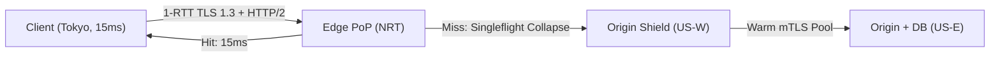

---
tags:
  - software-engineering
  - system-design
  - cdn
  - networking
  - caching
  - edge-compute
created: 2026-01-02
updated: 2026-11-13
status: 🟢
level: mid-to-senior
---
# Content Delivery Networks (CDN)

> [!abstract] Vault Navigation
> Edge networking, HTTP caching semantics, and programmable PoP architecture under [[Programming/Software Engineering/System Design/System Design Overview|System Design Overview]] and [[Programming/Software Engineering/System Design/System Design Complete Guide|System Design Complete Guide]]. Pairs closely with [[Programming/Software Engineering/System Design/Caching|Caching]], [[Programming/Software Engineering/System Design/Scalability|Scalability]], [[Programming/Software Engineering/System Design/Load Balancing|Load Balancing]], [[Programming/Software Engineering/System Design/Rate Limiting|Rate Limiting]], [[Programming/Software Engineering/System Design/API Design|API Design]], [[Programming/Frontend/Next.js Complete Guide|Next.js Complete Guide]], [[Programming/Software Engineering/SDLC/Release Engineering & Migrations|Release Engineering & Migrations]], and [[Programming/Software Engineering/DevOps/Cloud Fundamentals|Cloud Fundamentals]].

A Content Delivery Network (CDN) distributes reverse-proxy caches and programmable V8/WASM isolate runtimes across globally dispersed Points of Presence (PoPs). Beyond shrinking physical light-in-fiber RTT for static objects, a production CDN absorbs volumetric L3/L7 floods, terminates TLS close to clients to eliminate multi-RTT TCP slow-start penalties, deduplicates concurrent cache-miss storms through hierarchical Origin Shields, and enforces edge authentication and header hygiene before requests ever consume origin compute.

---

## 1. First-Principles Edge Networking & Architecture

### 1.1 Anycast BGP Routing vs GeoDNS

Every CDN routes a user's TCP/QUIC packets to a nearby PoP using one of two global traffic-steering layers:

| Dimension | Anycast BGP (Cloudflare, Fastly) | GeoDNS (CloudFront, Akamai) |
| :--- | :--- | :--- |
| **Mechanism** | Every global PoP announces the identical `/24` IPv4 (`/48` IPv6) BGP prefix; internet AS routers route packets to the shortest BGP path | Authoritative DNS maps client resolver IP (or `EDNS0 Client Subnet` `/24` hint) to a regional PoP A/AAAA IP address |
| **Failover Latency** | **Seconds:** PoP withdraws its BGP announcement; upstream transit routers converge and redirect traffic automatically | **30–120 seconds:** Constrained by DNS record TTL and stubborn recursive resolver / OS / browser DNS caching |
| **Routing Granularity** | Controlled by ISP BGP local-preference policies; suboptimal peering can occasionally send packets across continents | Fine-grained traffic engineering per ASN/region; operator can drain a single PoP smoothly via weighted DNS |
| **Stateful TCP Risk** | Mid-connection BGP route flaps (ECMP shifts) can break stateful TCP sockets unless PoPs synchronize or use QUIC Connection IDs | Stable per-IP pinning for connection lifetime, though stale DNS records trap users during sudden PoP outages |

### 1.2 TLS 1.3 Termination, 0-RTT Replay Risk & TCP Slow-Start Math

Terminating transport and cryptography at an Edge PoP 15 ms from the user instead of an Origin 180 ms away alters round-trip physics dramatically:



1. **Handshake & TCP Slow Start Physics:**
   - A cold connection requires **1 RTT** for the TCP 3-way handshake (`SYN`/`SYN-ACK`/`ACK`) plus **1 RTT** for TLS 1.3 (`ClientHello`/`ServerHello` + encrypted `Finished`) before the first HTTP response byte arrives.
   - Standard Linux TCP begins with an Initial Congestion Window (`IW10`) of $10 \times 1{,}460\text{ B} \approx 14.6\text{ KB}$. Delivering a 60 KB SSR HTML response requires 3 congestion-window round-trips ($\text{IW10} \to 20 \to 40$ segments):
     - **Direct to Origin (180 ms RTT):** $(2\text{ handshake} + 3\text{ transfer}) \times 180\text{ ms} = \mathbf{900\text{ ms}}$ minimum transport overhead before TLS/JSON parsing.
     - **Terminated at Edge PoP (15 ms RTT) + Warm Origin Pool:** Edge handshake + transfer takes $5 \times 15\text{ ms} = 75\text{ ms}$. Even on an Edge cache miss, the PoP forwards the request over an already-warm, high-`cwnd` HTTP/2+mTLS connection pool to Origin (`1 RTT = 180 ms`), yielding $75 + 180 = \mathbf{255\text{ ms}}$—a **$3.5\times$ speedup on uncached misses** and **$12\times$ speedup on cache hits** (`75 ms` vs `900 ms`).
2. **TLS 1.3 0-RTT Early Data Hazard:**
   - TLS 1.3 allows returning clients holding a session ticket (`PSK`) to transmit HTTP bytes inside the very first `ClientHello` flight (`0-RTT`).
   - **Critical Replay Vulnerability:** Because `0-RTT` Early Data lacks fresh server-chosen nonce entropy until handshake completion, a passive network attacker can capture and replay the `0-RTT` packet stream repeatedly across PoPs.
   - **Invariant:** Enable `0-RTT` strictly for **safe, idempotent `GET`/`HEAD` requests** and reject (HTTP `425 Too Early`) or strip `Early-Data: 1` for all `POST`/`PUT`/`PATCH`/`DELETE` mutations and authenticated financial/state-changing endpoints.

### 1.3 Push vs Pull CDNs & Hierarchical Origin Shield Amplification Math

| Dimension | Pull CDN (Web, APIs, Dynamic Media) | Push CDN (Firmware, Game Patches, VOD) |
| :--- | :--- | :--- |
| **Population Path** | Lazy fetch from Origin on first PoP cache miss | Explicit CI/CD upload directly into CDN edge/regional object storage |
| **Cold Cache Penalty** | First request per PoP incurs Origin RTT; long-tail eviction forces re-fetches | Zero Origin misses; 100% cache hit ratio from millisecond zero |
| **Storage Efficiency** | Stores only the hot working set (LRU / W-TinyLFU evicted) | Pays storage replication across all CDN regions regardless of read frequency |

#### Origin Shield Cache-Hit Amplification Math

Suppose your platform serves traffic across $N = 200$ global Edge PoPs, and a 500k-item product catalog exhibits a per-PoP cache hit rate of $h = 0.85$ (15% long-tail miss rate per PoP) under total global traffic $R = 100{,}000\text{ RPS}$:
- **Without Origin Shield (Flat Mesh):** Each PoP independently queries Origin on miss:
  $$\text{Origin QPS}_{\text{flat}} = R \times (1 - h) = 100{,}000 \times 0.15 = \mathbf{15{,}000\text{ QPS}}$$
  Worse, when a single popular key expires across 200 PoPs simultaneously, $200$ independent misses hit Origin even with per-PoP request collapsing.
- **With Tiered Caching / Origin Shield:** All 200 PoPs route cache misses through a single regional **Origin Shield** located in the same cloud region (`us-east-1`) as the Origin. Because the Shield aggregates the global working set across all 200 PoPs into one unified high-capacity SSD/RAM tier, long-tail items already fetched by Tokyo stay warm in the Shield when Frankfurt misses. If the Shield absorbs 95% of incoming PoP misses ($h_{\text{shield}} = 0.95$):
  $$\text{Origin QPS}_{\text{shield}} = R \times (1 - h) \times (1 - h_{\text{shield}}) = 100{,}000 \times 0.15 \times 0.05 = \mathbf{750\text{ QPS}}$$
  And for a single hot expired object, singleflight collapsing at the Shield drops 200 concurrent PoP misses down to **1 Origin query** ($200\times$ peak reduction).

### 1.4 Private Origin Authentication (Defeating Direct-to-Origin DDoS)

Exposing your Origin load balancer IP publicly lets attackers scan DNS history (`SecurityTrails`, Certificate Transparency logs) and send floods directly to the Origin IP—completely bypassing CDN WAF, rate limiting, and caching. Lock Origin down with **defense-in-depth**:

1. **Security Group / Firewall IP Allowlisting:** Restrict inbound TCP `443` on the Origin ALB/NGINX strictly to published CDN egress IP CIDRs (automated via Terraform/AWS managed prefix lists).
2. **Authenticated Origin Pulls (mTLS):** Configure the CDN Edge/Shield to present a CDN-signed or tenant-specific client TLS certificate during the Edge-to-Origin handshake, and enforce `ssl_verify_client on;` on NGINX/ALB. Even if another tenant shares the same CDN provider and discovers your Origin IP, their CDN Edge account cannot forge your mTLS client certificate!
3. **Rotating HMAC/Secret Header (`X-Origin-Verify`):** Secondary check verified at Origin edge proxy before forwarding to application containers (always rotate seamlessly with dual-header overlap).

---

## 2. Real-World Use Cases & Architectural Decision Matrix

| Scenario | Recommended CDN Topology | Cache Key & Directives | Do NOT Adopt When |
| :--- | :--- | :--- | :--- |
| **Global SaaS Storefront / Next.js SSR** | Pull CDN + Origin Shield + Surrogate-Key tags | `max-age=0, s-maxage=300, stale-while-revalidate=60` | Pages contain un-isolated per-user PII rendered inside shared HTML without edge personalization |
| **Public Read-Heavy Catalog / Pricing JSON API** | Pull CDN + Edge Cache Rules stripping cookies/UTM params | `public, max-age=60, s-maxage=900, stale-if-error=86400` | Read-after-write linearizability (`<1s` strict stale intolerance) is required without explicit surrogate purge |
| **Multi-GB Firmware / Game Patch / SPA Bundles** | Push CDN (R2/S3 + Immutable Pull) | Content-hashed filenames + `max-age=31536000, immutable` | Unhashed mutable filenames (`latest.zip`) without explicit short TTLs or versioned URIs |
| **Private Media / Paid Downloads** | Pull CDN + Edge JWT/Signed-URL verification at PoP | Verify signature in Worker, strip `Authorization` from key, serve cached object | Zero-trust compliance forbids shared cache persistence even behind PoP auth (`use private, no-store`) |
| **Active-Active Multi-CDN Failover** | GeoDNS steering + health probes across 2 providers | Standardized `Cache-Control` + `CDN-Cache-Control` headers | Team lacks automated purge synchronization and synthetic PoP health telemetry across vendors |

---

## 3. HTTP Caching Semantics in Depth

### 3.1 Complete `Cache-Control` & Targeted Cache Control Matrix (RFC 9111 / RFC 9213)

| Directive | Applies To | Exact Wire & Runtime Behavior |
| :--- | :--- | :--- |
| `public` | Browser + CDN | Explicitly permits shared caches to store the response (overrides default restriction when certain auth headers exist) |
| `private` | Browser Only | **Strictly forbids** CDN/shared proxies from caching; only the end-user's browser local cache may store it |
| `max-age=N` | Browser + CDN | Freshness lifetime in seconds from `Date` (or `Age` delta); overridden at CDN whenever `s-maxage` or `CDN-Cache-Control` is set |
| `s-maxage=N` | CDN / Shared Only | Overrides `max-age` exclusively for shared caches; `max-age=0, s-maxage=600` forces browser validation against PoP while caching 10m at PoP |
| `no-cache` | Browser + CDN | **Does store response** in cache, but **MUST revalidate** (`If-None-Match` / `304`) with upstream on every request before serving |
| `no-store` | Browser + CDN | **Zero persistence** in RAM or disk cache anywhere; mandatory for PII, banking balances, OAuth tokens, and CSRF tokens |
| `must-revalidate` | Browser + CDN | Once expired (`Age >= max-age`), strictly forbids serving stale bytes even if Origin is dead (overrides `stale-if-error`) |
| `proxy-revalidate` | CDN / Shared Only | Equivalent to `must-revalidate`, scoped exclusively to shared caches |
| `immutable` | Browser | Tells browsers not to issue conditional `If-None-Match` requests even on manual page reload while fresh; use ONLY on content-hashed filenames |
| `stale-while-revalidate=W` | Browser + CDN | For `W` seconds after freshness expires, serves stale bytes **immediately** (0ms origin wait) while firing an **async background refresh** |
| `stale-if-error=E` | Browser + CDN | If Origin returns `500/502/503/504` or times out after freshness expires, serves stale object for up to `E` seconds instead of surfacing an outage |
| `CDN-Cache-Control` / `Surrogate-Control` | CDN Only | **RFC 9213** targeted header consumed and stripped by CDN before reaching browsers—cleanly separates CDN TTL (`86400s`) from browser `Cache-Control` (`max-age=30`) |

### 3.2 `ETag` (Strong vs Weak `W/`) & `Last-Modified` Validation

When freshness expires (or `no-cache` forces validation), the CDN issues a conditional `GET` upstream carrying:
1. **`If-None-Match` against `ETag` (Highest Precedence per RFC 9110):**
   - **Strong `ETag` (`"9a8b7c"`):** Byte-for-byte identical representation. Required for range requests (`206 Partial Content`) and `If-Match` optimistic write locks.
   - **Weak `ETag` (`W/"9a8b7c"`):** Semantically equivalent even if byte representation differs slightly (for example, NGINX dynamically gzip/brotli-compressing a file converts strong ETags into `W/"..."` automatically). Valid for `If-None-Match` cache revalidation (`304 Not Modified`), invalid for `If-Match`.
2. **`If-Modified-Since` against `Last-Modified` (Fallback):**
   - Restricted to **1-second resolution**, breaks across unsynchronized origin clocks, and changes needlessly whenever CI/CD container rebuilds reset filesystem `mtime`. Always prefer content-hash or version-driven `ETag`s.

### 3.3 The `Vary` Header Explosion & Cookie Cache-Bypass Disaster

A CDN builds its internal lookup key from a tuple:
`CacheKey = Hash(scheme, host, normalized_path, filtered_query, ...vary_headers)`

Two widespread production mistakes destroy cache hit ratios overnight:

1. **The `Set-Cookie` & `Cookie` Cache-Bypass Disaster:**
   - **Mechanism:** Next.js middleware, Express session libraries, or A/B cookies emit `Set-Cookie: session_id=abc` (or `ab_id=123`) on `GET` responses. By HTTP safety defaults, Cloudflare (`CF-Cache-Status: BYPASS` or `DYNAMIC`), CloudFront, and Fastly **refuse to cache any response containing `Set-Cookie`** because caching it would leak User A's session cookie to User B!
   - **Authorization Implicit Bypass:** Requests carrying `Authorization: Bearer ...` are uncacheable in shared caches per RFC 9111 unless explicit edge logic validates the JWT at the PoP and strips `Authorization` from the upstream cache key.
2. **The `Vary` Cardinality Explosion:**
   - Emitting **`Vary: User-Agent`** multiplies cache keys across ~15,000 distinct browser/OS version strings—each user hits a cold key, shredding hit ratio from **97% down to <5%** and flooding Origin.
   - Emitting **`Vary: Cookie`** or **`Vary: *`** creates 1 unique cache entry per user/request (0% shared hit rate).
   - Even **`Vary: Accept-Encoding`** fragments keys if an unconfigured proxy stores raw client strings (`gzip, deflate, br, zstd` vs `br, gzip`) instead of canonical buckets (`br`, `gzip`, `identity`).

#### Deterministic Remediation Checklist
- Never emit `Set-Cookie` from public cacheable endpoints (`GET /products`, `GET /pricing`, SSR landing pages). Move anonymous session/analytics cookie assignment to client-side JS or Edge Workers *after* cache lookup.
- Never include `User-Agent`, `Cookie`, or `*` in `Vary`. Keep only canonicalized `Vary: Accept-Encoding`.
- Strip marketing tracking query parameters (`utm_*`, `fbclid`, `gclid`, `mc_cid`) and irrelevant cookies (`_ga`, `_gid`, `_fbp`) inside Edge Cache Rules / Workers before cache lookup.

---

## 4. Invalidation, Request Collapsing & Step-by-Step Edge Production Implementation

### 4.1 Zero-Purge Immutable Assets, Surrogate Keys & Request Collapsing

1. **Content-Hashed Immutable Rollouts:** Embed build digests in JS/CSS/font filenames (`app.9e12b4a1.js`) served with `Cache-Control: public, max-age=31536000, immutable`. Always deploy new chunks to S3/R2 **before** updating `index.html`, and **never** run `aws s3 sync --delete` immediately during deployment; retain prior asset bundles for 14–30 days via S3 Lifecycle Rules so users holding open v1 tabs never crash with `404 ChunkLoadError` on lazy route navigation.
2. **Surrogate-Key (`Cache-Tag`) O(1) Purging:** Tag every response with every entity rendered inside it (`Cache-Tag: product-42 category-shoes homepage`). Edge PoPs maintain an inverted tag-to-key hash map in memory. When product 42's price updates, a single API call purging tag `product-42` invalidates `/products/42`, `/category/shoes`, and `/` across all global PoPs in **150 ms–3 s**.
   - **Soft Purge vs Hard Purge:** Hard purge deletes cached bytes immediately, forcing full-payload synchronous Origin fetches on the next request. **Soft Purge** marks objects stale (`Age > TTL`), allowing `stale-while-revalidate` and Origin `304 Not Modified` conditional validation to update edges cleanly without shocking Origin DB pools.
3. **Request Collapsing (Singleflight) + TTL Jittering:** Within a PoP (and at the Origin Shield), 2,000 simultaneous misses for the exact same cache key join an in-flight coalescing table; **1 upstream fetch** opens to Origin and streams chunks to all 2,000 waiting sockets. Add deterministic random jitter (`ttl + rand(0, 60)`) to batch-generated TTLs so mass expirations never synchronize on the same second.

> [!warning] Uncacheable Request Collapsing Serialization Trap
> If 500 concurrent requests hit a collapsing PoP for `/checkout` and Origin responds with `Cache-Control: private, no-store`, naive request collapsing discovers the response cannot be shared and **re-executes the remaining 499 queued requests sequentially**—turning a 50ms endpoint into a 25-second tail-latency cascade. Ensure CDN rules bypass collapsing for authenticated/non-cacheable routes (`Cache-Control: private` or cookie-authenticated API paths).

### 4.2 Production Edge & Origin Project Layout

```text
edge-platform/
├── wrangler.toml                  # Cloudflare Worker bindings + KV/JWKS config
├── src/
│   ├── worker.ts                  # Edge A/B bucketing, RS256 JWT gate, Geo, WebP/AVIF, cache norm
│   └── nextjs/
│       └── middleware.ts          # Next.js Set-Cookie hygiene & Cache-Control headers
├── origin/
│   └── nginx-origin.conf          # mTLS Authenticated Origin Pull + targeted CDN headers
├── terraform/
│   └── cdn_cache_policy.tf        # CloudFront CachePolicy stripping cookies/UTM & Origin Shield
├── scripts/
│   └── surrogate-purge.ts         # Batched Soft/Hard Cache-Tag invalidation client
└── tests/
    └── worker.test.ts             # Runnable edge caching & JWT verification tests
```

### 4.3 Complete Production Cloudflare Worker (A/B Bucketing, Edge JWT Gate, Geo Injection & AVIF/WebP Negotiation)

```toml
# wrangler.toml
name = "acme-edge-gateway"
main = "src/worker.ts"
compatibility_date = "2026-10-01"

[vars]
ORIGIN_BASE_URL = "https://origin-shield.internal.acme.dev"
JWT_ISSUER = "https://auth.acme.dev/"
JWT_AUDIENCE = "api.acme.dev"
```

```typescript
// src/worker.ts
export interface Env {
  ORIGIN_BASE_URL: string;
  JWT_ISSUER: string;
  JWT_AUDIENCE: string;
  JWT_PUBLIC_JWK_JSON: string; // RS256 public JWK bound via Worker secret/var
}

interface VerifiedClaims {
  sub: string;
  tenant_id: string;
  exp: number;
  iss: string;
  aud: string;
}

const TRACKING_PARAMS = new Set([
  'fbclid',
  'gclid',
  'mc_cid',
  'mc_eid',
  'utm_source',
  'utm_medium',
  'utm_campaign',
  'utm_term',
  'utm_content',
]);

let cachedVerifyKey: CryptoKey | null = null;

async function getRsaVerifyKey(jwkJson: string): Promise<CryptoKey> {
  if (cachedVerifyKey) return cachedVerifyKey;
  const jwk = JSON.parse(jwkJson) as JsonWebKey;
  cachedVerifyKey = await crypto.subtle.importKey(
    'jwk',
    jwk,
    { name: 'RSASSA-PKCS1-v1_5', hash: 'SHA-256' },
    false,
    ['verify']
  );
  return cachedVerifyKey;
}

function base64UrlToUint8Array(b64u: string): Uint8Array {
  const padded = b64u.replace(/-/g, '+').replace(/_/g, '/').padEnd(Math.ceil(b64u.length / 4) * 4, '=');
  const bin = atob(padded);
  const out = new Uint8Array(bin.length);
  for (let i = 0; i < bin.length; i++) out[i] = bin.charCodeAt(i);
  return out;
}

/**
 * 1. Stateless RS256 Edge JWT Verification via WebCrypto API (< 0.4ms CPU at PoP).
 */
export async function verifyEdgeJwt(token: string, env: Env, nowSec = Math.floor(Date.now() / 1000)): Promise<VerifiedClaims | null> {
  const segments = token.split('.');
  if (segments.length !== 3) return null;
  const [headerB64, payloadB64, sigB64] = segments;

  try {
    const header = JSON.parse(new TextDecoder().decode(base64UrlToUint8Array(headerB64))) as { alg?: string };
    if (header.alg !== 'RS256') return null;

    const key = await getRsaVerifyKey(env.JWT_PUBLIC_JWK_JSON);
    const signedData = new TextEncoder().encode(`${headerB64}.${payloadB64}`);
    const sigBytes = base64UrlToUint8Array(sigB64);

    const valid = await crypto.subtle.verify('RSASSA-PKCS1-v1_5', key, sigBytes, signedData);
    if (!valid) return null;

    const claims = JSON.parse(new TextDecoder().decode(base64UrlToUint8Array(payloadB64))) as VerifiedClaims;
    if (claims.iss !== env.JWT_ISSUER || claims.aud !== env.JWT_AUDIENCE) return null;
    if (!Number.isFinite(claims.exp) || claims.exp <= nowSec) return null;
    return claims;
  } catch {
    return null;
  }
}

/**
 * 2. Image Format Negotiation: collapses arbitrary Accept headers into 3 deterministic cache buckets.
 */
export function negotiateImageFormat(acceptHeader: string | null): 'avif' | 'webp' | 'jpeg' {
  const accept = (acceptHeader ?? '').toLowerCase();
  if (accept.includes('image/avif')) return 'avif';
  if (accept.includes('image/webp')) return 'webp';
  return 'jpeg';
}

function parseCookie(cookieHeader: string | null, name: string): string | null {
  if (!cookieHeader) return null;
  for (const part of cookieHeader.split(';')) {
    const eqIdx = part.indexOf('=');
    if (eqIdx === -1) continue;
    if (part.slice(0, eqIdx).trim() === name) return part.slice(eqIdx + 1).trim();
  }
  return null;
}

/**
 * 3. Deterministic A/B Bucketing without per-user cache fragmentation.
 */
function resolveAbBucket(request: Request): { bucket: 'A' | 'B'; shouldSetCookie: boolean } {
  const existing = parseCookie(request.headers.get('Cookie'), 'ab_cohort');
  if (existing === 'A' || existing === 'B') {
    return { bucket: existing, shouldSetCookie: false };
  }
  const bucket: 'A' | 'B' = crypto.getRandomValues(new Uint8Array(1))[0] % 2 === 0 ? 'A' : 'B';
  return { bucket, shouldSetCookie: true };
}

function normalizePublicUrl(rawUrl: string): URL {
  const url = new URL(rawUrl);
  for (const key of [...url.searchParams.keys()]) {
    if (TRACKING_PARAMS.has(key)) url.searchParams.delete(key);
  }
  // Canonicalize query param ordering so ?a=1&b=2 and ?b=2&a=1 share one cache key
  url.searchParams.sort();
  return url;
}

export default {
  async fetch(request: Request, env: Env, ctx: ExecutionContext): Promise<Response> {
    const reqUrl = new URL(request.url);

    // Reject 0-RTT Early Data on non-idempotent mutations to prevent replay attacks
    const isSafeMethod = request.method === 'GET' || request.method === 'HEAD';
    if (!isSafeMethod && request.headers.get('Early-Data') === '1') {
      return new Response('Early Data not allowed on state-changing requests', { status: 425 });
    }

    // Route Group A: Edge JWT Auth Gate for /api/private/* (never hits Origin if invalid!)
    if (reqUrl.pathname.startsWith('/api/private/')) {
      const auth = request.headers.get('Authorization') ?? '';
      const token = auth.startsWith('Bearer ') ? auth.slice(7).trim() : '';
      const claims = await verifyEdgeJwt(token, env);
      if (!claims) {
        return Response.json(
          { type: 'https://api.acme.dev/problems/unauthorized', title: 'Unauthorized', status: 401 },
          { status: 401, headers: { 'Cache-Control': 'no-store' } }
        );
      }

      const upstreamHeaders = new Headers(request.headers);
      upstreamHeaders.set('X-Authenticated-User', claims.sub);
      upstreamHeaders.set('X-Tenant-Id', claims.tenant_id);
      upstreamHeaders.set('X-Edge-Country', String(request.cf?.country ?? 'ZZ'));
      return fetch(`${env.ORIGIN_BASE_URL}${reqUrl.pathname}${reqUrl.search}`, {
        method: request.method,
        headers: upstreamHeaders,
        body: isSafeMethod ? undefined : request.body,
      });
    }

    // Only cache safe GET/HEAD public catalog, marketing, and media traffic
    if (!isSafeMethod) {
      return fetch(`${env.ORIGIN_BASE_URL}${reqUrl.pathname}${reqUrl.search}`, request);
    }

    const cleanUrl = normalizePublicUrl(request.url);

    // Route Group B: Media Asset WebP/AVIF Negotiation keyed cleanly on 3 formats
    if (cleanUrl.pathname.startsWith('/media/')) {
      const format = negotiateImageFormat(request.headers.get('Accept'));
      cleanUrl.searchParams.set('_fmt', format);
      const cacheKey = new Request(cleanUrl.toString(), { method: 'GET' });
      const cache = caches.default;
      let mediaRes = await cache.match(cacheKey);

      if (!mediaRes) {
        const originRes = await fetch(`${env.ORIGIN_BASE_URL}${cleanUrl.pathname}${cleanUrl.search}`, {
          headers: { 'X-Negotiated-Format': format },
        });
        mediaRes = new Response(originRes.body, originRes);
        mediaRes.headers.delete('Set-Cookie');
        mediaRes.headers.set('Vary', 'Accept');
        mediaRes.headers.set('Cache-Control', 'public, max-age=86400, s-maxage=2592000');
        mediaRes.headers.set('X-Edge-Media-Format', format);
        if (originRes.ok) {
          ctx.waitUntil(cache.put(cacheKey, mediaRes.clone()));
        }
      }
      return mediaRes;
    }

    // Route Group C: Public SSR / Catalog Pages with A/B Bucketing & Geo Injection
    const { bucket, shouldSetCookie } = resolveAbBucket(request);
    const country = String(request.cf?.country ?? 'US');

    // Internal cache key includes ONLY 2 variants (A/B) + normalized path/query—NOT raw Cookies!
    const internalKeyUrl = new URL(cleanUrl.toString());
    internalKeyUrl.searchParams.set('_ab', bucket);
    internalKeyUrl.searchParams.set('_cc', country);
    const cacheKey = new Request(internalKeyUrl.toString(), { method: 'GET' });

    const cache = caches.default;
    let cached = await cache.match(cacheKey);
    let cacheStatus = 'HIT';

    if (!cached) {
      cacheStatus = 'MISS';
      const upstreamRes = await fetch(`${env.ORIGIN_BASE_URL}${cleanUrl.pathname}${cleanUrl.search}`, {
        headers: {
          'X-AB-Cohort': bucket,
          'X-Geo-Country': country,
          'Accept-Encoding': request.headers.get('Accept-Encoding') ?? 'br, gzip',
        },
      });

      const mutableHeaders = new Headers(upstreamRes.headers);
      // Strip any accidental framework Set-Cookie so the shared PoP cache ALWAYS stores the payload
      mutableHeaders.delete('Set-Cookie');
      mutableHeaders.delete('Vary');
      mutableHeaders.set('Vary', 'Accept-Encoding');

      const cacheableCopy = new Response(upstreamRes.body, {
        status: upstreamRes.status,
        headers: mutableHeaders,
      });

      if (upstreamRes.status === 200) {
        ctx.waitUntil(cache.put(cacheKey, cacheableCopy.clone()));
      }
      cached = cacheableCopy;
    }

    // Attach client-specific A/B assignment cookie ONLY on outgoing response AFTER caching
    const clientRes = new Response(cached.body, cached);
    clientRes.headers.set('X-Edge-Cache-Status', cacheStatus);
    clientRes.headers.set('X-AB-Cohort', bucket);
    if (shouldSetCookie) {
      clientRes.headers.append('Set-Cookie', `ab_cohort=${bucket}; Path=/; Max-Age=2592000; SameSite=Lax; Secure`);
    }
    return clientRes;
  },
};
```

### 4.4 Origin NGINX mTLS Enforcement, Next.js Hygiene & Terraform Cache Policy

```nginx
# origin/nginx-origin.conf
server {
    listen 443 ssl http2;
    server_name origin-shield.internal.acme.dev;

    ssl_certificate     /etc/ssl/origin/server.crt;
    ssl_certificate_key /etc/ssl/origin/server.key;

    # Authenticated Origin Pulls (mTLS): reject direct internet scanners & spoofed requests
    ssl_client_certificate /etc/ssl/cdn/cloudflare-origin-pull-ca.pem;
    ssl_verify_client      on;

    location /_next/static/ {
        # Content-hashed immutable JS/CSS assets: zero conditional revalidation for 1 year
        add_header Cache-Control "public, max-age=31536000, immutable" always;
        try_files $uri =404;
    }

    location /api/catalog/ {
        proxy_pass http://catalog_upstream;
        proxy_http_version 1.1;
        proxy_set_header Connection "";

        # Hide accidental Set-Cookie from upstream frameworks on public catalog reads
        proxy_hide_header Set-Cookie;
        proxy_ignore_headers Set-Cookie;

        # Targeted CDN headers: browser checks PoP every 30s; Edge caches 15m + SWR + stale-if-error
        add_header Cache-Control "public, max-age=30, stale-while-revalidate=60, stale-if-error=3600" always;
        add_header CDN-Cache-Control "public, s-maxage=900, stale-while-revalidate=120, stale-if-error=86400" always;
        add_header Vary "Accept-Encoding" always;
    }
}
```

```typescript
// src/nextjs/middleware.ts
import { NextResponse, type NextRequest } from 'next/server';

/**
 * Prevents Next.js middleware from emitting Set-Cookie or Cache-Control: private on public SSR routes.
 */
export function middleware(req: NextRequest) {
  const res = NextResponse.next();

  if (req.nextUrl.pathname.startsWith('/catalog') || req.nextUrl.pathname.startsWith('/products')) {
    // Public catalog pages: never write session/ab Set-Cookie here; enforce clean Edge TTL
    res.headers.set('Cache-Control', 'public, max-age=0, s-maxage=300, stale-while-revalidate=60, stale-if-error=86400');
    res.headers.set('Vary', 'Accept-Encoding');
    return res;
  }

  if (req.nextUrl.pathname.startsWith('/account') || req.nextUrl.pathname.startsWith('/checkout')) {
    // Personalized views must strictly disable shared caching
    res.headers.set('Cache-Control', 'private, no-store, max-age=0');
  }
  return res;
}
```

```hcl
# terraform/cdn_cache_policy.tf
resource "aws_cloudfront_cache_policy" "catalog_high_hit" {
  name        = "acme-catalog-high-hit-policy"
  default_ttl = 300
  max_ttl     = 86400
  min_ttl     = 0

  parameters_in_cache_key_and_forwarded_to_origin {
    enable_accept_encoding_brotli = true
    enable_accept_encoding_gzip   = true

    cookies_config {
      cookie_behavior = "whitelist"
      cookies {
        items = ["ab_cohort"] # Ignore _ga, _fbp, and tracking cookies in cache key
      }
    }

    headers_config {
      header_behavior = "whitelist"
      headers {
        items = ["X-Geo-Country"] # Never whitelist User-Agent or Authorization on public cache
      }
    }

    query_strings_config {
      query_string_behavior = "whitelist"
      query_strings {
        items = ["category", "sort", "cursor"] # Drops utm_*, fbclid, gclid automatically
      }
    }
  }
}
```

### 4.5 Surrogate-Key Purging Client & Edge Worker Tests

```typescript
// scripts/surrogate-purge.ts
export interface PurgeConfig {
  zoneId: string;
  apiToken: string;
  mode: 'soft' | 'hard';
}

/**
 * Batches Cache-Tag / Surrogate-Key invalidations into chunks of 30 tags per API call.
 * Prefer `soft` purge when CDN supports marking objects stale so SWR protects Origin from spikes.
 */
export async function purgeSurrogateTags(tags: string[], cfg: PurgeConfig): Promise<void> {
  const uniqueTags = [...new Set(tags.map((t) => t.trim()).filter(Boolean))];
  const CHUNK_SIZE = 30;

  for (let i = 0; i < uniqueTags.length; i += CHUNK_SIZE) {
    const batch = uniqueTags.slice(i, i + CHUNK_SIZE);
    const response = await fetch(`https://api.cloudflare.com/client/v4/zones/${cfg.zoneId}/purge_cache`, {
      method: 'POST',
      headers: {
        Authorization: `Bearer ${cfg.apiToken}`,
        'Content-Type': 'application/json',
        ...(cfg.mode === 'soft' ? { 'Soft-Purge': '1' } : {}),
      },
      body: JSON.stringify({ tags: batch }),
    });

    if (!response.ok) {
      const body = await response.text();
      throw new Error(`CDN tag purge failed (${response.status}): ${body}`);
    }
  }
}
```

```typescript
// tests/worker.test.ts
import assert from 'node:assert/strict';
import crypto from 'node:crypto';
import { describe, it } from 'node:test';
import { negotiateImageFormat, verifyEdgeJwt, type Env } from '../src/worker.js';

describe('CDN Edge Compute Invariants', () => {
  it('negotiates optimal image format deterministically across raw Accept permutations', () => {
    assert.equal(negotiateImageFormat('image/avif,image/webp,image/png,*/*;q=0.8'), 'avif');
    assert.equal(negotiateImageFormat('image/webp,image/apng,image/*,*/*;q=0.8'), 'webp');
    assert.equal(negotiateImageFormat('image/png,image/jpeg'), 'jpeg');
    assert.equal(negotiateImageFormat(null), 'jpeg');
  });

  it('authenticates RS256 JWT at PoP and rejects expired or algorithm-downgraded tokens', async () => {
    const { publicKey, privateKey } = crypto.generateKeyPairSync('rsa', { modulusLength: 2048 });
    const publicJwk = publicKey.export({ format: 'jwk' });

    const env: Env = {
      ORIGIN_BASE_URL: 'https://origin.internal',
      JWT_ISSUER: 'https://auth.acme.dev/',
      JWT_AUDIENCE: 'api.acme.dev',
      JWT_PUBLIC_JWK_JSON: JSON.stringify(publicJwk),
    };

    const signJwt = (header: object, payload: object) => {
      const h = Buffer.from(JSON.stringify(header)).toString('base64url');
      const p = Buffer.from(JSON.stringify(payload)).toString('base64url');
      const sig = crypto.sign('RSA-SHA256', Buffer.from(`${h}.${p}`), privateKey).toString('base64url');
      return `${h}.${p}.${sig}`;
    };

    const now = 1_763_050_000;
    const validToken = signJwt(
      { alg: 'RS256', typ: 'JWT' },
      { sub: 'usr_91', tenant_id: 'ten_4', iss: env.JWT_ISSUER, aud: env.JWT_AUDIENCE, exp: now + 300 }
    );
    const claims = await verifyEdgeJwt(validToken, env, now);
    assert.equal(claims?.tenant_id, 'ten_4');

    const expiredToken = signJwt(
      { alg: 'RS256', typ: 'JWT' },
      { sub: 'usr_91', tenant_id: 'ten_4', iss: env.JWT_ISSUER, aud: env.JWT_AUDIENCE, exp: now - 1 }
    );
    assert.equal(await verifyEdgeJwt(expiredToken, env, now), null);

    const noneAlgToken = signJwt(
      { alg: 'none', typ: 'JWT' },
      { sub: 'usr_91', tenant_id: 'ten_4', iss: env.JWT_ISSUER, aud: env.JWT_AUDIENCE, exp: now + 300 }
    );
    assert.equal(await verifyEdgeJwt(noneAlgToken, env, now), null);
  });
});
```

---

## 5. Production Debugging, Profiling & Operations Playbook

### 5.1 CDN Cache Status & Telemetry Header Decoder

| Header | Observed Value | Exact Meaning | Action / Next Check |
| :--- | :--- | :--- | :--- |
| `CF-Cache-Status` | `HIT` | Served directly from local Edge PoP cache without touching Origin | Check `Age` header (`Age: 142` means cached 142s ago) |
| `CF-Cache-Status` | `MISS` | Cacheable resource absent from PoP; fetched from Shield/Origin and stored | Normal on first cold request; persistent `MISS` across repeat hits implies cache-key variance (`UTM`/cookie/User-Agent) |
| `CF-Cache-Status` | `EXPIRED` | TTL elapsed; PoP revalidated/refetched from Origin | Raise `s-maxage` or add `stale-while-revalidate` |
| `CF-Cache-Status` | `STALE` / `UPDATING` | Served stale bytes while background revalidation runs (`stale-while-revalidate` or `stale-if-error`) | Healthy zero-wait refresh (`STALE` also fires if Origin returned 5xx under `stale-if-error`) |
| `CF-Cache-Status` | `REVALIDATED` | Origin returned `304 Not Modified` to PoP `If-None-Match` conditional check | Healthy bandwidth savings; consider longer `s-maxage` to avoid origin RTT |
| `CF-Cache-Status` | `BYPASS` | Origin emitted `Set-Cookie`, `Cache-Control: private/no-store`, or matched Bypass Cache Rule | Inspect Origin response headers directly bypassing CDN |
| `CF-Cache-Status` | `DYNAMIC` | Path/MIME type not eligible for default Edge caching without explicit Cache Rule (`Cache Everything`) | Add Edge Cache Rule / `CDN-Cache-Control` for public JSON/HTML APIs |
| `X-Cache` (CloudFront) | `Hit from cloudfront` / `RefreshHit` / `Miss` | `RefreshHit` = TTL expired, CloudFront validated `304` against Origin | Inspect `X-Amz-Cf-Pop` (`IAD89-P1`) and `Age` |

### 5.2 Exact CLI Diagnostic Workflow (`curl`, `dig`, Origin Isolation)

```bash
# 1. Inspect cache status, Age progression, Vary, and Set-Cookie leaks across 2 consecutive hits
curl -sI -H "Accept-Encoding: br, gzip" "https://api.acme.dev/v1/catalog?utm_source=test" \
  | grep -iE "HTTP/|cf-cache-status|x-cache|age|cache-control|cdn-cache-control|vary|set-cookie|etag"

# 2. Bypass Edge completely (from trusted bastion) to inspect raw Origin headers
curl -sI --resolve "api.acme.dev:443:10.42.8.15" "https://api.acme.dev/v1/catalog"

# 3. Verify DNS Anycast / GeoDNS resolution & EDNS0 Client Subnet steering
dig +short api.acme.dev A
dig @1.1.1.1 +subnet=203.0.113.0/24 api.acme.dev A

# 4. Measure cold TLS + TTFB breakdown (namelookup -> connect -> appconnect -> starttransfer)
curl -s -o /dev/null -w "dns=%{time_namelookup} tcp=%{time_connect} tls=%{time_appconnect} ttfb=%{time_starttransfer} total=%{time_total}\n" \
  "https://api.acme.dev/v1/catalog"
```

| Production Symptom | Diagnostic Signal | Exact Root Cause & Fix |
| :--- | :--- | :--- |
| **96% -> 8% Hit Ratio Drop after Deploy** | `curl -sI` shows `CF-Cache-Status: BYPASS` + `Set-Cookie` OR `MISS` with `Vary: User-Agent` | Framework middleware added `Set-Cookie` or `Vary: User-Agent`. Strip `Set-Cookie` from public GETs, enforce `Vary: Accept-Encoding`, and configure Cache Policy cookie/query whitelists |
| **`Age` Resets to `0` on Every Request From Different Regions** | `Age: 0` in Tokyo after hitting `HIT` in Frankfurt | No Origin Shield enabled, OR `s-maxage` is `0` while `CDN-Cache-Control` is absent. Enable Tiered Cache / Origin Shield |
| **Origin CPU Spikes 10x While CDN `HIT` Rate Looks High (90%)** | Attacker bypassing CDN by hitting Origin IPv4 directly (`ss -tn` shows non-CDN source IPs) | Lock Origin ALB/NGINX firewall exclusively to CDN IP CIDRs and enforce **mTLS Authenticated Origin Pulls** |
| **Origin Serves `502`/`504` Every 5 Minutes Despite `stale-if-error=86400`** | Response contains `Cache-Control: public, s-maxage=300, must-revalidate, stale-if-error=86400` | `must-revalidate` strictly overrides `stale-if-error` per RFC 9111! Remove `must-revalidate` from public catalog responses |

---

## 6. Comprehensive Worked Exercises

### Exercise 1: Cache-Hit Ratio Collapse (96% $\to$ 8%) Post-Deploy
Following a Next.js App Router middleware rollout, an e-commerce storefront behind Cloudflare/CloudFront drops from a **96% Edge cache-hit ratio** to **8%**, spiking Origin RDS CPU to 95%. Inspecting raw Origin headers via `curl -sI` returns:
```http
HTTP/1.1 200 OK
Cache-Control: public, max-age=300
Vary: Accept-Encoding, User-Agent, Origin, Cookie
Set-Cookie: visitor_ab=B_9421; Path=/; HttpOnly
```
Meanwhile, paid marketing campaigns append `?fbclid=...&utm_campaign=...` to landing URLs. Identify all 4 cache-destroying defects and write the exact remediated HTTP headers + Worker/CDN rules.

### Solution 1
**Root Causes:**
1. **`Set-Cookie` on Public Cacheable Pages:** CDNs treat any response emitting `Set-Cookie` as personalized/uncacheable (`BYPASS`), bypassing Edge caching for all un-cookied visitors.
2. **`Vary: User-Agent, Cookie`:** Multiplies cache key cardinality across thousands of browser builds and individual per-user cookies, reducing shared hit rates toward 0%.
3. **Unfiltered `fbclid`/`utm_*` Query Strings:** Every ad click carries a unique `fbclid`, forcing a fresh Origin miss per user click.
4. **Coupled Browser/Origin TTL + Missing SWR:** Setting `max-age=300` without `s-maxage`, `stale-while-revalidate`, or `stale-if-error` exposes Origin to synchronized expiration misses.

**Fix:**
1. Remove `Set-Cookie` emission from SSR catalog/landing routes; assign A/B cohorts cleanly in the Edge Worker (`resolveAbBucket` in Section 4.3) attaching `Set-Cookie` *after* pulling the `A` or `B` cached response.
2. Normalize query parameters in Edge Cache Policy / Worker by stripping `fbclid`, `gclid`, and `utm_*` before key hashing.
3. Return clean decoupled headers from Origin/Next.js:
   ```http
   Cache-Control: public, max-age=30, s-maxage=300, stale-while-revalidate=60, stale-if-error=86400
   Vary: Accept-Encoding
   Cache-Tag: catalog-home
   ```

---

### Exercise 2: Flash-Sale Expiration Stampede Amplification Math
A sneaker drop API (`GET /v1/drops/air-99`, 45 KB JSON) sits behind **180 global CDN PoPs** with `Cache-Control: public, max-age=60`. Peak drop traffic reaches **180,000 RPS** evenly distributed (1,000 RPS/PoP). The Origin SQL query takes **450 ms** and saturates above **400 concurrent DB connections**.
1. Quantify worst-case Origin concurrency at `t = 60.0s` when the cache expires **without** Request Collapsing or Origin Shield.
2. Quantify Origin concurrency **with** per-PoP Request Collapsing alone vs **Origin Shield + Request Collapsing + `stale-while-revalidate=30`**.

### Solution 2
**1. Flat CDN Without Request Collapsing or Shield:**
- During the **450 ms** Origin fetch window after `t = 60.0s`, each PoP receives $1{,}000\text{ RPS} \times 0.45\text{ s} = 450$ concurrent misses before the first Origin response arrives and populates cache.
- Across 180 global PoPs: $180 \times 450 = \mathbf{81{,}000\text{ concurrent requests}}$ stampede Origin ($81{,}000 \gg 400$ DB capacity $\to$ instant `504` cascade).

**2. With Request Collapsing + Origin Shield + SWR:**
- **PoP Request Collapsing alone:** Coalesces 450 misses/PoP into 1 upstream fetch per PoP = **180 concurrent Origin queries** (safe under 400 limit, though tight if another hot SKU expires simultaneously).
- **Adding Origin Shield:** Routes all 180 PoP misses to the single Origin Shield tier, which collapses all 180 PoPs into **1 singleflight query** to Origin.
- **Adding `stale-while-revalidate=30`:** Even the very first client at `t = 60.0s` receives stale cached bytes in 15ms with zero blocking while the Shield performs **1 async background refresh**, pinning Origin QPS to **0.016 QPS** regardless of client demand.

---

### Exercise 3: SPA Rollout `ChunkLoadError` Race & Emergency Legal Takedown
A Vite/React SPA deploys to S3 behind CloudFront using content-hashed JS chunks (`/assets/chunk.a1b2c3.js`) and `/index.html`:
1. During deployment v2, CI executes `aws s3 sync dist/ s3://app-bucket/ --delete`, immediately removing v1 chunks when `index.html` updates. Users with open tabs or cached v1 `index.html` immediately receive `404` for v1 chunks—and CloudFront caches those `404` responses for **5 minutes**!
2. Separately, a legal takedown requires purging a leaked PDF (`/docs/secret.pdf`) worldwide immediately, even though it was served with `Cache-Control: public, max-age=31536000, immutable`.

Design the zero-downtime rollout order and the emergency takedown remediation.

### Solution 3
**1. Eliminating SPA Deployment Races:**
- **Upload Order & S3 Retention:** Upload new hashed `/assets/*` bundles **first** *without* `--delete`. Only after assets succeed, upload `/index.html` with `Cache-Control: public, max-age=0, s-maxage=30, must-revalidate` (or issue an invalidation strictly for `/index.html`). Retain old hashed assets in S3 for **14–30 days** via S3 lifecycle expiration rules so active user tabs lazy-loading routes never hit `404`.
- **Negative Error Caching Guard:** Configure CloudFront/Cloudflare `Error Caching Minimum TTL` for `404` and `5xx` to `0s` (or `5s` max) so transient propagation glitches never lock in a 5-minute outage.

**2. Emergency `immutable` Takedown:**
- Delete `/docs/secret.pdf` from S3/Origin first so Origin returns `404`/`410 Gone`, then issue an immediate **Hard Purge** on the CDN API for `/docs/secret.pdf`—immediately blocking all *new* edge downloads worldwide.
- **Architectural Limitation:** End-user browsers that *already* fetched `/docs/secret.pdf` under `max-age=31536000, immutable` hold it in local disk cache for 1 year without contacting the CDN. **Rule:** Never attach `public, immutable` to revocable, sensitive, or access-controlled files; serve them with short-lived presigned URLs (`Cache-Control: private, no-store`) or Edge JWT gates.

---

### Exercise 4: Direct-to-Origin DDoS Bypass & 0-RTT Replay Attack
During an incident, an e-commerce site using Cloudflare reports two anomalies:
1. Origin ALB metrics show 40,000 RPS hitting `POST /v1/gift-cards/redeem`, yet Cloudflare Analytics shows only 1,200 RPS passing through the WAF/CDN.
2. Customers using mobile TLS 1.3 browsers report duplicate `POST /v1/votes` submissions when switching from Wi-Fi to LTE, accompanied by `Early-Data: 1` headers in Origin logs.

Diagnose both vulnerabilities and specify the exact infrastructure + code fixes.

### Solution 4
**1. Direct-to-Origin WAF Bypass:**
- **Diagnosis:** Attackers uncovered the Origin ALB's public IP/DNS record (via historical DNS records or SPF/MX/CT logs) and sent traffic straight to the Origin, bypassing Cloudflare WAF, rate limiting, and CDN caching completely.
- **Fix:** Lock Origin Security Groups/firewalls exclusively to CDN egress IP CIDRs AND enable **mTLS Authenticated Origin Pulls** (`ssl_verify_client on;` in `nginx-origin.conf`, Section 4.4) so any connection lacking your CDN client certificate is dropped at the TLS handshake.

**2. TLS 1.3 `0-RTT` Early Data Replay:**
- **Diagnosis:** TLS 1.3 `0-RTT` Early Data allows clients to piggyback HTTP bytes onto the first `ClientHello` packet before fresh server randomness completes. Network retries or malicious active attackers can replay `0-RTT` frames repeatedly.
- **Fix:** Configure the CDN/Edge Worker to **reject (`425 Too Early`)** any non-idempotent request (`POST`, `PUT`, `PATCH`, `DELETE`) carrying `Early-Data: 1` (Section 4.3), forcing the client to complete a full `1-RTT` TLS handshake before submitting mutations—and require `Idempotency-Key` on mutation endpoints (`POST /v1/gift-cards/redeem`).

---

### Exercise 5: Multi-Format Image Cache Poisoning & `stale-if-error` Failure
An image service emits:
```http
HTTP/1.1 200 OK
Cache-Control: public, max-age=300, must-revalidate, stale-if-error=86400
```
for `GET /media/hero.jpg`, converting JPEG to AVIF or WebP dynamically based on the `Accept` header, **without** setting `Vary: Accept` or keying on format.
1. Explain why Chrome users receive broken binary payloads in Safari, and what happens to `stale-if-error=86400` when Origin crashes with `503 Service Unavailable` after `t = 301s`.
2. Write the exact fixed Edge Worker logic and response headers.

### Solution 5
**1. Two Independent Defects:**
- **Cross-Browser Format Cache Poisoning:** Because `Vary: Accept` and format-based cache keying are absent, the first Chrome visitor requesting `Accept: image/avif,image/webp` caches an **AVIF** binary payload under the shared key `/media/hero.jpg`. Subsequent older browsers or API clients requesting `/media/hero.jpg` (supporting only JPEG) receive raw AVIF bytes under `Content-Type: image/avif`, causing broken image renders.
- **`must-revalidate` Negating `stale-if-error`:** Per RFC 9111 §5.2.2.2, `must-revalidate` strictly prohibits caches from serving *any* stale response under *any* circumstance once `max-age` expires—overriding `stale-if-error=86400` and forcing the CDN to return `503` outages to users!

**2. Fixed Edge Routing & Response Headers:**
- Normalize `Accept` into strictly 3 cache buckets (`avif`, `webp`, `jpeg`) inside the Edge Worker (`negotiateImageFormat` + `_fmt` cache key in Section 4.3) instead of raw `Accept` strings (which would fragment caches across different browser header orderings).
- Remove `must-revalidate` and emit:
  ```http
  Cache-Control: public, max-age=86400, s-maxage=2592000, stale-while-revalidate=3600, stale-if-error=86400
  Vary: Accept
  ```

---

← [[Programming/Software Engineering/System Design/System Design Overview|Back to System Design Overview]]
