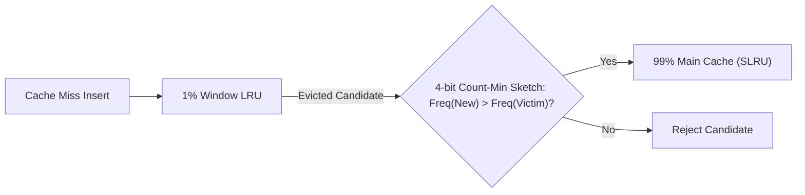
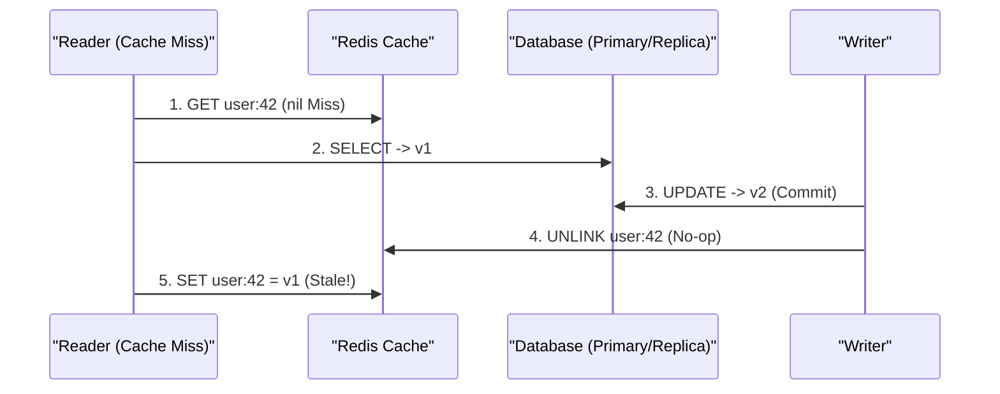
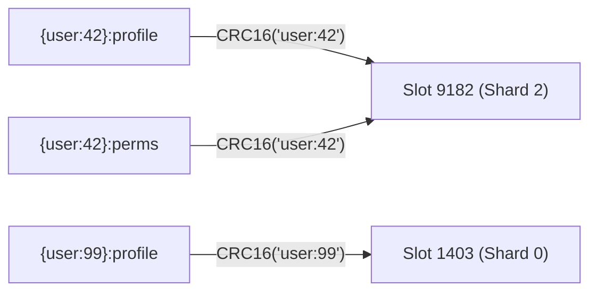

---
tags:
  - software-engineering
  - system-design
  - caching
  - redis
  - performance
created: 2026-01-02
updated: 2026-11-13
status: 🟢
level: mid-to-senior
---

# Caching

> [!abstract] Vault Navigation
> Core caching architecture handbook within [[Programming/Software Engineering/System Design/System Design Overview|System Design Overview]] and [[Programming/Software Engineering/System Design/System Design Complete Guide|System Design Complete Guide]]. Integrates with [[Programming/Software Engineering/System Design/Scalability|Scalability]], [[Programming/Software Engineering/System Design/Load Balancing|Load Balancing]], [[Programming/Software Engineering/System Design/CDN|CDN]], [[Programming/Software Engineering/Database Design/Relational Databases|Relational Databases]], [[Programming/Software Engineering/Database Design/NoSQL|NoSQL]], and [[Programming/Software Engineering/Architectural Patterns/Event-Driven Architecture|Event-Driven Architecture]].

Caching trades bounded memory capacity and mathematically controlled staleness for orders-of-magnitude tail-latency reduction and backend database load shedding. In production systems, caching outages almost never stem from key-value serialization bugs; they erupt from dual-write race conditions, LFU/LRU eviction skew, correlated TTL avalanches, penetration floods, `CROSSSLOT` hot-key shards, synchronous BigKey deletion stalls, and Linux `fork()` Copy-on-Write OOM kills.

---

## 1. Memory Hierarchy, CPU/L1/L2 Internals & Eviction Algorithms

### 1.1 The Complete Latency & Coherency Hierarchy

| Tier | Typical Latency | Scope & Memory Medium | Coherency & Operational Trade-Off |
| :--- | :--- | :--- | :--- |
| **CPU L1 / L2 / L3 Cache** | `0.5 – 20 ns` | Core-local SRAM / Shared socket SRAM (`64 B` cache lines) | Hardware MESI protocol; susceptible to **false sharing** when distinct threads mutate adjacent bytes inside the same 64-byte cache line |
| **In-Process Heap (L1)** | `50 – 200 ns` | Single application process RAM (`Caffeine`, `Ristretto`, JS `Map`) | Zero TCP/RESP serialization overhead; state diverges across pods unless invalidations push via RESP3 `CLIENT TRACKING` or Pub/Sub; adds GC/RSS pressure |
| **Distributed Store (L2)** | `0.3 – 1.0 ms` | Intra-AZ cluster RAM (`Redis`, `Valkey`, `Memcached`) | Shared cluster-wide source of truth across stateless pods; incurs network RTT, TCP/TLS framing, and serialization overhead |
| **Edge HTTP / CDN Cache** | `5 – 30 ms` | Global PoP RAM/NVMe reverse proxies (`Cloudflare`, `Fastly`, `Varnish`) | Absorbs anonymous read traffic off origin completely; governed by HTTP `Cache-Control`, `s-maxage`, `Vary`, and surrogate-key purges (see [[Programming/Software Engineering/System Design/CDN|CDN]]) |
| **NVMe Database Read** | `1 – 10 ms` | Persistent storage engine (`PostgreSQL` buffer pool + NVMe) | Full ACID durability; bounded by IOPS, MVCC locks, and connection concurrency |

#### CPU False Sharing & In-Process L1 Memory Limits

Even inside a single application host, naive multi-threaded counters or per-worker stats arrays suffer severe L1/L2 CPU cache-line bouncing when variables updated by different cores sit within the same **64-byte cache line**. Under MESI coherency, every atomic write on Core 0 invalidates Core 1's entire 64-byte line, serializing execution across cores (USL $\beta > 0$). Production concurrent C++/Rust/Go metrics pads independent hot counters to 64-byte boundaries (`alignas(64)` / `[64]byte` pad).

In garbage-collected runtimes (JVM, Go, V8/Node.js), sizing an in-process L1 cache recklessly causes **heap fragmentation and Stop-The-World GC pauses**. Always enforce an explicit **maximum entry count or byte-weight cap** (e.g., `10,000` hot entries or `64 MiB` max weight) and short TTLs (`2–10s`) unless backed by explicit invalidation push.

### 1.2 Exact LRU vs Scan-Resistant W-TinyLFU

#### Exact LRU Mechanics & Failure Modes

Classic Exact LRU combines a **Hash Map** (key $\to$ list node pointer) with a **Doubly-Linked List**:
- **Overhead**: Every entry requires two 8-byte pointers (`prev` + `next` = **16 extra bytes/entry**) plus allocator node headers.
- **Lock Contention**: Even a cache **read hit** mutates list pointers (`moveToFront`), forcing exclusive mutex acquisition across threads on high-read hot keys unless sharded into striped segments.
- **Sequential Scan Pollution**: One bulk table scan or crawler iterating over 100,000 cold archive records inserts them all at the MRU head, flushing the entire hot active working set out the tail!

#### W-TinyLFU Architecture (`Caffeine` / `Ristretto`)

Modern high-hit-ratio L1 caches (`Caffeine` in Java, `Ristretto` in Go) solve scan pollution and pointer contention using **W-TinyLFU** (Windowed TinyLFU):



1. **4-Bit Count-Min Sketch (Frequency Estimator)**:
   - Allocates $d = 4$ independent hash rows of $w$ 4-bit counters (max count `15` per slot)—consuming just **2 bytes per tracked item slot** (`4 * 4 bits`), roughly $10\times$ smaller than storing 64-bit exact counters.
   - To estimate frequency of key $k$, read all 4 hashed slots and take $\min_{i=1..4} \text{sketch}[i, h_i(k)]$ (minimizing hash collision over-estimation).
   - **Aging / Reset**: When total tracked accesses reach sample threshold $W$ (e.g., $10\times$ cache capacity), **divide every 4-bit counter by 2** (`>> 1`), smoothly decaying old historical spikes ("frequency pollution") so newly trending keys can compete fairly.
2. **Doorkeeper Bloom Filter (Optional)**:
   - Rejects strict "one-hit wonders" on their first occurrence before incrementing the Count-Min Sketch, saving sketch bits for recurring keys.
3. **Admission Filter & $1\%$ Window LRU**:
   - On eviction from the tiny **1% Window LRU**, the evicted candidate is compared against the victim at the tail of the **99% Main Segmented LRU (Probation/Protected)**: the candidate enters Main *only if* `freq(candidate) > freq(victim)`.
   - The 1% Window protects brand-new bursty items long enough to build up sketch hits before facing the strict TinyLFU admission filter.

### 1.3 Redis / Valkey Approximated LRU/LFU, TTL Expiration & `fork()` CoW

#### Redis Object Header & Approximated Eviction

Redis avoids doubly-linked list pointer overhead (saving 16 bytes/key) by packing a **24-bit `lru` field** directly inside every `redisObject` (`robj`, 16 bytes total header):
- **Approximated LRU (`allkeys-lru` / `volatile-lru`)**: Rather than maintaining a global linked list, Redis stores a 24-bit second-precision clock updated on access. Under `maxmemory` pressure, Redis samples `maxmemory-samples` random keys (default `5`; setting `10` yields near-exact LRU accuracy at negligible CPU cost), pushes them into a persistent **16-entry sorted eviction pool**, and evicts the key with the oldest idle time.
- **Approximated LFU (`allkeys-lfu` / `volatile-lfu`)**: Splits the 24-bit `lru` field into a **16-bit last-decrement minute timestamp** + an **8-bit Morris probabilistic logarithmic counter** (`0..255`, initialized to `5` on creation so new keys survive initial eviction).
  - *Logarithmic Increment Probability*:
    $$P(\text{increment}) = \frac{1}{(\text{counter} - 5) \cdot \text{lfu\_log\_factor} + 1}$$
    With default `lfu-log-factor 10`, counter `255` corresponds roughly to **1,000,000+ hits** inside 8 bits!
  - *Decay*: Every `lfu-decay-time` minutes (default `1`) without access, the counter decrements by 1, purging stale past hotspots naturally.
- **Eviction Policy Summary**:
  - `allkeys-lfu` / `allkeys-lru`: Default for pure caches (evict across entire keyspace).
  - `volatile-lru` / `volatile-lfu` / `volatile-ttl`: Evict *only* keys carrying an explicit `EX`/`PX` TTL—useful when mixing permanent config entries alongside ephemeral cached rows in one Redis instance.
  - `noeviction`: Returns write errors (`OOM command not allowed`) when full; mandatory for distributed locks/queues, fatal for pure caches.

#### TTL Expiration & Non-Blocking Reclamation (`UNLINK` + `lazyfree`)

Redis combines two complementary expiration sweeps:
1. **Passive (Lazy) Expiration**: Evaluated synchronously whenever a client runs `GET` / `HGET`. If `now > expire_ts`, Redis deletes the key before returning `nil`. Keys that go cold and are never read again are never reclaimed by passive checks alone.
2. **Active Probabilistic Expiration**: Every `100 ms` (configured via `hz 10`), Redis scans `20` random keys per database from the `expires` dictionary, deletes expired entries, and **loops immediately if $> 25\%$ were expired**—hard-capped at **25% CPU time per cycle** (`1–2 ms` in normal mode, shorter in `ACTIVE_EXPIRE_CYCLE_FAST`) so the main single-threaded loop stays responsive.

> [!danger] The BigKey Synchronous `DEL` Stall & `fork()` Copy-on-Write OOM Trap
> 1. **Blocking `DEL` / Expiration**: Calling `DEL` (or synchronously expiring) a 500,000-element `Hash` or `Sorted Set` freezes Redis's single-threaded command loop for **hundreds of milliseconds**, triggering client timeouts and Sentinel/Cluster false failovers. **Always issue non-blocking `UNLINK`** (which unlinks the key reference in $O(1)$ and frees allocations asynchronously on background `bio_lazy_free` threads) and set `lazyfree-lazy-expire yes`, `lazyfree-lazy-eviction yes`, and `lazyfree-lazy-server-del yes`.
> 2. **`fork()` Copy-on-Write (CoW) OOM Crash**: Executing `BGSAVE`, `BGREWRITEAOF`, or serving a full replica resync calls POSIX `fork()`. Initially parent and child share physical RAM pages via Linux Copy-on-Write. Under heavy write traffic (`50k SET/sec`), every modified 4 KB page (or 2 MB page if Transparent Huge Pages are enabled!) forces the kernel to allocate a duplicate private page for the parent—potentially expanding memory usage up to **$2\times$**! Always disable THP (`echo never > /sys/kernel/mm/transparent_hugepage/enabled`), set `vm.overcommit_memory = 1`, and size `maxmemory` to **50–65% of host physical RAM** whenever persistence or replication is active.

---

## 2. Caching Topologies, Selection Matrix & Dual-Write Race Conditions

### 2.1 Four Core Read/Write Topologies

| Topology | Read Flow | Write Flow | Consistency & Failure Profile |
| :--- | :--- | :--- | :--- |
| **Cache-Aside (Lazy Loading)** | App checks cache; on miss, reads DB and calls `SET` | App updates DB, then **deletes (`DEL`/`UNLINK`)** key | Cache holds only actively read working set; extra RTT on cold miss; exposed to read-miss + write race |
| **Read-Through** | App calls Cache abstraction; Cache itself invokes DB loader | App updates DB + invalidates cache (or combines with Write-Through) | Centralizes singleflight coalescing & DB loader cleanly inside cache client/proxy |
| **Write-Through** | App reads directly from cache (warm on every write) | App writes Cache + DB **synchronously** before ACK | Minimal staleness window; pays $2\times$ write latency; pollutes cache RAM with write-only cold keys unless paired with LFU admission |
| **Write-Behind (Write-Back)** | App reads directly from cache | App mutates Cache (`ACK < 1 ms`); background worker batches/coalesces dirty keys asynchronously to DB | Highest write throughput; collapses 1,000 rapid counter increments into 1 SQL `UPDATE`; **risks data loss** on cache node crash |

#### Five Concrete Multi-Use-Case Selection Rules

1. **General OLTP Product Catalog / User Profiles (`95%` read, `5%` write)**: Adopt **Cache-Aside + Singleflight + Short Jittered TTL** (or CDC invalidation). Only hot records occupy Redis RAM, keeping memory cost low.
2. **Feature Flags, Routing Rules & Auth Revocation Lists (`Read-After-Write` strict)**: Adopt **Write-Through + RESP3 `CLIENT TRACKING` L1** (or synchronous `SET` with version checks) so mutations take effect across pods immediately without waiting for misses.
3. **High-Throughput Like Counters, Telemetry Windows & Leaderboard Scores**: Adopt **Write-Behind** (increment atomically via Redis `HINCRBY` / `ZINCRBY` and flush dirty deltas to PostgreSQL/ClickHouse every 5 seconds via batch worker), accepting up to a 5-second non-financial loss window in exchange for $100\times$ DB write reduction.
4. **Financial Wallet Ledgers, Inventory Reservations & Double-Entry Accounting**: **DO NOT USE Write-Behind or unversioned Cache-Aside.** Keep primary balance state strictly inside ACID transactional storage ([[Programming/Software Engineering/Database Design/Transactions|Transactions]]); cache only immutable historical statements.
5. **Write-Once / Never-Read Audit Logs or Webhook Payloads**: **DO NOT USE Write-Through.** Writing cold audit blobs synchronously into Redis wastes expensive RAM and triggers aggressive eviction of hot catalog keys.

### 2.2 Dual-Write Race Conditions: Exact Packet Timelines

#### Race 1: Concurrent Write-Write `SET` Reordering

Never update cache via `updateDB() -> cache.SET()` on concurrent mutations:
1. Request $A$ executes `UPDATE users SET name='Alice'` (`v1`) $\to$ pauses before cache write.
2. Request $B$ executes `UPDATE users SET name='Bob'` (`v2`) $\to$ writes `cache.SET('u:1', 'Bob')`.
3. Request $A$ resumes and executes `cache.SET('u:1', 'Alice')`.
Database holds `'Bob'`, but Redis holds stale `'Alice'` until TTL expires!

#### Race 2: Concurrent Read-Miss + Write `DEL` Race

Even when writes **delete (`DEL`)** the key rather than overwriting with `SET`, an interleaved cache miss still injects permanent stale data:



1. **Step 1–2**: Reader misses Redis and reads `v1` from DB (or a lagging read replica), then pauses on GC or scheduler preemption.
2. **Step 3–4**: Writer commits `v2` to Primary DB and deletes `user:42` in Redis (currently empty).
3. **Step 5**: Reader wakes up and executes `SET user:42 v1 EX 86400`. Stale `v1` now persists for 24 hours!

### 2.3 Four Complete Production Solutions to Dual-Write Races

#### Solution A: `DEL` + Delayed Double-Delete (Pragmatic Low-Infrastructure Mitigation)

Delete the cache key *after* DB commit (or both before and after), then enqueue an asynchronous delayed delete after `max_read_plus_replica_lag_ms` (e.g., `250 ms`) to evict any stale value written by an in-flight slow reader:

```typescript
// src/cache/delayed-double-delete.ts
import type { Redis } from "ioredis";
import type { Pool } from "pg";

export async function updateProfileWithDoubleDelete(
  db: Pool,
  redis: Redis,
  userId: string,
  displayName: string,
): Promise<void> {
  const cacheKey = `profile:${userId}`;

  // 1. Commit authoritative DB state first
  await db.query("UPDATE users SET display_name = $1, version = version + 1 WHERE id = $2", [
    displayName,
    userId,
  ]);

  // 2. Immediate non-blocking unlink
  await redis.unlink(cacheKey);

  // 3. Delayed second unlink clears stale backfill from slow concurrent readers / replica lag.
  // Note: If node crashes during 250ms, delayed delete is lost unless backed by a durable MQ timer.
  setTimeout(() => {
    redis.unlink(cacheKey).catch((err) => {
      console.error(`Delayed double-delete failed for ${cacheKey}:`, err);
    });
  }, 250).unref();
}
```
*Trade-off*: Simple, zero schema change, narrows race window dramatically—but remains **probabilistic** (fails if a GC pause exceeds `250 ms` or pod restarts before timer fires).

#### Solution B: Atomic Lua Monotonic Version CAS + Tombstones (Strong App-Layer Guarantee)

Store `{ version, deleted, payload }` inside Redis alongside a monotonically increasing `version` column in PostgreSQL. A read-miss backfill executes an atomic **Redis Lua Compare-And-Set** that rejects any write whose `version <= stored_version`. On SQL `DELETE`, write a short-lived tombstone (`deleted: true, version: N`) so stalled readers holding `version: N-1` cannot resurrect deleted records!

```lua
-- redis/versioned_cas_set.lua
-- KEYS[1] = cache key (e.g., "profile:42")
-- ARGV[1] = candidate_version (integer), ARGV[2] = serialized JSON payload, ARGV[3] = ttl_seconds
local cur = redis.call("GET", KEYS[1])
if cur then
  local ok, decoded = pcall(cjson.decode, cur)
  if ok and decoded and tonumber(decoded.version) >= tonumber(ARGV[1]) then
    return 0 -- Reject stale backfill or out-of-order overwrite
  end
end
redis.call("SET", KEYS[1], ARGV[2], "EX", tonumber(ARGV[3]))
return 1
```

```typescript
// src/cache/versioned-cas-cache.ts
import type { Redis } from "ioredis";
import type { Pool } from "pg";

const CAS_LUA = `
local cur = redis.call("GET", KEYS[1])
if cur then
  local ok, decoded = pcall(cjson.decode, cur)
  if ok and decoded and tonumber(decoded.version) >= tonumber(ARGV[1]) then
    return 0
  end
end
redis.call("SET", KEYS[1], ARGV[2], "EX", tonumber(ARGV[3]))
return 1
`;

export interface VersionedRecord<T> {
  version: number;
  deleted: boolean;
  data: T | null;
}

export class VersionedCasProfileStore {
  constructor(private readonly redis: Redis, private readonly primaryDb: Pool) {
    this.redis.defineCommand("versionedCasSet", { numberOfKeys: 1, lua: CAS_LUA });
  }

  async getProfile(userId: string) {
    const key = `profile:${userId}`;
    const raw = await this.redis.get(key);
    if (raw) {
      const parsed = JSON.parse(raw) as VersionedRecord<{ id: string; displayName: string }>;
      return parsed.deleted ? null : parsed.data;
    }

    // Read-miss fallback queries primary (or LSN-verified replica) to fetch monotonic version
    const { rows } = await this.primaryDb.query<{
      id: string;
      display_name: string;
      version: number;
      deleted_at: Date | null;
    }>("SELECT id, display_name, version, deleted_at FROM users WHERE id = $1", [userId]);

    if (rows.length === 0) return null;
    const row = rows[0];
    const envelope: VersionedRecord<{ id: string; displayName: string }> = {
      version: row.version,
      deleted: row.deleted_at !== null,
      data: row.deleted_at ? null : { id: row.id, displayName: row.display_name },
    };

    const jitterTtl = 3600 + Math.floor(Math.random() * 300);
    await (this.redis as unknown as {
      versionedCasSet: (k: string, v: number, val: string, ttl: number) => Promise<number>;
    }).versionedCasSet(key, row.version, JSON.stringify(envelope), jitterTtl);

    return envelope.data;
  }

  async updateProfile(userId: string, displayName: string): Promise<void> {
    const { rows } = await this.primaryDb.query<{ id: string; display_name: string; version: number }>(
      `UPDATE users SET display_name = $1, version = version + 1
       WHERE id = $2 AND deleted_at IS NULL
       RETURNING id, display_name, version`,
      [displayName, userId],
    );
    if (rows.length === 0) return;

    const row = rows[0];
    const envelope: VersionedRecord<{ id: string; displayName: string }> = {
      version: row.version,
      deleted: false,
      data: { id: row.id, displayName: row.display_name },
    };
    await (this.redis as unknown as {
      versionedCasSet: (k: string, v: number, val: string, ttl: number) => Promise<number>;
    }).versionedCasSet(`profile:${userId}`, row.version, JSON.stringify(envelope), 3600);
  }
}
```

#### Solution C: Debezium WAL CDC Invalidator (Best Correctness & Decoupling)

Eliminate cache invalidation logic from application write services entirely. Stream committed PostgreSQL Write-Ahead Log (`pgoutput`) changes via **Debezium** into a Kafka topic keyed strictly by primary key (`user_id`), guaranteeing per-key commit ordering. A dedicated consumer processes events sequentially per partition and executes Lua CAS `SET`/`UNLINK`:

```json
// debezium/postgres-users-connector.json
{
  "name": "users-cache-cdc-connector",
  "config": {
    "connector.class": "io.debezium.connector.postgresql.PostgresConnector",
    "database.hostname": "pg-primary.internal",
    "database.port": "5432",
    "database.user": "debezium_replication",
    "database.dbname": "orders",
    "topic.prefix": "cdc",
    "plugin.name": "pgoutput",
    "slot.name": "debezium_users_cache_slot",
    "table.include.list": "public.users",
    "publication.autocreate.mode": "filtered",
    "tombstones.on.delete": "true"
  }
}
```

```typescript
// src/cdc/redis-cdc-invalidator.ts
import { Kafka } from "kafkajs";
import type { Redis } from "ioredis";

export async function startCacheCdcConsumer(kafka: Kafka, redis: Redis): Promise<void> {
  const consumer = kafka.consumer({ groupId: "redis-profile-invalidator-v1" });
  await consumer.connect();
  await consumer.subscribe({ topic: "cdc.public.users", fromBeginning: false });

  await consumer.run({
    eachBatchAutoResolve: true,
    eachBatch: async ({ batch }) => {
      const pipeline = redis.pipeline();
      for (const msg of batch.messages) {
        if (!msg.value) {
          // Debezium tombstone event after DELETE
          const keyObj = msg.key ? JSON.parse(msg.key.toString()) : null;
          if (keyObj?.id) pipeline.unlink(`profile:${keyObj.id}`);
          continue;
        }
        const event = JSON.parse(msg.value.toString()) as {
          payload?: { op: string; after?: { id: string; display_name: string; version: number }; before?: { id: string } };
        };
        const p = event.payload;
        if (!p) continue;

        if (p.op === "d" && p.before) {
          pipeline.unlink(`profile:${p.before.id}`);
        } else if (p.after) {
          // Invalidate or refresh cache in strict WAL LSN commit order
          const val = JSON.stringify({
            version: p.after.version,
            deleted: false,
            data: { id: p.after.id, displayName: p.after.display_name },
          });
          pipeline.set(`profile:${p.after.id}`, val, "EX", 3600 + Math.floor(Math.random() * 180));
        }
      }
      await pipeline.exec();
    },
  });
}
```

#### Solution D: RESP3 `CLIENT TRACKING` Sub-Millisecond L1 Invalidation

When pairing an in-process **L1 Map/W-TinyLFU** with Redis **L2**, polling L2 or waiting out L1 TTLs introduces stale windows across pods. Redis 6+ **Client-Side Caching (`CLIENT TRACKING ON`)** maintains a compact invalidation table on the Redis server (or prefix-matched `BCAST` mode, avoiding per-key server tracking memory overhead!) and sends asynchronous RESP3 push frames (`invalidate` messages) whenever tracked keys mutate:

```typescript
// src/cache/resp3-l1-hybrid.ts — Native RESP3 Client-Side Caching (node-redis v5+)
import { createClient, BasicClientSideCache } from "redis";

export async function createResp3TrackedClient(redisUrl: string) {
  // BasicClientSideCache tracks keys locally inside node-redis, turns on RESP3 + CLIENT TRACKING,
  // deletes invalidated keys automatically on Redis push frames (>2 invalidate ...),
  // and clears the entire L1 map on socket disconnect/reconnect automatically.
  const l1Provider = new BasicClientSideCache({
    ttl: 5_000,         // Safety ceiling (ms) even if connection drops briefly
    maxEntries: 10_000, // Hard memory bound preventing V8 heap bloat
    evictPolicy: "LRU",
  });

  const client = createClient({
    url: redisUrl,
    RESP: 3,
    clientSideCache: l1Provider,
  });

  client.on("error", (err) => console.error("Redis RESP3 error:", err));
  // Explicit safety purge on reconnect because push invalidations sent while offline are never replayed
  client.on("reconnecting", () => l1Provider.clear());

  await client.connect();
  return client;
}
```

*(Protocol mechanics under the hood: When `CLIENT TRACKING ON` runs in default mode, Redis records `(key -> client_IDs)` inside its `TrackingTable`; on any mutation, Redis pushes an out-of-band RESP3 frame `>2\r\n$10\r\ninvalidate\r\n*1\r\n$10\r\ncfg:flags\r\n` over the same TCP socket. For very high-key-cardinality fleets where `TrackingTable` RAM grows large, switch to **Broadcast Mode** via `CLIENT TRACKING ON BCAST PREFIX cfg:`: Redis stores only prefix subscriptions instead of millions of individual key pointers, trading slightly higher invalidation fan-out for near-zero server tracking memory!)*

---

## 3. Production Implementations for Stampedes, Penetration & Hot Keys

### 3.1 Singleflight + XFetch Probabilistic Early Expiration (TypeScript & Go)

#### Failure Mode: Cache Stampede (Thundering Herd)

When a hot key requiring `400 ms` of SQL aggregation expires under `5,000 req/s`, thousands of simultaneous requests miss Redis simultaneously and launch `5,000` redundant SQL queries—saturating database CPU and connections instantaneously.

#### Two-Layer Defense: `Singleflight` + `XFetch` (Vattani et al.)

1. **In-Process `singleflight`**: Deduplicates concurrent misses for the same key *inside* each application pod into a single leader Promise/goroutine while all sibling callers await the identical shared result.
2. **Probabilistic Early Expiration (`XFetch`)**: Eliminates cross-pod distributed locks completely. Store `{ value, computeMs, expiresAtMs }` inside Redis. Before hard expiration `expiresAtMs`, every reader evaluates:
   $$t_{\text{now}} - \Delta \cdot \beta \cdot \ln(\text{rand}(0, 1)) \ge t_{\text{expiry}}$$
   where $\Delta = \text{computeMs}$ is the measured rebuild duration and $\beta \ge 1.0$ controls refresh eagerness. Because $-\ln(U)$ for $U \in (0, 1]$ is exponentially distributed, one reader probabilistically triggers an early background/singleflight rebuild seconds *before* TTL hits zero, resetting `expiresAtMs` cleanly so the rest of the fleet never encounters a miss!

```typescript
// src/cache/singleflight-xfetch.ts
import type { Redis } from "ioredis";

interface CachedEnvelope<T> {
  value: T;
  computeMs: number;
  expiresAtMs: number;
}

export class SingleflightXFetchCache {
  private readonly inFlight = new Map<string, Promise<unknown>>();

  constructor(private readonly redis: Redis, private readonly beta = 1.2) {}

  private shouldEarlyRefresh(expiresAtMs: number, computeMs: number): boolean {
    const remainingMs = expiresAtMs - Date.now();
    if (remainingMs <= 0) return true;
    const u = Math.max(Number.MIN_VALUE, Math.random());
    const deltaTerm = -Math.max(1, computeMs) * this.beta * Math.log(u);
    return deltaTerm >= remainingMs;
  }

  /** Coalesces concurrent misses per key inside this Node/V8 process */
  private runSingleflight<T>(key: string, loader: () => Promise<T>): Promise<T> {
    const existing = this.inFlight.get(key) as Promise<T> | undefined;
    if (existing) return existing;

    const promise = loader().finally(() => {
      this.inFlight.delete(key);
    });
    this.inFlight.set(key, promise);
    return promise;
  }

  async getOrLoad<T>(
    key: string,
    ttlSec: number,
    loader: () => Promise<T>,
  ): Promise<T> {
    const raw = await this.redis.get(key);
    let cached: CachedEnvelope<T> | null = raw ? (JSON.parse(raw) as CachedEnvelope<T>) : null;

    if (cached && !this.shouldEarlyRefresh(cached.expiresAtMs, cached.computeMs)) {
      return cached.value;
    }

    return this.runSingleflight<T>(key, async () => {
      // Re-check inside singleflight in case another local/remote writer just refreshed it
      const freshRaw = await this.redis.get(key);
      if (freshRaw) {
        const fresh = JSON.parse(freshRaw) as CachedEnvelope<T>;
        if (!this.shouldEarlyRefresh(fresh.expiresAtMs, fresh.computeMs)) {
          return fresh.value;
        }
        cached = fresh;
      }

      const start = performance.now();
      try {
        const value = await loader();
        const computeMs = Math.max(1, Math.round(performance.now() - start));
        const jitterSec = Math.floor(Math.random() * Math.max(1, Math.floor(ttlSec * 0.15)));
        const finalTtlSec = ttlSec + jitterSec;

        const envelope: CachedEnvelope<T> = {
          value,
          computeMs,
          expiresAtMs: Date.now() + finalTtlSec * 1000,
        };
        // Keep physical Redis EX 2x logical expiresAtMs so stale-if-error fallback stays available!
        await this.redis.set(key, JSON.stringify(envelope), "EX", finalTtlSec * 2);
        return value;
      } catch (err) {
        if (cached) return cached.value; // Stale-if-error resilience during DB hiccup
        throw err;
      }
    });
  }
}
```

```go
// cache/singleflight_xfetch.go — Production Go implementation with x/sync/singleflight
package cache

import (
	"context"
	"encoding/json"
	"math"
	"math/rand/v2"
	"time"

	"github.com/redis/go-redis/v9"
	"golang.org/x/sync/singleflight"
)

type Envelope[T any] struct {
	Value       T       `json:"v"`
	ComputeMs   float64 `json:"c"`
	ExpiresAtMs int64   `json:"e"`
}

type XFetchStore[T any] struct {
	rdb   redis.Cmdable
	group singleflight.Group
	beta  float64
}

func NewXFetchStore[T any](rdb redis.Cmdable, beta float64) *XFetchStore[T] {
	return &XFetchStore[T]{rdb: rdb, beta: beta}
}

func (s *XFetchStore[T]) shouldRefresh(expiresAtMs int64, computeMs float64) bool {
	remainingMs := float64(expiresAtMs - time.Now().UnixMilli())
	if remainingMs <= 0 {
		return true
	}
	u := math.Max(1e-12, rand.Float64())
	return (-math.Max(1.0, computeMs) * s.beta * math.Log(u)) >= remainingMs
}

func (s *XFetchStore[T]) GetOrLoad(ctx context.Context, key string, ttl time.Duration, load func(context.Context) (T, error)) (T, error) {
	var zero T
	var stale *Envelope[T]

	if raw, err := s.rdb.Get(ctx, key).Bytes(); err == nil {
		var env Envelope[T]
		if json.Unmarshal(raw, &env) == nil {
			stale = &env
			if !s.shouldRefresh(env.ExpiresAtMs, env.ComputeMs) {
				return env.Value, nil
			}
		}
	}

	val, err, _ := s.group.Do(key, func() (any, error) {
		start := time.Now()
		loaded, loadErr := load(ctx)
		if loadErr != nil {
			if stale != nil {
				return stale.Value, nil // Stale-if-error fallback
			}
			return zero, loadErr
		}
		computeMs := math.Max(1.0, float64(time.Since(start).Milliseconds()))
		jitter := time.Duration(rand.IntN(int(ttl.Seconds()/10)+1)) * time.Second
		logicalTTL := ttl + jitter

		env := Envelope[T]{
			Value:       loaded,
			ComputeMs:   computeMs,
			ExpiresAtMs: time.Now().Add(logicalTTL).UnixMilli(),
		}
		if bytes, mErr := json.Marshal(env); mErr == nil {
			_ = s.rdb.Set(ctx, key, bytes, logicalTTL*2).Err()
		}
		return loaded, nil
	})
	if err != nil {
		return zero, err
	}
	return val.(T), nil
}
```

### 3.2 Redis Bloom Filter Sizing & Penetration Guard

#### Failure Mode: Cache Penetration (Miss-Everything Attack)

Queries for keys that exist **neither in cache nor in the database** (`GET /items/fake-uuid-99182`) miss Redis (`nil`) and hit PostgreSQL directly on *every* request. Null-sentinel caching (`SET item:fake "__NULL__" EX 600`) fails against random unique-ID floods because storing `50,000` unique fake keys/sec for 600s requires **30M keys $\approx 3.3\text{ GB}$**, evicting valid hot catalog data.

#### Bloom Filter Sizing Mathematics

Given $n$ valid dataset keys and target false-positive rate $p \in (0, 1)$:

$$m = -\frac{n \ln p}{(\ln 2)^2} \approx -1.4427 \cdot n \log_2 p \text{ bits}, \qquad k = \left\lceil \frac{m}{n} \ln 2 \right\rceil \approx \left\lceil -\log_2 p \right\rceil$$

| Valid Keys $n$ | Target False Positive $p$ | Exact Bit Array Size $m$ | Optimal Hashes $k$ | Redis RAM Footprint |
| :--- | :--- | :--- | :--- | :--- |
| `1,000,000` | `0.01` (`1%`) | `9,585,059` bits | `7` | `1.14 MiB` |
| `10,000,000` | `0.01` (`1%`) | `95,850,584` bits | `7` | `11.43 MiB` |
| `30,000,000` | `0.001` (`0.1%`) | `431,327,532` bits | `10` | `51.42 MiB` |
| `100,000,000` | `0.001` (`0.1%`) | `1,437,758,439` bits | `10` | `171.39 MiB` |

*(Standard Bloom filters never delete elements; when items archive/delete permanently, rebuild a fresh Bloom snapshot nightly and swap atomically via `RENAME`, or pair with a 60s Null-Sentinel for residual $p$-rate false positives).*

#### Production Double-Hashing Redis Bitfield Bloom Guard

Using **Kirsch-Mitzenmacher double hashing**, only two 64-bit hashes $(h_1, h_2)$ generate $k$ independent bit offsets $g_i(x) = (h_1(x) + i \cdot h_2(x)) \bmod m$, executable via pipelined `SETBIT`/`GETBIT` on *standard* Redis/Valkey strings (max string size 512 MB = $4.29 \times 10^9$ bits, zero external RedisBloom module needed):

```typescript
// src/cache/bloom-penetration-guard.ts
import crypto from "node:crypto";
import type { Redis } from "ioredis";

export class RedisBloomGuard {
  public readonly bitCount: number;
  public readonly hashCount: number;

  constructor(
    private readonly redis: Redis,
    private readonly key: string,
    expectedItems: number,
    falsePositiveRate = 0.001,
  ) {
    const ln2Sq = Math.LN2 * Math.LN2;
    this.bitCount = Math.ceil((-expectedItems * Math.log(falsePositiveRate)) / ln2Sq);
    this.hashCount = Math.max(1, Math.round((this.bitCount / expectedItems) * Math.LN2));
  }

  /** Generates k deterministic bit indices using Kirsch-Mitzenmacher double hashing */
  private computeOffsets(item: string): number[] {
    const digest = crypto.createHash("sha256").update(item).digest();
    const h1 = digest.readBigUInt64BE(0);
    const h2 = digest.readBigUInt64BE(8) | 1n; // Force odd h2 to prevent trivial short cycles
    const mod = BigInt(this.bitCount);

    const offsets: number[] = new Array(this.hashCount);
    for (let i = 0; i < this.hashCount; i++) {
      offsets[i] = Number((h1 + BigInt(i) * h2) % mod);
    }
    return offsets;
  }

  async addBatch(items: string[]): Promise<void> {
    const pipeline = this.redis.pipeline();
    for (const item of items) {
      for (const offset of this.computeOffsets(item)) {
        pipeline.setbit(this.key, offset, 1);
      }
    }
    await pipeline.exec();
  }

  /** Returns false ONLY when key is guaranteed absent (0% false negatives) */
  async mightExist(item: string): Promise<boolean> {
    const pipeline = this.redis.pipeline();
    for (const offset of this.computeOffsets(item)) {
      pipeline.getbit(this.key, offset);
    }
    const results = await pipeline.exec();
    if (!results) return true; // Fail open on transient pipeline failure
    return results.every(([err, bit]) => !err && bit === 1);
  }
}
```

### 3.3 Key-Salting Hot-Key Sharding

When one viral SKU or celebrity record receives `150,000 RPS`, Redis Cluster maps `CRC16(key) % 16384` to **a single primary shard**, pinning its single-threaded CPU at `100%` while 15 sibling shards idle. Combining **L1 local caching** (5s TTL cuts 150k RPS across 100 pods down to `20 RPS`!) with **Key-Salting ($K$ sharded copies)** distributes residual Redis traffic uniformly across all shards:

```typescript
// src/cache/hot-key-sharded.ts
import type { Redis } from "ioredis";

export class HotKeyShardedCache {
  private readonly l1 = new Map<string, { val: string; exp: number }>();

  constructor(
    private readonly redis: Redis, // Redis.Cluster or standalone client
    private readonly replicaShards = 16,
    private readonly l1TtlMs = 2000,
  ) {}

  /** Writes value to K distinct suffixed keys so CRC16 scatters copies across all cluster shards */
  async setHotKey(baseKey: string, value: string, ttlSec: number): Promise<void> {
    // Note: in Redis Cluster, parallel individual SET calls route safely across independent slots
    const ops: Promise<unknown>[] = [];
    for (let i = 0; i < this.replicaShards; i++) {
      const jitter = Math.floor(Math.random() * 15);
      ops.push(this.redis.set(`${baseKey}#${i}`, value, "EX", ttlSec + jitter));
    }
    await Promise.all(ops);
    this.l1.set(baseKey, { val: value, exp: Date.now() + this.l1TtlMs });
  }

  /** Reads from L1 first, falling back to a uniformly chosen replica suffix #0..#K-1 */
  async getHotKey(baseKey: string): Promise<string | null> {
    const local = this.l1.get(baseKey);
    if (local && local.exp > Date.now()) return local.val;

    const shardIdx = Math.floor(Math.random() * this.replicaShards);
    const val = await this.redis.get(`${baseKey}#${shardIdx}`);
    if (val !== null) {
      // Jitter L1 expiry +-25% so all pods do not expire simultaneously
      const jitterMs = Math.floor((Math.random() - 0.5) * 0.5 * this.l1TtlMs);
      this.l1.set(baseKey, { val, exp: Date.now() + this.l1TtlMs + jitterMs });
    }
    return val;
  }
}
```

### 3.4 Redis Cluster `{hash_tag}` Multi-Key Atomicity & Skew Trap

Redis Cluster partitions keys deterministically across **16,384 hash slots** using `CRC16(key) % 16384`. Multi-key commands (`MGET`, `MSET`, `RENAME`, multi-key Lua `EVALSHA`) fail with **`CROSSSLOT Keys in request don't hash to the same slot`** whenever their arguments live on different hash slots—even if those slots currently sit on the same physical shard!



- **Hash-Tag Rule**: If a key contains `{...}` with at least one character inside the braces, Redis hashes **only the first substring inside `{...}`**:
  - `{user:42}:profile` and `{user:42}:perms` both hash strictly on `"user:42"`, guaranteeing same-slot co-location for atomic multi-key Lua scripts.
- **The Hash-Tag Skew Hazard**: Never enclose a coarse global or high-cardinality-skewed identifier inside `{...}` (for example, `{prod}:item:1..10M` or `{vip_tenant}:session:1..5M`). All 10 million keys collapse onto **1 of 16,384 slots**, creating un-reshardable memory and CPU hotspot failure on a single Redis node!

```lua
-- Atomic multi-key transfer across co-located hash-tagged user keys:
-- KEYS[1] = "{acct:1001}:balance", KEYS[2] = "{acct:1001}:reserved", ARGV[1] = amount
local bal = tonumber(redis.call("GET", KEYS[1]) or "0")
local amt = tonumber(ARGV[1])
if bal < amt then
  return -1
end
redis.call("DECRBY", KEYS[1], amt)
redis.call("INCRBY", KEYS[2], amt)
return bal - amt
```

---

## 4. Complete Redis / Valkey / Memcached Tuning & Edge Cases

### 4.1 Memcached vs Redis vs Valkey Architecture Comparison

| Dimension | Memcached | Redis (7.x / 8.x) | Valkey (8.0+ BSD-3 Fork) |
| :--- | :--- | :--- | :--- |
| **Threading Model** | **Multi-threaded** (`libevent` worker pool); scales seamlessly across CPU cores | **Single-threaded** command loop + multi-threaded socket I/O (`io-threads`) | **Single-threaded** core + improved **multi-threaded I/O** & per-slot prefetching |
| **Memory Allocator** | **Slab allocator** (`1 MB` pages split into fixed size classes; zero fragmentation, rigid slab calc) | `jemalloc` dynamic allocator; tracks `mem_fragmentation_ratio` | `jemalloc` + compact dictionary slot headers reducing per-key RAM overhead |
| **Data Structures** | Opaque byte blobs (`key -> string`, `1 MB` slab default) | Strings, Hashes, Lists, Sets, ZSets, Streams, HyperLogLog, Bitmaps | Full Redis 7.2 wire compatibility + Bloom/JSON/Vector modules |
| **Clustering** | Pure client-side consistent hashing (stateless isolated nodes, zero HA replication) | Server-side **16,384 hash slots**, primary-replica failover, `{hash_tags}` | Same 16,384 hash-slot protocol; dual-channel replication improvements |
| **License & Persistence** | Volatile only (BSD-3) | RDB + AOF; dual-licensed RSALv2 / SSPLv1 (7.4+) | RDB + AOF; open **BSD-3-Clause** Linux Foundation governance |

### 4.2 Production `valkey.conf` / `redis.conf` Baseline

```ini
# /etc/redis/redis.conf — Production L2 Cache Node (64 GB RAM host)
# Cap maxmemory at ~60% physical RAM if RDB/AOF/replica resyncs run (CoW headroom!)
maxmemory 38gb
maxmemory-policy allkeys-lfu
maxmemory-samples 10

# Non-blocking memory reclamation prevents BigKey stalls
lazyfree-lazy-eviction yes
lazyfree-lazy-expire yes
lazyfree-lazy-server-del yes
replica-lazy-flush yes

# Multi-threaded socket parsing (4-8 vCPU cache host; keep <= cores - 1)
io-threads 4
io-threads-do-reads yes

# Pure ephemeral cache? Disable disk persistence to eliminate fork() CoW risk completely:
save ""
appendonly no

# Protect memory from slow Pub/Sub consumers & stalled replica buffers
client-output-buffer-limit normal 0 0 0
client-output-buffer-limit replica 512mb 128mb 60
client-output-buffer-limit pubsub 64mb 16mb 60

# Capture commands slower than 5ms (microseconds)
slowlog-log-slower-than 5000
slowlog-max-len 256
```

### 4.3 Critical Production Edge Cases

1. **Cache Avalanche Mitigation**: When millions of entries share uniform TTLs (e.g., nightly `00:00 UTC` pre-warmer setting `EX 3600`), simultaneous expiration at `01:00 UTC` forwards 100% of reads to SQL. Always apply **$\pm 15\text{–}20\%$ random TTL jitter**, run multi-AZ HA replicas, and serve stale cached envelopes during upstream DB circuit-breaker trips.
2. **Serialization & Compression Thresholds**: JSON serialization inflates key values $2\text{–}3\times$ and burns CPU on `JSON.parse`. Switch large hot payloads (`> 1 KB`) to **MessagePack or Protobuf + Zstd** (compress *only* payloads $> 512\text{ bytes}$ to avoid inflating tiny values).
3. **Memory Fragmentation Ratio (`mem_fragmentation_ratio`)**:
   - `1.0 – 1.3`: Healthy `jemalloc` behavior.
   - `> 1.5`: Severe heap fragmentation from churning variable-sized values (enable `activedefrag yes` or rolling replica failover).
   - `< 1.0`: **Critical emergency**—Redis RSS fits less than allocated data, meaning **Linux is swapping Redis pages to disk**, causing `100 ms+` tail latency spikes!

---

## 5. Production Debugging, Profiling & Operations Playbook

| Symptom | Root Cause Hypothesis | Exact Diagnostic Commands | Remediation |
| :--- | :--- | :--- | :--- |
| **Redis latency jumps periodically to `200–800 ms` across all clients** | Synchronous `DEL` on BigKey, `BGSAVE` THP CoW stall, or `KEYS *` / Lua loop | `redis-cli SLOWLOG GET 20` · `redis-cli --bigkeys` · `redis-cli LATENCY DOCTOR` | Replace `DEL` with `UNLINK`, enable `lazyfree-*`, split BigKeys into chunked hashes (`<5k` fields), disable Linux THP |
| **Eviction storm (`evicted_keys/s` spiking) & hit ratio drops `< 70%`** | Penetration flood, unbounded Null-Sentinels, or undersized `maxmemory` | `redis-cli INFO stats \| grep -E "hits\|misses\|evicted\|expired"` · `redis-cli --memkeys` | Add Bloom penetration guard, lower Null-Sentinel TTL to 30s, enable `allkeys-lfu` + compression |
| **One Cluster shard at `100%` CPU while 5 siblings idle at `15%`** | Viral Hot-Key or `{hash_tag}` skew overloading single slot/shard | `redis-cli -c --hotkeys` *(requires `allkeys-lfu` or `volatile-lfu`!)* | Add L1 pod cache (2–5s TTL) + key-salting (`key#0..#15`); audit `{tag}` cardinality |
| **`redis-server` killed by kernel OOM Killer below `maxmemory`** | `fork()` CoW duplicated pages during `BGSAVE` / replica full resync | `dmesg -T \| grep -i oom` · `redis-cli INFO memory` · `redis-cli INFO persistence` | Lower `maxmemory` to `55%` host RAM (or disable `save`), set `vm.overcommit_memory=1` |
| **Replication link flapping or clients disconnecting abruptly** | `client-output-buffer-limit` exceeded by slow Pub/Sub or lagging replica | `redis-cli CLIENT LIST` (check `omem` and `obl`/`oll` columns!) | Raise `client-output-buffer-limit replica`, move Pub/Sub fan-out off critical cache shards |

```bash
# Rapid Production Triage One-Liner Bundle
redis-cli --stat -i 1                                    # Live ops/s, mem, hit-rate, clients stream
redis-cli --hotkeys                                      # Scans keyspace LFU counters (only works on LFU policies!)
redis-cli --bigkeys                                      # Finds largest keys per data type non-blockingly via SCAN
redis-cli MEMORY USAGE "session:user:42" SAMPLES 0       # Exact byte cost including all nested members
redis-cli INFO memory | grep -E "used_memory_human|used_memory_rss_human|mem_fragmentation_ratio"
```

---

## 6. Worked Exercises

### Exercise 1: Bloom Filter Sizing & Cache Penetration Defense

Your e-commerce API serves `GET /api/v1/items/{sku}` backed by Redis and PostgreSQL (`30,000,000` valid SKUs). An attacker triggers a penetration flood sending **`50,000 RPS`** of random non-existent 16-byte SKUs.
- Available Redis RAM headroom for penetration protection: **256 MiB**.
- Target Bloom Filter false positive rate: **$p = 0.001$ ($0.1\%$)**.

1. Calculate quantitatively why caching Null-Sentinels alone with a 10-minute TTL exhausts Redis RAM.
2. Derive the exact Bloom Filter bit-array size $m$ (in MiB) and optimal hash count $k$ for $n = 30{,}000{,}000, p = 0.001$.
3. Calculate residual PostgreSQL QPS passing the Bloom Filter and design the complete layered mitigation reducing DB traffic near `0 RPS`.

---

### Solution 1

#### 1. Null-Sentinel Failure Math
At $50{,}000$ unique random fake SKUs/sec over a $600\text{ s}$ TTL:
$$\text{Negative keys} = 50{,}000 \times 600 = 30{,}000{,}000\text{ keys}$$
Each Redis key entry (`dictEntry` + `robj` + key string + `"__NULL__"` + TTL entry) consumes **~105–120 bytes** in `jemalloc`:
$$30\times 10^6 \times 110\text{ bytes} \approx \mathbf{3.3\text{ GB}}$$
This exceeds the 256 MiB budget by **$13\times$**, evicting valid hot catalog keys immediately!

#### 2. Bloom Filter Sizing ($n = 3\times 10^7, p = 0.001$)
$$m = -\frac{3\times 10^7 \ln(0.001)}{(\ln 2)^2} = \frac{3\times 10^7 \times 6.907755}{0.480453} \approx \mathbf{431{,}327{,}532\text{ bits}}$$
Convert to MiB:
$$\frac{431{,}327{,}532}{8 \times 1024 \times 1024} \approx \mathbf{51.42\text{ MiB}}$$
Optimal hash functions:
$$k = \frac{m}{n} \ln 2 = 14.3776 \times 0.693147 \approx \mathbf{10\text{ hash functions}}$$
51.42 MiB easily fits inside Redis's 256 MiB headroom (or even replicated inside every API pod's L1 RAM!).

#### 3. Residual Load & Complete Defense
- False positives reaching PostgreSQL: $50{,}000 \times 0.001 = \mathbf{50\text{ RPS}}$.
- **Eliminating Residual Load**: Pair the Bloom Filter with **short-TTL (`60s`) Null-Sentinels** and **edge IP rate limiting**. Now only the `50/s` false-positive keys get null-cached (`50 * 60 = 3,000` keys $\approx 330\text{ KB}$ total), absorbing repeated retries on those false-positive SKUs inside Redis and dropping DB load toward zero.

---

### Exercise 2: Diagnosing a Permanent Stale-Profile Bug

Users report seeing hours-old reverted display names after saving updates, despite Cache-Aside deletion and a 24-hour TTL:

```typescript
async function getProfile(userId: string) {
  const cached = await redis.get(`profile:${userId}`);
  if (cached) return JSON.parse(cached);
  const row = await readReplicaDb.query("SELECT * FROM users WHERE id = $1", [userId]);
  await redis.set(`profile:${userId}`, JSON.stringify(row), "EX", 86400);
  return row;
}

async function updateProfile(userId: string, name: string) {
  await redis.del(`profile:${userId}`);
  await primaryDb.query("UPDATE users SET display_name = $1, version = version + 1 WHERE id = $2", [name, userId]);
}
```

1. Identify **all 3 distinct race/ordering bugs** causing 24-hour stale caches.
2. Provide the complete fixed implementation using monotonic version CAS in Lua (and explain when Debezium CDC replaces this entirely).

---

### Solution 2

#### 1. Three Root Causes
1. **`DEL` Before `UPDATE` Ordering**: Deleting Redis *before* committing PostgreSQL lets any concurrent reader between `redis.del()` and SQL `COMMIT` read the pre-update row and immediately repopulate Redis with stale data.
2. **Cache Backfill from Async Read Replica**: Even after swapping `UPDATE` before `DEL`, replication lag (`50–500 ms`) causes a cache miss right after a write to query `readReplicaDb` for stale data and lock it into Redis for `86,400 s`.
3. **Unconditional `redis.set()` Overwrite**: A stalled read-miss coroutine lacking monotonic version checks overwrites newer committed writes unconditionally.

#### 2. Fixed Solution
1. Query `primaryDb` (or LSN-verified replica from [[Programming/Software Engineering/System Design/Scalability|Scalability]]) on cache miss, commit `UPDATE ... RETURNING version` on `primaryDb` *before* touching Redis, and perform cache updates via the atomic **`versionedCasSet` Lua script** (`tonumber(decoded.version) >= tonumber(ARGV[1])` rejects stale overwrites; see `VersionedCasProfileStore` in Section 2.3).
2. **Superior Alternative**: Move cache population/invalidation entirely out of request handlers into a **Debezium WAL CDC consumer** processing committed PostgreSQL events in strict LSN order.

---

### Exercise 3: Hot-Key Shard Saturation & XFetch Stampede Math

A 6-shard Redis Cluster handles **180,000 RPS** evenly (~30k RPS/shard). A flash marketing campaign pushes `promo:flash_sale` to **140,000 RPS** across 80 stateless Go pods.
- Shard 4 (`CRC16("promo:flash_sale") % 16384`) saturates at `100%` CPU while 5 shards remain at `25%`.
- When `promo:flash_sale` (`TTL = 120s`, SQL rebuild time $\Delta = 400\text{ ms}$) expires, all 80 Go pods slam PostgreSQL simultaneously.

1. Show how to drop Shard 4's traffic below **5,000 RPS** (with L1 enabled and also *without* L1 if sub-second freshness is strictly required).
2. Using **XFetch** with $\Delta = 400\text{ ms}, \beta = 1.5$, calculate the exact probability that any single check triggers an early refresh when **$1.0\text{ s}$ remains before expiry**, and explain why combining XFetch + `singleflight` eliminates the stampede across 80 pods.

---

### Solution 3

#### 1. Eliminating Shard 4 Saturation
- **With 2-Second L1 In-Process Cache**: Each of the 80 Go pods stores `promo:flash_sale` locally for `2s` (with $\pm 20\%$ jitter). Redis receives at most $80 / 2 = \mathbf{40\text{ RPS}}$ total across the cluster!
- **Without L1 (Key Salting across $K = 18$ suffixes)**: Replicate `promo:flash_sale#0..#17` on writes and sample random suffix `#0..#17` on reads. Now `140,000 RPS` spreads evenly across all 6 shards: $140{,}000 / 6 \approx 23{,}333\text{ RPS/shard}$ (or combine 1s L1 + salting for $< 50\text{ RPS/shard}$).

#### 2. XFetch Probability Calculation
Given $\Delta = 0.4\text{ s}, \beta = 1.5, R = 1.0\text{ s}$:
$$-\Delta \cdot \beta \cdot \ln(U) \ge R \implies -0.4 \times 1.5 \ln(U) \ge 1.0 \implies \ln(U) \le -\frac{1.0}{0.6} = -1.6667$$
$$P(\text{trigger}) = P\left(U \le e^{-1.6667}\right) = e^{-1.6667} \approx \mathbf{0.1889\text{ (18.9\%)}}$$
At `40+ RPS` checking Redis during the final `2–3s` (`R=3s` $\implies P = 0.67\%$, `R=1s` $\implies P = 18.9\%$), one lucky pod triggers refresh smoothly *before* `R=0`; inside that pod `singleflight` guarantees only 1 goroutine hits PostgreSQL, immediately resetting `expiresAtMs = now + 120s` for all remaining 79 pods!

---

### Exercise 4: Redis `BGSAVE` OOM Crash & BigKey Stalls

A 32 GB RAM cache host runs Redis 7 with `maxmemory 28gb`, `maxmemory-policy allkeys-lru`, `save 900 1`, and Transparent Huge Pages enabled (`always`). At peak traffic (`50,000 HSET/s`), Linux OOM-kills `redis-server` even though `INFO memory` showed only `27.8 GB` used. Furthermore, periodic `p99` latency spikes of `450 ms` coincide with `DEL` calls on `session_bag` hashes holding `300,000` fields.

1. Explain the exact Linux kernel memory amplification mechanism (including THP `2 MB` pages!) that pushed RSS past 32 GB during `BGSAVE`.
2. Explain the `450 ms` latency spike and provide the complete `redis.conf` + Linux kernel + client-command fix.

---

### Solution 4

#### 1. `fork()` CoW + THP Amplification
- When `BGSAVE` invokes `fork()`, parent and child share the `27.8 GB` heap via Copy-on-Write. While the child takes minutes serializing `27.8 GB` to disk, `50,000 HSET/s` dirties memory pages in the parent.
- With **Transparent Huge Pages (`2 MB`)** enabled, mutating even *one byte* forces the kernel to duplicate an entire **2 MB huge page** rather than a 4 KB page—causing rapid CoW bloat! Even modifying `15%` of pages allocates $+4.2\text{ GB}$ (`27.8 + 4.2 = 32.0 GB`), triggering the Linux OOM Killer.

#### 2. BigKey Stall & Complete Fix
- `DEL session_bag` frees 300,000 hash dict entries synchronously on Redis's single-threaded command loop, blocking all clients for `450 ms`.
- **Fixes**:
  1. Disable THP (`echo never > /sys/kernel/mm/transparent_hugepage/enabled`) and set `vm.overcommit_memory = 1`.
  2. On pure cache nodes, disable snapshots (`save ""`, `appendonly no`); if snapshots/replicas are mandatory, cap `maxmemory 18gb` (`56%` of 32 GB).
  3. Switch client deletes from `DEL` to **`UNLINK`**, enable `lazyfree-lazy-expire yes` + `lazyfree-lazy-eviction yes` + `lazyfree-lazy-server-del yes`, and split monolithic `300k`-field hashes into bounded sharded buckets (`session_bag:{shard}`).

---

### Exercise 5: Redis Cluster `CROSSSLOT`, Hash-Tag Skew & Eviction Storm

A SaaS platform migrates its Lua sliding-window rate limiter and tenant metadata onto a **6-shard Redis Cluster**:
```lua
-- Fails with: CROSSSLOT Keys in request don't hash to the same slot
redis.call("INCR", KEYS[1]) -- KEYS[1] = "rl:tenant_acme:api"
redis.call("GET", KEYS[2])  -- KEYS[2] = "cfg:tenant_acme:quota"
```
To "fix" `CROSSSLOT`, an engineer changes **all** platform keys globally to prefix `{prod}:...` (`{prod}:rl:tenant_acme:api`, `{prod}:cfg:tenant_acme:quota`, `{prod}:session:user_1...user_5000000`). Within an hour, Shard 1 triggers `OOM` evictions while Shards 2–6 report `< 1%` memory used and `99%` idle CPU.

1. Explain why `CROSSSLOT` occurred initially and why `{prod}:...` destroyed cluster scaling completely.
2. Redesign the key naming schema so multi-key Lua scripts execute atomically **without** hotspot skew, and list the exact `redis-cli` commands confirming recovery.

---

### Solution 5

#### 1. Root Cause Analysis
- **Initial `CROSSSLOT`**: `CRC16("rl:tenant_acme:api") % 16384` and `CRC16("cfg:tenant_acme:quota") % 16384` map to different hash slots (potentially different shards), violating Redis Cluster's single-slot atomic multi-key invariant.
- **Why `{prod}:...` Collapsed the Cluster**: Because Redis Cluster hashes *only* the substring inside the first `{...}`, prefixing every key with `{prod}` hashed **all 5,000,000 keys to the exact same slot (`CRC16("prod") % 16384`)**, pinning 100% of memory and QPS onto Shard 1 while leaving Shards 2–6 completely empty!

#### 2. Fine-Grained Hash-Tag Redesign & Verification
- Scope `{hash_tag}` strictly to the **natural atomic boundary** (`tenant_id` or `user_id`), never a global constant:
  - `rl:{tenant_acme}:api` and `cfg:{tenant_acme}:quota` share `CRC16("tenant_acme") % 16384` $\implies$ atomic Lua script executes cleanly on the same slot!
  - Meanwhile, `{tenant_beta}`, `{user_1}`, ..., `{user_5000000}` distribute evenly across all 16,384 slots across all 6 shards.
  - *(For extreme enterprise whale tenants generating `> 50k RPS` individually, avoid putting all user sessions under `{whale_tenant}`; keep rate-limiter + quota co-located under `{whale_tenant}` and shard user sessions by `{user_id}`).*
- **Verification**:
  ```bash
  redis-cli --cluster info <host>:6379       # Verify balanced key counts per shard
  redis-cli CLUSTER KEYSLOT "{tenant_acme}"  # Confirm both KEYS share identical slot integer
  redis-cli INFO stats | grep evicted_keys   # Confirm eviction storm subsided
  ```

---

← [[Programming/Software Engineering/System Design/System Design Overview|Back to System Design]]
