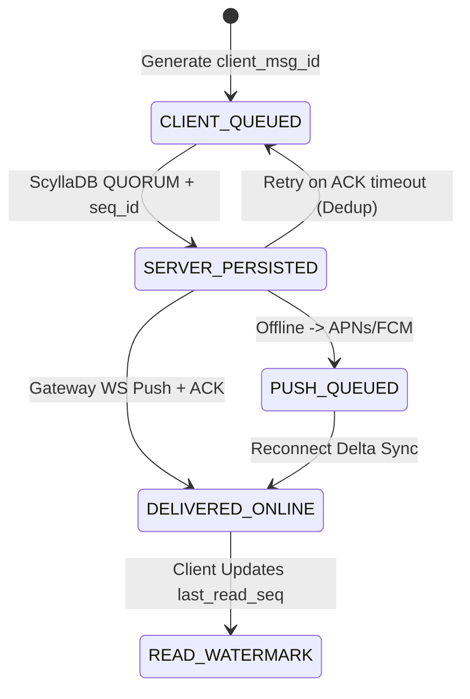
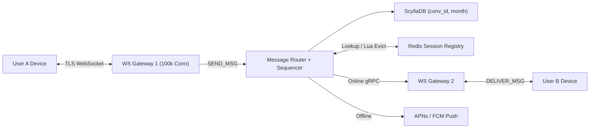
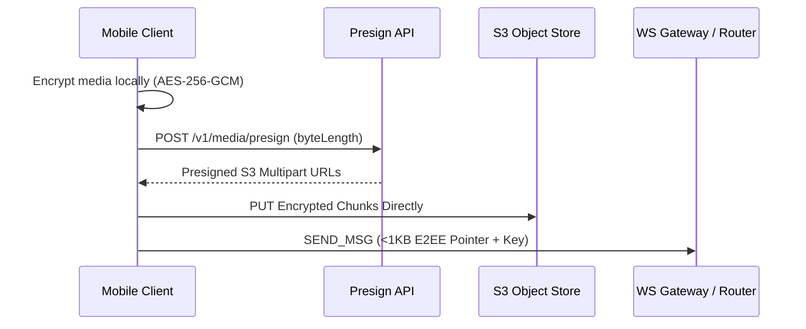

---
tags:
  - software-engineering
  - system-design
  - case-study
  - chat-application
  - websockets
  - scylladb
  - e2ee
created: 2026-11-13
updated: 2026-11-13
status: 🟢
level: mid-to-senior
---
# Case Study: Real-Time Distributed Chat System (WhatsApp / Slack Architecture)

> [!abstract] Vault Navigation
> Case study under [[Programming/Software Engineering/System Design/System Design Overview|System Design Overview]] and [[Programming/Software Engineering/System Design/System Design Complete Guide|System Design Complete Guide]]. Integrates [[Programming/Software Engineering/System Design/API Design|API Design]], [[Programming/Software Engineering/System Design/Scalability|Scalability]], [[Programming/Software Engineering/System Design/Caching|Caching]], [[Programming/Software Engineering/System Design/Load Balancing|Load Balancing]], [[Programming/Software Engineering/System Design/Message Queues|Message Queues]], [[Programming/Software Engineering/Architectural Patterns/Event-Driven Architecture|Event-Driven Architecture]], [[Programming/Software Engineering/Database Design/Database Design Complete Guide|Database Design Complete Guide]], [[Programming/Software Engineering/Database Design/Data Modeling NoSQL|Data Modeling NoSQL]], [[Programming/Software Engineering/Database Design/NoSQL|NoSQL]], [[Programming/Backend/Backend Core (Node, Event Loop, Auth & Concurrency)|Backend Core (Node, Event Loop, Auth & Concurrency)]], and [[Programming/Software Engineering/DevOps/Observability|Observability]].

---

## 1. First-Principles Mechanics, SLAs & Exact Capacity Derivations

A production messaging platform differs fundamentally from stateless request-response HTTP backends in three ways:
1. **Stateful Edge Connection Termination:** Gateways hold millions of persistent full-duplex TCP+TLS WebSocket file descriptors (`fd`s) in kernel memory, requiring explicit reverse-routing lookup (`user_id:device_id -> gateway_node`) to push inbound frames.
2. **Causal Per-Conversation Sequencing Without Wall Clocks:** Mobile endpoints and backend hosts suffer arbitrary NTP clock skew; total ordering per conversation requires monotonic sequence allocation (`seq_id`) paired with idempotency tokens (`client_msg_id`) to turn at-least-once mobile network retries into effectively-once UX.
3. **Write-Heavy Append Storage & Asymmetric Fan-Out:** Storing tens of billions of immutable daily messages demands log-structured merge-tree (LSM) storage (**ScyllaDB / Apache Cassandra**) partitioned cleanly by `(conv_id, bucket_month)` alongside tiered group fan-out policies (`<= 256` active push vs. `>= 1,000` broadcast/lazy-pull channels).

### 1.1 Functional & Non-Functional Requirements

| Category | Engineering Specification & Bound |
| :--- | :--- |
| **1:1 & Group Chat** | Real-time bidirectional text/media messaging for 1:1 DMs, small active groups (`<= 256` members), and large workspace channels (`1,000–10,000+` members). |
| **Multi-Device Sync** | Concurrent active delivery and history catch-up across up to 5 linked devices (`phone`, `desktop`, `web`, `tablet`) with sender self-echo. |
| **Delivery Lifecycle** | Monotonic per-conversation `seq_id` order, idempotent `client_msg_id` retries, watermark receipts (`sent` -> `delivered` -> `read`), and offline APNs/FCM push. |
| **Presence & Typing** | Ephemeral online/`last_seen` indicators and typing beacons suppressed cleanly so idle connections do not melt Redis or saturate mobile radios. |
| **Media & E2EE** | Client-encrypted S3 multipart presigned media pipeline bypassing gateways; Signal X3DH + Double Ratchet (1:1) and Sender Keys (groups). |
| **Latency & Availability** | Same-region online delivery `p99 < 100 ms`; offline delta catch-up `p99 < 200 ms`; **99.99%** message routing and persistence durability. |

### 1.2 Exact Scale & Capacity Derivations

Assume **500M DAU**, **100M simultaneous peak WebSocket connections** (including multi-device desktop/phone sessions), and **50 Billion messages/day**.

#### Step 1: Message Throughput & WebSocket Fleet Sizing

- **Message Ingress Rate (50B messages/day):**
  $$\text{MPS}_{\text{avg}} = \frac{50 \times 10^9}{86{,}400} \approx \mathbf{578{,}704\text{ MPS avg}}$$
  Applying a $3\times$ diurnal evening/event burst multiplier:
  $$\text{MPS}_{\text{peak (3x)}} \approx \mathbf{1{,}736{,}111\text{ MPS}} \approx \mathbf{1.74\text{M MPS}}$$
- **WebSocket Gateway Fleet Size (100M Concurrent Sockets):**
  At **100,000 tuned TLS WebSockets per Gateway node** (8 vCPU, 16 GB RAM):
  $$\text{Active Gateways} = \frac{100 \times 10^6}{100{,}000} = \mathbf{1{,}000\text{ stateful nodes}}$$
  Provision **1,400 nodes** (40% N+2 AZ failover & rolling-deploy drain headroom).
- **Per-Node Memory Budget for 100k Sockets:**
  - Kernel TCP structs + tuned read/write buffers (`tcp_rmem`/`tcp_wmem` default `16 KB` idle): $100{,}000 \times 24\text{ KB} \approx \mathbf{2.4\text{ GB kernel slab/buffers}}$
  - OpenSSL / BoringSSL TLS 1.3 session state (`~4 KB/conn`): $100{,}000 \times 4\text{ KB} \approx \mathbf{400\text{ MB}}$
  - Application connection state + Go/Rust/Node buffer structs (`~4 KB/conn`): $\mathbf{400\text{ MB}}$
  - **Total Resident Footprint:** **~3.2–4.0 GB/node** on 16 GB nodes (leaving >11 GB headroom for GC/bursts and `tcp_wmem` expansion to 64 KB under active send bursts).

#### Step 2: 5-Year ScyllaDB Storage Derivation

- Assume average message row = `180 bytes` (16B `conv_id` + 4B `bucket` + 8B `seq_id` + 16B `client_msg_id` + 8B `sender_id` + ~110B encrypted ciphertext/metadata + 18B cell overhead).
- **Daily Raw Data Volume:**
  $$50 \times 10^9 \times 180\text{ B} = \mathbf{9.0\text{ TB/day}}$$
- **5-Year Net Dataset ($1{,}825$ days):**
  $$9.0\text{ TB/day} \times 1{,}825 = \mathbf{16.425\text{ PB uncompressed}}$$
  Applying ScyllaDB **Zstd table compression** (~$0.55\times$ across mixed ciphertext + repeated headers/metadata; pure high-entropy AES ciphertext compresses ~0.95x, structured metadata ~0.35x; conservative blended **0.75x** = **~12.3 PB net**) and Replication Factor $\text{RF} = 3$:
  $$\text{Total Cluster NVMe Footprint (RF=3)} = 12.3\text{ PB} \times 3 \times 1.25\text{ (compaction headroom)} \approx \mathbf{46.1\text{ PB}}$$
  *(Note: True E2EE deployments like WhatsApp delete server-side message queues immediately upon confirmed delivery (`ACK_DELIVERY`) and retain undelivered offline buffers for 30 days max, cutting persistent server storage from 46 PB down to ~250 TB! Enterprise Slack/Teams deployments requiring full multi-year server history retain the full ScyllaDB tiered NVMe footprint above.)*

#### Step 3: Media Bandwidth & Ephemeral Presence Heartbeat Math

- **Media Throughput:** Assume 15% of messages carry attachments ($7.5\text{B/day}$). With viral forward deduplication (30% unique uploads = $2.25\text{B uploads/day}$ $\times$ 300 KB avg compressed image/audio):
  $$\text{S3 Ingress} = 2.25 \times 10^9 \times 300\text{ KB} = \mathbf{675\text{ TB/day}} \approx \mathbf{7.81\text{ GB/s (62.5 Gbps)}}$$
  $$\text{CDN Egress (3x downloads/upload)} \approx \mathbf{2.025\text{ PB/day}} \approx \mathbf{187.5\text{ Gbps}}$$
  Because gateways never proxy binaries, gateway NICs carry **0 Gbps** of media bytes!
- **Presence Heartbeat Flood Math (Why Naive Pings Melt Redis):**
  - Sending a Redis `SET presence:{u}` heartbeat every 30s across 100M sockets generates:
    $$\frac{100 \times 10^6}{30\text{ s}} = \mathbf{3.33\text{M writes/sec}}$$
  - Broadcasting each flip to an average 200 contacts creates **$666\text{M presence push frames/sec}$**!
  - Switching to **gateway-terminated idle-only keepalives + 45s disconnect debounce + viewport-scoped presence subscriptions** cuts Redis writes by **>98%** (emitting state strictly on connect and durable disconnect!).

---

## 2. Real-Time Wire Protocol, HTTP Control Plane & State Machine

### 2.1 WebSocket Handshake & Wire Frame Definitions

Clients connect over HTTPS TLS 1.3 (`wss://edge.chat.io/v1/ws`), passing a short-lived EdDSA/RS256 JWT, persistent `device_id`, and last persisted sync cursor:

```protobuf
// proto/chat_wire.proto (Compiled to compact binary WebSocket frames)
syntax = "proto3";
package chat.v1;

enum FrameType {
  FRAME_UNSPECIFIED = 0;
  SEND_MSG          = 1;
  SERVER_ACK        = 2;
  DELIVER_MSG       = 3;
  ACK_DELIVERY      = 4;
  WATERMARK_READ    = 5;
  TYPING            = 6;
  PRESENCE_SUB      = 7;
  PRESENCE_EVENT    = 8;
  GOAWAY            = 9;
  PING              = 10;
  PONG              = 11;
}

message Envelope {
  FrameType type = 1;
  uint64 frame_seq = 2;
  bytes payload = 3;
}

message SendMsgPayload {
  string client_msg_id = 1; // UUIDv7 generated client-side
  string conv_id       = 2; // UUID
  bytes  ciphertext    = 3; // Signal E2EE or encrypted envelope
  string media_object  = 4; // Optional encrypted S3 pointer metadata
  uint32 msg_type      = 5; // 1=text, 2=media, 3=sender_key_dist
}

message ServerAckPayload {
  string client_msg_id = 1;
  string conv_id       = 2;
  uint64 seq_id        = 3; // Canonical server-assigned monotonic sequence
  int64  hlc_ms        = 4;
  bool   deduplicated  = 5;
}

message DeliverMsgPayload {
  string conv_id       = 1;
  uint64 seq_id        = 2;
  string client_msg_id = 3;
  int64  sender_id     = 4;
  string sender_device = 5;
  bytes  ciphertext    = 6;
  int64  hlc_ms        = 7;
}

message WatermarkReadPayload {
  string conv_id       = 1;
  uint64 last_read_seq = 2;
}

message GoAwayPayload {
  uint32 reconnect_delay_ms = 1; // Randomized [5000..60000] jitter during deploys
  string reason             = 2;
}
```

### 2.2 Message Delivery State Machine



### 2.3 REST Control Plane Contracts

- `GET /v1/sync?after_hlc={hlc_ms}&limit=100` — Returns only conversations with new activity since `after_hlc` (`user_delta_feed`), preventing $N$-conversation poll storms on app launch.
- `GET /v1/conversations/{conv_id}/messages?after_seq={seq}&limit=50` — Fetches contiguous forward or backward history slices cleanly across monthly ScyllaDB partition buckets.
- `POST /v1/media/presign` — Issues scoped S3 `CreateMultipartUpload` + presigned part URLs without handling media bytes on chat pods.
- `POST /v1/keys/bundle` & `GET /v1/keys/bundle/{user_id}` — Publishes and fetches X3DH Identity Key, Signed Pre-Key, and One-Time Pre-Keys per device.

---

## 3. Complete Storage Schemas & Redis Session Registry

### 3.1 ScyllaDB / Apache Cassandra CQL DDL

Relational B-trees stall under 1.74M random writes/sec and 46 PB storage. ScyllaDB's shared-nothing C++ Seastar engine appends writes sequentially to memtables/SSTables while delivering single-digit millisecond range scans per partition.

```sql
-- =============================================================================
-- SCYLLADB / CASSANDRA WIDE-COLUMN SCHEMA
-- =============================================================================
CREATE KEYSPACE IF NOT EXISTS chat_prod
WITH replication = {
    'class': 'NetworkTopologyStrategy',
    'us-east': 3,
    'eu-west': 3
} AND durable_writes = true;

-- 1. Time-Bucketed Conversation History
-- Composite partition key ((conv_id, bucket_month)) bounds every partition <= 100 MB,
-- eliminating compaction OOMs on multi-year 10,000-member channels!
CREATE TABLE chat_prod.messages_by_conv (
    conv_id        UUID,
    bucket_month   INT,       -- Format YYYYMM, e.g. 202611
    seq_id         BIGINT,    -- Strictly monotonic per conversation
    client_msg_id  UUID,
    sender_id      BIGINT,
    sender_device  TEXT,
    msg_type       TINYINT,
    ciphertext     BLOB,
    hlc_ms         BIGINT,
    is_deleted     BOOLEAN,
    PRIMARY KEY ((conv_id, bucket_month), seq_id)
) WITH CLUSTERING ORDER BY (seq_id DESC)
  AND compaction = {
      'class': 'TimeWindowCompactionStrategy',
      'compaction_window_unit': 'DAYS',
      'compaction_window_size': 7
  }
  AND compression = {'sstable_compression': 'ZstdCompressor'}
  AND gc_grace_seconds = 86400;

-- 2. Idempotency Deduplication Table (7-day mobile retry coverage)
-- Uses ScyllaDB Lightweight Transaction (LWT: INSERT ... IF NOT EXISTS)
-- on retry collisions or single-writer sequencer guarantees.
CREATE TABLE chat_prod.msg_dedup (
    conv_id        UUID,
    client_msg_id  UUID,
    seq_id         BIGINT,
    hlc_ms         BIGINT,
    PRIMARY KEY ((conv_id, client_msg_id))
) WITH default_time_to_live = 604800
  AND compression = {'sstable_compression': 'LZ4Compressor'};

-- 3. Watermark Read & Delivery Receipts (O(1) upsert per user per conversation)
CREATE TABLE chat_prod.conversation_watermarks (
    conv_id             UUID,
    user_id             BIGINT,
    last_delivered_seq  BIGINT,
    last_read_seq       BIGINT,
    updated_at          TIMESTAMP,
    PRIMARY KEY ((conv_id), user_id)
);

-- 4. Multi-Device Offline Delta Index (Solves "which of my 500 chats changed?" in 1 query)
-- Bucketed weekly by user_id so catch-up queries read strictly WHERE hlc_ms > last_sync_hlc
CREATE TABLE chat_prod.user_inbox_deltas (
    user_id        BIGINT,
    bucket_week    INT,       -- e.g. 202646 (ISO year-week)
    hlc_ms         BIGINT,
    conv_id        UUID,
    latest_seq_id  BIGINT,
    PRIMARY KEY ((user_id, bucket_week), hlc_ms, conv_id)
) WITH CLUSTERING ORDER BY (hlc_ms DESC, conv_id ASC)
  AND default_time_to_live = 2592000; -- 30-day offline catch-up window
```

### 3.2 PostgreSQL Metadata & E2EE Key Store DDL

```sql
-- =============================================================================
-- SHARDED POSTGRESQL METADATA & SIGNAL KEY DIRECTORY
-- =============================================================================
CREATE TABLE users (
    user_id        BIGINT PRIMARY KEY,
    username       VARCHAR(32) NOT NULL UNIQUE,
    display_name   VARCHAR(64) NOT NULL,
    created_at     TIMESTAMPTZ NOT NULL DEFAULT NOW()
);

-- Stores Signal Protocol X3DH public key bundles per registered device
CREATE TABLE user_devices (
    user_id            BIGINT      NOT NULL,
    device_id          VARCHAR(36) NOT NULL,
    registration_id    INT         NOT NULL,
    identity_pub_key   BYTEA       NOT NULL, -- Curve25519 / Ed25519 32 bytes
    signed_pre_key     BYTEA       NOT NULL,
    signed_pre_key_sig BYTEA       NOT NULL,
    apns_fcm_token     TEXT,
    last_seen_at       TIMESTAMPTZ NOT NULL DEFAULT NOW(),
    PRIMARY KEY (user_id, device_id)
);

CREATE TABLE one_time_pre_keys (
    user_id      BIGINT      NOT NULL,
    device_id    VARCHAR(36) NOT NULL,
    key_id       INT         NOT NULL,
    public_key   BYTEA       NOT NULL,
    PRIMARY KEY (user_id, device_id, key_id)
);

CREATE TABLE conversations (
    conv_id       UUID PRIMARY KEY,
    conv_type     SMALLINT    NOT NULL, -- 1=DM, 2=GROUP, 3=LARGE_CHANNEL
    member_count  INT         NOT NULL DEFAULT 2,
    latest_bucket INT         NOT NULL,
    created_at    TIMESTAMPTZ NOT NULL DEFAULT NOW()
);

CREATE TABLE conversation_members (
    conv_id       UUID        NOT NULL,
    user_id       BIGINT      NOT NULL,
    role          SMALLINT    NOT NULL DEFAULT 0, -- 0=member, 1=admin
    is_muted      BOOLEAN     NOT NULL DEFAULT false,
    joined_at     TIMESTAMPTZ NOT NULL DEFAULT NOW(),
    PRIMARY KEY (conv_id, user_id)
);

CREATE INDEX idx_conv_members_user ON conversation_members (user_id, conv_id);
```

### 3.3 Redis Session Registry Schema & Atomic Stale-Gateway Eviction Lua

| Key Pattern | Redis Structure | Value Format & TTL | Purpose |
| :--- | :--- | :--- | :--- |
| `ws:sess:{user_id}` | `Hash` | Field = `device_id`, Value = `gw-42\|epoch_17315\|1731520000` (`EX 180` refreshed lazily) | Maps active online devices to exact Gateway pod |
| `seq:{conv_id}` | `String` | Monotonic integer `BIGINT` (`noeviction` sequencer shard) | Fast atomic `INCR` per-conversation `seq_id` |
| `presence:{user_id}` | `String` | JSON `{"s":1,"ts":1731520100,"gw":"gw-42"}` (`EX 180`) | Ephemeral online / `last_seen` indicator |
| `conv:meta:{conv_id}` | `String` | JSON `{"type":2,"count":85,"members":[...]}` (`EX 300`) | Cached membership list avoiding PG lookups on send |

```lua
-- =============================================================================
-- LUA: SAFE CONDITIONAL GATEWAY EVICTION (EVICT_IF_MATCH)
-- Prevents Message Service from deleting a NEW gateway session if a user
-- dropped gw-42 and already reconnected to gw-91 within 100 ms!
-- KEYS[1] = "ws:sess:<user_id>"
-- ARGV[1] = device_id, ARGV[2] = expected_gateway_prefix (e.g. "gw-42|")
-- Returns: 1 if evicted stale entry, 0 if device already moved to another gateway
-- =============================================================================
local current = redis.call("HGET", KEYS[1], ARGV[1])
if not current then
    return 0
end

if string.sub(current, 1, #ARGV[2]) == ARGV[2] then
    redis.call("HDEL", KEYS[1], ARGV[1])
    return 1
end
return 0
```

---

## 4. Stateful WebSocket Gateway, Kernel Tuning & Full Routing Code

### 4.1 Linux Kernel Socket Tuning for 100,000 TLS WebSockets per Node

Default Linux server configurations fail long before 100k concurrent WebSockets due to 1,024 file-descriptor `ulimit` caps, small TCP SYN queues, and `128 KB` default socket buffers inflating RAM to `> 25 GB`. Apply these explicit `/etc/sysctl.d/99-ws-gateway.conf` parameters on Gateway nodes:

```ini
# Maximum kernel open files across host and per-process nr_open
fs.file-max = 2097152
fs.nr_open = 1048576

# Accept queue and SYN backlog for handling burst reconnect storms
net.core.somaxconn = 65535
net.ipv4.tcp_max_syn_backlog = 65535
net.core.netdev_max_backlog = 32768

# Expand ephemeral port range for outbound internal gRPC / Redis / Scylla sockets
net.ipv4.ip_local_port_range = 1024 65535
net.ipv4.tcp_tw_reuse = 1

# Tune TCP socket memory: min 4KB | default 16KB | max 64KB
# 100,000 idle sockets x 16KB = 1.6 GB RAM (vs 12.8 GB at 128KB default!)
net.ipv4.tcp_rmem = 4096 16384 65536
net.ipv4.tcp_wmem = 4096 16384 65536
net.core.rmem_max = 65536
net.core.wmem_max = 65536

# Fast dead-peer detection without aggressive chatty 10s user-space pings
net.ipv4.tcp_keepalive_time = 120
net.ipv4.tcp_keepalive_intvl = 15
net.ipv4.tcp_keepalive_probes = 4
```

Additionally configure container `ulimit -n 524288` (`NOFILE=524288`) and bind multiple worker processes using `SO_REUSEPORT` so kernel softirqs distribute incoming TLS handshakes across all 8 vCPU cores without single-accept-socket lock contention.

### 4.2 Stateful WebSocket Gateway (`src/gateway/ws-gateway.ts`)

```typescript
// src/gateway/ws-gateway.ts
import type { WebSocket } from "ws";
import type { Redis } from "ioredis";

interface ActiveClientConn {
  userId: string;
  deviceId: string;
  socket: WebSocket;
  lastActivityMs: number;
  viewportSubscriptions: Set<string>;
}

const IDLE_PING_THRESHOLD_MS = 45_000;
const DISCONNECT_DEBOUNCE_MS = 35_000;
const SESSION_TTL_SEC = 180;

export class StatefulWsGateway {
  // Key: `${userId}:${deviceId}`
  private readonly connections = new Map<string, ActiveClientConn>();
  // Tracks pending offline debounce timers so LTE micro-drops don't flicker presence
  private readonly offlineTimers = new Map<string, NodeJS.Timeout>();
  // Local reverse index of viewport presence watchers: targetUserId -> Set<watcherConnKey>
  private readonly presenceWatchers = new Map<string, Set<string>>();

  constructor(
    private readonly gatewayId: string,
    private readonly bootEpoch: number,
    private readonly redis: Redis,
    private readonly messageRouter: {
      handleInboundSend(userId: string, deviceId: string, frame: unknown): Promise<void>;
    }
  ) {
    // Periodic sweep refreshes active Redis session TTLs and sends idle-only PINGs
    setInterval(() => void this.runKeepaliveSweep(), 30_000).unref();
  }

  public async onConnect(userId: string, deviceId: string, socket: WebSocket): Promise<void> {
    const connKey = `${userId}:${deviceId}`;

    // Cancel any pending offline debounce timer if user reconnected within 35s
    const pendingTimer = this.offlineTimers.get(connKey);
    if (pendingTimer) {
      clearTimeout(pendingTimer);
      this.offlineTimers.delete(connKey);
    }

    // Evict older socket on same device seamlessly
    const previous = this.connections.get(connKey);
    if (previous) {
      previous.socket.close(4001, "SESSION_SUPERSEDED");
    }

    const conn: ActiveClientConn = {
      userId,
      deviceId,
      socket,
      lastActivityMs: Date.now(),
      viewportSubscriptions: new Set(),
    };
    this.connections.set(connKey, conn);

    // Register authoritative session routing pointer + Presence Online state
    const sessionValue = `${this.gatewayId}|${this.bootEpoch}|${Date.now()}`;
    await this.redis
      .pipeline()
      .hset(`ws:sess:${userId}`, deviceId, sessionValue)
      .expire(`ws:sess:${userId}`, SESSION_TTL_SEC)
      .set(
        `presence:${userId}`,
        JSON.stringify({ s: 1, ts: Date.now(), gw: this.gatewayId }),
        "EX",
        SESSION_TTL_SEC
      )
      .publish("presence:events", JSON.stringify({ userId, status: 1, ts: Date.now() }))
      .exec();

    socket.on("message", (raw) => {
      conn.lastActivityMs = Date.now();
      void this.dispatchFrame(conn, raw.toString("utf8"));
    });

    socket.on("pong", () => {
      conn.lastActivityMs = Date.now();
    });

    socket.on("close", () => this.onDisconnect(conn));
  }

  private async dispatchFrame(conn: ActiveClientConn, rawJson: string): Promise<void> {
    const frame = JSON.parse(rawJson) as {
      type: string;
      payload: Record<string, unknown>;
    };

    if (frame.type === "SEND_MSG") {
      await this.messageRouter.handleInboundSend(conn.userId, conn.deviceId, frame.payload);
      return;
    }

    if (frame.type === "PRESENCE_SUB") {
      // Viewport culling: only subscribe to the 10-15 visible chat contacts on screen
      const targetIds = (frame.payload.userIds as string[]).slice(0, 20);
      this.updateViewportSubscriptions(conn, targetIds);
      return;
    }

    if (frame.type === "PING") {
      conn.socket.send(JSON.stringify({ type: "PONG", ts: Date.now() }));
    }
  }

  private updateViewportSubscriptions(conn: ActiveClientConn, nextTargets: string[]): void {
    const connKey = `${conn.userId}:${conn.deviceId}`;
    for (const oldTarget of conn.viewportSubscriptions) {
      this.presenceWatchers.get(oldTarget)?.delete(connKey);
    }
    conn.viewportSubscriptions = new Set(nextTargets);
    for (const target of nextTargets) {
      let set = this.presenceWatchers.get(target);
      if (!set) {
        set = new Set();
        this.presenceWatchers.set(target, set);
      }
      set.add(connKey);
    }
  }

  public pushToLocalDevice(userId: string, deviceId: string, frameObj: unknown): boolean {
    const conn = this.connections.get(`${userId}:${deviceId}`);
    if (!conn || conn.socket.readyState !== conn.socket.OPEN) {
      return false;
    }
    conn.socket.send(JSON.stringify(frameObj));
    return true;
  }

  private onDisconnect(conn: ActiveClientConn): void {
    const connKey = `${conn.userId}:${conn.deviceId}`;
    if (this.connections.get(connKey)?.socket !== conn.socket) {
      return; // Superseded by newer socket
    }
    this.connections.delete(connKey);
    this.updateViewportSubscriptions(conn, []);

    // Debounce offline state for 35s to absorb subway/cellular handoffs without push storms
    const timer = setTimeout(() => {
      this.offlineTimers.delete(connKey);
      void this.finalizeDisconnect(conn.userId, conn.deviceId);
    }, DISCONNECT_DEBOUNCE_MS);
    this.offlineTimers.set(connKey, timer);
  }

  private async finalizeDisconnect(userId: string, deviceId: string): Promise<void> {
    if (this.connections.has(`${userId}:${deviceId}`)) return;
    await this.redis.eval(
      `local cur = redis.call("HGET", KEYS[1], ARGV[1])
       if cur and string.sub(cur, 1, #ARGV[2]) == ARGV[2] then
         redis.call("HDEL", KEYS[1], ARGV[1])
         return 1
       end
       return 0`,
      1,
      `ws:sess:${userId}`,
      deviceId,
      `${this.gatewayId}|`
    );

    const remainingDevices = await this.redis.hlen(`ws:sess:${userId}`);
    if (remainingDevices === 0) {
      await this.redis
        .pipeline()
        .set(`presence:${userId}`, JSON.stringify({ s: 0, ts: Date.now() }), "EX", 86400)
        .publish("presence:events", JSON.stringify({ userId, status: 0, ts: Date.now() }))
        .exec();
    }
  }

  private async runKeepaliveSweep(): Promise<void> {
    const now = Date.now();
    const pipe = this.redis.pipeline();
    const touchedUsers = new Set<string>();

    for (const conn of this.connections.values()) {
      // Only send WebSocket PING to genuinely idle sockets (saves radio & CPU)
      if (now - conn.lastActivityMs >= IDLE_PING_THRESHOLD_MS) {
        if (conn.socket.readyState === conn.socket.OPEN) {
          conn.socket.ping();
        }
      }
      if (!touchedUsers.has(conn.userId)) {
        touchedUsers.add(conn.userId);
        pipe.expire(`ws:sess:${conn.userId}`, SESSION_TTL_SEC);
      }
    }
    if (touchedUsers.size > 0) {
      await pipe.exec().catch(() => undefined);
    }
  }

  /**
   * Kubernetes preStop / SIGTERM Graceful Drain:
   * Emits staggered GOAWAY reconnect jitter [5s..60s] preventing TLS thundering herds.
   */
  public async gracefulDrain(): Promise<void> {
    const entries = [...this.connections.values()];
    const pipe = this.redis.pipeline();

    for (const conn of entries) {
      const jitterMs = 5_000 + Math.floor(Math.random() * 55_000);
      if (conn.socket.readyState === conn.socket.OPEN) {
        conn.socket.send(
          JSON.stringify({
            type: "GOAWAY",
            payload: { reconnectDelayMs: jitterMs, reason: "ROLLING_DEPLOY" },
          })
        );
        conn.socket.close(1001, "SERVER_DRAINING");
      }
      pipe.hdel(`ws:sess:${conn.userId}`, conn.deviceId);
    }
    await pipe.exec();
    this.connections.clear();
  }
}
```

### 4.3 Monotonic Per-Conversation Sequencer & Message Router (`src/routing/message-router.ts`)

```typescript
// src/routing/conv-sequencer.ts
import type { Redis } from "ioredis";
import type { Client as ScyllaClient } from "cassandra-driver";

export class ConversationSequencer {
  private readonly inflightRecovery = new Map<string, Promise<void>>();
  private lastHlcMs = 0n;

  constructor(
    private readonly sequencerRedis: Redis,
    private readonly scylla: ScyllaClient
  ) {}

  public async nextSeqAndHlc(convId: string, bucketMonth: number): Promise<{ seqId: bigint; hlcMs: bigint }> {
    const key = `seq:${convId}`;
    let seqNum = await this.sequencerRedis.incr(key);

    // Cold recovery: if Redis key was missing/evicted, INCR returned 1 — verify ScyllaDB MAX(seq_id)
    if (seqNum === 1) {
      await this.recoverCeilingOnce(convId, bucketMonth);
      const recovered = await this.sequencerRedis.incr(key);
      seqNum = recovered;
    }

    // Hybrid Logical Clock ensures monotonic ms timestamps even across minor NTP jumps
    const physical = BigInt(Date.now());
    this.lastHlcMs = physical > this.lastHlcMs ? physical : this.lastHlcMs + 1n;

    return { seqId: BigInt(seqNum), hlcMs: this.lastHlcMs };
  }

  private async recoverCeilingOnce(convId: string, bucketMonth: number): Promise<void> {
    const existing = this.inflightRecovery.get(convId);
    if (existing) return existing;

    const promise = (async () => {
      const res = await this.scylla.execute(
        `SELECT seq_id FROM chat_prod.messages_by_conv
          WHERE conv_id = ? AND bucket_month = ? LIMIT 1`,
        [convId, bucketMonth],
        { prepare: true, consistency: 4 /* LOCAL_QUORUM */ }
      );
      const dbMax = res.rows.length > 0 ? BigInt(res.rows[0].seq_id.toString()) : 0n;
      // Only raise Redis ceiling atomically if DB had prior messages
      if (dbMax > 0n) {
        await this.sequencerRedis.eval(
          `local cur = tonumber(redis.call("GET", KEYS[1]) or "0")
           local target = tonumber(ARGV[1])
           if cur < target then redis.call("SET", KEYS[1], ARGV[1]) end
           return 1`,
          1,
          `seq:${convId}`,
          dbMax.toString()
        );
      }
    })().finally(() => {
      this.inflightRecovery.delete(convId);
    });

    this.inflightRecovery.set(convId, promise);
    return promise;
  }
}
```

```typescript
// src/routing/message-router.ts
import type { Redis } from "ioredis";
import type { Pool } from "pg";
import type { Client as ScyllaClient } from "cassandra-driver";
import type { ConversationSequencer } from "./conv-sequencer";

export interface SendMessageInput {
  clientMsgId: string;
  convId: string;
  ciphertextB64: string;
  msgType: number;
}

export interface GatewayRpcClient {
  pushFrameToGateway(gatewayId: string, userId: string, deviceId: string, frame: unknown): Promise<boolean>;
}

export interface PushNotificationQueue {
  enqueueOfflinePush(userId: string, convId: string, seqId: string): Promise<void>;
}

const ACTIVE_GROUP_FANOUT_LIMIT = 256;

export class MessageRouterService {
  constructor(
    private readonly scylla: ScyllaClient,
    private readonly pgPool: Pool,
    private readonly redis: Redis,
    private readonly sequencer: ConversationSequencer,
    private readonly gatewayRpc: GatewayRpcClient,
    private readonly pushQueue: PushNotificationQueue
  ) {}

  public async handleInboundSend(
    senderId: string,
    senderDeviceId: string,
    msg: SendMessageInput
  ): Promise<{ seqId: string; hlcMs: string; deduplicated: boolean }> {
    const now = new Date();
    const bucketMonth = now.getUTCFullYear() * 100 + (now.getUTCMonth() + 1);
    const bucketWeek = this.isoWeekBucket(now);

    // 1. Check Idempotency via LWT / msg_dedup table before allocating a new seq_id
    const existingDedup = await this.scylla.execute(
      `SELECT seq_id, hlc_ms FROM chat_prod.msg_dedup WHERE conv_id = ? AND client_msg_id = ?`,
      [msg.convId, msg.clientMsgId],
      { prepare: true, consistency: 4 /* LOCAL_QUORUM */ }
    );
    if (existingDedup.rows.length > 0) {
      const row = existingDedup.rows[0];
      return {
        seqId: row.seq_id.toString(),
        hlcMs: row.hlc_ms.toString(),
        deduplicated: true,
      };
    }

    // 2. Assign Strictly Monotonic Per-Conversation seq_id & HLC
    const { seqId, hlcMs } = await this.sequencer.nextSeqAndHlc(msg.convId, bucketMonth);

    // 3. Atomic LWT Dedup Lock (Protects against concurrent duplicate client retries)
    const lwtRes = await this.scylla.execute(
      `INSERT INTO chat_prod.msg_dedup (conv_id, client_msg_id, seq_id, hlc_ms)
       VALUES (?, ?, ?, ?) IF NOT EXISTS`,
      [msg.convId, msg.clientMsgId, seqId.toString(), hlcMs.toString()],
      { prepare: true }
    );

    if (!lwtRes.wasApplied()) {
      const winner = lwtRes.rows[0];
      return {
        seqId: winner.seq_id.toString(),
        hlcMs: winner.hlc_ms.toString(),
        deduplicated: true,
      };
    }

    // 4. Persist Message to Time-Bucketed ScyllaDB Partition (LOCAL_QUORUM)
    const cipherBuf = Buffer.from(msg.ciphertextB64, "base64");
    await this.scylla.execute(
      `INSERT INTO chat_prod.messages_by_conv
       (conv_id, bucket_month, seq_id, client_msg_id, sender_id, sender_device, msg_type, ciphertext, hlc_ms, is_deleted)
       VALUES (?, ?, ?, ?, ?, ?, ?, ?, ?, false)`,
      [
        msg.convId,
        bucketMonth,
        seqId.toString(),
        msg.clientMsgId,
        senderId,
        senderDeviceId,
        msg.msgType,
        cipherBuf,
        hlcMs.toString(),
      ],
      { prepare: true, consistency: 4 /* LOCAL_QUORUM */ }
    );

    // 5. Fetch Conversation Members & Routing Boundary
    const convMeta = await this.getConversationMembers(msg.convId);

    const deliverFrame = {
      type: "DELIVER_MSG",
      payload: {
        convId: msg.convId,
        seqId: seqId.toString(),
        clientMsgId: msg.clientMsgId,
        senderId,
        senderDeviceId,
        ciphertextB64: msg.ciphertextB64,
        hlcMs: hlcMs.toString(),
      },
    };

    // 6. Group Size Fan-Out Boundary:
    // <= 256 members -> Push fan-out + inbox delta + APNs/FCM offline push
    // >= 1,000 members -> Broadcast channel pub/sub for active viewers + lazy pull on open
    if (convMeta.memberCount <= ACTIVE_GROUP_FANOUT_LIMIT) {
      await Promise.all(
        convMeta.memberIds.map(async (uid) => {
          // Record multi-device offline delta pointer so sleeping phones catch up in 1 query
          await this.scylla.execute(
            `INSERT INTO chat_prod.user_inbox_deltas (user_id, bucket_week, hlc_ms, conv_id, latest_seq_id)
             VALUES (?, ?, ?, ?, ?)`,
            [uid, bucketWeek, hlcMs.toString(), msg.convId, seqId.toString()],
            { prepare: true }
          );

          await this.routeToAllUserDevices(uid, senderId, senderDeviceId, deliverFrame, msg.convId, seqId.toString());
        })
      );
    } else {
      // Large Channel (>= 1,000 members): Publish to lightweight channel topic;
      // offline members sync via conversation unread pointers on channel focus (no 10k APNs storm)
      await this.redis.publish(
        `chan:live:${msg.convId}`,
        JSON.stringify(deliverFrame)
      );
    }

    return { seqId: seqId.toString(), hlcMs: hlcMs.toString(), deduplicated: false };
  }

  private async routeToAllUserDevices(
    targetUserId: string,
    senderId: string,
    originDeviceId: string,
    deliverFrame: unknown,
    convId: string,
    seqIdStr: string
  ): Promise<void> {
    const deviceMap = await this.redis.hgetall(`ws:sess:${targetUserId}`);
    const deviceEntries = Object.entries(deviceMap);
    let deliveredAnyOnline = false;

    for (const [devId, sessionVal] of deviceEntries) {
      // Multi-Device Sender Echo: skip ONLY the originating socket; push to sender's laptop/tablet!
      if (targetUserId === senderId && devId === originDeviceId) {
        deliveredAnyOnline = true;
        continue;
      }

      const [gatewayId] = sessionVal.split("|");
      const ok = await this.gatewayRpc.pushFrameToGateway(gatewayId, targetUserId, devId, deliverFrame);
      if (ok) {
        deliveredAnyOnline = true;
      } else {
        // Stale Gateway Crash Detection: conditional Lua delete avoids clobbering fresh reconnect
        await this.redis.eval(
          `local cur = redis.call("HGET", KEYS[1], ARGV[1])
           if cur and string.sub(cur, 1, #ARGV[2]) == ARGV[2] then
             redis.call("HDEL", KEYS[1], ARGV[1])
             return 1
           end
           return 0`,
          1,
          `ws:sess:${targetUserId}`,
          devId,
          `${gatewayId}|`
        );
      }
    }

    // Trigger APNs/FCM Mobile Push only if recipient had zero active online deliveries
    if (!deliveredAnyOnline && targetUserId !== senderId) {
      await this.pushQueue.enqueueOfflinePush(targetUserId, convId, seqIdStr);
    }
  }

  private async getConversationMembers(
    convId: string
  ): Promise<{ memberCount: number; memberIds: string[] }> {
    const cached = await this.redis.get(`conv:meta:${convId}`);
    if (cached) return JSON.parse(cached) as { memberCount: number; memberIds: string[] };

    const res = await this.pgPool.query<{ user_id: string }>(
      `SELECT user_id::TEXT FROM conversation_members WHERE conv_id = $1`,
      [convId]
    );
    const meta = {
      memberCount: res.rowCount ?? 0,
      memberIds: res.rows.map((r) => r.user_id),
    };
    await this.redis.set(`conv:meta:${convId}`, JSON.stringify(meta), "EX", 300);
    return meta;
  }

  private isoWeekBucket(date: Date): number {
    const tmp = new Date(Date.UTC(date.getUTCFullYear(), date.getUTCMonth(), date.getUTCDate()));
    tmp.setUTCDate(tmp.getUTCDate() + 4 - (tmp.getUTCDay() || 7));
    const yearStart = new Date(Date.UTC(tmp.getUTCFullYear(), 0, 1));
    const weekNo = Math.ceil(((tmp.getTime() - yearStart.getTime()) / 86400000 + 1) / 7);
    return tmp.getUTCFullYear() * 100 + weekNo;
  }
}
```

### 4.4 Multi-Device Catch-Up & Cross-Month Pagination (`src/services/offline-sync-service.ts`)

```typescript
// src/services/offline-sync-service.ts
import type { Client as ScyllaClient } from "cassandra-driver";

export interface DeltaConversationSummary {
  convId: string;
  latestSeqId: string;
  latestHlcMs: string;
}

export class OfflineSyncService {
  constructor(private readonly scylla: ScyllaClient) {}

  /**
   * Step 1 on Mobile/Desktop Reconnect:
   * Fetches ONLY conversations that received messages after client's last sync HLC.
   */
  public async getChangedConversations(
    userId: string,
    sinceHlcMs: bigint,
    currentWeekBucket: number,
    prevWeekBucket: number
  ): Promise<DeltaConversationSummary[]> {
    const buckets = currentWeekBucket === prevWeekBucket
      ? [currentWeekBucket]
      : [currentWeekBucket, prevWeekBucket];

    const dedup = new Map<string, DeltaConversationSummary>();

    for (const bucket of buckets) {
      const res = await this.scylla.execute(
        `SELECT conv_id, hlc_ms, latest_seq_id
           FROM chat_prod.user_inbox_deltas
          WHERE user_id = ? AND bucket_week = ? AND hlc_ms > ?
          LIMIT 500`,
        [userId, bucket, sinceHlcMs.toString()],
        { prepare: true }
      );
      for (const r of res.rows) {
        const cid = r.conv_id.toString();
        const seq = r.latest_seq_id.toString();
        const hlc = r.hlc_ms.toString();
        const existing = dedup.get(cid);
        if (!existing || BigInt(seq) > BigInt(existing.latestSeqId)) {
          dedup.set(cid, { convId: cid, latestSeqId: seq, latestHlcMs: hlc });
        }
      }
    }
    return [...dedup.values()];
  }

  /**
   * Step 2: Pull missing message slice cleanly across monthly ScyllaDB buckets.
   */
  public async fetchMessagesBefore(
    convId: string,
    startMonthBucket: number,
    beforeSeqExclusive: bigint,
    limit = 50
  ): Promise<Record<string, unknown>[]> {
    const collected: Record<string, unknown>[] = [];
    let bucket = startMonthBucket;

    // Traverse backward at most 3 monthly partitions per single scroll page
    for (let hop = 0; hop < 3 && collected.length < limit; hop++) {
      const remaining = limit - collected.length;
      const res = await this.scylla.execute(
        `SELECT seq_id, client_msg_id, sender_id, sender_device, msg_type, ciphertext, hlc_ms
           FROM chat_prod.messages_by_conv
          WHERE conv_id = ? AND bucket_month = ? AND seq_id < ?
          LIMIT ?`,
        [convId, bucket, beforeSeqExclusive.toString(), remaining],
        { prepare: true }
      );
      for (const r of res.rows) {
        collected.push({
          seqId: r.seq_id.toString(),
          clientMsgId: r.client_msg_id.toString(),
          senderId: r.sender_id.toString(),
          ciphertextB64: (r.ciphertext as Buffer).toString("base64"),
          hlcMs: r.hlc_ms.toString(),
        });
      }
      bucket = this.prevMonthBucket(bucket);
    }
    return collected;
  }

  private prevMonthBucket(yyyymm: number): number {
    const year = Math.floor(yyyymm / 100);
    const month = yyyymm % 100;
    return month === 1 ? (year - 1) * 100 + 12 : year * 100 + (month - 1);
  }
}
```

### 4.5 Automated Routing & Synchronization Test Suite (`tests/chat-router.test.ts`)

```typescript
import { describe, expect, it, vi } from "vitest";
import { MessageRouterService } from "../src/routing/message-router";

describe("MessageRouterService", () => {
  it("deduplicates flaky mobile retries cleanly via msg_dedup without bumping seq_id", async () => {
    const scyllaMock = {
      execute: vi.fn().mockResolvedValueOnce({
        rows: [{ seq_id: 405n, hlc_ms: 1731520001000n }],
      }),
    };
    const seqMock = { nextSeqAndHlc: vi.fn() };

    const router = new MessageRouterService(
      scyllaMock as never,
      {} as never,
      {} as never,
      seqMock as never,
      {} as never,
      {} as never
    );

    const outcome = await router.handleInboundSend("101", "dev-ios", {
      clientMsgId: "019326c8-3d10-7a4b-9e00-cc1122334455",
      convId: "conv-1",
      ciphertextB64: "AQID",
      msgType: 1,
    });

    expect(outcome).toEqual({
      seqId: "405",
      hlcMs: "1731520001000",
      deduplicated: true,
    });
    expect(seqMock.nextSeqAndHlc).not.toHaveBeenCalled();
  });
});
```

---

## 5. Encrypted S3 Media Pipeline & Signal Protocol E2EE Architecture

### 5.1 S3 Presigned Multipart Encrypted Media Pipeline

Chat gateways must **never** receive raw MB-scale media payloads—buffering 10 MB videos in Gateway RAM triggers OOM kills and stalls text delivery on the socket. Instead:
1. **Client-Side Symmetric Encryption:** Sender generates a fresh ephemeral 256-bit AES-GCM key $K_m$ and 96-bit nonce, encrypts the file locally (streaming 5 MB chunks), and computes `sha256(ciphertext)`.
2. **Presigned S3 Multipart Upload:** Sender calls `POST /v1/media/presign`, receives S3 Multipart `uploadId` and time-limited (15-min) presigned `UploadPart` URLs, uploads encrypted bytes directly from mobile client to S3/CloudFront edge, and commits `CompleteMultipartUpload`.
3. **Lightweight Signal Payload:** Sender sends a `< 1 KB` WebSocket `SEND_MSG` frame containing `{ objectKey, sha256Ciphertext, aesKeyB64, ivB64, blurHash }` encrypted inside the Signal E2EE envelope—S3 stores strictly opaque encrypted blobs!

```typescript
// src/services/media-presign.ts
import { S3Client, CreateMultipartUploadCommand, UploadPartCommand } from "@aws-sdk/client-s3";
import { getSignedUrl } from "@aws-sdk/s3-request-presigner";
import { randomUUID } from "node:crypto";

const MAX_MEDIA_BYTES = 100 * 1024 * 1024; // 100 MB cap
const PART_SIZE_BYTES = 5 * 1024 * 1024;   // S3 minimum multipart chunk = 5 MB

export class EncryptedMediaPresignService {
  constructor(
    private readonly s3: S3Client,
    private readonly bucketName: string
  ) {}

  public async initiateUpload(userId: string, byteLength: number): Promise<{
    objectKey: string;
    uploadId: string;
    partUrls: { partNumber: number; url: string }[];
  }> {
    if (byteLength <= 0 || byteLength > MAX_MEDIA_BYTES) {
      throw new Error(`Media payload must be 1..${MAX_MEDIA_BYTES} bytes`);
    }

    const objectKey = `encrypted-media/${new Date().toISOString().slice(0, 10)}/${userId}/${randomUUID()}.enc`;
    const createCmd = new CreateMultipartUploadCommand({
      Bucket: this.bucketName,
      Key: objectKey,
      ContentType: "application/octet-stream", // Always opaque ciphertext
    });
    const created = await this.s3.send(createCmd);
    if (!created.UploadId) throw new Error("Failed to initiate S3 multipart upload");

    const partCount = Math.max(1, Math.ceil(byteLength / PART_SIZE_BYTES));
    const partUrls: { partNumber: number; url: string }[] = [];

    for (let partNumber = 1; partNumber <= partCount; partNumber++) {
      const partCmd = new UploadPartCommand({
        Bucket: this.bucketName,
        Key: objectKey,
        UploadId: created.UploadId,
        PartNumber: partNumber,
      });
      const url = await getSignedUrl(this.s3, partCmd, { expiresIn: 900 });
      partUrls.push({ partNumber, url });
    }

    return { objectKey, uploadId: created.UploadId, partUrls };
  }
}
```

### 5.2 Signal Protocol End-to-End Encryption (1:1 Double Ratchet & Group Sender Keys)

#### 1:1 Messaging: X3DH Key Agreement + Double Ratchet

1. **Asynchronous Session Setup (X3DH):** Even if Bob is offline, Alice fetches Bob's public bundle from Postgres (`Identity Key IK_B`, `Signed Pre-Key SPK_B`, and pops one `One-Time Pre-Key OPK_B` atomically via `DELETE ... RETURNING`). Alice generates an ephemeral key `EK_A` and computes four Diffie-Hellman agreements:
   $$\text{SK} = \text{KDF}\big(\text{DH}(IK_A, SPK_B) \ \|\ \text{DH}(EK_A, IK_B) \ \|\ \text{DH}(EK_A, SPK_B) \ \|\ \text{DH}(EK_A, OPK_B)\big)$$
   Popping `OPK_B` guarantees **forward secrecy** on the very first message even if Bob's long-term identity key is compromised years later.
2. **Per-Message & Turn-Taking Ratcheting (Double Ratchet):**
   - **Symmetric-Key Ratchet:** Advances a KDF chain for every consecutive message sent, deriving a single-use `MessageKey` that is erased immediately after encryption/decryption (preventing retroactive decryption of past messages).
   - **Diffie-Hellman Ratchet:** Every time conversation direction switches (`Alice -> Bob` then `Bob -> Alice`), a new Curve25519 DH keypair rotates into the Root Key, delivering **post-compromise (break-in) recovery** if an attacker temporarily leaks a session state.

#### Group E2EE: Signal Sender Keys

Pairwise 1:1 Double Ratchet across a 1,000-member group forces the sender's device to encrypt the message 999 separate times and upload `999 x 250 B = 250 KB` per short sentence. **Sender Keys** solve this cleanly:
1. When Alice sends her first message to Group $G$, she generates a random 32-byte `ChainKey_Alice` and a Curve25519 `SignatureKey_Alice`.
2. Alice encrypts her **Sender Key Distribution Message (SKDM)** *once* pairwise over existing 1:1 Double Ratchet sessions to the 999 members.
3. For every subsequent group message, Alice advances `ChainKey_Alice` symmetrically, encrypts the message **once** (`250 B` total upload!), signs the ciphertext with `SignatureKey_Alice`, and sends **one** frame; the server fans out that single ciphertext across the group.
4. **Forward Secrecy on Membership Revocation:** Whenever any member leaves or is removed from Group $G$, remaining members delete cached Sender Keys and regenerate fresh `ChainKey`s on their next send, excluding the evicted device's `user_id:device_id` from the SKDM distribution.

*(Architectural Constraint: Under E2EE, servers cannot inspect message bodies. Full-text search moves strictly to client-side **SQLite FTS5** over locally decrypted messages, URL link previews are fetched either directly from the sender's client or via an IP-blinding proxy before encryption, and abuse moderation attaches the decrypted plaintext + message signature proof only when a recipient explicitly submits an abuse report.)*

---

## 6. Thundering Herd Defenses, Topologies & Operations Playbook

### 6.1 End-to-End Routing & Media Bypass Diagrams





### 6.2 Defeating the WebSocket Reconnect Thundering Herd

When a Gateway node holding 100,000 connections crashes or rotates during a deploy, 100,000 clients simultaneously attempting TLS 1.3 + JWT verification can overwhelm Edge LBs and Auth nodes:
1. **Planned Rolling Deploys (`SIGTERM` / `preStop`):** Never kill pods abruptly. Gateways emit `GOAWAY` frames containing uniform randomized `reconnectDelayMs` in `[5_000, 60_000]` before tearing down sockets, smoothing 100,000 reconnects into ~1,800 req/sec across 55 seconds.
2. **Unplanned AZ Crash Client Backoff:** Clients enforce **Exponential Backoff with Full Jitter**:
   $$\text{sleep\_ms} = \text{random}\big(0, \min(60{,}000,\ 500 \times 2^{\text{attempt}})\big)$$
3. **TLS 1.3 PSK Session Resumption:** Edge Envoy/HAProxy L4/L7 balancers share distributed TLS session ticket keys (rotated hourly), cutting handshake CPU cost by >70% on reconnects.

### 6.3 Production Debugging, Profiling & Operations Playbook

| Symptom | Root Cause | Diagnostic Command / Telemetry | Mitigation & Permanent Fix |
| :--- | :--- | :--- | :--- |
| **1. Gateway pod stops accepting connections at ~1,000 or ~65k sockets** | Container `NOFILE` ulimit (`1024`) or ephemeral port exhaustion on NAT | `cat /proc/<pid>/limits` (`Max open files`); `ss -s` (`TCP:` states) | Raise `ulimit -n 524288`, tune `ip_local_port_range`, verify `fs.nr_open` >= 1M |
| **2. ScyllaDB read timeouts & GC/compaction OOM on 1 channel** | Unbounded partition (`PRIMARY KEY (conv_id, seq_id)`) grew >1 GB | `nodetool tablestats chat_prod.messages_by_conv` (`Compacted partition maximum bytes`) | Migrate to `PRIMARY KEY ((conv_id, bucket_month), seq_id)` + `TimeWindowCompactionStrategy` |
| **3. Online messages black-holed for 2–3 minutes after Gateway node OOM** | Stale `ws:sess:{user}` still points to crashed `gw-42` until TTL expires | Router logs showing `UNAVAILABLE` RPC errors to dead pod IP | Invoke Lua `EVICT_IF_MATCH` immediately on RPC failure and fall back to APNs/FCM push |
| **4. Redis Presence cluster hits 100% CPU during commute hours** | Clients sending 30s user-space PINGs updating Redis + broadcasting to all contacts | `redis-cli --stat` ops/s spike on `SET presence:*` + `PUBLISH` | Switch to idle-only keepalive, 35s disconnect debounce, and viewport-only `PRESENCE_SUB` |
| **5. Mobile user sees duplicate messages after riding through subway** | Retry generated new `client_msg_id` or `msg_dedup` LWT bypassed | ScyllaDB rows having identical payload with two consecutive `seq_id`s | Persist `client_msg_id` (UUIDv7) in local SQLite outbox *before* first send attempt; enforce `msg_dedup` LWT |
| **6. E2EE recipient fails to decrypt message (`Bad MAC / Invalid PreKey`)** | Multi-device race consumed last `OPK` or out-of-order skipped message keys exceeded 2,000-key ratchet window | Client Signal error counter `DECRYPT_ERR_SKIP_LIMIT` spike | Replenish `one_time_pre_keys` automatically when remaining `< 20`; trigger silent Sender Key / X3DH session reset frame |

#### Golden SLIs & Alert Rules

- **End-to-End Online Delivery Latency:** `histogram_quantile(0.99, chat_message_delivery_duration_seconds) < 0.100`
- **Message Persistence Durability:** `scylla_write_errors_total / total_sends < 0.0001` (Page immediately on quorum failures)
- **Gateway Socket Saturation:** `gateway_active_sockets / gateway_max_capacity_sockets < 0.80` (Autoscaling triggers at 65%)

---

## 7. Interview Follow-Up Defense Exercises

### Exercise 1: WebSocket Gateway Crash & Stale Session Black-Holing
**Prompt:** `gw-42` suffers a sudden kernel panic while holding **90,000 active WebSockets**. Within 1 second, 90,000 mobile clients detect TCP RST and reconnect simultaneously, while Redis still holds `ws:sess:{user} -> gw-42` with 140 seconds remaining on TTL. Diagnose both cascading failures and design the defenses.

#### Solution 1
**Failure Cascades:**
1. **TLS/Auth Thundering Herd:** 90,000 simultaneous TLS 1.3 full handshakes + JWT signature verifications spike CPU across surviving gateways and Edge LBs, causing handshake timeouts and continuous retry loops.
2. **Stale Routing Black Hole:** For 140 seconds, Message Router looks up `ws:sess:{u}`, sees `gw-42`, skips APNs/FCM push (assuming user is online!), and repeatedly fails pushing to dead `gw-42`.

**Defenses:**
1. **Client Full-Jitter Exponential Backoff + TLS Resumption:** Spread reconnect storms randomly across `[500 ms .. 30 s]` with TLS 1.3 PSK session tickets, reducing handshake CPU by >70%.
2. **Immediate Conditional Eviction (`EVICT_IF_MATCH`) + Push Fallback:** The moment `gatewayRpc.pushFrameToGateway("gw-42", ...)` fails with `UNAVAILABLE`/timeout, Message Router executes the Lua `EVICT_IF_MATCH` script deleting `device_id` *strictly if* the value still begins with `"gw-42|"` (avoiding erasing a newer connection if the client already reconnected to `gw-77` 50 ms earlier!) and immediately enqueues APNs/FCM Push while ScyllaDB safely holds the persisted message for delta sync.

---

### Exercise 2: Unbounded ScyllaDB Partition & Multi-Device Subway Tunnel Deduplication
**Prompt:** A 500-person engineering channel accumulates 25 million messages over 2 years. Fetching the latest 50 messages takes 4.5 seconds and triggers ScyllaDB compaction OOMs. Meanwhile, users typing offline in a subway tunnel see duplicate messages when reconnecting across their phone and desktop. Diagnose and fix both bugs.

#### Solution 2
1. **Unbounded Wide Partition Fix:** A schema keyed strictly by `PRIMARY KEY (conv_id, seq_id)` places all 25M rows (~4.5 GB) into a single logical partition on one replica set, violating ScyllaDB/Cassandra's ~100 MB partition ceiling and forcing SSTable compactions to buffer gigabytes in RAM.
   - **Fix:** Partition by **`PRIMARY KEY ((conv_id, bucket_month), seq_id)`**. Every calendar month creates a fresh bounded partition; reading the latest 50 messages reads strictly the active `(conv_id, 202611)` partition in `< 3 ms`, stepping seamlessly backward across `bucket_month` boundaries (`OfflineSyncService.fetchMessagesBefore`) only when scrolling deeper.
2. **Multi-Device Deduplication & Sender Echo:**
   - Clients generate and persist `client_msg_id` (UUIDv7) in local SQLite *before* transmission. If connectivity drops post-ScyllaDB insert but pre-`SERVER_ACK`, retrying the exact `client_msg_id` hits `msg_dedup` LWT, returning the canonical existing `seq_id` with `deduplicated: true`.
   - `routeToAllUserDevices()` explicitly skips only `originDeviceId` while pushing `DELIVER_MSG` to all **other** active sessions of `senderId` (e.g., `user_A:desktop`), keeping phone and desktop timelines identical in `seq_id` order.

---

### Exercise 3: Scaling Group Chat to 1,000+ Members Under E2EE & Read Receipts
**Prompt:** A workspace group scales from 12 to 1,000 members. Under naive 1:1 Double Ratchet encryption and naive read receipts, sending 1 sentence forces the client to upload 1,000 ciphertexts (`250 KB`) and triggers `1,000,000` read-receipt WebSocket frames as members read the burst. Quantify and redesign both mechanisms.

#### Solution 3
1. **E2EE Scaling via Signal Sender Keys:**
   - **Before:** 999 pairwise Double Ratchet encryptions per message $\implies 999 \times 250\text{ B} = \mathbf{249.75\text{ KB}}$ cellular upload per single chat line.
   - **After (Sender Keys):** Sender distributes a symmetric `ChainKey` + `SignatureKey` once upon group join or membership change (`SKDM`), then encrypts every subsequent message **once** (`250 B` upload—a **1,000x client bandwidth & CPU reduction!**) while servers fan out that identical blob to recipients. Rotate Sender Keys lazily whenever a member is removed to preserve forward secrecy.
2. **Group Fan-Out Boundary & Watermark Suppression:**
   - Enforce `conversation_watermarks` (`last_read_seq`) instead of per-message read rows ($O(1)$ upsert).
   - Automatically disable live `TYPING`, `DELIVERED`, and `READ` WebSocket broadcast pushes once `member_count > 50` (eliminating $O(N^2)$ control-plane storms), exposing aggregated read counts lazily on demand when a user inspects Message Info. Above `>= 1,000` members, switch from per-member inbox pushes (`ACTIVE_GROUP_FANOUT_LIMIT = 256`) to lightweight channel Pub/Sub + lazy unread badge sync.

---

### Exercise 4: Multi-Device Offline Catch-Up Without $500 \times N$ Poll Storms
**Prompt:** A user has 500 historical conversations on their account and turns on their desktop client after being offline for 3 days. Only 7 of those 500 conversations received new messages. Firing 500 parallel `GET /v1/conversations/{id}/messages` queries upon every app launch multiplies read QPS by 500x. Design an $O(\Delta)$ catch-up protocol.

#### Solution 4
1. **Inbox Delta Partition (`user_inbox_deltas`):** Whenever `MessageRouterService` persists a message to a conversation (`<= 256` members), it writes a lightweight pointer `(user_id, bucket_week, hlc_ms, conv_id, latest_seq_id)` into `user_inbox_deltas`.
2. **2-Step Delta Sync on App Open:**
   - **Step 1:** Desktop opens and issues **1 single query**: `GET /v1/sync?after_hlc={last_synced_hlc}`. `OfflineSyncService.getChangedConversations()` reads `WHERE user_id = ? AND bucket_week = ? AND hlc_ms > ?` in `< 4 ms` and returns **strictly the 7 mutated conversations** along with their `latest_seq_id`.
   - **Step 2:** Desktop compares each returned `latest_seq_id` against its local SQLite `last_seq` and pulls missing slices (`after_seq`) **only for those 7 conversations**—cutting app-launch DB/API read load by **>98%**!

---

### Exercise 5: Sequencer Redis Failover Losing `seq:{conv_id}` Monotonicity
**Prompt:** The dedicated Redis shard holding `seq:{conv_id}` crashes and fails over to a replica that lagged by 3 writes (or restarts cold without persistence). If `seq:{conv_id}` resets to `1` or jumps backward from `1,050` to `1,047`, new messages either fail/overwrite `seq_id = 1048` in `messages_by_conv` or violate strict causal ordering. Design a crash-safe recovery invariant.

#### Solution 5
1. **Why Cold `INCR` Alone Fails:** In ScyllaDB, `PRIMARY KEY ((conv_id, bucket_month), seq_id)` silently **overwrites** an existing row on identical `(conv_id, bucket_month, seq_id)` (Last-Write-Wins)! A backward `seq_id` regression causes catastrophic silent data loss.
2. **Three-Layer Crash-Safe Monotonicity:**
   - **Layer 1 (Cold-Miss Singleflight Ceiling Recovery):** As implemented in `ConversationSequencer.recoverCeilingOnce()`, whenever `INCR` returns `1` (cold cache), pause under an in-flight lock, query ScyllaDB `SELECT seq_id FROM messages_by_conv WHERE conv_id = ? AND bucket_month = ? LIMIT 1` (instant $O(1)$ because `CLUSTERING ORDER BY (seq_id DESC)` places the highest `seq_id` as the very first clustering column!), and fast-forward Redis via Lua `if cur < dbMax then SET dbMax`.
   - **Layer 2 (Zero-Overwrite Guard / Safe Write):** Use ScyllaDB `INSERT INTO messages_by_conv (...) IF NOT EXISTS` (LWT) whenever `seqId <= recovered_watermark + grace_window` or configure Redis Sequencer with **synchronous AOF `appendfsync always` / `WAIT 1 5`** across replicas.
   - **Layer 3 (Lease-Block Sequencer Alternative):** For maximum durability without AOF per-write overhead, lease blocks of `1,000` `seq_id`s from ScyllaDB LWT (`UPDATE conv_seq_leases SET next_seq = next_seq + 1000`) into partitioned stateful Sequencer nodes (consistent-hashed by `conv_id`): even a hard node crash only leaves unused gaps (never backward regressions!), and clients fetch any gap cleanly or treat `seq_id` as strictly monotonic rather than gapless.

---

← [[Programming/Software Engineering/System Design/System Design Overview|Back to System Design Overview]]
