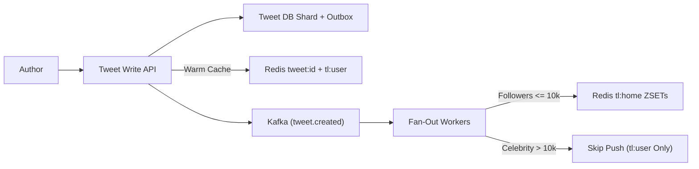
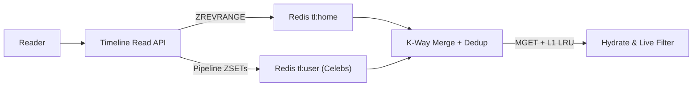
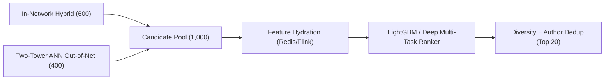

---
tags:
  - software-engineering
  - system-design
  - case-study
  - twitter-timeline
  - fan-out
  - distributed-systems
created: 2026-11-13
updated: 2026-11-13
status: 🟢
level: mid-to-senior
---
# Case Study: Social Media Feed & Home Timeline (Twitter / X Architecture)

> [!abstract] Vault Navigation
> Case study under [[Programming/Software Engineering/System Design/System Design Overview|System Design Overview]] and [[Programming/Software Engineering/System Design/System Design Complete Guide|System Design Complete Guide]]. Integrates [[Programming/Software Engineering/System Design/Caching|Caching]], [[Programming/Software Engineering/System Design/Scalability|Scalability]], [[Programming/Software Engineering/System Design/API Design|API Design]], [[Programming/Software Engineering/Architectural Patterns/Event-Driven Architecture|Event-Driven Architecture]], [[Programming/Software Engineering/Architectural Patterns/CQRS|CQRS]], [[Programming/Software Engineering/Database Design/Database Design Complete Guide|Database Design Complete Guide]], [[Programming/Software Engineering/Database Design/Sharding|Sharding]], [[Programming/Machine Learning/MLOps & Production ML Guide|MLOps & Production ML Guide]], and [[Programming/Software Engineering/DevOps/Observability|Observability]].

---

## 1. First-Principles Mechanics, SLAs & Exact Capacity Derivations

A social timeline system transforms an asymmetric directed social graph $G = (V, E)$ into personalized, causally ordered read views under severe **write-amplification skew**. While client-facing reads outnumber client-facing writes by ~10:1 to 100:1, an author's follower degree $d_{\text{in}}(u)$ spans **7 orders of magnitude**—from 15 followers to 80,000,000+ followers. Pushing every tweet synchronously or uniformly across all followers turns a single `POST /v1/tweets` request into tens of millions of mutations, while pulling from hundreds of followed authors' database shards at read time violates interactive latency SLAs.

Production timeline architectures resolve this tension via **ID-Only Hybrid Fan-Out + CQRS Materialized Feeds + Read-Time K-Way Merge**:
1. **Materialize only 64-bit `tweet_id` pointers**, never full tweet payloads, inside per-user timeline `ZSET`s.
2. **Route by out-degree cutoff (`> 10,000` followers):** Non-celebrity tweets fan out asynchronously (`Push`) into active followers' Redis timelines; celebrity tweets remain exclusively on the author's own `ZSET` (`Pull`) and merge at read time.
3. **Hydrate & filter late:** Fetch tweet bodies, engagement counters, and author state in parallel (`MGET`) *after* merging IDs, stripping deleted tweets, muted/blocked authors, and private accounts dynamically.

### 1.1 Functional & Non-Functional Requirements

| Category | Engineering Specification & Bound |
| :--- | :--- |
| **Tweet Publishing** | Create text posts (`<= 280` UTF-8 graphemes), replies/quotes, and up to 4 pre-uploaded S3 media attachments. Guarantee strict `Idempotency-Key` deduplication. |
| **Social Graph Mutations** | Follow / unfollow, mute (silent feed removal), block (mutual hard visibility removal), and protected/private account visibility enforcement. |
| **Home Timeline Read** | Chronological or ML-ranked stream from followed accounts (`p99 < 200 ms`), cursor-paginated without duplicates or missing posts during live stream arrival. |
| **Propagation SLA** | Eventual consistency (`AP` / `PA/EL`): non-celebrity tweets visible in active followers' Home Timelines within **`< 5 seconds`**; celebrity tweets visible immediately (`< 1 second`) via read-merge. |
| **Availability & Degradation** | **99.99%** timeline reads. If Redis shard fails or ML ranker times out (`> 60 ms`), degrade gracefully to bounded chronological fallback or cold-start scatter rebuild rather than HTTP `503`. |

### 1.2 Detailed Capacity & Memory Derivations

Assume **300M Daily Active Users (DAU)**, **500M Total Users**, **50M new tweets/day** (with 10% carrying media), average **5 home timeline refreshes/DAU/day** (**1.5B timeline reads/day**), and average **200 followers/user** (99.9% of users have $< 10{,}000$ followers; top 0.1% celebrity accounts average 2M–80M followers).

#### Step 1: Write, Read & Fan-Out Amplification QPS

- **Tweet Write QPS:**
  $$\text{WPS}_{\text{avg}} = \frac{50 \times 10^6}{86{,}400} \approx \mathbf{578.7\text{ WPS}} \approx \mathbf{600\text{ WPS}}, \quad \text{WPS}_{\text{peak (3x)}} \approx \mathbf{1{,}800\text{ WPS}}$$
- **Home Timeline Read QPS (1.5B reads/day):**
  $$\text{RPS}_{\text{avg}} = \frac{1.5 \times 10^9}{86{,}400} \approx \mathbf{17{,}361\text{ RPS}}, \quad \text{RPS}_{\text{peak (3x)}} \approx \mathbf{52{,}000\text{ RPS}}$$
- **Fan-Out Amplification Math (Why Celebrity Cutoff `> 10,000` Is Mandatory):**
  - Suppose 95% of tweets come from non-celebrities averaging 150 active followers (after skipping >30d dormant accounts):
    $$\text{Normal Fan-Out Ops/s}_{\text{avg}} = 600 \times 0.95 \times 150 = \mathbf{85{,}500\text{ ZADD/sec}}, \quad \text{Peak (3x)} = \mathbf{256{,}500\text{ ZADD/sec}}$$
  - Now compare **without** a celebrity cutoff when a single 60M-follower celebrity posts alongside 4 other celebrities during a live global broadcast:
    $$5 \times 60{,}000{,}000 = \mathbf{300{,}000{,}000\text{ ZADD operations}}$$
    Even at 500,000 Redis ops/sec dedicated cluster capacity, that single burst queues Kafka workers for **600 seconds (10 minutes)** of severe "celebrity lag" starving normal users. Routing `follower_count > 10,000` strictly to `tl:user:{celeb_id}` caps fan-out workers to `< 300k ops/s` indefinitely.

#### Step 2: Exact Redis `ZSET` Timeline RAM Math (`listpack` vs. `skiplist`)

Only **active users** (logged in within last 14 days, e.g., **120M active timelines** out of 500M total users) reside in Redis `tl:home:{user_id}` with a rolling cap of **800 `tweet_id`s** per timeline:

- **Standard Redis `skiplist` + `hashtable` Encoding (`> 128` entries default):**
  Redis stores each `ZSET` member in both a dict (`dictEntry` 24B + `sds` 16B + `robj` 16B) and a skiplist node (`zskiplistNode` 32B + avg 1.33 forward level pointers $\times$ 16B $\approx 21\text{ B}$) $\approx \mathbf{109\text{ bytes/entry}}$ (rounded by jemalloc bins to ~112B).
  $$800\text{ entries} \times 112\text{ B} \approx \mathbf{89.6\text{ KB/user}} \implies 120 \times 10^6 \times 89.6\text{ KB} \approx \mathbf{10.75\text{ TB RAM}}$$
- **Memory-Optimized Production Tuning (`zset-max-listpack-entries 800`, `zset-max-listpack-value 64` or Packed Binary Blob):**
  Storing 8-byte binary big-endian `tweet_id`s inside a contiguous Redis 7 **`listpack`** eliminates per-node pointers and hashtable dicts: each `(8B member + 8B score + 4B encoding headers)` consumes **~20 bytes/entry**!
  $$800\text{ entries} \times 20\text{ B} = \mathbf{16\text{ KB/user}} \implies 120 \times 10^6 \times 16\text{ KB} \times 1.20\text{ (frag)} \approx \mathbf{2.30\text{ TB RAM}}$$
  *(Notice: because `listpack` insertion is $O(N)$ over 800 contiguous bytes (~16 KB L1 cache line copy), updating an 800-item listpack takes `< 2 microseconds` in C—completely negligible compared to network RTT while cutting RAM by **4.6x**, from 10.75 TB down to **~2.3 TB**, fitting comfortably across 40 Redis 64 GB primary shards!)*

#### Step 3: Tweet Hydration Cache, User Profile Cache & Social Graph Storage

- **Tweet Hydration Cache (`tweet:{id}`):** Retain last 48 hours of tweets + hot viral tweets ($\approx 120\text{M}$ objects $\times$ 550B serialized Protobuf + Redis overhead) $\approx \mathbf{66\text{ GB RAM}}$ (2 shards with read replicas).
- **Author Profile & Filter Caches (`user:{id}`, `filter:blk_mute:{id}`):** 120M active authors $\times$ 300B $\approx \mathbf{36\text{ GB RAM}}$.
- **Social Graph Storage (`follows` Bidirectional):** 500M users $\times$ 200 avg edges = **100B directed edges**. Storing two sharded adjacency projections (`follower -> followee` and `followee -> follower`, 24B/row raw, ~36B with B+Tree/RocksDB overhead):
  $$100 \times 10^9 \times 2 \times 36\text{ B} \approx \mathbf{7.2\text{ TB}}$$
- **5-Year Tweet OLTP Database + Media Storage:**
  - Text/metadata: $50\text{M/day} \times 1{,}825\text{ days} \times 350\text{ B (w/ indexes)} \approx \mathbf{32\text{ TB}}$ across 16–32 Vitess/Postgres shards.
  - Media (S3 + CDN): $5\text{M/day}$ media posts $\times$ 600 KB avg image/video variant $\times 1{,}825 \approx \mathbf{5.48\text{ PB}}$ object storage.

---

## 2. Real-World Use Cases & Architectural Trade-Off Matrix

| Architectural Strategy | Read Latency (`p99`) | Write Amplification | Celebrity / Skew Behavior | Freshness & Delete Semantics | Optimal Adoption Scenario |
| :--- | :--- | :--- | :--- | :--- | :--- |
| **1. Pure Fan-Out-on-Read (SQL/NoSQL Pull)** | `400–2,500 ms` (multi-shard scatter-gather across 500 followees) | **$O(1)$** (1 DB row write) | Immune to write storms; catastrophic read hotspots | Instant deletes & unfollows | Tiny closed networks (`< 100k` users, `< 50` follows/user) |
| **2. Pure Fan-Out-on-Write (Push All)** | **`10–25 ms`** (single `ZREVRANGE`) | **$O(F_{\text{followers}})$** | **Fails catastrophically** (1 tweet by 50M-follower user stalls Kafka for minutes) | Unfollow/delete requires scanning millions of feeds | Homogeneous bidirectional networks (e.g., Facebook friends capped at 5,000) |
| **3. Hybrid Push/Pull (Cutoff `> 10k` + ID-Only)** | **`25–70 ms`** (1 `ZSET` + 5–30 celeb `ZSET`s + `MGET`) | **$O(\min(F, 10{,}000))$** | **Bounded:** Celebs skip `tl:home` push; readers merge on demand | Late hydration hides deleted/blocked tweets instantly | **Production default** for asymmetric social graphs (Twitter/X, Threads, Bluesky) |
| **4. Two-Stage ML Ranked Home Feed** | **`110–190 ms`** (candidate pull + ANN + feature hydration + GBDT/DNN) | Hybrid + streaming interaction counters | Requires L1 micro-cache & feature store pre-aggregation | Combines in-network follow candidates + out-of-network discovery | Algorithmic "For You" feeds optimizing engagement & diversity |

---

## 3. Complete Data Model & Snowflake 64-Bit K-Sortable ID Generator

### 3.1 Sharded Relational Schemas (PostgreSQL / Vitess Topology)

1. **`tweets` (Sharded by `tweet_id`):** Guarantees completely uniform write distribution across shards—a celebrity tweeting 100 times/minute never overloads one shard. Profile timeline queries (`GET /v1/users/:id/tweets`) read `tl:user:{author_id}` in Redis first and only hit a scatter/secondary index (`user_tweets_idx` sharded by `author_id`) on deep scroll beyond 800 items.
2. **Bidirectional Social Graph (`follows_by_followee` + `follows_by_follower`):** Fan-out workers require `WHERE followee_id = $1` (who follows this author?), while Timeline Read Service and ML candidate retrieval require `WHERE follower_id = $1` (whom does this reader follow?). Maintaining **two independently sharded projections** (updated via dual-write transaction / CDC outbox) guarantees every graph traversal hits **exactly one shard**.

```sql
-- =============================================================================
-- SHARD SET A: TWEETS (Distributed / Sharded by tweet_id)
-- =============================================================================
CREATE TABLE tweets (
    tweet_id        BIGINT       PRIMARY KEY, -- 64-bit K-sortable Snowflake ID
    author_id       BIGINT       NOT NULL,
    content         VARCHAR(280) NOT NULL,
    reply_to_id     BIGINT,
    quote_tweet_id  BIGINT,
    media_keys      JSONB        NOT NULL DEFAULT '[]'::jsonb,
    visibility      SMALLINT     NOT NULL DEFAULT 0, -- 0=public, 1=followers_only
    is_deleted      BOOLEAN      NOT NULL DEFAULT false,
    created_at      TIMESTAMPTZ  NOT NULL DEFAULT NOW()
) WITH (fillfactor = 95);

-- Outbox guarantees atomic DB write + Kafka tweet.created delivery
CREATE TABLE tweet_outbox (
    outbox_id       BIGINT       PRIMARY KEY,
    tweet_id        BIGINT       NOT NULL,
    author_id       BIGINT       NOT NULL,
    event_type      VARCHAR(32)  NOT NULL, -- 'TWEET_CREATED' | 'TWEET_DELETED'
    payload         JSONB        NOT NULL,
    published_at    TIMESTAMPTZ,
    created_at      TIMESTAMPTZ  NOT NULL DEFAULT NOW()
);

-- =============================================================================
-- SHARD SET B: SOCIAL GRAPH & USER STATS (Sharded by Partition Key)
-- =============================================================================

-- Projection 1 (Sharded by followee_id): Fan-Out Worker reads active followers
CREATE TABLE follows_by_followee (
    followee_id         BIGINT      NOT NULL,
    follower_id         BIGINT      NOT NULL,
    follower_active_at  TIMESTAMPTZ NOT NULL, -- Denormalized for >30d dormant skipping
    created_at          TIMESTAMPTZ NOT NULL DEFAULT NOW(),
    PRIMARY KEY (followee_id, follower_id)
);

CREATE INDEX idx_fbf_active_cursor
    ON follows_by_followee (followee_id, follower_id ASC)
    INCLUDE (follower_active_at);

-- Projection 2 (Sharded by follower_id): Read Service fetches celebs, mutes, blocks
CREATE TABLE follows_by_follower (
    follower_id       BIGINT      NOT NULL,
    followee_id       BIGINT      NOT NULL,
    followee_is_celeb BOOLEAN     NOT NULL DEFAULT false,
    created_at        TIMESTAMPTZ NOT NULL DEFAULT NOW(),
    PRIMARY KEY (follower_id, followee_id)
);

-- Mutes & Blocks (Sharded by source_user_id for O(1) read-time filter loading)
CREATE TABLE user_filters (
    source_user_id  BIGINT      NOT NULL,
    target_user_id  BIGINT      NOT NULL,
    filter_type     SMALLINT    NOT NULL, -- 1=MUTE, 2=BLOCK
    created_at      TIMESTAMPTZ NOT NULL DEFAULT NOW(),
    PRIMARY KEY (source_user_id, target_user_id, filter_type)
);

-- Author Metadata & Celebrity Hysteresis State (Sharded by user_id)
CREATE TABLE user_profiles (
    user_id         BIGINT       PRIMARY KEY,
    handle          VARCHAR(32)  NOT NULL UNIQUE,
    display_name    VARCHAR(64)  NOT NULL,
    is_private      BOOLEAN      NOT NULL DEFAULT false,
    is_celebrity    BOOLEAN      NOT NULL DEFAULT false,
    follower_count  INT          NOT NULL DEFAULT 0,
    last_active_at  TIMESTAMPTZ  NOT NULL DEFAULT NOW()
);
```

### 3.2 Redis Cluster Key Layout

| Key Pattern | Redis Type | Contents & TTL Policy |
| :--- | :--- | :--- |
| `tl:home:{user_id}` | `ZSET` | `score = tweet_id`, `member = tweet_id` (capped to newest 800 entries, `EX 1209600` = 14d sliding TTL) |
| `tl:user:{author_id}` | `ZSET` | Author's own non-deleted tweets (capped to 3,200 entries for celebs & profile pages) |
| `tweet:{tweet_id}` | `String` | Packed Protobuf/JSON (`author_id`, `content`, `media`, `is_deleted`, `visibility`, `created_ms`, `EX 172800`) |
| `user:{user_id}` | `String` | Author profile (`handle`, `display_name`, `is_private`, `is_celebrity`, `EX 86400`) |
| `graph:celebs:{user_id}` | `SET` | Set of celebrity `author_id`s followed by `user_id` |
| `filter:hide:{user_id}` | `SET` | Union of muted + blocked `author_id`s for `user_id` (`EX 3600`, invalidated on mute/block) |
| `active:last_seen` | `ZSET` / Hash | Partitioned active user timestamps or `user:{id}:active` flag (`EX 2592000` = 30d) |

### 3.3 Snowflake 64-Bit K-Sortable ID Generator & NTP Clock-Regression Protection

A timeline cursor `max_id` relies on IDs encoding creation order directly inside a 64-bit signed integer (`BIGINT`):

| Bit Range | Width | Field | Value / Capacity |
| :--- | :--- | :--- | :--- |
| `63` (MSB) | `1 bit` | Sign Bit | Fixed `0` (positive signed `BIGINT`) |
| `62..22` | `41 bits` | Timestamp (`ms - epoch`) | $2^{41}\text{ ms} \approx 69.7\text{ years}$ since `2024-01-01` |
| `21..12` | `10 bits` | Datacenter + Worker ID | `1,024` concurrent generator nodes |
| `11..0` (LSB) | `12 bits` | Per-Millisecond Sequence | `4,096` unique IDs/ms/node (`4.096M IDs/sec/node`) |

- **Throughput ceiling per node:** $4{,}096 \text{ IDs/ms} = \mathbf{4{,}096{,}000\text{ IDs/sec/node}}$.
- **NTP Clock Regression Hazard:** If `ntpd`/`chrony` steps the host wall clock backward by even 10 ms while the worker handles 600 WPS, naive `timestampMs` drops below `lastTimestampMs`, generating **out-of-order or duplicate IDs**!
  - **Mild Drift (`0 < drift <= 5 ms`):** Busy-wait / `setImmediate` until `now >= lastTimestampMs`.
  - **Severe Drift (`drift > 5 ms`):** Immediately trip the pod's `/readyz` health probe (removing it from load balancer rotation), refuse ID generation rather than emitting duplicate IDs, OR advance a 2-bit logical clock epoch extension (`sequence_overflow` / `clock_seq` shard offset).

```typescript
// src/domain/snowflake.ts
const CUSTOM_EPOCH_MS = 1704067200000n; // 2024-01-01T00:00:00.000Z
const WORKER_ID_BITS = 10n;
const SEQUENCE_BITS = 12n;

const MAX_WORKER_ID = (1n << WORKER_ID_BITS) - 1n; // 1023
const SEQUENCE_MASK = (1n << SEQUENCE_BITS) - 1n; // 4095
const WORKER_SHIFT = SEQUENCE_BITS;
const TIMESTAMP_SHIFT = SEQUENCE_BITS + WORKER_ID_BITS; // 22n

export class ClockRollbackError extends Error {
  constructor(driftMs: bigint) {
    super(`Fatal NTP clock regression detected: ${driftMs}ms backward`);
  }
}

export class SnowflakeGenerator {
  private lastTimestampMs = -1n;
  private sequence = 0n;
  private readonly workerId: bigint;

  constructor(workerId: number) {
    const id = BigInt(workerId);
    if (id < 0n || id > MAX_WORKER_ID) {
      throw new RangeError(`workerId must be in [0, ${MAX_WORKER_ID}]`);
    }
    this.workerId = id;
  }

  public async nextId(): Promise<bigint> {
    let nowMs = BigInt(Date.now());

    // Handle NTP clock rollback cleanly
    if (nowMs < this.lastTimestampMs) {
      const drift = this.lastTimestampMs - nowMs;
      if (drift <= 5n) {
        nowMs = await this.waitUntilNextMs(this.lastTimestampMs);
      } else {
        throw new ClockRollbackError(drift);
      }
    }

    if (nowMs === this.lastTimestampMs) {
      this.sequence = (this.sequence + 1n) & SEQUENCE_MASK;
      if (this.sequence === 0n) {
        // Sequence exhausted within single millisecond; spin to next ms
        nowMs = await this.waitUntilNextMs(this.lastTimestampMs);
      }
    } else {
      this.sequence = 0n;
    }

    this.lastTimestampMs = nowMs;
    const elapsed = nowMs - CUSTOM_EPOCH_MS;

    return (
      (elapsed << TIMESTAMP_SHIFT) |
      (this.workerId << WORKER_SHIFT) |
      this.sequence
    );
  }

  public static extractTimestampMs(snowflakeId: bigint): number {
    return Number((snowflakeId >> TIMESTAMP_SHIFT) + CUSTOM_EPOCH_MS);
  }

  private async waitUntilNextMs(minMs: bigint): Promise<bigint> {
    let ts = BigInt(Date.now());
    while (ts <= minMs) {
      await new Promise((r) => setTimeout(r, 1));
      ts = BigInt(Date.now());
    }
    return ts;
  }
}
```

---

## 4. End-to-End Hybrid Fan-Out Engine (Complete Write, Worker & Read Code)

### 4.1 Atomic Redis Lua Script for Timeline ZSET Push & Rolling Cap

Using a single Lua script ensures `ZADD`, rolling window eviction (`800` max IDs), and 14-day sliding TTL update execute atomically without leaving orphaned uncapped lists if a worker crashes mid-pipeline:

```lua
-- =============================================================================
-- FANOUT TIMELINE PUSH SCRIPT (Executed via Redis Pipeline per Shard)
-- KEYS[1] = "tl:home:<follower_id>"
-- ARGV[1] = tweet_id_str, ARGV[2] = max_size (800), ARGV[3] = ttl_sec (1209600)
-- =============================================================================
local key = KEYS[1]
local tweet_id = ARGV[1]
local max_size = tonumber(ARGV[2])
local ttl_sec = tonumber(ARGV[3])

redis.call("ZADD", key, tweet_id, tweet_id)
local count = redis.call("ZCARD", key)
if count > max_size then
    redis.call("ZREMRANGEBYRANK", key, 0, count - max_size - 1)
end
redis.call("EXPIRE", key, ttl_sec)
return 1
```

### 4.2 Tweet Write Service (`src/services/tweet-write-service.ts`)

```typescript
// src/services/tweet-write-service.ts
import type { Pool } from "pg";
import type { Redis } from "ioredis";
import type { Producer } from "kafkajs";
import { SnowflakeGenerator } from "../domain/snowflake";

export interface CreateTweetInput {
  authorId: string;
  content: string;
  mediaKeys?: string[];
  replyToId?: string;
  visibility?: 0 | 1; // 0=public, 1=followers_only
  idempotencyKey: string;
}

export interface TweetHydrationDto {
  tweetId: string;
  authorId: string;
  content: string;
  mediaKeys: string[];
  replyToId: string | null;
  visibility: 0 | 1;
  isDeleted: boolean;
  createdAtMs: number;
}

export class TweetWriteService {
  constructor(
    private readonly tweetShardRouter: (tweetId: bigint) => Pool,
    private readonly userPool: Pool,
    private readonly redis: Redis,
    private readonly kafkaProducer: Producer,
    private readonly idGen: SnowflakeGenerator
  ) {}

  public async publishTweet(input: CreateTweetInput): Promise<TweetHydrationDto> {
    if (input.content.length === 0 || [...input.content].length > 280) {
      throw new Error("Tweet content must be 1-280 Unicode graphemes");
    }

    // 1. Idempotency Guard
    const idemKey = `idem:tweet:${input.authorId}:${input.idempotencyKey}`;
    const existing = await this.redis.get(idemKey);
    if (existing) {
      return JSON.parse(existing) as TweetHydrationDto;
    }

    // 2. Lookup Author Celebrity & Privacy State (Cached first, DB fallback)
    const authorMeta = await this.getAuthorMeta(input.authorId);

    // 3. Allocate 64-bit Snowflake ID & Select Uniform Tweet Shard
    const tweetId = await this.idGen.nextId();
    const tweetIdStr = tweetId.toString();
    const createdAtMs = SnowflakeGenerator.extractTimestampMs(tweetId);
    const shardPool = this.tweetShardRouter(tweetId);

    const dto: TweetHydrationDto = {
      tweetId: tweetIdStr,
      authorId: input.authorId,
      content: input.content,
      mediaKeys: input.mediaKeys ?? [],
      replyToId: input.replyToId ?? null,
      visibility: input.visibility ?? (authorMeta.isPrivate ? 1 : 0),
      isDeleted: false,
      createdAtMs,
    };

    // 4. Atomic Persistence + Transactional Outbox
    const client = await shardPool.connect();
    try {
      await client.query("BEGIN");
      await client.query(
        `INSERT INTO tweets (tweet_id, author_id, content, reply_to_id, media_keys, visibility, created_at)
         VALUES ($1, $2, $3, $4, $5::jsonb, $6, to_timestamp($7 / 1000.0))`,
        [
          tweetIdStr,
          input.authorId,
          dto.content,
          dto.replyToId,
          JSON.stringify(dto.mediaKeys),
          dto.visibility,
          createdAtMs,
        ]
      );

      await client.query(
        `INSERT INTO tweet_outbox (outbox_id, tweet_id, author_id, event_type, payload)
         VALUES ($1, $1, $2, 'TWEET_CREATED', $3::jsonb)`,
        [
          tweetIdStr,
          input.authorId,
          JSON.stringify({
            tweetId: tweetIdStr,
            authorId: input.authorId,
            isCelebrity: authorMeta.isCelebrity,
            createdAtMs,
          }),
        ]
      );
      await client.query("COMMIT");
    } catch (err) {
      await client.query("ROLLBACK").catch(() => undefined);
      throw err;
    } finally {
      client.release();
    }

    // 5. Eagerly Warm Hydration Cache + Author Profile ZSET BEFORE Fan-Out
    // Prevents thundering-herd DB cache miss when followers immediately read tl:home
    const pipe = this.redis.pipeline();
    pipe.set(`tweet:${tweetIdStr}`, JSON.stringify(dto), "EX", 172800);
    pipe.zadd(`tl:user:${input.authorId}`, tweetIdStr, tweetIdStr);
    pipe.zremrangebyrank(`tl:user:${input.authorId}`, 0, -3201);
    pipe.set(idemKey, JSON.stringify(dto), "EX", 3600);
    await pipe.exec();

    // 6. Publish Async Event to Kafka (Outbox relay backs up failures)
    await this.kafkaProducer.send({
      topic: "tweet.created",
      messages: [
        {
          key: input.authorId,
          value: JSON.stringify({
            tweetId: tweetIdStr,
            authorId: input.authorId,
            isCelebrity: authorMeta.isCelebrity,
          }),
        },
      ],
    });

    return dto;
  }

  private async getAuthorMeta(
    authorId: string
  ): Promise<{ isCelebrity: boolean; isPrivate: boolean }> {
    const cached = await this.redis.get(`user:${authorId}`);
    if (cached) {
      const u = JSON.parse(cached) as { isCelebrity: boolean; isPrivate: boolean };
      return u;
    }
    const res = await this.userPool.query<{ is_celebrity: boolean; is_private: boolean }>(
      `SELECT is_celebrity, is_private FROM user_profiles WHERE user_id = $1`,
      [authorId]
    );
    const row = res.rows[0] ?? { is_celebrity: false, is_private: false };
    return { isCelebrity: row.is_celebrity, isPrivate: row.is_private };
  }
}
```

### 4.3 Async Hybrid Fan-Out Worker (`src/workers/fanout-worker.ts`)

```typescript
// src/workers/fanout-worker.ts
import type { Pool } from "pg";
import type { Redis } from "ioredis";
import type { EachMessagePayload } from "kafkajs";

const CELEBRITY_CUTOFF = 10_000;
const DORMANT_THRESHOLD_MS = 30 * 24 * 3600 * 1000; // Skip >30 days inactive
const FOLLOWER_PAGE_SIZE = 2_000;
const HOME_TL_CAP = 800;
const HOME_TL_TTL_SEC = 1_209_600; // 14 days

const FANOUT_ZADD_LUA = `
local key = KEYS[1]
local tid = ARGV[1]
local max_sz = tonumber(ARGV[2])
local ttl = tonumber(ARGV[3])
redis.call("ZADD", key, tid, tid)
local n = redis.call("ZCARD", key)
if n > max_sz then
    redis.call("ZREMRANGEBYRANK", key, 0, n - max_sz - 1)
end
redis.call("EXPIRE", key, ttl)
return 1
`;

interface TweetCreatedEvent {
  tweetId: string;
  authorId: string;
  isCelebrity: boolean;
}

export class HybridFanOutWorker {
  constructor(
    private readonly graphShardRouter: (followeeId: string) => Pool,
    private readonly userPool: Pool,
    private readonly redis: Redis
  ) {}

  public async processEvent({ message }: EachMessagePayload): Promise<void> {
    if (!message.value) return;
    const evt = JSON.parse(message.value.toString("utf8")) as TweetCreatedEvent;

    // 1. Re-verify celebrity cutoff dynamically against live count
    const statsRes = await this.userPool.query<{ follower_count: number; is_celebrity: boolean }>(
      `SELECT follower_count, is_celebrity FROM user_profiles WHERE user_id = $1`,
      [evt.authorId]
    );
    const stats = statsRes.rows[0];
    if (!stats || evt.isCelebrity || stats.is_celebrity || stats.follower_count > CELEBRITY_CUTOFF) {
      // Celebrities bypass tl:home fan-out completely; tweet already warmed in tl:user:{authorId}
      return;
    }

    // 2. Cursor-paginate active followers on the author's single graph shard
    const graphPool = this.graphShardRouter(evt.authorId);
    const activeCutoff = new Date(Date.now() - DORMANT_THRESHOLD_MS);
    let cursorFollowerId = "0";

    while (true) {
      const page = await graphPool.query<{ follower_id: string; follower_active_at: Date }>(
        `SELECT follower_id::TEXT, follower_active_at
           FROM follows_by_followee
          WHERE followee_id = $1
            AND follower_id > $2
          ORDER BY follower_id ASC
          LIMIT $3`,
        [evt.authorId, cursorFollowerId, FOLLOWER_PAGE_SIZE]
      );

      if (page.rowCount === 0 || !page.rows.length) break;

      cursorFollowerId = page.rows[page.rows.length - 1].follower_id;

      // Skip dormant followers (>30d inactive) to eliminate ~70% wasted Redis RAM & writes
      const activeFollowers = page.rows
        .filter((r) => r.follower_active_at >= activeCutoff)
        .map((r) => r.follower_id);

      if (activeFollowers.length > 0) {
        await this.pipelinePushBatch(activeFollowers, evt.tweetId);
      }

      if (page.rows.length < FOLLOWER_PAGE_SIZE) break;
    }
  }

  private async pipelinePushBatch(followerIds: string[], tweetId: string): Promise<void> {
    // Chunk into 500-command Redis pipelines to prevent client socket head-of-line stalls
    const CHUNK = 500;
    for (let i = 0; i < followerIds.length; i += CHUNK) {
      const slice = followerIds.slice(i, i + CHUNK);
      const pipe = this.redis.pipeline();
      for (const fid of slice) {
        pipe.eval(
          FANOUT_ZADD_LUA,
          1,
          `tl:home:${fid}`,
          tweetId,
          String(HOME_TL_CAP),
          String(HOME_TL_TTL_SEC)
        );
      }
      await pipe.exec();
    }
  }
}
```

### 4.4 Read Path: Parallel K-Way Merge, Live Filter Stripping & Hydration (`src/services/timeline-read-service.ts`)

```typescript
// src/services/timeline-read-service.ts
import { LRUCache } from "lru-cache";
import type { Pool } from "pg";
import type { Redis } from "ioredis";
import type { TweetHydrationDto } from "./tweet-write-service";

export interface TimelinePageResponse {
  tweets: HydratedTimelineItem[];
  nextCursor: string | null;
  degradedMode: boolean;
}

export interface HydratedTimelineItem extends TweetHydrationDto {
  authorHandle: string;
  authorDisplayName: string;
}

interface AuthorSummary {
  userId: string;
  handle: string;
  displayName: string;
  isPrivate: boolean;
}

export class TimelineReadService {
  // L1 micro-cache protects Tweet Cache shards during 8M-user celebrity read bursts
  private readonly hotTweetL1 = new LRUCache<string, TweetHydrationDto>({
    max: 25_000,
    ttl: 5_000,
  });

  constructor(
    private readonly tweetShardRouter: (tweetId: bigint) => Pool,
    private readonly graphFollowerPool: (followerId: string) => Pool,
    private readonly userPool: Pool,
    private readonly redis: Redis
  ) {}

  public async getHomeTimeline(
    viewerId: string,
    maxIdExclusive: string | null,
    limit = 20
  ): Promise<TimelinePageResponse> {
    const safeLimit = Math.min(Math.max(limit, 1), 100);
    let cursor = maxIdExclusive;
    const collected: HydratedTimelineItem[] = [];
    let degradedMode = false;

    // Fetch viewer's mute/block & following sets once per request
    const [hiddenAuthors, followedCelebs, normalFollowing] = await Promise.all([
      this.getHiddenAuthorsSet(viewerId),
      this.getFollowedCelebrities(viewerId),
      this.getFollowedNormalSet(viewerId),
    ]);

    // Loop with bounded iterations (max 3 slices) in case deleted/blocked filtering removes items
    for (let attempt = 0; attempt < 3 && collected.length < safeLimit; attempt++) {
      const fetchWindow = Math.ceil((safeLimit - collected.length) * 2.5);
      const scoreUpperBound = cursor ? `(${cursor}` : "+inf";

      // 1. Parallel Read: Precomputed tl:home + Celebrity tl:user ZSETs
      const homePromise = this.redis.zrevrangebyscore(
        `tl:home:${viewerId}`,
        scoreUpperBound,
        "-inf",
        "LIMIT",
        0,
        fetchWindow
      );

      const celebPipe = this.redis.pipeline();
      for (const celebId of followedCelebs) {
        celebPipe.zrevrangebyscore(
          `tl:user:${celebId}`,
          scoreUpperBound,
          "-inf",
          "LIMIT",
          0,
          fetchWindow
        );
      }

      const [homeIds, celebResults] = await Promise.all([
        homePromise,
        followedCelebs.length > 0 ? celebPipe.exec() : Promise.resolve([]),
      ]);

      // Cold-start fallback if tl:home was evicted (dormant user return or Redis shard restart)
      let sourceStreams: string[][] = [];
      if (homeIds.length === 0 && attempt === 0 && !cursor) {
        const rebuiltIds = await this.coldStartRebuild(viewerId, normalFollowing, safeLimit * 3);
        if (rebuiltIds.length > 0) {
          sourceStreams.push(rebuiltIds);
          degradedMode = true;
        }
      } else {
        sourceStreams.push(homeIds);
      }

      if (celebResults) {
        for (const entry of celebResults) {
          if (entry && !entry[0] && Array.isArray(entry[1])) {
            sourceStreams.push(entry[1] as string[]);
          }
        }
      }

      // 2. Parallel K-Way Merge (Descending 64-bit Snowflake ID order with deduplication)
      const mergedIds = this.kWayMergeDescending(sourceStreams, fetchWindow);
      if (mergedIds.length === 0) break;

      cursor = mergedIds[mergedIds.length - 1];

      // 3. Batch Hydrate Tweet Payloads + Author Summaries via L1 -> Redis MGET -> DB
      const tweetsMap = await this.hydrateTweets(mergedIds);
      const uniqueAuthors = [
        ...new Set(
          mergedIds
            .map((id) => tweetsMap.get(id)?.authorId)
            .filter((aid): aid is string => Boolean(aid))
        ),
      ];
      const authorsMap = await this.hydrateAuthors(uniqueAuthors);

      // 4. Live Filter Stripping: Deleted, Muted/Blocked, Unfollowed Ghosts, Private Accounts
      for (const tid of mergedIds) {
        if (collected.length >= safeLimit) break;
        const tweet = tweetsMap.get(tid);
        if (!tweet || tweet.isDeleted) continue;
        if (hiddenAuthors.has(tweet.authorId)) continue;

        const isFollowed =
          tweet.authorId === viewerId ||
          followedCelebs.includes(tweet.authorId) ||
          normalFollowing.has(tweet.authorId);

        // Strips unfollowed ghost tweets before async background cleanup completes
        if (!isFollowed) continue;

        const author = authorsMap.get(tweet.authorId);
        if (!author) continue;
        if (author.isPrivate && !isFollowed) continue;

        collected.push({
          ...tweet,
          authorHandle: author.handle,
          authorDisplayName: author.displayName,
        });
      }
    }

    const nextCursor = collected.length === safeLimit
      ? collected[collected.length - 1].tweetId
      : null;

    return { tweets: collected, nextCursor, degradedMode };
  }

  /**
   * K-Way Merge over K pre-sorted descending Snowflake ID arrays using a max-heap.
   * Deduplicates identical tweet_ids across tl:home and tl:user during celebrity promotion.
   */
  public kWayMergeDescending(streams: string[][], targetCount: number): string[] {
    interface HeapNode {
      id: bigint;
      raw: string;
      streamIdx: number;
      elemIdx: number;
    }

    const heap: HeapNode[] = [];
    const pushHeap = (node: HeapNode) => {
      heap.push(node);
      let idx = heap.length - 1;
      while (idx > 0) {
        const parent = (idx - 1) >> 1;
        if (heap[parent].id >= heap[idx].id) break;
        [heap[parent], heap[idx]] = [heap[idx], heap[parent]];
        idx = parent;
      }
    };
    const popHeap = (): HeapNode | undefined => {
      if (heap.length === 0) return undefined;
      const top = heap[0];
      const last = heap.pop()!;
      if (heap.length > 0) {
        heap[0] = last;
        let idx = 0;
        while (true) {
          let largest = idx;
          const l = 2 * idx + 1;
          const r = 2 * idx + 2;
          if (l < heap.length && heap[l].id > heap[largest].id) largest = l;
          if (r < heap.length && heap[r].id > heap[largest].id) largest = r;
          if (largest === idx) break;
          [heap[idx], heap[largest]] = [heap[largest], heap[idx]];
          idx = largest;
        }
      }
      return top;
    };

    for (let s = 0; s < streams.length; s++) {
      if (streams[s].length > 0) {
        pushHeap({
          id: BigInt(streams[s][0]),
          raw: streams[s][0],
          streamIdx: s,
          elemIdx: 0,
        });
      }
    }

    const merged: string[] = [];
    const seen = new Set<string>();

    while (heap.length > 0 && merged.length < targetCount) {
      const maxNode = popHeap()!;
      if (!seen.has(maxNode.raw)) {
        seen.add(maxNode.raw);
        merged.push(maxNode.raw);
      }
      const nextElem = maxNode.elemIdx + 1;
      const stream = streams[maxNode.streamIdx];
      if (nextElem < stream.length) {
        pushHeap({
          id: BigInt(stream[nextElem]),
          raw: stream[nextElem],
          streamIdx: maxNode.streamIdx,
          elemIdx: nextElem,
        });
      }
    }

    return merged;
  }

  private async hydrateTweets(tweetIds: string[]): Promise<Map<string, TweetHydrationDto>> {
    const result = new Map<string, TweetHydrationDto>();
    const missingFromL1: string[] = [];

    for (const tid of tweetIds) {
      const hit = this.hotTweetL1.get(tid);
      if (hit) {
        result.set(tid, hit);
      } else {
        missingFromL1.push(tid);
      }
    }

    if (missingFromL1.length === 0) return result;

    const redisVals = await this.redis.mget(missingFromL1.map((id) => `tweet:${id}`));
    const missingFromRedis: string[] = [];

    redisVals.forEach((raw, idx) => {
      const tid = missingFromL1[idx];
      if (raw) {
        const parsed = JSON.parse(raw) as TweetHydrationDto;
        this.hotTweetL1.set(tid, parsed);
        result.set(tid, parsed);
      } else {
        missingFromRedis.push(tid);
      }
    });

    // Fallback to Tweet DB shards on cold cache miss
    if (missingFromRedis.length > 0) {
      const pipe = this.redis.pipeline();
      await Promise.all(
        missingFromRedis.map(async (tid) => {
          const pool = this.tweetShardRouter(BigInt(tid));
          const res = await pool.query<{
            tweet_id: string;
            author_id: string;
            content: string;
            media_keys: string[];
            reply_to_id: string | null;
            visibility: 0 | 1;
            is_deleted: boolean;
            created_at: Date;
          }>(
            `SELECT tweet_id::TEXT, author_id::TEXT, content, media_keys, reply_to_id::TEXT,
                    visibility, is_deleted, created_at
               FROM tweets WHERE tweet_id = $1`,
            [tid]
          );
          if (res.rowCount && res.rowCount > 0) {
            const r = res.rows[0];
            const dto: TweetHydrationDto = {
              tweetId: r.tweet_id,
              authorId: r.author_id,
              content: r.content,
              mediaKeys: r.media_keys,
              replyToId: r.reply_to_id,
              visibility: r.visibility,
              isDeleted: r.is_deleted,
              createdAtMs: r.created_at.getTime(),
            };
            result.set(tid, dto);
            this.hotTweetL1.set(tid, dto);
            pipe.set(`tweet:${tid}`, JSON.stringify(dto), "EX", 172800);
          }
        })
      );
      await pipe.exec();
    }

    return result;
  }

  private async hydrateAuthors(authorIds: string[]): Promise<Map<string, AuthorSummary>> {
    const map = new Map<string, AuthorSummary>();
    if (authorIds.length === 0) return map;

    const vals = await this.redis.mget(authorIds.map((id) => `user:${id}`));
    const misses: string[] = [];

    vals.forEach((raw, idx) => {
      if (raw) {
        map.set(authorIds[idx], JSON.parse(raw) as AuthorSummary);
      } else {
        misses.push(authorIds[idx]);
      }
    });

    if (misses.length > 0) {
      const res = await this.userPool.query<{
        user_id: string;
        handle: string;
        display_name: string;
        is_private: boolean;
      }>(
        `SELECT user_id::TEXT, handle, display_name, is_private
           FROM user_profiles WHERE user_id = ANY($1::BIGINT[])`,
        [misses]
      );
      const pipe = this.redis.pipeline();
      for (const r of res.rows) {
        const summary: AuthorSummary = {
          userId: r.user_id,
          handle: r.handle,
          displayName: r.display_name,
          isPrivate: r.is_private,
        };
        map.set(r.user_id, summary);
        pipe.set(`user:${r.user_id}`, JSON.stringify(summary), "EX", 86400);
      }
      await pipe.exec();
    }

    return map;
  }

  private async getHiddenAuthorsSet(viewerId: string): Promise<Set<string>> {
    const key = `filter:hide:${viewerId}`;
    const members = await this.redis.smembers(key);
    if (members.length > 0) return new Set(members);

    const graphPool = this.graphFollowerPool(viewerId);
    const res = await graphPool.query<{ target_user_id: string }>(
      `SELECT target_user_id::TEXT FROM user_filters WHERE source_user_id = $1`,
      [viewerId]
    );
    const ids = res.rows.map((r) => r.target_user_id);
    if (ids.length > 0) {
      await this.redis.sadd(key, ...ids);
      await this.redis.expire(key, 3600);
    }
    return new Set(ids);
  }

  private async getFollowedCelebrities(viewerId: string): Promise<string[]> {
    return this.redis.smembers(`graph:celebs:${viewerId}`);
  }

  private async getFollowedNormalSet(viewerId: string): Promise<Set<string>> {
    const graphPool = this.graphFollowerPool(viewerId);
    const res = await graphPool.query<{ followee_id: string }>(
      `SELECT followee_id::TEXT FROM follows_by_follower
        WHERE follower_id = $1 AND followee_is_celeb = false LIMIT 2000`,
      [viewerId]
    );
    return new Set(res.rows.map((r) => r.followee_id));
  }

  /**
   * Synchronous bounded scatter-gather rebuild when a dormant user's tl:home expires
   * or a Redis shard restarts empty. Pulls top 100 followed authors' tl:user ZSETs.
   */
  private async coldStartRebuild(
    viewerId: string,
    normalFollowing: Set<string>,
    limit: number
  ): Promise<string[]> {
    const sampleAuthors = [...normalFollowing].slice(0, 100);
    if (sampleAuthors.length === 0) return [];

    const pipe = this.redis.pipeline();
    for (const aid of sampleAuthors) {
      pipe.zrevrange(`tl:user:${aid}`, 0, 19);
    }
    const res = await pipe.exec();
    const streams: string[][] = [];
    if (res) {
      for (const [err, ids] of res) {
        if (!err && Array.isArray(ids) && ids.length > 0) {
          streams.push(ids as string[]);
        }
      }
    }

    const merged = this.kWayMergeDescending(streams, Math.max(limit, 200));
    if (merged.length > 0) {
      // Asynchronously backfill tl:home without blocking initial render
      const args: string[] = [];
      for (const tid of merged) args.push(tid, tid);
      void this.redis
        .pipeline()
        .zadd(`tl:home:${viewerId}`, ...args)
        .expire(`tl:home:${viewerId}`, 1_209_600)
        .exec()
        .catch(() => undefined);
    }

    return merged.slice(0, limit);
  }
}
```

### 4.5 Automated Unit Tests (`tests/timeline.test.ts`)

```typescript
import { describe, expect, it } from "vitest";
import { SnowflakeGenerator } from "../src/domain/snowflake";
import { TimelineReadService } from "../src/services/timeline-read-service";

describe("SnowflakeGenerator", () => {
  it("generates strictly increasing 64-bit K-sortable IDs under burst calls", async () => {
    const gen = new SnowflakeGenerator(42);
    const ids: bigint[] = [];
    for (let i = 0; i < 5_000; i++) {
      ids.push(await gen.nextId());
    }
    for (let i = 1; i < ids.length; i++) {
      expect(ids[i] > ids[i - 1]).toBe(true);
    }
  });
});

describe("TimelineReadService.kWayMergeDescending", () => {
  const svc = new TimelineReadService(
    () => ({} as never),
    () => ({} as never),
    {} as never,
    {} as never
  );

  it("merges sorted celebrity and home streams in strict descending order while deduplicating", () => {
    const home = ["900", "700", "500", "300"];
    const celeb1 = ["950", "700", "400"]; // 700 overlaps during celeb promotion
    const celeb2 = ["850", "600"];

    const merged = svc.kWayMergeDescending([home, celeb1, celeb2], 10);
    expect(merged).toEqual(["950", "900", "850", "700", "600", "500", "400", "300"]);
  });
});
```

---

## 5. Scale Hardening, ML Ranking Integration & Multi-Region Architecture

### 5.1 Hybrid Write & Read Topologies





### 5.2 Simultaneous Celebrity Storm & Hot-Key Sharding

When 5 mega-celebrities (40M+ followers each) post simultaneously during an international broadcast final:
1. **Write-Path Protection:** All 5 skip `tl:home` fan-out completely, keeping Kafka lag at zero for the remaining 600 WPS of normal users.
2. **Read-Time Hydration Stampede (`tweet:999`):** 10M readers execute `MGET` within 5 seconds, hammering the single Redis shard holding `CRC16("tweet:999")`.
   - **L1 In-Process LRU (`hotTweetL1`, 5s TTL):** Across 300 Timeline API pods, 10M readers trigger at most $300 / 5\text{ s} = \mathbf{60\text{ RPS}}$ to that Redis shard!
   - **Read Replicas + Key Salting:** Route hydration `MGET` calls to Redis read replicas; if an account exceeds 500k RPS on a single object, replicate `tweet:{id}#0..#15` across all 16 Redis shards upon write when `is_celebrity = true`.
3. **Kafka Partition Skew Protection:** Never key `tweet.created` solely by `author_id` if medium-tier creators (50k–90k if threshold were higher) require splitting; for mega-fanout events (e.g., system announcements), split fan-out tasks into `(author_id, follower_bucket_0..63)` Kafka sub-jobs so 64 worker consumers parallelize the follower scan horizontally.

### 5.3 Cold-Start & Redis Shard Failure Recovery

If a Redis Timeline shard suffers catastrophic unrecoverable memory loss (e.g., primary + replica lost simultaneously without AOF sync):
- **Do NOT bulk-scan Postgres** across 120M users. Fail open smoothly: when `tl:home:{viewerId}` returns empty on a cold cache miss, `TimelineReadService.coldStartRebuild()` reads the reader's top 100 followed accounts' `tl:user:{author_id}` caches (living on a *separate* `tl:user` Redis cluster or reconstructed via `SELECT tweet_id FROM tweets WHERE author_id = ANY(...)` secondary index), merges top 200 items in `< 45 ms`, serves the user immediately, and backfills `tl:home:{viewerId}` asynchronously.

### 5.4 Two-Stage ML Ranking Pipeline (`For You` Algorithmic Feed)

Chronological feeds fail discovery and engagement relevance when users follow 1,500+ accounts. Production ranked timelines replace simple chronological truncation with a **4-stage funnel** operating within a strict `180 ms` budget:



1. **Candidate Retrieval (`0–35 ms`, ~1,000 IDs):**
   - **In-Network (~600 candidates):** Produced by the exact Hybrid K-Way Merge described in Section 4.
   - **Out-of-Network (~400 candidates):** Query a **Two-Tower Neural Retrieval Model** (`UserTower(u)` dot-product `TweetTower(t)`) against a partitioned **Faiss / HNSW Vector Index** refreshed every 60 seconds for trending content.
2. **Feature Hydration (`35–70 ms`):** Batch-fetch real-time streaming counters from Flink -> Redis Cluster (`tweet_likes_1h`, `tweet_replies_5m`, `author_viewer_affinity_score`, `has_video`, `dwell_p90`), using default fallback medians if a feature shard times out (`15 ms` hard deadline).
3. **Heavy Scoring (`70–130 ms`):** Score all 1,000 candidates in a single batched GPU/ONNX inference call (Deep & Cross Network or LightGBM ensemble) predicting weighted engagement probabilities:
   $$\text{Score}(u, t) = w_1 P(\text{reply}) + w_2 P(\text{retweet}) + w_3 P(\text{like}) + w_4 P(\text{dwell} > 10\text{s}) - w_5 P(\text{not\_interested} \mid \text{block})$$
4. **Heuristics, Visibility Filtering & Mixing (`130–145 ms`):** Strip deleted/blocked posts, penalize consecutive posts from the same author (author diversity decay $0.6^k$), enforce conversation thread grouping, and return Top 20 hydrated items.

### 5.5 Multi-Region Home Timeline Architecture

Deploy active-active regional Read/Fan-Out stacks (`us-east`, `eu-west`, `ap-northeast`):
- Each region maintains its own **local Redis `tl:home` / `tl:user` cluster** and local **Fan-Out Workers** consuming from regional Kafka clusters mirrored asynchronously via `MirrorMaker 2` (`tweet.created` global replication latency `80–250 ms`).
- **Read-Your-Writes Consistency:** After `POST /v1/tweets`, set a 10-second `x-pinned-region` edge cookie routing the author's immediate profile/home reloads back to their write region while global replication converges.

---

## 6. Production Debugging, Profiling & Operations Playbook

| Symptom | Root Cause | Diagnostic Command / Telemetry | Mitigation & Permanent Fix |
| :--- | :--- | :--- | :--- |
| **1. Kafka `tweet.created` consumer lag spikes to 500k+ msgs** | Threshold misconfiguration or mega-user just below `is_celebrity` cutoff (`9,900` followers posting every 2s) | `kafka-consumer-groups.sh --describe --group fanout-workers`; inspect top `author_id`s in lag | Lower cutoff dynamically via runtime config (`5,000`), verify dormant follower skipping active, scale consumer pods to partition count |
| **2. Redis Timeline shard OOMs or stalls for 800 ms periodically** | `BGSAVE` RDB snapshot triggering Linux Copy-on-Write (CoW) page duplication under heavy `ZADD` churn | `redis-cli INFO persistence` (`rdb_last_cow_size`), `INFO memory` (`mem_fragmentation_ratio`) | Keep shard RAM utilization `<= 55%` for CoW headroom, disable RDB on pure ephemeral `tl:home` cache shards (use cold-start rebuild instead!) |
| **3. Home Timeline `p99` jumps from 60 ms to 450 ms** | Deleted/blocked filter loop exhausting all 3 pagination attempts on accounts following high-volume spam bots | Trace waterfall showing 3 sequential `zrevrange` + `MGET` cycles per request | Purge banned/suspended spammer `tweet_id`s asynchronously from `tl:home` or pre-filter suspended authors at fan-out |
| **4. Tweet Hydration Redis shard hits 100% single-core CPU** | Celebrity tweet burst missing L1 pod micro-cache | `redis-cli --hotkeys`; `hot_tweet_l1_hit_ratio` Prometheus metric drop | Verify `hotTweetL1` enabled (`5s` TTL) + enable salted read-replica caching (`tweet:{id}#0..#15`) for celebrity posts |
| **5. `ClockRollbackError` trips Kubernetes readiness probes** | Host NTP daemon stepped clock backward `> 5 ms` without slewing | `chronyc tracking` (`System time` skew), pod `/readyz` logs | Configure `chrony` strictly with `makestep` disabled in production (`slewing` only at `<= 500 ppm` max drift) |
| **6. Unfollowed user tweets remain visible for hours** | Async unfollow pruning worker deadlocked or filter cache TTL stale | Inspect `filter:hide:{id}` and `follows_by_follower` sync lag | Invalidate `follows_by_follower` cache synchronously inside `DELETE /follow` API before returning `204` |

#### Golden SLIs & Alert Rules

- **Timeline Read Latency SLI:** `histogram_quantile(0.99, http_request_duration_seconds_bucket{route="/v1/timelines/home"}) < 0.200`
- **Fan-Out Propagation Delay:** `time() - kafka_message_timestamp_seconds{topic="tweet.created"} < 5.0` at `p99`
- **Hydration Cache Hit Ratio:** `redis_tweet_cache_hits / (hits + misses) >= 0.99`

---

## 7. Interview Follow-Up Defense Exercises

### Exercise 1: Celebrity Tweet Hydration Stampede (8M Concurrent Readers)
**Prompt:** A global pop star with 65M followers publishes `tweet_999`. Within 3 seconds, 8 million online users refresh their feeds, execute the hybrid K-way merge, and simultaneously fire `MGET tweet:999` against the single Redis Tweet Cache shard owning `CRC16("tweet:999")`. That shard saturates at 100% CPU and triggers cascading `504` timeouts across Timeline Service. Design the multi-layer defense.

#### Solution 1
1. **Eager Write-Path Cache Warming:** `TweetWriteService` populates `SET tweet:999` and `ZADD tl:user:{celeb_id}` synchronously *before* returning `201` or emitting to Kafka, guaranteeing **0% Postgres miss stampede**.
2. **L1 In-Process Micro-Cache (`hotTweetL1`):** Each of the 400 Timeline Service pods caches hot `tweet:{id}` objects locally in RAM for `5 seconds`. Instead of 8M reads/3s = 2.67M RPS hitting one Redis shard, only the first miss per pod per 5s touches Redis: $400 / 5\text{ s} = \mathbf{80\text{ RPS}}$ (**33,000x load reduction!**).
3. **Salted Multi-Shard Replication for Celebrity Objects:** Whenever `author.isCelebrity === true`, write 16 salted copies (`tweet:999#0`..`tweet:999#15`) across the Redis Cluster and randomly select `#(rand % 16)` during `MGET`, spreading residual origin misses uniformly across 16 shards.

---

### Exercise 2: Crossing the Celebrity Threshold Mid-Flight (`9,999 <-> 10,001` Followers)
**Prompt:** A creator rapidly gains followers during a live stream and crosses the `10,000`-follower celebrity threshold.
1. What breaks if `is_celebrity` flips back and forth repeatedly around 10,000 due to follow/unfollow churn?
2. How do you guarantee followers neither **lose** tweets posted right before promotion nor see **duplicate** tweets during cutover?

#### Solution 2
1. **Hysteresis Band (Schmitt Trigger):** Promote `is_celebrity = true` when `follower_count >= 12,000`, and only demote back to `false` if `follower_count <= 8,000`. Eliminate rapid state flapping around the boundary.
2. **Zero-Gap, Zero-Duplicate Cutover:**
   - **Pre-Promotion Tweets:** Remain safely inside followers' existing `tl:home:{u}` `ZSET`s untouched (do not delete them).
   - **Atomic Cutover Ordering:** First add the newly promoted celebrity `author_id` into followers' `graph:celebs:{u}` read-set (backfilled asynchronously from `follows_by_followee`), and *then* flip `is_celebrity = true` so fan-out workers stop pushing future tweets to `tl:home`.
   - **Automatic Deduplication:** If a tweet posted right at the cutover boundary appears in **both** `tl:home:{u}` and `tl:user:{celeb_id}`, `TimelineReadService.kWayMergeDescending()` stores `tweet_id` in a `Set<string>` (`seen`) while merging sorted Snowflake streams—eliminating duplicates cleanly with zero missing posts.

---

### Exercise 3: Follow / Unfollow Timeline Inconsistencies & Dormant User Login Latency
**Prompt:** User A follows User B (500 followers) and refreshes their Home Timeline 200 ms later expecting B's recent posts—the feed is empty of B's posts. Later, User A unfollows B, yet B's old tweets linger in A's feed. Finally, a dormant user who hasn't logged in for 90 days opens the app and sees an empty feed because fan-out skipped them. Fix all three UX failures cheaply.

#### Solution 3
1. **Follow Miss (Empty History):** Fan-out only pushes *future* posts. Inside `POST /v1/users/{B}/follow`:
   - If `B` is a **celebrity**, `SADD graph:celebs:{A} B` makes B's `tl:user:{B}` appear immediately on next refresh.
   - If `B` is **normal**, copy B's latest 25 `tweet_id`s from `tl:user:{B}` directly into `tl:home:{A}` via `ZADD` (capped to 800) inline or on an immediate priority queue (`< 20 ms`).
2. **Unfollow Ghost Tweets:** Scanning `tl:home:{A}` synchronously isn't even strictly needed for immediate UX correctness: `TimelineReadService` intersects hydrated tweets against `normalFollowing` + `followedCelebs` (`!isFollowed -> continue`), hiding B's tweets **instantly at 0 ms wait** after `DELETE /follow` invalidates the following cache, while an async worker executes `ZREM tl:home:{A} <B_recent_ids>` in the background.
3. **Dormant User Cold-Start Rebuild:** `TimelineReadService.coldStartRebuild()` detects `tl:home:{A}.length === 0`, synchronously pipelines `ZREVRANGE tl:user:{aid} 0 19` across A's top 100 followed accounts, runs `kWayMergeDescending()`, returns the populated Top 20 in `< 45 ms`, and asynchronously writes the rebuilt 200-item `tl:home:{A}` back into Redis (reactivating A for future fan-out pushes).

---

### Exercise 4: Simultaneous Live Event Kafka Lag & Mass Toxic Tweet Purge
**Prompt:** During a major global breaking-news event, normal non-celebrity tweet volume jumps $8\times$ to 4,800 WPS, pushing `fanout-workers` lag past 45 seconds. Simultaneously, Trust & Safety bans a coordinated spam ring that already fanned out 20,000 spam tweets across 10M users' `tl:home` `ZSET`s. How do you recover fan-out lag without dropping tweets and erase the spam tweets instantaneously?

#### Solution 4
1. **Recovering Fan-Out Lag Under $8\times$ Spike:**
   - **Dynamic Priority Shedding:** Temporarily tighten the dormant follower cutoff from `30 days` to `7 days` active (cutting Redis fan-out writes by ~45% during emergencies without affecting currently active viewers; returning users hit cold-start rebuild cleanly).
   - **Temporary Cutoff Lowering:** Lower `CELEBRITY_CUTOFF` via dynamic feature flag from `10,000` to `2,500`, instantly shedding mid-tier high-degree accounts to pull-merge until Kafka consumers catch up.
2. **Instant Mass Spam Purge (Zero `tl:home` Scanning):**
   - Never iterate 10M `tl:home:{u}` keys (`O(10M)` scans). Instead, set `is_deleted = true` in DB and overwrite `tweet:{spam_id}` in Redis with `{ ..., isDeleted: true }` (or flag `spam_author` as suspended in `user:{id}`), and publish eviction over L1 Pub/Sub. `TimelineReadService`'s hydration filter (`if (!tweet || tweet.isDeleted) continue`) hides all 20,000 spam tweets across 100% of users **within `< 100 ms`** while keeping the fan-out cluster idle!

---

### Exercise 5: Cursor Pagination (`max_id`) Breaks Under ML Ranking
**Prompt:** Your chronological feed uses `max_id = last_seen_tweet_id` cleanly because Snowflake IDs are strictly decreasing. Product asks you to ship the Two-Stage ML Ranked ("For You") feed, where a highly engaging 3-hour-old tweet ranks above a 2-minute-old tweet. Explain why `max_id` silently drops or repeats tweets under ML ranking and design a duplicate-free ranked pagination protocol.

#### Solution 5
1. **Why `max_id` Fails:** Under ML ranking, `score_rank` is non-monotonic with respect to `tweet_id`. If Page 1 returns `[tweet_100 (score 0.98), tweet_500 (score 0.91)]` and the client passes `max_id = 500` (requesting `tweet_id < 500`), Page 2 silently skips `tweet_600` (score 0.88) forever; conversely, passing `max_id = 100` drops `tweet_450` (score 0.89) or repeats `tweet_500`.
2. **Stateless-Server / Cached Ranked Session Cursor:**
   - Upon Page 1 initial feed load (`cursor = null`), the Timeline Ranker scores all 1,000 candidates once, sorts the ranked list `[id_1, id_2, ..., id_200]`, stores the **ordered ID slice** in Redis (`ranked:sess:{viewer_id}:{session_uuid}` with `EX 900` — just $200 \times 8\text{ B} = 1.6\text{ KB}$!), and returns `nextCursor = "{session_uuid}:20"`.
   - Page 2 (`GET /v1/timelines/home?cursor={session_uuid}:20`) fetches `LRANGE ranked:sess:... 20 39` in $O(1)$ without re-running the expensive ML model, hydrates fresh counts/deletes via `MGET`, and guarantees **zero duplicates and deterministic scroll stability**. If the 15-minute session expired, seamlessly start a fresh ranked batch while passing a compact Bloom/seen-ID exclusion filter (`seen_ids` of last 100 items) from the client so previously viewed tweets are never repeated.

---

← [[Programming/Software Engineering/System Design/System Design Overview|Back to System Design Overview]]
