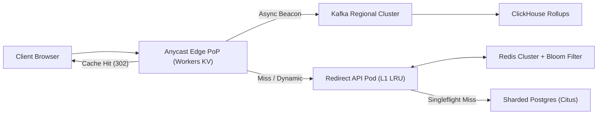
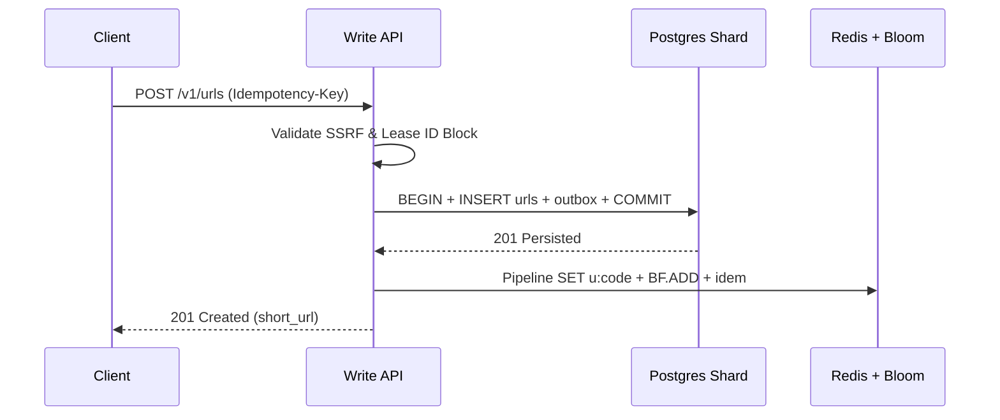

---
tags:
  - software-engineering
  - system-design
  - case-study
  - url-shortener
  - distributed-systems
  - clickhouse
created: 2026-11-13
updated: 2026-11-13
status: 🟢
level: mid-to-senior
---
# Case Study: Distributed URL Shortener (Production Blueprint)

> [!abstract] Vault Navigation
> Case study under [[Programming/Software Engineering/System Design/System Design Overview|System Design Overview]] and [[Programming/Software Engineering/System Design/System Design Complete Guide|System Design Complete Guide]]. Integrates [[Programming/Software Engineering/System Design/API Design|API Design]], [[Programming/Software Engineering/System Design/Caching|Caching]], [[Programming/Software Engineering/System Design/CDN|CDN]], [[Programming/Software Engineering/System Design/Rate Limiting|Rate Limiting]], [[Programming/Software Engineering/System Design/Scalability|Scalability]], [[Programming/Software Engineering/Database Design/Database Design Complete Guide|Database Design Complete Guide]], [[Programming/Software Engineering/Database Design/Sharding|Sharding]], and [[Programming/Software Engineering/DevOps/Observability|Observability]].

---

## 1. First-Principles Mechanics, Scope & Capacity Derivations

A distributed URL shortener functions as a globally replicated, read-dominant key-value router paired with a decoupled append-only telemetry pipeline. Every redirect executes an edge-terminated lookup mapping a compact opaque identifier (`short_code`, typically 7 Base62 characters) to an arbitrary destination URI (`long_url`), emitting a minimal HTTP `301`, `302`, `307`, or `308` response with a `Location` header while asynchronously streaming click metadata to an analytical store. The central architectural invariant is **strict isolation between the synchronous redirect critical path and all mutable write/analytics workloads**: no redirect request may ever acquire a row lock, update a mutable database counter, or block on analytical storage availability.

### 1.1 Functional & Non-Functional Requirements

| Category | Specification & Engineering Bound |
| :--- | :--- |
| **Shortening (`POST`)** | Accept canonical `http`/`https` URIs up to 2,048 bytes, optional `custom_alias` (`4..32` chars), optional `expires_at` UTC timestamp, and optional `redirect_type` (`301` \| `302` \| `307` \| `308`). Support strict `Idempotency-Key` deduplication. |
| **Redirection (`GET`)** | Resolve `GET /{short_code}` and emit `Location` response with `p99 < 15 ms` (CDN/Edge hit), `p99 < 25 ms` (Redis Cluster hit), and `p99 < 100 ms` (PostgreSQL origin miss). |
| **Lifecycle & Takedown** | Soft-deactivate abusive/phishing links (`is_active = false`), purge L1/L2/CDN caches within `< 5 s`, and reclaim expired TTL rows without table locks or autovacuum stalls. |
| **Security & Anti-Abuse** | Enforce SSRF blocklists (RFC1918, loopback, link-local cloud metadata, integer/hex/IPv6-mapped IP obfuscation), phishing domain reputation checks, open-redirect loop detection, and 404 cache-penetration shielding. |
| **Analytics Pipeline** | Capture non-blocking click telemetry (timestamp, `short_code`, country, ASN, device class, browser family, referrer domain, deduplicated visitor hash) with `< 60 s` ingestion lag into ClickHouse rollups. |
| **Availability & CAP** | Redirect path: **99.99%** (`AP` / `PA/EL` — stale/dropped click telemetry never fails a redirect). Write path: **99.95%** (`CP` per shard for custom alias uniqueness). |

### 1.2 Multi-Tier Capacity Derivations (Baseline SaaS vs. 100k+ RPS Global Edge Tier)

We explicitly size two operational tiers: **Tier A (Baseline Enterprise SaaS)** handling 100M new URLs/month at a 100:1 read-to-write ratio, and **Tier B (Hyper-Scale Global Edge Tier)** handling 100,000+ RPS sustained global redirects (300,000+ RPS viral campaign bursts).

#### Step 1: Request Throughput Derivation

- **Baseline Write Rate (100M new URLs/month):**
  $$\text{WPS}_{\text{avg}} = \frac{100 \times 10^6}{30 \times 86{,}400} = \frac{100{,}000{,}000}{2{,}592{,}000} \approx \mathbf{38.58\text{ WPS}} \approx \mathbf{40\text{ WPS}}$$
  Applying a $3\times$ diurnal + batch-import burst factor yields **$\mathbf{120\text{ WPS}}$ peak** (and $5\times$ API campaign import bursts of **$\mathbf{200\text{ WPS}}$**).
- **Baseline Read Rate (100:1 Read-to-Write Ratio, 10B redirects/month):**
  $$\text{RPS}_{\text{avg}} = 40 \times 100 = \mathbf{4{,}000\text{ RPS}}, \quad \text{RPS}_{\text{peak (3x)}} = \mathbf{12{,}000\text{ RPS}}$$
- **Global Edge Tier Variant (250B+ redirects/month, 2,500:1 Read-to-Write Ratio):**
  $$\text{RPS}_{\text{global}} = \frac{259.2 \times 10^9}{2{,}592{,}000} = \mathbf{100{,}000\text{ RPS sustained}}, \quad \text{RPS}_{\text{burst (3x)}} = \mathbf{300{,}000\text{ RPS}}$$
  At 100k–300k RPS, terminating every redirect at a centralized single-region origin exceeds single-AZ NAT gateway port budgets and adds 80–150 ms cross-ocean RTT. Anycast GeoDNS + Edge PoP caching (Cloudflare Workers / Fastly Compute + distributed KV) is mandatory for Tier B.

#### Step 2: Keyspace Sizing & Bijective Bit-Width Proof

Using Base62 (`[0-9A-Za-z]`, 62 symbols):

| Code Length $L$ | Total Combinations $62^L$ | Bit Capacity $\lfloor \log_2(62^L) \rfloor$ | Lifespan at 100M/mo (1.2B/yr) | Production Verdict |
| :--- | :--- | :--- | :--- | :--- |
| **5 chars** | $62^5 = 916{,}132{,}832$ | 29 bits ($2^{29} = 5.36 \times 10^8$) | ~9.1 months | Exhausted immediately |
| **6 chars** | $62^6 = 56{,}800{,}235{,}584$ | 35 bits ($2^{35} = 3.43 \times 10^{10}$) | ~47.3 years | Risky once reserved/custom/deleted churn accumulates |
| **7 chars** | $62^7 = 3{,}521{,}614{,}606{,}208$ | **41 bits** ($2^{41} = 2.199 \times 10^{12}$) | **~2,934 years** | **Optimal default** (compact URL + multi-millennium runway) |
| **8 chars** | $62^8 = 218{,}340{,}105{,}584{,}896$ | 47 bits ($2^{47} = 1.407 \times 10^{14}$) | ~181,950 years | Reserve for multi-tenant partitions or Snowflake-embedded codes |

Note the critical mathematical boundary for **41-bit vs. 42-bit** bijective permutation:
$$2^{41} = 2{,}199{,}023{,}255{,}552 < 62^7 = 3{,}521{,}614{,}606{,}208 < 2^{42} = 4{,}398{,}046{,}511{,}104$$
If a 42-bit counter is fed into a bijective cipher over $[0, 2^{42}-1]$, approximately $20\%$ of outputs exceed $62^7 - 1$ and require an **8th Base62 character**! Using either a **41-bit domain** ($2.199 \times 10^{12}$ unique keys, or a **40-bit balanced 20+20 Feistel network** yielding $1.099 \times 10^{12}$ unique keys—still 916 years of headroom at 100M/mo) or **cycle-walking modular Feistel** over $[0, 62^7 - 1]$ guarantees every generated code fits strictly within 7 characters.

#### Step 3: 5-Year Database Storage + B+Tree Index Bloat Derivation

At 100M new URLs/month for 5 years ($60\text{ months}$):
$$\text{Total Rows} = 100 \times 10^6 \times 60 = \mathbf{6 \times 10^9\text{ rows (6 Billion)}}$$

Let us compute the exact **PostgreSQL heap + B+Tree byte footprint** per row:
- Heap tuple header + alignment: `24 bytes` (`t_xmin`, `t_xmax`, `t_ctid`, null bitmap)
- `short_code` (`VARCHAR(32)`): average 8 bytes + 1B varlena header = `9 bytes`
- `long_url` (`TEXT`, avg 140 chars + 1–2B varlena header): `142 bytes`
- `user_id` (`BIGINT`): `8 bytes`, `redirect_type` (`SMALLINT`): `2 bytes`, flags (`BOOLEAN` x2): `2 bytes`
- `expires_at`, `created_at`, `updated_at` (`TIMESTAMPTZ` x3): `24 bytes`
- Row item pointer (`lp` in page): `4 bytes`
- **Net raw tuple size:** $24 + 9 + 142 + 8 + 2 + 2 + 24 + 4 \approx \mathbf{215\text{ bytes/row}}$ (up to **350–400 bytes/row** for longer UTM marketing query strings).
- Accounting for `fillfactor = 90` (10% free page space to absorb updates/deactivations via HOT) and **~15% MVCC dead-tuple bloat** between autovacuum cycles:
  $$\text{Effective Heap Row Footprint} = \frac{350\text{ B}}{0.90 \times 0.85} \approx \mathbf{458\text{ B/row}} \implies 6 \times 10^9 \times 458\text{ B} \approx \mathbf{2.75\text{ TB heap}}$$
- **B+Tree Index Overhead (30% average page fragmentation + key + CTID pointer):**
  1. Primary Key `(short_code)`: $(10\text{ B key} + 6\text{ B CTID} + 4\text{ B lineptr}) / 0.70 \approx 29\text{ B/row} \implies \mathbf{174\text{ GB}}$
  2. User History Index `(user_id, created_at DESC)`: $(16\text{ B keys} + 6\text{ B} + 4\text{ B}) / 0.70 \approx 37\text{ B/row} \implies \mathbf{222\text{ GB}}$
  3. Partial Expiration Index `(expires_at) WHERE expires_at IS NOT NULL AND is_active = true` (~30% of links set TTL): $1.8\times 10^9 \times (8+6+4)/0.70 \approx \mathbf{46\text{ GB}}$
- **Total 5-Year Primary Storage:** $2.75\text{ TB} + 0.44\text{ TB} \approx \mathbf{3.19\text{ TB}}$ (provision **4.5 TB** including WAL retention, temp sort buffers, and long-URL skew). Across 1 Primary + 2 Synchronous/Async Replicas ($\text{RF}=3$), total cluster NVMe footprint = **~13.5 TB**.

#### Step 4: Redis Hot Working-Set RAM Derivation

Assume an 80/20 power-law access distribution (in reality URL shorteners exhibit an even steeper Zipfian $\alpha \approx 0.9$ distribution where top 5% of links drive >85% of clicks). Daily baseline redirects = $4{,}000 \times 86{,}400 \approx 345.6\text{M clicks/day}$ (~70M distinct active keys hit per day at Tier A; ~350M distinct active keys per day at Tier B).

- **Per-Key Redis 7 Memory Accounting:**
  - `dictEntry` (24B) + key SDS (`u:aB9x2Kq`, 9B + 3B header + jemalloc 16B bin = 16B) + `robj` (16B) + compact value payload (~200B packed JSON/MsgPack rounded to jemalloc 224B bin) = **~280 bytes/key** (up to **450 bytes/key** with long tracking query strings).
  - Tier A Hot Set (70M keys $\times$ 400B + 25% jemalloc fragmentation + replication backlog):
    $$70 \times 10^6 \times 400\text{ B} \times 1.25 = \mathbf{35\text{ GB RAM}}$$
    Deploy **3 Redis Cluster primary shards** (32 GB usable each = 96 GB total, ~36% utilization leaving headroom for `BGSAVE` copy-on-write forks) + 2 read replicas per shard.
  - Tier B Hot Set (350M keys $\times$ 400B $\times 1.25$): **~175 GB origin Redis RAM** across 8–12 shards, fronted by **Edge PoP caches** absorbing >92% of reads before origin.

#### Step 5: Egress & Click Telemetry Bandwidth

- **Tier A Redirect Bandwidth:** Avg HTTP `302` response (`HTTP/2` headers + `Location` URI) $\approx 350\text{ B}$ wire size.
  $$4{,}000\text{ RPS} \times 350\text{ B} = \mathbf{1.4\text{ MB/s (11.2 Mbps) avg}}, \quad \mathbf{33.6\text{ Mbps peak}}$$
- **Tier B Redirect Bandwidth (100k RPS / 300k Burst):**
  $$100{,}000\text{ RPS} \times 350\text{ B} = \mathbf{35\text{ MB/s (280 Mbps) avg}}, \quad \mathbf{840\text{ Mbps burst}}$$
- **Click Telemetry Stream (Kafka + ClickHouse):** Uncompressed JSON/Protobuf event $\approx 280\text{ B/click}$; batched Zstd compression ratio $\approx 4:1 \implies 70\text{ B/click}$. At 100k RPS: $100{,}000 \times 280\text{ B} = 28\text{ MB/s}$ raw (**7 MB/s compressed** over Kafka network).

---

## 2. Real-World Use Cases & Architectural Decision Matrix

Different business constraints force fundamentally different storage, caching, and consistency choices. Adopting a distributed sharded SQL + Kafka + ClickHouse stack for a tiny internal link mapper creates unnecessary operational drag, whereas running a single Postgres instance for 100k RPS global redirects melts under connection and CPU limits.

| Scenario | Traffic & Consistency Profile | Recommended Architecture | Rejected Alternative & Why |
| :--- | :--- | :--- | :--- |
| **1. Multi-Tenant SaaS Marketing Platform** | 40–200 WPS, 12k RPS peak, strict `302` click analytics, custom branded domains (`go.acme.io/promo`), instant link editing | **Sharded PostgreSQL (Citus/Vitess)** + Redis Cluster + Bloom 404 Guard + Kafka + ClickHouse | **Pure DynamoDB + S3 logs:** Hard to enforce cross-tenant composite custom-domain uniqueness and arbitrary `user_id` pagination without expensive GSIs |
| **2. Global Consumer Link Router (100k+ RPS)** | 300k RPS viral drops, `< 15 ms` global `p99`, 99.995% availability across continents | **Anycast GeoDNS + Edge Workers KV (Cloudflare/Fastly)** + L1 Pod LRU + Origin Postgres/CockroachDB + Async Regional Kafka | **Centralized Origin Redis Only:** 90–140 ms cross-continent TCP/TLS handshake + single-region Redis network saturation |
| **3. Security-Sensitive Enterprise / Unlisted Docs** | Strict non-enumerability, instant `< 2 s` phishing/leak takedown, zero browser-cached permanent links | **41-bit Bijective Feistel IDs** + `302` (`Cache-Control: no-store`) + L1 invalidation pub/sub + WAF `404` rate limiter | **Sequential Base62 + `301` Permanently:** Competitors scrape IDs sequentially and `301` remains pinned in end-user browsers post-takedown |
| **4. Ephemeral OTP / Transactional Checkout Links** | 50M links/day expiring in 15 minutes–7 days, high deletion churn, zero 5-year retention | **Time-partitioned Postgres (`DROP TABLE` monthly/daily)** or **DynamoDB native TTL** + Redis TTL-aligned entries | **Unpartitioned Postgres with `DELETE` cron:** Continuous autovacuum bloat, B+Tree index bloat, and heavy I/O lock contention |
| **5. Internal Engineering Shortlinks (`go/runbook`)** | `< 50` RPS, `< 500k` total rows, corporate SSO auth | **Single Multi-AZ PostgreSQL** + in-process LRU cache | **Kafka + ClickHouse + Citus:** Severe over-engineering; simple Postgres materialized counter view suffices |

---

## 3. ID Generation Deep Comparison & Bijective Feistel Implementation

The ID generator determines write latency, uniqueness guarantees, database lock contention, horizontal scalability, and enumeration resistance.

### 3.1 Comparative Architecture Analysis

| Strategy | Collision Risk | Enumeration Resistance | Coordination Overhead | Deduplication Support | Verdict |
| :--- | :--- | :--- | :--- | :--- | :--- |
| **1. Monotonic Counter + Base62** | Zero | **None** (`4c92`, `4c93` leaks volume & unlisted links) | Low (Range leases) | Optional secondary index | **Unsafe** without permutation |
| **2. Counter + Bijective Feistel Cipher** | **Zero** | **Cryptographic PRP** (4-round keyed permutation) | **Low** (Pods lease 10,000-ID blocks from `etcd`/PG) | Optional | **Best overall:** $O(1)$ writes, zero DB uniqueness probes, unguessable |
| **3. Token-Range Coordinator (`etcd`/SQL Lease)** | **Zero** | Requires Feistel/shuffle on top of range | **Very Low** (1 DB call per 10k writes) | Optional | Standard allocator feeding Feistel codec |
| **4. MD5 / SHA-256 Truncate (41–42 bits)** | **High** (Birthday bound $\sqrt{2^{41}} \approx 1.48\text{M}$ rows causes collisions) | High | Zero stateless | Breaks under salt retry (`url + salt`) | **Avoid:** Read-before-write + retry loops destroy $O(1)$ write tail |
| **5. Pre-Generated KGS (`unused` -> `used`)** | **Zero** | CSPRNG high | Moderate (Background KGS worker + batch lease lock) | None | Strong alternative if custom CSPRNG alphabet distribution is mandated |

### 3.2 Mathematical Foundation: Balanced / Split-Bit Feistel Network + Cycle-Walking

Let $N = 62^7 = 3{,}521{,}614{,}606{,}208$. To construct an invertible **pseudorandom permutation (PRP)** over integers $x \in [0, 2^{40}-1]$ (which holds $1.099 \times 10^{12}$ unique 7-character Base62 codes—roughly **916 years** of runway at 100M URLs/month—and satisfies $2^{40} < 62^7$ strictly with zero overflow):

1. Split the 40-bit unsigned counter $x$ into two exact **20-bit halves**:
   $$L_0 = (x \gg 20) \ \& \ \text{0xFFFFF}, \quad R_0 = x \ \& \ \text{0xFFFFF}$$
2. Run **4 rounds** ($i = 0, 1, 2, 3$) using a keyed pseudorandom round function $F(R_i, k_i) \in [0, 2^{20}-1]$ derived from `HMAC-SHA256(masterSecret, round || R_i)` truncated to 20 bits:
   $$L_{i+1} = R_i, \quad R_{i+1} = L_i \oplus F(R_i, k_i)$$
3. Reassemble the 40-bit permuted integer $y = (L_4 \ll 20) \mid R_4$, encode $y$ in Base62, and left-pad with `'0'` to exact width 7.
4. **Why Bijectivity Is Guaranteed:** Every Feistel round is algebraically invertible regardless of whether $F$ is invertible, because $L_i = R_{i+1} \oplus F(L_{i+1}, k_i)$ and $R_i = L_{i+1}$. By the Luby-Rackoff theorem, a 4-round Feistel network with a secure PRF $F$ is a **strong pseudorandom permutation**—indistinguishable from a random bijection against adaptive chosen-plaintext/ciphertext queries. Two consecutive counters (`1000000` and `1000001`) produce completely uncorrelated 7-character strings, and two distinct counters can **never** collide.

*(If you ever need the full $3.52 \times 10^{12}$ range of $62^7$ instead of $2^{40}$, apply **Format-Preserving Cycle-Walking**: run a 42-bit Feistel (21+21 bits) in a `while (y >= 62^7)` loop; because $62^7 / 2^{42} \approx 80.07\%$, the expected iterations are only $1 / 0.8007 = 1.25$ and bijectivity over $[0, 62^7-1]$ remains exact.)*

### 3.3 Custom Vanity Alias Namespace Separation

Never mix auto-generated codes and user-supplied vanity aliases in the same collision domain without explicit structural separation:
- **Rule 1 (Length & Character Disjointness):** Auto-generated codes are **strictly 7 characters** drawn exclusively from `[0-9A-Za-z]` (`^[0-9A-Za-z]{7}$`). Enforce that user `custom_alias` either:
  - Has length `4..6` or `8..32`, **OR**
  - Contains at least one hyphen (`-`) or underscore (`_`), **OR**
  - Is scoped under a dedicated route prefix (`/c/{alias}`) or custom tenant domain (`go.acme.com/{alias}`).
- **Rule 2 (Reserved Route Blocklist):** Reject system paths (`api`, `v1`, `healthz`, `readyz`, `metrics`, `admin`, `login`, `robots.txt`, `favicon.ico`, `.well-known`) before database lookup.
- **Rule 3 (Strict Uniqueness Enforcement):** Regardless of structural separation, custom alias creation still hits `INSERT INTO urls ... ON CONFLICT (short_code) DO NOTHING` on the shard responsible for `hash(short_code)` to guarantee linearizable `409 Conflict` behavior under concurrent racing requests.

---

## 4. Complete Storage Schemas, Redis Lua Scripts & ClickHouse Pipeline

### 4.1 Sharded PostgreSQL (Citus / Vitess-Compatible) DDL

Shard `urls` by `hashtext(short_code)` across 8–16 logical shards so every `GET /{short_code}` and `POST /v1/urls` custom-alias check resolves to exactly **one shard**. User dashboard queries (`GET /v1/urls?user_id=...`) execute scatter-gather across 8 shards in `< 15 ms` via async connection pooling or read from a dedicated `user_urls_index` projection updated asynchronously.

```sql
-- =============================================================================
-- SHARDED OLTP DATABASE SCHEMA (PostgreSQL 16+ / Citus Distributed)
-- =============================================================================

-- 1. Core URL Mappings Table (Distributed by short_code hash)
CREATE TABLE urls (
    short_code     VARCHAR(32)  NOT NULL,
    tenant_id      BIGINT       NOT NULL DEFAULT 0, -- 0 = default shared domain
    long_url       TEXT         NOT NULL CHECK (octet_length(long_url) <= 2048),
    url_sha256     BYTEA        NOT NULL,           -- Fast equality check for idempotency/dedup
    user_id        BIGINT       NOT NULL,
    redirect_type  SMALLINT     NOT NULL DEFAULT 302 CHECK (redirect_type IN (301, 302, 307, 308)),
    is_custom      BOOLEAN      NOT NULL DEFAULT false,
    is_active      BOOLEAN      NOT NULL DEFAULT true,
    takedown_reason VARCHAR(64),
    expires_at     TIMESTAMPTZ,
    created_at     TIMESTAMPTZ  NOT NULL DEFAULT NOW(),
    updated_at     TIMESTAMPTZ  NOT NULL DEFAULT NOW(),
    PRIMARY KEY (short_code)
) WITH (fillfactor = 90);

-- Citus distribution call (execute on coordinator):
-- SELECT create_distributed_table('urls', 'short_code');

-- Secondary index for user dashboard listing
CREATE INDEX idx_urls_user_created
    ON urls (user_id, created_at DESC)
    INCLUDE (long_url, is_active, expires_at);

-- Partial index strictly covering active links with TTLs for lock-free batched reclamation
CREATE INDEX idx_urls_active_expiring
    ON urls (expires_at ASC)
    WHERE expires_at IS NOT NULL AND is_active = true;

-- 2. Token-Range Lease Allocator Table (Lives on Coordinator / Single Metadata Shard)
-- Each API pod leases 10,000 IDs at a time in 1 atomic UPDATE.
CREATE TABLE id_range_leases (
    namespace      VARCHAR(32) PRIMARY KEY,
    next_id        BIGINT      NOT NULL DEFAULT 100000,
    max_id         BIGINT      NOT NULL DEFAULT 1099511627775, -- 2^40 - 1
    updated_at     TIMESTAMPTZ NOT NULL DEFAULT NOW()
);

INSERT INTO id_range_leases (namespace, next_id, max_id)
VALUES ('base62_7char_v1', 0, 1099511627775)
ON CONFLICT (namespace) DO NOTHING;

-- 3. Idempotency Ledger (Prevents duplicate short codes on network retries)
CREATE TABLE idempotency_keys (
    user_id         BIGINT      NOT NULL,
    idempotency_key UUID        NOT NULL,
    short_code      VARCHAR(32) NOT NULL,
    request_hash    BYTEA       NOT NULL, -- SHA-256 of canonical request body
    created_at      TIMESTAMPTZ NOT NULL DEFAULT NOW(),
    expires_at      TIMESTAMPTZ NOT NULL DEFAULT (NOW() + INTERVAL '24 hours'),
    PRIMARY KEY (user_id, idempotency_key)
);

-- 4. Transactional Outbox (Guarantees Bloom filter, CDN purge & audit sync)
CREATE TABLE url_outbox (
    event_id       BIGSERIAL   PRIMARY KEY,
    short_code     VARCHAR(32) NOT NULL,
    event_type     VARCHAR(32) NOT NULL, -- 'URL_CREATED' | 'URL_REVOKED' | 'URL_EXPIRED'
    payload        JSONB       NOT NULL,
    published_at   TIMESTAMPTZ,
    created_at     TIMESTAMPTZ NOT NULL DEFAULT NOW()
);

CREATE INDEX idx_url_outbox_unpublished
    ON url_outbox (event_id ASC)
    WHERE published_at IS NULL;

-- 5. Blocked Domains & Malware/Phishing Feed Sync Table
CREATE TABLE blocked_hosts (
    host_reverse   VARCHAR(255) PRIMARY KEY, -- e.g., 'com.evil-phish.login' for prefix matching
    reason         VARCHAR(64)  NOT NULL,
    source         VARCHAR(32)  NOT NULL,    -- 'GSB' | 'PHISHTANK' | 'INTERNAL_ABUSE'
    added_at       TIMESTAMPTZ  NOT NULL DEFAULT NOW()
);
```

### 4.2 Redis Cluster Key Layout, Counting Bloom Filter & Atomic Lua Scripts

#### Key Design & Eviction Policy (`allkeys-lru` on L2 Cache Cluster, `noeviction` on Rate-Limit/Bloom Cluster)

| Key Pattern | Data Structure | Value Encoding & TTL | Purpose |
| :--- | :--- | :--- | :--- |
| `u:{short_code}` | `String` | Compact JSON/MsgPack: `{"u":"https://...","t":302,"a":1,"e":1794614400000}` (`TTL = min(86400, expires_at - now)`) | Hot redirect lookup (single `GET`) |
| `neg:{short_code}` | `String` | `"1"`, `EX 120` (2 minutes) | Short-TTL negative cache shielding DB from missing/revoked codes |
| `idem:{user_id}:{key}` | `String` | JSON `{ "short_code": "...", "req_hash": "..." }`, `EX 86400` | Fast-path idempotency verification |
| `bf:urls:{0..15}` | `RedisBloom` (`BF.RESERVE`) | 16 partitioned Bloom filters (`error_rate = 0.001`, `capacity = 400M/shard`) | Zero-DB 404 cache penetration shield |
| `rl:redirect:{ip}` | `String` (Lua counter) | Sliding-window / token bucket (`EX 60`) | Per-IP `404` scanner throttle & abuse guard |

#### Bloom Filter Sizing & Deletion Semantics (Why Counting/Partitioned Filters Matter)

For $n = 6 \times 10^9$ cumulative codes at false-positive probability $p = 0.001$ ($0.1\%$):
$$m = -\frac{n \ln p}{(\ln 2)^2} = -\frac{6 \times 10^9 \times (-6.907755)}{0.480453} \approx \mathbf{8.627 \times 10^{10}\text{ bits}} \approx \mathbf{10.78\text{ GB total}}$$
With optimal hash count $k = \lceil \frac{m}{n} \ln 2 \rceil = \mathbf{10\text{ hashes}}$ per key.

Partitioning across 16 shards (`bf:urls:{crc16(code) % 16}`) consumes **~674 MB per shard**. Standard Bloom filters **cannot delete keys** (clearing a bit risks breaking overlapping keys). For links that expire or get revoked:
- Do **not** rebuild the entire 10 GB Bloom filter on every deletion. Instead, upon revocation/expiration, write `neg:{short_code}` (`EX 86400`) and overwrite/delete `u:{short_code}` with `{"a":0}` tombstone (for 24h) or delete from L1/L2 cache.
- Optionally deploy a **Cuckoo Filter (`CF.RESERVE` / `CF.DEL`)** for the active hot tier (stores 12-bit fingerprints in 4-entry buckets, supporting $O(1)$ deletions with ~12.5 GB footprint) or rotate time-windowed Bloom filters quarterly while draining expired eras.

#### Production Lua Scripts

```lua
-- =============================================================================
-- LUA SCRIPT 1: Token Bucket Rate Limiter (Anti-404 Scanner & Write Throttler)
-- KEYS[1] = "rl:404:<ip>"
-- ARGV[1] = capacity (e.g. 60), ARGV[2] = refill_per_sec (e.g. 1.0)
-- ARGV[3] = now_ms, ARGV[4] = cost (1)
-- Returns: { allowed (1|0), remaining_tokens, retry_after_ms }
-- =============================================================================
local key = KEYS[1]
local capacity = tonumber(ARGV[1])
local refill_rate = tonumber(ARGV[2])
local now_ms = tonumber(ARGV[3])
local cost = tonumber(ARGV[4])

local data = redis.call("HMGET", key, "tokens", "ts")
local tokens = tonumber(data[1])
local last_ts = tonumber(data[2])

if tokens == nil then
    tokens = capacity
    last_ts = now_ms
else
    local elapsed_sec = math.max(0, (now_ms - last_ts) / 1000.0)
    tokens = math.min(capacity, tokens + elapsed_sec * refill_rate)
    last_ts = now_ms
end

local allowed = 0
local retry_after_ms = 0
if tokens >= cost then
    tokens = tokens - cost
    allowed = 1
else
    retry_after_ms = math.ceil(((cost - tokens) / refill_rate) * 1000)
end

redis.call("HSET", key, "tokens", tokens, "ts", last_ts)
redis.call("PEXPIRE", key, math.ceil((capacity / refill_rate) * 1000) + 5000)

return { allowed, math.floor(tokens), retry_after_ms }
```

```lua
-- =============================================================================
-- LUA SCRIPT 2: Race-Safe Negative/Positive Cache Population
-- Prevents stale DB read from overwriting a concurrent link revocation!
-- KEYS[1] = "u:<short_code>", KEYS[2] = "revoked:<short_code>"
-- ARGV[1] = serialized_payload, ARGV[2] = ttl_seconds
-- Returns: 1 if written, 0 if blocked by active revocation marker
-- =============================================================================
if redis.call("EXISTS", KEYS[2]) == 1 then
    return 0
end

local ttl = tonumber(ARGV[2])
if ttl > 0 then
    redis.call("SET", KEYS[1], ARGV[1], "EX", ttl)
    return 1
end
return 0
```

### 4.3 HTTP `301` vs. `302` vs. `307` vs. `308` Engineering Trade-Off Matrix

| Status Code | Semantic Meaning | HTTP Method Preservation (`POST` -> ?) | Client / Browser Caching Default | Impact on Click Analytics & Kill-Switch |
| :--- | :--- | :--- | :--- | :--- |
| **`301 Moved Permanently`** | Resource permanently relocated | **Unsafe:** Rewrites `POST`/`PUT` to `GET` on redirect | Browser caches aggressively across sessions even without explicit `Cache-Control` | **Breaks click analytics** (~80% client cache hit bypasses origin) and **prevents rapid malware/phishing takedown** until user clears browser cache |
| **`302 Found`** | Temporary relocation | **Unsafe:** Rewrites `POST`/`PUT` to `GET` (historically de-facto standard) | Re-validates with shortener on every click when sent with `Cache-Control: private, no-cache, max-age=0` | **Full analytics visibility** + **instant kill-switch revocation**; higher origin RPS unless terminated at CDN Edge Workers |
| **`307 Temporary Redirect`** | Strict temporary relocation | **Preserved:** `POST` remains `POST` with original body | Re-validates on every request (with `no-store`/`max-age=0`) | Mandatory for webhook/API callback shortlinks where `POST` payload must reach destination intact |
| **`308 Permanent Redirect`** | Strict permanent relocation | **Preserved:** `POST` remains `POST` | Browser caches permanently across restarts | Same browser-pinning hazard as `301`; use only for immutable API endpoint aliases |

**Production Hybrid Policy:** Default every user-created link to **`302 Found`** with `Cache-Control: private, max-age=0, must-revalidate` (or `s-maxage=60` strictly for **CDN edge PoPs** via `Surrogate-Control: max-age=60`, keeping `Cache-Control: private, max-age=0` toward end browsers so Edge Workers log clicks asynchronously via `ctx.waitUntil()` while retaining `< 5 s` global surrogate-key purge capability).

### 4.4 ClickHouse OLAP Analytics Schemas (`MergeTree`, `SummingMergeTree`, `ReplacingMergeTree`)

Never increment `click_count` in PostgreSQL during a redirect. Stream click logs through Kafka into ClickHouse using batched inserts (`5,000–25,000` rows/batch) to avoid creating thousands of micro-parts.

```sql
-- =============================================================================
-- CLICKHOUSE OLAP ANALYTICS SCHEMA (ReplacingMergeTree + SummingMergeTree Rollups)
-- =============================================================================

-- 1. Raw Append-Only Click Events (90-day granular retention)
CREATE TABLE analytics.click_events_raw (
    event_id      UUID,
    short_code    String CODEC(ZSTD(1)),
    tenant_id     UInt64,
    clicked_at    DateTime64(3, 'UTC') CODEC(Delta, ZSTD(1)),
    country_code  LowCardinality(FixedString(2)),
    device_type   LowCardinality(String),   -- 'mobile' | 'desktop' | 'tablet' | 'bot'
    os_family     LowCardinality(String),
    browser       LowCardinality(String),
    referrer_host String CODEC(ZSTD(1)),
    visitor_hash  UInt64,                   -- SipHash64(daily_salt || ip || ua) for privacy-safe UV
    is_bot        UInt8
) ENGINE = MergeTree()
PARTITION BY toYYYYMM(clicked_at)
ORDER BY (short_code, clicked_at, event_id)
TTL toDateTime(clicked_at) + INTERVAL 90 DAY DELETE
SETTINGS index_granularity = 8192;

-- 2. Dimension Enrichment Table (ReplacingMergeTree deduplicates mutable link metadata)
CREATE TABLE analytics.url_dimensions (
    short_code    String,
    user_id       UInt64,
    tenant_id     UInt64,
    long_url      String,
    is_active     UInt8,
    updated_at    DateTime64(3, 'UTC')
) ENGINE = ReplacingMergeTree(updated_at)
ORDER BY (short_code);

-- 3. Pre-Aggregated Hourly Click Counts (SummingMergeTree collapses identical PKs on merge)
CREATE TABLE analytics.clicks_hourly_rollup (
    short_code    String,
    hour_bucket   DateTime('UTC'),
    country_code  LowCardinality(FixedString(2)),
    device_type   LowCardinality(String),
    total_clicks  UInt64,
    bot_clicks    UInt64
) ENGINE = SummingMergeTree((total_clicks, bot_clicks))
PARTITION BY toYYYYMM(hour_bucket)
ORDER BY (short_code, hour_bucket, country_code, device_type);

-- Materialized View auto-maintaining hourly sums during raw batch ingestion
CREATE MATERIALIZED VIEW analytics.mv_clicks_hourly
TO analytics.clicks_hourly_rollup AS
SELECT
    short_code,
    toStartOfHour(clicked_at) AS hour_bucket,
    country_code,
    device_type,
    count()                   AS total_clicks,
    sum(is_bot)               AS bot_clicks
FROM analytics.click_events_raw
GROUP BY short_code, hour_bucket, country_code, device_type;

-- 4. Unique Visitor HyperLogLog Sketch Rollup (AggregatingMergeTree)
CREATE TABLE analytics.clicks_daily_uv (
    short_code     String,
    day_bucket     Date,
    uv_state       AggregateFunction(uniq, UInt64)
) ENGINE = AggregatingMergeTree()
PARTITION BY toYYYYMM(day_bucket)
ORDER BY (short_code, day_bucket);

CREATE MATERIALIZED VIEW analytics.mv_clicks_daily_uv
TO analytics.clicks_daily_uv AS
SELECT
    short_code,
    toDate(clicked_at) AS day_bucket,
    uniqState(visitor_hash) AS uv_state
FROM analytics.click_events_raw
WHERE is_bot = 0
GROUP BY short_code, day_bucket;

-- Querying Rollups (Combines unmerged parts at query time in < 10 ms):
SELECT
    hour_bucket,
    country_code,
    sum(total_clicks) AS clicks,
    sum(total_clicks - bot_clicks) AS human_clicks
FROM analytics.clicks_hourly_rollup
WHERE short_code = 'aB9x2Kq'
  AND hour_bucket >= now() - INTERVAL 7 DAY
GROUP BY hour_bucket, country_code
ORDER BY hour_bucket DESC;

-- Querying Exact-Merged Metadata + Unique Visitors:
SELECT
    d.short_code,
    argMax(d.long_url, d.updated_at) AS current_url,
    uniqMerge(u.uv_state)            AS unique_visitors
FROM analytics.clicks_daily_uv AS u
INNER JOIN analytics.url_dimensions AS d FINAL USING (short_code)
WHERE u.short_code = 'aB9x2Kq'
  AND u.day_bucket >= today() - 30
GROUP BY d.short_code;
```

---

## 5. Step-by-Step Practical Production Implementation

### 5.1 Production Repository Layout

```text
url-shortener-platform/
|-- package.json
|-- tsconfig.json
|-- migrations/
|   |-- 001_postgres_urls_and_leases.sql
|   `-- 002_clickhouse_rollups.sql
|-- src/
|   |-- domain/
|   |   |-- feistel-codec.ts          # 40-bit bijective Feistel + Base62 codec
|   |   `-- url-validator.ts          # SSRF, private CIDR, phishing & loop guard
|   |-- infra/
|   |   |-- range-allocator.ts        # Postgres batched ID lease allocator (10k/lease)
|   |   |-- bloom-shield.ts           # RedisBloom + negative cache wrapper
|   |   `-- click-producer.ts         # Ring-buffered non-blocking Kafka batch producer
|   |-- services/
|   |   |-- write-service.ts          # POST /v1/urls + idempotency + outbox + warm cache
|   |   `-- redirect-service.ts       # GET /:code + L1 LRU + singleflight + 302 router
|   `-- workers/
|       `-- analytics-consumer.ts     # Kafka -> ClickHouse 5k-row batched inserter + DLQ
`-- tests/
    `-- shortener.test.ts             # Bijection, SSRF, 404 shield & singleflight tests
```

### 5.2 Bijective Feistel Network + Base62 Codec (`src/domain/feistel-codec.ts`)

```typescript
import { createHmac } from "node:crypto";

const BASE62_ALPHABET =
  "0123456789ABCDEFGHIJKLMNOPQRSTUVWXYZabcdefghijklmnopqrstuvwxyz";
const CODE_LENGTH = 7;
const HALF_BITS = 20n;
const HALF_MASK = (1n << HALF_BITS) - 1n; // 0xFFFFF (1,048,575)
const MAX_COUNTER = (1n << 40n) - 1n;     // 1,099,511,627,775 (< 62^7)

export class BijectiveFeistelCodec {
  private readonly roundKeys: Buffer[];

  constructor(masterSecret: Buffer) {
    if (masterSecret.length < 32) {
      throw new Error("Master secret must be at least 256 bits (32 bytes)");
    }
    this.roundKeys = [0, 1, 2, 3].map((round) =>
      createHmac("sha256", masterSecret).update(`feistel-round-${round}`).digest()
    );
  }

  /**
   * Keyed pseudorandom round function F: (20-bit uint, roundIdx) -> 20-bit uint.
   * Uses HMAC-SHA256 truncated to 20 bits; non-invertibility of F does not affect
   * invertibility of the Feistel structure.
   */
  private roundFunction(half: bigint, roundIdx: number): bigint {
    const input = Buffer.allocUnsafe(4);
    input.writeUInt32BE(Number(half), 0);
    const digest = createHmac("sha256", this.roundKeys[roundIdx])
      .update(input)
      .digest();
    const raw32 = digest.readUInt32BE(0);
    return BigInt(raw32) & HALF_MASK;
  }

  /**
   * Bijectively permutes a 40-bit sequential counter into a 7-char Base62 string.
   */
  public encode(counter: bigint): string {
    if (counter < 0n || counter > MAX_COUNTER) {
      throw new RangeError(`Counter ${counter} out of 40-bit bounds`);
    }

    let left = (counter >> HALF_BITS) & HALF_MASK;
    let right = counter & HALF_MASK;

    for (let round = 0; round < 4; round++) {
      const nextLeft = right;
      const nextRight = left ^ this.roundFunction(right, round);
      left = nextLeft;
      right = nextRight;
    }

    const permuted = (left << HALF_BITS) | right;
    return this.toBase62Fixed(permuted);
  }

  /**
   * Exact inverse permutation: recovers original counter from 7-char Base62 code.
   */
  public decode(shortCode: string): bigint {
    if (shortCode.length !== CODE_LENGTH) {
      throw new Error(`Expected ${CODE_LENGTH}-char code, got ${shortCode.length}`);
    }

    const permuted = this.fromBase62(shortCode);
    let left = (permuted >> HALF_BITS) & HALF_MASK;
    let right = permuted & HALF_MASK;

    for (let round = 3; round >= 0; round--) {
      const prevRight = left;
      const prevLeft = right ^ this.roundFunction(left, round);
      left = prevLeft;
      right = prevRight;
    }

    return (left << HALF_BITS) | right;
  }

  private toBase62Fixed(num: bigint): string {
    const chars = new Array<string>(CODE_LENGTH).fill("0");
    let value = num;
    for (let idx = CODE_LENGTH - 1; idx >= 0; idx--) {
      const rem = Number(value % 62n);
      chars[idx] = BASE62_ALPHABET[rem];
      value /= 62n;
    }
    return chars.join("");
  }

  private fromBase62(code: string): bigint {
    let acc = 0n;
    for (let i = 0; i < code.length; i++) {
      const digit = BASE62_ALPHABET.indexOf(code[i]);
      if (digit === -1) {
        throw new Error(`Invalid Base62 character: ${code[i]}`);
      }
      acc = acc * 62n + BigInt(digit);
    }
    return acc;
  }
}
```

### 5.3 SSRF, Phishing & Open-Redirect Loop Guard (`src/domain/url-validator.ts`)

```typescript
import { promises as dns } from "node:dns";
import net from "node:net";

const RESERVED_PATHS = new Set([
  "api", "v1", "v2", "health", "healthz", "readyz", "metrics",
  "admin", "login", "robots.txt", "favicon.ico", ".well-known",
]);

const CUSTOM_ALIAS_REGEX = /^[0-9A-Za-z_-]{4,32}$/;
const AUTO_GENERATED_PATTERN = /^[0-9A-Za-z]{7}$/;

export interface BlocklistRepository {
  isHostBlocked(reversedHostname: string): Promise<boolean>;
}

export class UrlValidationError extends Error {
  constructor(public readonly code: string, message: string) {
    super(message);
  }
}

export class UrlSecurityValidator {
  constructor(
    private readonly ownHostnames: ReadonlySet<string>,
    private readonly blocklistRepo: BlocklistRepository
  ) {}

  public validateCustomAlias(alias: string): void {
    const normalized = alias.trim();
    if (!CUSTOM_ALIAS_REGEX.test(normalized)) {
      throw new UrlValidationError(
        "INVALID_ALIAS",
        "Alias must be 4-32 chars using [0-9A-Za-z_-]"
      );
    }
    // Enforce structural disjointness against auto-generated 7-char Base62 space
    if (AUTO_GENERATED_PATTERN.test(normalized)) {
      throw new UrlValidationError(
        "ALIAS_NAMESPACE_RESERVED",
        "7-character pure alphanumeric aliases are reserved; include '-' or '_' or change length"
      );
    }
    if (RESERVED_PATHS.has(normalized.toLowerCase())) {
      throw new UrlValidationError("ALIAS_RESERVED", "Alias collides with system route");
    }
  }

  public async validateLongUrl(rawUrl: string): Promise<string> {
    if (rawUrl.length === 0 || Buffer.byteLength(rawUrl, "utf8") > 2048) {
      throw new UrlValidationError("URL_TOO_LONG", "URL must be 1-2048 UTF-8 bytes");
    }

    let parsed: URL;
    try {
      parsed = new URL(rawUrl);
    } catch {
      throw new UrlValidationError("MALFORMED_URL", "Invalid URI syntax");
    }

    if (parsed.protocol !== "http:" && parsed.protocol !== "https:") {
      throw new UrlValidationError(
        "UNSUPPORTED_SCHEME",
        "Only http and https schemes are permitted"
      );
    }

    if (parsed.username !== "" || parsed.password !== "") {
      throw new UrlValidationError(
        "CREDENTIALS_IN_URL",
        "Embedded userinfo credentials are rejected to prevent phishing spoofing"
      );
    }

    const hostname = parsed.hostname.toLowerCase();
    if (this.ownHostnames.has(hostname)) {
      throw new UrlValidationError(
        "REDIRECT_LOOP",
        "Self-referential shortening to own domain is prohibited"
      );
    }

    // Check literal IP or obfuscated decimal/hex/IPv6-mapped IPv4 literals
    const stripped = hostname.startsWith("[") && hostname.endsWith("]")
      ? hostname.slice(1, -1)
      : hostname;

    if (net.isIP(stripped) !== 0) {
      if (this.isForbiddenIp(stripped)) {
        throw new UrlValidationError("SSRF_PRIVATE_IP", "Private/loopback IP literals forbidden");
      }
    } else {
      // Check domain blocklist (reversed host hierarchy: com.phish.evil)
      const reversed = hostname.split(".").reverse().join(".");
      if (await this.blocklistRepo.isHostBlocked(reversed)) {
        throw new UrlValidationError("BLOCKED_HOST", "Target domain flagged by threat intelligence");
      }

      // Resolve DNS to block domains pointing at RFC1918 / 169.254.169.254
      try {
        const records = await dns.lookup(hostname, { all: true });
        for (const rec of records) {
          if (this.isForbiddenIp(rec.address)) {
            throw new UrlValidationError(
              "SSRF_RESOLVED_INTERNAL",
              "Hostname resolves to forbidden internal or metadata IP range"
            );
          }
        }
      } catch (err) {
        if (err instanceof UrlValidationError) throw err;
        throw new UrlValidationError("DNS_RESOLUTION_FAILED", "Target hostname failed DNS lookup");
      }
    }

    return parsed.toString();
  }

  private isForbiddenIp(ip: string): boolean {
    if (ip.startsWith("::ffff:")) {
      return this.isForbiddenIp(ip.slice(7));
    }
    if (net.isIPv6(ip)) {
      const lower = ip.toLowerCase();
      return (
        lower === "::1" ||
        lower === "::" ||
        lower.startsWith("fe80:") || // Link-local
        lower.startsWith("fc") ||    // Unique local fc00::/7
        lower.startsWith("fd")
      );
    }
    const octets = ip.split(".").map((n) => Number(n));
    if (octets.length !== 4 || octets.some((n) => Number.isNaN(n))) return true;
    const [a, b] = octets;

    return (
      a === 0 ||                               // 0.0.0.0/8 "this network"
      a === 10 ||                              // 10.0.0.0/8 RFC1918
      a === 127 ||                             // 127.0.0.0/8 loopback
      (a === 169 && b === 254) ||              // 169.254.0.0/16 AWS/GCP/Azure IMDS
      (a === 172 && b >= 16 && b <= 31) ||     // 172.16.0.0/12 RFC1918
      (a === 192 && b === 168) ||              // 192.168.0.0/16 RFC1918
      (a === 100 && b >= 64 && b <= 127) ||    // 100.64.0.0/10 CGNAT
      a >= 224                                 // Multicast / reserved
    );
  }
}
```

### 5.4 Batched Token-Range Allocator & Write Service (`src/infra/range-allocator.ts` & `src/services/write-service.ts`)

```typescript
// src/infra/range-allocator.ts
import type { Pool } from "pg";

export class TokenRangeAllocator {
  private current = 0n;
  private ceiling = -1n;
  private inflightLease: Promise<void> | null = null;

  constructor(
    private readonly metaPool: Pool,
    private readonly namespace = "base62_7char_v1",
    private readonly blockSize = 10_000n
  ) {}

  public async nextId(): Promise<bigint> {
    while (this.current > this.ceiling) {
      if (!this.inflightLease) {
        this.inflightLease = this.acquireLeaseBlock().finally(() => {
          this.inflightLease = null;
        });
      }
      await this.inflightLease;
    }
    const allocated = this.current;
    this.current += 1n;
    return allocated;
  }

  private async acquireLeaseBlock(): Promise<void> {
    const res = await this.metaPool.query<{ start_id: string; max_id: string }>(
      `UPDATE id_range_leases
          SET next_id = next_id + $1,
              updated_at = NOW()
        WHERE namespace = $2
          AND next_id + $1 <= max_id
       RETURNING (next_id - $1)::TEXT AS start_id, max_id::TEXT AS max_id`,
      [this.blockSize.toString(), this.namespace]
    );
    if (res.rowCount === 0) {
      throw new Error(`Keyspace exhausted for namespace ${this.namespace}`);
    }
    this.current = BigInt(res.rows[0].start_id);
    this.ceiling = this.current + this.blockSize - 1n;
  }
}
```

```typescript
// src/services/write-service.ts
import { createHash } from "node:crypto";
import type { Pool } from "pg";
import type { Redis } from "ioredis";
import { BijectiveFeistelCodec } from "../domain/feistel-codec";
import { UrlSecurityValidator } from "../domain/url-validator";
import { TokenRangeAllocator } from "../infra/range-allocator";

export interface ShortenRequest {
  userId: number;
  idempotencyKey?: string;
  longUrl: string;
  customAlias?: string;
  expiresAt?: string;
  redirectType?: 301 | 302 | 307 | 308;
}

export interface ShortenResponse {
  statusCode: 200 | 201;
  shortCode: string;
  shortUrl: string;
  expiresAt: string | null;
}

export class UrlWriteService {
  constructor(
    private readonly shardPool: Pool,
    private readonly redis: Redis,
    private readonly codec: BijectiveFeistelCodec,
    private readonly allocator: TokenRangeAllocator,
    private readonly validator: UrlSecurityValidator,
    private readonly publicBaseUrl: string
  ) {}

  public async shorten(req: ShortenRequest): Promise<ShortenResponse> {
    const canonicalUrl = await this.validator.validateLongUrl(req.longUrl);
    const redirectType = req.redirectType ?? 302;
    const expiresDate = req.expiresAt ? new Date(req.expiresAt) : null;

    if (expiresDate && (Number.isNaN(expiresDate.getTime()) || expiresDate.getTime() <= Date.now())) {
      throw new Error("expires_at must be a valid future UTC timestamp");
    }

    if (req.customAlias) {
      this.validator.validateCustomAlias(req.customAlias);
    }

    const requestHash = createHash("sha256")
      .update(`${canonicalUrl}|${req.customAlias ?? ""}|${redirectType}|${expiresDate?.toISOString() ?? ""}`)
      .digest();

    // 1. Fast Idempotency Check in Redis before allocating an ID or hitting DB
    if (req.idempotencyKey) {
      const cachedIdem = await this.redis.get(`idem:${req.userId}:${req.idempotencyKey}`);
      if (cachedIdem) {
        const parsed = JSON.parse(cachedIdem) as { shortCode: string; reqHashHex: string; expiresAt: string | null };
        if (parsed.reqHashHex !== requestHash.toString("hex")) {
          throw Object.assign(new Error("Idempotency-Key reused with different payload"), { status: 422 });
        }
        return {
          statusCode: 200,
          shortCode: parsed.shortCode,
          shortUrl: `${this.publicBaseUrl}/${parsed.shortCode}`,
          expiresAt: parsed.expiresAt,
        };
      }
    }

    // 2. Allocate O(1) Bijective Short Code or use validated Custom Alias
    const isCustom = Boolean(req.customAlias);
    const shortCode = req.customAlias
      ? req.customAlias.trim()
      : this.codec.encode(await this.allocator.nextId());

    const urlSha256 = createHash("sha256").update(canonicalUrl).digest();
    const client = await this.shardPool.connect();

    try {
      await client.query("BEGIN");

      if (req.idempotencyKey) {
        const existing = await client.query<{ short_code: string; request_hash: Buffer }>(
          `SELECT short_code, request_hash FROM idempotency_keys
           WHERE user_id = $1 AND idempotency_key = $2`,
          [req.userId, req.idempotencyKey]
        );
        if (existing.rowCount && existing.rowCount > 0) {
          await client.query("ROLLBACK");
          const row = existing.rows[0];
          if (!row.request_hash.equals(requestHash)) {
            throw Object.assign(new Error("Idempotency-Key payload mismatch"), { status: 422 });
          }
          return {
            statusCode: 200,
            shortCode: row.short_code,
            shortUrl: `${this.publicBaseUrl}/${row.short_code}`,
            expiresAt: expiresDate ? expiresDate.toISOString() : null,
          };
        }
      }

      const insertRes = await client.query(
        `INSERT INTO urls (short_code, long_url, url_sha256, user_id, redirect_type, is_custom, expires_at)
         VALUES ($1, $2, $3, $4, $5, $6, $7)
         ON CONFLICT (short_code) DO NOTHING`,
        [shortCode, canonicalUrl, urlSha256, req.userId, redirectType, isCustom, expiresDate]
      );

      if (insertRes.rowCount === 0) {
        await client.query("ROLLBACK");
        throw Object.assign(new Error(`Alias '${shortCode}' already exists`), { status: 409 });
      }

      if (req.idempotencyKey) {
        await client.query(
          `INSERT INTO idempotency_keys (user_id, idempotency_key, short_code, request_hash)
           VALUES ($1, $2, $3, $4)`,
          [req.userId, req.idempotencyKey, shortCode, requestHash]
        );
      }

      await client.query(
        `INSERT INTO url_outbox (short_code, event_type, payload)
         VALUES ($1, 'URL_CREATED', $2::jsonb)`,
        [shortCode, JSON.stringify({ shortCode, longUrl: canonicalUrl, userId: req.userId })]
      );

      await client.query("COMMIT");
    } catch (err) {
      await client.query("ROLLBACK").catch(() => undefined);
      throw err;
    } finally {
      client.release();
    }

    // 3. Eagerly Warm Redis Cache, Bloom Filter & Idempotency Key (Read-Your-Writes)
    const expMs = expiresDate ? expiresDate.getTime() : 0;
    const ttlSeconds = expMs > 0
      ? Math.max(1, Math.min(86400, Math.floor((expMs - Date.now()) / 1000)))
      : 86400;

    const cachePayload = JSON.stringify({ u: canonicalUrl, t: redirectType, a: 1, e: expMs });
    const bloomShard = this.bloomShardKey(shortCode);

    const pipeline = this.redis.pipeline();
    pipeline.set(`u:${shortCode}`, cachePayload, "EX", ttlSeconds);
    pipeline.del(`neg:${shortCode}`);
    pipeline.call("BF.ADD", bloomShard, shortCode);
    if (req.idempotencyKey) {
      pipeline.set(
        `idem:${req.userId}:${req.idempotencyKey}`,
        JSON.stringify({
          shortCode,
          reqHashHex: requestHash.toString("hex"),
          expiresAt: expiresDate ? expiresDate.toISOString() : null,
        }),
        "EX",
        86400
      );
    }
    await pipeline.exec();

    return {
      statusCode: 201,
      shortCode,
      shortUrl: `${this.publicBaseUrl}/${shortCode}`,
      expiresAt: expiresDate ? expiresDate.toISOString() : null,
    };
  }

  private bloomShardKey(code: string): string {
    let hash = 0;
    for (let i = 0; i < code.length; i++) {
      hash = (hash * 31 + code.charCodeAt(i)) >>> 0;
    }
    return `bf:urls:${hash % 16}`;
  }
}
```

### 5.5 Ultra-Hot Redirect Service & Non-Blocking Click Pipeline (`src/services/redirect-service.ts`)

```typescript
// src/services/redirect-service.ts
import { LRUCache } from "lru-cache";
import type { Pool } from "pg";
import type { Redis } from "ioredis";

export interface CachedUrlRecord {
  u: string; // long_url
  t: 301 | 302 | 307 | 308;
  a: 0 | 1;  // is_active
  e: number; // expires_at epoch ms (0 = never)
}

export interface ClickEvent {
  eventId: string;
  shortCode: string;
  clickedAtMs: number;
  ip: string;
  userAgent: string;
  referrer: string;
  countryCode: string;
}

export interface ClickRingBuffer {
  enqueueNonBlocking(event: ClickEvent): void;
}

export interface RedirectOutcome {
  status: 301 | 302 | 307 | 308 | 404 | 410 | 429;
  location?: string;
  cacheControl: string;
}

const VALID_CODE_FORMAT = /^[0-9A-Za-z_-]{4,32}$/;

export class RedirectService {
  // L1 in-process micro-cache absorbs celebrity hot-keys before touching Redis
  private readonly l1Cache = new LRUCache<string, CachedUrlRecord>({
    max: 50_000,
    ttl: 5_000, // 5-second L1 TTL limits stale revocation window while shielding Redis
  });

  // Singleflight map prevents N concurrent origin DB lookups on a cold cache miss
  private readonly inflightDb = new Map<string, Promise<CachedUrlRecord | null>>();

  constructor(
    private readonly shardPool: Pool,
    private readonly redis: Redis,
    private readonly clickBuffer: ClickRingBuffer
  ) {}

  public async resolve(
    shortCode: string,
    clientMeta: Omit<ClickEvent, "eventId" | "shortCode" | "clickedAtMs">
  ): Promise<RedirectOutcome> {
    if (!VALID_CODE_FORMAT.test(shortCode)) {
      return { status: 404, cacheControl: "no-store" };
    }

    const nowMs = Date.now();

    // 1. L1 In-Process Cache Check (Nanosecond path for hot keys)
    let record: CachedUrlRecord | null | undefined = this.l1Cache.get(shortCode);

    if (!record) {
      // 2. L2 Redis Cluster Check (Positive + Negative Cache in 1 pipelined round-trip)
      const [rawPos, rawNeg] = await this.redis
        .pipeline()
        .get(`u:${shortCode}`)
        .get(`neg:${shortCode}`)
        .exec()
        .then((res) => [res?.[0]?.[1] as string | null, res?.[1]?.[1] as string | null]);

      if (rawNeg === "1") {
        return { status: 404, cacheControl: "public, max-age=60" };
      }

      if (rawPos) {
        record = JSON.parse(rawPos) as CachedUrlRecord;
        this.l1Cache.set(shortCode, record);
      } else {
        // 3. Bloom Filter 404 Guard: If BF.EXISTS returns 0, shortCode CANNOT exist in DB
        const existsMaybe = await this.redis.call(
          "BF.EXISTS",
          this.bloomShardKey(shortCode),
          shortCode
        ) as number;

        if (existsMaybe === 0) {
          await this.redis.set(`neg:${shortCode}`, "1", "EX", 120);
          return { status: 404, cacheControl: "public, max-age=60" };
        }

        // 4. Singleflight Coalesced Origin DB Lookup
        record = await this.fetchWithSingleflight(shortCode);
        if (!record) {
          await this.redis.set(`neg:${shortCode}`, "1", "EX", 120);
          return { status: 404, cacheControl: "public, max-age=60" };
        }
      }
    }

    // 5. Lazy Revocation & Expiration Check
    if (record.a === 0) {
      return { status: 410, cacheControl: "no-store" };
    }
    if (record.e > 0 && record.e <= nowMs) {
      // Asynchronously purge expired cache entry; never block caller
      void this.redis.del(`u:${shortCode}`).catch(() => undefined);
      return { status: 410, cacheControl: "no-store" };
    }

    // 6. Enqueue Async Telemetry into Non-Blocking Ring Buffer (Drops gracefully if full)
    this.clickBuffer.enqueueNonBlocking({
      eventId: crypto.randomUUID(),
      shortCode,
      clickedAtMs: nowMs,
      ...clientMeta,
    });

    const cacheControl =
      record.t === 301 || record.t === 308
        ? "public, max-age=300, s-maxage=3600"
        : "private, max-age=0, must-revalidate";

    return {
      status: record.t,
      location: record.u,
      cacheControl,
    };
  }

  private async fetchWithSingleflight(shortCode: string): Promise<CachedUrlRecord | null> {
    const existing = this.inflightDb.get(shortCode);
    if (existing) {
      return existing;
    }

    const promise = (async (): Promise<CachedUrlRecord | null> => {
      const res = await this.shardPool.query<{
        long_url: string;
        redirect_type: 301 | 302 | 307 | 308;
        is_active: boolean;
        expires_at: Date | null;
      }>(
        `SELECT long_url, redirect_type, is_active, expires_at
         FROM urls
         WHERE short_code = $1`,
        [shortCode]
      );

      if (res.rowCount === 0) return null;

      const row = res.rows[0];
      const expMs = row.expires_at ? row.expires_at.getTime() : 0;
      const rec: CachedUrlRecord = {
        u: row.long_url,
        t: row.redirect_type,
        a: row.is_active ? 1 : 0,
        e: expMs,
      };

      const ttl = expMs > 0
        ? Math.max(1, Math.min(86400, Math.floor((expMs - Date.now()) / 1000)))
        : 86400;

      // Only write cache if no active revocation marker exists
      await this.redis.eval(
        `if redis.call("EXISTS", KEYS[2]) == 1 then return 0 end
         redis.call("SET", KEYS[1], ARGV[1], "EX", tonumber(ARGV[2]))
         return 1`,
        2,
        `u:${shortCode}`,
        `revoked:${shortCode}`,
        JSON.stringify(rec),
        String(ttl)
      );

      this.l1Cache.set(shortCode, rec);
      return rec;
    })().finally(() => {
      this.inflightDb.delete(shortCode);
    });

    this.inflightDb.set(shortCode, promise);
    return promise;
  }

  private bloomShardKey(code: string): string {
    let hash = 0;
    for (let i = 0; i < code.length; i++) {
      hash = (hash * 31 + code.charCodeAt(i)) >>> 0;
    }
    return `bf:urls:${hash % 16}`;
  }
}
```

### 5.6 Batched Kafka-to-ClickHouse Consumer (`src/workers/analytics-consumer.ts`)

```typescript
// src/workers/analytics-consumer.ts
import { createHash } from "node:crypto";
import type { EachBatchPayload } from "kafkajs";
import type { ClickHouseClient } from "@clickhouse/client";

interface RawClickPayload {
  eventId: string;
  shortCode: string;
  tenantId: number;
  clickedAtMs: number;
  ip: string;
  userAgent: string;
  referrer: string;
  countryCode: string;
}

export class ClickAnalyticsConsumer {
  constructor(
    private readonly clickhouse: ClickHouseClient,
    private readonly dailySaltProvider: () => string
  ) {}

  public async handleBatch({ batch, resolveOffset, heartbeat }: EachBatchPayload): Promise<void> {
    if (batch.messages.length === 0) return;

    const salt = this.dailySaltProvider();
    const rows: Record<string, unknown>[] = [];

    for (const msg of batch.messages) {
      if (!msg.value) continue;
      const evt = JSON.parse(msg.value.toString("utf8")) as RawClickPayload;

      const isBot = /bot|crawler|spider|curl|wget|headless/i.test(evt.userAgent) ? 1 : 0;
      const visitorHash = this.computeVisitorHash64(salt, evt.ip, evt.userAgent);

      rows.push({
        event_id: evt.eventId,
        short_code: evt.shortCode,
        tenant_id: evt.tenantId ?? 0,
        clicked_at: evt.clickedAtMs,
        country_code: (evt.countryCode || "ZZ").slice(0, 2).toUpperCase(),
        device_type: this.classifyDevice(evt.userAgent, isBot === 1),
        os_family: this.classifyOs(evt.userAgent),
        browser: this.classifyBrowser(evt.userAgent),
        referrer_host: this.extractHost(evt.referrer),
        visitor_hash: visitorHash.toString(),
        is_bot: isBot,
      });
    }

    // Single bulk HTTP/JSONEachRow insert prevents ClickHouse "Too many parts"
    await this.clickhouse.insert({
      table: "analytics.click_events_raw",
      values: rows,
      format: "JSONEachRow",
      clickhouse_settings: {
        async_insert: 0, // Already batching 5,000+ rows deterministically per batch
        wait_for_async_insert: 0,
      },
    });

    const lastOffset = batch.messages[batch.messages.length - 1].offset;
    resolveOffset(lastOffset);
    await heartbeat();
  }

  private computeVisitorHash64(salt: string, ip: string, ua: string): bigint {
    const digest = createHash("sha256").update(`${salt}:${ip}:${ua}`).digest();
    return digest.readBigUInt64BE(0);
  }

  private classifyDevice(ua: string, isBot: boolean): string {
    if (isBot) return "bot";
    if (/ipad|tablet/i.test(ua)) return "tablet";
    if (/mobile|iphone|android/i.test(ua)) return "mobile";
    return "desktop";
  }

  private classifyOs(ua: string): string {
    if (/iphone|ipad|ios/i.test(ua)) return "iOS";
    if (/android/i.test(ua)) return "Android";
    if (/windows/i.test(ua)) return "Windows";
    if (/mac os x/i.test(ua)) return "macOS";
    if (/linux/i.test(ua)) return "Linux";
    return "Other";
  }

  private classifyBrowser(ua: string): string {
    if (/edg\//i.test(ua)) return "Edge";
    if (/chrome|crios/i.test(ua)) return "Chrome";
    if (/safari/i.test(ua) && !/chrome/i.test(ua)) return "Safari";
    if (/firefox/i.test(ua)) return "Firefox";
    return "Other";
  }

  private extractHost(referrer: string): string {
    if (!referrer) return "direct";
    try {
      return new URL(referrer).hostname.toLowerCase();
    } catch {
      return "unknown";
    }
  }
}
```

### 5.7 Automated Verification Suite (`tests/shortener.test.ts`)

```typescript
import { describe, expect, it, vi } from "vitest";
import { randomBytes } from "node:crypto";
import { BijectiveFeistelCodec } from "../src/domain/feistel-codec";
import { UrlSecurityValidator, UrlValidationError } from "../src/domain/url-validator";

describe("BijectiveFeistelCodec", () => {
  const codec = new BijectiveFeistelCodec(randomBytes(32));

  it("produces unique 7-char Base62 codes with exact bijection across 10,000 sequential IDs", () => {
    const seen = new Set<string>();
    for (let i = 0n; i < 10_000n; i++) {
      const code = codec.encode(i);
      expect(code).toMatch(/^[0-9A-Za-z]{7}$/);
      expect(seen.has(code)).toBe(false);
      seen.add(code);
      expect(codec.decode(code)).toBe(i);
    }
  });
});

describe("UrlSecurityValidator", () => {
  const validator = new UrlSecurityValidator(new Set(["sho.rt"]), {
    isHostBlocked: vi.fn().mockResolvedValue(false),
  });

  it("blocks RFC1918, cloud IMDS metadata, and IPv6-mapped IPv4 SSRF targets", async () => {
    const malicious = [
      "http://169.254.169.254/latest/meta-data/",
      "http://127.0.0.1:8080/admin",
      "http://[::ffff:127.0.0.1]/",
      "http://10.0.12.4/internal",
      "https://sho.rt/abc1234",
      "javascript:alert(1)",
    ];
    for (const url of malicious) {
      await expect(validator.validateLongUrl(url)).rejects.toBeInstanceOf(UrlValidationError);
    }
  });

  it("prevents custom alias collisions with 7-char alphanumeric Base62 space", () => {
    expect(() => validator.validateCustomAlias("aB9x2Kq")).toThrow(UrlValidationError);
    expect(() => validator.validateCustomAlias("spring-2026")).not.toThrow();
    expect(() => validator.validateCustomAlias("promo")).not.toThrow();
  });
});
```

---

## 6. Multi-Region Edge Architecture, Lifecycle Reclamation & Operations Playbook

### 6.1 End-to-End Request & Analytics Dataflows





### 6.2 Multi-Region Active-Active Reads & Edge Synchronization

To support Tier B (**100,000+ RPS global reads** at `p99 < 15 ms`):
1. **GeoDNS / Anycast Edge Termination:** BGP Anycast routes clients to the nearest Edge PoP (300+ global nodes). Edge Workers resolve `u:{short_code}` directly from edge-replicated KV (`< 5 ms` local read), emitting `302` immediately and queuing click telemetry via `ctx.waitUntil()` to the nearest regional Kafka ingress collector.
2. **Write Propagation Topology:** `POST /v1/urls` routes to regional Write APIs backed by multi-region CockroachDB (Raft per shard) or primary Postgres with CDC (`Debezium -> Kafka -> Global Edge KV Sync`), converging worldwide within **1.5–4 seconds**.
3. **Instant Global Revocation (`kill-switch`):** On abuse detection, the Control Plane sets `is_active = false`, writes `revoked:{short_code}` in Redis (`EX 86400`), broadcasts a `URL_REVOKED` message on Redis Pub/Sub (clearing every pod's L1 LRU in `< 50 ms`), and invokes Edge CDN **Surrogate-Key Purge API** (`Surrogate-Key: link-{short_code}`).

### 6.3 Key Expiration & Space Reclamation Without Table Locks

Executing `DELETE FROM urls WHERE expires_at < NOW()` on 50M expired rows locks pages, inflates WAL generation, stalls replication, and exhausts autovacuum workers. Execute reclamation in two layers:
1. **Lazy Read-Time Enforcement:** `RedirectService` always checks `record.e <= nowMs`, returning `410 Gone` immediately even if background deletion lags by hours.
2. **Throttled `ctid` Batched Sweep + Partition Drop:**
   - For standard `urls`, a scheduled job sweeps 5,000 rows per iteration via the partial index (`idx_urls_active_expiring`) with a `50 ms` sleep between batches so replication lag stays `< 100 ms`:
     ```sql
     WITH doomed AS (
         SELECT ctid FROM urls
         WHERE expires_at IS NOT NULL AND expires_at < NOW() - INTERVAL '7 days'
         ORDER BY expires_at ASC LIMIT 5000
     )
     DELETE FROM urls USING doomed WHERE urls.ctid = doomed.ctid;
     ```
   - For high-churn **ephemeral OTP/campaign links** (`expires_at <= created_at + 30 days`), route into a separate monthly-partitioned table (`urls_ephemeral_YYYYMM`) so entire expired months drop instantaneously via `DROP TABLE urls_ephemeral_2026_09` with zero row-level WAL or vacuum work.

### 6.4 Production Debugging, Profiling & Operations Playbook

| Symptom | Root Cause | Diagnostic Command / Telemetry | Mitigation & Permanent Fix |
| :--- | :--- | :--- | :--- |
| **1. Single Redis shard hits 100% CPU while others sit at 8%** | Viral link hot-key (`sb2026`) bypasses L1 or lacks edge caching | `redis-cli --hotkeys` or `MONITOR` sampling + Prometheus `redis_commands_duration_seconds` | Enable L1 in-process LRU (5s TTL), push `s-maxage=60` to Edge PoPs, or shard hot key (`u:code#0..#7`) across Redis shards |
| **2. Origin Postgres CPU spikes to 95% with high `SELECT` QPS** | 404 scanner botnet bypassing missing Bloom Filter or `neg:` cache TTL expired | `pg_stat_statements` top `SELECT` calls returning 0 rows; Gateway `404` rate metric jump | Verify RedisBloom `BF.EXISTS` active; apply Lua token bucket on `404` responses per IP/ASN (`429`) |
| **3. ClickHouse throws `Too many parts (252)` & drops inserts** | Consumer inserting 1 row per Kafka message instead of batching | ClickHouse `SELECT table, count() FROM system.parts WHERE active GROUP BY table;` | Enforce batch sizes `>= 5,000` rows or `max_flush_wait = 1000ms`; verify `async_insert=0` with explicit client batching |
| **4. `POST /v1/urls` spikes to `503` on range allocator timeout** | Pod lease block size too small (`100` IDs/lease) under write burst | Postgres `pg_stat_activity` waiting on `UPDATE id_range_leases` lock | Increase `blockSize` from `100` to `10,000` (1 DB call per 10k writes) + trigger asynchronous background pre-fetch at 80% consumption |
| **5. Revoked phishing URL continues serving `302` after DB update** | L1 pod LRU holds stale record, or target link used `301` cached in browsers | Check `curl -I https://sho.rt/badlink` headers (`Age:`, `X-Cache: HIT`) | Publish `URL_REVOKED` over Redis Pub/Sub to evict L1 LRU across all pods + issue CDN Surrogate-Key purge; ban `301` for unverified accounts |
| **6. Redirect `p99` jumps from 18 ms to 450 ms during traffic spike** | Cache miss storm on newly launched link hitting un-coalesced Postgres lookups | API tracing spans showing 500 concurrent identical `SELECT` spans for same `short_code` | Verify `fetchWithSingleflight` coalescing map active + tune `PgBouncer` transaction pool limits |

#### Golden SLIs & Alert Rules

- **Redirect Availability SLI:** `(total_redirects - 5xx_responses) / total_redirects >= 99.99%` (Page on 5-min burn rate $> 14.4\times$).
- **Origin Shield Efficiency:** `(l1_hits + edge_hits + redis_hits + bloom_404_blocks) / total_requests >= 99.5%`.
- **ClickHouse Ingestion Lag:** `kafka_consumergroup_lag{topic="click_events"} < 100,000` messages (`< 10 s` at baseline, `< 60 s` at Tier B).

---

## 7. Interview Follow-Up Defense Exercises

### Exercise 1: Sequential Enumeration & Competitive Intelligence Leak
**Prompt:** Your service currently encodes an auto-incrementing PostgreSQL `BIGSERIAL` ID directly into Base62 (`1000000 -> 4c92`). Security flags two vulnerabilities: (1) competitors query `/4c93`, `/4c94` daily to track exact creation volume, and (2) attackers iterate adjacent codes to discover unlisted shared cloud drives. Redesign ID generation to maintain $O(1)$ zero-collision writes while defeating enumeration.

#### Solution 1
**Root Cause:** Base62 is a monotonic base conversion, preserving algebraic adjacency ($f(n+1) = f(n) + 1$).
**Fix Architecture:**
1. **Batch-Leased 40-Bit Counter + 4-Round Bijective Feistel Permutation:** Restrict the counter domain to $[0, 2^{40}-1]$ ($1.099 \times 10^{12} < 62^7$). Each API pod leases blocks of 10,000 IDs via `TokenRangeAllocator` (`1 DB row lock per 10,000 writes`). Before Base62 encoding, pass the 40-bit integer through `BijectiveFeistelCodec.encode()` keyed with an HSM/KMS-managed 256-bit secret.
2. **Proof of Invariants:** Because a Feistel network is strictly bijective, every distinct input produces a unique 40-bit output ($\implies$ **0% collision probability, zero DB uniqueness probes**), while HMAC-SHA256 round functions ensure output codes appear statistically uniform across `[0000000, D9c8...]` (defeating growth telemetry scraping).
3. **Defense-in-Depth:** Pair with the Redis Lua Token Bucket throttling repeated `404` responses per IP/subnet at the API Gateway so brute-force probing of the $1.1 \times 10^{12}$ active space against $6 \times 10^9$ active codes (0.5% hit density) gets blocked before returning useful enumerations.

---

### Exercise 2: Viral Super-Bowl Hot-Key (150k RPS) + 404 Scanner Storm (50k RPS)
**Prompt:** During a live broadcast ad, `https://sho.rt/sb2026` spikes to **150,000 RPS**, saturating a single Redis Cluster shard to 100% single-core CPU. Simultaneously, a botnet fires **50,000 RPS** of random 7-character guesses, exhausting Postgres connections on cache misses. Diagnose both single-point bottlenecks and provide quantitative fixes.

#### Solution 2
**Diagnosis:**
1. Redis Cluster uses single-threaded event loops per shard (`CRC16("u:sb2026") % 16384`). Routing 150,000 `GET` commands/s + connection interrupts to one core exceeds the ~90k–110k ops/s ceiling of one shard.
2. 50,000 random guesses miss Redis (`u:{guess}` = nil) and fall straight into Postgres (`SELECT ...`), saturating connection pools (`max_connections = 200`) with fruitless B+Tree probes.

**Mitigation Stack:**
1. **Defeating the 150k RPS Hot-Key:**
   - **Edge PoP Termination (`Surrogate-Control: s-maxage=60`):** Cloudflare/Fastly PoPs absorb >95% of `sb2026` redirects at the edge, logging telemetry asynchronously.
   - **L1 In-Process LRU Micro-Cache (`5s` TTL):** Across 100 Redirect API pods, each pod serves `1,500 RPS` locally from RAM in nanoseconds and refreshes Redis only once per 5 seconds (`100 pods / 5s = 20 RPS` hitting that Redis shard—a **7,500x reduction**!).
   - **Key Salting Fallback (Non-Edge):** If an L1 cache isn't feasible, replicate ultra-hot keys across $N=16$ logical keys (`u:sb2026#0`..`#15`) and pick a random suffix on read.
2. **Defeating the 50k RPS 404 Storm:**
   - Query `BF.EXISTS` across the 16-shard RedisBloom filter first. At $p = 0.001$, **99.9%** of random non-existent guesses terminate before Postgres and immediately receive a `neg:{code}` (`EX 120`) marker plus WAF/Lua `429` throttling on repeated `404`s. Even the 0.1% false positives (`50 RPS`) coalesce via `fetchWithSingleflight` and cache negatively in Redis.

---

### Exercise 3: Custom Alias Namespace Collisions, Bulk TTL Cleanup & `301` Abuse Revocation
**Prompt:** Enterprise users require vanity slugs (`/spring-sale`), time-bounded links (`expires_at`), and `< 5 s` malware takedowns. Explain how to guarantee zero collisions with auto-generated keys, expire 50M rows/month without table locks, and prevent `301` browser caching from breaking takedowns.

#### Solution 3
1. **Structural Namespace Separation:** Enforce `^[0-9A-Za-z]{7}$` exclusively for Feistel auto-generated keys, and require `custom_alias` to either differ in length (`4..6` or `8..32` chars) or include `-` / `_` (rejected from Base62). Because the regex languages are mathematically disjoint, an auto-generated code can **never** collide with a user vanity alias, while concurrent vanity-alias races resolve safely via Postgres `PRIMARY KEY (short_code)` + `ON CONFLICT DO NOTHING` (`409 Conflict`).
2. **Lock-Free Expiration:** Combine lazy `expires_at <= nowMs` verification on the read path (`410 Gone`) with either (a) monthly partitioned tables (`urls_ephemeral_YYYYMM`) dropped instantaneously via `DROP TABLE`, or (b) throttled `5,000`-row `DELETE ... USING (SELECT ctid ... LIMIT 5000)` sweeps backed by the partial index `WHERE expires_at IS NOT NULL AND is_active = true`.
3. **Kill-Switch vs `301`:** Browsers cache `301 Moved Permanently` persistently on disk without sending origin validation requests, making remote revocation impossible for visited clients. Never emit unbounded `301` for untrusted/self-serve links: enforce **`302`** (`Cache-Control: private, max-age=0`) toward browsers while caching strictly at **CDN Edge PoPs** (`Surrogate-Control: max-age=60`) so an instant Surrogate-Key purge revokes malicious links globally in `< 5 s`.

---

### Exercise 4: SSRF, DNS Rebinding & Open-Redirect Bypass
**Prompt:** An attacker submits `http://169.254.169.254/latest/meta-data/`, `http://2130706433/`, and a custom domain `rebind.attacker.io` whose DNS A record returns `93.184.216.34` during `POST /v1/urls` validation but switches (TTL=0s) to `127.0.0.1` 2 seconds later when your background link-preview crawler fetches page titles. How do you defeat both synchronous and async SSRF attacks?

#### Solution 4
1. **Canonical Parsing & Literal Obfuscation Rejection:** Node's WHATWG `new URL()` parser normalizes decimal (`2130706433 -> 127.0.0.1`), octal (`0177.0.0.1`), and hex (`0x7f000001`) IPv4 literals into dotted-quad format before checking `net.isIP()`. Explicitly strip `::ffff:` IPv6-mapped prefixes before applying CIDR rules for RFC1918, loopback, CGNAT (`100.64.0.0/10`), and link-local cloud IMDS (`169.254.169.254`, `fd00:ec2::254`).
2. **Defeating Time-of-Check-to-Time-of-Use (TOCTOU) DNS Rebinding:** Redirect responses (`302 Location`) only instruct the *end user's browser* to navigate—so redirects alone do not trigger server-side fetches. However, any **backend link-preview/title-scraper worker** MUST NOT resolve DNS independently in an HTTP client (`fetch`/`axios` default). Instead:
   - Run the scraper in an **isolated egress-only VPC/namespace** blocked via `iptables`/NetworkPolicy from reaching RFC1918/IMDS (`169.254.169.254`).
   - Use a custom `http.Agent` `lookup` hook that resolves DNS once, validates all returned IPs against `isForbiddenIp()`, and pins the **exact validated IP address** directly to the `net.Socket.connect()` call (preventing a second DNS query after validation).

---

### Exercise 5: Multi-Region Split-Brain Custom Alias Race & ClickHouse MergeTree Part Explosion
**Prompt:** Under an active-active US/EU deployment, Alice in New York and Bob in Frankfurt both send `POST /v1/urls` with `custom_alias: "launch26"` within 20 ms of each other; both regions return `201 Created` pointing to different URLs. Meanwhile, replaying 24 hours of Kafka click backlog causes ClickHouse to reject writes with `DB::Exception: Too many parts (301)` on `click_events_raw`. Diagnose and fix both failures.

#### Solution 5
1. **Multi-Region Custom Alias Linearizability:** Active-active asynchronous replication violates `CP` uniqueness on shared namespaces. Fix via two clean designs:
   - **Home-Region Ownership / Lease Routing:** Route `custom_alias` creation (tiny `< 5%` of already small 40 WPS write load!) to a single **globally consistent CP coordinator** (e.g., CockroachDB / Spanner multi-region Raft group or single-primary Postgres for alias reservations). At 40 WPS, a 70 ms cross-region consensus RTT for `POST /v1/urls` stays well under the `< 150 ms` Write SLA while guaranteeing zero split-brain `201` duplicates; `GET` redirects remain 100% active-active local.
   - *(Alternative)* Partition vanity domains geographically (`eu.sho.rt` vs `us.sho.rt`).
2. **ClickHouse Part Explosion (`Too many parts`):** Every `INSERT` statement in ClickHouse writes a new immutable directory part on disk that background threads must merge asynchronously. Replaying millions of messages with small batch sizes (e.g., 10–50 rows per `INSERT`, or inserting unsorted timestamps spanning 200 different `toYYYYMM` partitions) creates $>300$ unmerged active parts faster than background merge threads can compact them.
   - **Fix:** Buffer Kafka replay batches up to **`25,000–50,000` rows per `INSERT`** (or enable `async_insert = 1` with `async_insert_busy_timeout_ms = 500`), ensure timestamps are validated/clamped so rogue future/past epochs don't spawn hundreds of unintended monthly partitions, and throttle replay consumer rate using ClickHouse `system.parts` active part count backpressure (`pause` consumer if `active_parts > 150` per partition).

---

← [[Programming/Software Engineering/System Design/System Design Overview|Back to System Design Overview]]
