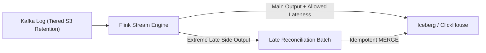
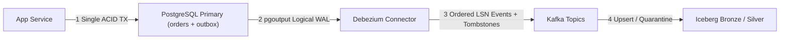
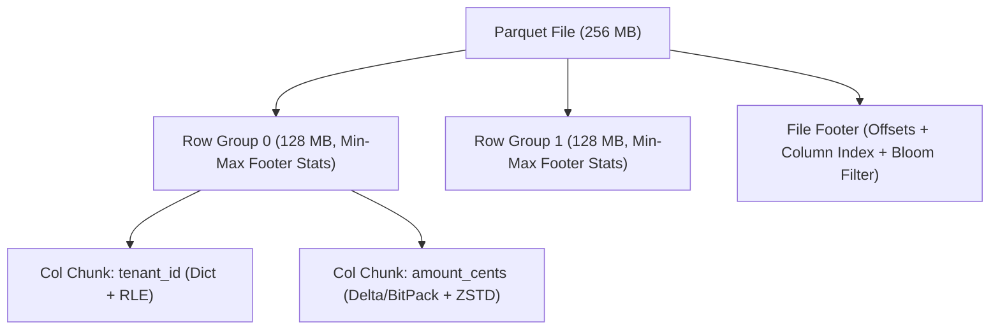

---
tags:
  - software-engineering
  - system-design
  - etl
  - data-engineering
  - cdc
  - streaming
  - lakehouse
created: 2026-01-02
updated: 2026-11-13
status: 🟢
level: mid-to-senior
---
# ETL, ELT & Streaming Data Pipelines

> [!abstract] Vault Navigation
> Data integration, CDC, and analytical lakehouse engineering under [[Programming/Software Engineering/System Design/System Design Overview|System Design Overview]] and [[Programming/Software Engineering/System Design/System Design Complete Guide|System Design Complete Guide]]. Integrates with [[Programming/Software Engineering/Database Design/Database Design Complete Guide|Database Design Complete Guide]], [[Programming/Software Engineering/Database Design/Transactions|Transactions]], [[Programming/Software Engineering/Database Design/Replication|Replication]], [[Programming/Software Engineering/Database Design/Indexing|Indexing]], [[Programming/Software Engineering/System Design/Message Queues|Message Queues]], [[Programming/Software Engineering/Architectural Patterns/Event-Driven Architecture|Event-Driven Architecture]], [[Programming/Software Engineering/Architectural Patterns/CQRS|CQRS]], [[Programming/Software Engineering/System Design/Scalability|Scalability]], [[Programming/Software Engineering/DevOps/Pipeline Design|Pipeline Design]], and [[Programming/Software Engineering/SDLC/Release Engineering & Migrations|Release Engineering & Migrations]].

Analytical data pipelines move committed state from concurrency-optimized row stores (OLTP) and distributed event logs into columnar OLAP lakehouses without stalling production primaries, losing hard `DELETE` operations, duplicating financial metrics on retry, choking RocksDB state backends on late arrivals, or scanning terabytes of unpruned tiny Parquet files.

---

## 1. First-Principles Mechanics: ETL, ELT & Streaming Internals

### 1.1 ETL vs ELT Execution Order

| Dimension | Traditional ETL | Modern Cloud ELT | Streaming / Incremental Lakehouse |
| :--- | :--- | :--- | :--- |
| **Pipeline Sequence** | Extract $\to$ Transform (Spark/JVM mid-tier) $\to$ Load | Extract $\to$ Load Raw (S3/Iceberg/Warehouse) $\to$ Transform (`dbt` / MPP SQL) | Continuous Extract (WAL CDC / Kafka) $\to$ Stateful Flink / Micro-batch `MERGE` |
| **Compute Topology** | Dedicated transformation cluster scaled separately from target DB | Elastic cloud MPP warehouse compute (Snowflake, BigQuery, Trino, ClickHouse) | Distributed stream operators (Flink / Spark Structured Streaming) + Iceberg compaction |
| **Schema Coupling** | Brittle: upstream column drift crashes pre-load transform and drops records | Resilient: immutable Bronze retains raw JSON/Avro forever; transforms replay cleanly | Enforced via Schema Registry compatibility gates + Quarantine dead-letter sinks |
| **PII & Compliance** | **Strength:** Sensitive fields tokenized/dropped in memory *before* hitting analytical storage | Bronze stores raw payloads unless masked at ingestion proxy or via warehouse column masking | Inline pre-sink PII tokenization/hashing before writing Bronze partitions |

### 1.2 Lambda vs Kappa Architectures



- **Lambda Architecture:** Runs two separate codebases in parallel: a **Batch Layer** (Spark/SQL hourly recomputation over full history for exactness) and a **Speed Layer** (streaming approximation for low latency), merging outputs at query time. *Operational Failure:* Double business logic drifts silently between Scala/Python batch code and streaming operators, multiplying incident debugging time.
- **Kappa Architecture:** Eliminates dual stacks behind a single **immutable, partitioned, replayable log** (Apache Kafka / Redpanda with tiered S3 storage) driving one streaming engine (Apache Flink). Historical backfills simply launch a second isolated consumer job from offset `0` writing into a new table version `v2`, validate totals, and execute an atomic catalog swap.

### 1.3 Event Time, Watermarks, Windowing & RocksDB State Lifecycle

Mobile clients losing cellular coverage in subways or retrying buffered batches cause **Event Time** (timestamp when the user acted) to lag **Processing Time** (clock when the Flink task reads the Kafka offset) by minutes or hours. Grouping by Processing Time corrupts daily financial closes by sliding yesterday's midnight sales into today's buckets.

1. **Window Semantics:**
   - **Tumbling Windows:** Fixed, contiguous, non-overlapping spans (`[10:00, 10:05)`, `[10:05, 10:10)`). Every event maps to exactly one window.
   - **Sliding (Hopping) Windows:** Fixed window `size = 15m` advancing every `slide = 1m` (an event maps to $\text{size} / \text{slide} = 15$ concurrent window accumulators in RocksDB).
   - **Session Windows:** Dynamically sized intervals per key (`user_id`), merging adjacent events until an inactivity gap (e.g., `30 minutes` idle) closes the session.
2. **Watermark Mechanics ($W(t)$):**
   - A watermark $W(t)$ is a monotonically advancing metadata timestamp flowing interleaved inside data partitions asserting: *no further events with `event_time <= W(t)` are expected.*
   - **Bounded Out-of-Orderness Formula:** $W(t) = \max_{\text{seen}}(\text{event\_time}) - \delta$, where $\delta$ tolerates routine network jitter (e.g., `30 seconds`).
   - **Operator Minimum Invariant:** When an operator consumes multiple Kafka partitions, its effective watermark equals $\min(\text{partition watermarks})$. **Hazard:** If 1 of 32 Kafka partitions receives zero traffic (`idle partition`), its watermark stays frozen at $-\infty$, blocking every downstream window across all 32 partitions indefinitely! Always configure **`withIdleness(Duration.ofSeconds(60))`** so Flink excludes idle partitions from the minimum watermark calculation.
3. **`allowedLateness` & Side Outputs:**
   - Holding $\delta = 12\text{ hours}$ delays dashboard visibility for 12 hours and explodes RocksDB state. Instead, keep $\delta = 30\text{s}$ for sub-minute emission, attach **`.allowedLateness(Time.minutes(30))`** so late events updating recently closed windows emit idempotent `upsert/retract` corrections into Iceberg/ClickHouse, and attach **`.sideOutputLateData(LATE_TAG)`** to divert extreme outliers (`>30m` late) into a cold reconciliation path without unbounded RocksDB state growth.

---

## 2. Real-World Use Cases & Architectural Decision Matrix

| Use Case | Selected Architecture | Primary Correctness Mechanism | Do NOT Use When |
| :--- | :--- | :--- | :--- |
| **Financial Ledger & Order OLTP $\to$ Warehouse Sync** | PostgreSQL Logical WAL CDC (Debezium) $\to$ Iceberg `MERGE` | Exact LSN commit ordering + tombstone `DELETE` capture + WAP publish | Analytical queries can tolerate zero schema isolation; direct OLTP read replicas suffice for small (<1 TB) ad-hoc queries |
| **Real-Time Fraud & Clickstream Funneling** | Kafka $\to$ Flink Session/Sliding Windows + Side Outputs | Event-Time watermarks + `withIdleness` + RocksDB incremental checkpoints | Latency tolerance is `>= 15 minutes`; micro-batch Spark/warehouse SQL is dramatically cheaper to operate |
| **Multi-Tenant SaaS Medallion Lakehouse** | Airflow/Dagster ELT + Iceberg WAP + SCD Type 2 | Deterministic `data_interval` partitions + SHA-256 SCD2 `MERGE` + Z-Order | High-concurrency single-row `<10ms` OLTP point lookups (use PostgreSQL/DynamoDB, not Parquet lakehouses) |
| **Cross-Service Event Synchronization** | Transactional Outbox Table + Debezium `EventRouter` | Single-DB ACID commit of domain state + outbox event (no distributed 2PC) | Events are purely ephemeral telemetry where occasional loss is acceptable (direct Kafka producer with `acks=1`) |
| **ML Feature Store Parity (Training vs Serving)** | Kappa Stream + Materialized Parquet/Redis Dual Sink | Identical Flink/Feast feature transforms writing offline Iceberg + online Redis | Feature definitions change weekly across 50 research teams without strict schema governance |

---

## 3. Change Data Capture (CDC) & Ingestion Invariants

### 3.1 Three Structural Failures of `WHERE updated_at > :last_sync` Polling

1. **Silent Blindness to Hard `DELETE`s:** Executing `DELETE FROM orders WHERE id = 42;` removes the row completely. A SQL query scanning `updated_at > :cursor` never sees deleted primary keys, leaving phantom orders and inflated revenue inside the warehouse forever.
2. **Uncommitted Transaction Visibility Skew (`xmin` Race):**
   - `T = 10:00:00.100`: Checkout Transaction A begins (`txid = 500`), sets `updated_at = NOW()` (which in PostgreSQL returns **transaction start time** `.100`!), and awaits an external inventory lock for 900ms.
   - `T = 10:00:00.400`: Transaction B begins (`txid = 501`), sets `updated_at = .400`, and commits immediately at `.450`.
   - `T = 10:00:00.500`: The hourly ETL polling job executes `WHERE updated_at > '10:00:00.000'`. Under `READ COMMITTED` MVCC isolation, Transaction A is invisible (uncommitted), so the poll reads only Transaction B (`updated_at = .400`) and persists `:last_sync = '10:00:00.400'`.
   - `T = 10:00:01.000`: Transaction A finally commits with `updated_at = 10:00:00.100`. Because `.100 < .400`, **every future poll permanently skips Transaction A's order**.
3. **Lost Intermediate Transitions & OLTP Index Thrashing:** Polling snapshots only the final row state if a row transitions `PENDING -> PAID -> CANCELLED` between ticks, while range scans contend with live OLTP buffer pool pages.

### 3.2 PostgreSQL Logical WAL Replication, `max_slot_wal_keep_size` & Transactional Outbox



- **Why WAL Tailing Solves All Three Polling Bugs:** PostgreSQL's `pgoutput` logical decoding plugin decodes committed Write-Ahead Log (WAL) changes in **exact commit LSN order**—emitting committed transactions strictly after commit (zero `xmin` races!), preserving intermediate `UPDATE` states (`before` and `after` images), and emitting explicit `op = 'd'` + tombstone (`null` value) records for hard `DELETE`s with minimal primary query impact.
- **The Replication Slot Disk-Exhaustion Trap:** PostgreSQL retains every WAL segment starting from a slot's `restart_lsn` until Debezium confirms consumption (`confirmed_flush_lsn`). If Debezium crashes over a weekend—or if a slot monitors a **low-traffic database** where no tracked tables change while other tables generate gigabytes of WAL—`confirmed_flush_lsn` never advances and **PostgreSQL fills 100% of disk and crashes**.
  - **Mandatory Dual Safeguard:**
    1. Set `max_slot_wal_keep_size = '50GB'` in `postgresql.conf` so Postgres invalidates an abandoned slot rather than crashing primary storage (triggering re-snapshot recovery on restart).
    2. Enable Debezium **`heartbeat.interval.ms` + `heartbeat.action.query`** updating a tiny 1-row `cdc_heartbeat` table inside the tracked publication so `confirmed_flush_lsn` advances continuously even when business tables are idle!

```sql
-- postgres/cdc_outbox.sql
-- Required postgresql.conf settings:
-- wal_level = logical
-- max_replication_slots = 10
-- max_wal_senders = 10
-- max_slot_wal_keep_size = '50GB'

CREATE TABLE orders (
    order_id     BIGINT PRIMARY KEY,
    customer_id  BIGINT NOT NULL,
    status       TEXT NOT NULL,
    amount_cents BIGINT NOT NULL,
    updated_at   TIMESTAMPTZ NOT NULL DEFAULT now()
);

-- REPLICA IDENTITY FULL ensures Debezium emits full `before` row state on UPDATE/DELETE
ALTER TABLE orders REPLICA IDENTITY FULL;

-- Clean Transactional Outbox decoupling internal OLTP schema from downstream consumers
CREATE TABLE outbox_events (
    id             UUID PRIMARY KEY,
    aggregate_type TEXT NOT NULL,
    aggregate_id   TEXT NOT NULL,
    event_type     TEXT NOT NULL,
    payload        JSONB NOT NULL,
    created_at     TIMESTAMPTZ NOT NULL DEFAULT now()
);

-- 1-row heartbeat table preventing WAL accumulation on low-traffic tracked tables
CREATE TABLE cdc_heartbeat (
    id         INTEGER PRIMARY KEY,
    updated_at TIMESTAMPTZ NOT NULL DEFAULT now()
);
INSERT INTO cdc_heartbeat (id) VALUES (1) ON CONFLICT DO NOTHING;

CREATE PUBLICATION debezium_orders_pub FOR TABLE orders, outbox_events, cdc_heartbeat;
```

```json
// debezium/postgres-orders-cdc.json
{
  "name": "pg-orders-cdc-v1",
  "config": {
    "connector.class": "io.debezium.connector.postgresql.PostgresConnector",
    "tasks.max": "1",
    "database.hostname": "pg-primary.internal.acme.dev",
    "database.port": "5432",
    "database.user": "debezium_cdc",
    "database.password": "${file:/secrets/db.properties:debezium_pass}",
    "database.dbname": "commerce",
    "topic.prefix": "oltp.commerce",
    "plugin.name": "pgoutput",
    "publication.name": "debezium_orders_pub",
    "slot.name": "debezium_orders_slot_v1",
    "table.include.list": "public.orders,public.outbox_events,public.cdc_heartbeat",
    "snapshot.mode": "initial",
    "tombstones.on.delete": "true",
    "decimal.handling.mode": "string",
    "heartbeat.interval.ms": "10000",
    "heartbeat.action.query": "UPDATE public.cdc_heartbeat SET updated_at = now() WHERE id = 1;",
    "transforms": "outbox",
    "transforms.outbox.type": "io.debezium.transforms.outbox.EventRouter",
    "transforms.outbox.route.topic.replacement": "domain.events.${routedByValue}",
    "transforms.outbox.table.field.event.key": "aggregate_id",
    "transforms.outbox.table.field.event.type": "event_type",
    "transforms.outbox.table.field.event.payload": "payload",
    "transforms.outbox.predicate": "isOutboxTopic",
    "predicates": "isOutboxTopic",
    "predicates.isOutboxTopic.type": "org.apache.kafka.connect.transforms.predicates.TopicNameMatches",
    "predicates.isOutboxTopic.pattern": "oltp\\.commerce\\.public\\.outbox_events"
  }
}
```

---

## 4. Step-by-Step Practical Lakehouse & Pipeline Implementations

### 4.1 Production Data Platform Repository Layout

```text
analytics-platform/
├── postgres/
│   └── cdc_outbox.sql                 # Logical replication + outbox + heartbeat DDL
├── debezium/
│   └── postgres-orders-cdc.json       # Production Debezium pgoutput + EventRouter config
├── flink/
│   └── revenue_window_job.py          # PyFlink EventTime + Watermarks + AllowedLateness + SideOutput
├── airflow/
│   └── dags/orders_elt_wap.py         # Idempotent Airflow DAG + Iceberg WAP branching
├── dagster/
│   └── assets/orders_assets.py        # Software-Defined Asset + DailyPartitionsDefinition
├── python/
│   └── schema_registry_quarantine.py  # Avro/JSON Schema compatibility check + DLQ Quarantine
├── sql/
│   ├── medallion_and_scd.sql          # Bronze->Silver dedup + SCD Type 1 & SCD Type 2 MERGE
│   └── parquet_compaction.sql         # Iceberg Z-Order compaction & snapshot expiration
└── tests/
    └── test_etl_invariants.py         # Runnable Pytest verifying deduplication, SCD2 & quarantine
```

### 4.2 Streaming Event-Time Pipeline (Watermarks, Idleness & Side Output)

```python
# flink/revenue_window_job.py
from datetime import timedelta
from pyflink.common import Types, WatermarkStrategy, Duration, Time
from pyflink.datastream import StreamExecutionEnvironment, OutputTag
from pyflink.datastream.functions import ProcessWindowFunction
from pyflink.datastream.window import TumblingEventTimeWindows
from pyflink.common.watermark_strategy import TimestampAssigner


class OrderEventTimestampAssigner(TimestampAssigner):
    def extract_timestamp(self, value: dict, record_timestamp: int) -> int:
        # Expect epoch milliseconds from source payload `event_ts_ms`
        return int(value["event_ts_ms"])


class RevenueWindowAggregator(ProcessWindowFunction):
    def process(self, key: str, context, elements):
        total_cents = sum(int(e["amount_cents"]) for e in elements if e["op"] != "d")
        yield {
            "tenant_id": key,
            "window_start_ms": context.window().start,
            "window_end_ms": context.window().end,
            "revenue_cents": total_cents,
            "event_count": len(list(elements)) if isinstance(elements, list) else -1,
            "watermark_ms": context.current_watermark(),
        }


def build_pipeline(source_stream):
    # Tolerate 30s normal network jitter; mark quiet Kafka partitions idle after 60s
    # so one empty partition never stalls global watermark progression!
    watermark_strategy = (
        WatermarkStrategy.for_bounded_out_of_orderness(Duration.of_seconds(30))
        .with_timestamp_assigner(OrderEventTimestampAssigner())
        .with_idleness(Duration.of_seconds(60))
    )

    late_events_tag = OutputTag("extreme-late-orders", Types.PICKLED_BYTE_ARRAY())

    windowed_stream = (
        source_stream.assign_timestamps_and_watermarks(watermark_strategy)
        .key_by(lambda evt: evt["tenant_id"])
        .window(TumblingEventTimeWindows.of(Time.minutes(5)))
        # Keep RocksDB state 30m past watermark to emit corrective upserts for subway offline batches
        .allowed_lateness(Time.minutes(30))
        # Divert >30m outliers to cold side output instead of dropping or OOMing RocksDB
        .side_output_late_data(late_events_tag)
        .process(RevenueWindowAggregator())
    )

    late_reconciliation_stream = windowed_stream.get_side_output(late_events_tag)
    return windowed_stream, late_reconciliation_stream
```

### 4.3 Idempotent Partitioned `MERGE` & Write-Audit-Publish (WAP) in Airflow & Dagster

#### Airflow Idempotent DAG with Iceberg WAP Branching

```python
# airflow/dags/orders_elt_wap.py
from datetime import datetime, timedelta
from airflow.decorators import dag, task
from airflow.providers.trino.hooks.trino import TrinoHook


@dag(
    dag_id="orders_silver_wap_daily",
    start_date=datetime(2026, 1, 1),
    schedule="0 2 * * *",
    catchup=True,
    max_active_runs=1,  # Guarantees sequential historical backfills without race overlaps
    default_args={"retries": 3, "retry_delay": timedelta(minutes=5)},
    tags=["iceberg", "wap", "elt"],
)
def orders_silver_wap_pipeline():
    @task
    def stage_and_merge_on_wap_branch(data_interval_start=None, data_interval_end=None) -> str:
        """
        NEVER use CURRENT_DATE() or datetime.now()!
        Parameterize strictly from Airflow's logical interval for deterministic backfills.
        """
        ds = data_interval_start.strftime("%Y-%m-%d")
        branch = f"wap_orders_{data_interval_start.strftime('%Y%m%d')}"
        hook = TrinoHook(trino_conn_id="trino_iceberg")

        # Create/reset isolated WAP audit branch off main snapshot
        hook.run(f"ALTER TABLE iceberg.silver.orders CREATE OR REPLACE BRANCH {branch}")

        # Execute idempotent deduplicated MERGE strictly inside the WAP branch
        hook.run(
            f"""
            MERGE INTO iceberg.silver.orders FOR VERSION AS OF '{branch}' AS target
            USING (
                SELECT order_id, customer_id, status, amount_cents, op, cdc_lsn, event_date
                FROM (
                    SELECT *,
                           ROW_NUMBER() OVER (PARTITION BY order_id ORDER BY cdc_lsn DESC) AS rn
                    FROM iceberg.bronze.orders_cdc
                    WHERE ingested_at >= TIMESTAMP '{data_interval_start.strftime('%Y-%m-%d %H:%M:%S')}'
                      AND ingested_at <  TIMESTAMP '{data_interval_end.strftime('%Y-%m-%d %H:%M:%S')}'
                ) deduped
                WHERE rn = 1
            ) AS src
            ON target.order_id = src.order_id
            WHEN MATCHED AND src.op = 'd' THEN DELETE
            WHEN MATCHED THEN UPDATE SET
                status = src.status,
                amount_cents = src.amount_cents,
                cdc_lsn = src.cdc_lsn,
                event_date = src.event_date
            WHEN NOT MATCHED AND src.op != 'd' THEN INSERT (
                order_id, customer_id, status, amount_cents, cdc_lsn, event_date
            ) VALUES (
                src.order_id, src.customer_id, src.status, src.amount_cents, src.cdc_lsn, src.event_date
            )
            """
        )
        return branch

    @task
    def audit_wap_branch(branch: str) -> str:
        """Quality gate executed on staged branch BEFORE downstream BI sees a single byte."""
        hook = TrinoHook(trino_conn_id="trino_iceberg")
        checks = hook.get_first(
            f"""
            SELECT
                COUNT(*) AS total_rows,
                COUNT(*) - COUNT(DISTINCT order_id) AS duplicate_pks,
                SUM(CASE WHEN amount_cents < 0 THEN 1 ELSE 0 END) AS negative_amounts,
                SUM(CASE WHEN customer_id IS NULL THEN 1 ELSE 0 END) AS null_fks
            FROM iceberg.silver.orders FOR VERSION AS OF '{branch}'
            """
        )
        total_rows, dupes, neg_amounts, null_fks = checks
        if dupes > 0 or neg_amounts > 0 or null_fks > 0 or total_rows == 0:
            raise ValueError(
                f"WAP audit failed on {branch}: total={total_rows}, dupes={dupes}, neg={neg_amounts}, null_fk={null_fks}"
            )
        return branch

    @task
    def fast_forward_publish(branch: str) -> None:
        """Atomic O(1) metadata pointer flip on Iceberg catalog."""
        hook = TrinoHook(trino_conn_id="trino_iceberg")
        hook.run(f"CALL iceberg.system.fast_forward('silver.orders', 'main', '{branch}')")

    wap_branch = stage_and_merge_on_wap_branch()
    verified_branch = audit_wap_branch(wap_branch)
    fast_forward_publish(verified_branch)


orders_silver_wap_pipeline()
```

#### Dagster Software-Defined Asset (Asset-First Orchestration)

```python
# dagster/assets/orders_assets.py
from dagster import (
    AssetCheckResult,
    AssetExecutionContext,
    DailyPartitionsDefinition,
    MaterializeResult,
    asset,
    asset_check,
)

daily_partitions = DailyPartitionsDefinition(start_date="2026-01-01")


@asset(partitions_def=daily_partitions, group_name="silver_lakehouse")
def silver_orders_partition(context: AssetExecutionContext) -> MaterializeResult:
    partition_date = context.partition_key  # Deterministic YYYY-MM-DD partition
    context.log.info(f"Rebuilding deterministic silver_orders partition={partition_date}")
    # Execute idempotent DELETE/INSERT or MERGE scoped strictly to event_date = partition_date
    rows_written = 42_180
    return MaterializeResult(metadata={"partition_date": partition_date, "rows_written": rows_written})


@asset_check(asset=silver_orders_partition)
def check_silver_orders_no_negative_amounts() -> AssetCheckResult:
    negative_count = 0  # Query warehouse partition audit metric
    return AssetCheckResult(passed=(negative_count == 0), metadata={"negative_count": negative_count})
```

### 4.4 Schema Registry Compatibility & Quarantine Dead-Letter Routing

| Compatibility Mode | Guarantee | Permitted Schema Evolutions | Mandatory Upgrade Sequence |
| :--- | :--- | :--- | :--- |
| **`BACKWARD`** | New consumer decodes old producer messages | Add fields **with default**, delete any field | Upgrade **Consumers first**, then Producers |
| **`FORWARD`** | Old consumer decodes new producer messages | Add any field (old ignores unknown), delete fields **with default** | Upgrade **Producers first**, then Consumers |
| **`FULL`** | Both Backward & Forward across adjacent versions | Add **optional** fields with defaults; delete **optional** fields with defaults | Upgrade Consumers & Producers in **any order** |
| **`FULL_TRANSITIVE`** | Compatible across **every** historical schema version in topic | Strictest discipline: tag/field reuse and type mutations permanently banned | Required for long-retention Kafka/Kappa logs |

```python
# python/schema_registry_quarantine.py
from dataclasses import dataclass
from datetime import datetime, timezone
import json
from typing import Any


@dataclass(frozen=True)
class QuarantineRecord:
    raw_payload: str
    rule_failed: str
    kafka_topic: str
    kafka_partition: int
    kafka_offset: int
    ingested_at: str


def validate_order_contract(
    raw_bytes: bytes,
    kafka_meta: tuple[str, int, int],
    known_currencies: set[str] | None = None,
) -> tuple[dict[str, Any] | None, QuarantineRecord | None]:
    """
    Validates raw Kafka/CDC records cleanly without crashing batch/stream jobs on poison pills.
    Routes violating rows to Quarantine with exact offset lineage.
    """
    topic, partition, offset = kafka_meta
    now_iso = datetime.now(timezone.utc).isoformat()
    raw_text = raw_bytes.decode("utf-8", errors="replace")

    try:
        record = json.loads(raw_text)
    except json.JSONDecodeError as exc:
        return None, QuarantineRecord(raw_text, f"INVALID_JSON:{exc.msg}", topic, partition, offset, now_iso)

    required = ("order_id", "tenant_id", "amount_cents", "currency", "event_ts_ms")
    missing = [field for field in required if field not in record or record[field] is None]
    if missing:
        return None, QuarantineRecord(
            raw_text, f"MISSING_REQUIRED:{','.join(missing)}", topic, partition, offset, now_iso
        )

    if not isinstance(record["amount_cents"], int) or record["amount_cents"] < 0:
        return None, QuarantineRecord(
            raw_text, "DOMAIN_NEGATIVE_OR_NONINT_AMOUNT", topic, partition, offset, now_iso
        )

    allowed_ccy = known_currencies or {"USD", "EUR", "GBP", "JPY"}
    if record["currency"] not in allowed_ccy:
        return None, QuarantineRecord(
            raw_text, f"UNKNOWN_CURRENCY:{record['currency']}", topic, partition, offset, now_iso
        )

    return record, None


def route_batch_with_circuit_threshold(
    messages: list[tuple[bytes, tuple[str, int, int]]],
    max_quarantine_ratio: float = 0.01,
) -> tuple[list[dict[str, Any]], list[QuarantineRecord]]:
    """
    Separates valid Silver records from Quarantine dead-letter records, raising an explicit alert
    if malformed ratio spikes (indicating upstream breaking schema deploy rather than isolated poison pills).
    """
    valid_rows: list[dict[str, Any]] = []
    quarantined: list[QuarantineRecord] = []

    for raw, meta in messages:
        ok, bad = validate_order_contract(raw, meta)
        if ok is not None:
            valid_rows.append(ok)
        elif bad is not None:
            quarantined.append(bad)

    if messages and (len(quarantined) / len(messages)) > max_quarantine_ratio:
        raise RuntimeError(
            f"Quarantine spike breach: {len(quarantined)}/{len(messages)} rows failed contract validation"
        )
    return valid_rows, quarantined
```

### 4.5 Medallion Architecture & Complete SCD Type 1 / SCD Type 2 SQL `MERGE`

```sql
-- sql/medallion_and_scd.sql

-- ============================================================================
-- 1. SCD TYPE 1 (Overwrite in Place): Current customer tier without history
-- ============================================================================
MERGE INTO gold.dim_customer_current AS target
USING (
    SELECT customer_id, email_hash, country_code, loyalty_tier, updated_at
    FROM (
        SELECT *,
               ROW_NUMBER() OVER (PARTITION BY customer_id ORDER BY cdc_lsn DESC) AS rn
        FROM silver.stg_customers
    ) s
    WHERE rn = 1
) AS src
ON target.customer_id = src.customer_id
WHEN MATCHED AND target.updated_at < src.updated_at THEN UPDATE SET
    email_hash   = src.email_hash,
    country_code = src.country_code,
    loyalty_tier = src.loyalty_tier,
    updated_at   = src.updated_at
WHEN NOT MATCHED THEN INSERT (
    customer_id, email_hash, country_code, loyalty_tier, updated_at
) VALUES (
    src.customer_id, src.email_hash, src.country_code, src.loyalty_tier, src.updated_at
);

-- ============================================================================
-- 2. SCD TYPE 2 (Point-in-Time History): Zero-overlap atomic MERGE pattern
-- ============================================================================
-- Target DDL:
--   customer_sk    TEXT PRIMARY KEY  (SHA256(customer_id || ':' || valid_from))
--   customer_id    BIGINT NOT NULL
--   country_code   TEXT NOT NULL
--   loyalty_tier   TEXT NOT NULL
--   attribute_hash TEXT NOT NULL     (SHA256 of tracked historical columns)
--   valid_from     TIMESTAMPTZ NOT NULL
--   valid_to       TIMESTAMPTZ NOT NULL  ('9999-12-31 23:59:59+00' while open)
--   is_current     BOOLEAN NOT NULL

-- Atomic single-MERGE SCD2 idiom (Snowflake / Databricks / Spark / BigQuery):
-- Emit TWO rows per genuinely changed natural key:
--   merge_key = customer_id -> closes existing open row (valid_to = src.effective_at)
--   merge_key = NULL        -> falls into WHEN NOT MATCHED, inserting the new active version!
WITH latest_changes AS (
    SELECT
        customer_id,
        country_code,
        loyalty_tier,
        effective_at,
        TO_HEX(SHA256(CONCAT_WS('|', country_code, loyalty_tier))) AS attribute_hash
    FROM silver.stg_customer_changes_batch
),
changed_records AS (
    SELECT s.*
    FROM latest_changes s
    LEFT JOIN gold.dim_customer_scd2 cur
      ON cur.customer_id = s.customer_id AND cur.is_current = TRUE
    WHERE cur.customer_id IS NULL
       OR cur.attribute_hash <> s.attribute_hash
),
staged_upsert AS (
    -- Row A: Matches active target row to close interval [valid_from, effective_at)
    SELECT customer_id AS merge_key, * FROM changed_records
    UNION ALL
    -- Row B: Forces NOT MATCHED branch to insert new open version [effective_at, '9999-12-31')
    SELECT NULL AS merge_key, * FROM changed_records
    WHERE EXISTS (
        SELECT 1 FROM gold.dim_customer_scd2 cur
        WHERE cur.customer_id = changed_records.customer_id AND cur.is_current = TRUE
    )
)
MERGE INTO gold.dim_customer_scd2 AS target
USING staged_upsert AS src
ON target.customer_id = src.merge_key AND target.is_current = TRUE
WHEN MATCHED THEN UPDATE SET
    valid_to   = src.effective_at,
    is_current = FALSE
WHEN NOT MATCHED THEN INSERT (
    customer_sk, customer_id, country_code, loyalty_tier,
    attribute_hash, valid_from, valid_to, is_current
) VALUES (
    TO_HEX(SHA256(CONCAT_WS(':', CAST(src.customer_id AS STRING), CAST(src.effective_at AS STRING)))),
    src.customer_id,
    src.country_code,
    src.loyalty_tier,
    src.attribute_hash,
    src.effective_at,
    TIMESTAMP '9999-12-31 23:59:59+00',
    TRUE
);

-- Exact half-open interval point-in-time BI join (never duplicates rows at boundary timestamps!)
-- SELECT f.order_id, f.amount_cents, d.loyalty_tier
-- FROM gold.fct_orders f
-- JOIN gold.dim_customer_scd2 d
--   ON f.customer_id = d.customer_id
--  AND f.order_ts >= d.valid_from
--  AND f.order_ts <  d.valid_to;
```

---

## 5. Apache Parquet Columnar Internals, Compaction & Z-Ordering

Row-oriented storage (PostgreSQL heap, CSV, Avro) writes every attribute of a single record contiguously. Running `SELECT SUM(amount_cents) FROM events` across 500M rows forces the engine to read 100% of unrelated `user_agent`, `headers_json`, and `description` bytes off disk.



### 5.1 Internal Physical & Encoding Mechanics

1. **Hybrid Horizontal + Vertical Layout:** A Parquet file splits horizontally into **Row Groups** (target **128–512 MB** uncompressed), and each Row Group splits vertically into independent **Column Chunks**, subdivided into compressed **Pages** (~1 MB).
2. **Column Encodings:**
   - **Dictionary + RLE / Bit-Packing:** Low-cardinality strings (`currency`, `status`, `country`) build a per-chunk dictionary table (`USD=0, EUR=1`) and store compact bit-packed integer codes, often shrinking strings by $20\times$. Falls back to plain encoding if dictionary exceeds 1 MB threshold.
   - **Delta Encoding:** Stores differences between consecutive sorted integers/timestamps (`t_1 - t_0`), compressing monotonic event timestamps down to ~1–2 bytes per row.
   - **Compression Codecs:** `ZSTD` achieves ~30% higher compression ratio than `SNAPPY` at comparable decompression speed for analytical object-store scans.
3. **Byte-Range Column Pruning & Predicate Pushdown:**
   - Query engines read **only the last few KB** (the Parquet Footer `FileMetaData`) via a single S3 range `GET` request.
   - If the query selects 3 of 90 columns, the engine issues byte-range S3 `GET`s strictly for those 3 column chunks (**>95% I/O reduction**).
   - **Row Group Skipping:** Every Row Group footer records `min`, `max`, and `null_count` per column (plus optional Page-level Column Indexes and split-block **Bloom Filters** for equality lookups on non-sorted UUIDs/hashes). A query filtering `WHERE tenant_id = 42` completely skips any Row Group whose `[min, max]` interval excludes `42` without transferring or decompressing a byte.

### 5.2 The Small-File Problem, Compaction & Z-Ordering

Streaming ingestion flushing every 15 seconds writes 5,760 tiny 40 KB Parquet files per day (2.1M files/year). Every query wastes minutes executing thousands of S3 `LIST` and footer `GET` metadata requests while dictionary compression barely amortizes across ~100 rows.

```sql
-- sql/parquet_compaction.sql (Apache Iceberg Maintenance Procedures)
-- 1. Binpack + Z-Order compact tiny streaming files into 256 MB Z-Ordered files
CALL iceberg.system.rewrite_data_files(
    table => 'silver.events',
    strategy => 'sort',
    sort_order => 'zorder(tenant_id, user_id)',
    options => map(
        'target-file-size-bytes', '268435456',   -- 256 MB optimal Row Group / File size
        'min-input-files', '5',
        'partial-progress.enabled', 'true'
    ),
    where => 'event_date = DATE ''2026-11-12'''
);

-- 2. Expire obsolete snapshot metadata older than 7 days (enables safe time-travel for 7d)
CALL iceberg.system.expire_snapshots(
    table => 'silver.events',
    older_than => TIMESTAMP '2026-11-06 00:00:00',
    retain_last => 10
);

-- 3. Remove unreferenced orphaned Parquet objects left by crashed Spark/Flink tasks
CALL iceberg.system.remove_orphan_files(
    table => 'silver.events',
    older_than => TIMESTAMP '2026-11-10 00:00:00'
);
```

- **Why Z-Ordering Beats Over-Partitioning:** Directory-partitioning S3 strictly by `event_date` keeps partition counts bounded (~1,000 days). Never directory-partition by high-cardinality `tenant_id` (100k tenants $\times$ 365 days = 36.5M tiny directories!). Instead, partition coarsely by `event_date` and **Z-Order (space-filling Morton curve)** inside 256 MB files across `(tenant_id, user_id)`, yielding tight, non-overlapping `[min, max]` Row Group boundaries across *multiple* filter columns simultaneously.

---

## 6. Production Debugging, Profiling & Operations Playbook

```sql
-- 1. Diagnose PostgreSQL Replication Slot WAL Retention & Stalled Debezium Lag
SELECT
    slot_name,
    active,
    wal_status,
    pg_size_pretty(pg_wal_lsn_diff(pg_current_wal_lsn(), restart_lsn)) AS retained_wal_bytes,
    pg_size_pretty(pg_wal_lsn_diff(pg_current_wal_lsn(), confirmed_flush_lsn)) AS unconsumed_lag
FROM pg_replication_slots
ORDER BY pg_wal_lsn_diff(pg_current_wal_lsn(), restart_lsn) DESC;

-- 2. Inspect Apache Iceberg Small-File Fragmentation & Row Group Distribution
SELECT
    partition.event_date,
    COUNT(*) AS file_count,
    ROUND(AVG(file_size_in_bytes) / 1048576.0, 2) AS avg_file_mb,
    SUM(record_count) AS total_rows
FROM iceberg.silver."events$files"
GROUP BY 1
ORDER BY file_count DESC;
```

```bash
# 3. Inspect Kafka consumer group lag across CDC partitions
kafka-consumer-groups.sh --bootstrap-server kafka:9092 \
  --describe --group flink-orders-silver-v1

# 4. Inspect Parquet footer encodings, Row Groups, and min/max stats using Python PyArrow
python3 -c "
import pyarrow.parquet as pq
pf = pq.ParquetFile('part-00000.zstd.parquet')
print('Row groups:', pf.num_row_groups, 'Schema:', pf.schema_arrow)
for i in range(pf.num_row_groups):
    rg = pf.metadata.row_group(i)
    col = rg.column(0)
    print(f'RG {i}: rows={rg.num_rows}, col0_stats=({col.statistics.min}, {col.statistics.max})')
"
```

| Production Symptom | Root Cause | Exact Fix |
| :--- | :--- | :--- |
| **Postgres Primary Disk Hits 95% Full Despite Low Table Size** | Inactive/crashed Debezium slot OR quiet tracked table holding `restart_lsn` while unrelated tables write WAL | Enforce `max_slot_wal_keep_size = '50GB'`, add Debezium `heartbeat.action.query`, and drop abandoned dev slots (`SELECT pg_drop_replication_slot('stale_slot');`) |
| **Flink Tumbling Windows Stop Emitting Output Completely** | 1 idle Kafka partition emits 0 events, pinning global `min(partition_watermarks)` at $-\infty$ | Add `.with_idleness(Duration.of_seconds(60))` to `WatermarkStrategy` |
| **BI Revenue Totals Jump 2x Randomly on Same Day** | Unclosed duplicate active rows in `dim_customer_scd2` causing fact join fan-out (`[t1, 9999)` overlapping `[t2, 9999)`) | Enforce single atomic close+open SCD2 `MERGE`, add assertion `HAVING COUNT(*) > 1` on `is_current = TRUE` in WAP audit |
| **Trino/Spark Query Takes 90s Scanning 4 TB for Single Tenant** | 100k tiny 30 KB Parquet files all spanning `[min='t_0001', max='t_9999']` | Schedule Iceberg `rewrite_data_files(strategy => 'sort', sort_order => 'zorder(tenant_id)')` targeting 256 MB files |
| **Airflow Backfill Overwrites Historical Partition with Today's Data** | SQL inside DAG calls `CURRENT_DATE()` instead of Airflow `{{ ds }}` / `data_interval_start` | Replace all wall-clock functions with explicit Jinja/TaskFlow `data_interval_start` / `data_interval_end` bounds |

### 6.1 Automated Pipeline Invariant Tests

```python
# tests/test_etl_invariants.py
import json
import pytest
from python.schema_registry_quarantine import route_batch_with_circuit_threshold, validate_order_contract


def test_quarantine_isolates_poison_pill_without_crashing_healthy_rows():
    batch = [
        (json.dumps({"order_id": 1, "tenant_id": "t1", "amount_cents": 2500, "currency": "USD", "event_ts_ms": 1000}).encode(), ("orders", 0, 10)),
        (b"{corrupt-json", ("orders", 0, 11)),
        (json.dumps({"order_id": 2, "tenant_id": "t1", "amount_cents": -50, "currency": "USD", "event_ts_ms": 1002}).encode(), ("orders", 0, 12)),
    ]
    ok, bad = route_batch_with_circuit_threshold(batch, max_quarantine_ratio=0.75)
    assert len(ok) == 1
    assert ok[0]["order_id"] == 1
    assert len(bad) == 2
    assert bad[0].rule_failed.startswith("INVALID_JSON")
    assert bad[1].rule_failed == "DOMAIN_NEGATIVE_OR_NONINT_AMOUNT"


def test_quarantine_circuit_trips_when_schema_regression_spikes():
    batch = [
        (json.dumps({"order_id": i, "tenant_id": "t1", "amount_cents": 100, "currency": "ZZZ", "event_ts_ms": 1000}).encode(), ("orders", 0, i))
        for i in range(10)
    ]
    with pytest.raises(RuntimeError, match="Quarantine spike breach"):
        route_batch_with_circuit_threshold(batch, max_quarantine_ratio=0.05)


def test_valid_contract_passes_cleanly():
    raw = json.dumps({"order_id": 99, "tenant_id": "t7", "amount_cents": 9900, "currency": "EUR", "event_ts_ms": 1763050000000}).encode()
    ok, bad = validate_order_contract(raw, ("orders", 2, 501))
    assert bad is None
    assert ok is not None and ok["currency"] == "EUR"
```

---

## 7. Comprehensive Worked Exercises

### Exercise 1: Silent Data Loss & Phantom Revenue in `updated_at` Polling
An hourly Python ETL syncs `orders` from PostgreSQL to Snowflake using:
```sql
SELECT * FROM orders WHERE updated_at > :last_max_updated_at;
```
After 3 months, Finance discovers:
1. Snowflake shows **1.6% higher revenue** than PostgreSQL due to hard-deleted fraud/test orders persisting forever in Snowflake.
2. **210 legitimate checkout orders** created during flash peaks vanished completely from Snowflake despite zero ETL errors.
3. One weekend, after switching to Debezium without a heartbeat, an idle microservice DB's WAL disk filled to **100%**, crashing PostgreSQL primary.

Diagnose all 3 incidents and specify the complete fix.

### Solution 1
1. **Phantom Revenue (Hard `DELETE` Blindness):** Polling `updated_at` only inspects surviving rows; `DELETE FROM orders ...` removes rows completely, leaving Snowflake stale.
2. **Missing Orders (`xmin` Uncommitted Transaction Skew):** A slow checkout transaction writes `updated_at = NOW()` (transaction start time `14:00:00.100`), blocks for 2s before committing at `14:00:02.100`, while a fast concurrent transaction commits with `updated_at = 14:00:00.800` at `.850`. The `14:00:01` ETL poll reads `.800`, advances the cursor to `.800`, and permanently skips the `.100` row when it commits at `.100`.
3. **Quiet-Table WAL Disk Exhaustion:** When a tracked database has no changes on its published tables while other untracked databases/tables on the same PostgreSQL cluster generate WAL, `confirmed_flush_lsn` stays frozen and Postgres retains gigabytes of WAL indefinitely.

**Complete Fix:**
- Enable `wal_level = logical` + `REPLICA IDENTITY FULL` + `max_slot_wal_keep_size = '50GB'` in PostgreSQL.
- Deploy **Debezium (`pgoutput`)** with `heartbeat.interval.ms = 10000` and `heartbeat.action.query` updating `cdc_heartbeat` (Section 3.2) so `confirmed_flush_lsn` advances even on idle tables.
- Land events into Bronze and run deduplicated Iceberg/Snowflake `MERGE` (`ROW_NUMBER() OVER (PARTITION BY order_id ORDER BY cdc_lsn DESC) = 1`) honoring `WHEN MATCHED AND op = 'd' THEN DELETE`.

---

### Exercise 2: Flink Watermark Revenue Drop, Idle Partition Freeze & RocksDB OOM
A PyFlink job computes 5-minute tumbling revenue windows (`SUM(amount_cents)`) using `EventTime`:
1. Native mobile SDKs buffer offline subway checkouts and flush them **20 minutes late**. With `forBoundedOutOfOrderness(10s)`, revenue under-reports by 4%.
2. An engineer switches out-of-orderness to **12 hours**; dashboards go blank for 12 hours and task managers crash with RocksDB disk/RAM exhaustion.
3. After tuning watermarks to `30s` + `allowedLateness(30m)`, staging tests with 8 Kafka partitions (where partition `7` receives 0 events) **never fire a single window**.

Explain all 3 behaviors and write the corrected PyFlink strategy.

### Solution 2
1. **4% Under-Reporting:** Subway events arrive 20 minutes behind the 10-second watermark ($t < W(t)$). Without `allowedLateness`, closed windows drop late arrivals silently.
2. **12-Hour Watermark Disaster:** Every 5-minute window cannot emit its initial pane until $W(t)$ crosses `window_end + 12h`, violating real-time SLAs by 12 hours and bloating RocksDB per-key accumulators by $144\times$.
3. **Idle Partition Starvation:** Flink's global watermark across a multi-partition Kafka consumer equals $\min(\text{partition watermarks})$. Partition `7` with zero events leaves its local watermark stuck at `Long.MIN_VALUE`, freezing every window across partitions `0..6`.

**Exact Fix (`flink/revenue_window_job.py`, Section 4.2):**
Configure tight `for_bounded_out_of_orderness(Duration.of_seconds(30))`, add **`.with_idleness(Duration.of_seconds(60))`** to unblock quiet partitions, set **`.allowed_lateness(Time.minutes(30))`** for idempotent late upserts, and attach **`.side_output_late_data(late_events_tag)`** routing `>30m` outliers to cold Iceberg batch reconciliation.

---

### Exercise 3: Broken SCD Type 2 History Causing 2x Revenue Fan-Out
A warehouse team builds `dim_customer_scd2` using two separate nightly SQL scripts:
- Script A: `INSERT INTO dim_customer_scd2 SELECT ... FROM staging WHERE ...`
- Script B: `UPDATE dim_customer_scd2 SET valid_to = ... , is_current = FALSE WHERE ...`

After a pipeline retry midway between Script A and Script B, Finance runs:
```sql
SELECT SUM(f.amount_cents)
FROM gold.fct_orders f
JOIN gold.dim_customer_scd2 d
  ON f.customer_id = d.customer_id
 AND f.order_ts BETWEEN d.valid_from AND d.valid_to;
```
Revenue reports **double** for 18,000 customers! Identify every SQL and atomicity defect and write the exact SCD Type 2 fix.

### Solution 3
**Root Defects:**
1. **Non-Atomic Two-Step Update/Insert:** Running Script A (`INSERT`) and Script B (`UPDATE`) in separate statements caused a crash/retry to leave **two `is_current = TRUE` rows** with overlapping `[valid_from, 9999-12-31)` intervals per customer, multiplying every joined fact row by 2x!
2. **`BETWEEN` Closed-Interval Boundary Overlap:** Even when valid, `BETWEEN valid_from AND valid_to` matches **both** the closing row (`valid_to = 12:00:00`) and opening row (`valid_from = 12:00:00`) if an order occurs at the exact boundary timestamp `12:00:00`!

**Exact Fix (`sql/medallion_and_scd.sql`, Section 4.5):**
1. Execute the **single atomic `staged_upsert` `MERGE INTO`** pattern (`merge_key = customer_id` closes the open row while `merge_key = NULL` inserts the new active version inside one ACID transaction) filtered by SHA-256 `attribute_hash` so retries never generate no-op duplicate versions.
2. Always join fact tables using **half-open intervals**: `f.order_ts >= d.valid_from AND f.order_ts < d.valid_to`.
3. Gate publishing behind an Iceberg **WAP audit assertion** verifying `SELECT customer_id FROM dim_customer_scd2 WHERE is_current = TRUE GROUP BY 1 HAVING COUNT(*) > 1` returns 0 rows.

---

### Exercise 4: 4.5 TB Lakehouse Scan Collapse & Schema Registry Breakage
1. A Trino query `SELECT order_id, amount_cents FROM silver.events WHERE tenant_id = 't_912' AND event_date = '2026-11-12'` scans **4.5 TB** and takes **98 seconds** across 160,000 tiny 28 KB Parquet files inside `/event_date=2026-11-12/`. Explain why Parquet footer pruning fails and fix it without partitioning S3 by `tenant_id`.
2. Concurrently, a producer removes an optional field `discount_code` from a Kafka Avro schema registered under **`BACKWARD`** compatibility and upgrades producers **before** consumers. Explain what breaks and fix the compatibility mode + rollout sequence.

### Solution 4
**1. Parquet Pruning Collapse & Z-Order Compaction:**
- Each 15-second streaming micro-batch writes a tiny 28 KB file containing mixed rows from *all* tenants, so every file's Row Group footer advertises `[min(tenant_id) = 't_0001', max(tenant_id) = 't_9999']`. Predicate pushdown evaluates `TRUE` on all 160,000 files, forcing 160k S3 footer/chunk fetches!
- **Fix:** Keep coarse directory partitioning strictly on `event_date`, and run Iceberg compaction (`CALL iceberg.system.rewrite_data_files(strategy => 'sort', sort_order => 'zorder(tenant_id, user_id)', options => map('target-file-size-bytes', '268435456'))`, Section 5.2). Compacting into ~18 256 MB Z-Ordered files isolates disjoint `tenant_id` `[min, max]` ranges across Row Groups, slashing scan bytes from 4.5 TB to **< 80 MB** and runtime from 98s to **< 1.4s**.

**2. `BACKWARD` Compatibility Upgrade Inversion:**
- Under `BACKWARD` mode, **new** consumers can read **old** producer payloads, NOT vice versa—old consumers expecting `discount_code` crash when new producers stop emitting it!
- **Fix:** Either enforce **`FULL_TRANSITIVE`** compatibility (allowing deletion only of fields carrying explicit defaults so old and new consumers/producers upgrade in any order) OR upgrade all consumers **first** before deploying producers under `BACKWARD` mode.

---

### Exercise 5: Corrupted Historical Backfills & WAP Partial Dashboard Pollution
An Airflow DAG runs nightly at `02:00 UTC` executing:
```sql
DELETE FROM analytics.fct_daily_revenue WHERE rev_date = CURRENT_DATE() - INTERVAL '1 day';
INSERT INTO analytics.fct_daily_revenue SELECT ... WHERE DATE(created_at) = CURRENT_DATE() - INTERVAL '1 day';
```
1. When an operator triggers a backfill for the past 14 days after an upstream bug fix, what happens to `analytics.fct_daily_revenue`?
2. Mid-way between `DELETE` and `INSERT` failing on a transient syntax/FK issue, executives open the Looker dashboard and see `$0` revenue for yesterday.

Fix both bugs cleanly using deterministic Airflow parameterization and Iceberg Write-Audit-Publish (WAP).

### Solution 5
**Root Causes:**
1. **`CURRENT_DATE()` Non-Determinism:** All 14 backfilled DAG runs evaluate `CURRENT_DATE() - 1 day` to **today's yesterday**, overwriting the exact same single date 14 times while leaving the prior 13 historical days untouched and stale!
2. **Non-Atomic `DELETE` + `INSERT` Exposure:** Running bare `DELETE` followed by `INSERT` outside a transaction or branch exposes a zero-row window to BI queries and leaves an empty table whenever `INSERT` fails.

**Complete Fix (`airflow/dags/orders_elt_wap.py`, Section 4.3):**
1. Parameterize every SQL query strictly via Airflow's deterministic execution window (`{{ ds }}` / `data_interval_start` and `data_interval_end`), setting `max_active_runs=1`.
2. Write transformed partition rows onto an isolated Iceberg **WAP branch** (`wap_orders_YYYYMMDD`), execute automated SQL row-count/null/duplicate assertions against the branch, and only upon passing execute `CALL iceberg.system.fast_forward('silver.orders', 'main', branch)`—guaranteeing **zero** empty-table gaps and **zero** corrupted data ever reaching executive dashboards.

---

← [[Programming/Software Engineering/System Design/System Design Overview|Back to System Design Overview]]
