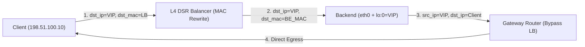
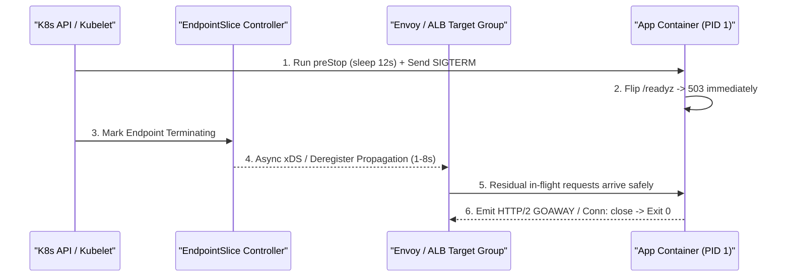

---
tags:
  - software-engineering
  - system-design
  - load-balancing
  - networking
  - kubernetes
created: 2026-11-13
updated: 2026-11-13
status: 🟢
level: mid-to-senior
---

# Load Balancing

> [!abstract] Vault Navigation
> Core infrastructure guide within [[Programming/Software Engineering/System Design/System Design Overview|System Design Overview]]. Integrates directly with [[Programming/Software Engineering/System Design/Scalability|Scalability]], [[Programming/Software Engineering/System Design/Caching|Caching]], [[Programming/Software Engineering/System Design/CDN|CDN]], [[Programming/Software Engineering/System Design/API Design|API Design]], and [[Programming/Software Engineering/DevOps/Kubernetes|Kubernetes]].

A load balancer decouples client-facing virtual IP addresses (VIPs) from mutable backend compute fleets, distributes inbound requests across healthy capacity, isolates partial hardware or process failures, and terminates transport or application protocols. Every production load-balancing decision involves a physical trade-off across OSI layers: forwarding packets at Layer 3/4 maximizes packet-per-second throughput in kernel space but pins multiplexed HTTP/2 connections to static pods, whereas terminating connections at Layer 7 unlocks per-stream routing, TLS offloading, and passive outlier ejection at the cost of user-space CPU and memory overhead.

---

## 1. First-Principles Mechanics & Complete Architecture

A single client request traverses four distinct load-balancing boundaries before executing application business logic inside a container. Understanding what state each layer inspects—and what headers or sockets it rewrites—prevents connection leaks, asymmetric routing blackholes, and cascading deployment outages.


### 1.1 Packet-by-Packet Lifecycle: DNS, GeoDNS, Anycast BGP, and ECMP

1. **Client DNS & GeoDNS Resolution**:
   Before sending a single TCP packet, the client resolves `api.example.com`. Authoritative DNS servers inspect the resolver's IP (or **EDNS0 Client Subnet / ECS** option, typically masked to `/24` IPv4 or `/56` IPv6) and return a regional VIP belonging to the lowest-RTT data center.
   - **Failure Mode (DNS Caching Inertia)**: Authoritative TTLs of `30s–60s` bound regional failover speed, and ISP/enterprise recursive resolvers frequently clamp sub-30s TTLs upward. Clients also cache resolved A/AAAA records in language runtime pools (e.g., JVM `networkaddress.cache.ttl` or persistent Node.js `http.Agent` sockets) long after DNS records update.
2. **Anycast BGP Routing**:
   Instead of relying on DNS to steer regions, high-scale edge networks (`Cloudflare`, `CloudFront`, `Fastly`) advertise the **identical IP prefix** (e.g., `198.51.100.0/24`) simultaneously from dozens of global Points of Presence (PoPs) over **BGP (Border Gateway Protocol)**. Internet Autonomous System (AS) routers forward client packets along the shortest AS-path topology to the nearest healthy PoP. If an entire PoP fails, BGP withdraws its route advertisement within seconds, automatically shifting traffic globally without waiting on DNS TTL expiration.
3. **ECMP (Equal-Cost Multi-Path) Edge Distribution**:
   At the PoP entrance, hardware routers receive packets destined for the Anycast VIP and spread traffic across multiple stateless L4 load-balancer hosts sharing equal BGP routing cost. Routers compute a deterministic hash over the **5-tuple** `(src_ip, dst_ip, src_port, dst_port, protocol)` (or 3-tuple for fragmented packets) so all packets belonging to one TCP flow land on the exact same L4 balancer without inter-router coordination.
   - **Anycast TCP Split-Flow Risk**: If an external BGP route flaps mid-connection, upstream Internet routers may suddenly deliver packets for an existing TCP socket to a *different* PoP whose L4 balancer lacks that connection's state, causing immediate `TCP RST` drops. Production edges neutralize this in two ways: (a) terminate TCP and TLS directly at the Anycast PoP edge and forward over persistent regional backbone tunnels, or (b) share consistent hashing ring tables across L4 nodes (`Google Maglev`, `Meta Katran` eBPF/XDP) so stateless nodes recalculate the identical backend target even on connection-table misses.

### 1.2 Layer 4 Load Balancing: NAT vs IPVS vs Direct Server Return (DSR)

A Layer 4 (Transport) load balancer inspects only IP and TCP/UDP headers. It never decrypts TLS payloads or parses HTTP paths, enabling line-rate kernel/NIC forwarding (`10M+ PPS` per node using eBPF/XDP, DPDK, or Linux IPVS). The critical architectural split at Layer 4 is how return packets travel back to the client.

| L4 Forwarding Mode | Packet Mutation on Ingress | Return Path | Client Source IP Visibility | Primary Bottleneck / Constraint |
| :--- | :--- | :--- | :--- | :--- |
| **L4 DNAT + SNAT (Two-Arm Proxy)** | Rewrites `dst_ip` to backend IP and `src_ip` to LB internal IP | Symmetric: Backend $\to$ LB (`conntrack` reverse NAT) $\to$ Client | Masked by LB IP unless **PROXY protocol v2** prepended | LB NIC egress bandwidth; `65,535` ephemeral port limit per SNAT-IP/backend pair; `nf_conntrack` table size |
| **IPVS Tunnel (`IPIP`)** | Encapsulates original IP packet inside an outer IP packet (`LB -> Backend`) | Asymmetric (DSR over L3): Backend strips outer header, replies directly to client | **Native** (inner `src_ip` preserved untouched) | MTU reduction (`-20 bytes` for outer IPv4 header) requires lowering MTU (`1480`) or MSS clamping; works across L3 subnets |
| **L4 DSR (L2 MAC Rewrite)** | Keeps `src_ip` and `dst_ip=VIP` identical; rewrites **L2 Destination MAC** to backend MAC | **Asymmetric**: Backend replies directly via gateway router to Client | **Native** (`src_ip` untouched; zero PROXY protocol needed) | Requires L2 adjacency (same VLAN/subnet) between LB and backends; requires **ARP suppression** on backend loopbacks |

#### Why L4 NAT Hits Bandwidth & Ephemeral Port Ceilings

In standard NAT mode, every byte returned to the user traverses the load balancer twice (backend $\to$ LB $\to$ client). For video streaming, software artifacts, or object storage downloads where response-to-request byte ratios exceed `50:1`, the L4 balancer's outbound NIC saturates long before backend compute reaches 10% utilization. Simultaneously, rewriting `src_ip` via SNAT binds each outbound socket to one of the LB's ephemeral ports (`ip_local_port_range`, typically `~28,000` to `~60,000` ports). Once a single LB SNAT IP establishes ~60,000 concurrent connections to the same `(backend_ip, backend_port)` 2-tuple, new connections fail with `EADDRNOTAVAIL` unless multiple SNAT IPs are pooled.

#### Direct Server Return (DSR) Packet & Kernel Mechanics

DSR eliminates both return-path saturation and SNAT port exhaustion by keeping the original Layer 3 IP header (`src_ip = Client`, `dst_ip = VIP`) completely intact:



1. Client sends a TCP packet to `VIP` (`203.0.113.50:443`).
2. The L4 DSR balancer hashes the 5-tuple to pick `Backend-2`, swaps **only the Layer 2 Ethernet destination MAC address** to `Backend-2`'s NIC MAC, and transmits the frame onto the local subnet switch.
3. `Backend-2` receives the Ethernet frame on `eth0`. Because the VIP (`203.0.113.50/32`) is configured on `Backend-2`'s non-ARP loopback interface (`lo:0`), the Linux kernel accepts the packet locally.
4. `Backend-2`'s TCP stack builds the HTTP/video response with `src_ip = 203.0.113.50` (`VIP`) and `dst_ip = 198.51.100.10` (`Client`), and routes the packet **directly through the Top-of-Rack gateway router back to the client**, bypassing the load balancer completely.

**Why ARP Suppression on `lo:0` Is Mandatory**: If 50 backends all bind the same `VIP` to `lo:0` without kernel ARP tuning, the upstream router's ARP request (`Who has 203.0.113.50?`) receives 50 competing ARP replies. The router overwrites its ARP cache to send traffic directly to one backend MAC, completely bypassing the load balancer and blackholing the remaining 49 hosts. Setting `arp_ignore=1` and `arp_announce=2` on Linux suppresses `VIP` ARP replies on physical NICs while keeping `lo:0` receptive to forwarded frames.

### 1.3 Layer 7 Load Balancing & Why L4 Breaks HTTP/2 and gRPC

A Layer 7 (Application) reverse proxy (`Envoy`, `NGINX`, `HAProxy`, `AWS ALB`) terminates the client's TCP socket and TLS handshake completely in user space, parses application framing (HTTP/1.1 headers, HTTP/2 `HEADERS`/`DATA` frames, gRPC service paths, cookies, JWT claims), and dispatches each logical request or stream over an independent pool of backend connections.

| Dimension | Layer 4 Connection Forwarding | Layer 7 Dual-Proxy Termination |
| :--- | :--- | :--- |
| **Routing Granularity** | Once per TCP connection (`SYN`) | Per individual HTTP request or HTTP/2 stream |
| **TLS & Security** | Passthrough or SNI inspection; cannot inspect URLs/headers | Terminates TLS at edge; enforces mTLS, WAF, JWT auth, header sanitization |
| **Protocol Translation** | Identical protocol end-to-end | Accepts HTTP/3 (QUIC) or HTTP/2 from clients; speaks HTTP/1.1 or HTTP/2 upstream |
| **CPU & Memory Footprint** | Minimal (~10 KB/conn kernel state, zero payload copies) | High (TLS crypto, HPACK header tables, user-space buffers, GC/allocations) |
| **HTTP/2 & gRPC Scaling** | **Breaks horizontal autoscaling** (connection pinning) | **Balances every RPC stream dynamically** across newly scaled pods |

#### The HTTP/2 & gRPC Connection Pinning Trap

HTTP/1.1 forced clients to open 6+ parallel TCP connections or short-lived keep-alive pools, allowing L4 balancers to approximate request distribution. **HTTP/2 and gRPC reverse this**: a client opens **one persistent TCP connection** and multiplexes hundreds of concurrent RPC streams (`stream_id=1, 3, 5, ...`) over that single socket using binary frame interleaving.

Because an L4 load balancer (`AWS NLB`, `kube-proxy IPVS/iptables`) evaluates its hash or round-robin decision **strictly on the initial TCP `SYN` packet**, every RPC sent over that long-lived channel for the next several hours hits the exact same pod:
- Suppose 4 upstream checkout pods establish 1 gRPC channel each to 4 `auth-grpc` pods via an L4 NLB.
- Traffic triples, and Kubernetes HPA scales `auth-grpc` from 4 pods to 16 pods.
- Because the 4 existing TCP connections remain healthy, zero `SYN` packets occur. The original 4 pods saturate at 100% CPU and return `DEADLINE_EXCEEDED`, while the **12 newly launched pods remain permanently at 0% RPS**.

Two production architectures eliminate L4 HTTP/2 pinning:
1. **L7 Proxy Termination**: Place Envoy, Kubernetes Gateway API, or an L7 service mesh sidecar between clients and backends. Envoy terminates the client's multiplexed connection and balances **individual HTTP/2 streams** using `LEAST_REQUEST` across all 16 pod endpoints as soon as xDS/`EndpointSlice` updates arrive.
2. **Proxy-Less Client-Side Load Balancing + Server Connection Aging**: Configure gRPC clients with `round_robin` (using a Kubernetes Headless Service `clusterIP: None` returning all 16 pod A-records, or a gRPC `xDS` control plane). Crucially, configure the gRPC **server** with `MaxConnectionAge: 60s` and `MaxConnectionAgeJitter: 15s`. Every ~60 seconds, the server emits an HTTP/2 **`GOAWAY`** frame, gracefully draining active streams and forcing clients to open fresh TCP sockets across the expanded 16-pod fleet without synchronized thundering herds.

---

## 2. Routing Algorithms, Mathematics & Consistent Hashing

Choosing an algorithm requires matching state tracking cost against workload variance and cache locality.

### 2.1 Algorithm Comparison & Failure Modes

| Algorithm | Lookup Complexity | State Tracked | Optimal Workload | Primary Failure Mode |
| :--- | :--- | :--- | :--- | :--- |
| **Smooth Weighted Round Robin (SWRR)** | $O(N)$ or $O(\log N)$ | Per-node `current_weight` | Homogeneous stateless REST APIs with uniform request latency | Heavy outlier requests queue behind slow pods without diversion |
| **Least Connections** | $O(N)$ scan or $O(\log N)$ heap | Active request count per backend | Heterogeneous request durations (PDF export, DB queries, LLM streaming) | **Fast-Fail `500` Sinkhole**: A broken pod rejecting requests in 0.2 ms stays at `~0` active connections and draws 100% of traffic |
| **Peak EWMA (Exponentially Weighted Moving Avg)** | $O(N)$ or $O(1)$ w/ P2C | Active conns $\times$ decayed RTT | Multi-AZ deployments and latency-sensitive APIs | Requires active floor/outlier ejection so fast `500` errors do not register as "ultra-fast healthy responses" |
| **Power of Two Random Choices (P2C)** | **$O(1)$** | Local active conns / EWMA score | Distributed multi-instance L7 proxies (Envoy default for `LEAST_REQUEST`) | Slightly sub-optimal on tiny backend pools ($N \le 3$) where full scan is free |
| **Consistent Hashing (Ring + vNodes)** | $O(\log(N \cdot V))$ binary search | Sorted ring of $N \times V$ hashes | Stateful in-memory caches, sticky WebSocket routing, sharded partitions | Viral hot keys overload 1 host unless **Bounded Loads** is enforced |
| **Maglev Hash Table** | **$O(1)$** array index | Fixed prime lookup table ($M = 65{,}537$) | High-speed L4/L7 edge proxies needing minimal disruption + line-rate lookup | Table rebuild takes milliseconds on topology changes; not naturally bounded-load |

### 2.2 Power of Two Random Choices (P2C) & Herd Avoidance

When 30 independent Envoy proxies execute global **Least Connections** using asynchronous 5-second health snapshots, every proxy sees `pod-9` at 0 active connections during the same interval and routes a sudden burst simultaneously to `pod-9` (**herd oscillation**).

**Power of Two Random Choices** solves this in strict $O(1)$ time with zero inter-proxy coordination:
1. Uniformly sample **two** distinct healthy backends $(b_i, b_j)$ at random.
2. Compute each candidate's load score—either `active_requests` or `EWMA_latency * (active_requests + 1)`.
3. Route the request to the lower-scoring backend of the pair.

By Mitzenmacher's supermarket queuing theorem, pure random assignment across $N$ identical servers yields an expected maximum queue depth of $\Theta\left(\frac{\ln N}{\ln \ln N}\right)$. Sampling just **two** random choices reduces maximum queue depth exponentially to **$\Theta(\ln \ln N)$**: across $N = 1{,}000$ servers, $\ln(1000) / \ln\ln(1000) \approx 3.6\times$ worse queue tail drops to $\ln\ln(1000) \approx 1.9$, matching global Least Connections without any global lock or synchronization storm.

### 2.3 The Least Connections Fast-Fail `500` Sinkhole

Suppose `pod-3` loses its database connection pool or fails to mount a TLS secret on startup, causing every incoming request to crash and return `HTTP 500` in **0.3 ms**, while healthy pods take **45 ms** to query PostgreSQL and render JSON.
- At steady state (`45 ms` latency, `100 RPS/pod`), healthy pods average $L = \lambda W = 100 \times 0.045 = \mathbf{4.5}$ active connections (Little's Law).
- On `pod-3` (`0.3 ms` failure), even at `1,000 RPS`, average concurrency is $1000 \times 0.0003 = \mathbf{0.3}$ active connections!
- **Result**: `Least Connections` (and naive `EWMA` latency without status inspection) perceives `pod-3` as the fastest, least-loaded host in the cluster and funnels **nearly 100% of all production traffic into the broken pod**, converting a single-node fault into a total outage.
- **Defense**: Always pair `Least Connections` / `EWMA` with **Passive Outlier Detection** (`consecutive_5xx` ejection) AND treat `5xx` responses as a latency penalty (e.g., setting penalty RTT to `10s` in EWMA scoring) so failing nodes immediately drop to the bottom of routing preference.

### 2.4 Consistent Hashing, Virtual Nodes, Maglev & Bounded Loads

Modulo hashing (`hash(key) % N`) reassigns roughly $\frac{N - 1}{N}$ (90%+ in a 10-node cluster) of all cached keys whenever a single backend joins or leaves, unleashing a simultaneous cache-miss thundering herd onto upstream databases.

#### Hash Ring with Virtual Nodes (vNodes)
Both server IDs and request keys (`user_id`, `doc_id`) are mapped onto a circular $32$-bit ring $[0, 2^{32}-1]$. A request routes clockwise to the first server token $\ge \text{hash}(\text{key})$.
- **Key Movement Bound**: Adding or removing 1 node out of $N$ only moves **$O(K / N)$** keys (solely the arc previously owned by the removed node or split from its immediate neighbor).
- **Why Virtual Nodes Are Mandatory**: Placing 1 physical token per server onto a $2^{32}$ ring produces up to $3\times–5\times$ uneven arc lengths (variance $\sigma \propto 1$). Assigning $V = 100\text{–}200$ virtual points per physical host (`nodeA#0 .. nodeA#149`) reduces key-distribution standard deviation proportionally to **$O(1 / \sqrt{V})$** (below ~7% variance at $V=200$) and allows weighted capacity by assigning $2V$ vNodes to $2\times$ RAM machines.

#### Google Maglev Consistent Hashing
Ring binary search takes $O(\log(N \cdot V))$ comparisons per packet, which is suboptimal inside kernel/DPDK L4 balancers processing millions of packets per second. **Maglev** replaces the binary-search ring with a flat lookup table `entry[0 .. M-1]` of prime size $M$ (typically $M = 65{,}537$):
1. Each backend $b_i$ computes a deterministic pseudo-random permutation over $[0, M-1]$ using two independent hashes `offset` and `skip` (`skip = (h2 % (M - 1)) + 1`, guaranteed coprime to prime $M$).
2. Backends take turns round-robin claiming their next unclaimed slot in `entry` until all $M$ slots are populated.
3. Packet routing reduces to **one array lookup**: `backend = entry[hash(5_tuple) % M]` in **$O(1)$ time** with zero pointer chasing, achieving near-perfect balance ($\le 1\%$ variance) and minimal disruption when backends fail.

#### Consistent Hashing with Bounded Loads
Standard Consistent Hashing and Maglev both fail under **viral hot keys** (e.g., `doc_id=breaking-news` receiving 45% of cluster RPS—all routed to one cache node). **Consistent Hashing with Bounded Loads** (Mirrokni et al.) imposes a hard concurrency ceiling per backend:
$$\text{cap} = \left\lceil (1 + \epsilon) \times \frac{\text{total\_active\_requests} + 1}{N} \right\rceil \quad (\text{typically } \epsilon = 0.25)$$
If the primary ring target for `key` already holds $\ge \text{cap}$ active requests, the router steps clockwise to the next distinct physical backend below its cap. Normal keys maintain ~100% cache locality while viral hot keys spill cleanly onto immediate neighbors before saturating a single host.

---

## 3. Real-World Use Cases & Decision Matrix

Choosing the right load-balancing architecture depends on payload protocol, statefulness, egress volume, and security boundary.

| Scenario | Recommended Stack | Why It Fits | Anti-Pattern to Avoid |
| :--- | :--- | :--- | :--- |
| **1. Video CDN / Large Static Media Egress** | **Anycast BGP + L4 DSR (`IPVS` / `Katran`)** | Terabits/sec egress bypasses LB NIC directly to client gateway; preserves client IP natively | Routing 50 Gbps video streams through two-arm L4 NAT or L7 proxies (doubles NIC cost and exhausts SNAT ports) |
| **2. High-Throughput gRPC Microservice Mesh** | **L7 Proxy (`Envoy` / Gateway API) with `LEAST_REQUEST` (P2C)** | Balances individual HTTP/2 streams dynamically as pods autoscale; enforces mTLS and retries | Direct L4 NLB routing without `MAX_CONNECTION_AGE` (pins 100% load onto old pods after HPA scale-out) |
| **3. Distributed In-Memory Cache / Preview Cluster** | **Envoy `RING_HASH` or `MAGLEV` w/ Bounded Loads** | Maximizes aggregate cluster cache hit rate ($N\times$ memory pool) while bounding hot-key overload | Using Round Robin or P2C (reduces cache hit rate to $\sim 1/N$ across nodes, thrashing origin storage) |
| **4. Multi-Tenant Public SaaS REST API** | **Cloud L4 NLB (`PROXY v2`) $\to$ L7 `Envoy` Fleet** | L4 absorbs volumetric SYN floods; L7 enforces TLS, rate limiting, WAF, and `X-Forwarded-For` sanitization | Exposing L7 proxy directly without L4/Anycast DDoS tier or trusting raw `X-Forwarded-For` headers |
| **5. Zero-Hop Internal Service Discovery (Ultra-Low Latency)** | **Proxy-Less gRPC (`xDS` / Headless K8s + `round_robin`)** | Eliminates intermediate L7 proxy hop ($\sim 0.3\text{–}0.8\text{ ms}$ p99 saved) while retaining per-RPC balancing | Using `pick_first` default in gRPC clients against headless services (pins all RPCs to index 0 pod) |

---

## 4. Step-by-Step Practical Application: Production Routing, Configs & Graceful K8s Drain

The following complete, copy-pasteable production artifacts implement a full multi-tier load-balanced stack structured across this repository layout:
- `src/lb/router.ts` & `tests/router.test.ts` — Smooth WRR, P2C EWMA, Bounded-Load Consistent Hash Ring, and Google Maglev table implementation with verification tests.
- `deploy/99-dsr-vip.conf` — Linux kernel `lo:0` VIP ARP-suppression and `rp_filter` tuning for L4 DSR nodes.
- `deploy/envoy.yaml` & `deploy/nginx.conf` — Production L7 proxy configurations (`PROXY v2`, `X-Forwarded-For` right-to-left trust, P2C slow-start, outlier ejection caps, keep-alive tuning).
- `deploy/k8s-gateway.yaml` & `src/server.go` — Kubernetes Gateway API routing, `preStop` draining Pod spec, and graceful HTTP/2 `GOAWAY` Go server.

### 4.1 Production Routing Algorithms in TypeScript (`src/lb/router.ts`)

This module implements **Smooth Weighted Round Robin**, **P2C with EWMA + `5xx` Penalty**, **Consistent Hashing with Virtual Nodes & Bounded Loads**, and **Google Maglev Table Generation** with zero third-party dependencies.

```ts
// src/lb/router.ts
import { createHash } from "node:crypto";

export interface BackendNode {
  id: string;
  address: string;
  weight: number;
  healthy: boolean;
  activeRequests: number;
  ewmaLatencyMs: number;
  lastUpdatedNs: bigint;
  currentWeight: number; // Used by Smooth Weighted Round Robin
}

export function fnv1a32(input: string): number {
  let hash = 0x811c9dc5;
  for (let i = 0; i < input.length; i++) {
    hash ^= input.charCodeAt(i);
    hash = Math.imul(hash, 0x01000193);
  }
  return hash >>> 0;
}

function sha256Int32(input: string, offsetBytes: number): number {
  const digest = createHash("sha256").update(input).digest();
  return digest.readUInt32BE(offsetBytes);
}

/**
 * 1. NGINX-style Smooth Weighted Round Robin (SWRR)
 * Distributes weighted traffic smoothly instead of sending burst streaks to high-weight nodes.
 */
export function selectSmoothWeightedRR(nodes: BackendNode[]): BackendNode | null {
  let best: BackendNode | null = null;
  let totalWeight = 0;

  for (const node of nodes) {
    if (!node.healthy || node.weight <= 0) continue;
    node.currentWeight += node.weight;
    totalWeight += node.weight;
    if (!best || node.currentWeight > best.currentWeight) {
      best = node;
    }
  }

  if (best) {
    best.currentWeight -= totalWeight;
  }
  return best;
}

/**
 * 2. Power of Two Random Choices (P2C) with Peak EWMA + Fast-Fail 500 Penalty
 * Avoids global Least-Connections herd oscillation and neutralizes fast-failing 500 sinkholes.
 */
export class P2CEwmaBalancer {
  private readonly tauNs = 10_000_000_000; // 10s decay constant
  private readonly failurePenaltyMs = 10_000; // Penalize fast 5xx to prevent sinkholing

  public recordCompletion(
    node: BackendNode,
    rttMs: number,
    statusCode: number,
    nowNs: bigint = process.hrtime.bigint()
  ): void {
    const dt = Math.max(0, Number(nowNs - node.lastUpdatedNs));
    const weight = Math.exp(-dt / this.tauNs);
    const sample = statusCode >= 500 ? this.failurePenaltyMs : Math.max(0.1, rttMs);

    node.ewmaLatencyMs =
      node.ewmaLatencyMs === 0 ? sample : node.ewmaLatencyMs * weight + sample * (1 - weight);
    node.lastUpdatedNs = nowNs;
    node.activeRequests = Math.max(0, node.activeRequests - 1);
  }

  public select(nodes: BackendNode[]): BackendNode | null {
    const healthy = nodes.filter((n) => n.healthy);
    if (healthy.length === 0) return null;
    if (healthy.length === 1) {
      healthy[0].activeRequests++;
      return healthy[0];
    }

    const i = Math.floor(Math.random() * healthy.length);
    let j = Math.floor(Math.random() * (healthy.length - 1));
    if (j >= i) j++;

    const a = healthy[i];
    const b = healthy[j];

    const scoreA = (a.ewmaLatencyMs || 1) * (a.activeRequests + 1) / Math.max(1, a.weight);
    const scoreB = (b.ewmaLatencyMs || 1) * (b.activeRequests + 1) / Math.max(1, b.weight);

    const chosen = scoreA <= scoreB ? a : b;
    chosen.activeRequests++;
    return chosen;
  }
}

/**
 * 3. Consistent Hash Ring with Virtual Nodes & Bounded Loads (Mirrokni / Lattanzi)
 */
interface RingPoint {
  hash: number;
  nodeId: string;
}

export class BoundedConsistentHashRing {
  private ring: RingPoint[] = [];
  private readonly nodeMap = new Map<string, BackendNode>();

  constructor(
    nodes: BackendNode[],
    private readonly vnodesPerWeightUnit = 150,
    private readonly overprovisioningEpsilon = 0.25
  ) {
    this.rebuild(nodes);
  }

  public rebuild(nodes: BackendNode[]): void {
    this.ring = [];
    this.nodeMap.clear();
    for (const node of nodes) {
      this.nodeMap.set(node.id, node);
      if (!node.healthy) continue;
      const vnodeCount = Math.max(1, node.weight * this.vnodesPerWeightUnit);
      for (let v = 0; v < vnodeCount; v++) {
        this.ring.push({
          hash: sha256Int32(`${node.id}#${v}`, 0),
          nodeId: node.id,
        });
      }
    }
    this.ring.sort((a, b) => a.hash - b.hash);
  }

  public select(key: string): BackendNode | null {
    if (this.ring.length === 0) return null;

    let totalActive = 0;
    let healthyCount = 0;
    for (const node of this.nodeMap.values()) {
      if (node.healthy) {
        totalActive += node.activeRequests;
        healthyCount++;
      }
    }
    if (healthyCount === 0) return null;

    // Cap each backend at ceil((1 + epsilon) * avgLoad) to absorb viral hot-key spikes
    const avgLoad = (totalActive + 1) / healthyCount;
    const capacityCap = Math.ceil((1 + this.overprovisioningEpsilon) * avgLoad);

    const keyHash = sha256Int32(key, 0);
    const startIdx = this.lowerBound(keyHash);
    const visited = new Set<string>();

    for (let offset = 0; offset < this.ring.length; offset++) {
      const point = this.ring[(startIdx + offset) % this.ring.length];
      if (visited.has(point.nodeId)) continue;
      visited.add(point.nodeId);

      const candidate = this.nodeMap.get(point.nodeId);
      if (candidate && candidate.healthy && candidate.activeRequests < capacityCap) {
        candidate.activeRequests++;
        return candidate;
      }
      if (visited.size >= healthyCount) break;
    }

    // Fallback to primary healthy hash owner if every node exceeds soft cap
    const fallback = this.nodeMap.get(this.ring[startIdx].nodeId) ?? null;
    if (fallback && fallback.healthy) fallback.activeRequests++;
    return fallback;
  }

  private lowerBound(target: number): number {
    let lo = 0;
    let hi = this.ring.length;
    while (lo < hi) {
      const mid = (lo + hi) >>> 1;
      if (this.ring[mid].hash < target) lo = mid + 1;
      else hi = mid;
    }
    return lo === this.ring.length ? 0 : lo;
  }
}

/**
 * 4. Google Maglev O(1) Permutation Lookup Table
 * Builds a prime-sized table M (e.g. 65537) for zero-allocation O(1) packet/request hashing.
 */
export class MaglevTable {
  private readonly table: Int32Array;
  private readonly backends: BackendNode[];

  constructor(nodes: BackendNode[], private readonly tableSize = 65537) {
    this.backends = nodes.filter((n) => n.healthy);
    this.table = new Int32Array(tableSize).fill(-1);
    if (this.backends.length > 0) {
      this.populate();
    }
  }

  private populate(): void {
    const N = this.backends.length;
    const M = this.tableSize;
    const offsets = new Int32Array(N);
    const skips = new Int32Array(N);
    const nextIdx = new Int32Array(N);

    for (let i = 0; i < N; i++) {
      const id = this.backends[i].id;
      const h1 = sha256Int32(id, 0);
      const h2 = sha256Int32(id, 4);
      offsets[i] = h1 % M;
      skips[i] = (h2 % (M - 1)) + 1;
    }

    let filled = 0;
    while (filled < M) {
      for (let i = 0; i < N; i++) {
        let candidate = (offsets[i] + nextIdx[i] * skips[i]) % M;
        while (this.table[candidate] !== -1) {
          nextIdx[i]++;
          candidate = (offsets[i] + nextIdx[i] * skips[i]) % M;
        }
        this.table[candidate] = i;
        nextIdx[i]++;
        filled++;
        if (filled === M) break;
      }
    }
  }

  public lookup(key: string): BackendNode | null {
    if (this.backends.length === 0) return null;
    const slot = fnv1a32(key) % this.tableSize;
    return this.backends[this.table[slot]];
  }
}
```

#### Verification Tests (`tests/router.test.ts`)

```ts
// tests/router.test.ts
import assert from "node:assert/strict";
import test from "node:test";
import {
  BackendNode,
  BoundedConsistentHashRing,
  MaglevTable,
  P2CEwmaBalancer,
  selectSmoothWeightedRR,
} from "../src/lb/router.js";

function makeNode(id: string, weight = 1): BackendNode {
  return {
    id,
    address: `10.0.1.${id.slice(-1)}:8080`,
    weight,
    healthy: true,
    activeRequests: 0,
    ewmaLatencyMs: 0,
    lastUpdatedNs: process.hrtime.bigint(),
    currentWeight: 0,
  };
}

test("Smooth Weighted RR distributes proportions without consecutive bursts", () => {
  const nodes = [makeNode("a", 5), makeNode("b", 1), makeNode("c", 1)];
  const seq: string[] = [];
  for (let i = 0; i < 7; i++) {
    seq.push(selectSmoothWeightedRR(nodes)!.id);
  }
  // Smooth sequence prevents [a,a,a,a,a,b,c]; exact pattern is [a,a,b,a,c,a,a]
  assert.deepEqual(seq, ["a", "a", "b", "a", "c", "a", "a"]);
});

test("Bounded Consistent Hash spills viral hot-key once primary node hits load cap", () => {
  const nodes = [makeNode("n1"), makeNode("n2"), makeNode("n3"), makeNode("n4")];
  const ring = new BoundedConsistentHashRing(nodes, 150, 0.25);

  const selectedIds = new Set<string>();
  for (let i = 0; i < 20; i++) {
    const picked = ring.select("viral-doc-999")!;
    selectedIds.add(picked.id);
  }
  // Because cap = ceil(1.25 * avg), hot-key spills evenly across all 4 nodes instead of saturating 1
  assert.equal(selectedIds.size, 4);
  for (const n of nodes) assert.ok(n.activeRequests <= 6);
});

test("Maglev O(1) table maintains <1.5% variance and <30% key churn on single-node removal", () => {
  const nodes5 = ["b1", "b2", "b3", "b4", "b5"].map((id) => makeNode(id));
  const m5 = new MaglevTable(nodes5, 65537);
  const m4 = new MaglevTable(nodes5.slice(0, 4), 65537);

  const counts = new Map<string, number>();
  let moved = 0;
  const totalKeys = 10_000;
  for (let k = 0; k < totalKeys; k++) {
    const key = `session-${k}`;
    const bBefore = m5.lookup(key)!.id;
    const bAfter = m4.lookup(key)!.id;
    counts.set(bBefore, (counts.get(bBefore) ?? 0) + 1);
    if (bBefore !== bAfter) moved++;
  }
  for (const c of counts.values()) {
    assert.ok(c > 1900 && c < 2100, `Unexpected Maglev bucket count: ${c}`);
  }
  assert.ok(moved < 2500, `Expected ~20% movement on 1/5 removal, got ${moved}`);
});

test("P2C EWMA avoids fast-500 sinkhole after penalty observation", () => {
  const healthy = makeNode("healthy");
  const broken = makeNode("broken");
  const balancer = new P2CEwmaBalancer();
  const t0 = process.hrtime.bigint();

  for (let i = 0; i < 10; i++) {
    healthy.activeRequests++;
    balancer.recordCompletion(healthy, 20, 200, t0 + BigInt(i * 1_000_000));
    broken.activeRequests++;
    balancer.recordCompletion(broken, 0.2, 500, t0 + BigInt(i * 1_000_000));
  }

  let pickedHealthy = 0;
  for (let i = 0; i < 100; i++) {
    const chosen = balancer.select([healthy, broken])!;
    if (chosen.id === "healthy") pickedHealthy++;
    chosen.activeRequests = 0;
  }
  assert.equal(pickedHealthy, 100);
});
```

### 4.2 Linux Kernel DSR Configuration (`/etc/sysctl.d/99-dsr-vip.conf`)

Deploy this exact kernel configuration on every backend server operating behind an L4 Direct Server Return balancer (`IPVS DR` or `Katran`).

```ini
# /etc/sysctl.d/99-dsr-vip.conf
# 1. ARP Suppression: prevent backends from hijacking ARP resolution for the shared VIP
# arp_ignore=1: reply to ARP requests ONLY if target IP is configured on the incoming interface (ignore lo:0 VIP)
net.ipv4.conf.all.arp_ignore = 1
net.ipv4.conf.lo.arp_ignore = 1
net.ipv4.conf.eth0.arp_ignore = 1

# arp_announce=2: always use best local physical address (eth0 IP) as ARP source, never loopback VIP
net.ipv4.conf.all.arp_announce = 2
net.ipv4.conf.lo.arp_announce = 2
net.ipv4.conf.eth0.arp_announce = 2

# 2. Asymmetric Routing Guard: allow ingress on eth0 with dst_ip=VIP while egress leaves directly via default gateway
# Strict rp_filter=1 drops packets if reverse route wouldn't leave through the exact same interface!
net.ipv4.conf.all.rp_filter = 0
net.ipv4.conf.eth0.rp_filter = 0

# 3. Socket Backlog & Ephemeral Port Tuning for High Connection Churn
net.core.somaxconn = 65535
net.ipv4.tcp_max_syn_backlog = 65535
net.ipv4.ip_local_port_range = 10240 65535
```

Apply and bind the VIP onto the loopback alias (`lo:0`) with `/32` netmask so the backend never advertises an entire `/24` subnet onto loopback:

```bash
sysctl --system
ip addr add 203.0.113.50/32 dev lo label lo:0
```

### 4.3 Production Envoy Configuration (`deploy/envoy.yaml`)

This Envoy configuration handles **PROXY protocol v2** from an upstream L4 NLB, sanitizes `X-Forwarded-For` cleanly, runs `LEAST_REQUEST` (P2C) with **slow-start warmup**, configures **passive outlier detection with a 50% ejection safety cap**, and applies **L7 circuit breakers** plus active `/readyz` health checks.

```yaml
# deploy/envoy.yaml
static_resources:
  listeners:
    - name: ingress_https_listener
      address:
        socket_address: { address: 0.0.0.0, port_value: 8443 }
      listener_filters:
        # Parse L4 NLB PROXY protocol v2 binary header to recover true client IP before TLS
        - name: envoy.filters.listener.proxy_protocol
          typed_config:
            "@type": type.googleapis.com/envoy.extensions.filters.listener.proxy_protocol.v3.ProxyProtocol
        - name: envoy.filters.listener.tls_inspector
          typed_config:
            "@type": type.googleapis.com/envoy.extensions.filters.listener.tls_inspector.v3.TlsInspector
      filter_chains:
        - transport_socket:
            name: envoy.transport_sockets.tls
            typed_config:
              "@type": type.googleapis.com/envoy.extensions.transport_sockets.tls.v3.DownstreamTlsContext
              common_tls_context:
                alpn_protocols: ["h2", "http/1.1"]
                tls_certificates:
                  - certificate_chain: { filename: "/etc/certs/tls.crt" }
                    private_key: { filename: "/etc/certs/tls.key" }
          filters:
            - name: envoy.filters.network.http_connection_manager
              typed_config:
                "@type": type.googleapis.com/envoy.extensions.filters.network.http_connection_manager.v3.HttpConnectionManager
                stat_prefix: ingress_http
                # Prevent X-Forwarded-For spoofing: trust only 1 proxy hop (upstream L4/CDN)
                use_remote_address: true
                xff_num_trusted_hops: 1
                drain_timeout: 15s
                stream_idle_timeout: 60s
                route_config:
                  name: local_route
                  virtual_hosts:
                    - name: api_service
                      domains: ["api.example.com"]
                      routes:
                        - match: { prefix: "/" }
                          route:
                            cluster: orders_api_cluster
                            timeout: 15s
                            retry_policy:
                              retry_on: "connect-failure,refused-stream,reset"
                              num_retries: 2
                              per_try_timeout: 5s
                http_filters:
                  - name: envoy.filters.http.router
                    typed_config:
                      "@type": type.googleapis.com/envoy.extensions.filters.http.router.v3.Router

  clusters:
    - name: orders_api_cluster
      connect_timeout: 1s
      type: STRICT_DNS
      # P2C Load Balancing (samples 2 healthy backends, picks lower active_requests)
      lb_policy: LEAST_REQUEST
      least_request_lb_config:
        choice_count: 2
        slow_start_config:
          # Ramp new pods smoothly over 60s to prevent JIT/cache cold-start crash
          slow_start_window: 60s
          aggression: { default_value: 1.5 }
          min_weight_percent: 10
      typed_extension_protocol_options:
        envoy.extensions.upstreams.http.v3.HttpProtocolOptions:
          "@type": type.googleapis.com/envoy.extensions.upstreams.http.v3.HttpProtocolOptions
          explicit_http_config:
            http2_protocol_options:
              max_concurrent_streams: 250
      # Active Readiness Probe (NEVER point at DB-heavy /healthz)
      health_checks:
        - timeout: 2s
          interval: 5s
          unhealthy_threshold: 2
          healthy_threshold: 2
          http_health_check:
            path: "/readyz"
      # Passive Outlier Detection w/ 50% Ejection Safety Cap
      outlier_detection:
        consecutive_5xx: 5
        consecutive_gateway_failure: 3
        interval: 5s
        base_ejection_time: 30s
        max_ejection_time: 300s
        max_ejection_percent: 50
        enforcing_consecutive_5xx: 100
      # L7 Circuit Breakers preventing memory exhaustion during downstream stalls
      circuit_breakers:
        thresholds:
          - priority: DEFAULT
            max_connections: 2048
            max_pending_requests: 1024
            max_requests: 4096
            max_retries: 100
      load_assignment:
        cluster_name: orders_api_cluster
        endpoints:
          - lb_endpoints:
              - endpoint:
                  address:
                    socket_address: { address: orders-api.prod.svc.cluster.local, port_value: 8080 }
```

### 4.4 Production NGINX Reverse Proxy (`deploy/nginx.conf`)

Notice the upstream keep-alive timeout ordering rule: NGINX's `keepalive_timeout` toward upstream backends **must be strictly shorter** than the upstream Go/Node server's idle timeout, eliminating the race where NGINX writes an HTTP request onto a socket at the exact microsecond the backend closes it (`502 Bad Gateway`).

```nginx
# deploy/nginx.conf
events {
    worker_connections 16384;
    multi_accept on;
}

http {
    # Trust internal VPC load balancer CIDR only when reading X-Forwarded-For right-to-left
    set_real_ip_from  10.0.0.0/8;
    real_ip_header    X-Forwarded-For;
    real_ip_recursive on;

    upstream orders_backend {
        least_conn;
        # For stateful cache affinity instead of least_conn:
        # hash $arg_doc_id consistent;

        server 10.0.2.11:8080 max_fails=3 fail_timeout=15s;
        server 10.0.2.12:8080 max_fails=3 fail_timeout=15s;

        # Maintain 128 persistent idle sockets per worker to skip TCP/TLS handshakes
        keepalive 128;
        keepalive_requests 10000;
        # MUST be shorter than upstream app server IdleTimeout (e.g., 60s < 75s)
        keepalive_timeout 60s;
    }

    server {
        listen 443 ssl http2;
        server_name api.example.com;

        ssl_certificate     /etc/certs/tls.crt;
        ssl_certificate_key /etc/certs/tls.key;
        ssl_protocols       TLSv1.2 TLSv1.3;

        location / {
            proxy_pass http://orders_backend;
            proxy_http_version 1.1;
            proxy_set_header Connection ""; # Required to preserve upstream keepalive pool
            proxy_set_header Host $host;
            proxy_set_header X-Real-IP $remote_addr;
            proxy_set_header X-Forwarded-For $proxy_add_x_forwarded_for;
            proxy_set_header X-Forwarded-Proto $scheme;

            proxy_connect_timeout 2s;
            proxy_read_timeout    15s;
            proxy_send_timeout    15s;

            # Retry ONLY idempotent/connection failures, NEVER non-idempotent POST timeouts
            proxy_next_upstream error timeout http_502 http_503;
            proxy_next_upstream_tries 2;
        }
    }
}
```

### 4.5 Kubernetes Gateway API + Zero-Downtime Pod Spec & Go Drain Server

Legacy Kubernetes `Ingress` forces teams into brittle vendor annotations (`nginx.ingress.kubernetes.io/...`). Modern **Kubernetes Gateway API** cleanly separates infrastructure (`GatewayClass`, `Gateway`) from application routing (`HTTPRoute`, `GRPCRoute`).

```yaml
# deploy/k8s-gateway.yaml
apiVersion: gateway.networking.k8s.io/v1
kind: Gateway
metadata:
  name: prod-edge-gateway
  namespace: infra-gateway
spec:
  gatewayClassName: envoy-gateway-class
  listeners:
    - name: https
      protocol: HTTPS
      port: 443
      hostname: "api.example.com"
      tls:
        mode: Terminate
        certificateRefs:
          - name: api-example-tls
            kind: Secret
      allowedRoutes:
        namespaces:
          from: Selector
          selector:
            matchLabels: { gateway-access: "true" }
---
apiVersion: gateway.networking.k8s.io/v1
kind: HTTPRoute
metadata:
  name: orders-canary-route
  namespace: orders-prod
spec:
  parentRefs:
    - name: prod-edge-gateway
      namespace: infra-gateway
  hostnames: ["api.example.com"]
  rules:
    - matches:
        - path: { type: PathPrefix, value: "/v1/orders" }
      timeouts:
        request: 15s
        backendRequest: 10s
      backendRefs:
        - name: orders-api-v1
          port: 8080
          weight: 95
        - name: orders-api-v2-canary
          port: 8080
          weight: 5
---
apiVersion: apps/v1
kind: Deployment
metadata:
  name: orders-api-v1
  namespace: orders-prod
spec:
  replicas: 6
  strategy:
    type: RollingUpdate
    rollingUpdate: { maxUnavailable: 0, maxSurge: 2 }
  template:
    metadata:
      labels: { app: orders-api, version: v1 }
    spec:
      # Must exceed preStop sleep (12s) + max request timeout (15s) + shutdown buffer
      terminationGracePeriodSeconds: 45
      containers:
        - name: api
          image: registry.example.com/orders-api:1.18.0
          ports: [{ containerPort: 8080 }]
          livenessProbe:
            httpGet: { path: /healthz, port: 8080 }
            periodSeconds: 10
            failureThreshold: 3
          readinessProbe:
            httpGet: { path: /readyz, port: 8080 }
            periodSeconds: 5
            failureThreshold: 2
          lifecycle:
            preStop:
              exec:
                # Keep accepting residual traffic while EndpointSlice & Envoy xDS drain async
                command: ["/bin/sh", "-c", "sleep 12"]
```

```go
// src/server.go
package main

import (
	"context"
	"errors"
	"log"
	"net/http"
	"os/signal"
	"sync/atomic"
	"syscall"
	"time"

	"golang.org/x/net/http2"
	"golang.org/x/net/http2/h2c"
)

func main() {
	var isReady atomic.Bool
	isReady.Store(true)

	mux := http.NewServeMux()
	// Liveness: checks process/goroutine responsiveness ONLY; never queries DB or Redis
	mux.HandleFunc("/healthz", func(w http.ResponseWriter, r *http.Request) {
		w.WriteHeader(http.StatusOK)
		_, _ = w.Write([]byte("alive"))
	})

	// Readiness: flips to 503 immediately on SIGTERM to detach EndpointSlice cleanly
	mux.HandleFunc("/readyz", func(w http.ResponseWriter, r *http.Request) {
		if !isReady.Load() {
			http.Error(w, "draining", http.StatusServiceUnavailable)
			return
		}
		w.WriteHeader(http.StatusOK)
		_, _ = w.Write([]byte("ready"))
	})

	mux.HandleFunc("/v1/orders", func(w http.ResponseWriter, r *http.Request) {
		time.Sleep(50 * time.Millisecond) // Simulated request work
		w.WriteHeader(http.StatusOK)
		_, _ = w.Write([]byte(`{"status":"ok"}`))
	})

	h2Server := &http2.Server{IdleTimeout: 75 * time.Second}
	srv := &http.Server{
		Addr:              ":8080",
		Handler:           h2c.NewHandler(mux, h2Server),
		ReadHeaderTimeout: 5 * time.Second,
		IdleTimeout:       75 * time.Second, // Strictly > NGINX keepalive_timeout (60s)
	}

	ctx, stop := signal.NotifyContext(context.Background(), syscall.SIGTERM, syscall.SIGINT)
	defer stop()

	go func() {
		if err := srv.ListenAndServe(); err != nil && !errors.Is(err, http.ErrServerClosed) {
			log.Fatalf("listen error: %v", err)
		}
	}()

	// Wait for SIGTERM (delivered in parallel with preStop in K8s)
	<-ctx.Done()
	isReady.Store(false)
	log.Println("SIGTERM received: failing /readyz and draining in-flight requests")

	// Shutdown stops new listeners, emits Connection: close (H1) and GOAWAY (H2), and waits for active handlers
	drainCtx, cancel := context.WithTimeout(context.Background(), 25*time.Second)
	defer cancel()
	if err := srv.Shutdown(drainCtx); err != nil {
		log.Printf("forced close after drain timeout: %v", err)
	}
}
```

---

## 5. Complete Construct Reference, Security & Edge Cases

### 5.1 Health Check Separation (`/healthz` vs `/readyz` vs `/startupz`)

| Probe Type | Failure Action | Appropriate Checks | Fatal Production Misconfiguration |
| :--- | :--- | :--- | :--- |
| **`startupProbe`** | Holds liveness/readiness until initial boot succeeds | JVM JIT warmup, huge ML model load into GPU VRAM | Omitting on slow-boot pods causes `livenessProbe` to kill-loop the container infinitely |
| **`livenessProbe` (`/healthz`)** | `kubelet` sends `SIGTERM`/`SIGKILL` and restarts container | Event loop responsiveness, deadlock canary | **Querying PostgreSQL/Redis inside `/healthz`**: a 5s DB failover triggers simultaneous pod restarts across 100% of API containers! |
| **`readinessProbe` (`/readyz`)** | Removes Pod IP from `EndpointSlice` / LB target group (keeps active sockets intact) | Warm local cache, downstream circuit closed, `!isDraining` | Failing to flip `/readyz` during shutdown delays LB removal during rolling deployments |

### 5.2 Passive Outlier Detection & Ejection Safety Caps

Active probes poll every 5–10 seconds—far too slow when a broken host fails at `5,000 RPS`, dropping `25,000–50,000` live user requests before the probe detects it. **Passive Outlier Detection** inside L7 proxies inspects live response codes inline:
- **Consecutive `5xx` vs Local Gateway Errors**: `consecutive_gateway_failure` triggers exclusively on transport-level failures (`502`, `503`, `504`, TCP reset, connect timeout), distinguishing crashed nodes from application-level `500`s caused by shared upstream data corruption.
- **Exponential Ejection Time**: A first offense ejects the backend for `base_ejection_time` (`30s`); repeating offenses immediately upon reinstatement double the penalty up to `max_ejection_time` (`300s`).
- **`max_ejection_percent` Guardrail**: Always cap maximum ejected nodes (e.g., `50%` or `30%`). Without this bound, a 4-second blip in an upstream payment gateway or shared database causes every API pod to return `503` simultaneously, prompting Envoy to **eject 100% of the API fleet** and prolonging a 4-second downstream blip into minutes of total blackout.

### 5.3 `X-Forwarded-For` Spoofing Defense & `PROXY protocol v2`

When clients connect through CDNs and reverse proxies, each L7 proxy appends the incoming socket's peer IP to `X-Forwarded-For`.
- **The Left-to-Right Spoofing Vulnerability**: An attacker injects a fake header `X-Forwarded-For: 127.0.0.1, 10.0.0.5` on the client request. The CDN appends the attacker's true IP `198.51.100.77`, and internal Envoy appends the CDN's IP `172.64.10.2`, producing:
  `X-Forwarded-For: 127.0.0.1, 10.0.0.5, 198.51.100.77, 172.64.10.2`
  An app reading **index 0 from the left** extracts `127.0.0.1`, bypassing IP allowlists and per-IP rate limiters!
- **Canonical Defense (Right-to-Left Parsing)**: Configure the edge proxy (`xff_num_trusted_hops` in Envoy, `real_ip_recursive on` + `set_real_ip_from` CIDRs in NGINX) to walk **from right to left**, stripping only known trusted proxy IPs. Counting 1 trusted hop (`172.64.10.2`) from the right cleanly resolves **`198.51.100.77`** regardless of forged leftmost entries.
- **`PROXY protocol v2` at Layer 4**: Because an L4 balancer (`AWS NLB`, `HAProxy TCP`) never reads HTTP headers, it cannot insert `X-Forwarded-For`. Enabling **PROXY protocol v2** prepends a compact binary header (`\x0D\x0A\x0D\x0A\x00\x0D\x0A\x51\x55\x49\x54\x0A...`) onto the freshly opened TCP byte stream containing `src_ip`, `dst_ip`, `src_port`, `dst_port`, and cloud TLVs (such as `AWS VPC Endpoint ID`). Both the L4 emitter and the L7 receiver (`envoy.filters.listener.proxy_protocol`) **must** match—mismatching causes corrupted binary garbage on TLS `ClientHello` (`ERR_SSL_PROTOCOL_ERROR`).

### 5.4 Sticky Sessions Trade-Offs & Graceful Draining Timeline

Cookie-based sticky sessions (`AWS ALB` `AWSALB` cookie, `NGINX sticky`) or `IP Hash` lock a user's browser to one specific pod.
- **When Acceptable**: Legacy stateful monoliths storing unshared session objects in local heap, or WebRTC/Socket.IO polling handshakes prior to WebSocket upgrade.
- **Hidden Costs**: (1) Pods created during HPA autoscaling receive zero traffic from active users pinned to old pods; (2) rolling deployments forcibly invalidate active pinned sessions; (3) one heavy browser tenant (`batch export` tab + 20 polling tabs) overloads one pod asymmetrically.
- **Modern Replacement**: Store ephemeral session state in Redis/Valkey or signed stateless JWTs, routing traffic via stateless `P2C` (or Consistent Hashing on `room_id`/`doc_id` solely for collaborative state/cache routing).



### 5.5 TCP Backlog & Keep-Alive Socket Traps

- **`somaxconn` & `tcp_max_syn_backlog` Drops**: Linux kernels default `net.core.somaxconn` to `4096` (historically `128`). During sharp traffic spikes, if `accept()` loops lag briefly, the kernel silently drops incoming `SYN` or `ACK` packets (`ListenOverflows` / `ListenDrops` in `/proc/net/netstat`), triggering 1-second TCP `SYN` retransmission stalls on clients!
- **Upstream Keep-Alive Race (`502 Bad Gateway`)**: If an upstream server closes an idle TCP connection at `t = 60.000s` (sending `FIN`) at the exact microsecond Envoy/NGINX writes a fresh `GET /orders` onto that same pooled socket (`t = 60.000s`), the upstream kernel replies with `TCP RST`, causing Envoy/NGINX to return `502 Bad Gateway`. Fix universally by configuring **proxy idle timeout < upstream server idle timeout** (e.g., Proxy `60s` < App `75s`).

---

## 6. Production Debugging, Profiling & Operations Playbook

| Symptom | Most Likely Root Cause | Exact Diagnostic Commands | Remediation |
| :--- | :--- | :--- | :--- |
| **Burst of `502 Bad Gateway` during rolling deploys** | Pod exits on `SIGTERM` before `EndpointSlice`/ALB deregisters IP; or proxy idle timeout $\ge$ app idle timeout | `kubectl get endpointslices -w` <br> `kubectl logs deploy/api --previous` <br> `tcpdump -ni eth0 'tcp[tcpflags] & tcp-rst != 0'` | Add `preStop: sleep 12`, flip `/readyz` to `503`, use `srv.Shutdown()`, ensure `proxy_idle < app_idle` |
| **100% CPU on 3 pods, 0% on 12 new pods after HPA scale-up** | HTTP/2 or gRPC connection pinning over L4 NLB / `kube-proxy` IPVS | `ss -antp \| grep :50051` (count sockets per pod) <br> `curl -s localhost:9901/clusters \| grep rq_active` | Terminate HTTP/2 at L7 Envoy (`LEAST_REQUEST`) or use headless gRPC `round_robin` + `MaxConnectionAge=60s` |
| **`503 No Healthy Upstream` during transient DB blip** | Passive outlier detection ejected 100% of pods, OR `/healthz` queried DB and triggered CrashLoopBackOff | `curl -s localhost:9901/stats/prometheus \| grep eject` <br> `kubectl describe pod <name>` | Set `max_ejection_percent: 50`; strip DB/Redis checks out of `/healthz` |
| **Asymmetric DSR packets arriving on `eth0` and vanishing silently** | Linux Strict Reverse Path Filtering (`rp_filter=1`) drops packets whose return route leaves via different interface/VIP, or missing `lo:0` VIP | `nstat -az TcpExtIPReversePathFilter` <br> `sysctl net.ipv4.conf.eth0.rp_filter` <br> `ip addr show dev lo` | Set `rp_filter=0` on `all` and physical NICs; bind `VIP/32` to `lo:0`; apply `arp_ignore=1`, `arp_announce=2` |
| **Client connections fail sporadically with `Cannot assign requested address` on LB** | L4/L7 SNAT ephemeral port exhaustion (`~28k–64k` sockets to single backend VIP:port) or `nf_conntrack` table full | `cat /proc/sys/net/netfilter/nf_conntrack_count` <br> `dmesg \| grep nf_conntrack` <br> `ss -s` | Expand SNAT IP pool across multiple proxy egress IPs; raise `nf_conntrack_max`; enable upstream HTTP keepalive multiplexing |
| **Slow `504 Gateway Timeout` spikes only on one backend host** | Packet drops/CRC errors on NIC, GC stop-the-world pauses, or `somaxconn` accept queue overflow | `nstat -az TcpExtListenOverflows TcpExtListenDrops` <br> `ethtool -S eth0 \| grep -E 'drop\|err'` <br> `curl -s localhost:9901/clusters \| grep rq_time` | Raise `net.core.somaxconn=65535`; enable `outlier_detection`; investigate host NIC/noisy neighbor |

---

## 7. Worked Exercises

### Exercise 1: gRPC CPU Skew After HPA Autoscaling

A payment authorization service (`auth-grpc`) runs behind an AWS **Network Load Balancer (L4 NLB)** with Kubernetes HPA.
- At steady state (`3 pods`), traffic is `6,000 RPS` (2,000 RPS/pod, 65% CPU) sent by 6 upstream checkout pods using persistent gRPC channels.
- Traffic doubles to `12,000 RPS`. HPA scales `auth-grpc` from **3 pods to 12 pods**.
- **Anomaly**: The original 3 pods hit 100% CPU and drop requests with `DEADLINE_EXCEEDED`, while the **9 newly launched pods sit at 2% CPU**.

1. Explain the exact TCP and HTTP/2 protocol mechanism causing this imbalance.
2. Provide two distinct production architectures to solve it (one L7 proxy-based, one proxy-less), detailing exact configuration parameters required in each.

---

### Solution 1

#### 1. Root Cause: HTTP/2 Long-Lived Connection Pinning
- gRPC multiplexes all RPC calls over a single persistent HTTP/2 TCP connection opened when each of the 6 checkout pods started.
- Because AWS NLB operates at **OSI Layer 4**, routing evaluates the 5-tuple hash strictly once during the TCP `SYN` handshake. Every subsequent RPC frame travels inside those original 6 TCP sockets.
- When HPA adds 9 healthy pods, no new `SYN` packets occur from existing checkout pods—pinning 100% of the `12,000 RPS` surge permanently onto the initial 3 `auth-grpc` pods.

#### 2. Two Production Remediations
1. **Option A — L7 Proxy Termination (Envoy / Kubernetes Gateway API)**:
   - Route `auth-grpc` through an HTTP/2-aware L7 proxy (`Envoy` or `GRPCRoute` gateway) configured with `lb_policy: LEAST_REQUEST` (`choice_count: 2`) and `http2_protocol_options`.
   - Envoy terminates client TCP sockets, inspects HTTP/2 stream headers, and distributes individual RPC streams dynamically across all 12 `EndpointSlice` pods as soon as they become `/readyz`.
2. **Option B — Proxy-Less Client-Side Load Balancing + Server Connection Aging**:
   - Expose `auth-grpc` via a Kubernetes **Headless Service** (`spec.clusterIP: None`) so DNS returns all 12 pod IPs (or connect clients to an xDS control plane).
   - Configure the gRPC client channel with `dns:///auth-grpc.prod.svc.cluster.local:50051` and default service config `{"loadBalancingConfig": [{"round_robin":{}}]}`.
   - Configure `keepalive.ServerParameters` on the `auth-grpc` server with **`MaxConnectionAge: 60 * time.Second`** and **`MaxConnectionAgeJitter: 15 * time.Second`**. Every ~60 seconds, servers send HTTP/2 **`GOAWAY`** frames to recycle long-lived sockets gracefully across newly scaled pods without thundering-herd reconnect spikes.

---

### Exercise 2: Rolling Deployment `502 Bad Gateway` & Keep-Alive Race

Every time your team rolls out a Go REST microservice behind an NGINX L7 ingress on Kubernetes, monitoring captures two recurring `502 Bad Gateway` errors:
- A 4-second burst of `connect() failed (111: Connection refused)` during every deployment rollout.
- Sporadic random `upstream prematurely closed connection while reading response header` errors even during quiet hours with zero deployments.

Relevant snippets:
```yaml
# K8s Deployment
terminationGracePeriodSeconds: 10
readinessProbe:
  httpGet: { path: /healthz, port: 8080 }
```
```nginx
# NGINX
upstream api_pool { server api-svc:8080; keepalive 64; keepalive_timeout 75s; }
```
```go
// Go server
srv := &http.Server{Addr: ":8080", IdleTimeout: 60 * time.Second}
<-sigtermChan
srv.Close()
```

1. Diagnose **all 4 distinct defects** causing both deployment bursts and quiet-hour `502`s.
2. Provide the corrected Kubernetes, NGINX, and Go configurations.

---

### Solution 2

#### 1. Four Root Causes
1. **Control-Plane Propagation Race (Missing `preStop`)**: On termination, `kubelet` sends `SIGTERM` to Go instantaneously while `EndpointSlice` and NGINX upstream updates take 2–8s to propagate. Go exits immediately, leaving NGINX routing requests to a closed socket (`Connection refused`).
2. **Abrupt `srv.Close()`**: Immediately destroys active in-flight TCP sockets instead of draining them via `srv.Shutdown(ctx)` with `Connection: close` / `GOAWAY`.
3. **Too Short `terminationGracePeriodSeconds` & Missing `/readyz`**: `10s` fails to accommodate propagation (`~12s`) + request timeout (`~15s`). Using `/healthz` risks conflating liveness with graceful drain readiness.
4. **Upstream Keep-Alive Race (`75s > 60s`)**: NGINX's `keepalive_timeout` (`75s`) exceeds Go's `IdleTimeout` (`60s`). Between `60s` and `75s`, Go closes idle pooled sockets at the exact instant NGINX writes new HTTP requests onto them, triggering `upstream prematurely closed connection` (`502`).

#### 2. Corrected Configuration
- **NGINX**: Set **`keepalive_timeout 50s;`** (strictly shorter than Go's `IdleTimeout: 75s`) and add `proxy_set_header Connection "";`.
- **Kubernetes Pod Spec**: Set `terminationGracePeriodSeconds: 45`, probe `/readyz` on `readinessProbe`, and add `lifecycle.preStop.exec.command: ["/bin/sh", "-c", "sleep 12"]`.
- **Go Shutdown Sequence**: Set `IdleTimeout: 75 * time.Second`; upon `SIGTERM`, flip `isReady.Store(false)` so `/readyz` returns `503`, wait for drain via `srv.Shutdown(drainCtx)` (`25s` timeout), and exit cleanly.

---

### Exercise 3: Stateful Cache Routing, Hot-Key Spill & 100% Fleet Ejection

You run a 10-node distributed document preview cache (`5 GB` RAM per node = `50 GB` total) behind Envoy. The hot working set is `30 GB` of 5 MB objects (`400 ms` S3 render on miss vs `1 ms` on hit).
1. Calculate the steady-state cache hit rate under **Power of Two Choices (P2C)** vs **Consistent Hashing (`doc_id`)**.
2. Even after enabling Envoy `RING_HASH` with `150` virtual nodes and `consecutive_5xx: 5`, explain **two failure scenarios** that still break availability and specify the exact Envoy parameters fixing both.

---

### Solution 3

#### 1. P2C vs Consistent Hashing Hit-Rate Calculation
- **Under P2C**: Every node caches random subsets of the `30 GB` working set because requests scatter across all 10 nodes. Each node's `5 GB` RAM holds only $5 / 30 = \mathbf{16.7\%}$ of the working set, yielding a **~16.7% hit rate** (83.3% misses $\implies$ constant 400 ms S3 rendering thrash).
- **Under Consistent Hashing (`doc_id`)**: The `30 GB` working set partitions disjointly across the 10 nodes ($30 / 10 = 3\text{ GB/node} < 5\text{ GB}$ RAM), yielding a **~100% warm hit rate**.

#### 2. Two Remaining Failures & Exact Envoy Safeguards
1. **Viral Hot-Key Node Collapse**: A single breaking document receiving 45% of cluster RPS hashes deterministically to 1 cache node, exhausting its CPU/NIC while 9 peers stay underutilized.
   - **Fix**: Enable **Bounded-Load Consistent Hashing** (e.g., `hash_balance_factor: 125` in Envoy `RingHashLbConfig` / `MaglevLbConfig`—capping per-host load at $1.25\times$ cluster average and spilling excess requests clockwise) plus a small local L1 in-proxy/edge cache.
2. **100% Fleet Ejection Cascade**: If upstream S3 suffers a 5-second transient timeout causing cache misses on all 10 cache nodes to return `502`/`500`, passive outlier detection ejects all 10 nodes simultaneously (`No healthy upstream`).
   - **Fix**: Set **`max_ejection_percent: 50`** (or `30`) on Envoy's `outlier_detection` block and isolate `consecutive_gateway_failure` vs `consecutive_5xx` so at least half the fleet remains active for immediate recovery when S3 stabilizes.

---

### Exercise 4: `X-Forwarded-For` Spoofing & L4 NAT Ephemeral Port Exhaustion

Your SaaS platform runs an L4 NAT balancer forwarding HTTP traffic to a 2-node NGINX fleet (`10.0.2.11:8080`, `10.0.2.12:8080`) behind a single L4 SNAT IP (`10.0.0.5`).
- **Incident A**: A penetration tester bypasses your IP-based admin allowlist (`198.51.100.0/24`) by sending `curl -H "X-Forwarded-For: 198.51.100.5" https://api.example.com/admin`.
- **Incident B**: During a seasonal sale generating **75,000 concurrent HTTP connections per backend**, the L4 NAT balancer logs `EADDRNOTAVAIL` and drops 30% of new user `SYN`s even though CPU and RAM sit at 25%.

1. Trace why Incident A succeeds and configure NGINX to extract the true client IP safely.
2. Calculate the exact ephemeral port exhaustion math causing Incident B and provide two architectural fixes.

---

### Solution 4

#### 1. Incident A: Left-to-Right `X-Forwarded-For` Trust Bug
- When the L7 app reads `X-Forwarded-For.split(",")[0]` (leftmost element), the attacker's forged `198.51.100.5` sits at index 0 while the attacker's real IP `203.0.113.88` sits appended at index 1 (`198.51.100.5, 203.0.113.88`).
- **Fix**:
  1. Enable **PROXY protocol v2** between the L4 NAT balancer and NGINX (`listen 443 ssl http2 proxy_protocol;`) because L4 NAT does not inject HTTP headers natively.
  2. In NGINX, configure `set_real_ip_from 10.0.0.0/8; real_ip_header proxy_protocol;` (or `X-Forwarded-For` + `real_ip_recursive on` if an L7 CDN sits upstream) so NGINX overwrites `$remote_addr` strictly by stripping trusted internal hops **right-to-left**, yielding `203.0.113.88`.

#### 2. Incident B: SNAT 2-Tuple Ephemeral Port Exhaustion
- A TCP connection from the L4 SNAT IP (`10.0.0.5`) to backend `10.0.2.11:8080` fixes 3 of the 5 tuple elements `(src_ip=10.0.0.5, dst_ip=10.0.2.11, dst_port=8080, proto=TCP)`. Only **`src_port`** varies.
- Under default Linux `ip_local_port_range = 32768 60999`, only **$28{,}232$ ephemeral ports** exist per `(SNAT_IP, backend_ip:port)` tuple (maximum `~64,511` even if widened to `1024–65535`). At **75,000 concurrent connections per backend**, the L4 balancer exhausts 100% of ephemeral ports to `10.0.2.11:8080` and fails with `EADDRNOTAVAIL`.
- **Fixes**:
  1. **Multi-IP SNAT Pooling**: Assign at least `3–4` private SNAT IPs (`10.0.0.5–10.0.0.8`) on the L4 NAT balancer (`4 * 60,000 = 240,000` concurrent sockets per backend) and tune `net.ipv4.ip_local_port_range = 1024 65535`.
  2. **Switch L4 to DSR (Direct Server Return) or L7 Multiplexing**: DSR preserves original client `(src_ip, src_port)` tuples completely (zero SNAT port usage), or an L7 proxy multiplexes 75k client streams onto 200 pooled HTTP/2 upstream connections.

---

### Exercise 5: DSR Asymmetric Routing Blackhole & Fast-Fail `500` Sinkhole

You deploy a Linux IPVS **Direct Server Return (DSR)** cluster using VIP `203.0.113.50` across 8 bare-metal servers:
- **Bug 1**: After running `ip addr add 203.0.113.50/32 dev lo:0`, `tcpdump -ni eth0` on Backend-1 shows incoming client `SYN` packets arriving from the IPVS MAC address, yet Backend-1 never sends a single `SYN-ACK` back!
- **Bug 2**: Separately, on an NGINX `least_conn` L7 upstream pool, one backend pod fails to mount its TLS client key and returns `HTTP 500` in **0.2 ms** while 7 healthy pods process database queries in **50 ms**. Error rates jump instantly from **0%** to **94%** across the entire API!

1. Identify the two Linux kernel parameters causing Bug 1 and trace why packets silently drop.
2. Prove via Little's Law why `least_conn` turns one broken pod into a 94% cluster blackout in Bug 2, and configure the exact remediation.

---

### Solution 5

#### 1. Bug 1 Diagnosis: `rp_filter` & Missing ARP Suppression
1. **Strict Reverse Path Filtering (`net.ipv4.conf.eth0.rp_filter = 1`)**: When `eth0` receives a frame with `dst_ip = 203.0.113.50` (`VIP`) and `src_ip = Client_IP`, the kernel checks how it would reach `Client_IP`. Because DSR routes replies asymmetrically or if VLAN/routing tables conflict with source validation during DSR encapsulation/forwarding, strict `rp_filter=1` silently discards ingress packets (`TcpExtIPReversePathFilter`). Fix: set `net.ipv4.conf.all.rp_filter = 0` and `net.ipv4.conf.eth0.rp_filter = 0`.
2. **ARP Leakage (`arp_ignore=0`)**: Simultaneously check `arp_ignore=1` and `arp_announce=2`; without them, one backend hijacks upstream router ARP resolution, blackholing traffic to peers or causing local loopback collisions.

#### 2. Bug 2 Diagnosis: Little's Law `least_conn` Fast-Fail `500` Sinkhole
- By Little's Law ($L = \lambda W$):
  - Healthy pod (`W = 50 ms = 0.05 s`) handling `100 RPS` holds $L = 100 \times 0.05 = \mathbf{5.0}$ active connections.
  - Broken pod (`W = 0.2 ms = 0.0002 s`) handling `800 RPS` holds $L = 800 \times 0.0002 = \mathbf{0.16}$ active connections!
- Because `0.16 << 5.0`, `least_conn` continuously selects the broken pod on nearly every incoming request, sucking ~94% of total cluster traffic into a 0.2 ms `500` sinkhole.
- **Remediation**:
  1. **Passive Outlier Detection / Ejection**: In Envoy, enable `outlier_detection` with `consecutive_5xx: 5`, `base_ejection_time: 30s`, `max_ejection_percent: 50`. In NGINX Plus/OSS, treat `http_500` via `max_fails=3 fail_timeout=15s` (note: NGINX OSS only treats connection/timeout/`502`/`503`/`504` as passive fails unless patched/NGINX Plus or `proxy_next_upstream http_500`), or deploy Envoy with EWMA latency scoring that applies a `10s` synthetic latency penalty on `5xx` responses.
  2. **Startup Readiness Gate**: Validate required TLS secrets/DB credentials during container startup inside `/readyz` so unconfigured pods never enter the load balancer rotation.

---

← [[Programming/Software Engineering/System Design/System Design Overview|Back to System Design]]
