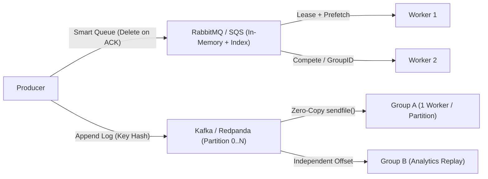
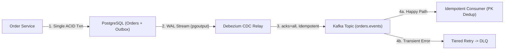

---
tags:
  - software-engineering
  - system-design
  - message-queues
  - kafka
  - distributed-systems
created: 2026-11-13
updated: 2026-11-13
status: 🟢
level: mid-to-senior
---

# Message Queues & Event Streaming

> [!abstract] Vault Navigation
> Core distributed systems handbook within [[Programming/Software Engineering/System Design/System Design Overview|System Design Overview]]. Integrates with [[Programming/Software Engineering/Architectural Patterns/Event-Driven Architecture|Event-Driven Architecture]], [[Programming/Software Engineering/Architectural Patterns/CQRS|CQRS]], [[Programming/Software Engineering/System Design/Scalability|Scalability]], [[Programming/Software Engineering/System Design/CAP Theorem|CAP Theorem]], [[Programming/Software Engineering/Database Design/Relational Databases|Relational Databases]], [[Programming/Software Engineering/Database Design/Transactions|Transactions]], and [[Programming/Software Engineering/Database Design/Replication|Replication]].

Asynchronous messaging decouples producer execution from downstream consumer latency, smooths traffic spikes via bounded buffering, and distributes background execution across worker fleets. Selecting between **smart brokers** that track per-message delivery leases (RabbitMQ, AWS SQS) and **dumb brokers** structured as immutable partitioned append-only logs (Apache Kafka, Redpanda) dictates consumer parallelism ceilings, historical replay capability, disk I/O efficiency, and failure-isolation semantics.

---

## 1. First-Principles Mechanics & Complete Architecture

Every messaging platform optimizes around two fundamental architectural choices: **(1) who tracks consumer progress** (broker per-message metadata vs consumer-tracked byte offsets), and **(2) how disk persistence interacts with the OS kernel**.



### 1.1 Smart Broker Push/Lease Models: RabbitMQ vs AWS SQS

Smart brokers maintain per-message state inside broker memory/indexes and delete messages permanently once a consumer acknowledges (`ACK`) successful execution.

#### RabbitMQ (AMQP 0-9-1 Push + Exchanges + Quorum Queues)
1. **Exchanges, Bindings, and Routing Keys**:
   Producers never publish directly to queues in AMQP; they publish to an **Exchange** tagged with a routing key (`orders.eu.paid`). The exchange evaluates **Bindings** to copy the message into zero or more target queues:
   - **`direct`**: Exact match between message routing key and binding key.
   - **`topic`**: Wildcard pattern matching on dot-delimited tokens (`orders.*.paid` or `orders.#`).
   - **`fanout`**: Broadcasts unconditionally to every bound queue.
   - **`headers`**: Matches AMQP header key-value attributes instead of the routing key string.
2. **TCP Push & `basic.qos` (`prefetch_count`) Flow Control**:
   RabbitMQ actively **pushes** messages down open consumer TCP sockets. Without an explicit `prefetch_count` (i.e., default `0` = unlimited), the broker pushes every queued message into the first connected consumer's RAM buffer—starving newly launched autoscaled workers and triggering OOM crashes when jobs consume significant heap. Setting `prefetch_count = 10` caps unacknowledged in-flight deliveries per channel at 10, creating natural backpressure across workers.
3. **Classic Queues vs Raft-Based Quorum Queues**:
   Deprecated *Classic Mirrored Queues* suffered split-brain data corruption during network partitions. Production durable RabbitMQ deployments must declare **Quorum Queues** (`x-queue-type: quorum`), which replicate every enqueue/ACK across nodes using an embedded **Raft consensus** log (`CAP` CP semantics), pair with **Publisher Confirms** (`confirm.select`), and attach `x-dead-letter-exchange` for poison-pill isolation.

#### AWS SQS (Pull Lease, `VisibilityTimeout`, and FIFO Groups)
1. **Pull-Based Lease Lifecycle (`Available -> InFlight -> Deleted`)**:
   Instead of pushing over persistent AMQP sockets, stateless HTTP workers long-poll (`WaitTimeSeconds = 20`) SQS partitions:
   - On `ReceiveMessage`, SQS transitions the message to `InFlight`, issues an opaque `ReceiptHandle`, and starts a server-side **`VisibilityTimeout`** lease timer (default `30s`, max `12h`) while hiding the message from sibling workers.
   - Upon completion, the worker issues `DeleteMessage(ReceiptHandle)` to purge the record permanently.
   - If the worker crashes—or takes longer than `VisibilityTimeout`—the lease expires, SQS transitions the message back to `Available`, increments `ApproximateReceiveCount`, and redelivers it to another worker. When `ApproximateReceiveCount > maxReceiveCount`, SQS moves the message into the configured **Dead-Letter Queue (DLQ)** via Redrive Policy.
2. **Heartbeat Lease Extension**:
   Long-running tasks (video transcoding, ML batch inference, slow external bank calls) must spawn a background heartbeat timer calling **`ChangeMessageVisibility`** periodically (e.g., every 1/3 of `VisibilityTimeout`) to extend the lease cleanly while execution continues—and abort extension on `SIGTERM` or processing failure.
3. **SQS Standard vs SQS FIFO**:
   - **Standard**: Virtually unlimited TPS, best-effort ordering, **at-least-once** delivery (duplicates can occur during distributed shard rebalancing).
   - **FIFO (`*.fifo`)**: Guarantees strict FIFO ordering **per `MessageGroupId`** and **exact-once deduplication within a 5-minute window** via `MessageDeduplicationId` (or SHA-256 content hash). Throughput scales per `MessageGroupId` shard (`300 msg/s` per API call, `3,000 msg/s` with batching of 10, or `70,000+ msg/s` with High Throughput FIFO enabled—though a single `MessageGroupId` remains strictly serialized to preserve ordering!).

### 1.2 Dumb Broker Append-Only Logs: Apache Kafka & Redpanda

A partitioned log broker never tracks per-message ACK state and never deletes records upon consumption. Consumers are lightweight readers holding only a monotonic 64-bit integer **offset** per partition.

#### Storage Layout: Segments, Sparse Indexes & Log Compaction
Each Kafka **Topic** splits into $P$ ordered **Partitions**. On disk, each partition is an append-only sequence of **Log Segments** (default 1 GB `.log` data files accompanied by `.index` and `.timeindex` sparse memory-mapped files):
- **Append-Only Sequential Writes**: Producers append batches sequentially to the active segment tail—avoiding random disk seeks completely (`100s MB/s–GB/s` sequential throughput even on spinning disks and saturating NVMe channels).
- **Sparse `.index` Lookup**: Rather than indexing every message offset, Kafka indexes every ~4 KB of `.log` bytes (`index.interval.bytes=4096`). Seeking to offset `1,048,592` binary-searches the compact memory-mapped `.index` file in RAM and linearly scans at most 4 KB in the `.log` segment.
- **Retention vs Compaction**: Standard topics retain segments by time (`retention.ms`, e.g., `7 days`) or byte ceiling (`retention.bytes`), deleting whole closed segments in $O(1)$. **Compacted topics** (`cleanup.policy=compact`) periodically merge old segments in the background, retaining strictly the **latest record per message key** (and deleting keys after a `delete.retention.ms` grace period when a `null`-value **tombstone** record is published).

#### OS Page Cache & Zero-Copy `sendfile(2)` Mechanics
Traditional message brokers read bytes from disk into kernel buffer $\to$ copy into JVM/user-space heap $\to$ serialize into socket buffer $\to$ copy to NIC DMA (4 context switches, 4 memory copies, heavy GC pressure). Kafka delegates buffering entirely to the **Linux OS Page Cache** and calls **`sendfile(2)`**:
1. Producer appends write sequentially into the OS Page Cache (flushed asynchronously to disk by kernel `pdflush`, while durability derives from cross-broker replication rather than per-message `fsync()`!).
2. Active consumers reading near the log tail hit **100% RAM inside the OS Page Cache** with zero physical disk reads.
3. **`sendfile(2)`** instructs the kernel to transfer bytes **directly from Page Cache pages to the NIC DMA ring buffer**, bypassing user-space JVM heap completely (0 JVM copies, 2 context switches).
- **Important Caveats**: Enabling **application-level TLS** inside the Kafka JVM disables kernel `sendfile()` (because user-space Java must encrypt payload bytes before writing to the socket), unless **Linux kernel TLS (`kTLS`)** offloading is active. **Redpanda** (C++20 / Seastar engine) eliminates JVM garbage collection and the Linux Page Cache entirely using **thread-per-core pinned CPU architecture**, direct NVMe **asynchronous `io_uring` DMA**, and user-space memory pools to eliminate tail-latency spikes during Page Cache eviction storms.

#### KRaft Controller Architecture (ZooKeeper Elimination)
Historically, Kafka relied on an external **Apache ZooKeeper** cluster to store broker membership, partition leader elections, and topic ACLs—creating dual-cluster operational complexity and scaling bottlenecks when cluster metadata exceeded ~200,000 partitions (slow ZooKeeper session failover replays). Since Kafka 3.3+ (and default in 4.0), **KRaft (Kafka Raft Metadata Mode)** embeds an internal **Raft consensus quorum** directly inside controller brokers via an append-only `@metadata` topic. Active controllers maintain warm in-memory snapshots; standby controllers stay continuously caught up on the Raft log, reducing controller failover recovery from tens of seconds down to milliseconds.

#### Consumer Groups, Partition Ceiling & Rebalance Storm Mechanics
Within a single **Consumer Group (`group.id`)**, Kafka guarantees per-partition ordering by enforcing a strict **1-to-1 exclusive ownership invariant**: **each partition is assigned to at most 1 consumer instance inside that group**.

```mermaid
sequenceDiagram
    participant C1 as "Consumer 1 (Part 0, 1)"
    participant Coord as "Group Coordinator Broker"
    participant C2 as "Consumer 2 (Joining)"
    participant Off as "__consumer_offsets Log"
    C2->>Coord: 1. JoinGroup Request
    Coord-->>C1: 2. Revoke Only Part 1 (Cooperative Sticky)
    C1->>Off: 3. Commit Part 1 Offset (Part 0 Keeps Running!)
    C1->>Coord: 4. RejoinGroup (Owns Part 0)
    Coord-->>C1: 5a. Assign Part 0
    Coord-->>C2: 5b. Assign Part 1
```

- **The Partition Parallelism Ceiling**: If a topic has `12 partitions` and you autoscale a Consumer Group deployment from `12` pods to `24` pods, **12 pods remain permanently unassigned at 0% CPU**. Effective parallelism within one Consumer Group cannot exceed `num_partitions`.
- **Eager vs Cooperative Sticky Rebalancing**:
  - Legacy **`RangeAssignor` / `RoundRobinAssignor` (Eager Protocol)**: Every consumer drops *all* assigned partitions simultaneously ("stop-the-world" pause) whenever any pod joins, restarts, or crashes.
  - **`CooperativeStickyAssignor`**: Executes an incremental two-phase handoff—healthy consumers retain unaffected partitions continuously while revoking *only* the subset of partitions migrating to newly joined pods.
- **Two Decoupled Liveness Timers (The `max.poll.interval.ms` Rebalance Storm)**:
  Kafka clients run two independent checks:
  1. **Background Heartbeat Thread** (`heartbeat.interval.ms = 3s`, `session.timeout.ms = 45s`): Detects dead processes/network splits quickly even while user code executes.
  2. **Application Poll Loop Timer (`max.poll.interval.ms = 300s` default)**: Measures wall-clock duration between consecutive `consumer.poll()` invocations. If a batch of `max.poll.records` (default `500`) contains slow blocking I/O (e.g., `500 * 1.2s = 600s > 300s`), the consumer's poll timer expires. The broker ejects the "stalled" consumer, triggers a rebalance, and hands the exact same uncommitted batch to Pod B—which stalls for 5 minutes and gets evicted too, creating an endless **rebalance + duplicate-processing storm**!

---

## 2. Real-World Use Cases & Decision Matrix

Selecting the wrong broker introduces unnecessary operational complexity (running Kafka for 50 background emails/sec) or hits hard architectural ceilings (attempting 7-day event replay on SQS).

| Dimension | RabbitMQ (Quorum) | AWS SQS (Standard / FIFO) | Apache Kafka / Redpanda | PostgreSQL (`SKIP LOCKED`) |
| :--- | :--- | :--- | :--- | :--- |
| **Storage & Deletion** | Deleted upon consumer `ACK` | Deleted upon `DeleteMessage` | Retained on disk (`days`/`size`/compacted) | Deleted or archived in table |
| **Worker Parallelism** | Unbounded competing workers on 1 queue | Standard: Unbounded; FIFO: 1 worker per active `MessageGroupId` | Capped at **`num_partitions`** per Consumer Group | Unbounded competing DB workers (up to pool limit) |
| **Historical Replay** | No (unless streamed via RabbitMQ Streams) | No (unless archived to S3/Firehose separately) | **Native** (`offset` seek by time or index) | Only if retained in archival rows |
| **Routing Topology** | Rich broker-side routing (`direct`, `topic`, `headers`) | Point-to-point (pair with AWS SNS for fan-out) | Dumb topic append; multiple Consumer Groups fan-out freely | SQL predicates / partial indexes |
| **Typical Throughput** | `10k – 100k msg/s` | Effectively unlimited (Standard); `3k–70k` (FIFO) | **`1M+ msg/s`** (`sendfile` sequential I/O) | `1k – 10k msg/s` (bounded by MVCC vacuum/WAL) |
| **Best Fit Scenario** | Complex routing topologies, RPC reply queues, priority task queues | Serverless/AWS variable-duration background jobs, decoupled teams | Event sourcing, CDC streams, multi-consumer fan-out, real-time analytics | Low-to-moderate volume jobs needing zero extra infrastructure |

### Decision Guidelines: When NOT to Choose Kafka vs Queues
- **Do NOT use Kafka** for unbounded long-running, arbitrary-duration jobs (e.g., 10-minute video transcodes or unstable third-party webhook retries per record): Kafka's partition-offset model cannot selectively ACK message `105` while retrying message `102` on the same partition without custom delay topics or blocking consumers. Use **SQS / RabbitMQ** (or push lightweight job pointers from Kafka into SQS).
- **Do NOT use SQS/RabbitMQ** when 4+ independent downstream services (billing, search indexing, ML feature store, audit compliance) need independent read speeds and historical **7-day replay** from a single canonical event stream.

---

## 3. Step-by-Step Practical Application: End-to-End Outbox, CDC, Idempotency & Tiered Retries

This production blueprint implements an **effectively-once** order payment and fulfillment pipeline across PostgreSQL, Kafka, Debezium CDC, and AWS SQS, eliminating dual-write gaps and head-of-line partition blocking across this layout:
- `sql/outbox_idempotency.sql` — `orders`, `outbox_events`, `processed_events` PK deduplication, and `blocked_keys`/`parked_events` quarantine tables.
- `config/kafka-durability.properties` & `debezium/pg-outbox-connector.json` — `RF=3`, `min.insync.replicas=2`, `acks=all`, `enable.idempotence=true`, `zstd`, and Debezium `EventRouter` WAL CDC config.
- `src/retry-backoff.ts`, `src/outbox-service.ts`, `src/outbox-poller.ts`, `src/idempotent-consumer.ts`, & `src/sqs-heartbeat-worker.ts` — Complete TypeScript implementation covering atomic outbox commits, `SKIP LOCKED` fallback polling, tiered retry topics, per-key poison quarantine, and SQS lease heartbeats.



### 3.1 PostgreSQL Schema: Transactional Outbox, Deduplication & Key Quarantine (`sql/outbox_idempotency.sql`)

```sql
-- sql/outbox_idempotency.sql

-- 1. Core Business Table
CREATE TABLE orders (
    id              UUID PRIMARY KEY,
    customer_id     UUID NOT NULL,
    total_cents     BIGINT NOT NULL CHECK (total_cents > 0),
    status          TEXT NOT NULL CHECK (status IN ('PENDING', 'PAID', 'CANCELLED')),
    created_at      TIMESTAMPTZ NOT NULL DEFAULT now(),
    updated_at      TIMESTAMPTZ NOT NULL DEFAULT now()
);

-- 2. Transactional Outbox Table (Written atomically with orders mutation)
-- Compatible with both Debezium EventRouter SMT and SKIP LOCKED fallback polling
CREATE TABLE outbox_events (
    id              UUID PRIMARY KEY,
    aggregate_type  TEXT NOT NULL,          -- Routes to Kafka topic e.g. 'orders.events'
    aggregate_id    TEXT NOT NULL,          -- Becomes Kafka partition key (customer_id / order_id)
    event_type      TEXT NOT NULL,          -- e.g. 'OrderPaid'
    payload         JSONB NOT NULL,
    headers         JSONB NOT NULL DEFAULT '{}'::jsonb,
    created_at      TIMESTAMPTZ NOT NULL DEFAULT now(),
    published_at    TIMESTAMPTZ NULL        -- Used ONLY by polling relay; Debezium tails WAL & ignores
);

-- Partial index keeps polling relay scans O(unpublished) tiny even at millions of historical rows
CREATE INDEX idx_outbox_unpublished
    ON outbox_events (created_at ASC)
    WHERE published_at IS NULL;

-- 3. Idempotent Consumer Deduplication Table
CREATE TABLE processed_events (
    event_id        UUID PRIMARY KEY,
    consumer_group  TEXT NOT NULL,
    processed_at    TIMESTAMPTZ NOT NULL DEFAULT now()
);

-- 4. Per-Key Quarantine Tables (Prevents 1 poison pill from stalling 1/P of all customers)
CREATE TABLE blocked_keys (
    partition_key   TEXT PRIMARY KEY,
    reason          TEXT NOT NULL,
    failed_event_id UUID NOT NULL,
    blocked_at      TIMESTAMPTZ NOT NULL DEFAULT now()
);

CREATE TABLE parked_events (
    seq_id          BIGSERIAL PRIMARY KEY,
    partition_key   TEXT NOT NULL REFERENCES blocked_keys(partition_key) ON DELETE CASCADE,
    event_id        UUID NOT NULL UNIQUE,
    event_type      TEXT NOT NULL,
    payload         JSONB NOT NULL,
    headers         JSONB NOT NULL,
    parked_at       TIMESTAMPTZ NOT NULL DEFAULT now()
);

CREATE INDEX idx_parked_key_seq ON parked_events (partition_key, seq_id ASC);
```

### 3.2 Hardened Kafka Topic, Producer & Consumer Configuration (`config/kafka-durability.properties`)

```ini
# config/kafka-durability.properties

# ========================
# TOPIC-LEVEL DURABILITY
# ========================
# Require 3 replicas across distinct Availability Zones (broker.rack)
replication.factor=3
# Commit succeeds ONLY when Leader + at least 1 follower confirm persistence
min.insync.replicas=2
# Prevent out-of-sync follower promotion from silently truncating committed offsets
unclean.leader.election.enable=false
# Compress batches on broker/producer boundary using modern zstd (high ratio, fast CPU)
compression.type=zstd
retention.ms=604800000

# ========================
# PRODUCER CONFIGURATION
# ========================
# Block ACK until ALL current ISR replicas (min 2) write record batch
acks=all
# Prevent duplicate writes and out-of-order batch retries via PID + monotonic sequence number
enable.idempotence=true
# Safe with enable.idempotence=true (up to 5 pipelined batches in flight without reordering)
max.in.flight.requests.per.connection=5
retries=2147483647
delivery.timeout.ms=120000
request.timeout.ms=30000
# Micro-batch up to 10ms or 64KB to amortize network/compression overhead
linger.ms=10
batch.size=65536
compression.type=zstd

# ========================
# CONSUMER CONFIGURATION
# ========================
# Never auto-commit offsets on timer; commit explicitly ONLY after DB transaction commits
enable.auto.commit=false
# Hide aborted Kafka transactional records
isolation.level=read_committed
# Incremental two-phase partition handoff (zero stop-the-world cluster freeze)
partition.assignment.strategy=org.apache.kafka.clients.consumer.CooperativeStickyAssignor
# Keep batch duration strictly well below max.poll.interval.ms (e.g. 50 * 0.5s = 25s << 300s)
max.poll.records=50
max.poll.interval.ms=300000
# Background heartbeat thread parameters for fast node crash detection
session.timeout.ms=45000
heartbeat.interval.ms=3000
```

### 3.3 Debezium PostgreSQL CDC Outbox Connector (`debezium/pg-outbox-connector.json`)

Debezium attaches to PostgreSQL's `pgoutput` logical replication slot, reads committed WAL changes cleanly with zero `SELECT` lock contention on the `outbox_events` table, and routes rows directly to Kafka topics using the `EventRouter` Single Message Transform (SMT).

```json
{
  "name": "orders-outbox-cdc-connector",
  "config": {
    "connector.class": "io.debezium.connector.postgresql.PostgresConnector",
    "database.hostname": "pg-primary.prod.internal",
    "database.port": "5432",
    "database.user": "debezium_repl",
    "database.password": "${file:/mnt/secrets/db.properties:repl_password}",
    "database.dbname": "orders_db",
    "topic.prefix": "orders_cdc",
    "plugin.name": "pgoutput",
    "slot.name": "debezium_orders_outbox_slot",
    "publication.name": "orders_outbox_pub",
    "table.include.list": "public.outbox_events",
    "tombstones.on.delete": "false",
    "heartbeat.interval.ms": "10000",
    "transforms": "outbox",
    "transforms.outbox.type": "io.debezium.transforms.outbox.EventRouter",
    "transforms.outbox.table.field.event.id": "id",
    "transforms.outbox.table.field.event.key": "aggregate_id",
    "transforms.outbox.table.field.event.type": "event_type",
    "transforms.outbox.table.field.event.payload": "payload",
    "transforms.outbox.route.by.field": "aggregate_type",
    "transforms.outbox.route.topic.replacement": "${routedByValue}.events",
    "transforms.outbox.table.expand.json.payload": "true"
  }
}
```

### 3.4 Full Jitter Exponential Backoff & Atomic Outbox Write (`src/retry-backoff.ts`, `src/outbox-service.ts`)

```ts
// src/retry-backoff.ts
import { randomInt } from "node:crypto";

/**
 * AWS Full Jitter Backoff:
 * Uniformly distributes retry spikes across [0, min(capMs, baseMs * 2^attempt)].
 * Eliminates synchronized retry thundering herds against recovering downstream dependencies.
 */
export function fullJitterDelayMs(
  attempt: number,
  baseMs = 250,
  capMs = 60_000
): number {
  const safeAttempt = Math.min(Math.max(0, attempt), 20);
  const ceiling = Math.min(capMs, baseMs * 2 ** safeAttempt);
  return ceiling <= 0 ? 0 : randomInt(0, ceiling + 1);
}

export async function sleep(ms: number, signal?: AbortSignal): Promise<void> {
  if (ms <= 0) return;
  await new Promise<void>((resolve, reject) => {
    const timer = setTimeout(() => {
      signal?.removeEventListener("abort", onAbort);
      resolve();
    }, ms);

    const onAbort = () => {
      clearTimeout(timer);
      reject(new Error("Sleep aborted"));
    };

    if (signal?.aborted) {
      onAbort();
      return;
    }
    signal?.addEventListener("abort", onAbort, { once: true });
  });
}
```

```ts
// src/outbox-service.ts
import { randomUUID } from "node:crypto";
import type { Pool } from "pg";

export interface PayOrderInput {
  orderId: string;
  customerId: string;
  totalCents: number;
}

/**
 * Eliminates dual-write atomicity gap:
 * Updates business state AND inserts domain event inside ONE PostgreSQL ACID transaction.
 */
export async function markOrderPaidWithOutbox(
  pool: Pool,
  input: PayOrderInput
): Promise<{ eventId: string }> {
  const client = await pool.connect();
  const eventId = randomUUID();

  try {
    await client.query("BEGIN");

    const updated = await client.query<{ id: string }>(
      `UPDATE orders
          SET status = 'PAID', updated_at = now()
        WHERE id = $1 AND status = 'PENDING'
        RETURNING id`,
      [input.orderId]
    );

    if (updated.rowCount === 0) {
      throw new Error(`Order ${input.orderId} not eligible for PAID transition`);
    }

    const payload = {
      eventId,
      orderId: input.orderId,
      customerId: input.customerId,
      totalCents: input.totalCents,
      occurredAt: new Date().toISOString(),
    };

    await client.query(
      `INSERT INTO outbox_events (id, aggregate_type, aggregate_id, event_type, payload, headers)
       VALUES ($1, $2, $3, $4, $5::jsonb, $6::jsonb)`,
      [
        eventId,
        "orders",
        input.customerId, // Partition key preserves strict per-customer order
        "OrderPaid",
        JSON.stringify(payload),
        JSON.stringify({ "x-schema-version": "1", "x-event-id": eventId }),
      ]
    );

    await client.query("COMMIT");
    return { eventId };
  } catch (err) {
    await client.query("ROLLBACK");
    throw err;
  } finally {
    client.release();
  }
}
```

### 3.5 Fallback `SKIP LOCKED` Outbox Poller Relay (`src/outbox-poller.ts`)

When organizations prefer zero Debezium infrastructure for moderate event volumes (`< 5k events/sec`), a polling relay uses PostgreSQL `FOR UPDATE SKIP LOCKED` so multiple stateless relay pods pull disjoint batches without lock contention.

```ts
// src/outbox-poller.ts
import type { Producer } from "kafkajs";
import type { Pool } from "pg";

interface OutboxRow {
  id: string;
  aggregate_type: string;
  aggregate_id: string;
  event_type: string;
  payload: unknown;
  headers: Record<string, string>;
}

export async function pollAndPublishOutboxBatch(
  pool: Pool,
  producer: Producer,
  batchSize = 100
): Promise<number> {
  const client = await pool.connect();
  try {
    await client.query("BEGIN");

    // SKIP LOCKED allows N concurrent poller instances without blocking each other
    const { rows } = await client.query<OutboxRow>(
      `SELECT id, aggregate_type, aggregate_id, event_type, payload, headers
         FROM outbox_events
        WHERE published_at IS NULL
        ORDER BY created_at ASC
        LIMIT $1
        FOR UPDATE SKIP LOCKED`,
      [batchSize]
    );

    if (rows.length === 0) {
      await client.query("COMMIT");
      return 0;
    }

    const groupedByTopic = new Map<string, OutboxRow[]>();
    for (const row of rows) {
      const topic = `${row.aggregate_type}.events`;
      const list = groupedByTopic.get(topic) ?? [];
      list.push(row);
      groupedByTopic.set(topic, list);
    }

    // Send with idempotent producer (acks=-1); at-least-once if crash occurs before COMMIT
    for (const [topic, topicRows] of groupedByTopic.entries()) {
      await producer.send({
        topic,
        acks: -1,
        messages: topicRows.map((row) => ({
          key: row.aggregate_id,
          value: JSON.stringify(row.payload),
          headers: {
            ...row.headers,
            "x-event-id": row.id,
            "x-event-type": row.event_type,
          },
        })),
      });
    }

    const ids = rows.map((r) => r.id);
    await client.query(
      `UPDATE outbox_events SET published_at = now() WHERE id = ANY($1::uuid[])`,
      [ids]
    );

    await client.query("COMMIT");
    return rows.length;
  } catch (err) {
    await client.query("ROLLBACK");
    throw err;
  } finally {
    client.release();
  }
}
```

### 3.6 Idempotent Consumer, Tiered Retry Topics & Non-Blocking Key Quarantine (`src/idempotent-consumer.ts`)

This production consumer demonstrates both failure-isolation strategies:
1. **Unordered/Best-Effort Path**: Routes transient failures into tiered delayed retry topics (`orders.retry.1m` $\to$ `orders.retry.10m` $\to$ `orders.dlq`) with Full Jitter scheduling headers, immediately advancing the main partition offset.
2. **Strict Per-Key Ordered Path**: If a poison pill crashes on `customerId=4082`, it isolates *only* `customerId=4082` inside `blocked_keys` / `parked_events` and advances the partition offset so the other 99.99% of customers hashing to that partition experience zero delay!

```ts
// src/idempotent-consumer.ts
import type { Consumer, EachMessagePayload, Producer } from "kafkajs";
import type { Pool } from "pg";
import { fullJitterDelayMs, sleep } from "./retry-backoff.js";

export class NonRetryableError extends Error {
  constructor(message: string) {
    super(message);
    this.name = "NonRetryableError";
  }
}

export interface OrderPaidPayload {
  eventId: string;
  orderId: string;
  customerId: string;
  totalCents: number;
}

export class IdempotentOrderConsumer {
  private readonly retryTiers = [
    { topic: "orders.retry.1m", baseDelayMs: 60_000 },
    { topic: "orders.retry.10m", baseDelayMs: 600_000 },
  ];
  private readonly dlqTopic = "orders.dlq";

  constructor(
    private readonly pool: Pool,
    private readonly producer: Producer,
    private readonly consumer: Consumer,
    private readonly groupId: string,
    private readonly strictPerKeyOrder: boolean
  ) {}

  public async handleMessage(payload: EachMessagePayload): Promise<void> {
    const { topic, partition, message } = payload;
    const key = message.key?.toString("utf8") ?? "unknown";
    const headers = normalizeHeaders(message.headers);
    const eventId = headers["x-event-id"];

    // 1. Honor delayed retry-after timestamp when consuming from retry-1m / retry-10m topics
    if (headers["x-retry-after"]) {
      const targetEpochMs = Number(headers["x-retry-after"]);
      const waitMs = targetEpochMs - Date.now();
      if (waitMs > 0) {
        await sleep(Math.min(waitMs, 30_000)); // Bound per-message wait < max.poll.interval.ms
        if (Date.now() < targetEpochMs) {
          // Pause partition or re-wait cleanly in production delay scheduler
          await sleep(targetEpochMs - Date.now());
        }
      }
    }

    let parsed: OrderPaidPayload;
    try {
      if (!message.value) throw new NonRetryableError("Empty Kafka record value");
      parsed = JSON.parse(message.value.toString("utf8")) as OrderPaidPayload;
      if (!eventId || parsed.totalCents <= 0) {
        throw new NonRetryableError("Invalid schema: missing eventId or non-positive total");
      }
    } catch (err) {
      await this.sendToDlq(topic, partition, message.offset, key, message.value, headers, err);
      await this.commitOffset(topic, partition, message.offset);
      return;
    }

    // 2. Strict Per-Key Quarantine Check: isolate poisoned customer without blocking partition
    if (this.strictPerKeyOrder) {
      const parked = await this.parkIfKeyBlocked(key, parsed, headers);
      if (parked) {
        await this.commitOffset(topic, partition, message.offset);
        return;
      }
    }

    // 3. Execute Business Mutation Atomically with PK Deduplication
    try {
      await this.applyIdempotently(eventId, parsed);
    } catch (err) {
      await this.handleProcessingFailure(
        err,
        topic,
        partition,
        message.offset,
        key,
        parsed,
        message.value,
        headers
      );
    }

    await this.commitOffset(topic, partition, message.offset);
  }

  private async applyIdempotently(eventId: string, event: OrderPaidPayload): Promise<void> {
    const client = await this.pool.connect();
    try {
      await client.query("BEGIN");

      // Deduplicate atomically inside the exact business mutation transaction
      const dedup = await client.query(
        `INSERT INTO processed_events (event_id, consumer_group)
         VALUES ($1, $2)
         ON CONFLICT (event_id) DO NOTHING`,
        [eventId, this.groupId]
      );

      if (dedup.rowCount === 0) {
        // Duplicate delivery already committed previously -> skip business mutation safely
        await client.query("COMMIT");
        return;
      }

      await client.query(
        `INSERT INTO fulfillment_ledger (order_id, customer_id, amount_cents)
         VALUES ($1, $2, $3)`,
        [event.orderId, event.customerId, event.totalCents]
      );

      await client.query("COMMIT");
    } catch (err) {
      await client.query("ROLLBACK");
      throw err;
    } finally {
      client.release();
    }
  }

  private async parkIfKeyBlocked(
    key: string,
    parsed: OrderPaidPayload,
    headers: Record<string, string>
  ): Promise<boolean> {
    const client = await this.pool.connect();
    try {
      await client.query("BEGIN");
      const check = await client.query(
        `SELECT 1 FROM blocked_keys WHERE partition_key = $1 FOR SHARE`,
        [key]
      );
      if (check.rowCount === 0) {
        await client.query("COMMIT");
        return false;
      }

      await client.query(
        `INSERT INTO parked_events (partition_key, event_id, event_type, payload, headers)
         VALUES ($1, $2, $3, $4::jsonb, $5::jsonb)
         ON CONFLICT (event_id) DO NOTHING`,
        [key, parsed.eventId, "OrderPaid", JSON.stringify(parsed), JSON.stringify(headers)]
      );
      await client.query("COMMIT");
      return true;
    } catch (err) {
      await client.query("ROLLBACK");
      throw err;
    } finally {
      client.release();
    }
  }

  private async handleProcessingFailure(
    err: unknown,
    topic: string,
    partition: number,
    offset: string,
    key: string,
    parsed: OrderPaidPayload,
    rawValue: Buffer | null,
    headers: Record<string, string>
  ): Promise<void> {
    if (err instanceof NonRetryableError) {
      if (this.strictPerKeyOrder) {
        await this.quarantineKey(key, parsed, headers, err.message);
      } else {
        await this.sendToDlq(topic, partition, offset, key, rawValue, headers, err);
      }
      return;
    }

    const attempt = Number(headers["x-retry-attempt"] ?? "0");
    if (attempt < this.retryTiers.length) {
      const nextTier = this.retryTiers[attempt];
      const jitteredDelay = fullJitterDelayMs(attempt, nextTier.baseDelayMs, 600_000);
      await this.producer.send({
        topic: nextTier.topic,
        acks: -1,
        messages: [
          {
            key,
            value: rawValue,
            headers: {
              ...headers,
              "x-retry-attempt": String(attempt + 1),
              "x-retry-after": String(Date.now() + jitteredDelay),
              "x-orig-topic": headers["x-orig-topic"] ?? topic,
              "x-orig-partition": headers["x-orig-partition"] ?? String(partition),
              "x-orig-offset": headers["x-orig-offset"] ?? offset,
              "x-error-message": err instanceof Error ? err.message : String(err),
            },
          },
        ],
      });
      return;
    }

    if (this.strictPerKeyOrder) {
      await this.quarantineKey(key, parsed, headers, "Exhausted retry tiers");
    } else {
      await this.sendToDlq(topic, partition, offset, key, rawValue, headers, err);
    }
  }

  private async quarantineKey(
    key: string,
    parsed: OrderPaidPayload,
    headers: Record<string, string>,
    reason: string
  ): Promise<void> {
    const client = await this.pool.connect();
    try {
      await client.query("BEGIN");
      await client.query(
        `INSERT INTO blocked_keys (partition_key, reason, failed_event_id)
         VALUES ($1, $2, $3)
         ON CONFLICT (partition_key) DO NOTHING`,
        [key, reason, parsed.eventId]
      );
      await client.query(
        `INSERT INTO parked_events (partition_key, event_id, event_type, payload, headers)
         VALUES ($1, $2, $3, $4::jsonb, $5::jsonb)
         ON CONFLICT (event_id) DO NOTHING`,
        [key, parsed.eventId, "OrderPaid", JSON.stringify(parsed), JSON.stringify(headers)]
      );
      await client.query("COMMIT");
    } catch (dbErr) {
      await client.query("ROLLBACK");
      throw dbErr;
    } finally {
      client.release();
    }
  }

  private async sendToDlq(
    topic: string,
    partition: number,
    offset: string,
    key: string,
    rawValue: Buffer | null,
    headers: Record<string, string>,
    err: unknown
  ): Promise<void> {
    await this.producer.send({
      topic: this.dlqTopic,
      acks: -1,
      messages: [
        {
          key,
          value: rawValue,
          headers: {
            ...headers,
            "x-orig-topic": headers["x-orig-topic"] ?? topic,
            "x-orig-partition": headers["x-orig-partition"] ?? String(partition),
            "x-orig-offset": headers["x-orig-offset"] ?? offset,
            "x-error-message": err instanceof Error ? err.message : String(err),
          },
        },
      ],
    });
  }

  private async commitOffset(topic: string, partition: number, offset: string): Promise<void> {
    await this.consumer.commitOffsets([
      { topic, partition, offset: String(BigInt(offset) + 1n) },
    ]);
  }
}

function normalizeHeaders(raw: EachMessagePayload["message"]["headers"]): Record<string, string> {
  const out: Record<string, string> = {};
  if (!raw) return out;
  for (const [k, v] of Object.entries(raw)) {
    if (typeof v === "string") out[k] = v;
    else if (Buffer.isBuffer(v)) out[k] = v.toString("utf8");
  }
  return out;
}
```

### 3.7 AWS SQS `VisibilityTimeout` Heartbeat Lease Worker (`src/sqs-heartbeat-worker.ts`)

```ts
// src/sqs-heartbeat-worker.ts
import {
  ChangeMessageVisibilityCommand,
  DeleteMessageCommand,
  type Message,
  SQSClient,
} from "@aws-sdk/client-sqs";

export async function processSqsMessageWithHeartbeat(
  sqs: SQSClient,
  queueUrl: string,
  msg: Message,
  visibilityTimeoutSec: number,
  handler: (body: string, signal: AbortSignal) => Promise<void>
): Promise<void> {
  if (!msg.ReceiptHandle || !msg.Body) {
    throw new Error("Malformed SQS message missing ReceiptHandle or Body");
  }

  const abortController = new AbortController();
  const heartbeatEveryMs = Math.max(5_000, Math.floor((visibilityTimeoutSec * 1000) / 3));

  const timer = setInterval(async () => {
    try {
      await sqs.send(
        new ChangeMessageVisibilityCommand({
          QueueUrl: queueUrl,
          ReceiptHandle: msg.ReceiptHandle,
          VisibilityTimeout: visibilityTimeoutSec,
        })
      );
    } catch (err) {
      // Lost lease or handle expired -> abort processing immediately to minimize duplicate side effects
      abortController.abort(err);
    }
  }, heartbeatEveryMs);

  try {
    await handler(msg.Body, abortController.signal);
    await sqs.send(
      new DeleteMessageCommand({
        QueueUrl: queueUrl,
        ReceiptHandle: msg.ReceiptHandle,
      })
    );
  } finally {
    clearInterval(timer);
  }
}
```

---

## 4. Complete Reference, Replication & Edge Cases

### 4.1 Replication, ISR & CAP Theorem Trade-Offs

Every Kafka partition consists of `1 Leader` and `R - 1` `Followers`. Followers pull log batches continuously from the Leader; any follower whose fetch falls more than `replica.lag.time.max.ms` (default `30s`) behind the Leader's log-end offset is evicted from the **In-Sync Replicas (ISR)** set.

| Producer `acks` | Topic `min.insync.replicas` | Actual Durability & CAP Behavior | Failure Mode / Data Loss Vector |
| :--- | :--- | :--- | :--- |
| **`acks=0`** | Any | Fire-and-forget | Lost immediately on TCP drop or broker buffer eviction |
| **`acks=1`** | Any | Leader writes to local OS Page Cache & ACKs | **Silent Data Loss**: Leader crashes before followers fetch batch or disk flushes |
| **`acks=all` (`-1`)** | **`min.insync.replicas=1`** | Waits for current ISR (which shrinks to 1 when followers lag!) | **False Sense of Safety**: Degrades identically to `acks=1` during follower network partition |
| **`acks=all` (`-1`)** | **`min.insync.replicas=2`** (`RF=3`) | Committed only when Leader + $\ge 1$ Follower persist to log | Zero loss on single broker failure; rejects writes (`NotEnoughReplicasException`) if 2/3 brokers fail (**CP over AP** per [[Programming/Software Engineering/System Design/CAP Theorem\|CAP Theorem]]) |

> [!danger] Never Enable `unclean.leader.election.enable=true` on Durable Streams
> If every ISR replica dies simultaneously, setting `unclean.leader.election.enable=true` promotes an out-of-sync follower to Leader. When the original ISR brokers recover, they **truncate** previously acknowledged offsets to match the lower-offset unclean leader—causing permanent silent data loss. Keep `unclean.leader.election.enable=false` on state-mutation topics.

### 4.2 Delivery Semantics & Kafka Transactions Boundary

| Semantic | Mechanism | Failure Limitation |
| :--- | :--- | :--- |
| **At-Most-Once** | Commit offset before handler executes (or `acks=0`) | Worker crash drops message permanently |
| **At-Least-Once** | Commit offset strictly *after* side effects persist | Crash after external DB commit / API call triggers redelivery & duplicate execution |
| **Effectively-Once (End-to-End)** | **Transactional Outbox** + `acks=all` + `enable.idempotence=true` + **`processed_events` PK deduplication** | Guarantees zero missing events and zero duplicate DB state transitions across broker/worker crashes |
| **Kafka EOS (`transactional.id`)** | Atomic two-phase coordinator commit across Kafka topics & `__consumer_offsets` | **Bounded strictly inside Kafka (`Kafka -> Kafka`)**: cannot span an external PostgreSQL commit or REST payment call! |

### 4.3 Ordering Traps & Hot Partition Key Mitigation

1. **Pipelined Retry Reordering (`OutOfOrderSequenceException`)**:
   With `max.in.flight.requests.per.connection > 1` and `enable.idempotence=false`, Batch 1 can time out transiently while Batch 2 succeeds, and Batch 1's subsequent retry lands *after* Batch 2—inverting event order. Always keep **`enable.idempotence=true`**, which embeds `(ProducerID, Epoch, SequenceNumber)` inside every batch so brokers deduplicate retries and enforce strict FIFO sequence order even with 5 pipelined batches in flight.
2. **Hot Partition Key Skew & Salting**:
   Choosing a low-cardinality or wildly skewed partition key (`country="US"`, or `tenant_id="mega-corp"` generating 65% of global traffic) pins all load onto **1 partition**, saturating 1 leader broker disk/NIC and 1 consumer pod while 31 sibling partitions sit idle.
   - **Fix A (No Strict Global Key Ordering Needed)**: Pass `key = null` (Kafka's `UniformStickyPartitioner` fills full batches cleanly across healthy partitions evenly).
   - **Fix B (Key Salting)**: Append a bounded hash shard suffix (`tenant_id + "#" + (hash(order_id) % 8)`), distributing the enterprise tenant across 8 partitions while maintaining strict ordering per `order_id` or sub-shard.
   - **Fix C (Partition Expansion Warning)**: Increasing a topic's partition count from `P=12` to `P=24` alters `murmur2(key) % P`, breaking temporal ordering across pre-expansion vs post-expansion records for the same key! Always size partition counts generously upfront (`24–64` for standard core services) or drain/migrate to a new topic version when strict cross-resize ordering is required.

---

## 5. Production Debugging, Profiling & Operations Playbook

| Symptom | Most Likely Root Cause | Exact Diagnostic Commands | Remediation |
| :--- | :--- | :--- | :--- |
| **Consumer lag grows linearly; half of pods sit at 0% CPU** | Pod count exceeds topic `num_partitions`, or hot partition key skew | `kafka-consumer-groups.sh --bootstrap-server $B --describe --group orders-fulfillment` <br> `kafka-run-class.sh kafka.tools.GetOffsetShell --broker-list $B --topic orders.events` | Increase partitions (or salt skewed key); align `HPA maxReplicas <= num_partitions`; switch to SQS if unbounded workers required |
| **Endless rebalance loops + duplicate event spikes every 5 min** | Slow batch processing exceeds `max.poll.interval.ms` (`300s`), kicking healthy consumers | `grep -E "Revoking\|max.poll.interval\|Member .* leaving" consumer.log` <br> Check `consumer_lag` + `rebalance-rate-per-min` JMX metric | Lower `max.poll.records` (e.g. `500 -> 20`); offload slow calls to bounded worker pool; switch to `CooperativeStickyAssignor` |
| **Offset lag shows `100` vs `50,000`: when to page on-call?** | Raw offset lag misleads without consumption throughput (**Time-Lag** = `lag / consume_rate`) | Compare `LAG` column against consumer `records-consumed-rate` metric | Alert on **estimated time-lag** (`consumer_lag_seconds > SLA`) and **oldest unconsumed message timestamp**, not flat offset count |
| **Producers fail with `NotEnoughReplicasException`** | Broker failures/restarts reduced ISR below `min.insync.replicas=2` | `kafka-topics.sh --bootstrap-server $B --describe --under-replicated-partitions` <br> `kafka-topics.sh --describe --unavailable-partitions` | Restore crashed broker / disk volume immediately; spread brokers across 3 AZs (`broker.rack`) |
| **PostgreSQL primary disk filling rapidly toward 100% (`pg_wal`)** | Stopped/broken Debezium connector left an active replication slot retaining unconsumed WAL files indefinitely | `SELECT slot_name, active, pg_size_pretty(pg_wal_lsn_diff(pg_current_wal_lsn(), restart_lsn)) AS wal_retained FROM pg_replication_slots;` | Fix Debezium connector immediately, OR drop orphaned slot via `SELECT pg_drop_replication_slot('slot_name');` and configure `max_slot_wal_keep_size` |
| **RabbitMQ workers crash with OOM or newly scaled pods get zero work** | Missing `basic.qos` `prefetch_count` allows broker to dump entire queue into first consumer's RAM | `rabbitmqctl list_queues name messages_ready messages_unacknowledged` <br> `rabbitmqctl list_consumers` | Configure explicit `channel.basicQos(prefetchCount)` (e.g., `10–25`); use Quorum Queues (`x-queue-type: quorum`) |

---

## 6. Worked Exercises

### Exercise 1: Kafka Scaling Freeze & `max.poll.interval.ms` Rebalance Storm

An invoice-generation pipeline consumes from a Kafka topic `invoices.created` configured with **`6` partitions** (`replication.factor=3`) and default consumer settings (`max.poll.records=500`, `max.poll.interval.ms=300000`).
- Generating and uploading each PDF invoice takes **1.2 seconds** synchronously per message.
- Traffic surges $4\times$; an engineer scales the Kubernetes consumer Deployment from **6 pods to 18 pods**.
- **Outcome**: Aggregate throughput does not rise, **12 pods sit at 0% CPU**, and the active 6 pods enter an endless rebalance loop duplicating invoices every 5–10 minutes.

1. Calculate the exact batch processing duration per `poll()` and prove why the rebalance storm happens.
2. Explain why scaling from 6 to 18 pods yielded zero throughput gain.
3. Specify the exact topic, Kubernetes, and Kafka consumer fixes required to scale safely to 18 workers with zero rebalance loops.

---

### Solution 1

#### 1. Batch Processing Math & Rebalance Storm Trace
- Sequential batch duration: $500\text{ records} \times 1.2\text{ s/record} = \mathbf{600\text{ seconds (10 minutes)}}$.
- `max.poll.interval.ms` defaults to `300,000 ms` (**5 minutes**).
- Although the background heartbeat thread keeps pinging the broker every 3 seconds, the main application loop does not invoke `consumer.poll()` again until 600s elapse. At `t = 300s`, the Group Coordinator declares the consumer dead, evicts it from the group, triggers a rebalance, and hands the exact same uncommitted 500-message batch to another pod—which repeats the 5-minute stall infinitely.

#### 2. Why Scaling to 18 Pods Produced Zero Speedup
Inside a single Consumer Group, Kafka assigns each partition to **strictly one consumer instance**. With `6` partitions, 6 pods hold 1 partition each and **12 pods receive zero partitions (`0%` CPU)**.

#### 3. Production Remediation
1. **Increase Partition Count / Decouple Heavy CPU Work**: Increase topic partitions to **$\ge 18$** (e.g., `24` or `36` partitions, keeping `HPA maxReplicas <= num_partitions`), OR—because PDF generation rarely requires strict global ordering across customers—push lightweight invoice job IDs into **AWS SQS** where worker scaling is completely unbound by partition counts.
2. **Fix `max.poll.records` Ratio**: Lower **`max.poll.records = 20`** ($20 \times 1.2\text{ s} = 24\text{ s} \ll 300\text{ s}$ safety margin) so `poll()` executes smoothly every ~24 seconds.
3. **Use `CooperativeStickyAssignor`**: Prevent stop-the-world pauses across healthy pods during Kubernetes rolling deploys or HPA scaling events.

---

### Exercise 2: Dual-Write Phantom Events & `acks=1` Leader Page-Cache Loss

Your payments service handles checkout requests with this handler:

```ts
await db.query("UPDATE orders SET status = 'PAID' WHERE id = $1", [orderId]);
await kafkaProducer.send({
  topic: "orders.paid",
  acks: 1,
  messages: [{ key: orderId, value: JSON.stringify({ orderId, totalCents }) }]
});
```

Two distinct production incidents occur within 30 days:
- **Incident A**: 14 orders show `status = 'PAID'` in PostgreSQL, yet warehouse fulfillment never received an `orders.paid` event.
- **Incident B**: Following an abrupt EBS hardware failure on Kafka Broker 2 (the partition leader), 38 checkout requests that already returned HTTP 200 disappeared completely from `orders.paid` despite `replication.factor = 3`.

1. Diagnose the exact root cause of Incident A and Incident B.
2. Write the exact SQL outbox/idempotency schema and Kafka durability settings eliminating both failure modes permanently.

---

### Solution 2

#### 1. Root Cause Analysis
- **Incident A (Dual-Write Crash Window)**: `db.query` committed PostgreSQL, then the application pod crashed/restarted (or encountered a transient network timeout) before `kafkaProducer.send()` succeeded. Database state and the Kafka log diverged permanently.
- **Incident B (`acks=1` Leader Page-Cache Loss)**: With `acks=1`, Broker 2 appended the 38 messages to its local OS Page Cache and returned an immediate ACK to the producer. Broker 2 died before followers pulled those offsets (and before kernel flush to disk). When a follower became the new Leader, those 38 un-replicated events never existed on the new leader—permanently losing acknowledged messages despite `RF=3`.

#### 2. Complete Fix
1. **Transactional Outbox (Single ACID Boundary)**: Inside one `BEGIN ... COMMIT` PostgreSQL transaction, execute `UPDATE orders SET status = 'PAID'` AND `INSERT INTO outbox_events (id, aggregate_type, aggregate_id, event_type, payload) ...`. Relay committed rows to Kafka via Debezium WAL CDC (`pgoutput`) or a `SKIP LOCKED` poller.
2. **Kafka Durability Configuration**: Set topic **`replication.factor = 3`**, **`min.insync.replicas = 2`**, **`unclean.leader.election.enable = false`**, and producer **`acks = "all"` (`-1`)**, **`enable.idempotence = true`**. Now every ACK confirms persistence across at least 2 independent brokers/AZs.
3. **Idempotent Fulfillment Consumer**: Wrap fulfillment SQL inside a transaction starting with `INSERT INTO processed_events (event_id) VALUES ($1) ON CONFLICT DO NOTHING`, skipping duplicate redeliveries safely if a crash occurs before offset commit.

---

### Exercise 3: SQS `VisibilityTimeout` Double-Charge Race

A billing worker polls an AWS SQS standard queue (`VisibilityTimeout = 30s`, `maxReceiveCount = 3`):
1. Receives `charge_order` (`order_id=7741`, `$250`).
2. Calls external payment processor `POST /charges`, which normally takes `2s` but stalls to **`42s`** before returning `200 OK`.
3. Calls `sqs.deleteMessage()`.

During that 42-second stall, **the customer's credit card was charged twice**.

1. Trace the exact SQS lease timeline from `t=0s` to `t=42s` explaining how two workers charged the card simultaneously.
2. Design the 3-layer defense eliminating double charges even if external APIs stall arbitrarily.

---

### Solution 3

#### 1. Exact SQS Lease Timeline
- `t = 0s`: Worker 1 polls message (`ReceiptHandle_1`), starting SQS's 30s `VisibilityTimeout`. Worker 1 blocks inside `POST /charges`.
- `t = 30s`: `VisibilityTimeout` expires while Worker 1 is still awaiting the external HTTP response. SQS transitions the message back to `Available`.
- `t = 31s`: Worker 2 polls the exact same `charge_order` message (`ReceiptHandle_2`) and fires a **second** `POST /charges` to the bank!
- `t = 42s`: Worker 1 finishes `200 OK` and calls `deleteMessage(ReceiptHandle_1)`—either deleting the record out from under Worker 2 or leaving both bank charges already settled externally.

#### 2. Three-Layer Remediation
1. **External Gateway Idempotency Key**: Send deterministic **`Idempotency-Key: charge-order-7741-v1`** on `POST /charges`. Even if 3 workers submit concurrent requests to the payment processor, the processor executes the card charge once and returns the cached result to duplicates.
2. **Background `ChangeMessageVisibility` Heartbeat**: Raise base `VisibilityTimeout` above p99 (e.g., `90s`) and run a background heartbeat calling `ChangeMessageVisibility` every `30s` (as in `src/sqs-heartbeat-worker.ts`) while the HTTP call remains alive, aborting gracefully if heartbeat renewal fails.
3. **Database Lease State Machine + Full Jitter Retries**: Guard local billing rows atomically with `UPDATE payment_intents SET status='CAPTURED' WHERE order_id=$1 AND status='PENDING'` and space failed transient retries via **Full Jitter** (`random(0, min(cap, base * 2^attempt))`).

---

### Exercise 4: Poison Pill Blocking a 12-Partition Order Stream

Your Kafka topic `orders.events` (`12 partitions`, keyed by `customer_id`) feeds a billing consumer (`enable.auto.commit=false`).
At 14:10 UTC, a buggy upstream producer emits one record with `"totalCents": -500` for `customer_id = 4082` landing on **Partition 5, Offset 98120**. The consumer throws `ValidationException`, catches it, skips committing offset `98120`, and immediately loops back to re-fetch offset `98120`.
Within 10 minutes, **Partition 5 lag exceeds 500,000 messages**, delaying billing for thousands of unrelated customers hashing onto Partition 5 while Partitions 0–4 and 6–11 show 0 lag.

1. Explain why refusing to commit offset `98120` froze 1/12th of all global customers despite 11 healthy partitions.
2. Design a **Non-Blocking Retry + DLQ + Quarantine** architecture detailing exact behavior both when strict per-customer ordering is NOT required and when strict per-customer ordering IS required.

---

### Solution 4

#### 1. Head-of-Line Partition Blocking
Kafka tracks **one linear committed offset integer per partition**, not per message or per customer key. Refusing to advance Partition 5's offset past `98120` halts consumption for *every* unrelated `customer_id` whose `murmur2(customer_id) % 12 == 5`, creating an 8.3% global customer outage from a single bad message.

#### 2. Non-Blocking Remediation Architecture
1. **Edge Schema Validation**: Enforce strict JSON Schema / Protobuf contracts in Schema Registry (`totalCents > 0`) at ingestion so invalid events fail synchronously (`400 Bad Request`) before entering Kafka.
2. **Case A — Strict Per-Customer Ordering NOT Required (Tiered Retry + DLQ)**:
   - Route non-retryable validation errors directly to **`orders.dlq`** tagged with diagnostic headers (`x-orig-topic`, `x-orig-partition=5`, `x-orig-offset=98120`, `x-error-message`) and **immediately commit offset `98121`**.
   - Route transient errors (`503`, timeouts) to delayed retry topics (`orders.retry.1m` $\to$ `orders.retry.10m` $\to$ `orders.dlq`) before committing `98121`. Partition 5 immediately resumes draining at full speed.
3. **Case B — Strict Per-Customer Ordering IS Required (Per-Key Quarantine)**:
   - Commit offset `98121` on Kafka to unblock all unrelated customers on Partition 5, **after** atomically inserting `customer_id = 4082` into `blocked_keys` and appending offset `98120` into `parked_events`.
   - Every subsequent message on Partition 5 checks `blocked_keys` in $O(1)$ indexed lookup: healthy customers execute normally, while new events for `4082` append cleanly in sequence to `parked_events` until engineering fixes the poison record and replays `4082`'s parked queue in order—shrinking the blast radius from `8.3%` of all customers down to **1 single customer**.

---

### Exercise 5: Hot Tenant Partition Skew & Debezium WAL Disk Exhaustion

Your multi-tenant event ingestion platform partitions `analytics.events` across `16` Kafka partitions using `tenant_id` as the partition key, synced from PostgreSQL via a Debezium `pgoutput` connector:
- **Incident A**: A single enterprise tenant (`tenant-enterprise-9`) runs a backfill generating `45,000 msg/s` while all other 2,000 tenants combined generate `15,000 msg/s`. Broker 4's NVMe I/O hits 100% and Consumer Pod 7 lags by 40 minutes while the other 15 Consumer Pods stay under 5% CPU.
- **Incident B**: During Incident A's investigation, someone stops the Debezium Kafka Connect worker for 6 hours to tweak memory flags. Before restarting Connect, PostgreSQL primary crashes with `PANIC: could not write to file "pg_wal/...": No space left on device`.

1. Explain the exact mechanics driving both Incident A and Incident B.
2. Provide the exact partition-key redesign and PostgreSQL WAL protection safeguards preventing recurrence.

---

### Solution 5

#### 1. Root Cause Mechanics
- **Incident A (Hot Partition Skew)**: Kafka determines target partition via `murmur2(key) % 16`. Every single event for `tenant-enterprise-9` (`75%` of cluster RPS = `45k msg/s`) hashes deterministically onto **1 single partition** (e.g., Partition 7), pinning 100% of that spike onto Broker 4 (its partition leader) and Consumer Pod 7 (the sole consumer permitted to read Partition 7).
- **Incident B (Orphaned Replication Slot WAL Retention)**: Debezium uses a persistent PostgreSQL logical replication slot (`debezium_orders_outbox_slot`). PostgreSQL **never recycles or removes any WAL segment** required by an existing slot's `restart_lsn`, even when the connector is stopped (`active = false`)! Six hours of `60k msg/s` writes accumulated hundreds of gigabytes of unconsumed WAL inside `pg_wal/`, exhausting disk capacity and crashing the database primary.

#### 2. Production Fixes
1. **Hot Partition Mitigation (Key Salting / Null Key)**:
   - If analytics events do not require strict tenant-wide ordering, use `key = null` (`UniformStickyPartitioner`) or key by finer granularity (`event_id` / `user_id`).
   - If tenant sub-partitioning is required, apply **bounded key salting**: `partition_key = tenant_id + "#" + (hash(session_id) % 8)`, spreading `tenant-enterprise-9` smoothly across 8 partitions (or all 16) while preserving session-level order.
2. **PostgreSQL WAL Exhaustion Safeguards**:
   - Configure **`max_slot_wal_keep_size = 50GB`** in `postgresql.conf` (PostgreSQL 13+): if Debezium stays offline past `50GB` of retained WAL, PostgreSQL automatically invalidates the lagging slot rather than crashing the primary OLTP database (triggering a snapshot resync cleanly upon recovery).
   - Enable **`heartbeat.interval.ms = 10000`** with a heartbeat action table in Debezium so low-traffic databases still advance `restart_lsn`, and alert via Prometheus whenever `pg_wal_lsn_diff(pg_current_wal_lsn(), restart_lsn)` exceeds `10 GB`.

---

← [[Programming/Software Engineering/System Design/System Design Overview|Back to System Design]]
