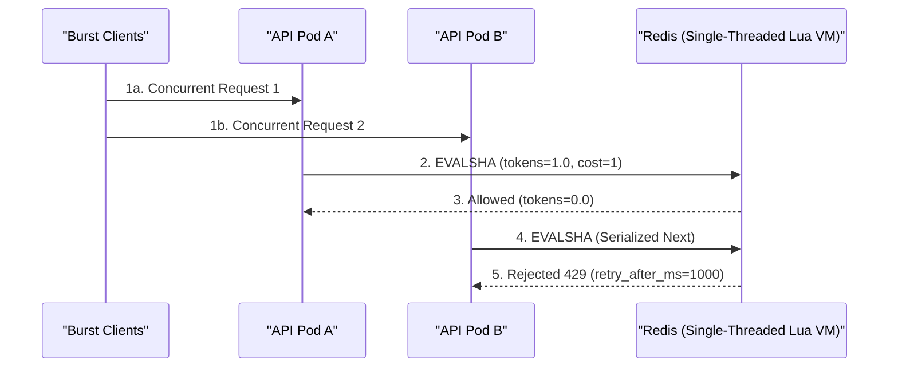
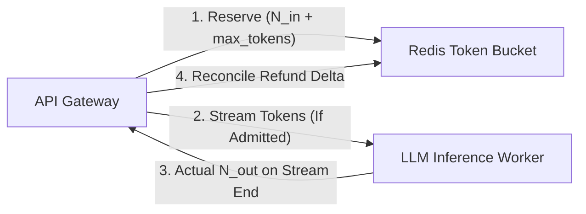
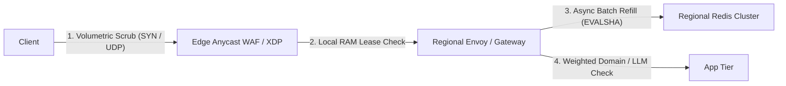

---
tags:
  - software-engineering
  - system-design
  - rate-limiting
  - security
  - redis
created: 2026-11-13
updated: 2026-11-13
status: 🟢
level: mid-to-senior
---

# Rate Limiting

> [!abstract] Vault Navigation
> Core traffic-governance handbook within [[Programming/Software Engineering/System Design/System Design Overview|System Design Overview]]. Integrates with [[Programming/Software Engineering/System Design/Scalability|Scalability]], [[Programming/Software Engineering/System Design/Load Balancing|Load Balancing]], [[Programming/Software Engineering/System Design/Caching|Caching]], [[Programming/Software Engineering/System Design/API Design|API Design]], [[Programming/Software Engineering/System Design/CDN|CDN]], and [[AI/AI Engineering/LLM Internals, Inference & Economics|LLM Internals, Inference & Economics]].

Rate limiting enforces explicit per-identity request or resource quotas to isolate noisy neighbors, stop credential stuffing and scraping, bound downstream database saturation, and meter metered compute such as LLM tokens. Unlike global **load shedding** (which drops excess aggregate traffic indiscriminately once server CPU or queue depth saturates), rate limiting discriminates strictly by caller identity (`tenant_id`, `api_key`, `user_id`, or `client_ip`) across distributed stateless gateways with deterministic wire feedback (`HTTP 429`).

---

## 1. First-Principles Mechanics & Complete Algorithmic Analysis

### 1.1 Rate Limiting vs Load Shedding vs Concurrency Limiting

| Control Mechanism | Decision Signal | Identity Scope | Primary Failure Prevented |
| :--- | :--- | :--- | :--- |
| **Rate Limiting** | Requests/sec or cost-units/min (`100 req/min`, `100k TPM`) | Per caller (`api_key`, `tenant_id`, `ip`) | Noisy neighbor monopolization, brute-force attacks, billing quota overruns |
| **Concurrency Limiting** | Active in-flight requests $L = \lambda W$ (Little's Law) | Per caller or per upstream dependency | Thread/connection-pool exhaustion when downstream latency spikes ($W \uparrow \implies L \uparrow$) |
| **Load Shedding** | Local process queue depth, CPU load, p99 latency | Global (tenant-agnostic or priority-tiered) | Server OOM crash and cascading retry collapse under sudden fleet-wide overload |

By **Little's Law** ($L = \lambda W$), even if a tenant obeys a `600 req/min` ($10\text{ RPS}$) rate limit, a 10-second database stall shifts active concurrent requests per second from $10 \times 0.05 = 0.5$ to $10 \times 10 = 100$ open connections. Production APIs therefore pair **rate limits** (governing throughput $\lambda$) with **concurrency semaphores** (bounding simultaneous in-flight sockets $L$).

### 1.2 The 5 Core Algorithms: Equations, Simulations & Edge Cases

| Algorithm | Time / Space per Key | Burst Behavior | Accuracy | Operational Limitation |
| :--- | :--- | :--- | :--- | :--- |
| **Token Bucket** | $O(1)$ time, $O(1)$ space (2 scalars) | **Permits controlled bursts** up to capacity $B$ | Exact continuous refill | Downstream tier must tolerate instantaneous spike of size $B$ |
| **Leaky Bucket (FIFO) / GCRA** | $O(1)$ time, $O(1)$ space (1 scalar `TAT` for GCRA) | Queueing smooths to constant rate $r$; GCRA allows burst $b$ | Exact | FIFO queue variant adds latency overhead; rigid outflow pacing |
| **Fixed Window Counter** | $O(1)$ time, $O(1)$ space (1 integer) | **Fatal $2\times$ boundary spike** across window edge | Coarse | Client fires $R$ at `00:59` + $R$ at `01:00` = $2R$ inside 2 seconds |
| **Sliding Window Log** | $O(\log R)$ time, **$O(R)$ memory** | Zero boundary overshoot | Exact | Prohibitive RAM footprint ($O(R)$ timestamps per key in Redis `ZSET`) |
| **Sliding Window Counter** | $O(1)$ time, $O(1)$ space (2 integers) | Smooths boundary spike via weighted overlap | **99.997%+ empirical accuracy** | Assumes uniform distribution inside the previous discrete window |

#### 1. Token Bucket (Lazy Continuous Refill)
A bucket holds up to $B$ tokens (maximum allowed burst) and refills continuously at constant rate $r$ tokens/second. Rather than running a background timer across millions of keys, refill is computed **lazily on demand** whenever a request arrives at time $t_{\text{now}}$ requesting cost $c$ (where $c = 1$ for standard requests, or $c = N_{\text{tokens}}$ for weighted queries):
1. Compute accrued tokens since last interaction:
   $$\text{tokens} = \min\left(B,\ \text{tokens}_{\text{prev}} + \max(0,\ t_{\text{now}} - t_{\text{last}}) \cdot r\right)$$
2. If $\text{tokens} \ge c$: admit request, commit $\text{tokens} \leftarrow \text{tokens} - c$, set $t_{\text{last}} \leftarrow t_{\text{now}}$.
3. Else reject (`429`) with exact retry delay:
   $$\text{retry\_after} = \frac{c - \text{tokens}}{r}$$

**Simulation ($B = 5$, $r = 1\text{ token/s}$, initial $\text{tokens} = 5$, cost $c = 1$)**:

| Arrival $t$ (s) | Refill Earned | Pre-Tokens | Cost $c$ | Decision | Post-Tokens | `Retry-After` (s) |
| :--- | :--- | :--- | :--- | :--- | :--- | :--- |
| `0.0` | `0.0` | `5.0` | `1` | **Allow** | `4.0` | `0` |
| `0.2` | `0.2` | `4.2` | `4` (batch) | **Allow** | `0.2` | `0` |
| `0.5` | `0.3` | `0.5` | `1` | **Reject (429)** | `0.5` | `0.5` |
| `1.2` | `0.7` | `1.2` | `1` | **Allow** | `0.2` | `0` |

#### 2. Leaky Bucket (FIFO Queue) & GCRA (Generic Cell Rate Algorithm)
- **Queueing Leaky Bucket**: Incoming requests enter a bounded FIFO queue of depth $Q$; a single worker/timer drains the queue at strict constant interval $T = 1/r$. Requests arriving when the queue holds $Q$ items are dropped (`429`). Ideal for smoothing volatile bursts into flat constant pacing toward fragile downstream payment gateways or mainframe batch interfaces, at the cost of queueing latency up to $Q / r$.
- **GCRA (Metering Equivalent)**: Eliminates queues and dual-field hashes (`tokens` + `ts`) by tracking a **single 64-bit timestamp** called **`TAT` (Theoretical Arrival Time)**—representing when the bucket would empty back down to zero burst debt.
  - Define emission interval $T = 1 / r$ (seconds per token) and burst tolerance offset $\tau = (B - 1) \cdot T$ (or $B \cdot T$ depending on zero-indexed burst convention; using burst limit $B$ requests instantaneously gives $\text{burst\_offset} = (B - 1) \cdot T$ when $B$ represents total capacity including current request).
  - Let $\text{tat} = \max(\text{TAT}_{\text{prev}},\ t_{\text{now}})$. For cost $c$ requests, the new virtual finish time is $\text{new\_tat} = \text{tat} + c \cdot T$.
  - Request is **allowed** if and only if $\text{new\_tat} - t_{\text{now}} \le B \cdot T$ (equivalently $t_{\text{now}} \ge \text{new\_tat} - B \cdot T$).
  - **Mathematical Isomorphism with Token Bucket**: Notice that $(B \cdot T - (\text{TAT} - t_{\text{now}})) / T$ equals exact continuous remaining tokens! GCRA gives **identical admission decisions** to Token Bucket while cutting Redis memory overhead in half (one single scalar string key vs a 2-field Redis Hash).

**GCRA Step-by-Step Trace ($r = 1\text{ req/s} \implies T = 1.0\text{ s}$, capacity $B = 3\text{ tokens}$, $c = 1$)**:

| Arrival $t_{\text{now}}$ | $\text{TAT}_{\text{prev}}$ | $\max(\text{TAT}_{\text{prev}}, t_{\text{now}})$ | $\text{new\_tat} = \max + 1.0$ | $\text{new\_tat} - t_{\text{now}} \le 3.0$? | Decision & Stored `TAT` | Remaining Tokens |
| :--- | :--- | :--- | :--- | :--- | :--- | :--- |
| `0.0` | `0.0` (unset) | `0.0` | `1.0` | `1.0 <= 3.0` (True) | **Allow** (`TAT=1.0`) | `2` |
| `0.1` | `1.0` | `1.0` | `2.0` | `1.9 <= 3.0` (True) | **Allow** (`TAT=2.0`) | `1` |
| `0.2` | `2.0` | `2.0` | `3.0` | `2.8 <= 3.0` (True) | **Allow** (`TAT=3.0`) | `0` |
| `0.3` | `3.0` | `3.0` | `4.0` | `3.7 <= 3.0` (**False**) | **Reject (429)** (`TAT=3.0`) | `0` (`retry_after = 0.7s`) |
| `1.1` | `3.0` | `3.0` | `4.0` | `2.9 <= 3.0` (True) | **Allow** (`TAT=4.0`) | `0` |

#### 3. Fixed Window Counter & The $2\times$ Boundary Burst Proof
Partition time into discrete epochs `win = floor(now_sec / W)` and increment `INCR rl:{id}:{win}`:
- Enforce `R = 1,200 req/min` ($W = 60\text{ s}$).
- Client executes `1,200` requests across `[12:04:59.000, 12:04:59.999]` $\implies$ key `rl:u1:12_04` reaches `1,200` (all allowed).
- At `12:05:00.000`, the window counter resets to `0`. Client immediately fires another `1,200` requests across `[12:05:00.000, 12:05:00.999]` $\implies$ key `rl:u1:12_05` reaches `1,200` (all allowed).
- **Result**: **2,400 requests execute within 2.0 seconds**—double the intended limit—and synchronized client retries slam backends on every `:00` minute rollover.

#### 4. Sliding Window Log (Redis `ZSET` Exactness vs RAM Exhaustion)
Stores every admitted request's microsecond timestamp inside a Redis Sorted Set (`ZSET`), pruning entries older than `now - W` via `ZREMRANGEBYSCORE`, checking `ZCARD < R`, and appending via `ZADD`.
- **Duplicate Score Collision Trap**: Never insert the raw timestamp alone as the `ZSET` member (`ZADD key 1731530000123 "1731530000123"`). Because Redis `ZSET` members must be unique strings, two concurrent requests arriving within the same microsecond/millisecond overwrite each other, allowing unlimited concurrency! Always append a unique nonce (`member = "${now_us}:${seq_or_uuid}"`).
- **Memory Scaling Trap**: Each `ZSET` node consumes ~64–80 bytes (8-byte double score + string member + skiplist forward pointers + jemalloc overhead). Storing `2,000 req/min` across `500,000` active keys consumes $5 \times 10^5 \times 2{,}000 \times 70\text{ B} \approx \mathbf{70\text{ GB}}$ of Redis RAM—over $400\times$ larger than `O(1)` counters!

#### 5. Sliding Window Counter (Cloudflare Hybrid)
Combines the $O(1)$ space efficiency of Fixed Window Counter with rolling-boundary accuracy by storing only two integer buckets ($C_{\text{prev}}$ and $C_{\text{curr}}$) and weighting the previous window proportionally to its overlap inside the trailing $W$-second span:
$$\text{estimated\_count} = C_{\text{prev}} \cdot \left(1 - \frac{t_{\text{elapsed\_in\_curr}}}{W}\right) + C_{\text{curr}}$$
- **Worst-Case Approximation Edge Case**: Because the formula assumes requests inside the previous window arrived uniformly, if 100% of $C_{\text{prev}} = 100$ arrived at `12:04:59` (the very last second), at `12:05:30` the weighted overlap assumes only $50\%$ remain inside `[12:04:30, 12:05:30]`, underestimating the true rolling window slightly (`50` vs `100`). Across 400M+ real production requests at Cloudflare, empirical discrepancy against an exact Sliding Window Log stayed under **0.003%** (99.997%+ accuracy) at $O(1)$ memory!

---

## 2. Real-World Use Cases & Decision Matrix

| Engineering Scenario | Recommended Algorithm & Layer | Why It Fits | Anti-Pattern to Avoid |
| :--- | :--- | :--- | :--- |
| **1. Public SaaS REST API (`100 req/min`, burst `20`)** | **GCRA or Token Bucket** in Regional Redis (`EVALSHA`) | $O(1)$ memory, continuous smooth refill, tolerates legitimate client page-load bursts cleanly | Sliding Window Log `ZSET` (wastes tens of GBs of Redis RAM at millions of keys) |
| **2. Authentication / OTP Verification (`POST /auth/login`)** | **Sliding Window Counter** + **Fail-Closed** composite key `(ip, email)` | Prevents $2\times$ boundary credential stuffing without locking out entire corporate NAT offices | Pure `client_ip` key (locks out 5,000 university/office users behind 1 CGNAT IP) or Fail-Open on Redis timeout |
| **3. Legacy Mainframe / Fragile Partner Webhook Target** | **Leaky Bucket (FIFO Queue)** backed by SQS/worker pacing | Converts spiky bursts into flat constant outflow (e.g., strictly 1 request every 20 ms) | Token Bucket with large burst capacity $B$ (burst passes directly downstream and crashes legacy target) |
| **4. LLM / GPU Inference API (`100k TPM` + Concurrency)** | **Two-Phase Reserve/Reconcile Token Bucket** + In-Flight Semaphore | Prevents concurrent streaming burst attacks before output tokens finish generating | Post-response deduction (50 parallel requests bypass limit during 5s stream generation) |
| **5. Ultra-High RPS Global Edge (`250k+ RPS`)** | **Edge L3/L4 XDP + Local Token-Leasing Gateways** + Regional Redis | Serves 99.5% of requests from local gateway RAM in `0 ns`; eliminates cross-AZ Redis bottleneck | Synchronous cross-region Redis RTT on every packet (`150ms` p99 spike + Redis collapse) |

---

## 3. Step-by-Step Practical Application: Redis `EVALSHA` Lua Scripts & Production Middleware

The complete distributed rate-limiting implementation follows this production layout:
- `lua/token_bucket.lua`, `lua/gcra.lua`, `lua/sliding_window_counter.lua`, `lua/llm_reconcile.lua` — Atomic single-RTT Redis Lua scripts using server-side `TIME` and Redis Cluster `{hash_tag}` alignment.
- `src/rate-limiter.ts` & `src/middleware.ts` — `SCRIPT LOAD` / `EVALSHA` client with `NOSCRIPT` auto-recovery, 4 ms timeout circuit breaker, shadow mode, and IETF `RateLimit` response headers.
- `src/local-lease-limiter.ts` & `tests/rate-limiter.test.ts` — Ultra-high RPS local gateway token-leasing batch client and automated verification suite.

### 3.1 Why Client Read-Compute-Write Fails (TOCTOU Race Proof)

Consider two API pods `Pod A` and `Pod B` executing naive application-side Redis calls concurrently for a bucket holding `tokens = 1.0`:
1. `Pod A` runs `HGETALL rl:tb:k1` $\to$ reads `tokens = 1.0`.
2. `Pod B` runs `HGETALL rl:tb:k1` $\to$ **also** reads `tokens = 1.0` before `Pod A` writes back!
3. Both pass `tokens >= 1`, decrement locally to `0.0`, and call `HSET rl:tb:k1 tokens 0.0`.
4. **Result**: Both requests pass—with 20 concurrent pods, a `1 req/s` quota leaks **$20\times$ traffic**. Wrapping commands in `MULTI/EXEC` fails because `MULTI` queues blind writes and cannot branch conditionally (`if tokens >= cost`) on computed server values; adding optimistic `WATCH` triggers abort/retry storms under hot-key contention.



Executing inside **Redis Lua (`EVALSHA`)** guarantees single-threaded atomic read-compute-write execution in **one network round-trip**, using Redis's own **`TIME`** command so NTP drift across application pods never corrupts token calculations.

### 3.2 Production Redis Lua Scripts (`lua/`)

> [!important] Redis Cluster Slot Affinity (`{hash_tag}`)
> In Redis Cluster, multi-key Lua scripts (such as Sliding Window Counter accessing both `curr_win` and `prev_win` keys) fail with `CROSSSLOT Keys in request don't hash to the same slot` unless the caller wraps the shared identity in curly braces—e.g. **`rl:swc:{tenant_42}`**—forcing CRC16 hashing strictly onto `{tenant_42}` so both window keys always reside on the same Redis shard!

#### Script 1: Atomic Token Bucket (`lua/token_bucket.lua`)

```lua
-- lua/token_bucket.lua
-- KEYS[1] = "rl:tb:{tenant_42}:orders"
-- ARGV[1] = capacity (burst B)
-- ARGV[2] = refill_rate (tokens per second r)
-- ARGV[3] = cost (tokens requested)
-- Returns: { allowed (0|1), remaining_int, retry_after_ms, reset_ms }

local key      = KEYS[1]
local capacity = tonumber(ARGV[1])
local rate     = tonumber(ARGV[2])
local cost     = tonumber(ARGV[3])

local now_parts = redis.call("TIME")
local now = tonumber(now_parts[1]) + (tonumber(now_parts[2]) / 1000000.0)

local state   = redis.call("HMGET", key, "tokens", "ts")
local tokens  = tonumber(state[1])
local last_ts = tonumber(state[2])

if tokens == nil then
  tokens  = capacity
  last_ts = now
else
  local elapsed = math.max(0, now - last_ts)
  tokens  = math.min(capacity, tokens + (elapsed * rate))
  last_ts = now
end

local allowed = 0
local retry_after_ms = 0

if tokens >= cost then
  tokens  = tokens - cost
  allowed = 1
else
  local deficit = cost - tokens
  retry_after_ms = math.ceil((deficit / rate) * 1000)
end

-- Time until bucket reaches full capacity again (used by IETF RateLimit reset header)
local reset_ms = math.ceil(((capacity - tokens) / rate) * 1000)
local ttl_sec  = math.max(1, math.ceil(capacity / rate) + 10)

redis.call("HSET", key, "tokens", tostring(tokens), "ts", tostring(last_ts))
redis.call("EXPIRE", key, ttl_sec)

return { allowed, math.floor(tokens), retry_after_ms, reset_ms }
```

#### Script 2: Atomic GCRA (`lua/gcra.lua`) — Half the Memory of Token Bucket

```lua
-- lua/gcra.lua
-- Uses a single string key storing TAT (microseconds), eliminating Redis Hash overhead.
-- KEYS[1] = "rl:gcra:{tenant_42}:api"
-- ARGV[1] = burst_capacity (B >= 1)
-- ARGV[2] = refill_rate (tokens per second r)
-- ARGV[3] = cost (integer >= 1)
-- Returns: { allowed (0|1), remaining_int, retry_after_ms, reset_ms }

local key      = KEYS[1]
local burst    = tonumber(ARGV[1])
local rate     = tonumber(ARGV[2])
local cost     = tonumber(ARGV[3])

local now_parts = redis.call("TIME")
local now_us = (tonumber(now_parts[1]) * 1000000) + tonumber(now_parts[2])

-- Emission interval T (microseconds per single token) & burst window DVT
local emission_us = math.floor(1000000 / rate)
local dvt_us      = burst * emission_us
local increment   = cost * emission_us

local tat_raw = redis.call("GET", key)
local tat_us  = tat_raw and tonumber(tat_raw) or now_us

-- Clamp stale TAT up to current clock so idle buckets reset smoothly
if tat_us < now_us then
  tat_us = now_us
end

local new_tat_us = tat_us + increment
local allow_at_us = new_tat_us - dvt_us

if now_us < allow_at_us then
  local wait_ms = math.ceil((allow_at_us - now_us) / 1000.0)
  local reset_ms = math.max(0, math.ceil((tat_us - now_us) / 1000.0))
  return { 0, 0, wait_ms, reset_ms }
end

local ttl_ms = math.max(1000, math.ceil((new_tat_us - now_us) / 1000.0) + 5000)
redis.call("SET", key, tostring(new_tat_us), "PX", ttl_ms)

local remaining_us = dvt_us - (new_tat_us - now_us)
local remaining    = math.max(0, math.floor(remaining_us / emission_us))
local reset_ms     = math.max(0, math.ceil((new_tat_us - now_us) / 1000.0))

return { 1, remaining, 0, reset_ms }
```

#### Script 3: Atomic Sliding Window Counter (`lua/sliding_window_counter.lua`)

```lua
-- lua/sliding_window_counter.lua
-- KEYS[1] = prefix WITH Redis Cluster hash tag e.g. "rl:swc:{user_99}:login"
-- ARGV[1] = window_sec (W)
-- ARGV[2] = limit (R)
-- ARGV[3] = cost (default 1)
-- Returns: { allowed (0|1), remaining_int, retry_after_ms, reset_ms }

local prefix = KEYS[1]
local window = tonumber(ARGV[1])
local limit  = tonumber(ARGV[2])
local cost   = tonumber(ARGV[3])

local now_parts = redis.call("TIME")
local now_sec = tonumber(now_parts[1]) + (tonumber(now_parts[2]) / 1000000.0)

local curr_win     = math.floor(now_sec / window)
local prev_win     = curr_win - 1
local elapsed_frac = (now_sec - (curr_win * window)) / window
local prev_weight  = 1.0 - elapsed_frac

-- Hash-tagged prefix ensures curr_key and prev_key map to identical Redis Cluster slot
local curr_key = prefix .. ":" .. tostring(curr_win)
local prev_key = prefix .. ":" .. tostring(prev_win)

local curr_count = tonumber(redis.call("GET", curr_key) or "0")
local prev_count = tonumber(redis.call("GET", prev_key) or "0")

local est_count = (prev_count * prev_weight) + curr_count
local reset_ms  = math.ceil(((curr_win + 1) * window - now_sec) * 1000)

if (est_count + cost) > limit then
  return { 0, 0, reset_ms, reset_ms }
end

local new_curr = redis.call("INCRBY", curr_key, cost)
-- Keep window alive across current + entire next window so prev_win stays intact
redis.call("EXPIRE", curr_key, (window * 2) + 5)

local remaining = math.max(0, math.floor(limit - ((prev_count * prev_weight) + new_curr)))
return { 1, remaining, 0, reset_ms }
```

#### Script 4: Two-Phase LLM Cost Reconcile (`lua/llm_reconcile.lua`)

Phase 1 calls `token_bucket.lua` reserving worst-case cost `C_reserve = input_tokens + max_tokens` *before* dispatching GPU inference. Once streaming finishes with actual `N_out <= max_tokens`, Phase 2 credits unused tokens back cleanly without exceeding bucket capacity $B$.

```lua
-- lua/llm_reconcile.lua
-- KEYS[1] = "rl:tb:{tenant_42}:llm_tpm"
-- ARGV[1] = capacity (B), ARGV[2] = refill_rate (r tokens/sec), ARGV[3] = refund_tokens (>= 0)

local key      = KEYS[1]
local capacity = tonumber(ARGV[1])
local rate     = tonumber(ARGV[2])
local refund   = math.max(0, tonumber(ARGV[3]))

local now_parts = redis.call("TIME")
local now = tonumber(now_parts[1]) + (tonumber(now_parts[2]) / 1000000.0)

local state   = redis.call("HMGET", key, "tokens", "ts")
local tokens  = tonumber(state[1]) or capacity
local last_ts = tonumber(state[2]) or now

local elapsed = math.max(0, now - last_ts)
tokens = math.min(capacity, tokens + (elapsed * rate) + refund)

local ttl_sec = math.max(1, math.ceil(capacity / rate) + 10)
redis.call("HSET", key, "tokens", tostring(tokens), "ts", tostring(now))
redis.call("EXPIRE", key, ttl_sec)

return math.floor(tokens)
```

### 3.3 Production TypeScript `EVALSHA` Client, Fail-Open/Closed Policy & Wire Headers (`src/rate-limiter.ts`)

```ts
// src/rate-limiter.ts
import { readFileSync } from "node:fs";
import type { Redis } from "ioredis";

export type LimiterAlgorithm = "token_bucket" | "gcra" | "sliding_window_counter";
export type FailureMode = "fail-open" | "fail-closed";
export type EnforcementMode = "enforce" | "shadow";

export interface RateLimitPolicy {
  name: string;
  algorithm: LimiterAlgorithm;
  limit: number;          // Burst B (for TB/GCRA) or Window Quota R (for SWC)
  windowSec: number;      // Period W in seconds (rate = limit / windowSec)
  cost?: number;
  failureMode: FailureMode;
  enforcementMode: EnforcementMode;
  timeoutMs?: number;
}

export interface RateLimitDecision {
  allowed: boolean;
  wouldBlock: boolean;    // True even in shadow mode for accurate dry-run telemetry
  limit: number;
  remaining: number;
  retryAfterSec: number;
  resetSec: number;
  bypassedDueToError: boolean;
}

export class RedisRateLimiter {
  private readonly scripts: Record<LimiterAlgorithm | "llm_reconcile", string>;
  private readonly shas = new Map<string, string>();

  constructor(private readonly redis: Redis, luaDir: string) {
    this.scripts = {
      token_bucket: readFileSync(`${luaDir}/token_bucket.lua`, "utf8"),
      gcra: readFileSync(`${luaDir}/gcra.lua`, "utf8"),
      sliding_window_counter: readFileSync(`${luaDir}/sliding_window_counter.lua`, "utf8"),
      llm_reconcile: readFileSync(`${luaDir}/llm_reconcile.lua`, "utf8"),
    };
  }

  public async check(identityKey: string, policy: RateLimitPolicy): Promise<RateLimitDecision> {
    const cost = policy.cost ?? 1;
    const timeoutMs = policy.timeoutMs ?? 4; // Strict 4ms budget protects API p99
    // Wrap identity in {hash_tag} for safe Redis Cluster slot affinity
    const redisKey = `rl:${policy.algorithm}:{${identityKey}}:${policy.name}`;
    const ratePerSec = policy.limit / policy.windowSec;

    const args =
      policy.algorithm === "sliding_window_counter"
        ? [String(policy.windowSec), String(policy.limit), String(cost)]
        : [String(policy.limit), String(ratePerSec), String(cost)];

    try {
      const tuple = await withTimeout(
        this.evalShaWithReload(policy.algorithm, [redisKey], args),
        timeoutMs
      );
      const [allowedInt, remaining, retryAfterMs, resetMs] = tuple as [
        number,
        number,
        number,
        number
      ];

      const wouldBlock = allowedInt === 0;
      const allowed = policy.enforcementMode === "shadow" ? true : !wouldBlock;

      return {
        allowed,
        wouldBlock,
        limit: policy.limit,
        remaining,
        retryAfterSec: Math.max(1, Math.ceil(retryAfterMs / 1000)),
        resetSec: Math.max(0, Math.ceil(resetMs / 1000)),
        bypassedDueToError: false,
      };
    } catch (err) {
      // Fail-open on read APIs to prevent Redis outage taking down site;
      // Fail-closed on /auth/login or /payments to block brute-force bypass
      const allowOnOutage = policy.failureMode === "fail-open";
      return {
        allowed: allowOnOutage,
        wouldBlock: !allowOnOutage,
        limit: policy.limit,
        remaining: allowOnOutage ? 1 : 0,
        retryAfterSec: 5,
        resetSec: 5,
        bypassedDueToError: true,
      };
    }
  }

  public async reconcileLlmTokens(
    identityKey: string,
    policyName: string,
    capacity: number,
    windowSec: number,
    refundTokens: number
  ): Promise<void> {
    if (refundTokens <= 0) return;
    const redisKey = `rl:token_bucket:{${identityKey}}:${policyName}`;
    await this.evalShaWithReload("llm_reconcile", [redisKey], [
      String(capacity),
      String(capacity / windowSec),
      String(refundTokens),
    ]);
  }

  private async evalShaWithReload(
    scriptName: keyof RedisRateLimiter["scripts"],
    keys: string[],
    args: string[]
  ): Promise<unknown> {
    let sha = this.shas.get(scriptName);
    if (!sha) {
      sha = (await this.redis.script("LOAD", this.scripts[scriptName])) as string;
      this.shas.set(scriptName, sha);
    }

    try {
      return await this.redis.evalsha(sha, keys.length, ...keys, ...args);
    } catch (err) {
      // Automatically recover if Redis restarted or SCRIPT FLUSH ran
      if (err instanceof Error && err.message.includes("NOSCRIPT")) {
        sha = (await this.redis.script("LOAD", this.scripts[scriptName])) as string;
        this.shas.set(scriptName, sha);
        return await this.redis.evalsha(sha, keys.length, ...keys, ...args);
      }
      throw err;
    }
  }
}

async function withTimeout<T>(promise: Promise<T>, ms: number): Promise<T> {
  let timer: NodeJS.Timeout | undefined;
  try {
    return await Promise.race([
      promise,
      new Promise<never>((_, reject) => {
        timer = setTimeout(() => reject(new Error(`Redis RL timeout (${ms}ms)`)), ms);
      }),
    ]);
  } finally {
    if (timer) clearTimeout(timer);
  }
}
```

#### Express / HTTP Middleware Emitting IETF `RateLimit` Headers (`src/middleware.ts`)

```ts
// src/middleware.ts
import type { NextFunction, Request, Response } from "express";
import type { RateLimitPolicy, RedisRateLimiter } from "./rate-limiter.js";

export function createRateLimitMiddleware(
  limiter: RedisRateLimiter,
  policy: RateLimitPolicy,
  resolveIdentity: (req: Request) => string,
  metrics: { incBlocked: (route: string, shadow: boolean) => void }
) {
  return async (req: Request, res: Response, next: NextFunction): Promise<void> => {
    const identity = resolveIdentity(req);
    const decision = await limiter.check(identity, policy);

    // Emit modern IETF RateLimit + RateLimit-Policy headers on ALL responses
    res.setHeader("RateLimit-Policy", `"${policy.limit};w=${policy.windowSec}"`);
    res.setHeader(
      "RateLimit",
      `"limit=${decision.limit}, remaining=${decision.remaining}, reset=${decision.resetSec}"`
    );

    if (decision.wouldBlock) {
      metrics.incBlocked(policy.name, policy.enforcementMode === "shadow");
    }

    if (!decision.allowed) {
      res.setHeader("Retry-After", String(decision.retryAfterSec));
      res.status(decision.bypassedDueToError ? 503 : 429).json({
        error: decision.bypassedDueToError ? "service_unavailable" : "rate_limit_exceeded",
        retryAfterSec: decision.retryAfterSec,
      });
      return;
    }

    next();
  };
}
```

### 3.4 Ultra-High RPS Local Gateway Token-Leasing (`src/local-lease-limiter.ts`)

At `200,000+ RPS`, making 200k synchronous Redis network RTTs per second wastes gateway sockets and hits single-Redis-shard CPU ceilings. **Token-Leasing** lets each gateway pod reserve a small batch of tokens (e.g. `batchSize = 200`) from regional Redis when its local in-RAM balance drops below a watermark—deducting requests in `0 ns` local RAM while bounding worst-case global overshoot across $K$ pods strictly to $K \times \text{batchSize}$.

```ts
// src/local-lease-limiter.ts
import type { RateLimitPolicy, RedisRateLimiter } from "./rate-limiter.js";

interface LocalBucket {
  tokens: number;
  refilling: boolean;
  lastDeniedAtMs: number;
}

export class LocalLeasedRateLimiter {
  private readonly buckets = new Map<string, LocalBucket>();

  constructor(
    private readonly centralLimiter: RedisRateLimiter,
    private readonly leaseBatchSize = 100
  ) {}

  public async consume(identityKey: string, policy: RateLimitPolicy): Promise<boolean> {
    const cacheKey = `${policy.name}:${identityKey}`;
    let bucket = this.buckets.get(cacheKey);
    if (!bucket) {
      bucket = { tokens: 0, refilling: false, lastDeniedAtMs: 0 };
      this.buckets.set(cacheKey, bucket);
    }

    // Fast path: 0ns network latency while local token lease holds quota
    if (bucket.tokens >= 1) {
      bucket.tokens -= 1;
      // Trigger non-blocking background lease top-up at 25% watermark
      if (bucket.tokens <= Math.floor(this.leaseBatchSize * 0.25) && !bucket.refilling) {
        void this.refillLeaseAsync(identityKey, policy, bucket);
      }
      return true;
    }

    // Cold/depleted path: synchronize one batch lease (bounded negative backoff avoids Redis stampede)
    if (Date.now() - bucket.lastDeniedAtMs < 200) {
      return false;
    }
    return this.refillLeaseSync(identityKey, policy, bucket);
  }

  private async refillLeaseAsync(
    identityKey: string,
    policy: RateLimitPolicy,
    bucket: LocalBucket
  ): Promise<void> {
    bucket.refilling = true;
    try {
      const decision = await this.centralLimiter.check(identityKey, {
        ...policy,
        cost: this.leaseBatchSize,
      });
      if (decision.allowed) bucket.tokens += this.leaseBatchSize;
    } finally {
      bucket.refilling = false;
    }
  }

  private async refillLeaseSync(
    identityKey: string,
    policy: RateLimitPolicy,
    bucket: LocalBucket
  ): Promise<boolean> {
    const decision = await this.centralLimiter.check(identityKey, {
      ...policy,
      cost: this.leaseBatchSize,
    });
    if (decision.allowed) {
      bucket.tokens += this.leaseBatchSize - 1;
      return true;
    }
    bucket.lastDeniedAtMs = Date.now();
    return false;
  }
}
```

### 3.5 Automated Rate-Limiter Verification Suite (`tests/rate-limiter.test.ts`)

```ts
// tests/rate-limiter.test.ts
import assert from "node:assert/strict";
import test from "node:test";
import { LocalLeasedRateLimiter } from "../src/local-lease-limiter.js";
import type { RateLimitDecision, RateLimitPolicy, RedisRateLimiter } from "../src/rate-limiter.js";

/**
 * Deterministic in-memory Token Bucket / GCRA parity double simulating Redis EVALSHA atomicity
 * for unit testing middleware, local token leasing, shadow mode, and fail-open/closed policies.
 */
class FakeRedisRateLimiter {
  public failNext = false;
  private buckets = new Map<string, { tokens: number; lastSec: number }>();
  public nowSec = 1_000;

  public async check(identityKey: string, policy: RateLimitPolicy): Promise<RateLimitDecision> {
    if (this.failNext) {
      const allow = policy.failureMode === "fail-open";
      return {
        allowed: allow,
        wouldBlock: !allow,
        limit: policy.limit,
        remaining: allow ? 1 : 0,
        retryAfterSec: 5,
        resetSec: 5,
        bypassedDueToError: true,
      };
    }

    const rate = policy.limit / policy.windowSec;
    const cost = policy.cost ?? 1;
    const key = `${policy.name}:${identityKey}`;
    const state = this.buckets.get(key) ?? { tokens: policy.limit, lastSec: this.nowSec };

    const elapsed = Math.max(0, this.nowSec - state.lastSec);
    let tokens = Math.min(policy.limit, state.tokens + elapsed * rate);
    const wouldBlock = tokens < cost;

    if (!wouldBlock) {
      tokens -= cost;
    }
    this.buckets.set(key, { tokens, lastSec: this.nowSec });

    const allowed = policy.enforcementMode === "shadow" ? true : !wouldBlock;
    const retryAfterSec = wouldBlock ? Math.max(1, Math.ceil((cost - tokens) / rate)) : 0;
    const resetSec = Math.max(0, Math.ceil((policy.limit - tokens) / rate));

    return {
      allowed,
      wouldBlock,
      limit: policy.limit,
      remaining: Math.floor(tokens),
      retryAfterSec,
      resetSec,
      bypassedDueToError: false,
    };
  }
}

test("Shadow mode allows traffic while flagging wouldBlock telemetry accurately", async () => {
  const fake = new FakeRedisRateLimiter();
  const policy: RateLimitPolicy = {
    name: "catalog_read",
    algorithm: "token_bucket",
    limit: 2,
    windowSec: 60,
    failureMode: "fail-open",
    enforcementMode: "shadow",
  };

  const d1 = await fake.check("user_1", policy);
  const d2 = await fake.check("user_1", policy);
  const d3 = await fake.check("user_1", policy);

  assert.equal(d1.allowed, true);
  assert.equal(d2.wouldBlock, false);
  assert.equal(d3.allowed, true);      // Shadow mode lets request pass
  assert.equal(d3.wouldBlock, true);    // Telemetry captures 429 candidate
});

test("Asymmetric fail-open vs fail-closed outage handling", async () => {
  const fake = new FakeRedisRateLimiter();
  fake.failNext = true;

  const readDecision = await fake.check("ip_1", {
    name: "read_api",
    algorithm: "gcra",
    limit: 100,
    windowSec: 60,
    failureMode: "fail-open",
    enforcementMode: "enforce",
  });
  const loginDecision = await fake.check("ip_1", {
    name: "auth_login",
    algorithm: "sliding_window_counter",
    limit: 5,
    windowSec: 60,
    failureMode: "fail-closed",
    enforcementMode: "enforce",
  });

  assert.equal(readDecision.allowed, true);
  assert.equal(readDecision.bypassedDueToError, true);
  assert.equal(loginDecision.allowed, false);
  assert.equal(loginDecision.bypassedDueToError, true);
});

test("LocalLeasedRateLimiter serves 100 requests locally per 1 central Redis check", async () => {
  let redisCalls = 0;
  const fake = new FakeRedisRateLimiter();
  const wrappedLimiter = {
    check: async (k: string, p: RateLimitPolicy) => {
      redisCalls++;
      return fake.check(k, p);
    },
  } as unknown as RedisRateLimiter;

  const leased = new LocalLeasedRateLimiter(wrappedLimiter, 100);
  const policy: RateLimitPolicy = {
    name: "high_rps_api",
    algorithm: "token_bucket",
    limit: 1000,
    windowSec: 60,
    failureMode: "fail-open",
    enforcementMode: "enforce",
  };

  for (let i = 0; i < 60; i++) {
    const ok = await leased.consume("tenant_big", policy);
    assert.equal(ok, true);
  }
  assert.equal(redisCalls, 1); // 60 local deductions served from 1 single Redis lease call
});
```

---

## 4. Complete Policy Reference, Multi-Region Scaling & Edge Cases

### 4.1 Key Selection Matrix & The Corporate CGNAT IP Trap

| Endpoint Category | Primary Limiter Key | Secondary / Guardrail Key | Critical Failure Trap |
| :--- | :--- | :--- | :--- |
| **Unauthenticated Read (`GET /catalog`)** | `client_ip` (parsed safely via trusted hops) | Edge ASN / WAF Bot Score | Trusting forged `X-Forwarded-For` leftmost IP allows trivial bypass |
| **Credential Endpoints (`POST /auth/login`, `/otp`)** | **Composite `(email_hash, ip)`** (`5/min`) | High aggregate `ip` cap (`300/min`) + account lock | **Corporate CGNAT Trap**: Limiting `ip` alone at `10/min` locks out 2,000 employees behind one corporate NAT gateway! |
| **Authenticated Multi-Tenant SaaS API** | **`api_key` or `user_id`** (isolates noisy caller) | **`tenant_id` org ceiling** (protects plan tier) | Keying *only* by `tenant_id` allows 1 leaked developer key to black out the entire customer organization |
| **Weighted / Compute-Heavy Endpoints** | `tenant_id` (Token Bucket cost `c = N_tokens`) | Concurrent in-flight counter (`max 10 streams`) | Treating `GET /health` and `POST /exports/10yr.csv` identically (`cost=1`) permits resource exhaustion |

### 4.2 Two-Phase Reserve/Reconcile for LLM & Variable-Cost Endpoints

For `POST /v1/chat/completions`, exact output token generation (`1 to 4,096 tokens`) takes 2–8 seconds and is unknown when the request arrives. Checking quotas strictly *after* streaming ends lets a malicious client open 50 parallel streaming requests and burn $50\times$ their minute budget before any single stream finishes!



1. **Phase 1 (Synchronous Pre-Admission Reserve)**: Count prompt input tokens `N_in` locally using the tokenizer (`tiktoken`), calculate worst-case budget $C_{\text{reserve}} = N_{\text{in}} + \min(\text{max\_tokens},\ 4096)$, and execute `lua/token_bucket.lua` with `cost = C_reserve`. Parallel attackers hit `HTTP 429` immediately once reserved tokens saturate the quota.
2. **Phase 2 (Post-Completion Reconcile)**: When SSE streaming finishes (or client disconnects early at `N_out_actual`), calculate unused reservation $\Delta = C_{\text{reserve}} - (N_{\text{in}} + N_{\text{out\_actual}}) \ge 0$ and run `lua/llm_reconcile.lua` to refund $\Delta$ capped at bucket capacity $B$.
3. **Concurrency Guardrail**: Pair TPM quotas with a short-TTL Redis semaphore (`INCR`/`DECR` or `ZSET` timestamp lease) capping maximum parallel streams per tenant so slow clients cannot starve GPU KV-cache memory.

### 4.3 Multi-Region Global Quotas & Edge vs App Layering



- **Why Synchronous Cross-Continent Redis Fails**: Querying a single global Redis in `us-east` synchronously from `ap-southeast` adds `180–240 ms` to every API request, violating SLAs and inflating open gateway sockets by $10\times–50\times$ per Little's Law ($L = \lambda W$).
- **Production Multi-Region Architecture**:
  1. Deploy an independent Redis Cluster inside each region (`us-east`, `eu-west`, `ap-southeast`) paired with `LocalLeasedRateLimiter` in local gateways.
  2. Partition global tenant limits proportionally by expected regional traffic ($R_{\text{region}} = w_i \cdot R_{\text{global}}$), OR propagate delta increments asynchronously every `2–5 seconds` across regions via CRDT PN-counters / Kafka compaction (trading sub-second cross-continent drift for `0.3 ms` intra-AZ p99 latency).
- **Shadow Mode Rollout & Wire Status Codes**:
  Always roll out new rate-limit policies in **`shadow` (`dry-run`) mode** for 48 hours first, alerting on `rate_limit_would_block_total` before flipping `enforce`. When blocking, always return **`HTTP 429 Too Many Requests`** (never `403 Forbidden` or `503 Service Unavailable`) along with `Retry-After` and IETF **`RateLimit-Policy` / `RateLimit`** headers so compliant client SDKs perform clean jittered backoff rather than marking endpoints down.

---

## 5. Production Debugging, Profiling & Operations Playbook

| Symptom | Most Likely Root Cause | Exact Diagnostic Commands | Remediation |
| :--- | :--- | :--- | :--- |
| **`CROSSSLOT Keys in request don't hash to the same slot` on Sliding Window Counter** | `curr_key` and `prev_key` hashed to different Redis Cluster shards without `{hash_tag}` | `redis-cli -c CLUSTER KEYSLOT "rl:swc:u1:100"` vs `"rl:swc:u1:101"` | Wrap identity inside `{...}` hash tags: `rl:swc:{u1}:100` and `rl:swc:{u1}:101` |
| **Sudden burst of `NOSCRIPT No matching script` errors** | Redis primary failed over to replica without script cache or `SCRIPT FLUSH` ran | `redis-cli SCRIPT EXISTS <sha1>` <br> Inspect gateway Redis error logs | Catch `NOSCRIPT` transparently in client wrapper (`evalShaWithReload`) and re-`SCRIPT LOAD` |
| **Redis CPU spikes to 100% single-core; p99 hits 50ms** | Single hot tenant key hitting 100k+ RPS on one Redis shard, or `O(N)` command inside Lua | `redis-cli --hotkeys` <br> `redis-cli SLOWLOG GET 20` <br> `redis-cli LATENCY DOCTOR` | Enable `LocalLeasedRateLimiter` (`batchSize=100–500`) on gateways; never run `KEYS` or linear scans inside Lua |
| **Redis OOM / eviction warnings on Sliding Window Log** | High-traffic `ZSET` storing millions of microsecond members (`~70 B` each) | `redis-cli --bigkeys` <br> `redis-cli MEMORY USAGE "rl:swl:key"` | Migrate to $O(1)$ **GCRA** (`1` scalar key) or **Sliding Window Counter** (`2` counters); verify dynamic `EXPIRE` |
| **Corporate enterprise customer complains all 500 office users get `429` at 9 AM** | Unauthenticated or `/login` route keyed solely by `client_ip` behind shared corporate NAT | Check Prometheus `rate(http_429_total[5m]) by (route, ip)` | Key login by composite `(email, ip)` at low threshold and raise aggregate `ip` threshold; test rules in `shadow` mode first |
| **Global API returns `503` across all endpoints during Redis maintenance** | Fail-closed policy misapplied to general non-security read APIs (`GET /catalog`) | Inspect gateway Redis timeout metrics & circuit breaker state | Apply **asymmetric policy**: `fail-open` (`4ms` timeout) on read APIs; `fail-closed` strictly on `/auth`, `/otp`, `/payments` |

---

## 6. Worked Exercises

### Exercise 1: Fixed Window $2\times$ Burst & Sliding Window Counter Calculation

An API enforces `1,200 requests/minute` ($W = 60\text{ s}$) per `api_key`.
1. Demonstrate with exact timestamps how an attacker delivers **2,400 requests within 2 seconds** against a Fixed Window Counter (`INCR rl:{key}:{floor(ts/60)}`).
2. Using the **Sliding Window Counter** algorithm, evaluate a request arriving at **`12:05:18.000 UTC`** ($18\text{ s}$ into minute `12:05`) when:
   - Previous window (`12:04`) recorded **`C_prev = 1,000`** requests.
   - Current window (`12:05`) has recorded **`C_curr = 450`** requests so far.
   Determine whether the request is **Allowed or Rejected (`429`)** and compute exact `remaining` and `estimated_count`.

---

### Solution 1

#### 1. Fixed Window $2\times$ Boundary Burst Trace
- Window `12:04` covers `[12:04:00.000, 12:04:59.999]`; window `12:05` covers `[12:05:00.000, 12:05:59.999]`.
- Attacker fires **1,200 requests** between `12:04:59.000` and `12:04:59.999` $\implies$ `rl:key:12_04 = 1200/1200` (all allowed).
- Attacker fires **1,200 requests** between `12:05:00.000` and `12:05:00.999` $\implies$ `rl:key:12_05 = 1200/1200` (all allowed).
- **2,400 requests execute within 2.0 seconds** ($2\times$ the intended ceiling).

#### 2. Sliding Window Counter Math at `12:05:18`
- Elapsed time in current window = $18\text{ s}$ out of $W = 60\text{ s}$.
- Previous window overlap weight inside trailing 60-second span `[12:04:18, 12:05:18]`:
  $$w_{\text{prev}} = 1 - \frac{18}{60} = 1 - 0.30 = 0.70$$
- Estimated rolling 60-second count prior to current request:
  $$\text{est} = (1{,}000 \times 0.70) + 450 = 700 + 450 = \mathbf{1{,}150}$$
- Including current request (`+1` $\to$ `1,151 <= 1,200`): **Allowed**, with **`remaining = 1,200 - 1,151 = 49`**.

---

### Exercise 2: Redis Memory Sizing & Fixing a TOCTOU Race

Your team runs a Redis Sliding Window Log (`ZSET`) limiter enforcing `2,000 req/min` across **500,000 concurrently active API keys** averaging `400 req/min`. Meanwhile, during code review of a secondary Node.js Token Bucket endpoint, you discover:

```ts
const data = await redis.hgetall(`tb:${key}`);
let tokens = Math.min(cap, Number(data.tokens ?? cap) + (now - Number(data.ts ?? now)) * rate);
if (tokens < 1) return res.status(429).send();
await redis.hset(`tb:${key}`, { tokens: tokens - 1, ts: now });
```

1. Calculate the Redis RAM footprint of the **Sliding Window Log (`ZSET`)** vs **GCRA (`1` string scalar)** across those 500,000 active keys.
2. Explain the exact concurrency bug in the Node.js snippet and why replacing it with `redis.multi()` (`MULTI/EXEC`) + `WATCH` fails under burst load.

---

### Solution 2

#### 1. Redis Memory Sizing Comparison
- **Sliding Window Log (`ZSET`)**:
  - Each `ZSET` entry stores an 8-byte double timestamp + ~16-byte unique nonce string + skiplist/jemalloc metadata ($\approx \mathbf{64\text{ bytes/entry}}$).
  - $500{,}000\text{ keys} \times 400\text{ entries/key} = 200{,}000{,}000$ entries $\implies 2 \times 10^8 \times 64\text{ B} \approx \mathbf{12.8\text{ GB}}$ (spiking to **64 GB+** if keys hit full 2,000 entries!).
- **GCRA (`O(1)` Single Scalar Key)**:
  - Stores only 1 key + 16-byte integer `TAT` string ($\approx \mathbf{90\text{ bytes/key}}$ including Redis dict overhead).
  - $500{,}000 \times 90\text{ B} \approx \mathbf{45\text{ MB}}$ (**~285x smaller** than Sliding Window Log!).

#### 2. TOCTOU Race & Why `MULTI/EXEC` + `WATCH` Fails
- **TOCTOU Race**: Concurrent async handlers read `tokens = 1.2` simultaneously via `hgetall`, all pass `tokens >= 1` in Node.js memory, and all write `0.2`, letting $N\times$ traffic leak through.
- **`MULTI/EXEC` + `WATCH` Failure**: `MULTI/EXEC` cannot evaluate dynamic conditionals (`if tokens >= cost`) server-side before writing. Adding optimistic `WATCH` forces concurrent requests touching the same key to fail `EXEC` with `null` and loop-retry repeatedly—collapsing throughput under burst spikes.
- **Fix**: Replace the client-side read-compute-write with `lua/token_bucket.lua` or `lua/gcra.lua` via **`EVALSHA`**, using Redis `TIME` inside Lua to remove client NTP clock drift.

---

### Exercise 3: Multi-Region Gateway Architecture & Fail-Open Policy

A SaaS API serves **120,000 aggregate RPS** globally across `us-east`, `eu-west`, and `ap-southeast` via GeoDNS and 60 Envoy gateways. Enterprise tenants hold a `60,000 req/min` global quota, while `POST /auth/login` limits callers to `10 attempts/min`. An architect proposes deploying **1 central Redis Cluster in `us-east`** that every Envoy queries synchronously per request, failing closed (`503`) if Redis takes $> 200\text{ ms}$.

Identify **all 4 critical architectural flaws** and design the production-grade multi-region architecture.

---

### Solution 3

#### 1. Four Architectural Flaws
1. **Cross-Continent RTT Latency Destruction**: Synchronous calls from `ap-southeast` to `us-east` add `180–240 ms` to every API request, exhausting gateway socket pools per Little's Law ($L = \lambda W$).
2. **Global Redis SPOF + Fail-Closed Blackout**: Failing closed (`503`) across *all* routes means a single `us-east` Redis blip takes down all 3 continents simultaneously.
3. **Unnecessary 120k Sync RTTs/sec**: Even within one region, issuing 120k synchronous Redis `EVALSHA` hops adds avoidable network serialization latency.
4. **Corporate CGNAT IP Lockout on `/auth/login`**: Limiting strictly by `client_ip` (`10/min`) blocks an entire corporate office sharing one VPN/NAT gateway when 10 employees mistype passwords.

#### 2. Production Multi-Region Design
1. **Regional Redis + Local Token-Lease Batching**: Run an independent Redis Cluster in each region paired with `LocalLeasedRateLimiter` (`batchSize = 200` tokens) on Envoy gateways, evaluating >99% of requests in local RAM at `0 ns` network cost.
2. **Regional Quota Splitting / Async Global Sync**: Allocate regional tenant weights (e.g., `40% / 35% / 25%`) or replicate counter deltas asynchronously across regions every 2–5s via CRDT counters.
3. **Asymmetric Fail-Open vs Fail-Closed (`4 ms` Timeout)**: Cap Redis calls at `4 ms`. Fail-open on normal read APIs; fail-closed strictly on security/financial paths (`/auth/login`, `/otp`, `/payments`).
4. **Composite Key for Login**: Rate-limit `/auth/login` tightly by `(email, ip)` (`10/min`) alongside a generous aggregate `ip` cap (`300/min`) + edge WAF bot scoring.

---

### Exercise 4: Two-Phase Reserve/Reconcile Rate Limiter for LLM Tokens

You operate an AI completion API (`POST /v1/chat/completions`) limited at **`100,000` tokens/minute (TPM)** per tenant with `max_output_tokens = 4,000`. Because output token counts remain unknown until GPU SSE streaming completes (2–8s later), checking quotas *after* streaming completes lets an attacker dispatch 50 parallel `4,000`-token requests simultaneously before request #1 completes!

Design the **Two-Phase Reserve/Reconcile Rate Limiter**, detailing exact pre-admission math, early disconnect reconciliation, concurrency protection, and `HTTP 429` headers.

---

### Solution 4

#### Two-Phase Reserve & Reconcile Protocol
1. **Phase 1 — Pre-Admission Reserve (Before GPU Dispatch)**:
   - Tokenize prompt synchronously on the gateway to obtain exact `N_in` input tokens.
   - Reserve worst-case cost: $C_{\text{reserve}} = N_{\text{in}} + \min(\text{req.max\_tokens},\ 4000)$.
   - Run `lua/token_bucket.lua` (`capacity = 100,000`, `rate = 100,000 / 60 = 1,666.67 tok/s`, `cost = C_reserve`). Once 25 parallel requests reserve $25 \times 4{,}000 = 100{,}000$ tokens, requests #26–#50 immediately receive **`HTTP 429 Too Many Requests`** with:
     - `Retry-After: <ceil((C_reserve - tokens) / 1666.67)>`
     - `RateLimit-Policy: "100000;w=60"`
     - `RateLimit: "limit=100000, remaining=0, reset=<sec>"`
2. **Phase 2 — Post-Completion Reconcile (Including Client Abort)**:
   - Track exact emitted SSE chunks (`N_out_actual`). Inside a `finally` block (executing even if the user cancels the stream early), compute unused tokens $\Delta = C_{\text{reserve}} - (N_{\text{in}} + N_{\text{out\_actual}}) \ge 0$ and execute `lua/llm_reconcile.lua` crediting $\Delta$ capped at `100,000`.
3. **In-Flight Concurrency Semaphore**: Pair TPM limiting with a Redis lease semaphore (e.g., max `20` parallel streams per tenant) so slow 8-second streams cannot exhaust GPU KV-cache memory even within token quotas.

---

### Exercise 5: Redis Cluster `CROSSSLOT` Crash & GCRA `TAT` Simulation Trace

After migrating Redis from standalone to a 3-shard **Redis Cluster**, your Sliding Window Counter endpoint crashes with `ERR CROSSSLOT Keys in request don't hash to the same slot` inside `EVALSHA`. Simultaneously, your team validates a new **GCRA** rate limiter configured with **`rate = 2 req/s`** ($T = 0.5\text{ s}$) and **`burst capacity B = 3`** ($DVT = B \cdot T = 1.5\text{ s}$) starting idle at $t = 10.0\text{ s}$.

1. Explain why Sliding Window Counter triggers `CROSSSLOT` in Redis Cluster and show the exact key-naming fix.
2. Trace all 5 incoming single-cost (`c = 1`) requests at $t = [10.0,\ 10.1,\ 10.2,\ 10.3,\ 10.6]$ through the **GCRA `TAT` equations**, indicating `Allowed` vs `429`, stored `TAT`, `remaining`, and exact `retry_after_ms` on any rejected request.

---

### Solution 5

#### 1. `CROSSSLOT` Root Cause & Hash-Tag Fix
- Redis Cluster partitions the 16,384 hash slots using `CRC16(key) % 16384`. Without curly-brace hash tags, `rl:swc:tenant7:28475` and `rl:swc:tenant7:28474` hash to **different slots** on different shards! Redis forbids multi-key Lua scripts from reading/writing across two shards atomically.
- **Fix**: Wrap the shared identity in `{...}` hash tags: **`rl:swc:{tenant7}:28475`** and **`rl:swc:{tenant7}:28474`**. Redis hashes strictly the substring inside `{}` (`tenant7`), pinning both windows onto the exact same cluster shard. *(Even cleaner: pass both keys via `KEYS[1], KEYS[2]` rather than constructing dynamic keys inside Lua so Redis Cluster proxy layers can validate slot alignment upfront).*

#### 2. Step-by-Step GCRA `TAT` Simulation ($T = 0.5\text{ s}$, $B = 3 \implies DVT = 1.5\text{ s}$)

| Request Time $t_{\text{now}}$ | $\text{TAT}_{\text{prev}}$ | $\max(\text{TAT}_{\text{prev}}, t_{\text{now}})$ | $\text{new\_tat} = \max + 0.5$ | $\text{allow\_at} = \text{new\_tat} - 1.5$ | $t_{\text{now}} \ge \text{allow\_at}$? | Decision, New `TAT`, Remaining, `retry_after_ms` |
| :--- | :--- | :--- | :--- | :--- | :--- | :--- |
| **`10.0`** | unset | `10.0` | `10.5` | `9.0` | `10.0 >= 9.0` (True) | **Allow**, `TAT = 10.5`, `remaining = 2` |
| **`10.1`** | `10.5` | `10.5` | `11.0` | `9.5` | `10.1 >= 9.5` (True) | **Allow**, `TAT = 11.0`, `remaining = 1` |
| **`10.2`** | `11.0` | `11.0` | `11.5` | `10.0` | `10.2 >= 10.0` (True) | **Allow**, `TAT = 11.5`, `remaining = 0` |
| **`10.3`** | `11.5` | `11.5` | `12.0` | `10.5` | `10.3 >= 10.5` (**False**) | **Reject (`429`)**, `TAT` stays `11.5`, `remaining = 0`, `retry_after_ms = (10.5 - 10.3) * 1000 = 200 ms` |
| **`10.6`** | `11.5` | `11.5` | `12.0` | `10.5` | `10.6 >= 10.5` (True) | **Allow**, `TAT = 12.0`, `remaining = 0` |

---

← [[Programming/Software Engineering/System Design/System Design Overview|Back to System Design]]
