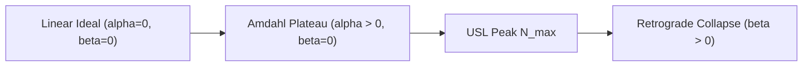

---
tags:
  - software-engineering
  - system-design
  - scalability
  - performance
created: 2026-01-02
updated: 2026-11-13
status: 🟢
level: mid-to-senior
---

# Scalability

> [!abstract] Vault Navigation
> Core engineering handbook within [[Programming/Software Engineering/System Design/System Design Overview|System Design Overview]] and [[Programming/Software Engineering/System Design/System Design Complete Guide|System Design Complete Guide]]. Integrates with [[Programming/Software Engineering/System Design/Load Balancing|Load Balancing]], [[Programming/Software Engineering/System Design/Caching|Caching]], [[Programming/Software Engineering/System Design/Message Queues|Message Queues]], [[Programming/Software Engineering/System Design/Rate Limiting|Rate Limiting]], [[Programming/Software Engineering/Database Design/Relational Databases|Relational Databases]], [[Programming/Software Engineering/Database Design/Sharding|Sharding]], [[Programming/Software Engineering/Database Design/Replication|Replication]], and [[Programming/Software Engineering/DevOps/Kubernetes|Kubernetes]].

Scalability defines how system throughput, tail latency, and infrastructure cost per unit of work evolve as request arrival rate, concurrency, or dataset volume increases across orders of magnitude. Adding CPU cores or horizontal instances does not yield linear capacity gains: mutex contention, distributed cache coherency traffic, fan-out tail latency amplification, TCP/database connection exhaustion, and unbounded FIFO queueing create hard non-linear ceilings and retrograde collapses.

---

## 1. First-Principles Mechanics & Quantitative Laws

### 1.1 Amdahl's Law vs Gustafson's Law

#### Amdahl's Law (Fixed-Workload Latency Bound)

**Amdahl's Law** models maximum achievable speedup $S(n)$ for a **fixed total workload** distributed across $n$ parallel execution units when fraction $p \in [0, 1]$ executes concurrently and fraction $(1 - p)$ is strictly sequential:

$$S(n) = \frac{1}{(1 - p) + \frac{p}{n}}, \qquad \lim_{n \to \infty} S(n) = \frac{1}{1 - p}$$

Even infinite compute cannot compress execution time below the serial bottleneck $(1 - p)$:
- **Serial Fraction $1 - p = 0.05$ (5%)**: Suppose an API request takes $100\text{ ms}$ on 1 core, where $95\text{ ms}$ computes embarrassingly parallel image transforms and $5\text{ ms}$ acquires a single global PostgreSQL advisory lock. At $n = 10$ workers, $S(10) = \frac{1}{0.05 + 0.095} = 6.90\times$. At $n = 1{,}000$ workers, $S(1{,}000) = \frac{1}{0.05 + 0.00095} = 19.63\times$. Infinite hardware caps speedup strictly at $\frac{1}{0.05} = \mathbf{20\times}$.
- **Serial Fraction $1 - p = 0.01$ (1%)**: Maximum speedup caps at $100\times$. Reaching $90\%$ of that ceiling ($90\times$) requires $n = 891$ workers—marginal returns collapse rapidly once $\frac{p}{n} \ll (1 - p)$.

#### Gustafson's Law (Scaled-Workload Throughput)

**Gustafson's Law** relaxes Amdahl's fixed-problem-size constraint. In distributed data processing, analytics, and multi-tenant request serving, **total work expands proportionally with hardware**: instead of shrinking a fixed 1 GB batch job from 10 minutes to 1 second, an organization processes 100 GB in the same 10-minute window across $100$ nodes.

If serial initialization/coordination consumes fraction $s = (1 - p)$ of parallel wall-clock time on $n$ workers, total equivalent single-node work executed in 1 unit of parallel time is $s + n(1 - s)$:

$$S_{\text{scaled}}(n) = s + n(1 - s) = n - s(n - 1)$$

| Dimension | Amdahl's Law | Gustafson's Law |
| :--- | :--- | :--- |
| **Workload Assumption** | Fixed problem size ($W = \text{const}$) | Scaled problem size ($W \propto n$) |
| **Scaling Objective** | Reduce latency of one massive task ("strong scaling") | Sustain constant latency as data/QPS scales ("weak scaling") |
| **Asymptotic Ceiling** | $\frac{1}{1 - p}$ (hard horizontal asymptote) | Linear slope $(1 - s)n$ assuming zero cross-node coordination |
| **Production Example** | Speeding up one checkout request constrained by a single ledger row lock | Adding Kafka partitions and stateless consumers as event ingestion grows $10\times$ |

### 1.2 The Universal Scalability Law (USL)

Amdahl's Law assumes worst-case speedup merely plateaus at a flat ceiling. Production distributed systems frequently suffer **retrograde scaling**: adding nodes past an inflection point **decreases absolute throughput** while spiking latency. Neil Gunther's **Universal Scalability Law (USL)** extends Amdahl's Law with a quadratic cross-node coherency penalty $\beta$:

$$C(N) = \frac{N}{1 + \alpha(N - 1) + \beta N(N - 1)}$$

Here $C(N) = \frac{X(N)}{X(1)}$ is relative capacity at concurrency/node count $N$, where $X(1)$ is baseline single-unit throughput.

| Parameter | Physical Mechanism | Production Manifestations |
| :--- | :--- | :--- |
| **$\alpha$ (Contention)** | Serialization / queueing for mutually exclusive shared resources | Single primary DB writer lock, Python GIL, connection pool wait, global rate-limiter mutex, hot inventory row lock |
| **$\beta$ (Coherency)** | Pairwise state synchronization and cache invalidation traffic ($\binom{N}{2} \propto N(N-1)$) | CPU MESI cache-line bouncing across NUMA sockets, Raft/Paxos quorum consensus RTT, synchronous multi-replica commit, L1 cache invalidation storms, PostgreSQL `LWLock: ProcArrayLock` snapshot broadcasts |

When $\beta = 0$, USL reduces identically to Amdahl's Law ($S(N)$ with $1 - p = \alpha$, since $\frac{N}{1 + \alpha(N - 1)} = \frac{1}{\alpha + (1 - \alpha)/N}$). When $\beta > 0$, setting $\frac{dC}{dN} = 0$ yields the exact peak concurrency $N_{\max}$:

$$\frac{d}{dN}\left[\frac{N}{1 + \alpha(N-1) + \beta N(N-1)}\right] = 0 \implies 1 - \alpha - \beta N^2 = 0 \implies N_{\max} = \left\lfloor \sqrt{\frac{1 - \alpha}{\beta}} \right\rfloor$$



> [!warning] The $\beta > 0$ Autoscaling Death Spiral
> Scaling Kubernetes pods ($N \uparrow$) beyond $N_{\max}$ while contending on a coherent shared bottleneck (such as PostgreSQL `ProcArrayLock`, synchronous distributed locking, or L1 cache invalidation broadcasts) drives effective cluster throughput **down** while raising p99 latency. Because Horizontal Pod Autoscalers see elevated CPU/latency, they spawn *additional* pods, worsening coherency traffic and driving goodput toward zero.

#### Fitting $(\alpha, \beta, N_{\max})$ from Benchmark Telemetry

Rearrange the USL equation to isolate the non-linear penalty on the left-hand side:

$$\frac{N}{C(N)} - 1 = \alpha(N - 1) + \beta N(N - 1)$$

Dividing both sides by $(N - 1)$ for $N > 1$ transforms USL into a clean linear equation $y_i = \alpha + \beta N_i$—or equivalently fitting the quadratic $\frac{N}{C(N)} - 1 = (\alpha - \beta)(N - 1) + \beta(N^2 - 1)$ via ordinary least squares (OLS) without division bias.

Suppose load testing a stateful service yields the following measured throughput $X(N)$ across worker concurrency $N$:

| Concurrency $N$ | Measured Throughput $X(N)$ (RPS) | Relative Capacity $C(N) = X(N)/X(1)$ | Excess Overhead $\frac{N}{C(N)} - 1$ |
| :--- | :--- | :--- | :--- |
| `1` | `1,000` | `1.000` | `0.000` |
| `4` | `3,571` | `3.571` | `0.120` |
| `8` | `6,061` | `6.061` | `0.320` |
| `16` | `8,421` | `8.421` | `0.900` |
| `32` | `8,205` | `8.205` | `2.900` |
| `64` | `5,333` | `5.333` | `11.000` |

Notice throughput peaks near $N = 16\text{–}20$ and collapses to $5{,}333\text{ RPS}$ by $N = 64$. Below is a complete zero-dependency Python USL solver that fits $\alpha, \beta, X(1), N_{\max}$ directly from benchmark CSV/arrays and prints capacity forecasts:

```python
# usl_fit.py — Ordinary Least Squares Universal Scalability Law Fitter
import math
from typing import List, Tuple


def fit_usl(n_vals: List[int], x_vals: List[float]) -> Tuple[float, float, float, int, float]:
    """
    Fits C(N) = N / (1 + alpha*(N-1) + beta*N*(N-1)) using Gunther's quadratic form:
        y_i = (N_i / (X_i / X_1)) - 1 = a * (N_i - 1) + b * (N_i^2 - 1)
    where b = beta and a = alpha - beta => alpha = a + b.
    """
    if len(n_vals) != len(x_vals) or len(n_vals) < 3:
        raise ValueError("Provide at least 3 paired (N, throughput) measurements.")
    if n_vals[0] != 1:
        raise ValueError("First data point must be baseline N=1.")

    x1 = x_vals[0]
    # Build 2x2 normal equations (X^T X) [a, b]^T = X^T y for N > 1 points
    s_u2 = s_uv = s_v2 = s_uy = s_vy = 0.0
    for n, x in zip(n_vals[1:], x_vals[1:]):
        u = float(n - 1)
        v = float(n * n - 1)
        y = (n * x1 / x) - 1.0
        s_u2 += u * u
        s_uv += u * v
        s_v2 += v * v
        s_uy += u * y
        s_vy += v * y

    det = s_u2 * s_v2 - s_uv * s_uv
    if abs(det) < 1e-12:
        raise ValueError("Singular matrix: insufficient spread in N values.")

    a = (s_v2 * s_uy - s_uv * s_vy) / det
    b = (s_u2 * s_vy - s_uv * s_uy) / det

    beta = max(0.0, b)
    alpha = max(0.0, a + beta)
    if beta == 0.0:
        n_max = 10**9
        x_peak = x1 / alpha if alpha > 0 else float("inf")
    else:
        n_max = math.floor(math.sqrt((1.0 - alpha) / beta))
        c_max = n_max / (1.0 + alpha * (n_max - 1) + beta * n_max * (n_max - 1))
        x_peak = x1 * c_max

    return alpha, beta, x1, n_max, x_peak


if __name__ == "__main__":
    N_BENCH = [1, 4, 8, 16, 32, 64]
    X_BENCH = [1000.0, 3571.0, 6061.0, 8421.0, 8205.0, 5333.0]

    alpha, beta, x1, n_max, x_peak = fit_usl(N_BENCH, X_BENCH)
    print(f"Fitted alpha (contention) : {alpha:.6f} ({alpha*100:.2f}% serial)")
    print(f"Fitted beta  (coherency)  : {beta:.6f}")
    print(f"Optimal peak concurrency  : N_max = {n_max} workers")
    print(f"Predicted peak throughput : {x_peak:,.1f} RPS")
    for n_test in [1, 8, 16, n_max, 32, 64, 128]:
        pred = x1 * n_test / (1.0 + alpha * (n_test - 1) + beta * n_test * (n_test - 1))
        print(f"  N={n_test:>3d} -> predicted {pred:>8,.1f} RPS")
```

Running `fit_usl` on the sample dataset recovers $\alpha \approx 0.0250$ ($2.5\%$ serial contention), $\beta \approx 0.00238$ (cross-node coherency), $N_{\max} = \lfloor \sqrt{0.975 / 0.00238} \rfloor = \mathbf{20}$ concurrent workers, and peak throughput **$\approx 8{,}602\text{ RPS}$**—giving capacity planners an exact hard ceiling above which autoscaling must stop.

### 1.3 Little's Law & $M/M/1$ Queueing Knee

#### Little's Law (Distribution-Free Steady-State Conservation)

For any stable, non-dropping system observed over a long window in steady state, the long-term average number of concurrent in-flight items $L$ equals the average arrival rate $\lambda$ multiplied by average residence time $W$ (queue wait + active service time):

$$L = \lambda \cdot W$$

Little's Law holds **regardless of arrival distribution, service-time distribution, or scheduling order** (FIFO, LIFO, priority). Its operational power lies in exposing **hidden concurrency explosions** during latency regressions:
- **Healthy Steady State**: $\lambda = 2{,}400\text{ req/s}$, mean latency $W = 0.015\text{ s}$ ($15\text{ ms}$) $\implies L = 2{,}400 \times 0.015 = \mathbf{36}$ active concurrent workers/DB connections.
- **Downstream Slowdown**: A missing PostgreSQL index or GC pause slows queries $6\times$ to $W = 0.090\text{ s}$ ($90\text{ ms}$) while arrival rate stays at $\lambda = 2{,}400\text{ req/s}$. Required concurrency jumps immediately to $L = 2{,}400 \times 0.090 = \mathbf{216}$. If the thread pool or DB pool is capped at $100$ slots, arrival rate exceeds completion capacity ($\lambda > 100 / 0.090 = 1{,}111\text{ req/s}$), queues grow monotonically until memory exhausts or upstream timeouts cascade—even while worker CPU idles at 20% waiting on I/O sockets!

#### $M/M/1$ Queueing Knee & Utilization Headroom

When arrivals follow a Poisson process at rate $\lambda$ and a single server processes requests with exponentially distributed service time (mean service time $S = 1/\mu$), server utilization is $\rho = \lambda / \mu \in [0, 1)$. Expected queue wait time $W_q$ and total residence time $W$ scale non-linearly:

$$W_q = \frac{\rho}{\mu(1 - \rho)}, \qquad W = \frac{1}{\mu(1 - \rho)} = \frac{S}{1 - \rho}, \qquad L = \frac{\rho}{1 - \rho}$$

| Utilization $\rho = \lambda / \mu$ | Latency Multiplier $\frac{1}{1 - \rho}$ | Mean Total Latency ($S = 10\text{ ms}$) | Mean Queue Depth $L_q = \frac{\rho^2}{1 - \rho}$ | Operational Regime |
| :--- | :--- | :--- | :--- | :--- |
| `0.20` (20%) | `1.25x` | `12.5 ms` | `0.05` | Underutilized; low unit economics |
| `0.50` (50%) | `2.00x` | `20.0 ms` | `0.50` | Comfortable burst absorption |
| `0.70` (70%) | `3.33x` | `33.3 ms` | `1.63` | **Recommended peak autoscaling target** |
| `0.80` (80%) | `5.00x` | `50.0 ms` | `3.20` | Queueing knee inflection begins |
| `0.90` (90%) | `10.00x` | `100.0 ms` | `8.10` | Severe tail variance on micro-bursts |
| `0.95` (95%) | `20.00x` | `200.0 ms` | `18.05` | Saturation cliff; timeouts imminent |
| `0.99` (99%) | `100.00x` | `1,000.0 ms` | `98.01` | Effective meltdown |

> [!important] Multi-Server Pooling Advantage ($M/M/c$ vs $c \times M/M/1$)
> Running $c$ independent single-server queues (e.g., shard-pinned workers without work stealing) yields latency $\frac{S}{1 - \rho}$. Consolidating $c$ servers behind one shared queue ($M/M/c$, Erlang-C) absorbs variance far better because an arrival only queues when **all $c$ servers are simultaneously busy**—delaying the steep knee from $\rho \approx 0.70$ out toward $\rho \approx 0.85\text{–}0.90$ for $c \ge 16$. Never shard worker queues unnecessarily when stateless uniform workers can share a pooled ingress.

### 1.4 Tail Latency Amplification, Hedged/Tied Requests & Retry Budgets

#### Fan-Out Latency Mathematics

Mean and median (`p50`) metrics conceal user-facing failures in scatter-gather architectures. When an API gateway issues $N$ parallel RPCs across microservices or storage partitions and waits for all $N$ to complete, total execution time equals the slowest leaf $\max_{i=1..N} X_i$.

If each independent leaf exceeds latency threshold $T$ with probability $p$ (e.g., leaf `p99` means $p = 0.01$):

$$P(\text{root} > T) = 1 - P(\text{all } N \text{ leaves} \le T) = 1 - (1 - p)^N$$

| Parallel Fan-Out $N$ | Leaf `p99` ($p = 0.01$) | Leaf `p95` ($p = 0.05$) | Root Exceeds Leaf Threshold ($p = 0.01$) |
| :--- | :--- | :--- | :--- |
| `1` | `1%` | `5%` | `1.0%` |
| `10` | `1%` | `5%` | `9.6%` |
| `25` | `1%` | `5%` | `22.2%` |
| `50` | `1%` | `5%` | `39.5%` |
| `100` | `1%` | `5%` | `63.4%` |
| `200` | `1%` | `5%` | `86.6%` |

At $N = 100$ parallel storage shards, **over 63% of user requests experience `p99` straggler latency** even while every individual backend meets its `p99` SLO.

#### Production Tail-Latency Mitigations

1. **Hedged Requests**:
   - Dispatch the primary idempotent read RPC to Replica A and start a local timer set to the leaf's **healthy `p95` latency** (e.g., `15 ms`, never `0 ms`).
   - If Replica A responds within `15 ms` (true 95% of the time), cancel the timer—zero extra network load is emitted.
   - Only if the `15 ms` timer expires does the client dispatch an identical read to Replica B, accept whichever responds first, and send cancellation (`RST_STREAM` / context abort) to the loser.
   - Result: **$\le 5\%$ extra cluster QPS** cuts `p99.9` latency by **70–95%** by bypassing isolated GC pauses or noisy-neighbor stalls.
   - **Strict Invariant**: Apply hedging **only to idempotent read operations** (or write RPCs carrying deterministic idempotency keys) and gate behind a retry/hedge budget.

2. **Tied Requests**:
   - When even a `p95` wait (`15 ms`) is unacceptable, dispatch two simultaneous reads to Replica A and Replica B at $t = 0$, embedding the peer's replica ID (`X-Tied-Peer: replica-b`) inside each request's metadata.
   - Whichever replica dequeues its request from its internal wait queue and **begins active execution first** immediately sends a lightweight out-of-band cancel message to its peer—removing the duplicate from the peer's queue *before* it wastes disk IOPS or CPU.

3. **Token-Bucket Retry & Hedge Budgets**:
   - Retrying or hedging unconditionally during a brownout turns a $20\%$ capacity deficit into a $300\text{–}400\%$ **metastable retry storm**.
   - Every client maintains a local **token bucket** (e.g., `maxTokens = 100`, `+1` token added per successful primary response, `-10` tokens deducted per retry/hedge attempt). Once tokens drop below `50%` (corresponding to $> 10\%$ retry ratio), client-side hedging and non-critical retries disable instantaneously, protecting degraded backends while preserving steady-state recovery.

---

## 2. Real-World Use Cases & Decision Matrix

| Engineering Scenario | Recommended Pattern | When NOT to Use It | Trade-Off vs Alternative |
| :--- | :--- | :--- | :--- |
| **Ultra-low-latency matching engine or graph traversal ($\le 10\text{ TB}$ RAM fit)** | **Vertical Scale-Up** (bare-metal high-clock NVMe + NUMA pinning) | Workload requires multi-AZ survival without failover pause or exceeds single-socket memory bandwidth | Zero network RTT & IPC serialization vs SPOF hardware ceiling and super-linear cloud SKU pricing |
| **I/O-bound REST/gRPC APIs spiking $5\times$ on promotions** | **Stateless Horizontal Scale-Out (`HPA` on RPS / queue depth)** | Pods retain in-memory sessions, local uploads, or share an unpooled direct PostgreSQL DB | Rapid horizontal elasticity vs network serialization (~0.5 ms) and downstream stateful bottlenecks |
| **Read-heavy SaaS catalog (`95%` reads, `5%` writes, stale tolerant 100 ms)** | **Async Read Replicas + Causal LSN Sticky Routing** | Financial ledger reads requiring zero-lag global strict serializability | Linear read QPS scaling vs replication lag management and primary pinning complexity |
| **Single PostgreSQL primary hitting WAL write IOPS ceiling (`>30k TPS`)** | **Horizontal Sharding via Virtual Shards (`1,024` logical buckets)** | Total dataset fits `< 2 TB` and write QPS `< 15k TPS` (prefer indexing, partitioning, & read replicas first!) | Near-infinite write & index RAM scale vs loss of cross-shard SQL joins and distributed 2PC cost |
| **Downstream dependency degrades $4\times$, risking thread/pool meltdown** | **Adaptive Concurrency Limiter + Priority CoDel Load Shedding** | Batch ingestion pipelines where backpressure can cleanly pause Kafka consumer offsets without SLA violation | Protects core checkout goodput (`CRITICAL`) by returning `503` on `SHEDDABLE` traffic vs dropping low-tier requests |

---

## 3. Step-by-Step Practical Application (Production Implementation)

A production scalable backend separates stateless execution, consistent shard routing, pooled database multiplexing, adaptive concurrency protection, and open-loop load verification into clean, independently testable modules:

```text
scalable-orders-platform/
├── infra/
│   └── k8s/
│       └── hpa-orders-api.yaml          # Custom-metric HPA + stabilization + PDB
├── db/
│   ├── pgbouncer.ini                    # Transaction-mode pooling (4000 -> 64 backends)
│   └── postgresql.tuned.conf            # Safeguard timeouts & ProcArray sizing
├── src/
│   ├── routing/
│   │   └── causal-replica-router.ts     # LSN write cookie + replica replay check
│   ├── sharding/
│   │   └── consistent-hash-ring.ts      # FNV-1a virtual-node ring + RF=3 node selection
│   └── resilience/
│       └── adaptive-limiter.ts          # Gradient2 concurrency + CoDel LIFO + Retry Budget
└── loadtest/
    └── open-loop-checkout.js            # k6 constant-arrival-rate avoiding Coordinated Omission
```

### 3.1 Stateless Compute Autoscaling (`HPA` CPU vs RPS/Lag Custom Metrics)

#### Why CPU-Only `HPA` Fails I/O-Bound APIs

Node.js, Go, and async Java services spend **70–90% of request latency blocked on network sockets** (PostgreSQL, Redis, gRPC). When a downstream DB slows down or traffic shifts to heavy DB queries, pod CPU remains at `30%` even as event-loop/worker concurrency saturates—so CPU-based HPA never scales out! Conversely, during a DB lock contention spike ($\beta > 0$), latency-triggered or aggressive scale-up without stabilization spawns pods that immediately hammer the already locked DB.

Below is a production `autoscaling/v2` manifest scaling on **both** CPU safety ceiling **and** per-pod active request rate (`http_requests_per_second`), paired with asymmetric stabilization windows (`scaleUp` fast, `scaleDown` conservative to prevent thrashing) and a `PodDisruptionBudget`:

```yaml
# infra/k8s/hpa-orders-api.yaml
apiVersion: autoscaling/v2
kind: HorizontalPodAutoscaler
metadata:
  name: orders-api-hpa
  namespace: production
spec:
  scaleTargetRef:
    apiVersion: apps/v1
    kind: Deployment
    name: orders-api
  minReplicas: 6
  maxReplicas: 40 # Hard ceiling calibrated from USL N_max + PgBouncer max_client_conn
  metrics:
    - type: Pods
      pods:
        metric:
          name: http_requests_per_second
        target:
          type: AverageValue
          averageValue: "450" # Target 65% of 700 RPS/pod healthy ceiling
    - type: Resource
      resource:
        name: cpu
        target:
          type: Utilization
          averageUtilization: 65
  behavior:
    scaleUp:
      stabilizationWindowSeconds: 30
      policies:
        - type: Percent
          value: 50
          periodSeconds: 60
        - type: Pods
          value: 4
          periodSeconds: 60
      selectPolicy: Max
    scaleDown:
      stabilizationWindowSeconds: 300 # 5-min cooldown avoids flapping on burst dips
      policies:
        - type: Percent
          value: 15
          periodSeconds: 60
      selectPolicy: Min
---
apiVersion: policy/v1
kind: PodDisruptionBudget
metadata:
  name: orders-api-pdb
  namespace: production
spec:
  minAvailable: "75%"
  selector:
    matchLabels:
      app: orders-api
```

#### Stateless Compute Prerequisites Checklist

1. **Externalized Auth & Session State**: Store session blobs in distributed Redis/Valkey or stateless short-lived signed JWTs (`exp <= 15m` + revocation bloom/set); never store sessions in pod local memory or sticky ALB cookies unless strictly for optimization.
2. **Direct-to-Object-Storage Uploads**: Issue signed S3/GCS PUT URLs (`Content-Length` + SHA-256 constraints) so multi-MB uploads never buffer onto pod `/tmp` disks.
3. **Async Offloading**: Move email dispatch, invoice PDF rendering, and webhook fan-out onto [[Programming/Software Engineering/System Design/Message Queues|Message Queues]] scaled independently via **KEDA** on Kafka consumer group lag (`lagThreshold: "5000"`).
4. **Graceful Drain (`preStop`)**: Configure `terminationGracePeriodSeconds: 45` with a `preStop` sleep (`5s`) so Kubernetes removes the pod IP from kube-proxy/Envoy endpoints *before* the HTTP server closes in-flight keep-alive connections.

### 3.2 Read Replica Routing + Causal LSN Propagation Middleware

When scaling read QPS via async PostgreSQL streaming replicas, routing `POST /orders` to the primary and an immediate `GET /orders` to a replica lagging by `40 ms` violates **Read-Your-Writes**. Passing a signed causal **Log Sequence Number (`pg_current_wal_lsn()`)** token bridges primary writes and replica reads without routing 100% of traffic to the primary:

```typescript
// src/routing/causal-replica-router.ts
import { Pool, PoolClient } from "pg";
import crypto from "node:crypto";
import type { Request, Response, NextFunction } from "express";

const HMAC_SECRET = process.env.CAUSAL_COOKIE_SECRET ?? "dev-rotate-in-prod-32bytes";
const REPLICA_WAIT_BUDGET_MS = 25;

// Convert PostgreSQL LSN string "0/16B4A88" -> sortable BigInt (64-bit integer)
export function parsePgLsn(lsn: string): bigint {
  const [hiHex, loHex] = lsn.trim().split("/");
  if (!hiHex || !loHex) throw new Error(`Invalid PostgreSQL LSN: ${lsn}`);
  return (BigInt("0x" + hiHex) << 32n) | BigInt("0x" + loHex);
}

function signToken(lsn: string, expiresAtMs: number): string {
  const payload = `${lsn}|${expiresAtMs}`;
  const sig = crypto.createHmac("sha256", HMAC_SECRET).update(payload).digest("base64url");
  return `${payload}|${sig}`;
}

function verifyToken(token: string | undefined): { lsn: bigint; rawLsn: string } | null {
  if (!token) return null;
  const parts = token.split("|");
  if (parts.length !== 3) return null;
  const [rawLsn, expStr, sig] = parts;
  const exp = Number(expStr);
  if (!Number.isFinite(exp) || Date.now() > exp) return null;

  const expectedSig = crypto
    .createHmac("sha256", HMAC_SECRET)
    .update(`${rawLsn}|${expStr}`)
    .digest("base64url");
  if (!crypto.timingSafeEqual(Buffer.from(sig), Buffer.from(expectedSig))) return null;

  return { lsn: parsePgLsn(rawLsn), rawLsn };
}

export class CausalReplicaRouter {
  constructor(
    private readonly primaryPool: Pool,
    private readonly replicaPools: Pool[],
  ) {}

  // Deterministic replica affinity per user/session ensures Monotonic Reads
  private pickReplicaForUser(userId: string): Pool {
    if (this.replicaPools.length === 0) return this.primaryPool;
    const hash = crypto.createHash("md5").update(userId).digest().readUInt32BE(0);
    return this.replicaPools[hash % this.replicaPools.length];
  }

  /**
   * Executes a primary mutation and returns the post-commit WAL LSN
   * so caller responses can attach X-Causal-Token.
   */
  async runWrite<T>(fn: (client: PoolClient) => Promise<T>): Promise<{ result: T; commitLsn: string }> {
    const client = await this.primaryPool.connect();
    try {
      await client.query("BEGIN");
      const result = await fn(client);
      await client.query("COMMIT");
      // Read LSN immediately post-commit so it bounds all modified pages
      const { rows } = await client.query<{ lsn: string }>("SELECT pg_current_wal_lsn()::text AS lsn");
      return { result, commitLsn: rows[0].lsn };
    } catch (err) {
      await client.query("ROLLBACK").catch(() => {});
      throw err;
    } finally {
      client.release();
    }
  }

  /**
   * Routes read to consistent sticky replica if its replay LSN >= minLsn;
   * polls briefly within REPLICA_WAIT_BUDGET_MS, falling back cleanly to primary.
   */
  async selectPoolForRead(userId: string, minLsn: bigint | null): Promise<Pool> {
    if (this.replicaPools.length === 0) return this.primaryPool;
    const replica = this.pickReplicaForUser(userId);
    if (!minLsn) return replica;

    const deadline = Date.now() + REPLICA_WAIT_BUDGET_MS;
    while (true) {
      try {
        const { rows } = await replica.query<{ replay_lsn: string | null }>(
          "SELECT pg_last_wal_replay_lsn()::text AS replay_lsn",
        );
        const replayRaw = rows[0]?.replay_lsn;
        if (replayRaw && parsePgLsn(replayRaw) >= minLsn) {
          return replica;
        }
      } catch {
        return this.primaryPool; // Replica degraded -> fallback safely
      }
      if (Date.now() >= deadline) {
        return this.primaryPool; // Lag exceeded tight budget -> read primary directly
      }
      await new Promise((r) => setTimeout(r, 5));
    }
  }
}

export function causalMiddleware(router: CausalReplicaRouter) {
  return async (req: Request & { dbPool?: Pool; recordWriteLsn?: (lsn: string) => void }, res: Response, next: NextFunction) => {
    const userId = (req.headers["x-user-id"] as string) ?? req.ip ?? "anon";
    const tokenRaw = (req.headers["x-causal-token"] as string) ?? req.cookies?.causal_lsn;
    const parsed = verifyToken(tokenRaw);

    req.recordWriteLsn = (lsn: string) => {
      const signed = signToken(lsn, Date.now() + 30_000); // 30s causal window
      res.setHeader("X-Causal-Token", signed);
      res.cookie?.("causal_lsn", signed, { httpOnly: true, sameSite: "lax", maxAge: 30_000 });
    };

    req.dbPool =
      req.method === "GET" || req.method === "HEAD"
        ? await router.selectPoolForRead(userId, parsed?.lsn ?? null)
        : (router as unknown as { primaryPool: Pool }).primaryPool;

    next();
  };
}
```

### 3.3 Consistent Hashing Ring Implementation (Virtual Nodes & $RF=3$ Placement)

Modulo hashing (`hash(key) % N`) remaps $\approx \frac{N-1}{N}$ keys whenever a node joins or crashes, triggering massive cache or shard storms. A **Consistent Hashing Ring** maps both physical servers (replicated across $V = 150$ **virtual nodes** to minimize standard deviation of shard ownership below $\sim 8\%$) and keys onto $[0, 2^{32}-1]$. Adding or removing 1 of $N$ nodes moves only **$1/N$** of keys.

```typescript
// src/sharding/consistent-hash-ring.ts
import crypto from "node:crypto";

interface VNodeEntry {
  hash: number;
  physicalNode: string;
}

export class ConsistentHashRing {
  private ring: VNodeEntry[] = [];
  private readonly nodes = new Set<string>();

  constructor(private readonly vnodesPerNode = 150) {
    if (vnodesPerNode < 1) throw new Error("vnodesPerNode must be >= 1");
  }

  /** 32-bit FNV-1a / SHA-256 truncated hash providing uniform ring distribution */
  private static hash32(key: string): number {
    const digest = crypto.createHash("sha256").update(key).digest();
    return digest.readUInt32BE(0);
  }

  addNode(nodeId: string): void {
    if (this.nodes.has(nodeId)) return;
    this.nodes.add(nodeId);

    for (let v = 0; v < this.vnodesPerNode; v++) {
      const hash = ConsistentHashRing.hash32(`${nodeId}#vnode:${v}`);
      this.ring.push({ hash, physicalNode: nodeId });
    }
    this.ring.sort((a, b) => a.hash - b.hash);
  }

  removeNode(nodeId: string): void {
    if (!this.nodes.delete(nodeId)) return;
    this.ring = this.ring.filter((entry) => entry.physicalNode !== nodeId);
  }

  /** Binary search for first clockwise vnode hash >= keyHash (wrap to 0 if past end) */
  private lowerBoundIndex(targetHash: number): number {
    let lo = 0;
    let hi = this.ring.length;
    while (lo < hi) {
      const mid = (lo + hi) >>> 1;
      if (this.ring[mid].hash < targetHash) lo = mid + 1;
      else hi = mid;
    }
    return lo === this.ring.length ? 0 : lo;
  }

  getPrimaryNode(key: string): string | null {
    if (this.ring.length === 0) return null;
    const idx = this.lowerBoundIndex(ConsistentHashRing.hash32(key));
    return this.ring[idx].physicalNode;
  }

  /**
   * Returns up to `replicationFactor` DISTINCT physical nodes walking clockwise.
   * Skips repeated virtual nodes belonging to an already-selected physical host.
   */
  getReplicaNodes(key: string, replicationFactor: number): string[] {
    if (this.ring.length === 0 || replicationFactor <= 0) return [];
    const targetCount = Math.min(replicationFactor, this.nodes.size);
    const startIdx = this.lowerBoundIndex(ConsistentHashRing.hash32(key));
    const selected: string[] = [];
    const seen = new Set<string>();

    for (let offset = 0; offset < this.ring.length && selected.length < targetCount; offset++) {
      const candidate = this.ring[(startIdx + offset) % this.ring.length].physicalNode;
      if (!seen.has(candidate)) {
        seen.add(candidate);
        selected.push(candidate);
      }
    }
    return selected;
  }
}
```

### 3.4 Connection Pool Exhaustion & Complete PgBouncer + PostgreSQL Sizing

#### Mechanics of PostgreSQL Process-Per-Connection Collapse

PostgreSQL forks an independent OS backend process for every client TCP socket:
- Each idle backend occupies **5–10 MB RSS** plus kernel page tables and `shared_buffers` address mappings.
- Beyond **200–500 concurrent backends**, snapshot acquisition (`GetSnapshotData`) contends heavily on **`LWLock: ProcArrayLock`** across CPU sockets, and OS context-switching thrashes L1/L2 CPU caches (introducing USL coherency $\beta > 0$).
- **Optimal Active Backend Formula**:
  $$\text{active\_backends} \approx (2 \times \text{vCPU cores}) + \text{effective NVMe spindles}$$
  For a 16-vCPU NVMe primary, **36–64 active backends** maximize throughput; allowing 1,500 direct app connections collapses goodput.

#### The HPA Connection-Pool Amplification Bug

$$\text{Total Connections} = (N_{\text{pods}} \times \text{pool\_max}) + N_{\text{workers}} \times \text{worker\_pool} + \text{admin\_and\_replication\_slots}$$

When HPA scales API pods from $10 \to 50$ with `pool_max = 20`, requested connections surge from $200 \to 1{,}000$, crashing into `max_connections = 500` with `FATAL: sorry, too many clients already`.

#### Complete Production `pgbouncer.ini` & `postgresql.tuned.conf`

```ini
; db/pgbouncer.ini — Placed on dedicated co-located AZ proxy pods or DB sidecar (16-vCPU Primary)
[databases]
orders_prod = host=pg-primary.internal port=5432 dbname=orders
orders_ro   = host=pg-replica-pool.internal port=5432 dbname=orders

[pgbouncer]
listen_addr = 0.0.0.0
listen_port = 6432
auth_type = scram-sha-256
auth_file = /etc/pgbouncer/userlist.txt

; Transaction-mode multiplexing: 4000 app TCP sockets -> 48 active DB backends
pool_mode = transaction
max_client_conn = 4000
default_pool_size = 48
min_pool_size = 12
reserve_pool_size = 16
reserve_pool_timeout = 2

; PgBouncer 1.21+ protocol-level prepared statement cache (avoids disabling prepare in Prisma/TypeORM/pgx)
max_prepared_statements = 250

; Aggressive leak reclamation & clean idle rotation
server_idle_timeout = 300
server_lifetime = 3600
client_idle_timeout = 300
idle_transaction_timeout = 10
query_wait_timeout = 3
client_login_timeout = 5
ignore_startup_parameters = extra_float_digits,options

; Prometheus exporter compatibility & clean diagnostics
stats_period = 60
admin_users = pgbouncer_admin
```

```ini
; db/postgresql.tuned.conf — Key concurrency & timeout hardening on PostgreSQL 16 (16 vCPU, 64 GB RAM)
max_connections = 200                  # Headroom for PgBouncer (48+16) + replicas + migrations + superuser
superuser_reserved_connections = 5
shared_buffers = 16GB                  # 25% of host RAM
effective_cache_size = 48GB            # 75% of host RAM for planner cost estimates
work_mem = 32MB                        # Keep conservative: peak concurrent sorts = backends * work_mem

# Critical multi-tenant / microservice safety timeouts:
statement_timeout = '4000ms'           # Kill runaway full-table scans before pool locks up
lock_timeout = '1500ms'                # Prevent DDL ALTER TABLE from queueing all reads behind AccessExclusiveLock
idle_in_transaction_session_timeout = '10000ms' # Reclaim app crashes holding open BEGIN blocks
```

> [!info] Transaction-Mode Compatibility Rules
> Under `pool_mode = transaction`, consecutive SQL statements from the same client outside `BEGIN ... COMMIT` may run on **different** PostgreSQL backend processes.
> - **Never** execute session-scoped `SET search_path` or `SET TIME ZONE` outside a transaction; use `SET LOCAL` inside `BEGIN ... COMMIT`.
> - **Never** use session advisory locks (`pg_advisory_lock`); use transaction-scoped `pg_advisory_xact_lock`.
> - **Never** rely on `LISTEN / NOTIFY` through transaction-mode PgBouncer; dedicate a tiny separate `session`-mode pool alias for listener workers.
> - Keep each application pod's internal pool small (`max: 5` to `8`, `connectionTimeoutMillis: 2000`) because PgBouncer holds the true multiplexed queue.

### 3.5 Adaptive Concurrency Limits & CoDel Load Shedding Middleware

Static concurrency caps either over-reject during fast cached workloads or permit catastrophic queuing when downstream latency degrades. **Adaptive Concurrency Limiting** (modeled on Netflix's `Gradient2` algorithm combined with **CoDel** queue sojourn dropping and **Priority Tiers**) continuously compares long-window baseline `minRTT` against short-window `sampleRTT`:
- When `sampleRTT <= minRTT * tolerance` (no queueing detected), the limit gently rises (`limit + 1`).
- When queuing emerges (`gradient = minRTT / sampleRTT < 1.0`), the limit shrinks proportionally (`limit * gradient`) *before* thread pools or DB pools saturate.

```typescript
// src/resilience/adaptive-limiter.ts
import type { Request, Response, NextFunction } from "express";

export enum PriorityTier {
  CRITICAL_PLUS = 0, // Health checks, payment webhooks, auth refresh (never shed unless OOM)
  CRITICAL = 1,      // Checkout, core writes
  SHEDDABLE_PLUS = 2,// Personalized feeds (serve stale fallback or shed)
  SHEDDABLE = 3,     // Telemetry, batch analytics, recommendations (drop first)
}

export class Gradient2AdaptiveLimiter {
  private limit: number;
  private inFlight = 0;
  private shortEmaMs = 0;
  private longMinMs = Number.POSITIVE_INFINITY;
  private sampleCount = 0;

  constructor(
    private readonly minLimit = 10,
    private readonly maxLimit = 500,
    initialLimit = 50,
    private readonly tolerance = 1.5, // Allow 50% queueing jitter before tightening
  ) {
    this.limit = initialLimit;
  }

  tryAcquire(tier: PriorityTier): (() => void) | null {
    // Tier-reserved headroom: SHEDDABLE sheds at 70% limit; CRITICAL_PLUS gets 120% emergency bypass
    const tierCap =
      tier === PriorityTier.CRITICAL_PLUS
        ? Math.ceil(this.limit * 1.2)
        : tier === PriorityTier.CRITICAL
          ? this.limit
          : tier === PriorityTier.SHEDDABLE_PLUS
            ? Math.floor(this.limit * 0.85)
            : Math.floor(this.limit * 0.7);

    if (this.inFlight >= tierCap) return null;

    this.inFlight++;
    const startNs = process.hrtime.bigint();
    let released = false;

    return () => {
      if (released) return;
      released = true;
      this.inFlight = Math.max(0, this.inFlight - 1);
      const rttMs = Number(process.hrtime.bigint() - startNs) / 1e6;
      this.updateLimit(rttMs);
    };
  }

  private updateLimit(rttMs: number): void {
    this.sampleCount++;
    const clampedRtt = Math.max(0.5, rttMs);

    // Track short EWMA (last ~20 samples) and slowly decaying baseline minRTT
    this.shortEmaMs = this.shortEmaMs === 0 ? clampedRtt : 0.1 * clampedRtt + 0.9 * this.shortEmaMs;
    if (clampedRtt < this.longMinMs) {
      this.longMinMs = clampedRtt;
    } else if (this.sampleCount % 200 === 0) {
      // Drift baseline up slightly every 200 samples to track legitimate workload shifts
      this.longMinMs = Math.min(this.shortEmaMs, this.longMinMs * 1.05);
    }

    const gradient = Math.min(1.0, (this.longMinMs * this.tolerance) / this.shortEmaMs);
    const queueAllowance = Math.sqrt(this.limit); // Square-root headroom scales smoothly with concurrency

    let nextLimit = this.limit * gradient + (gradient >= 0.99 ? 1.0 : queueAllowance * 0.1);
    // Smooth exponential adjustment so isolated GC glitches do not collapse limit overnight
    nextLimit = 0.2 * nextLimit + 0.8 * this.limit;
    this.limit = Math.max(this.minLimit, Math.min(this.maxLimit, Math.round(nextLimit)));
  }

  snapshot() {
    return { limit: this.limit, inFlight: this.inFlight, minRttMs: this.longMinMs, emaMs: this.shortEmaMs };
  }
}

/**
 * Bounded LIFO queue implementing CoDel (Controlled Delay) sojourn eviction.
 * Prevents short micro-bursts from immediate 503s while guaranteeing stale items
 * exceeding targetSojournMs are dropped cleanly instead of executing expired work.
 */
export class CodelLifoQueue {
  private readonly waiters: Array<{
    enqueuedAtMs: number;
    settled: boolean;
    resolve: (granted: boolean) => void;
    timer: NodeJS.Timeout;
  }> = [];

  constructor(
    private readonly maxQueueDepth = 64,
    private readonly targetSojournMs = 50,
  ) {}

  enqueue(): Promise<boolean> {
    if (this.waiters.length >= this.maxQueueDepth) {
      return Promise.resolve(false);
    }
    return new Promise<boolean>((resolve) => {
      const entry = {
        enqueuedAtMs: Date.now(),
        settled: false,
        resolve,
        timer: setTimeout(() => {
          if (entry.settled) return;
          entry.settled = true;
          const idx = this.waiters.indexOf(entry);
          if (idx !== -1) this.waiters.splice(idx, 1);
          resolve(false); // CoDel timeout bound prevents zombie queue hangs
        }, this.targetSojournMs),
      };
      this.waiters.push(entry);
    });
  }

  /** Pops newest arrival first (LIFO); sheds expired entries past CoDel sojourn budget */
  drainNext(): boolean {
    const now = Date.now();
    while (this.waiters.length > 0) {
      const waiter = this.waiters.pop()!;
      if (waiter.settled) continue;
      clearTimeout(waiter.timer);
      waiter.settled = true;
      if (now - waiter.enqueuedAtMs > this.targetSojournMs) {
        waiter.resolve(false);
        continue;
      }
      waiter.resolve(true);
      return true;
    }
    return false;
  }
}

export function loadSheddingMiddleware(
  limiter: Gradient2AdaptiveLimiter,
  codelQueue = new CodelLifoQueue(),
) {
  return async (req: Request, res: Response, next: NextFunction) => {
    // 1. Deadline propagation check: discard work already expired at gateway/client
    const deadlineHeader = req.headers["x-request-deadline-ms"];
    if (typeof deadlineHeader === "string") {
      const deadlineMs = Number(deadlineHeader);
      if (Number.isFinite(deadlineMs) && Date.now() >= deadlineMs) {
        return res.status(504).json({ error: "Upstream deadline already expired" });
      }
    }

    // 2. Classify criticality tier
    const tierHeader = (req.headers["x-priority-tier"] as string)?.toUpperCase();
    const tier =
      req.path === "/healthz" || tierHeader === "CRITICAL_PLUS"
        ? PriorityTier.CRITICAL_PLUS
        : req.path.startsWith("/v1/checkout") || tierHeader === "CRITICAL"
          ? PriorityTier.CRITICAL
          : req.path.startsWith("/v1/recommendations") || tierHeader === "SHEDDABLE"
            ? PriorityTier.SHEDDABLE
            : PriorityTier.SHEDDABLE_PLUS;

    let release = limiter.tryAcquire(tier);
    if (!release && tier <= PriorityTier.CRITICAL) {
      // Allow CRITICAL traffic a tiny bounded CoDel LIFO queue wait; shed SHEDDABLE immediately
      const admitted = await codelQueue.enqueue();
      if (admitted) release = limiter.tryAcquire(PriorityTier.CRITICAL_PLUS);
    }

    if (!release) {
      const retryJitter = 1 + Math.floor(Math.random() * 4); // Jittered 1..4s avoids synchronized retry wave
      res.setHeader("Retry-After", String(retryJitter));
      res.setHeader("X-Load-Shed-Tier", PriorityTier[tier]);
      return res.status(503).json({
        error: "Service overloaded",
        tier: PriorityTier[tier],
        retryAfterSec: retryJitter,
      });
    }

    let done = false;
    const onDone = () => {
      if (done) return;
      done = true;
      release!();
      codelQueue.drainNext();
    };
    res.on("finish", onDone);
    res.on("close", onDone);
    next();
  };
}
```

### 3.6 Open-Loop vs Closed-Loop `k6` Load Testing (Fixing Coordinated Omission)

A **closed-loop** load tester (`k6` default `vus` executor, `ab`, synchronous JMeter threads) waits for request $i$ to finish before dispatching request $i + 1$:
- Suppose target rate is $100\text{ req/s}$ ($10\text{ ms}$ inter-arrival) and the server undergoes a **2-second GC pause**.
- A closed-loop VU pauses for those $2{,}000\text{ ms}$, sends **1** request that records $2{,}000\text{ ms}$, and completely **omits the 199 requests that real open-loop users would have queued up** during the stall! Reported `p99` looks artificially healthy even though 200 real users waited $1\text{–}2\text{ s}$.

Always test tail latency with **open-loop** `constant-arrival-rate` generators (`k6`, `wrk2`, `ghz`) that enforce fixed inter-arrival timestamps regardless of backend response stalling:

```javascript
// loadtest/open-loop-checkout.js — Open-Loop k6 Benchmark Preventing Coordinated Omission
import http from "k6/http";
import { check } from "k6";
import { Trend, Counter } from "k6/metrics";

const ttfbTrend = new Trend("checkout_ttfb_ms", true);
const shedCounter = new Counter("shed_503_responses");

export const options = {
  scenarios: {
    open_loop_steady: {
      executor: "constant-arrival-rate",
      rate: 2000,            // Strict 2,000 arrivals/sec independent of server response time
      timeUnit: "1s",
      duration: "5m",
      preAllocatedVUs: 150,  // Size >= expected Little's Law peak concurrency (L = lambda * W_max)
      maxVUs: 600,           // Prevents k6 generator itself from starving & dropping iterations
    },
  },
  thresholds: {
    http_req_duration: ["p(95)<45", "p(99)<120"],
    http_req_failed: ["rate<0.005"],
    dropped_iterations: ["count==0"], // Non-zero means load generator ran out of maxVUs!
  },
};

export default function () {
  const deadlineMs = Date.now() + 250; // Propagate strict 250 ms SLO deadline
  const params = {
    headers: {
      "Content-Type": "application/json",
      "X-Request-Deadline-Ms": String(deadlineMs),
      "X-Priority-Tier": "CRITICAL",
    },
    timeout: "300ms",
  };

  const payload = JSON.stringify({
    sku: `SKU-${Math.floor(Math.random() * 5000)}`,
    qty: 1,
  });

  const res = http.post("https://api.staging.internal/v1/checkout", payload, params);
  ttfbTrend.add(res.timings.waiting);

  if (res.status === 503) shedCounter.add(1);

  check(res, {
    "status is 200 or controlled 503": (r) => r.status === 200 || r.status === 503,
  });
}
```

---

## 4. Complete Scalability Construct Reference & Edge Cases

### 4.1 Horizontal Sharding Taxonomies & Virtual Shards

Once single-node WAL throughput, B-tree index RAM, or MVCC vacuum capacity saturates despite read replicas and functional partitioning (`users_db`, `orders_db`, `ledger_db`), horizontal sharding splits one logical table across $K$ independent primaries.

| Sharding Strategy | Placement Rule | Primary Advantage | Operational Failure Mode |
| :--- | :--- | :--- | :--- |
| **Hash / Consistent Hash** | `hash(shard_key) % V` | Uniform write IOPS & storage balance | Cross-key range queries (`WHERE created_at BETWEEN ...`) trigger $K$-shard scatter-gather |
| **Range Partitioning** | Contiguous intervals (`[2026-01..03]`, `[A-F]`) | Single-shard ordered range scans | Monotonically increasing keys (`AUTO_INCREMENT`, `now()`) hotspot the newest shard exclusively |
| **Directory / Lookup** | Explicit map `(tenant_id -> shard_id)` | Pin VIP whales to isolated hardware; zero-downtime live tenant migration | Directory table becomes critical latency hop / SPOF unless cached heavily at L1/L2 |

#### Virtual Shards (Decoupling Logical Buckets from Physical Hosts)

Never hash directly modulo physical database nodes (`user_id % 4`). Expanding from $4 \to 6$ hosts forces moving $\sim 83\%$ of every table row simultaneously under production writes! Instead:
1. Partition the keyspace statically into a large power-of-two number of **logical shards** (e.g., $V = 1{,}024$ or $4{,}096$ PostgreSQL schemas or Vitess shards).
2. Store a lightweight routing table mapping `logical_shard_id (0..1023) -> physical_cluster_id`.
3. To split capacity from 4 hosts (256 buckets each) to 8 hosts (128 buckets each), stream CDC/logical replication for just buckets `128..255` onto the new host, verify checksums, dual-write briefly or pause writes for `< 100 ms`, flip the atomic routing map, and drop old bucket tables—migrating **exactly 50%** of data cleanly with zero key rehashing.

### 4.2 Ephemeral Port Exhaustion, `LIFO` vs `FIFO`, and Metastable Failures

1. **TCP Ephemeral Port Exhaustion (`TIME_WAIT`)**:
   - Every short-lived outbound HTTP/DB connection without keep-alive consumes one source port (`32768..60999`, ~28k ports) and lingers in Linux **`TIME_WAIT`** for `2 * MSL` (60 seconds). At just `500 new connections/sec` per pod to a single Redis/upstream IP:port tuple, all 28k ports exhaust in 56 seconds (`EADDRNOTAVAIL`).
   - **Fix**: Enable HTTP/1.1 persistent keep-alive pools (`keepAlive: true`), HTTP/2 multiplexing, or PgBouncer pooling so socket reuse stays $> 99.9\%$.
2. **FIFO vs LIFO Under Overload**:
   - Under sustained $\lambda > \mu$, a **FIFO** queue forces *every* incoming request to wait behind stale requests that have already exceeded client deadlines—driving **effective goodput to 0%** ("zombie processing").
   - A bounded **LIFO** queue (or **CoDel** dropping queue head entries whose sojourn time $> 50\text{ ms}$) ensures the newest arrival finishes within SLO immediately while shedding expired older items cheaply.
3. **Metastable Failure Hysteresis**:
   - Even after a spike returns to normal baseline $\lambda_{\text{normal}} < \mu_{\text{healthy}}$, retry storms, cold evicted caches, or GC allocation backlog trap the cluster in a low-goodput degraded state ($\mu_{\text{degraded}} < \lambda_{\text{normal}}$). Breaking a metastable collapse requires **shedding load below recovery capacity** (e.g., shedding 40% via circuit breakers/rate limiters) until queues drain and caches warm.

---

## 5. Production Debugging, Profiling & Operations Playbook

| Symptom | Root Cause Hypothesis | Exact Diagnostic Commands | Remediation |
| :--- | :--- | :--- | :--- |
| **DB CPU 98% system/kernel; throughput collapsed despite low QPS** | PostgreSQL connection thrashing (`ProcArrayLock` / OS context switches) | `SELECT wait_event_type, wait_event, count(*) FROM pg_stat_activity GROUP BY 1,2 ORDER BY 3 DESC;` and `vmstat 1` (`cs` column) | Insert PgBouncer (`transaction` mode, `default_pool_size = 2*vCPU`), cap `maxReplicas` / app `pool_max <= 8` |
| **API pods show `p99 = 3.5s` while `CPU = 22%` and PgBouncer healthy** | Downstream microservice stall saturating worker concurrency ($L = \lambda W$) | Inspect `SHOW POOLS;` on PgBouncer (`cl_waiting`), app active-request gauge, and `ss -tan \| grep ESTAB` | Enable Adaptive Concurrency Limiter, set outbound socket timeouts, check `X-Request-Deadline-Ms` |
| **Users report missing newly created items right after `POST` redirect** | Async read replica lag violating Read-Your-Writes | `SELECT now() - pg_last_xact_replay_timestamp() AS lag, pg_last_wal_replay_lsn();` on replica | Add Causal LSN Token router (`pg_current_wal_lsn()`) with tight primary fallback |
| **`EADDRNOTAVAIL` or `connect ETIMEDOUT` between API pods and internal services** | Missing HTTP keep-alive pool causing `TIME_WAIT` ephemeral port exhaustion | `ss -s` and `ss -tan state time-wait \| awk '{print $4}' \| sort \| uniq -c \| sort -rn` | Enable `http.Agent({ keepAlive: true })`, switch gRPC/HTTP2, verify `net.ipv4.ip_local_port_range` |
| **HPA constantly scaling up/down every 2 minutes ("pod flapping")** | Short CPU burst triggers scaleUp, followed by immediate scaleDown without stabilization | `kubectl describe hpa orders-api-hpa -n production` | Switch HPA metric to `http_requests_per_second` + set `scaleDown.stabilizationWindowSeconds: 300` |

```sql
-- Diagnostic query: find blocking lock chains & idle-in-transaction zombies in PostgreSQL
SELECT
  pid,
  now() - xact_start AS xact_age,
  state,
  wait_event_type || ':' || wait_event AS wait_info,
  pg_blocking_pids(pid) AS blocked_by,
  left(query, 80) AS query_snippet
FROM pg_stat_activity
WHERE state <> 'idle'
ORDER BY xact_age DESC NULLS LAST
LIMIT 20;
```

```bash
# Inspect PgBouncer real-time saturation via admin console
psql -h 127.0.0.1 -p 6432 -U pgbouncer_admin pgbouncer -c "SHOW POOLS;" -c "SHOW STATS;"
# Key fields: cl_active, cl_waiting (must stay ~0), sv_active, sv_idle, maxwait (seconds queued!)
```

---

## 6. Worked Exercises

### Exercise 1: USL Curve Fitting & Connection Pool Death Spiral

An order-processing API runs on Kubernetes (`minReplicas=10`, `maxReplicas=100`). Each pod configures HikariCP with `maximumPoolSize=25` connecting directly to an 8-vCPU PostgreSQL 16 primary (`max_connections=400`).
Before hitting connection refusal, load tests recorded throughput $X(N)$ by pod count $N$:
- $N = 1$ pod: `420 RPS`
- $N = 4$ pods: `1,448 RPS`
- $N = 8$ pods: `2,240 RPS`
- $N = 16$ pods: `2,592 RPS`

During a flash sale, HPA scales pods to $N = 30$ ($\lambda = 2{,}400\text{ RPS}$, healthy DB query latency $W = 12\text{ ms}$). Pods crash with `FATAL: remaining connection slots are reserved for roles with the SUPERUSER attribute`, DB CPU hits `98%` on `LWLock: ProcArrayLock`, and effective goodput collapses to `650 RPS` while HPA scales up to 100 pods.

1. Use the first 4 benchmark points to compute USL $\alpha$, $\beta$, and optimal ceiling $N_{\max}$. *(Hint: check `N=1, 4, 8, 16` excess overhead $\frac{N}{C(N)} - 1$).*
2. Compute the exact connection exhaustion threshold and use Little's Law to determine how many active PostgreSQL connections the workload actually needed at `2,400 RPS`.
3. Provide the full remediation across PgBouncer, HikariCP, PostgreSQL, and Kubernetes HPA.

---

### Solution 1

#### 1. USL Parameter Estimation & Peak Concurrency
Compute $C(N) = X(N) / 420$ and excess overhead $y = \frac{N}{C(N)} - 1$:
- $N = 4$: $C(4) = 1{,}448 / 420 = 3.4476 \implies y(4) = 4 / 3.4476 - 1 = 0.1602$.
- $N = 8$: $C(8) = 2{,}240 / 420 = 5.3333 \implies y(8) = 8 / 5.3333 - 1 = 0.5000$.
- $N = 16$: $C(16) = 2{,}592 / 420 = 6.1714 \implies y(16) = 16 / 6.1714 - 1 = 1.5926$.

Using $\frac{y(N)}{N - 1} = \alpha + \beta N$:
- At $N = 4$: $0.1602 / 3 = 0.0534$
- At $N = 8$: $0.5000 / 7 = 0.0714$
- At $N = 16$: $1.5926 / 15 = 0.1062$

Slope $\beta = \frac{0.1062 - 0.0534}{16 - 4} = \frac{0.0528}{12} \approx \mathbf{0.0044}$, and intercept $\alpha = 0.0534 - 0.0044(4) \approx \mathbf{0.0358}$ (~3.6% serial contention).
Peak pod count before retrograde collapse:
$$N_{\max} = \left\lfloor \sqrt{\frac{1 - 0.0358}{0.0044}} \right\rfloor = \left\lfloor \sqrt{219.14} \right\rfloor = \mathbf{14\text{ pods}}$$
*(Explaining why scaling past 16 pods dropped throughput rapidly.)*

#### 2. Connection Math & Little's Law
- **Exhaustion Threshold**: $16\text{ pods} \times 25\text{ conns/pod} = 400$ connections—already saturating `max_connections = 400` at just 16% of HPA `maxReplicas`! At $N = 30$, pods request $750$ connections.
- **Actual Concurrency Needed at $\lambda = 2{,}400\text{ RPS}, W = 0.012\text{ s}$**:
  $$L = \lambda \cdot W = 2{,}400 \times 0.012 = \mathbf{28.8\text{ active DB connections}}$$
  Even with $1.5\times$ burst headroom, an 8-vCPU PostgreSQL primary achieves optimal saturation at **`default_pool_size = 24–32`**—not 750!

#### 3. Complete Configuration Remediation
1. **PgBouncer (`transaction` mode)**: `max_client_conn = 3000`, `default_pool_size = 24`, `reserve_pool_size = 8`, `max_prepared_statements = 200`, `idle_transaction_timeout = 10`.
2. **HikariCP on App Pods**: Shrink `maximumPoolSize = 5`, `connectionTimeout = 1500` ms. Even at 60 pods, PgBouncer holds only 300 lightweight sockets while multiplexing onto 24 PostgreSQL backends.
3. **PostgreSQL & HPA**: Set `statement_timeout = '3s'`, `idle_in_transaction_session_timeout = '10s'`. Switch HPA to custom `http_requests_per_second` with `maxReplicas: 40` (or separate read replicas so $\beta$ drops toward 0) and `scaleDown.stabilizationWindowSeconds: 300`.

---

### Exercise 2: Fan-Out Tail Latency Amplification & Retry Storm

A product-detail aggregator endpoint (`GET /product/{id}`) executes **40 parallel independent gRPC calls** to internal storage shards (`pricing`, `inventory`, `reviews`, `promotions`, etc.). Each shard SLA is `p50 = 8 ms`, `p95 = 25 ms`, `p99 = 120 ms`.
An engineer configured the gRPC client to immediately retry any timeout ($> 100\text{ ms}$) **up to 3 times with zero backoff**. When 2 shards experienced 160 ms GC pauses, the entire aggregator cluster collapsed across *all* 40 shards.

1. Under normal healthy operation ($p = 0.01$ probability a shard exceeds 120 ms), compute the exact probability that `GET /product/{id}` exceeds 120 ms.
2. Explain quantitatively why immediate `3x` retries triggered cluster-wide failure across healthy shards.
3. Write a complete gRPC Service Config JSON + TypeScript hedged-read token bucket limiting extra hedge/retry overhead to $\le 10\%$.

---

### Solution 2

#### 1. Fan-Out Tail Math
With $N = 40$ independent leaves and $p = 0.01$:
$$P(\text{aggregator} > 120\text{ ms}) = 1 - (1 - 0.01)^{40} = 1 - 0.99^{40} \approx 1 - 0.6690 = \mathbf{33.1\%}$$
One in three user page loads hits `p99` tail latency even during nominal shard health!

#### 2. Metastable Retry Amplification
- When 2 shards stall past 100 ms, aggregator threads issue **3 immediate retries** per slow leaf, multiplying arrival rate to those 2 shards by **$4\times$** precisely while they are GC-saturated.
- By Little's Law ($L = \lambda W$), holding aggregator connections/goroutines open through `100ms + 3 * 100ms = 400ms` raises in-flight aggregator memory and socket counts $10\times$, starving shared HTTP/2 connection pools and Envoy sidecars—dragging all 40 shards down.

#### 3. gRPC Hedging + Token-Bucket Budget Remediation
```json
{
  "methodConfig": [{
    "name": [{ "service": "catalog.v1.ShardService", "method": "GetItem" }],
    "timeout": "0.140s",
    "hedgingPolicy": {
      "maxAttempts": 2,
      "hedgingDelay": "0.025s",
      "nonFatalStatusCodes": ["UNAVAILABLE", "DEADLINE_EXCEEDED"]
    }
  }],
  "retryThrottling": {
    "maxTokens": 100,
    "tokenRatio": 0.1
  }
}
```
- **Why this works**: `hedgingDelay: "0.025s"` (the `p95` threshold) emits at most 1 replica hedge for the slowest 5% of calls; `retryThrottling` (`maxTokens=100, tokenRatio=0.1` deducts 1 token per retry/hedge and adds `0.1` per success, blocking hedges whenever `tokens <= 50`) mathematically caps extra traffic at **10%** even during total shard outages! Pair with `reviews` / `promotions` sub-deadlines (60 ms) returning `null` for partial graceful degradation.

---

### Exercise 3: Write-Heavy Multi-Tenant Ingestion Under Skew & Overload

A multi-tenant metrics collector ingests **150,000 events/sec** across 16 sharded database writers (`shard_0..shard_15`, each rated for `15,000 writes/sec`).
- Normally, `hash(tenant_id) % 16` spreads load at `~9,375 writes/sec` per shard (62.5% capacity).
- Enterprise customer `tenant_99` initiates a historical backfill emitting **45,000 writes/sec** for 2 hours.
- `shard_7` (holding `tenant_99`) saturates, its unbounded FIFO ingestion queue grows to 2.5 million buffered events, OOM-kills the worker pod, and blocks ingestion for 400 small tenants sharing `shard_7`.

1. Quantify the exact shard utilization imbalance and explain why an unbounded FIFO queue guaranteed 0% goodput for the 400 co-located tenants.
2. Design a 3-layer remediation eliminating shard skew, queue exhaustion, and noisy-neighbor fate sharing.

---

### Solution 3

#### 1. Skew & Unbounded FIFO Analysis
- `shard_7` receives `~9,375 + 45,000` (assuming average share plus spike $\approx 54{,}000\text{ writes/sec}$) against a `15,000/sec` ceiling (**$360\%$ utilization**, $\rho = 3.6 > 1$).
- Because the queue was unbounded FIFO, `tenant_99` accumulated $(54{,}000 - 15{,}000) = +39{,}000$ items/sec into heap RAM—reaching 2.5M items in ~64 seconds until OOM kill. Fresh real-time events from the 400 healthy tenants sat behind 60+ seconds of `tenant_99` backlog, timing out before ever being written (`0%` interactive goodput).

#### 2. Three-Layer Architectural Fix
1. **Salted Composite Shard Key (`tenant_id#subshard`)**:
   - Route `tenant_99` across all 16 physical shards by salting writes: `shardKey = "${tenant_id}#${hash(event_id) % 16}"` (using a consistent hash ring or explicit tenant-salting config table so small tenants stay on 1 shard while whales scatter across 16).
   - Now `tenant_99`'s 45,000/sec splits evenly: $+2{,}812\text{ writes/sec}$ per shard $\implies \sim 12{,}187\text{ writes/sec}$ across every shard ($81\%$ capacity—zero overload!). Queries read across `(tenant_id, bucket)` or merge from an OLAP projection.
2. **Bounded Per-Tenant Stochastic Fair Queues + LIFO/CoDel Drop**:
   - Replace the global unbounded FIFO with per-tenant bounded rings (e.g., max `1,000` queued items or max `250 ms` sojourn time per tenant). Shedding strictly drops excess `tenant_99` traffic (`429 Too Many Requests` + `Retry-After`) without slowing the 400 healthy tenants' queues.
3. **Edge Rate Limit + Priority Topic Isolation**:
   - Enforce per-tenant token-bucket limits at the edge (see [[Programming/Software Engineering/System Design/Rate Limiting|Rate Limiting]]) and route bulk historical backfills onto a `SHEDDABLE` Kafka topic consumed only when primary ingestion utilization $< 70\%$.

---

### Exercise 4: Coordinated Omission & `M/M/1` Queueing Collapse

A junior engineer benchmarks an API server (`16` worker threads) using a **closed-loop** tool configured with **16 concurrent virtual users** (`vus = 16`). Every 10 seconds, the server experiences a **500 ms stop-the-world GC pause**; healthy service time is `5 ms`.
- The closed-loop report claims: **`p50 = 5.2 ms`, `p99 = 14 ms`** ("Well within 50 ms SLA!").
- In production under steady **open-loop traffic at $\lambda = 2{,}800\text{ req/s}$**, users observe **`p99 > 650 ms`** and cascading gateway timeouts.

1. Explain mathematically why the closed-loop test reported `p99 = 14 ms` despite a 500 ms pause every 10 seconds, and compute how many real open-loop requests actually queue during one 500 ms GC stall at $\lambda = 2{,}800\text{ req/s}$.
2. Calculate theoretical healthy utilization $\rho$ across 16 workers at `2,800 req/s` ($S = 5\text{ ms}$) and compute how long it takes the cluster to drain the backlog *after* the 500 ms GC pause ends!

---

### Solution 4

#### 1. Why Closed-Loop Testing Concealed the Outage (Coordinated Omission)
- During a 10-second window at healthy `5 ms` service time, 16 closed-loop VUs send $16 \times \frac{9{,}500\text{ ms}}{5\text{ ms}} = 30{,}400$ healthy fast requests. During the 500 ms pause, all 16 VUs freeze waiting on their single in-flight socket—emitting **only 16 stalled requests**!
- Fraction of recorded slow requests: $\frac{16}{30{,}416} = \mathbf{0.052\%}$ (`0.05%`), completely invisible at `p99` (which sits at the worst `1%` = 304th slowest sample!) and barely grazing `p99.95`!
- In real **open-loop** traffic ($\lambda = 2{,}800\text{ req/s}$), during the 500 ms stall users continuously arrive regardless of server state:
  $$\text{Backlog accumulated} = 2{,}800\text{ req/s} \times 0.5\text{ s} = \mathbf{1{,}400\text{ queued requests}}$$

#### 2. Post-Stall Drain Time & Queueing Amplification
- Total cluster capacity $\mu_{\text{total}} = \frac{16\text{ workers}}{0.005\text{ s}} = 3{,}200\text{ req/s}$.
- Healthy utilization: $\rho = \frac{2{,}800}{3{,}200} = \mathbf{87.5\%}$ (already past the $M/M/1$ knee!).
- Net drain rate after GC resumes: $\mu_{\text{total}} - \lambda = 3{,}200 - 2{,}800 = \mathbf{400\text{ req/s}}$ excess capacity.
- Time required just to drain the 1,400 queued requests:
  $$T_{\text{drain}} = \frac{1{,}400}{400} = \mathbf{3.5\text{ seconds!}}$$
- Thus, every 10 seconds, the API suffers **4.0 seconds** ($0.5\text{ s stall} + 3.5\text{ s drain}$) of multi-hundred-millisecond elevated latency ($40\%$ of wall-clock time!), violating `p99 < 50 ms` catastrophically! Fix by migrating benchmarks to `k6` `constant-arrival-rate` (Section 3.6) and scaling worker capacity so peak $\rho \le 0.65$ ($\ge 22$ workers) + eliminating STW GC stalls.

---

### Exercise 5: PgBouncer Transaction-Mode Session Leak & Stale Replica Routing

After enabling PgBouncer in `transaction` mode alongside a PostgreSQL read replica, a multi-tenant Node.js service reports two production bugs:
```typescript
// Buggy tenant-scoped handler
async function updateAndReadBilling(req, res) {
  await primaryPool.query(`SET app.current_tenant = '${req.tenantId}'`); // Statement 1 (autocommit)
  await primaryPool.query("UPDATE invoices SET status = 'PAID' WHERE id = $1", [req.body.id]); // Statement 2
  const { rows } = await replicaPool.query("SELECT id, status FROM invoices WHERE id = $1", [req.body.id]);
  res.json(rows[0]); // Frequently shows status = 'UNPAID' or leaks previous tenant RLS context!
}
```
1. Identify **all 3 defects** causing security/tenant data leakage, SQL injection, and stale `'UNPAID'` UI reads.
2. Rewrite `updateAndReadBilling` cleanly using `SET LOCAL`, parameterized transaction boundaries, and Causal LSN routing.

---

### Solution 5

#### 1. Root Causes
1. **Cross-Tenant Session Leak in PgBouncer `transaction` Mode**: Calling `SET app.current_tenant` as a standalone autocommit query modifies session state on Backend #7 and immediately returns Backend #7 to PgBouncer's pool! Statement 2 (`UPDATE`) may acquire Backend #12 (which still holds *some other tenant's* `app.current_tenant` value!), silently breaking Row-Level Security (RLS) tenant isolation!
2. **SQL Injection Vulnerability**: Direct string interpolation of `req.tenantId` inside `SET` permits syntax injection.
3. **Read-Your-Writes Violation on Async Replica**: `replicaPool.query(...)` executes milliseconds after `UPDATE` on the primary while WAL replication lags—returning stale `'UNPAID'` status to the client.

#### 2. Fixed Production Handler
```typescript
async function updateAndReadBillingSafe(
  router: CausalReplicaRouter,
  tenantId: string,
  invoiceId: string,
) {
  // 1. Single explicit transaction binds SET LOCAL + UPDATE to one backend & rolls back cleanly
  const { commitLsn } = await router.runWrite(async (client) => {
    // set_config(..., is_local=true) is parameterized (safe against SQLi) and scoped ONLY to this TX
    await client.query("SELECT set_config('app.current_tenant', $1, true)", [tenantId]);
    await client.query("UPDATE invoices SET status = 'PAID' WHERE id = $1", [invoiceId]);
  });

  // 2. Route read through CausalReplicaRouter checking replica pg_last_wal_replay_lsn() >= commitLsn
  const readPool = await router.selectPoolForRead(tenantId, parsePgLsn(commitLsn));
  const client = await readPool.connect();
  try {
    await client.query("BEGIN READ ONLY");
    await client.query("SELECT set_config('app.current_tenant', $1, true)", [tenantId]);
    const { rows } = await client.query("SELECT id, status FROM invoices WHERE id = $1", [invoiceId]);
    await client.query("COMMIT");
    return { invoice: rows[0], commitLsn };
  } finally {
    client.release();
  }
}
```

---

← [[Programming/Software Engineering/System Design/System Design Overview|Back to System Design]]
