---
tags:
  - software-engineering
  - system-design
  - distributed-systems
  - architecture
  - guide
  - complete
created: 2026-01-02
updated: 2026-11-13
status: 🟢
level: mid-to-senior
---
# System Design Complete Guide

> [!abstract] Vault Navigation
> Master synthesis and production engineering reference anchored under [[Programming/Software Engineering/System Design/System Design Overview|System Design Overview]]. Integrates core modules ([[Programming/Software Engineering/System Design/Scalability|Scalability]], [[Programming/Software Engineering/System Design/Load Balancing|Load Balancing]], [[Programming/Software Engineering/System Design/Caching|Caching]], [[Programming/Software Engineering/System Design/CAP Theorem|CAP Theorem]], [[Programming/Software Engineering/System Design/Message Queues|Message Queues]], [[Programming/Software Engineering/System Design/Rate Limiting|Rate Limiting]], [[Programming/Software Engineering/System Design/API Design|API Design]], [[Programming/Software Engineering/System Design/CDN|CDN]], [[Programming/Software Engineering/System Design/ETL|ETL]]), storage engineering ([[Programming/Software Engineering/Database Design/Database Design Complete Guide|Database Design Complete Guide]], [[Programming/Software Engineering/Database Design/Replication|Replication]], [[Programming/Software Engineering/Database Design/Sharding|Sharding]], [[Programming/Software Engineering/Database Design/Transactions|Transactions]], [[Programming/Software Engineering/Database Design/Indexing|Indexing]]), event-driven patterns ([[Programming/Software Engineering/Architectural Patterns/Event-Driven Architecture|Event-Driven Architecture]], [[Programming/Software Engineering/Architectural Patterns/CQRS|CQRS]]), platform operations ([[Programming/Software Engineering/DevOps/Kubernetes|Kubernetes]], [[Programming/Software Engineering/DevOps/Observability|Observability]]), and reference cases ([[Programming/Software Engineering/System Design/Cases/URL Shortener|URL Shortener]], [[Programming/Software Engineering/System Design/Cases/Twitter Timeline|Twitter Timeline]], [[Programming/Software Engineering/System Design/Cases/Chat Application|Chat Application]]).

---

## Table of Contents

1. [[#Part 1: End-to-End Design Execution Protocol & Production RFCs|Part 1: End-to-End Design Execution Protocol & Production RFCs]]
2. [[#Part 2: Hardware, Network & Single-Node Saturation Physics|Part 2: Hardware, Network & Single-Node Saturation Physics]]
3. [[#Part 3: Complete Core Distributed Building Blocks|Part 3: Complete Core Distributed Building Blocks]]
4. [[#Part 4: Six Complete Reference End-to-End Architectures|Part 4: Six Complete Reference End-to-End Architectures]]
5. [[#Part 5: Cascading Failure Prevention, Disaster Recovery & Capacity Playbook|Part 5: Cascading Failure Prevention, Disaster Recovery & Capacity Playbook]]
6. [[#Part 6: Cross-System Worked Exercises & Step-by-Step Solutions|Part 6: Cross-System Worked Exercises & Step-by-Step Solutions]]

---

## Part 1: End-to-End Design Execution Protocol & Production RFCs

Unstructured design reviews fail when engineers select infrastructure components (Kafka, Kubernetes, Cassandra) before quantifying latency budgets, state invariants, and concurrency failure modes. In both production architecture RFCs and 45-minute staff-level design reviews, topology must emerge strictly as a mathematical consequence of workload constraints.

### 1.1 The Six-Stage Execution Sequence

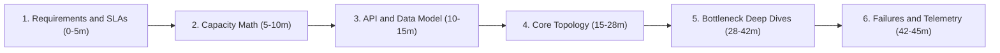

| Time Window | Phase | Mandatory Concrete Artifacts | Exit Gate (Do Not Advance Until Answered) |
| :--- | :--- | :--- | :--- |
| **0–5 min** | **Requirements & SLAs** | 3–4 core functional flows; explicit non-goals; DAU/MAU; read:write ratio; `p50`/`p99` latency SLOs; consistency contract; durability & RPO/RTO targets. | Do mutations require linearizable isolation, read-your-writes, or eventual convergence? |
| **5–10 min** | **Quantitative Workbook** | Average QPS; $3\times$–$5\times$ peak QPS; 5-year storage footprint with index and replication inflation; ingress/egress Mbps/Gbps; hot working-set RAM; DB connection pool size. | Does the dataset and write rate fit on a single primary node, or is sharding/LSM/CDN mandatory? |
| **10–15 min** | **API & Storage Contract** | REST/gRPC/WebSocket contracts, `Idempotency-Key` semantics, cursor pagination, primary key / partition key / sort key definitions, secondary indexes. | Does every read endpoint map cleanly to an indexed single-partition lookup without scatter-gather? |
| **15–28 min** | **Core Architecture** | End-to-end **Write Path** and **Read Path** across edge, gateway, stateless compute, caches, async queues, and storage shards. | Can every component on the diagram be justified directly by Step 2 numbers? |
| **28–42 min** | **Bottleneck Deep Dives** | Targeted resolution of top 2–3 scaling walls: hot keys, celebrity fan-out, write amplification, replication lag, pool exhaustion, or socket affinity. | Are concurrency races and partial failure states eliminated under concurrent retries? |
| **42–45 min** | **Failures & Operations** | Multi-AZ/region failover topology, load shedding, circuit breakers, DLQ replay procedures, and SLI burn-rate alerts. | What happens when a zone blackholes, a cache node drops, or downstream latency jumps $10\times$? |

### 1.2 Consistency & Durability SLA Calibration

Selecting a database or caching layer requires locking the weakest consistency model that preserves domain invariants, because every step stronger imposes coordination latency (`RTT` across quorum replicas) and reduces partition availability.

| Consistency Model | Exact Operational Guarantee | Typical Coordination Cost | Mandatory Domain Examples |
| :--- | :--- | :--- | :--- |
| **Linearizability (External Consistency)** | Every read returns the value of the latest completed write globally in real-time order, regardless of which node serves it. | 1 cross-AZ/region Raft/Paxos quorum RTT per write and lease-verified read (`2–80 ms`). | Distributed lock leases, unique slug reservation, inventory decrement, balance holds. |
| **Strict Serializability** | Linearizability combined with ACID multi-object transaction isolation (equivalent to sequential execution in real time). | Quorum consensus + 2PC/OCC across shards (`10–150 ms`). | Double-entry ledger transfers across accounts on distinct shards. |
| **Read-Your-Writes (Session)** | A client `U` always observes its own prior writes immediately, while concurrent readers may lag asynchronously. | Async replication + primary pinning window (`5 s`) or WAL LSN watermark check. | User profile edits, SaaS workspace settings, posting a comment and reloading page. |
| **Causal Consistency** | Operations that are causally linked (parent comment -> reply) appear in order to all nodes; concurrent unrelated writes may reorder. | Vector clocks or Hybrid Logical Clocks (`HLC`) attached to payload headers (`< 1 ms` local). | Threaded chat conversations, collaborative document edits, distributed event causality. |
| **Eventual Consistency** | If writes stop, replicas converge asynchronously over time; stale reads and conflicting concurrent writes are permissible temporarily. | Zero synchronous cross-node coordination on read/write (`< 1 ms` local). | View counters, social feed rankings, DNS propagation, telemetry metrics. |

### 1.3 Production Engineering RFC Template

Before writing application code in senior engineering teams, the architectural owner circulates a Technical RFC so storage teams, SREs, and security reviewers sign off on failure blast radius and operational cost.

```markdown
# RFC-042: Multi-Region Order Checkout & Ledger Ingestion

## 1. Context, Scope, and Non-Goals
- **Scope:** Synchronous checkout authorization, atomic inventory reservation, and asynchronous double-entry ledger posting for 15,000 peak TPS.
- **Non-Goals:** Settlement reconciliation with external banking rails (owned by RFC-049) and promotional coupon authoring UI.

## 2. Quantitative Envelope (Year 1 -> Year 5)
- **Peak Load:** 15,000 RPS reads (`GET /orders`), 3,000 TPS writes (`POST /orders`), $4\times$ flash-sale burst = 12,000 TPS.
- **Latency SLO:** `p99 <= 120 ms` for order placement excluding external PSP HTTP time; `p99 <= 25 ms` for order status lookup.
- **Availability SLO:** `99.99%` monthly (`<= 4.38 min` error budget/month); `RPO = 0` for financial state, `RTO <= 60 s`.

## 3. State Ownership, Contracts, and Consistency Boundaries
- **Source of Truth:** 8 logical PostgreSQL shards (1 primary + 2 sync/async replicas per shard) partitioned by `tenant_id`.
- **External Boundary:** Outbound PSP charge executes strictly *outside* SQL transactions using `Idempotency-Key` state transitions (`PENDING_AUTH -> AUTHORIZED -> CAPTURED`).
- **Event Propagation:** `outbox_events` table inside the same ACID commit; Debezium streams WAL changes to Kafka topic `orders.lifecycle.v2`.

## 4. Failure Modes, Blast Radius, and Degraded Behavior
- **PSP Latency Spike (> 3s):** Envoy circuit breaker opens at 50% error/timeout rate; checkout degrades gracefully to async authorization queue or fast-fails `503 Retry-After: 15`.
- **Shard Primary Failover:** Patroni/Raft promotes synchronous standby in `< 15 s`; PgBouncer drains old connections and re-binds DNS/VIP; API pods shed writes returning `503` without restarting liveness probes.

## 5. Rollout, Migration, and Rollback Plan
- **Phase 1:** Dark-launch dual-read shadow validation for 7 days (`diff_count == 0`).
- **Phase 2:** Canary tenant migration (1% -> 10% -> 50% -> 100%) gated on `p99 < 120 ms` and `deadlock_count == 0`.
- **Rollback:** Feature flag routes reads/writes back to v1 monolith schema within 5 seconds; forward-compatible additive DDL only (no column drops during rollout).
```

### 1.4 Quantitative Estimation Workbook (Worked Arithmetic)

Never quote vague estimates like "1 TB and lots of servers." Walk through exact unit arithmetic using standard conversions:

- **Time Shortcut:** $1\text{ day} = 86{,}400\text{ s} \approx 10^5\text{ s}$ (exact factor $1.157\times$ when dividing by $86{,}400$ vs $10^5$).
- **Bandwidth Shortcut:** $1\text{ MB/s} = 8\text{ Mbps}$; $1\text{ GB/s} = 8\text{ Gbps}$.
- **Memory Unit Shortcut:** $10^9$ records $\times 1\text{ KB} = 1\text{ TB}$; $10^6$ records $\times 1\text{ KB} = 1\text{ GB}$.

#### Worked Example: 50M DAU SaaS Activity & Document Metadata Service

Suppose we design a collaborative workspace API with **50,000,000 DAU**, where each active user generates **20 reads/day** and **4 writes/day**, average JSON payload is **2 KB** on writes and **4 KB** on reads, and retention is **5 years**.

1. **Throughput (`QPS` / `TPS`):**
   - Average Read QPS:
     $$\frac{50{,}000{,}000 \times 20}{86{,}400\text{ s}} = \frac{10^9}{86{,}400} \approx 11{,}574\text{ RPS}$$
   - Average Write TPS:
     $$\frac{50{,}000{,}000 \times 4}{86{,}400\text{ s}} = \frac{2 \times 10^8}{86{,}400} \approx 2{,}315\text{ TPS}$$
   - **Diurnal Peak ($3\times$) & Flash/Retry Headroom ($5\times$):**
     - Design Read Peak: $11{,}574 \times 4 \approx 46{,}300\text{ RPS}$
     - Design Write Peak: $2{,}315 \times 4 \approx 9{,}260\text{ TPS}$
     - *Architectural Deduction:* $9{,}260\text{ TPS}$ sustained peak exceeds a single tuned PostgreSQL primary's comfortable write ceiling (~$3{,}000$–$8{,}000\text{ TPS}$ with multi-index updates and WAL sync). Either partition writes across **4+ PostgreSQL shards** or offload high-volume append events to ScyllaDB/ClickHouse.

2. **5-Year Storage Sizing (Raw + Overhead + Indexes + Replication):**
   - Daily Raw Write Volume:
     $$2 \times 10^8\text{ writes/day} \times 2\text{ KB} = 400\text{ GB/day}$$
   - 5-Year Raw Data ($1{,}825$ days):
     $$400\text{ GB/day} \times 1{,}825\text{ days} = 730\text{ TB raw}$$
   - **Real Database Storage Inflation:** Production engines never store raw JSON bytes 1:1. Account for:
     - Row & page overhead + MVCC dead-tuple bloat (`~1.25x` in PostgreSQL with autovacuum fillfactor `85`).
     - Secondary B-Tree & GIN indexes (`~1.5x` of table heap if indexing `tenant_id`, `created_at`, and JSONB tags).
     - Replication Factor $RF = 3$ (1 primary + 2 standbys across AZs).
     - Total Physical Provisioned Storage:
       $$730\text{ TB} \times 1.25\text{ (MVCC/Page)} \times 1.5\text{ (Indexes)} \times 3\text{ (RF)} \approx 4{,}106\text{ TB} \approx 4.1\text{ PB}$$
     - *Architectural Deduction:* Keeping 4.1 PB on NVMe OLTP SSDs is prohibitively expensive (~USD 410,000+/month). Move records older than 90 days via lifecycle partitioning to Apache Iceberg / S3 Parquet with ZSTD compression ($4\times$–$6\times$ reduction), keeping hot OLTP NVMe footprint under **225 TB** across shards.

3. **Ingress & Egress Network Bandwidth:**
   - Peak Write Ingress: $9{,}260\text{ TPS} \times 2\text{ KB} \approx 18.5\text{ MB/s} = 148\text{ Mbps}$.
   - Peak Read Egress: $46{,}300\text{ RPS} \times 4\text{ KB} \approx 185.2\text{ MB/s} = 1.48\text{ Gbps}$ (plus ~10% TLS record framing overhead $\approx 1.63\text{ Gbps}$).

4. **Hot Working-Set RAM (Zipfian 80/20 Cache Sizing):**
   - Assuming 80% of reads hit the most recent **1 day** of active objects (or top 10% hot records = $2 \times 10^7$ objects at 4 KB serialized + ~100 bytes Redis dict/jemalloc metadata per entry):
     $$2 \times 10^7 \times 4.1\text{ KB} \approx 82\text{ GB}$$
   - Provision **128 GB** total Redis Cluster RAM across 4 shards (32 GB per primary + 32 GB per replica, keeping peak utilization $\le 65\%$ to leave headroom for replication output buffers and BGSAVE Copy-on-Write).

5. **Database Connection Pool Sizing (Little's Law):**
   - Little's Law states concurrency in a stable system equals arrival rate times mean service duration:
     $$L = \lambda \times W$$
   - If a single PostgreSQL shard handles $\lambda = 2{,}500\text{ queries/sec}$ with average query execution time $W = 4\text{ ms} = 0.004\text{ s}$:
     $$L = 2{,}500 \times 0.004 = 10\text{ active concurrent connections executing at any instant}$$
   - Even if 100 stateless API pods maintain 50 idle connections each ($5{,}000$ total sockets), PostgreSQL crashes or thrashes CPU context switches at 5,000 active backend processes (`10 MB` RAM per backend process = 50 GB wasted!). Place **PgBouncer** in `transaction` pooling mode in front of each shard with `default_pool_size = 40` (matched to `(2 * CPU_cores) + disk_channels` $\approx 32$–$64$ active workers) while multiplexing 5,000 client sockets cleanly.

---

## Part 2: Hardware, Network & Single-Node Saturation Physics

Distributed architectures degrade when software engineers ignore kernel networking constraints, CPU cache coherence, storage write amplification, and speed-of-light bounds. Every abstraction eventually collides with hardware physics.

### 2.1 Complete Hardware & Network Latency Hierarchy

| Operation | Latency | Order of Magnitude | Architectural Implication |
| :--- | :--- | :--- | :--- |
| L1 CPU Cache Reference | `0.5 ns` | $10^{-9}\text{ s}$ | Contiguous arrays/structs stay in cache lines (`64 B`); pointer chasing misses RAM. |
| CPU Branch Misprediction | `5 ns` | $10^{-9}\text{ s}$ | Tight hot loops with unpredictable conditionals stall instruction pipelines. |
| L2 CPU Cache Reference | `7 ns` | $10^{-9}\text{ s}$ | Fits hot hash-table buckets inside core-private cache. |
| Mutex Lock / Unlock (Uncontended) | `25 ns` | $10^{-8}\text{ s}$ | Contended global mutexes trigger kernel futex sleeps (`10–100 us`) and destroy scaling. |
| Main Memory (DRAM) Reference | `100 ns` | $10^{-7}\text{ s}$ | $200\times$ slower than L1; determines in-process cache and Redis single-core ceiling. |
| Compress 1 KB with LZ4 / ZSTD | `2–10 us` | $10^{-6}\text{ s}$ | Faster than network RTT; compress payloads $> 1\text{ KB}$ before Kafka/Redis/S3 writes. |
| NVMe SSD 4 KB Random Read | `20–150 us` | $10^{-4}\text{ s}$ | $1{,}000\times$ slower than DRAM; buffer pool hit rates $< 99\%$ collapse OLTP p99. |
| Intra-AZ Network Round-Trip (TCP) | `0.3–1.0 ms` | $10^{-3}\text{ s}$ | $10{,}000\times$ slower than RAM; chatty N+1 RPC/Redis calls accumulate rapidly. |
| Cross-AZ Network Round-Trip | `1.0–2.5 ms` | $10^{-3}\text{ s}$ | Synchronous multi-AZ quorum commit (`Raft` / `Sync Standby`) adds $\sim 2\text{ ms}$/tx. |
| PostgreSQL Indexed PK Read (In-Buffer-Pool) | `1–3 ms` | $10^{-3}\text{ s}$ | Includes TCP RTT, query parsing/planning, buffer lookup, and tuple serialization. |
| HDD Random Mechanical Seek | `10 ms` | $10^{-2}\text{ s}$ | Only permissible for sequential Kafka logs or cold archive storage, never OLTP index walks. |
| TLS 1.3 Full Handshake (1-RTT + Cert) | `15–60 ms` | $10^{-2}\text{ s}$ | Terminating TLS per-request ruins latency; use HTTP/2 keep-alive pools and TLS resumption. |
| Cross-Continent RTT (US East <-> EU West) | `70–95 ms` | $10^{-1}\text{ s}$ | Speed of light in silica fiber ($c / 1.47 \approx 204\text{ km/ms}$) sets an unbreakable lower bound. |
| Trans-Pacific RTT (US West <-> Singapore) | `150–180 ms` | $10^{-1}\text{ s}$ | Cross-region synchronous transactions cannot achieve `< 100 ms` global SLOs. |

**Latency Compounding (Tail-at-Scale Amplification):** If a single microservice page fan-outs sequentially or concurrently to $M = 20$ backend shards, and each shard has a `p99` latency of `50 ms` (meaning $1\%$ of shard calls exceed `50 ms`), the probability that *all* 20 sub-requests finish under `50 ms` is:
$$P(\text{all } \le 50\text{ ms}) = (0.99)^{20} \approx 0.818 \implies 18.2\%\text{ of user requests experience tail latency } > 50\text{ ms!}$$
To keep end-to-end `p99` fast under fan-out, engineers must deploy **hedged requests** (dispatch backup read after `p95` delay if first replica has not responded) and **strict request coalescing**.

### 2.2 Linux Kernel Limits & TCP Socket Physics

When scaling API gateways, load balancers, or WebSocket clusters beyond 10,000 concurrent connections per host, applications fail inside the Linux kernel long before hitting 100% CPU:

1. **Ephemeral Port Exhaustion (`28,232` Socket Ceiling):** Every outbound TCP connection from an API proxy to a specific downstream `(dst_ip, dst_port)` consumes one local ephemeral port from `/proc/sys/net/ipv4/ip_local_port_range` (default `32768–60999`). Short-lived HTTP/1.1 connections without keep-alive pooling linger in `TIME_WAIT` for `60 s` ($2 \times \text{MSL}$). Dividing `28,232 / 60 s = 470 RPS` to a single downstream IP saturates all local ports and throws `EADDRNOTAVAIL`!
   - *Fix:* Enforce persistent HTTP keep-alive / gRPC connection multiplexing, expand `ip_local_port_range`, bind multiple virtual local source IPs on ultra-dense proxies, and enable `net.ipv4.tcp_tw_reuse = 1` for outbound client sockets.
2. **Accept Queue Overflows (`somaxconn` & `tcp_max_syn_backlog`):** Under burst traffic, the kernel places half-open TCP handshakes in the SYN queue and completed handshakes in the accept queue before the app calls `accept()`. Older defaults (`somaxconn = 128`) silently drop SYN/ACK packets, forcing client TCP exponential backoff retries (`1 s -> 3 s -> 7 s`).
3. **File Descriptor Exhaustion (`ulimit -n`):** Every TCP socket, epoll instance, and disk file consumes one file descriptor. Default shell limits (`1024`) crash high-concurrency proxies immediately with `EMFILE: Too many open files`.
4. **Nagle's Algorithm + Delayed ACK Deadlock (`40 ms`–`200 ms` Stalls):** Nagle buffers small outbound writes waiting for prior ACKs, while the receiver's Delayed ACK waits up to `40 ms` (Linux) or `200 ms` (Windows) hoping to piggyback data. Always set `TCP_NODELAY = 1` on RPC, database, and caching sockets.

Production `/etc/sysctl.d/99-high-throughput.conf` kernel baseline for gateways and proxies:

```ini
# Maximum open file descriptors system-wide and per process (pair with systemd LimitNOFILE=1048576)
fs.file-max = 2097152

# Expand accept and SYN queues to survive connection bursts without dropping SYNs
net.core.somaxconn = 65535
net.core.netdev_max_backlog = 65535
net.ipv4.tcp_max_syn_backlog = 65535

# Expand ephemeral port range and allow safe reuse of TIME_WAIT sockets on outbound proxies
net.ipv4.ip_local_port_range = 1024 65535
net.ipv4.tcp_tw_reuse = 1
net.ipv4.tcp_fin_timeout = 15

# Tune TCP send/receive memory buffers (min / default / max in bytes)
net.core.rmem_max = 16777216
net.core.wmem_max = 16777216
net.ipv4.tcp_rmem = 4096 87380 16777216
net.ipv4.tcp_wmem = 4096 65536 16777216

# Enable BBR congestion control to maximize throughput across lossy WAN links
net.core.default_qdisc = fq
net.ipv4.tcp_congestion_control = bbr
```

### 2.3 Single-Node Saturation Ceilings & First-to-Fail Mechanics

| Component (Tuned Instance) | Realistic Production Ceiling | First Resource to Saturate | Exact Root Mechanism & Symptom |
| :--- | :--- | :--- | :--- |
| **Stateless HTTP Pod (Go/Node, 4 vCPU, 8 GB)** | `2,500–12,000 RPS` (I/O bound JSON) | Event-loop stall (Node), GC stop-the-world / JSON serialization CPU, or outbound pool wait | Node single JS thread blocks on crypto/JSON parsing (`event_loop_lag > 50 ms`); Go goroutines pile up waiting on unpooled DB sockets driving RSS OOM. |
| **WebSocket Gateway (8 vCPU, 16 GB)** | `50,000–120,000` concurrent sockets | Kernel socket buffer RAM (`sk_buff`), TLS session state, `ulimit -n` | Each active TLS+WS connection consumes `15–40 KB` kernel+user memory (`100k * 30 KB = 3 GB`); rapid reconnect storm saturates CPU on ECDHE handshakes. |
| **PostgreSQL Primary (16 vCPU, 64 GB, NVMe)** | `12,000–25,000` indexed reads/s; `3,000–8,000` TPS writes | WAL `fsync` IOPS, row-level lock contention, backend context switching | Checkpoint writes flood NVMe IOPS (`checkpoint_completion_target` misconfigured); hot-row updates block on `RowExclusiveLock`; >200 active procs thrash spinlocks. |
| **Redis Single Shard (Single-threaded core)** | `80,000–120,000 ops/s` (`< 1 KB` keys) | Main event-loop single core + `fork()` Copy-on-Write RAM during RDB/AOF | One `O(N)` `KEYS *`, `SMEMBERS`, or `HGETALL` on 500k elements stalls the event loop for `200 ms`; `BGSAVE` under heavy writes doubles RAM usage via CoW page faults. |
| **Kafka Partition Leader (1 Broker)** | `15–50 MB/s` or `20,000–50,000 msg/s` | Broker NIC egress (`RF=3` multiplies ingress $2\times$ outbound to followers), Linux page cache | Slow consumers miss page cache and force random disk reads off the partition disk, starving sequential producer appends on the same NVMe device. |
| **10 Gbps NIC Interface** | `~1.15 GB/s` practical payload ceiling | Packet-per-second (`PPS`) interrupt softIRQ CPU before raw Gbps on small frames | Processing 1.4M tiny 64-byte packets/sec saturates single-RX-queue NIC interrupts unless RSS (Receive Side Scaling) distributes queues across CPU cores. |

---

## Part 3: Complete Core Distributed Building Blocks

### 3.1 Global Traffic Routing, DNS & L4/L7 Load Balancing

Requests enter a multi-region distributed system through layered routing tiers before touching application compute.

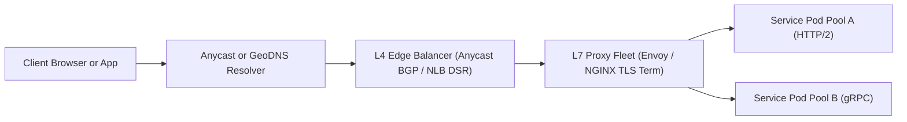

#### Global Routing Layer (DNS vs Anycast BGP)

- **GeoDNS / Latency-Based DNS:** Authoritative nameservers (`Route 53`, `NS1`, `Cloudflare`) resolve `api.example.com` to the regional VIP closest to the user's recursive DNS resolver (or EDNS Client Subnet `ECS` prefix).
  - *Operational Failure Mode:* DNS TTLs (even `TTL = 30 s`) are routinely ignored or clamped upward by ISP resolvers (`5–15 min`), causing prolonged traffic bleed into a failed region during disaster failover.
- **Anycast BGP:** Multiple global edge PoPs announce the exact same IPv4/IPv6 CIDR prefix over BGP. Internet routers automatically forward packets to the topologically nearest healthy PoP. When a PoP fails, BGP withdraws the route within seconds—eliminating DNS TTL lag—while terminating TCP close to the user (`< 20 ms` TLS handshake) before riding optimized private backbone pipes to origin.

#### L4 Transport vs L7 Application Load Balancing

- **Layer 4 (`AWS NLB`, `Maglev`, `Linux IPVS`):** Routes packets solely on 5-tuple `(proto, src_ip, src_port, dst_ip, dst_port)` without terminating TLS or parsing HTTP headers.
  - **Direct Server Return (DSR):** The L4 balancer rewrites only the destination MAC address (or encapsulates via IP-in-IP/GRE) and forwards packets to a backend node sharing the VIP on its loopback interface. The backend responds **directly** to the client through the gateway router, bypassing the load balancer on the massive egress path (critical for video streaming and CDN nodes).
  - **The HTTP/2 & gRPC Multiplexing Trap:** Because HTTP/2 and gRPC multiplex thousands of concurrent RPC streams over a *single* long-lived TCP connection, an L4 load balancer pins the entire TCP socket to one backend pod! When horizontal autoscaling adds 10 fresh pods, existing gRPC clients never re-distribute load until connections close. **Always place an L7 proxy (`Envoy`, `Linkerd`, or client-side gRPC round-robin resolver) in front of HTTP/2 and gRPC services.**
- **Layer 7 (`Envoy`, `NGINX`, `HAProxy`, `AWS ALB`):** Terminates TLS, parses HTTP `:path`, `:authority`, cookies, and JWT claims, executes per-route rate limits and header mutations, and spreads individual HTTP/2 streams evenly across every healthy endpoint in the upstream cluster.

#### Load Balancing Algorithms Comparison

| Algorithm | State Tracked | Key Advantage | Failure Mode / Pitfall |
| :--- | :--- | :--- | :--- |
| **Round Robin / Weighted** | Atomic counter | Zero overhead; respects heterogeneous instance weights | Sends equal load to a GC-paused or thermally throttled node, building an unseen queue. |
| **Least Connections** | Active in-flight count per node | Automatically shifts load away from slow/stalled nodes | Requires centralized state or misses instant bursts before connection counts update (`herd effect`). |
| **Power of Two Choices (`P2C`)** | Picks 2 random nodes, routes to lower active requests/EWMA latency | Near-optimal $O(1)$ distribution without central lock contention or herd bursts (`Envoy` default!) | Marginal overhead (2 atomic reads per request). |
| **Least Response Time (EWMA)** | Exponentially weighted moving average latency $\times$ active requests | Fastest adaptation to heterogeneous workloads and noisy neighbors | If a node fails fast (`500` in `0.2 ms`), naive latency-only trackers flood the broken node unless paired with status-code outlier ejection! |
| **Ring Hash / Maglev** | Consistent hash of header, user ID, or source IP | Maximizes local L1 cache hit rate and sticky routing across shards | Hot keys overload the assigned node unless protected by bounded load or L1 caches. |

#### Kubernetes Probe Physics & Graceful Zero-Downtime Draining

Misconfigured Kubernetes health checks are the #1 cause of self-inflicted outages:

- **Startup Probe (`/startupz`):** Halts liveness/readiness checks during slow JVM/ML-model initialization so Kubernetes does not kill slow-booting pods early.
- **Liveness Probe (`/livez`):** Checks *strictly* whether the internal process event loop or deadlock detector is alive. **Never query PostgreSQL, Redis, or downstream APIs inside `/livez`.** If PostgreSQL freezes for 4 seconds, failing `/livez` instructs Kubelet to `SIGKILL` every API pod simultaneously, wiping all in-memory caches and unleashing a TCP/TLS reconnect thundering herd.
- **Readiness Probe (`/readyz`) + `preStop` Sleep:** Checks downstream dependency pools and returns `503` immediately on `SIGTERM`. Because Kubernetes removes a pod's IP from Envoy/kube-proxy iptables asynchronously *in parallel* with sending `SIGTERM`, add a `lifecycle.preStop` `sleep 5` hook so inflight requests finish and endpoint propagation completes before the HTTP server stops accepting sockets.

#### Production Envoy L7 Cluster Configuration (Health, Outlier Ejection, Circuit Breaking & Retries)

```yaml
static_resources:
  clusters:
    - name: orders_service_grpc
      type: STRICT_DNS
      lb_policy: LEAST_REQUEST  # Implements Power-of-Two-Choices (P2C) active request balancing
      connect_timeout: 0.25s
      typed_extension_protocol_options:
        envoy.extensions.upstreams.http.v3.HttpProtocolOptions:
          "@type": type.googleapis.com/envoy.extensions.upstreams.http.v3.HttpProtocolOptions
          explicit_http_config:
            http2_protocol_options:
              max_concurrent_streams: 100
      # Active health checks verify /readyz without overloading backend workers
      health_checks:
        - timeout: 1s
          interval: 5s
          unhealthy_threshold: 2
          healthy_threshold: 2
          http_health_check:
            path: /readyz
            expected_statuses:
              - start: 200
                end: 299
      # Passive outlier detection immediately ejects pods throwing 5xx spikes between probes
      outlier_detection:
        consecutive_5xx: 5
        interval: 10s
        base_ejection_time: 30s
        max_ejection_percent: 50
        enforcing_consecutive_5xx: 100
      # Circuit breakers protect downstream pools from cascading queue saturation
      circuit_breakers:
        thresholds:
          - priority: DEFAULT
            max_connections: 2048
            max_pending_requests: 1024
            max_requests: 4096
            max_retries: 400        # Strict retry budget: max ~10% of max_requests
            track_remaining: true
      common_lb_config:
        healthy_panic_threshold:
          value: 50.0               # Fail-open across all pods if >50% fail health checks simultaneously
```

#### Consistent Hashing with Weighted Virtual Nodes (Production Go Implementation)

Naive modulo sharding `hash(key) % N` remaps $\approx \frac{N-1}{N}$ keys when scaling from $N$ to $N+1$ nodes (e.g., $4 \to 5$ migrates **80%** of data/cache). Consistent hashing maps both nodes and keys onto a $[0, 2^{32}-1]$ ring so scaling $N \to N+1$ moves only $\approx \frac{1}{N+1}$ of keys. Assigning `150` virtual nodes per physical server reduces key distribution standard deviation to $< 5\%$ and handles heterogeneous node capacities cleanly.

```go
package routing

import (
	"fmt"
	"hash/fnv"
	"sort"
	"sync"
)

type vnode struct {
	hash   uint32
	nodeID string
}

type ConsistentHashRing struct {
	mu           sync.RWMutex
	vnodesPerWt  int
	ring         []vnode
	nodeWeights  map[string]int
}

func NewConsistentHashRing(vnodesPerWeight int) *ConsistentHashRing {
	if vnodesPerWeight <= 0 {
		vnodesPerWeight = 150
	}
	return &ConsistentHashRing{
		vnodesPerWt: vnodesPerWeight,
		nodeWeights: make(map[string]int),
	}
}

func hash32(key string) uint32 {
	h := fnv.New32a()
	_, _ = h.Write([]byte(key))
	return h.Sum32()
}

func (c *ConsistentHashRing) AddNode(nodeID string, weight int) {
	if weight <= 0 {
		weight = 1
	}
	c.mu.Lock()
	defer c.mu.Unlock()

	if _, exists := c.nodeWeights[nodeID]; exists {
		c.removeLocked(nodeID)
	}
	c.nodeWeights[nodeID] = weight

	totalVnodes := weight * c.vnodesPerWt
	for i := 0; i < totalVnodes; i++ {
		vkey := fmt.Sprintf("%s#%d", nodeID, i)
		c.ring = append(c.ring, vnode{hash: hash32(vkey), nodeID: nodeID})
	}
	sort.Slice(c.ring, func(i, j int) bool {
		return c.ring[i].hash < c.ring[j].hash
	})
}

func (c *ConsistentHashRing) RemoveNode(nodeID string) {
	c.mu.Lock()
	defer c.mu.Unlock()
	c.removeLocked(nodeID)
}

func (c *ConsistentHashRing) removeLocked(nodeID string) {
	delete(c.nodeWeights, nodeID)
	filtered := c.ring[:0]
	for _, v := range c.ring {
		if v.nodeID != nodeID {
			filtered = append(filtered, v)
		}
	}
	c.ring = filtered
}

func (c *ConsistentHashRing) GetNode(key string) (string, bool) {
	c.mu.RLock()
	defer c.mu.RUnlock()

	if len(c.ring) == 0 {
		return "", false
	}
	h := hash32(key)
	idx := sort.Search(len(c.ring), func(i int) bool {
		return c.ring[i].hash >= h
	})
	if idx == len(c.ring) {
		idx = 0
	}
	return c.ring[idx].nodeID, true
}
```

---

### 3.2 Multi-Tier Caching, Stampede Defense & Invalidation

Every network hop multiplies latency and infrastructure cost. A well-engineered caching hierarchy eliminates redundant database work across four distinct tiers while preserving freshness invariants.

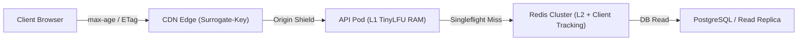

#### Cache Strategies & Durability Semantics

| Strategy | Read Flow | Write Flow | Consistency & Failure Trade-Off |
| :--- | :--- | :--- | :--- |
| **Cache-Aside (Lazy Loading)** | App checks L2; on miss, reads DB and populates L2 with TTL. | App updates DB, then **deletes** cache key. | Only hot keys occupy RAM; survives cache failure cleanly via DB fallback; requires stampede guard. |
| **Read-Through** | App queries cache proxy; cache provider transparently fetches DB on miss. | Same as Cache-Aside or Write-Through. | Simplifies app code (`DAX`, `NCache`); couples cache availability directly to read path. |
| **Write-Through** | App reads directly from cache (always warm). | App writes cache synchronously; cache commits DB synchronously before returning. | Zero stale reads for cached keys; doubles write latency; cold unused data fills cache RAM unless combined with LRU. |
| **Write-Behind (Write-Back)** | App reads from cache. | App writes cache and returns immediately; background worker batches async DB flushes. | Ultra-fast write latency and coalesced batch I/O (`50x` DB reduction); **loses committed writes if cache node crashes before flush!** Use strictly for counters, likes, or telemetry. |

#### Eviction Policies, Admission Filters & TTL Jitter

- **LRU (Least Recently Used):** Doubly-linked list + hash map ($O(1)$). Suffers from **scan pollution**: a single batch job scanning 1M cold keys evicts the hot working set completely.
- **LFU (Least Frequently Used):** Evicts lowest access count. Suffers from **historical bias** (old viral keys accumulate huge counts and linger forever unless decayed periodically).
- **W-TinyLFU (Windowed TinyLFU — Caffeine / Ristretto):** Uses a Count-Min Sketch frequency estimator as an admission filter in front of a Segmented LRU main space. One-hit scans fail admission and never pollute the main cache, delivering higher hit ratios at smaller RAM budgets.
- **TTL Jitter (`base_ttl + rand(0, jitter)`):** Never set uniform expirations (`EX 3600`) across 500,000 keys warmed during a deploy or daily batch job—all 500,000 keys will expire simultaneously at `T+3600s` and stampede the database. Add 10–20% random jitter to every TTL.

#### Browser & CDN HTTP Caching Contracts

- **Immutable Versioned Assets (`/assets/app.8f91c2.js`):** `Cache-Control: public, max-age=31536000, immutable` — CDN and browser never revalidate until the content-hashed URL changes on build.
- **Dynamic Public Content (Product pages, JSON catalogs):** `Cache-Control: public, s-maxage=60, stale-while-revalidate=300, stale-if-error=86400` + `Surrogate-Key: cat-shoes prod-123` + `ETag: "w/abc"`. CDN serves cached responses instantly for 60s, asynchronously refreshes in the background for 300s (`stale-while-revalidate`), and survives origin outages for 24h (`stale-if-error`). When inventory or prices change, an async worker hits the CDN API to purge `Surrogate-Key: prod-123` globally in `< 150 ms`.
- **Personalized Private Data:** `Cache-Control: private, no-store` (or `Vary: Authorization` if strictly user-scoped), preventing shared CDN proxies from leaking one tenant's response to another user!

#### Redis `CLIENT TRACKING` (RESP3 L1/L2 Synchronization)

When hot keys execute `> 100k ops/s`, even `0.5 ms` Redis RTT and single-core CPU saturate. Placing an **L1 in-process cache** inside every API pod cuts latency to `100 ns`, but introduces cross-pod staleness. Redis 6+ solves this via **`CLIENT TRACKING ON`** (Broadcasting or Standard mode):
1. When an API pod reads key `config:feature_flags` from Redis, Redis records that this pod's client connection tracks `config:feature_flags`.
2. When *any* writer updates or deletes `config:feature_flags` in Redis, Redis immediately pushes an invalidation message over the RESP3 push channel (`invalidate ["config:feature_flags"]`) to every tracking API pod, which evicts the key from local L1 memory within sub-milliseconds.
3. Pair L1 entries with a short safety TTL (e.g., `10 s`) so transient socket disconnects never trap stale entries indefinitely.

#### Cache Stampede Protection: `singleflight` + Probabilistic Early Recomputation (`XFetch`)

When a popular key (`home:featured`) expires, thousands of concurrent requests miss simultaneously and fire identical expensive queries at PostgreSQL (**Thundering Herd / Cache Stampede**). Combine three defenses:
1. **In-Process Coalescing (`singleflight`):** Collapses 500 concurrent cache misses inside a single pod into **1** network call to Redis/DB, sharing the result across all 500 waiting goroutines/promises.
2. **Distributed Mutex Lease (`SET lock:{key} {token} NX PX 3000`):** Across 100 pods, only the lock winner executes the heavy DB query and populates Redis; concurrent losers sleep `20 ms` with jitter and retry Redis read (or serve stale data if `stale-while-revalidate` is stored in the envelope).
3. **Probabilistic Early Recomputation (`XFetch`):** Before the hard TTL expires, reads recompute the cache proactively with probability increasing exponentially as remaining TTL approaches zero:
   $$\text{recompute if } \text{now} - \delta \cdot \beta \cdot \ln(\text{rand}(0, 1)) \ge \text{expiry}$$
   where $\delta$ is the last recomputation duration and $\beta \ge 1.0$ tunes aggressiveness.

Complete Go implementation combining `singleflight`, distributed Redis mutex lease (with Lua conditional delete so slow holders never release another pod's lock), and `XFetch` envelope storage:

```go
package cache

import (
	"context"
	"encoding/json"
	"errors"
	"math"
	"math/rand"
	"time"

	"github.com/google/uuid"
	"github.com/redis/go-redis/v9"
	"golang.org/x/sync/singleflight"
)

type Envelope[T any] struct {
	Value       T     `json:"v"`
	ComputedAt  int64 `json:"ca"` // Unix milliseconds
	DeltaMs     int64 `json:"d"`  // Recomputation cost in ms
	LogicalExp  int64 `json:"le"` // Soft logical expiry (hard Redis TTL = 2x)
}

var releaseLockLua = redis.NewScript(`
if redis.call("GET", KEYS[1]) == ARGV[1] then
	return redis.call("DEL", KEYS[1])
end
return 0
`)

type ResilientCache[T any] struct {
	rdb   *redis.Client
	group singleflight.Group
	beta  float64
}

func NewResilientCache[T any](rdb *redis.Client) *ResilientCache[T] {
	return &ResilientCache[T]{rdb: rdb, beta: 1.0}
}

func (c *ResilientCache[T]) GetOrLoad(
	ctx context.Context,
	key string,
	ttl time.Duration,
	loader func(context.Context) (T, error),
) (T, error) {
	nowMs := time.Now().UnixMilli()
	raw, err := c.rdb.Get(ctx, key).Bytes()
	if err == nil {
		var env Envelope[T]
		if uErr := json.Unmarshal(raw, &env); uErr == nil {
			// XFetch probabilistic early refresh before logical expiry
			gap := float64(env.DeltaMs) * c.beta * (-math.Log(rand.Float64()))
			if float64(nowMs)+gap < float64(env.LogicalExp) {
				return env.Value, nil
			}
			// Attempt non-blocking background refresh; fall back to serving fresh value if busy
			if v, rErr := c.coalescedRefresh(ctx, key, ttl, loader, &env.Value); rErr == nil {
				return v, nil
			}
			return env.Value, nil
		}
	}
	if err != nil && !errors.Is(err, redis.Nil) {
		// On Redis outage, still coalesce in-process before falling back to DB
		return c.coalescedDirectLoad(ctx, key, loader)
	}
	return c.coalescedRefresh(ctx, key, ttl, loader, nil)
}

func (c *ResilientCache[T]) coalescedRefresh(
	ctx context.Context,
	key string,
	ttl time.Duration,
	loader func(context.Context) (T, error),
	staleFallback *T,
) (T, error) {
	res, err, _ := c.group.Do(key, func() (any, error) {
		lockKey := "lock:" + key
		token := uuid.NewString()
		acquired, lockErr := c.rdb.SetNX(ctx, lockKey, token, 3*time.Second).Result()
		if lockErr == nil && !acquired {
			if staleFallback != nil {
				return *staleFallback, nil
			}
			// Wait briefly for lock holder to populate cache, then re-read
			time.Sleep(25*time.Millisecond + time.Duration(rand.Intn(20))*time.Millisecond)
			if raw, gErr := c.rdb.Get(ctx, key).Bytes(); gErr == nil {
				var env Envelope[T]
				if json.Unmarshal(raw, &env) == nil {
					return env.Value, nil
				}
			}
		}
		if acquired {
			defer func() {
				_, _ = releaseLockLua.Run(context.Background(), c.rdb, []string{lockKey}, token).Result()
			}()
		}

		start := time.Now()
		val, loadErr := loader(ctx)
		if loadErr != nil {
			if staleFallback != nil {
				return *staleFallback, nil
			}
			return zeroValue[T](), loadErr
		}
		deltaMs := max(1, time.Since(start).Milliseconds())
		jitterMs := int64(float64(ttl.Milliseconds()) * 0.15 * rand.Float64())
		env := Envelope[T]{
			Value:      val,
			ComputedAt: time.Now().UnixMilli(),
			DeltaMs:    deltaMs,
			LogicalExp: time.Now().Add(ttl).UnixMilli() + jitterMs,
		}
		if payload, mErr := json.Marshal(env); mErr == nil {
			// Hard Redis TTL = 2x logical TTL so stale-while-revalidate works safely
			_ = c.rdb.Set(ctx, key, payload, ttl*2+time.Duration(jitterMs)*time.Millisecond).Err()
		}
		return val, nil
	})
	if err != nil {
		return zeroValue[T](), err
	}
	return res.(T), nil
}

func (c *ResilientCache[T]) coalescedDirectLoad(ctx context.Context, key string, loader func(context.Context) (T, error)) (T, error) {
	res, err, _ := c.group.Do("direct:"+key, func() (any, error) {
		return loader(ctx)
	})
	if err != nil {
		return zeroValue[T](), err
	}
	return res.(T), nil
}

func zeroValue[T any]() T {
	var z T
	return z
}
```

#### Dual-Write Cache Invalidation Hazards

Never update cache via `Write DB -> Set Cache` across concurrent requests: Thread A writes `v1` to DB, Thread B writes `v2` to DB and sets Cache=`v2`, then slow Thread A resumes and overwrites Cache=`v1` (**permanent stale cache until TTL**).
- **Safe Pattern 1 (Delete After DB Commit):** Commit DB transaction, then issue `DEL key`. If a concurrent reader misses mid-flight and loads old replica data before replication catches up, apply **Delayed Double Delete** (wait `300 ms` async, `DEL key` again) or read from primary during the invalidation window.
- **Safe Pattern 2 (CDC Log-Driven Invalidation — Production Gold Standard):** Application only commits to PostgreSQL. **Debezium** tails PostgreSQL WAL in strict commit LSN order, emits `order_updated` events to Kafka, and an invalidation consumer issues idempotent `DEL` or `SET` (guarded by `version` / LSN timestamp via Redis Lua so older LSN messages never overwrite newer state).

---

### 3.3 Storage Engine Selection, Partitioning & Data Modeling

Choosing storage solely by "SQL vs NoSQL" misses the physical data structures governing disk I/O, tail latency, and compaction costs. Match workload shapes directly to engine storage internals (covered in depth in [[Programming/Software Engineering/Database Design/Database Design Complete Guide|Database Design Complete Guide]]):

| Engine Class | Canonical Systems | Underlying Index / File Engine | Write Performance | Read Pattern Strength | Failure Mode / Trap |
| :--- | :--- | :--- | :--- | :--- | :--- |
| **Relational ACID (B+Tree)** | PostgreSQL, MySQL InnoDB | Mutable fixed pages (`8–16 KB`) + WAL + MVCC undo/tuple versions | Moderate (`3k–8k TPS`/node); random B-tree page dirtying + index updates | Complex joins, range scans, ad-hoc filters, ACID invariants | Vacuum bloat from high `UPDATE` churn; connection explosion without PgBouncer. |
| **Distributed SQL (Raft + LSM/MVCC)** | CockroachDB, Google Spanner, TiDB | RocksDB/Pebble LSM-tree per Raft range + distributed 2PC/OCC | High horizontal write scaling; pays cross-AZ Raft RTT per commit | Multi-region strong consistency (`Strict Serializability`), online transparent resharding | Cross-region transactions incur `50–150 ms` commit RTT unless data is geo-pinned. |
| **LSM Wide-Column** | ScyllaDB, Apache Cassandra, DynamoDB | Append-only CommitLog -> MemTable -> immutable SSTables + async Compaction | Ultra-high sequential write throughput (`100k+ writes/s/node`) | Single-partition key + clustering key range reads (`O(1)` lookup) | `UPDATE`/`DELETE` creates **tombstones**; reading across tombstones destroys p99 latency! No joins. |
| **Document Store** | MongoDB (WiredTiger), Firestore | B-Tree (WiredTiger) or LSM over schema-flexible BSON/JSON documents | High horizontal sharding by shard key | Nested aggregate object retrieval in 1 lookup | Unbounded embedded arrays (`> 16 MB` limit) trigger constant document relocation on disk. |
| **Time-Series / OLAP Columnar** | ClickHouse (`MergeTree`), TimescaleDB | Column-oriented compressed stripes, sparse primary granules, partition pruning | Millions of rows/s via batch inserts (`10k–100k rows/insert`) | Analytical aggregations (`SUM`, `quantile`, `GROUP BY`) over billions of rows in ms | Terrible at single-row `UPDATE`/`DELETE` and high-frequency tiny single-row inserts (creates part explosion). |
| **Inverted Search Index** | OpenSearch, Elasticsearch | Immutable Apache Lucene segments (Inverted Index + FST + BKD trees + DocValues) | Near-real-time (`1 s` segment refresh); heavy CPU/IO on merge | Full-text fuzzy matching, tokenization, faceted aggregations, geo-bounding queries | Deep pagination (`from=100000`) loads $O(N \cdot \text{shards})$ into heap; use `search_after` + `PIT`. |
| **Vector Index** | Qdrant, pgvector (`HNSW`), Milvus | Hierarchical Navigable Small World (`HNSW`) multi-layer proximity graph or `IVF-PQ` | Slow graph insertion CPU; high RAM footprint (`1.5x` raw float32 vectors) | Top-K approximate nearest neighbor (`ANN`) semantic similarity (`< 15 ms` for 10M vecs) | Filtering highly selective metadata predicates after ANN traversal returns `< K` results (requires inline pre-filtering or iterative HNSW). |
| **Object Storage** | AWS S3, GCS, Ceph RGW | Erasure-coded immutable blobs indexed by `(bucket, prefix, object_key)` | High aggregate throughput (`GB/s` via multipart parallel PUTs) | Byte-range GETs, streaming media, Parquet/Iceberg lakehouse scans | `50–150 ms` TTFB; no atomic multi-object transactions or partial byte appends. |

#### PostgreSQL Production Pooling (`PgBouncer`), Vector HNSW & Object Storage Lifecycle

- **Connection Pooling Modes (`PgBouncer`):**
  - `session`: Assigned for entire client TCP lifetime — provides **zero** multiplexing gain over idle web sockets.
  - `transaction` (Production Standard): Server connection is assigned strictly for a single `BEGIN ... COMMIT` transaction and immediately returned to the pool. Disable session-scoped SQL features (`SET search_path` without `LOCAL`, session advisory locks, temporary tables); enable `max_prepared_statements = 200` on PgBouncer `>= 1.21` for safe protocol-level prepared statements.

```ini
[databases]
orders_prod = host=pg-orders-primary.internal port=5432 dbname=orders_prod

[pgbouncer]
listen_addr = 0.0.0.0
listen_port = 6432
auth_type = scram-sha-256
pool_mode = transaction
max_client_conn = 5000
default_pool_size = 48
reserve_pool_size = 10
reserve_pool_timeout = 2
max_prepared_statements = 200
server_idle_timeout = 60
query_wait_timeout = 5
```

- **PostgreSQL Modeling Guardrails:** Verify query plans (`EXPLAIN (ANALYZE, BUFFERS)`), align composite index column order (`Equality` -> `Sort` -> `Range`), and partition append-heavy tables by time (`RANGE (created_at)`) so dropping expired partitions runs `DROP TABLE` in `1 ms` instead of saturating autovacuum with massive `DELETE`s.
- **Vector Index Tuning (`HNSW` in `pgvector` / `Qdrant`):**
  - `m = 16`–`32` (max bi-directional edges per node; higher `m` increases recall and memory at ~`8 * m` bytes per vector).
  - `ef_construction = 128`–`200` (build-time beam width; controls graph quality without hurting query latency).
  - `ef_search = 64`–`100` (query-time candidate queue; tune per query with `SET LOCAL hnsw.ef_search = 100;` to trade latency vs recall dynamically, and pair with `halfvec` / scalar quantization to cut RAM $2\times$–$4\times$).
- **Object Storage S3 Prefix Partitioning & Lifecycle Tiering:** Never name keys sequentially by timestamp alone if pushing `> 3,500 PUTs/s` on older object stores; prefix keys with a short hash (`{sha256_prefix}/{tenant_id}/{yyyy}/{mm}/{dd}/{uuid}.parquet`) and enforce automated lifecycle policies to transition cold objects and abort orphaned multipart uploads:

```json
{
  "Rules": [
    {
      "ID": "tier-cold-telemetry-and-abort-stale-multiparts",
      "Status": "Enabled",
      "Filter": { "Prefix": "telemetry/" },
      "AbortIncompleteMultipartUpload": { "DaysAfterInitiation": 2 },
      "Transitions": [
        { "Days": 30, "StorageClass": "STANDARD_IA" },
        { "Days": 180, "StorageClass": "GLACIER_IR" }
      ],
      "Expiration": { "Days": 1825 }
    }
  ]
}
```

#### Sharding Strategies & Hot-Key Defenses

When single-primary write throughput or dataset footprint breaks vertical hardware ceilings, shard horizontally (see [[Programming/Software Engineering/Database Design/Sharding|Sharding]]):
1. **Hash / Logical Bucket Sharding:** Hash `(tenant_id)` or `(user_id)` into $B = 1{,}024$ logical shards mapped via a fast routing table to $P = 4..64$ physical database clusters. Adding capacity splits only logical buckets onto new primaries via CDC logical replication with zero downtime.
2. **Range Sharding:** Partition by `(timestamp)` or `(customer_name)`. Enables efficient range scans *within* a partition, but guarantees **hot spotting** on the newest time shard where 100% of current writes land!
3. **Directory / Lookup Sharding:** A lightweight, replicated routing cache stores `(org_id -> shard_id)`. Allows isolating whale/enterprise tenants onto dedicated silo shards without altering code, at the cost of one cached lookup hop.
4. **Hot Shard Mitigation (Write Key Salting):** When a single viral item or celebrity counter receives `50k writes/s`, append a deterministic salt suffix `counter:{id}#{0..15}` across 16 shards/Redis keys. Writes scale $16\times$; readers aggregate all 16 sub-keys asynchronously or on read.

---

### 3.4 Consensus, CAP/PACELC, Clocks & Fencing Tokens

Network partitions (`P`) are an unavoidable physical property of multi-node systems (switch failures, asymmetric packet drops, VM live migrations, GC stop-the-world pauses). Therefore, no multi-node distributed datastore can offer `CA` across a network boundary. See [[Programming/Software Engineering/System Design/CAP Theorem|CAP Theorem]] for foundational proofs.

#### CAP & PACELC Trade-Off Classification

**PACELC** completes CAP by specifying behavior during *normal* operation (`Else` when no partition `P` is present):
$$\text{If } P \implies (A \text{ vs } C); \quad \text{Else } \implies (L\text{atency vs } C\text{onsistency})$$

| Engine / System | Classification | Partition Behavior (`P`) | Normal Latency vs Consistency (`E`) | Production Engineering Consequence |
| :--- | :--- | :--- | :--- | :--- |
| **PostgreSQL (Sync Standby)** | `PC / EC` | Primary blocks writes if synchronous standby disconnects (or falls back to async if configured). | Pays 1 cross-AZ replication RTT (`1–2 ms`) before `COMMIT` returns. | Zero committed data loss on primary failure (`RPO = 0`), bounded by single-region write latency. |
| **Etcd / ZooKeeper / Spanner / CockroachDB** | `PC / EC` | Minority side of partition immediately halts writes and lease-verified reads. | Pays Raft/Paxos majority quorum RTT on every mutation (`2–80 ms`). | Linearizable coordination backbone for service discovery, lock leases, and ACID multi-shard balances. |
| **DynamoDB (Eventual Reads) / Cassandra (`ONE`)** | `PA / EL` | Every reachable node accepts reads and writes independently. | Serves reads and writes in local node memory/disk (`< 1 ms`) without quorum wait. | Highest uptime during AZ splits; applications must handle stale reads and concurrent write conflicts. |
| **Cassandra (`QUORUM` / `LOCAL_QUORUM`)** | `PA / EC` | Tolerates up to $\lfloor N/2 \rfloor$ unavailable replicas while staying writable/readable. | Pays intra-DC quorum RTT (`1–3 ms`) on reads and writes. | Tunable per-query consistency; read repair and HLC timestamps resolve concurrent mutations. |

#### Raft Consensus & Majority Quorum Mechanics

Consensus engines (`etcd`, `Consul`, `CockroachDB`, `Kafka KRaft`) implement **Raft** to guarantee that a cluster of $N$ nodes agrees on an identical append-only replicated log even if up to $f$ nodes crash or partition:
$$N = 2f + 1 \implies \text{Majority Quorum } Q = \lfloor N / 2 \rfloor + 1$$
- For $N=3$, $Q=2$ (tolerates $f=1$ node/AZ loss). For $N=5$, $Q=3$ (tolerates $f=2$ failures). Never deploy even cluster sizes ($N=2$ or $N=4$): $N=4$ requires $Q=3$, tolerating only $f=1$ failure just like $N=3$ while adding latency!
- **Leader Election & Term Monotonicity:** Nodes hold a strictly increasing `currentTerm`. If a follower's randomized election timeout (`150–300 ms`) expires without receiving an `AppendEntries` heartbeat, it increments `term`, votes for itself, and broadcasts `RequestVote`. A node grants its vote only if the candidate's log is at least as up-to-date as its own `(lastLogTerm, lastLogIndex)`.
- **Log Commitment & Split-Brain Prevention:** Only the leader in the current term appends entries and replicates via `AppendEntries`. An entry becomes **committed** once stored on $\ge Q$ nodes. Because any two majorities overlap by at least one node, a stale partitioned leader can never collect $Q$ votes or commit conflicting entries once a newer term exists.

#### Linearizability vs Serializability

Engineers frequently conflate these orthogonal guarantees:
- **Linearizability (Single-Object Recency):** Guarantees a real-time global ordering on reads and writes to individual items. Once write `W(x=5)` finishes at wall time $t_1$, every subsequent read at $t_2 > t_1$ must return `5` (or newer)—never an old value `3`.
- **Serializability (Multi-Object Transaction Isolation):** Guarantees that concurrent multi-row transactions execute equivalently to *some* serial order, eliminating anomalies like **Write Skew** (where Transaction A reads Doctors on-call = 2 and removes Alice, while Transaction B concurrently reads Doctors on-call = 2 and removes Bob, leaving 0 doctors on-call!). Notice Serializability *alone* allows reading slightly stale snapshots as long as the transaction schedule remains serially equivalent.
- **Strict Serializability (External Consistency):** Combines **both** Linearizability and Serializability (`Google Spanner`, `CockroachDB`).

#### Dynamo Quorum Math ($W + R > N$) & Conflict Reconciliation

In leaderless Dynamo-style clusters with replication factor $N$, write quorum $W$, and read quorum $R$:
$$W + R > N \implies \text{At least 1 replica in } R \text{ intersects with } W$$
1. **Standard Strict Quorum (`N=3, W=2, R=2`):** Tolerates 1 node failure for both reads and writes. Note that if a coordinator writes to 1 node and crashes before reaching node 2, an anti-entropy mechanism is still needed—otherwise subsequent reads return inconsistent siblings depending on which $R$ nodes answer.
2. **Sloppy Quorum & Hinted Handoff:** When a network partition isolates the designated $N$ preference-list nodes, coordinators temporarily write to healthy fallback nodes outside the preference list with a hint header (`Hinted Handoff`) and replay back once the partition heals. Increases write availability (`PA`), but breaks $W + R > N$ intersection!
3. **Read Repair & Anti-Entropy Merkle Trees:** When a read coordinator receives divergent versions across $R$ replicas, it returns the latest value (by vector clock or LWW timestamp) and asynchronously pushes the newer copy to lagging replicas (**Read Repair**). Background **Anti-Entropy** builds cryptographic **Merkle Trees** over key-range hashes so nodes synchronize only divergent tree branches across gigabytes of state with minimal network bandwidth.

#### Clocks, TrueTime & CRDTs

- **Why Wall-Clock `Date.now()` Fails Distributed Ordering:** Physical servers rely on quartz oscillators subject to drift and asynchronous **NTP slewing/stepping**. An NTP backward step of `200 ms` causes naive Last-Write-Wins (`LWW`) conflict resolution to silently discard a newer write as "older"!
- **Hybrid Logical Clocks (`HLC`):** Combines physical wall time (`pt`) with a monotonically incrementing logical counter (`lc`). If incoming message `m.pt >= local.pt`, advance `local.pt = m.pt` and increment `lc`; guarantees causal ordering ($e_1 \to e_2 \implies \text{HLC}(e_1) < \text{HLC}(e_2)$) without needing atomic hardware clocks.
- **TrueTime (`Google Spanner`):** Uses GPS receivers and Rubidium atomic clocks in every datacenter to expose a bounded time uncertainty interval $[t_{\text{earliest}}, t_{\text{latest}}]$ where $\epsilon \approx 1\text{–}7\text{ ms}$. Spanner executes **Commit Wait** (pausing $2\epsilon$ before releasing locks) so non-overlapping transactions always receive strictly ordered commit timestamps.
- **CRDTs (Conflict-Free Replicated Data Types):** Algebraic structures whose merge operator $\sqcup$ is associative, commutative, and idempotent ($A \sqcup A = A$), guaranteeing convergence across disconnected replicas without consensus locks:
  - **`G-Counter` / `PN-Counter`:** Per-replica vector map where each node increments only its own slot; total value = $\sum \text{slots}$, merge = $\max(\text{slot}_i)$ element-wise.
  - **`OR-Set` (Observed-Remove Set):** Tags each item addition with a unique UUID so concurrent `add(x)` and `remove(x)` preserve causal add-wins or remove-wins semantics cleanly.

#### Distributed Locks & Fencing Tokens (Solving the GC Pause Trap)

Using Redis `SET lock:resource token NX PX 10000` **alone** is unsafe for correctness-critical mutual exclusion! Consider this failure sequence:
1. Client A acquires lock with `10 s` TTL.
2. Client A experiences a `12 s` stop-the-world GC pause or Linux virtual-memory swap stall.
3. At `T+10s`, Redis expires Client A's lease. Client B acquires the lock and begins writing to S3/PostgreSQL.
4. Client A wakes up unaware its lease expired and sends its stale write to PostgreSQL, **overwriting Client B's work and corrupting state**.

**Production Fix — Monotonic Fencing Tokens:** The lock service (`etcd` revision, ZooKeeper `zxid`, or PostgreSQL sequence) issues a strictly increasing **fencing token** (`epoch = 33`, `34`, ...). Every downstream storage engine checks and persists the highest epoch seen, rejecting stale tokens atomically!

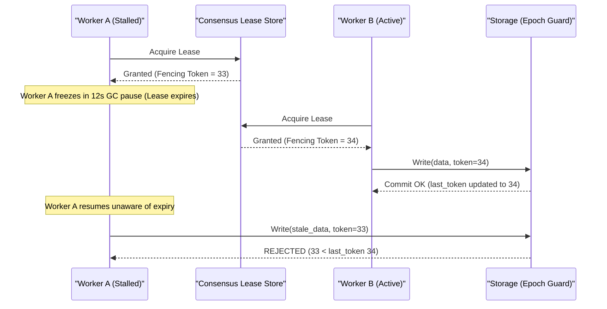

Complete PostgreSQL + Go fencing-token storage guard ensuring expired lock holders can never corrupt state:

```sql
CREATE TABLE fenced_resources (
    resource_id    TEXT PRIMARY KEY,
    last_fence_seq BIGINT NOT NULL DEFAULT 0,
    payload        JSONB  NOT NULL,
    updated_at     TIMESTAMPTZ NOT NULL DEFAULT now()
);

-- Atomic conditional upsert: rejects any request carrying a stale fencing token
INSERT INTO fenced_resources (resource_id, last_fence_seq, payload)
VALUES ($1, $2, $3)
ON CONFLICT (resource_id) DO UPDATE
SET last_fence_seq = EXCLUDED.last_fence_seq,
    payload        = EXCLUDED.payload,
    updated_at     = now()
WHERE fenced_resources.last_fence_seq < EXCLUDED.last_fence_seq
RETURNING last_fence_seq;
```

---

### 3.5 API Contracts, Protocols & Asynchronous Messaging

#### Protocol & Serialization Trade-Off Matrix

See [[Programming/Software Engineering/System Design/API Design|API Design]] for foundational REST resource patterns. At staff level, choose wire formats and pagination primitives by bandwidth, schema evolution, and caching semantics:

| Dimension | REST + JSON (HTTP/1.1 or HTTP/2) | GraphQL (HTTP POST) | gRPC (HTTP/2 + Protobuf) |
| :--- | :--- | :--- | :--- |
| **Wire Payload & CPU** | Verbose text JSON (~$3\times$–$5\times$ larger); slow reflection parsing | Verbose JSON responses; runtime AST validation & resolver overhead | Compact binary varint framing; code-generated zero-reflection serialization (`5x`–`10x` faster) |
| **HTTP Caching** | Native CDN & browser caching on `GET` URLs + `ETag` / `Vary` | Difficult (usually `POST /graphql`); relies on custom persisted-query `GET` CDN caches | None at HTTP layer; relies on in-process or L2 Redis response caching |
| **Streaming & Flow Control** | SSE / Chunked responses (unidirectional); WebSockets for duplex | Subscriptions over WebSocket (`graphql-ws`) | Native multiplexed bidirectional streaming with HTTP/2 window backpressure |
| **Pagination Standard** | **Keyset / Cursor** (`?cursor=eyJpZCI6MTAwfQ&limit=50`) — $O(1)$ index seek | Relay Connections (`edges`, `pageInfo.endCursor`) | `page_token` opaque cursor inside response message |
| **Contract Evolution** | Additive optional fields + URI `/v1/` or `Accept` header versioning | Non-breaking field additions + `@deprecated` schema directives | Protobuf field-tag numbers (`1, 2, ...`) — never reuse or renumber retired field tags! |
| **Primary Pitfall** | Over-fetching / chattiness across mobile clients | **N+1 resolver explosion** (requires `DataLoader` per-request batching) + malicious nested query DoS | Not browser-native directly (requires `gRPC-Web` / `Envoy` transcoding proxy) |

**Mandatory Production REST Guardrails:**
- **Never use `OFFSET` pagination on large tables:** `SELECT * FROM events ORDER BY id DESC LIMIT 50 OFFSET 500000` forces PostgreSQL to scan and discard 500,000 rows (`O(N)` degradation) and produces duplicate/skipped items when new rows insert mid-scroll. Always use **Keyset (Cursor) Pagination**: `WHERE (created_at, id) < ($cursor_ts, $cursor_id) ORDER BY created_at DESC, id DESC LIMIT 50` ($O(\log N)$ index seek).
- **Standardized Error Envelopes (RFC 9457 Problem Details):** Return machine-readable `application/problem+json` payloads (`type`, `title`, `status`, `detail`, `instance`, `trace_id`) instead of unstructured strings.

#### Message Queues vs Event Commit Logs

| Capability | Distributed Commit Log (`Kafka` / `Redpanda`) | Smart Broker Queue (`AWS SQS` / `RabbitMQ`) |
| :--- | :--- | :--- |
| **Storage & Deletion** | Immutable partitioned append-only log segments; messages retained by time/bytes (`7 days`+) independent of reads | Broker deletes message immediately after consumer sends `ACK` |
| **Ordering Scope** | Strict FIFO **within a single partition** (keyed by `partition_key` such as `tenant_id` or `order_id`) | Best-effort (Standard SQS) or per-`MessageGroupId` FIFO (`SQS FIFO`: 3,000 msg/s w/ batching) |
| **Consumer Scaling** | Max active consumers per consumer group = **number of partitions**; horizontal fan-out across independent consumer groups (`Analytics`, `Billing`, `Search`) reading the same topic | Dynamic worker autoscaling (`KEDA`) independent of shards; single-worker competing consumers |
| **Historical Replay** | Seek consumer group offset back to any timestamp or offset to rebuild corrupted read projections | Impossible once deleted (must replay from S3 archive/DLQ) |

#### Kafka Reliability Settings & Cooperative Rebalancing

To guarantee **zero silent data loss** on broker crashes in Kafka / Redpanda:
1. **Producer:** `acks=all` (leader waits for all in-sync replicas before returning), `enable.idempotence=true` (broker deduplicates network retries per `ProducerID + SequenceNumber`), `max.in.flight.requests.per.connection=5`.
2. **Topic / Broker:** `replication.factor=3`, `min.insync.replicas=2` (if fewer than 2 replicas are caught up, broker rejects `acks=all` writes with `NotEnoughReplicasException` rather than risking un-replicated single-node commits), `unclean.leader.election.enable=false` (never promote an out-of-sync replica and truncate committed offsets).
3. **Consumer Rebalance Storm Prevention:** Classic `Eager` rebalance pauses the *entire* consumer group ("stop-the-world") whenever one pod deploys or stalls longer than `max.poll.interval.ms`. Set `partition.assignment.strategy=org.apache.kafka.clients.consumer.CooperativeStickyAssignor` so only reassigned partitions pause momentarily while all other partitions stream uninterrupted!

#### Effectively-Once Processing: Transactional Outbox + Debezium CDC + Idempotent Consumer

Why **Dual Writes** (`await db.save(order); await kafka.send(event);`) always corrupt distributed state: if the pod crashes or Kafka times out *after* `db.save` commits, the order exists in PostgreSQL with **no event emitted**; if Kafka publishes *before* `db.commit` and PostgreSQL rolls back, downstream billing charges a nonexistent order!

The production solution pairs **Transactional Outbox** with **Debezium WAL CDC** and an **Idempotent Consumer**:

```mermaid
flowchart LR
    API["Order API Pod"] -->|"1. Single ACID TX"| PG["PostgreSQL (orders + outbox_events)"]
    PG -->|"2. WAL Logical Replication"| DEB["Debezium Kafka Connect"]
    DEB -->|"3. Topic orders.events"| K["Apache Kafka (Partitioned Log)"]
    K -->|"4. At-Least-Once Poll"| C["Billing Worker"]
    C -->|"5. Dedup PK + Domain TX"| BDB["Billing DB (processed_events)"]
```

**1. PostgreSQL Transactional Outbox Schema & Atomic Write:**

```sql
CREATE TABLE orders (
    order_id       UUID PRIMARY KEY,
    tenant_id      UUID        NOT NULL,
    total_cents    BIGINT      NOT NULL CHECK (total_cents >= 0),
    status         TEXT        NOT NULL,
    created_at     TIMESTAMPTZ NOT NULL DEFAULT now()
);

CREATE TABLE outbox_events (
    event_id       UUID PRIMARY KEY,
    aggregate_type TEXT        NOT NULL,
    aggregate_id   TEXT        NOT NULL,
    event_type     TEXT        NOT NULL,
    payload        JSONB       NOT NULL,
    created_at     TIMESTAMPTZ NOT NULL DEFAULT now()
);

-- Single local ACID commit: either BOTH order and outbox row persist, or NEITHER
BEGIN;
INSERT INTO orders (order_id, tenant_id, total_cents, status)
VALUES ('a9b1c2d3-1111-4000-8000-000000000001', 't-99', 14900, 'CONFIRMED');

INSERT INTO outbox_events (event_id, aggregate_type, aggregate_id, event_type, payload)
VALUES (
    'e4f5a6b7-2222-4000-8000-000000000099',
    'Order',
    'a9b1c2d3-1111-4000-8000-000000000001',
    'OrderConfirmed.v1',
    '{"order_id":"a9b1c2d3-1111-4000-8000-000000000001","tenant_id":"t-99","total_cents":14900}'::jsonb
);
COMMIT;
```

**2. Debezium Outbox Event Router Connector Config (`outbox-connector.json`):**

```json
{
  "name": "orders-outbox-cdc",
  "config": {
    "connector.class": "io.debezium.connector.postgresql.PostgresConnector",
    "plugin.name": "pgoutput",
    "database.hostname": "pg-orders-primary.internal",
    "database.port": "5432",
    "database.user": "debezium_repl",
    "database.dbname": "orders_prod",
    "slot.name": "debezium_orders_outbox_slot",
    "table.include.list": "public.outbox_events",
    "tombstones.on.delete": "false",
    "transforms": "outbox",
    "transforms.outbox.type": "io.debezium.transforms.outbox.EventRouter",
    "transforms.outbox.table.field.event.id": "event_id",
    "transforms.outbox.table.field.event.key": "aggregate_id",
    "transforms.outbox.table.field.event.type": "event_type",
    "transforms.outbox.table.field.event.payload": "payload",
    "transforms.outbox.route.by.field": "aggregate_type",
    "transforms.outbox.route.topic.replacement": "domain.${routedByValue}.events",
    "transforms.outbox.table.expand.json.payload": "true"
  }
}
```

**3. Idempotent Consumer + Bounded Retry + Dead-Letter Queue (TypeScript):**

```typescript
import { Pool } from "pg";

interface OutboxMessage {
  eventId: string;
  eventType: string;
  aggregateId: string;
  payload: { order_id: string; tenant_id: string; total_cents: number };
  attempt: number;
}

export class IdempotentBillingConsumer {
  constructor(
    private readonly db: Pool,
    private readonly sendToDlq: (msg: OutboxMessage, reason: string) => Promise<void>
  ) {}

  async handleMessage(msg: OutboxMessage): Promise<void> {
    const client = await this.db.connect();
    try {
      await client.query("BEGIN");

      // Atomic deduplication inside the SAME local ACID transaction as the state mutation
      const dedup = await client.query(
        `INSERT INTO processed_events (event_id, consumer_group)
         VALUES ($1, 'billing-ledger-v1')
         ON CONFLICT (event_id, consumer_group) DO NOTHING`,
        [msg.eventId]
      );

      if (dedup.rowCount === 0) {
        // Already processed on an earlier redelivery; ACK cleanly
        await client.query("ROLLBACK");
        return;
      }

      await client.query(
        `INSERT INTO invoice_charges (order_id, tenant_id, amount_cents)
         VALUES ($1, $2, $3)`,
        [msg.payload.order_id, msg.payload.tenant_id, msg.payload.total_cents]
      );

      await client.query("COMMIT");
    } catch (err: unknown) {
      await client.query("ROLLBACK");
      const message = err instanceof Error ? err.message : "unknown_error";
      const isPermanentValidationError =
        message.includes("violates check constraint") || message.includes("invalid input syntax");

      if (isPermanentValidationError || msg.attempt >= 5) {
        // Poison pill isolation: emit to DLQ and advance partition offset so healthy orders do not stall
        await this.sendToDlq(msg, message);
        return;
      }
      throw err; // Caller triggers exponential backoff + jitter retry
    } finally {
      client.release();
    }
  }
}
```

---

### 3.6 Distributed Rate Limiting & Quota Enforcement

Rate limiting protects origin compute and databases from abusive scrapers, noisy tenants, credential stuffing, and retry storms (see [[Programming/Software Engineering/System Design/Rate Limiting|Rate Limiting]]).

| Algorithm | Per-Key State / RAM | Boundary Spike Behavior | Exact Engineering Fit |
| :--- | :--- | :--- | :--- |
| **Token Bucket** | 2 floats (`tokens`, `last_ts`) $\approx 64\text{ B}$ | Allows controlled burst up to capacity $B$; sustains average rate $r$ | Standard public REST/GraphQL API tiers (`burst=50, refill=10/s`). |
| **Leaky Bucket (Queue / Meter)** | 2 numbers (`water_level`, `last_ts`) | Strictly smooths outbound traffic at constant drain rate $r$ (zero burst) | Protecting brittle downstream legacy payment/SOAP endpoints with rigid TPS caps. |
| **Fixed Window Counter** | 1 integer (`INCR` + `EXPIRE`) | **2x boundary burst hazard:** `100` reqs at `00:59` + `100` reqs at `01:00` = `200` reqs in 2 seconds! | Coarse protective abuse guard only. |
| **Sliding Window Log** | Redis `ZSET` of timestamps (`O(limit)` RAM) | **Zero boundary inaccuracy**; exact rolling window count | Strict security limits with small thresholds (5 SMS OTPs/15m, 10 password attempts/hr). |
| **Sliding Window Counter** | 2 integers (`prev_bucket`, `curr_bucket`) $\approx 64\text{ B}$ | Interpolates `prev * (1 - elapsed%) + curr`; $O(1)$ RAM, ~99.97% accurate | Ultra-high-scale multi-million-key API gateways. |

#### Atomic Redis Lua Implementations (Zero Check-Then-Act Races)

**1. Atomic Token Bucket (`token_bucket.lua`):**

```lua
-- KEYS[1] = "rl:tb:{tenant_id}"
-- ARGV    = [capacity, refill_rate_per_sec, now_ms, cost]
local key      = KEYS[1]
local capacity = tonumber(ARGV[1])
local rate     = tonumber(ARGV[2])
local now_ms   = tonumber(ARGV[3])
local cost     = tonumber(ARGV[4])

local data = redis.call("HMGET", key, "tokens", "ts")
local tokens  = tonumber(data[1])
local last_ts = tonumber(data[2])

if tokens == nil then
  tokens  = capacity
  last_ts = now_ms
else
  local elapsed_sec = math.max(0, now_ms - last_ts) / 1000.0
  tokens  = math.min(capacity, tokens + elapsed_sec * rate)
  last_ts = now_ms
end

local allowed = 0
if tokens >= cost then
  tokens  = tokens - cost
  allowed = 1
end

local ttl_sec = math.max(1, math.ceil((capacity / rate) * 2))
redis.call("HSET", key, "tokens", tokens, "ts", last_ts)
redis.call("EXPIRE", key, ttl_sec)

local retry_after_ms = 0
if allowed == 0 then
  retry_after_ms = math.ceil(((cost - tokens) / rate) * 1000)
end

return { allowed, math.floor(tokens), retry_after_ms }
```

**2. Atomic Sliding Window Counter (`sliding_window.lua`):**

```lua
-- KEYS[1] = prev_window_key, KEYS[2] = curr_window_key
-- ARGV    = [limit, window_ms, elapsed_in_curr_ms]
local limit       = tonumber(ARGV[1])
local window_ms   = tonumber(ARGV[2])
local elapsed_ms  = tonumber(ARGV[3])

local prev_count = tonumber(redis.call("GET", KEYS[1]) or "0")
local curr_count = tonumber(redis.call("GET", KEYS[2]) or "0")

local prev_weight   = math.max(0, (window_ms - elapsed_ms) / window_ms)
local est_requests  = math.floor(prev_count * prev_weight) + curr_count

if est_requests >= limit then
  local reset_ms = window_ms - elapsed_ms
  return { 0, 0, reset_ms }
end

local new_curr = redis.call("INCR", KEYS[2])
if new_curr == 1 then
  redis.call("PEXPIRE", KEYS[2], window_ms * 2)
end

local remaining = math.max(0, limit - (math.floor(prev_count * prev_weight) + new_curr))
return { 1, remaining, window_ms - elapsed_ms }
```

#### Standard HTTP Rate-Limit Response Headers & Fail-Safe Policy

Emit standard IETF `RateLimit-*` headers (and `Retry-After` on `429 Too Many Requests`) so well-behaved SDKs self-throttle instead of spinning tight retry loops:

```http
HTTP/1.1 429 Too Many Requests
Content-Type: application/problem+json
RateLimit-Limit: 1000
RateLimit-Remaining: 0
RateLimit-Reset: 14
Retry-After: 14
```

- **Gateway Fail-Safe Policy:** Wrap Redis rate-limit calls in an aggressive `15 ms` timeout + circuit breaker.
  - For **Authentication / OTP / Payment Initiation**, **fail-closed** (`503`) or fall back strictly to conservative local per-pod memory buckets (`limit / active_pods`) so an attacker cannot DDoS Redis to bypass brute-force protections.
  - For **High-Value Customer Read APIs**, **fail-open with local protective cap** (e.g., per-gateway token bucket capped at 120% of normal share) so a transient Redis outage never drops legitimate global revenue traffic.

---

## Part 4: Six Complete Reference End-to-End Architectures

Each reference architecture integrates the hardware physics and distributed building blocks from Parts 2–3 into an end-to-end production topology, detailing concrete write/read execution paths and the exact operational bottlenecks that break naive designs.

### 4.1 Architecture (A): High-Read Global Content & E-Commerce Catalog Platform

Handles `200,000+ RPS` catalog browsing (`99:1` read-to-write ratio) alongside strict atomic inventory reservations during flash-sale spikes. Related vault case study: [[Programming/Software Engineering/System Design/Cases/URL Shortener|URL Shortener]] and [[Programming/Software Engineering/System Design/CDN|CDN]].

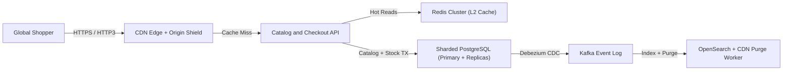

- **Concrete Production Stack:** Cloudflare/Fastly CDN with Origin Shield -> Envoy L7 Ingress -> Stateless Go/Node Catalog & Checkout Services -> L1 `W-TinyLFU` (`5 s`) + L2 Redis Cluster -> Sharded PostgreSQL (`catalog` & `inventory` ACID tables) -> Debezium CDC -> Kafka -> OpenSearch (full-text faceted search) + Surrogate-Key CDN Purger.
- **Step-by-Step Read Path (Browse & Search):**
  1. Product detail `GET /v1/products/{sku}` hits CDN Edge (`s-maxage=60, stale-while-revalidate=300, Surrogate-Key: sku-{id}`). `95%+` of catalog reads terminate at Edge PoPs in `< 15 ms` without touching origin servers.
  2. Cache misses collapse at a single regional **Origin Shield** POP before calling the Catalog API, which executes `singleflight` + L2 Redis lookup (`EX 120 + jitter`).
  3. Faceted search (`GET /v1/search?q=running+shoes&size=10&after=...`) routes directly to **OpenSearch** using `search_after` cursor pagination; inventory availability shown on search cards reads from a fast Redis availability bitmap (`10 s` staleness tolerated on browse, verified strictly at checkout).
- **Step-by-Step Write Path (Price/Catalog Edit & Flash-Sale Inventory Hold):**
  1. Merchant updates catalog price in PostgreSQL Primary (`version = version + 1`); Debezium emits `CatalogUpdated` to Kafka, driving OpenSearch document upsert and CDN `Surrogate-Key` invalidation (`< 150 ms` global purge).
  2. Checkout executes conditional atomic stock deduction inside a short local transaction:
     `UPDATE inventory SET available = available - $qty WHERE sku_id = $1 AND available >= $qty RETURNING available;`
     No distributed locks or `SELECT ... FOR UPDATE` pre-reads needed for single-SKU deduction; `affected_rows == 0` immediately returns `409 Conflict (Out of Stock)`.
- **Real Bottlenecks & Exact Mitigations:**
  - *Hot-Row Contention on Flash-Sale SKU:* 20,000 concurrent buyers updating `WHERE sku_id = 'sneaker-x'` serialize on PostgreSQL's single-row X-lock. **Mitigation:** Pre-gate checkout using a fast **Virtual Queue / Redis Atomic Lua Inventory Token Bucket** (`DECRBY`), or split hot SKU stock across **16 inventory sub-buckets** (`sku-x#0..#15`) so PostgreSQL processes $16\times$ parallel row locks cleanly.
  - *CDN Origin Shield Collapse on Simultaneous Purge:* Purging an entire category key flushes 50,000 URLs simultaneously. **Mitigation:** Tag surrogate keys granularly (`sku-{id}` rather than `cat-all`) and serve `stale-while-revalidate` during background origin refresh.

---

### 4.2 Architecture (B): High-Throughput Payment & Double-Entry Financial Ledger

Processes `5,000–15,000 TPS` of monetary transfers where zero balance drift (`RPO = 0`), idempotency under client retries, and full auditability are legally mandatory. See [[Programming/Software Engineering/Database Design/Transactions|Transactions]] and [[Programming/Software Engineering/Database Design/Database Design Complete Guide|Database Design Complete Guide]].

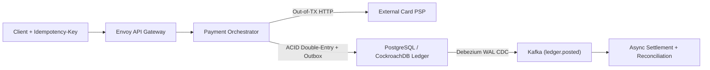

- **Concrete Production Stack:** Envoy L7 -> Payment Orchestrator Service -> PostgreSQL (sync multi-AZ standby `synchronous_commit = remote_apply`) or CockroachDB (Strict Serializability) -> Debezium CDC -> Kafka -> Daily Automated Settlement Reconciliation Engine.
- **Step-by-Step Write Path (Idempotent Payment & Double-Entry Commit):**
  1. Client sends `POST /v1/transfers` with mandatory header `Idempotency-Key: uuid-v4`.
  2. Orchestrator inserts `(idempotency_key, request_hash, status='STARTED')` into `idempotency_records`. If key exists with a different `request_hash`, return `422 Unprocessable Entity`; if `status='COMPLETED'`, replay the stored exact HTTP response body immediately without touching ledger balances!
  3. **Phase 1 (Local ACID Reserve):** Open short SQL TX -> lock involved accounts in **strictly ascending `account_id` order** (eliminating circular AB/BA deadlocks) -> insert `journal_entries` (`PENDING`) + debit/credit balanced `ledger_lines` where `SUM(amount_signed) == 0` -> commit and release DB connection immediately.
  4. **Phase 2 (External PSP HTTP Call Outside DB TX):** Call Stripe/Adyen with PSP `Idempotency-Key` (`300 ms–2 s`). Never hold a DB transaction open across external HTTP calls!
  5. **Phase 3 (Finalize + Outbox):** In a second short ACID transaction, record `POSTED` (or append a compensating reversal entry if PSP declined—**never `UPDATE` or `DELETE` immutable ledger rows**) alongside an `outbox_events` row for notifications and analytics.
- **Step-by-Step Read Path (Balance & Statement Query):**
  1. Real-time available balance reads the pre-materialized `accounts.posted_balance_cents` and `pending_hold_cents` columns updated atomically within the double-entry commit transaction (`O(1)` primary key index lookup, avoiding `SUM(ledger_lines)` scans over millions of rows).
  2. Historical statements paginate via keyset index `(account_id, created_at DESC, line_id DESC)`.

```sql
-- Immutable double-entry ledger schema with deadlock-free deterministic account ordering
CREATE TABLE accounts (
    account_id     UUID PRIMARY KEY,
    currency       CHAR(3) NOT NULL,
    balance_cents  BIGINT  NOT NULL CHECK (balance_cents >= 0),
    version        BIGINT  NOT NULL DEFAULT 0
);

CREATE TABLE journal_entries (
    journal_id      UUID PRIMARY KEY,
    idempotency_key UUID UNIQUE NOT NULL,
    created_at      TIMESTAMPTZ NOT NULL DEFAULT now()
);

CREATE TABLE ledger_lines (
    line_id       UUID PRIMARY KEY,
    journal_id    UUID   NOT NULL REFERENCES journal_entries(journal_id),
    account_id    UUID   NOT NULL REFERENCES accounts(account_id),
    amount_cents  BIGINT NOT NULL CHECK (amount_cents <> 0), -- Negative = Debit, Positive = Credit
    created_at    TIMESTAMPTZ NOT NULL DEFAULT now()
);

-- Transfer function locks accounts deterministically (least(from, to) first) to prevent deadlocks
CREATE OR REPLACE FUNCTION execute_transfer(
    p_journal_id UUID, p_idem_key UUID, p_from UUID, p_to UUID, p_amount BIGINT
) RETURNS VOID AS $$
DECLARE
    v_first UUID := LEAST(p_from, p_to);
    v_second UUID := GREATEST(p_from, p_to);
BEGIN
    IF p_amount <= 0 OR p_from = p_to THEN
        RAISE EXCEPTION 'Invalid transfer parameters';
    END IF;
    PERFORM 1 FROM accounts WHERE account_id = v_first FOR UPDATE;
    PERFORM 1 FROM accounts WHERE account_id = v_second FOR UPDATE;

    INSERT INTO journal_entries (journal_id, idempotency_key) VALUES (p_journal_id, p_idem_key);
    INSERT INTO ledger_lines (line_id, journal_id, account_id, amount_cents)
    VALUES (gen_random_uuid(), p_journal_id, p_from, -p_amount),
           (gen_random_uuid(), p_journal_id, p_to,    p_amount);

    UPDATE accounts SET balance_cents = balance_cents - p_amount, version = version + 1
    WHERE account_id = p_from;
    UPDATE accounts SET balance_cents = balance_cents + p_amount, version = version + 1
    WHERE account_id = p_to;
END;
$$ LANGUAGE plpgsql;
```

- **Real Bottlenecks & Exact Mitigations:**
  - *Hot Merchant/Platform Settlement Account:* Millions of customer debits credit a single platform fee account (`acct_platform_fees`), serializing every checkout transaction on one `FOR UPDATE` row lock! **Mitigation:** Shard hot system accounts into `N = 64` sub-accounts (`acct_platform_fees#00..#63`) chosen randomly or by `tx_id % 64`, and sweep sub-accounts into the master settlement account asynchronously every minute.

---

### 4.3 Architecture (C): Real-Time Event Telemetry, Streaming Analytics & Search Pipeline

Ingests `500,000+ events/sec` of application logs, clickstreams, and IoT metrics with sub-second alerting, interactive OLAP dashboards, and cheap cold lakehouse retention. Related vault notes: [[Programming/Software Engineering/System Design/ETL|ETL]] and [[Programming/Software Engineering/Architectural Patterns/Event-Driven Architecture|Event-Driven Architecture]].

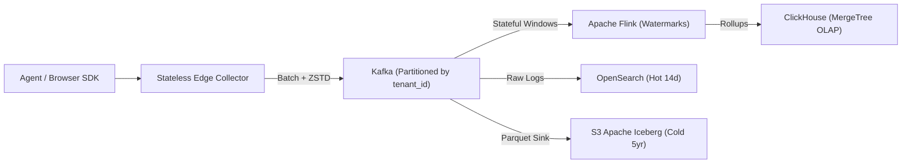

- **Concrete Production Stack:** Vector / OpenTelemetry Edge Collectors -> Apache Kafka (`compression.type=zstd`, 128 partitions) -> Apache Flink (RocksDB state backend, Event-Time Watermarks) -> ClickHouse (`ReplacingMergeTree` / `AggregatingMergeTree`) + OpenSearch (recent 14-day full-text logs) + Kafka Connect S3 Sink -> Apache Iceberg Parquet tables orchestrated by Airflow/dbt for batch billing rollups (**ELT** pattern: load raw immutable events first, transform inside warehouse/lakehouse).
- **Step-by-Step Write Path (Ingestion & Stream Windowing):**
  1. Clients batch events every `500 ms` or `100 KB`, compressing payloads with ZSTD before hitting the stateless Collector (`POST /v1/ingest`), which validates schema against a Schema Registry (Protobuf/Avro) and produces asynchronously to Kafka partitioned by `(tenant_id, metric_bucket)`.
  2. **Apache Flink** consumes streams using **Event-Time Processing** (not Processing-Time) with bounded-out-of-orderness **Watermarks** (`allowedLateness = 30 s`) so delayed mobile events still compute accurate 1-minute tumbling aggregations before emitting compacted rows to ClickHouse.
  3. Concurrently, a stateless sink flushes large columnar Parquet files (`128–256 MB` row groups) every 5 minutes to S3 Apache Iceberg, enabling fast Trino/Spark/DuckDB ad-hoc queries over 5 years of history at object-storage prices.
- **Step-by-Step Read Path (Real-Time Dashboards & Log Search):**
  1. Time-series metric dashboards query **ClickHouse** materialized rollup tables (`1m` and `1h` pre-aggregated columns), scanning billions of datapoints in `< 80 ms` via primary granule sparse indexing `(tenant_id, metric_name, toStartOfMinute(ts))`.
  2. Log searches filter OpenSearch hot indices (`logs-2026-11-*`) via Index State Management (`ISM`) rollover.
- **Real Bottlenecks & Exact Mitigations:**
  - *ClickHouse "Too Many Parts" Crash:* Writing individual 1-row `INSERT`s into ClickHouse creates thousands of small filesystem parts faster than background merges can compact them, failing inserts outright. **Mitigation:** Always buffer into batches of `20,000–100,000 rows` (or `>= 10 MB`) per `INSERT` inside Flink/Kafka sink, or enable ClickHouse `async_insert=1`.
  - *Late-Arriving Events Causing Unbounded Flink State:* Keeping window state open indefinitely explodes RocksDB disk/RAM. **Mitigation:** Bound watermark `allowedLateness`, close windows deterministically, and route ultra-late events (`> 5 min`) to a side-output late-events topic for batch Iceberg merge.

---

### 4.4 Architecture (D): Multi-Tenant B2B SaaS Control Plane (Isolation, RBAC & Noisy Neighbor Guards)

Serves thousands of enterprise organizations simultaneously where strict tenant data isolation, sub-5ms authorization checks, and noisy-neighbor blast-radius containment are paramount.

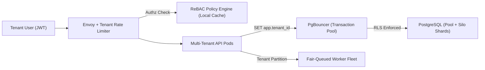

- **Concrete Production Stack:** Envoy L7 + Redis Tenant Quotas -> AuthZ Sidecar / Zanzibar-style ReBAC Engine (with Redis `CLIENT TRACKING` L1 cache) -> Stateless API Pods -> PgBouncer (`transaction` pooling) -> PostgreSQL enforcing **Row-Level Security (`RLS`)** for pooled tenants + dedicated **Silo Shards** for regulated enterprise tiers -> Fair-Scheduled Background Workers.
- **Isolation Models Compared (Pool vs Bridge vs Silo):**
  - **Pool (Shared Tables + `tenant_id` Column + RLS):** Maximum density and lowest cost/tenant; requires strict DB-enforced RLS so an omitted `WHERE tenant_id = ?` bug in application code can *never* leak cross-tenant rows.
  - **Bridge (Shared Instance, Separate Schema per Tenant):** Moderate isolation; collapses above ~5,000 schemas per PostgreSQL cluster due to bloated `pg_class` system catalogs and slow schema migrations.
  - **Silo (Dedicated Shard / Cluster per Enterprise Tenant):** Highest compliance/blast-radius isolation (`HIPAA`/`FedRAMP`); directory lookup table routes `(org_id -> cluster_dsn)` dynamically without changing application code.
- **Step-by-Step Request & Isolation Path:**
  1. Envoy validates the RS256/EdDSA JWT, extracts `org_id` and `plan_tier`, and executes the Redis Lua Token Bucket keyed by `org_id` so one tenant's runaway script receives `429` without saturating shared CPU.
  2. API middleware queries the local/L2 cached **ReBAC/RBAC permission evaluator** (`user:42 has editor on project:99?`) in `< 1 ms`; permission mutations publish instant cache invalidation over Kafka/Redis Pub/Sub.
  3. Before running any SQL query on a PgBouncer pooled connection, the API repository wrapper opens a transaction and binds the tenant context strictly for that transaction lifetime (`LOCAL`):
     ```sql
     -- Executed once at transaction start; automatically cleared on COMMIT/ROLLBACK (PgBouncer safe!)
     SET LOCAL app.current_tenant_id = 'org_88412';
     ```
     PostgreSQL enforces isolation directly in the planner:
     ```sql
     ALTER TABLE documents ENABLE ROW LEVEL SECURITY;
     ALTER TABLE documents FORCE ROW LEVEL SECURITY;

     CREATE POLICY tenant_isolation_policy ON documents
         USING (tenant_id = current_setting('app.current_tenant_id', true)::uuid)
         WITH CHECK (tenant_id = current_setting('app.current_tenant_id', true)::uuid);
     ```
- **Real Bottlenecks & Exact Mitigations:**
  - *PostgreSQL `SET` Leaks Across PgBouncer Transaction Pooling:* Using `SET app.current_tenant_id = ...` (without `LOCAL`) leaks Tenant A's ID onto the pooled backend connection for Tenant B's subsequent transaction! **Mitigation:** Strictly require `BEGIN; SET LOCAL ...; ... COMMIT;` and run CI static-analysis/integration tests verifying cross-tenant queries under pooled load.
  - *Noisy Neighbor Queue Starvation:* One enterprise importing 500,000 CSV rows fills the global RabbitMQ/Kafka worker queue, delaying password-reset or webhook jobs for 10,000 other tenants by 30 minutes. **Mitigation:** Use **Weighted Fair Queuing (Sharded Tenant Queues)** or dedicated priority pools (`interactive-fast` vs `bulk-import`) plus per-tenant max concurrent worker leases in Redis.

---

### 4.5 Architecture (E): Distributed File/Video Ingestion & Async Transcoding Pipeline

Uploads multi-gigabyte raw media reliably over unstable client networks and transcodes adaptive bitrate HLS/DASH streams (`4K -> 1080p -> 720p -> 480p`) in seconds rather than hours.

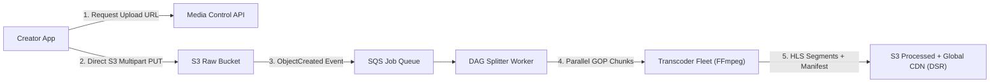

- **Concrete Production Stack:** Media Control API (PostgreSQL job state) -> Direct Client-to-S3 Multipart Presigned URLs (with CloudFront Transfer Acceleration) -> S3 Event Notification -> Amazon SQS (with visibility timeout heartbeats + DLQ) -> DAG Orchestrator -> Autoscale Spot GPU/CPU FFmpeg Workers -> S3 Processed Bucket -> Anycast CDN Edge (`DSR` / Byte-Range caching).
- **Step-by-Step Write Path (Resumable Ingestion & Parallel Split-and-Stitch):**
  1. Client calls `POST /v1/videos/uploads`; API creates a `PENDING_UPLOAD` row in PostgreSQL and generates **S3 Multipart Presigned URLs** (`5–50 MB` parts). The client streams raw gigabytes *directly* from mobile/browser to S3—API servers never proxy binary video bytes through pod RAM!
  2. Client retries individual failed 50 MB chunks independently on flaky mobile Wi-Fi (`CompleteMultipartUpload` validates ETag checksums atomically).
  3. S3 emits `s3:ObjectCreated:CompleteMultipartUpload` -> SQS. A DAG Splitter inspects container headers (`ffprobe`), splits the video along keyframe **GOP (Group of Pictures)** boundaries (`2–4 s` chunks), and fans out chunk tasks across 50 parallel Spot transcoding workers.
  4. A 60-minute `4K` file that took 90 minutes sequentially transcodes across 50 workers in **~2 minutes**, emitting `.m4s` CMAF segments and `.m3u8` HLS master/variant playlists to S3 Processed.
- **Step-by-Step Read Path (Adaptive Bitrate Playback):**
  1. Player downloads the small `.m3u8` playlist (`Cache-Control: public, max-age=300`) and begins requesting 4-second immutable `.m4s` media segments (`max-age=31536000, immutable`), dynamically switching between `1080p` and `480p` chunks based on measured throughput.
- **Real Bottlenecks & Exact Mitigations:**
  - *SQS Visibility Timeout Expiration During Long Transcodes:* If a worker takes 12 minutes on a heavy 4K chunk while SQS `VisibilityTimeout = 5 min`, SQS re-delivers the exact job to a second worker, burning duplicate GPU compute! **Mitigation:** Configure chunk sizes under `30 s` runtime AND run a worker background heartbeat calling `ChangeMessageVisibility` every `60 s` until upload completes (or abort on `SIGTERM`).
  - *Arbitrary Content-Type XSS / Malware Uploads:* Blindly serving user uploads from the main app domain lets attackers upload malicious HTML/SVG scripts executing under app cookies. **Mitigation:** Validate magic bytes (`libmagic`) post-upload, strip EXIF/metadata, and serve user media strictly from an isolated origin domain (`media-usercontent.net`) with `Content-Security-Policy: sandbox` and `X-Content-Type-Options: nosniff`.

---

### 4.6 Architecture (F): Geo-Distributed Low-Latency Collaborative App

Supports `1M+` concurrent WebSocket editors/chat participants across continents with `< 50 ms` local propagation, causal conflict-free merging during offline edits, and crash-safe recovery. Related case study: [[Programming/Software Engineering/System Design/Cases/Chat Application|Chat Application]].

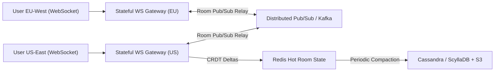

- **Concrete Production Stack:** Anycast Edge / GeoDNS routing to nearest region -> Stateful Go/Rust WebSocket Gateways (consistent-hashed or room-affined via Envoy Ring Hash) -> Redis Cluster Pub/Sub (intra-region broadcast) + Regional Mesh/NATS JetStream (cross-region delta relay) -> In-Memory **CRDT (`Yjs` / `Automerge`)** or Causal Sequence Engine -> ScyllaDB (append-only delta log) + Periodic Snapshot Compaction to S3.
- **Step-by-Step Write & Collaboration Path:**
  1. Client connects via `wss://edge.app/rooms/{room_id}`. Envoy routes connections for the same `room_id` preferentially to a single regional **Room Gateway Coordinator** when local, minimizing fan-out hops.
  2. When User 1 edits a document or sends a message, the browser sends a compact binary CRDT delta (`(client_id, lamport_clock, op)`) over the open WebSocket frame.
  3. The Gateway appends the delta to Redis Stream / ScyllaDB (`PARTITION KEY (room_id, time_bucket), CLUSTERING KEY (hlc_seq)`) for durability and immediately publishes the delta to all other local sockets in that room + cross-region gateway subscribers.
  4. **Offline Edits & Convergence:** If User 2 edits offline on a train and reconnects 10 minutes later, their client sends its local state vector (`SV`); the gateway replies solely with missing deltas, and the CRDT merge operator $\sqcup$ converges both clients deterministically to the exact identical state without modal "merge conflict" prompts.
- **Step-by-Step Read Path (Room Join & Catch-Up):**
  1. On initial join, client fetches the latest compacted **CRDT binary snapshot** from CDN/S3/Redis (`v=4200`), plus only the small tail of deltas (`seq > 4200`) from ScyllaDB—keeping cold room loads under `30 ms` even for documents with 100,000 historical edits.
- **Real Bottlenecks & Exact Mitigations:**
  - *Reconnection Thundering Herd on Gateway Deploy/Drop:* Restarting one WebSocket gateway holding 80,000 sockets causes 80,000 clients to reconnect within `100 ms`, saturating TLS ECDHE CPU and DB authentication lookups simultaneously! **Mitigation:** Drain rolling deploys gradually (`maxUnavailable: 5%`), enforce client **exponential backoff + full jitter** on WebSocket `onclose`, and cache signed room session tokens locally so reconnects authenticate statelessly without hitting PostgreSQL.
  - *CRDT Tombstone Memory Bloat:* Deleting 1,000,000 characters over a document's lifetime leaves CRDT metadata tombstones inflating snapshot RAM. **Mitigation:** Run periodic background snapshot compaction checkpoints when all active peers advance past a causal barrier, garbage-collecting retired tombstones into a clean base snapshot.

---

## Part 5: Cascading Failure Prevention, Disaster Recovery & Capacity Playbook

### 5.1 Retry Amplification, Metastable Failures & Deadline Propagation

Distributed systems rarely collapse from steady normal load—they collapse into **metastable failures** when a brief transient slowdown triggers self-sustaining amplification loops (`retries`, `client reconnects`, `GC pauses`, `cache misses`) that keep servers saturated even after the initial trigger vanishes.

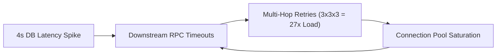

#### Retry Amplification Math

Suppose Request Path `Edge -> Service A -> Service B -> Service C -> DB` allows `3` attempts (`1` original + `2` retries) at every hop upon timeout. During a DB slowdown, total amplification at Service C equals:
$$\text{Amplification} = 3 \times 3 \times 3 = 27\times \text{ normal request volume!}$$
Even worse, synchronous waiting keeps upstream threads and sockets locked across all retries, multiplying memory consumption and queue depth across every hop.

#### Four Mandatory Anti-Amplification Defenses

1. **Retry at Strictly One Layer + Bounded Retry Budget:** Retry idempotent operations (`GET`, `PUT`, `POST` with `Idempotency-Key`) at *either* the edge proxy *or* the immediate caller—never blindly at every microservice hop. Enforce an Envoy/client-side **Retry Budget** (`max_retries <= 10%` of active in-flight requests): once >10% of downstream requests are retries, drop further retries immediately and fast-fail.
2. **Exponential Backoff with Full Jitter:** Never use fixed intervals or deterministic exponential backoff (`100 ms, 200 ms, 400 ms`), which synchronizes 10,000 clients into lock-step hammering waves. Use **Full Jitter**:
   $$\text{sleep} = \text{uniform}(0, \min(\text{cap}, \text{base} \cdot 2^{\text{attempt}}))$$
3. **Propagate End-to-End Deadlines (`grpc-timeout` / `X-Request-Deadline`):** If the Edge Gateway grants a `2,000 ms` total SLA and Service A already spent `1,700 ms`, Service A must attach `remaining_budget = 300 ms` (minus margin) to its call to Service B. Never issue a downstream call whose timeout exceeds the remaining caller deadline—if the client already timed out, continuing downstream SQL queries burns CPU for a discarded response!
4. **Hedged Requests vs Retries (Tail Latency Control):** For read-only idempotent calls hitting multi-replica stores, wait until `p95` latency (`e.g. 12 ms`), then send one hedged backup request to a *different* replica and cancel whichever finishes second. Caps retry overhead at $\le 5\%$ while cutting `p99.9` tail latency dramatically.

```go
package resilience

import (
	"context"
	"math"
	"math/rand"
	"time"
)

// BackoffWithFullJitter sleeps with randomized exponential jitter while honoring parent context deadlines.
func BackoffWithFullJitter(ctx context.Context, attempt int, baseDelay, maxCap time.Duration) error {
	exp := float64(baseDelay) * math.Pow(2, float64(attempt))
	ceiling := min(float64(maxCap), exp)
	jitterDelay := time.Duration(rand.Float64() * ceiling)

	if deadline, ok := ctx.Deadline(); ok {
		if time.Until(deadline) <= jitterDelay {
			return context.DeadlineExceeded // Abort immediately: parent deadline expires before retry could finish
		}
	}

	timer := time.NewTimer(jitterDelay)
	defer timer.Stop()
	select {
	case <-ctx.Done():
		return ctx.Err()
	case <-timer.C:
		return nil
	}
}
```

---

### 5.2 Bulkheads, Adaptive Concurrency Limits & Load Shedding

- **Bulkheads (Fault Containment):** Isolate thread pools, goroutine semaphores, and DB/HTTP connection pools per downstream dependency and per criticality tier. If the Recommendations engine stalls at `5 s` latency, its dedicated `max_conns = 32` pool fills and rejects calls in `< 1 ms`, leaving `Checkout` and `/health` pools completely unaffected.
- **Adaptive Concurrency Limits (Vegas / Gradient2 Algorithm):** Static rate limits fail whenever downstream database latency shifts (e.g., an index bloat makes queries $3\times$ slower). Adaptive limiters (`Netflix concurrency-limits`, `Envoy Adaptive Concurrency`) continuously probe baseline minimum latency (`minRTT` when queue = 0) and compare against observed `sampleRTT`:
  - When `sampleRTT <= minRTT * 1.2` (no queuing), increase concurrency limit additively (`limit += 1`).
  - When `sampleRTT` rises above threshold (queueing detected), shrink concurrency limit multiplicatively before saturation collapses the DB!
- **Load Shedding via LIFO + CoDel (Controlled Delay):** Standard FIFO queues exacerbate overload: during a `10 s` backlog, the oldest request at the front of the FIFO queue has already waited `9.5 s`, processes cleanly at the DB, and returns to a client whose HTTP timeout fired `5 s` ago—yielding **0% goodput at 100% CPU**.
  - **Production Fix:** Replace unbounded FIFO queues with a bounded **LIFO (Last-In, First-Out)** queue paired with **CoDel** tracking minimum sojourn wait time inside the queue. Shed requests immediately at ingress (`HTTP 503` + `Retry-After: 5`) if queue wait exceeds `target_delay` (e.g., `25 ms`), prioritizing critical revenue mutations (`checkout`, `auth`) over best-effort traffic (`analytics`, `prefetch`).

---

### 5.3 Multi-Region Disaster Recovery Patterns & Trade-Offs

| Topology Pattern | Write Handling | Cross-Region Data Sync | Realistic `RPO` | Realistic `RTO` | Operational Pitfalls |
| :--- | :--- | :--- | :--- | :--- | :--- |
| **Multi-AZ Active-Passive (Single Region)** | Single primary AZ; synchronous standby in AZ-2 | Sync WAL (`remote_apply` or `on`) | `0` (Zero data loss) | `15–60 s` (Patroni/RDS failover) | Vulnerable if an entire cloud region control plane or regional fiber fails. |
| **Multi-Region Pilot Light / Warm Standby** | Primary writes in Region A; Region B scales stateless pods at minimum + async DB replica | Async cross-region WAL streaming + S3 replication | `5–60 s` (async WAN lag) | `2–15 min` (promote standby, scale ASGs, flip DNS/BGP) | **Cold cache shock** on failover; DNS TTL caching traps legacy clients on dead Region A; un-fenced Region A causes split-brain if it recovers automatically! |
| **Multi-Region Active-Active (Geo-Sharded Home Regions)** | Each tenant/user pinned to a Home Region (`EU` vs `US`); writes commit locally in Home Region | Async cross-region summary replication or read-only global views | `0` per Home Region | `< 30 s` (Anycast BGP routes around failed edge; home-region DB still single-region unless Spanner/CRDT) | Cross-region user collaboration or tenant relocation requires draining and re-pinning home shard state cleanly. |
| **Multi-Region Active-Active (CockroachDB / Spanner / CRDT)** | Any region accepts writes for any key | Raft/Paxos multi-region quorum (`PC`) or CRDT async delta sync (`AP`) | `0` (Quorum) / `1–5 s` (CRDT) | `< 10 s` automatic | `PC` pays `70–150 ms` cross-continent commit latency on every write; `AP` CRDTs cannot enforce global linearizable invariants (unique emails, strict balances). |

**Critical Disaster Recovery Rule — Fence Before Promoting:** When promoting Region B's standby PostgreSQL primary during a Region A outage, execute an explicit fence command (`iptables DROP` / revoke storage lease / increment fencing epoch) on Region A before accepting Region B writes so a partitioning flap never leaves two primaries accepting diverging histories (**split-brain**). Test failover end-to-end monthly in staging/production game-days—untested DR plans routinely fail on stale IAM credentials, missing DNS records, or un-provisioned regional vCPU quotas!

---

### 5.4 Production Operations, Telemetry & Chaos Playbook

Refer to [[Programming/Software Engineering/DevOps/Observability|Observability]] and [[Programming/Software Engineering/DevOps/Kubernetes|Kubernetes]] for instrumentation setup. Diagnose active incidents rapidly using symptoms-to-telemetry correlation:

| Production Symptom | Underlying Root Cause | Exact Diagnostic CLI / SQL / PromQL Command | Immediate Remediation |
| :--- | :--- | :--- | :--- |
| **API `p99` jumps 20x while CPU stays at 15%** | DB connection pool exhaustion or downstream synchronous lock wait | SQL: `SELECT state, wait_event_type, count(*) FROM pg_stat_activity GROUP BY 1,2;` | Enable PgBouncer transaction pooling; kill blocking idle-in-tx sessions; verify `statement_timeout = '2s'`. |
| **K8s Pods cycling `CrashLoopBackOff` during brief DB blip** | `/livez` liveness probe queries Postgres/Redis | `kubectl describe pod <name>` -> `Liveness probe failed: HTTP 500` | Decouple `/livez` (process memory/loop only) from `/readyz` (DB pool check); add `preStop: sleep 5`. |
| **Redis latency spikes from `0.5 ms` to `400 ms` periodically** | `KEYS *` / large `HGETALL` blocking single thread OR `BGSAVE` CoW page faults | CLI: `redis-cli --latency-history` & `redis-cli SLOWLOG GET 10` | Replace `KEYS` with `SCAN` / `SSCAN`; move persistence snapshots to read replicas; cap hash sizes `< 1,000` fields. |
| **Kafka consumer lag climbs monotonically despite healthy CPU** | Poison-pill payload crashing partition worker OR rebalance loop exceeding `max.poll.interval.ms` | CLI: `kafka-consumer-groups.sh --bootstrap-server ... --describe --group <g>` | Switch to `CooperativeStickyAssignor`; pause heavy synchronous work off consumer thread; route failing payloads after 5 attempts to DLQ. |
| **Sudden burst of `502 Bad Gateway` on ALB/Envoy during traffic ramp** | Keep-alive idle timeout mismatch (App closes idle TCP at `5 s` while ALB pool holds for `60 s`) OR `somaxconn` SYN drops | `ss -s` & `nstat -az TcpExtListenDrops TcpExtListenOverflows` | Set backend HTTP `keepAliveTimeout > LB idleTimeout` (e.g., `65 s` vs `60 s`); raise `net.core.somaxconn = 65535`. |
| **PostgreSQL disk fills unexpectedly despite steady row count** | Abandoned logical replication slot (dead Debezium connector) retaining un-deleted WAL segments | SQL: `SELECT slot_name, active, pg_size_pretty(pg_wal_lsn_diff(pg_current_wal_lsn(), restart_lsn)) FROM pg_replication_slots;` | Restart Debezium connector or run `SELECT pg_drop_replication_slot('stale_slot');` + configure `max_slot_wal_keep_size`. |

#### Production Chaos Verification & Readiness Checklist

Before certifying a Tier-0 distributed service for production traffic, verify all 8 operational gates under fault injection:
- [ ] **AZ Blackhole Test:** Drop 100% network traffic to one Availability Zone (`AWS Fault Injection Simulator` / `NetworkPolicy`); confirm automated failover completes within `RTO` and error budget burn stays within threshold.
- [ ] **Packet Loss & Latency Injection (`tc netem`):** Inject `200 ms` latency and `2%` packet loss on downstream dependencies; verify timeouts fire accurately, retry budget caps amplification $\le 1.1\times$, and circuit breakers trip cleanly.
- [ ] **Cache Wipe / Cold Start Drill:** Flush L2 Redis in staging under simulated peak load; confirm `singleflight` + Redis mutex leases keep PostgreSQL CPU `< 60%` without stampede collapse.
- [ ] **Idempotency & Replay Verification:** Deliver duplicate webhooks and replay Kafka offsets backward by 1 hour; verify zero duplicate financial debits or broken state transitions.
- [ ] **Graceful Shutdown & Zero-502 Rollout:** Execute a rolling K8s deployment under continuous `1,000 RPS` load testing; verify `0` failed requests (`preStop` + SIGTERM drain).
- [ ] **Observability Golden Signals & Alerts:** Export RED metrics (`Rate`, `Errors`, `Duration` histograms with `le` buckets calibrated to SLOs), Saturation (`DB pool wait`, `Kafka consumer lag`, `Redis RSS %`), and structured JSON logs carrying W3C `traceparent` IDs.
- [ ] **Multi-Window SLO Burn-Rate Alerting:** Page on-call engineers only on fast burn (`14.4x` budget burn over `1 h` and `5 m` confirmation) rather than noisy single-datapoint CPU spikes.
- [ ] **Runbook & Game-Day Automation:** Every alert links directly to an executable playbook specifying exact rollback feature flags, safe load-shedding switches, and DLQ replay CLI commands.

---

## Part 6: Cross-System Worked Exercises & Step-by-Step Solutions

### Exercise 1: Global Multi-Region Rate Limiter & API Gateway (`200k RPS`)

**Scenario:** You must design a global rate limiter sitting in front of a multi-region API serving **200,000 RPS** across 3 regions (`us-east`: 100k RPS, `eu-west`: 60k RPS, `ap-south`: 40k RPS). Enterprise API keys have strict global limits (e.g., `1,200 req/min` = `20 req/s` average, burst `100`).
1. Prove mathematically why routing every check to a single global Redis cluster violates both `< 2 ms` `p99` gateway overhead and throughput ceilings.
2. Design a two-tier local-lease + async-gossip architecture achieving `< 0.5 ms` `p99` check latency while bounding global abuse when a client round-robins across all 3 regions simultaneously.
3. Compute the RAM required for `10,000,000` active API keys using the Sliding Window Counter vs Sliding Window Log, and define the exact regional Redis AZ failure fallback.

### Solution 1

1. **Why Single Global Redis Fails Latency & Throughput Physics:**
   - **Speed-of-Light Violation:** Cross-region TCP RTT from `eu-west -> us-east` is `75–90 ms` and `ap-south -> us-east` is `160–200 ms`—exceeding the `< 2 ms` budget by **$40\times$–$100\times$**.
   - **Single-Shard Saturation:** One single-threaded Redis primary tops out around `80k–120k ops/s` for Lua scripts; `200,000 RPS` instantly saturates its event loop at 100% CPU, queueing every global API call behind Lua execution.
2. **Two-Tier Local Quota Batching + Async Cross-Region Delta Sync:**
   - **Tier 1 (Regional Sharded Redis Cluster):** Deploy an independent multi-shard Redis cluster inside each region (`0.4–0.8 ms` intra-region RTT) running the atomic **Lua Sliding Window Counter** (`KEYS[1], KEYS[2]`).
   - **Tier 2 (In-Gateway Micro-Lease Batching + Regional CRDT Delta Gossip):** For ultra-hot keys, each gateway pod requests a small batch lease (e.g., `10` tokens or `50 ms` local sync interval) from its regional Redis cluster, checking 9 of 10 requests in local pod memory in **`< 0.05 ms`**. Every `250 ms`–`500 ms`, regional Redis clusters publish compact key counter deltas over Kafka/Redis replication to peer regions (CRDT `PN-Counter` style: each region owns its independent sub-key `rl:{key}:us`, `rl:{key}:eu`, `rl:{key}:ap`, merged asynchronously via `sum`).
   - **Abuse Bound Calculation:** If a malicious client sprays all 3 regions concurrently, the worst-case overshoot before the `500 ms` cross-region sync arrives is $\le 0.5\text{ s} \times 3\text{ regions} \times \text{burst\_leak}$, easily capped within ~5–10% slack while delivering `< 0.5 ms` regional `p99` overhead.
3. **Memory Sizing & Outage Fallback:**
   - **Sliding Window Log (`ZSET`):** Storing `1,200` timestamps (`8 B` score + `16 B` member + `~64 B` skiplist/dict overhead $\approx 90\text{ B}$/entry) for `10M` active keys requires $10^7 \times 1{,}200 \times 90\text{ B} \approx 1.08\text{ TB}$ RAM—prohibitive!
   - **Sliding Window Counter (2 integers + key overhead $\approx 120\text{ B}$/key):** $10^7 \times 120\text{ B} \approx 1.2\text{ GB}$ RAM across shards—fits effortlessly inside a tiny 3-shard Redis cluster (`4 GB` per shard).
   - **Regional Redis Failure Policy:** Envoy/Gateway wraps Redis checks in a `10 ms` timeout circuit breaker. On Redis cluster outage, gateways degrade to per-pod in-memory Token Buckets scaled to `global_limit / (active_pods * 3_regions)`, preventing both origin DDoS (`fail-open`) and total customer outage (`fail-closed`).

---

### Exercise 2: Diagnosing & Fixing a 45-Minute Cascading Outage

**Scenario:** A brief **4-second GC/checkpoint stall** on Primary PostgreSQL escalates into a **45-minute total platform outage** long after PostgreSQL recovers:
- API Gateway returns `100% 504 Gateway Timeout`, including static/health pages.
- Call chain `Edge Gateway -> Service A -> Service B -> Service C -> DB` configures `3` retries with `5 s` timeouts at every layer.
- A hot homepage product key expires in Redis at minute 1.
- Kubernetes kills and restarts 80% of Service A and Service B pods continuously in `CrashLoopBackOff`.

Trace all 4 self-reinforcing failure loops and provide exact YAML/code fixes.

### Solution 2

**Root-Cause Interaction Analysis (4 Compounding Loops):**
1. **Geometric Retry Storm ($27\times$ Traffic Surge):** Edge retries Service A ($3\times$), A retries B ($3\times$), and B retries C ($3\times$) without jitter or deadline propagation. The 4-second pause transforms into $3^3 = 27\times$ persistent traffic slamming the recovering database (**metastable state**).
2. **Self-Inflicted Liveness Probe Restart Loop:** `/livez` probes executed `SELECT 1` against PostgreSQL. During the 4-second DB freeze, Kubelet killed 80% of healthy pods across A and B, flushing warm L1 caches and causing thousands of cold pods to bombard PostgreSQL with simultaneous TLS/TCP connection handshakes on startup.
3. **Unprotected Cache Stampede:** At minute 1, the hot homepage Redis key expired cleanly while retries spiked; 10,000 incoming requests missed Redis identically and queued duplicate expensive catalog queries on the saturated Postgres pool.
4. **Thread/Connection Pool Exhaustion (No Bulkheads):** Long 5-second waits on Service C held all worker threads inside Service A and the Edge Gateway hostage, starving unrelated fast endpoints (`/static`, `/status`).

**Exact Production Remediations:**
1. **Fix Kubernetes Probes & Drain Hooks:** Split `/livez` (process loop check only—never touch DB/Redis) from `/readyz` (dependency health), plus add `preStop: sleep 5`:
   ```yaml
   livenessProbe:
     httpGet: { path: /livez, port: 8080 }
     periodSeconds: 5
     failureThreshold: 3
   readinessProbe:
     httpGet: { path: /readyz, port: 8080 }
     periodSeconds: 3
     failureThreshold: 2
   lifecycle:
     preStop:
       exec: { command: ["sh", "-c", "sleep 5"] }
   ```
2. **Eliminate Multi-Hop Retries & Propagate Deadlines:** Configure retries *strictly* at Edge/Service A with `max_retries <= 10%` retry budget (Envoy `circuit_breakers.thresholds.max_retries`), `BackoffWithFullJitter`, and strict `grpc-timeout` deadline propagation so Service B/C abort expired calls immediately.
3. **Deploy Stampede Guard:** Wrap hot homepage keys in the Go `ResilientCache` (`singleflight` + Redis `SET NX` mutex + `XFetch` probabilistic early refresh + `stale-while-revalidate`).
4. **Enforce Bulkheads + Circuit Breakers:** Separate HTTP/DB pools per downstream route and trip circuit breakers open on `5 consecutive 5xx` (`base_ejection_time: 30s`) so failing calls return `503` in `< 1 ms`, giving PostgreSQL breathing room to recover within seconds.

---

### Exercise 3: Quantitative Capacity Sizing, Modulo Resharding Skew & Read-Your-Writes Lag

**Scenario:** A multi-tenant collaboration platform serves **50,000,000 DAU** (`30 reads/user/day`, `5 writes/user/day`; average write payload `1.5 KB`, read payload `3 KB`, retention `5 years`). Currently, the storage layer runs across **4 PostgreSQL shards** using `shard_id = user_id % 4`, each with 1 primary and 2 async read replicas averaging `150 ms` replication lag.
1. Compute Average QPS, $4\times$ Peak QPS, 5-year physical provisioned storage (accounting for `1.25x` MVCC/page overhead, `1.4x` B-Tree/GIN indexes, and `RF=3`), and peak egress bandwidth (Gbps).
2. Prove mathematically why scaling from 4 shards to 5 shards via `user_id % 5` forces migrating **80%** of all database rows and invalidates cache affinity, and fix the sharding strategy for zero-downtime scaling.
3. Users edit workspace permissions (`PATCH /workspaces/{id}`) and immediately refresh (`GET /workspaces/{id}`) `40 ms` later, hitting a lagging read replica (`150 ms` lag) and seeing reverted permissions. Fix this without pinning 100% of global reads to Primaries.

### Solution 3

1. **Quantitative Sizing Calculations:**
   - **Daily Requests:**
     - Reads/day = $5 \times 10^7 \times 30 = 1.5 \times 10^9$ reads/day.
     - Writes/day = $5 \times 10^7 \times 5 = 2.5 \times 10^8$ writes/day.
   - **Average & Peak Throughput:**
     - Avg Read RPS = $\frac{1.5 \times 10^9}{86{,}400} \approx 17{,}361\text{ RPS}$; $4\times$ Peak Read = $69{,}444\text{ RPS}$.
     - Avg Write TPS = $\frac{2.5 \times 10^8}{86{,}400} \approx 2{,}894\text{ TPS}$; $4\times$ Peak Write = $11{,}574\text{ TPS}$.
   - **5-Year Provisioned Storage:**
     - Daily raw write = $2.5 \times 10^8 \times 1.5\text{ KB} = 375\text{ GB/day}$.
     - 5-Year raw = $375\text{ GB/day} \times 1{,}825\text{ days} = 684.4\text{ TB}$.
     - Physical footprint = $684.4\text{ TB} \times 1.25\text{ (MVCC)} \times 1.4\text{ (Indexes)} \times 3\text{ (RF=3)} \approx 3{,}593\text{ TB} \approx 3.59\text{ PB}$ (requires cold Parquet archiving after 180 days!).
   - **Peak Read Egress Bandwidth:**
     - $69{,}444\text{ RPS} \times 3\text{ KB} \approx 208.3\text{ MB/s} \times 8 = 1.67\text{ Gbps}$ (~`1.85 Gbps` including TLS framing).
2. **Proof of 80% Row Migration Under `% 4 -> % 5` & Fix:**
   - By the Chinese Remainder Theorem, since $\gcd(4, 5) = 1$, residues modulo $20$ cover every $(k \bmod 4, k \bmod 5)$ pair uniformly:
     - $k \bmod 4 == k \bmod 5$ holds *only* when $k \bmod 20 \in \{0, 1, 2, 3\}$ — **4 out of 20 = 20%** of keys remain on the same physical shard!
     - **80% of all rows** (`16 out of 20`) shift physical shards simultaneously, causing massive I/O throttling and 80% L1/L2 cache misses.
   - **Fix:** Decouple logical partitions from physical hosts using **1,024 Logical Shard Buckets** (or **Consistent Hashing with 150 Virtual Nodes**). Each physical shard hosts `256` logical PostgreSQL schemas/partitions. Adding Shard 5 moves strictly **20%** (`~205` logical buckets) incrementally via PostgreSQL logical replication CDC + brief read-only cutover lock per bucket.
3. **Read-Your-Writes Under 150 ms Lag (WAL LSN Watermark Routing):**
   - After `PATCH /workspaces/{id}` commits on the shard Primary, query `SELECT pg_current_wal_lsn()` (`e.g., 0/4F8A120`) and store it in a signed short-lived cookie (`rw_lsn=0/4F8A120`, `Max-Age=5`) AND/OR Redis `SET rw:{user_id} "0/4F8A120" EX 5`.
   - On subsequent `GET /workspaces/{id}`, API routing middleware reads `rw_lsn`:
     - If no token exists (`> 5 s` since last write—98%+ of reads), route normally to any async read replica.
     - If `rw_lsn` is present, either route directly to the shard Primary for that 5-second window OR select a replica whose `pg_last_wal_replay_lsn() >= '0/4F8A120'::pg_lsn`.

---

### Exercise 4: Checkout DB Pool Exhaustion, Lost Dual-Write & Double-Charge Bug

**Scenario:** An e-commerce checkout service processes `POST /v1/orders` by opening a PostgreSQL transaction, deducting inventory, calling Stripe's external Charge API synchronously (`600 ms–3 s` latency), committing the transaction, and then calling `await kafka.produce("order.paid")` in Node.js memory. During a sale:
1. PostgreSQL hits `max_connections` (`FATAL: remaining connection slots are reserved`) even at moderate `400 TPS` load.
2. Customers complain of **double charges** when tapping "Pay" twice on slow cellular connections.
3. `0.8%` of paid orders never trigger shipping emails or finance analytics.

Diagnose all three defects quantitatively and refactor the checkout workflow.

### Solution 4

1. **Quantitative Proof of Connection Pool Exhaustion (Little's Law):**
   - With Stripe HTTP calls executing *inside* an open DB transaction, average connection hold time jumps from $W = 4\text{ ms}$ to $W = 1.2\text{ s}$.
   - By Little's Law ($L = \lambda \cdot W$): at $\lambda = 400\text{ TPS}$, concurrent pinned PostgreSQL connections hit $L = 400 \times 1.2 = 480\text{ active holding connections}$, blowing past PostgreSQL's `max_connections = 300` while holding row locks on popular inventory rows for 1.2 seconds!
2. **Root Causes of Double Charges & Lost Events:**
   - **Double Charges:** No `Idempotency-Key` enforcement across client retries; concurrent `POST /v1/orders` calls each opened new transactions and charged Stripe twice.
   - **Lost Events (Dual-Write Gap):** Crashes, pod restarts, or transient Kafka timeouts occurring *after* `COMMIT` and *before* `kafka.produce()` permanently dropped `order.paid` events with zero audit trace.
3. **Production Refactored Checkout State Machine:**
   - **Step A (Short ACID Reserve TX — ~3 ms):** Validate `Idempotency-Key` in `idempotency_keys` (`UNIQUE KEY`); if already `COMPLETED`, return cached response immediately. Otherwise atomically decrement `inventory` (`WHERE available >= qty`) and insert `orders (status='PENDING_PAYMENT')` -> **`COMMIT` immediately and release DB connection!**
   - **Step B (External PSP HTTP Call Outside DB TX):** Call Stripe `POST /v1/payment_intents` passing `Idempotency-Key: order_id` with bounded timeout (`3 s`). Zero DB connections or row locks held across WAN I/O.
   - **Step C (Short ACID Finalize + Transactional Outbox — ~3 ms):**
     - On Stripe success: `BEGIN; UPDATE orders SET status='PAID' WHERE order_id=$1 AND status='PENDING_PAYMENT'; INSERT INTO outbox_events (...); COMMIT;`
     - On Stripe permanent decline or expiration timeout: `BEGIN; UPDATE orders SET status='FAILED'; UPDATE inventory SET available = available + $qty; COMMIT;`
   - **Step D (Debezium CDC):** Debezium streams `outbox_events` into Kafka `domain.Order.events`, guaranteeing email and Snowflake delivery reliably even if pods crash mid-flight.

---

### Exercise 5: Kafka Consumer Lag, Poison Pill & Hot-Tenant Noisy Neighbor

**Scenario:** An ingestion pipeline handles `100,000,000 events/day` across a 16-partition Kafka topic partitioned by `tenant_id`. One enterprise tenant (`tenant_mega`) suddenly generates **60%** of total traffic (`~700 msg/s` average, `3,500 msg/s` bursts), while a malformed Unicode payload lands on Partition #7:
1. Consumer Group `analytics-writer` freezes completely on Partition #7 (`lag > 2,500,000` messages) while 15 other pods sit partially idle.
2. Every 5 minutes, the entire 16-pod consumer group drops throughput to **0 msg/s** for 25 seconds during cascading consumer rebalances.

Explain exact Kafka internals behind all 3 failures and prescribe concrete configurations and partitioning changes.

### Solution 5

1. **Exact Failure Mechanisms:**
   - **Hot Partition Skew:** Partitioning solely by `tenant_id` hashes 100% of `tenant_mega`'s `3,500 msg/s` onto a single partition (e.g., Partition #3), capped by 1 single consumer pod's thread/DB throughput while 15 pods handle almost nothing.
   - **Poison Pill Head-of-Line Blocking:** Partition #7's consumer throws an unhandled deserialization/SQL constraint exception on the malformed payload, crashes or exits without committing offset, and re-fetches the identical poison offset infinitely—halting every subsequent healthy tenant sharing Partition #7.
   - **Rebalance Storm (`max.poll.interval.ms` + Eager Assignor):** When slow downstream writes take longer than `max.poll.interval.ms` (`300 s` default) between `poll()` calls, the Kafka coordinator assumes the pod is dead and triggers a **Stop-the-World Eager Rebalance**, revoking *all* 16 partitions from *all* pods simultaneously and restarting un-committed batches repeatedly!
2. **Concrete Production Remediations:**
   - **Salted Tenant Partition Key:** For high-volume tenants (or universally when strict cross-entity global ordering is unnecessary), partition by `tenant_id + "#" + (entity_id % 8)` (or random bucket `#0..#7` for telemetry). Distributes `tenant_mega` cleanly across 8 partitions instead of 1!
   - **Non-Blocking Retry + DLQ Isolation:** Catch permanent validation/serialization errors inside the consumer loop, publish the raw bytes + stack trace header to `events.dlq` after bounded in-memory retries (`max_attempts = 3`), and **commit the partition offset** so Partition #7 resumes streaming immediately.
   - **Eliminate Stop-the-World Rebalances:** Switch consumer group to **`CooperativeStickyAssignor`**, decouple slow external HTTP/DB flushes onto bounded worker pools or tune `max.poll.records=100` so `poll()` always executes well inside `max.poll.interval.ms=300000`, and monitor `kafka_consumergroup_lag` per partition instead of topic average!

---

### Exercise 6: Multi-Region Active-Active Failover & Split-Brain Prevention

**Scenario:** A global B2B SaaS control plane runs Active-Active across `us-east` and `eu-central` (`85 ms` RTT apart). Architects must support:
- **Requirement A:** Tenant distributed job locks and billing quota deductions (`RPO = 0`, zero double-executions or negative quota bypasses).
- **Requirement B:** Real-time dashboard telemetry counts and user presence (`< 5 ms` local latency, `RPO < 5 s` acceptable).

1. Explain why running a single synchronous Raft/Spanner quorum spanning `us-east` and `eu-central` destroys Requirement B's latency, yet running uncoordinated asynchronous active-active PostgreSQL destroys Requirement A.
2. Design the hybrid dual-plane consistency architecture with exact home-region pinning, fencing tokens, and split-brain failover steps.

### Solution 6

1. **Physics & CAP Trade-Off Proof:**
   - Synchronous cross-Atlantic Raft consensus requires a majority quorum RTT (`85 ms` fiber speed-of-light minimum) on every write—making `< 5 ms` local telemetry updates physically impossible (`17x` over budget).
   - Conversely, asynchronous multi-master replication (`PC` violated -> `AP`) lets concurrent updates in `us-east` and `eu-central` both acquire the same job lock or double-spend the same billing quota during the `85 ms+` replication lag window, violating `RPO = 0`.
2. **Hybrid Home-Region + CRDT Architecture:**
   - **Plane A (`PC/EC` Home-Pinned Authority per Tenant):** Each tenant has an explicit immutable `home_region` (`us-east` or `eu-central`) in the global routing directory. All mutations for Requirement A (job leases, billing quotas, RBAC edits) route cleanly to the tenant's **Home Region** (`2 ms` intra-region Multi-AZ synchronous Raft/PostgreSQL quorum, guaranteeing `RPO = 0`).
   - **Fencing Tokens Across Leases & Failover:** Every job lease acquired from the Home Region issues a monotonic **Fencing Token (`lease_epoch`)** stored and validated atomically by downstream storage (`WHERE last_fence_seq < $token`). If `us-east` undergoes an unplanned regional disaster and SREs promote `eu-central`'s backup replica via explicit regional failover, the promotion runbook first fences `us-east` BGP/API ingress and increments the cluster epoch (`epoch + 1,000,000`) so lingering stale workers in `us-east` can never commit split-brain writes once connectivity returns.
   - **Plane B (`PA/EL` Local Edge Telemetry & Presence):** User presence and dashboard telemetry write directly to each region's local Redis/ScyllaDB (`< 2 ms`) using **CRDT `PN-Counter` / `LWW-Element-Set` (with HLC timestamps)** and replicate delta batches asynchronously over Kafka MirrorMaker every `1–2 s`—meeting both `< 5 ms` local latency and `RPO < 5 s`.

---

## Pre-Production System Design Readiness Checklist

- [ ] **Requirements Locked:** Read/write ratio, `p99` latency SLO, consistency guarantee, durability `RPO`/`RTO`, and explicit non-goals documented in an RFC.
- [ ] **Capacity Validated:** $4\times$ peak QPS, 5-year storage with MVCC + index + $RF=3$ inflation, RAM working set, and Little's Law PgBouncer pool math verified.
- [ ] **Kernel & LB Tuned:** `ulimit -n`, `somaxconn`, `TCP_NODELAY`, HTTP keep-alive timeouts (`App > LB`), and L7 HTTP/2 load balancing verified.
- [ ] **Caching Hardened:** Jittered TTLs, `singleflight` + mutex lease stampede protection, and CDC/delete-based invalidation (zero racy dual-writes).
- [ ] **Storage Partitioned Safely:** Shard key avoids hot-spotting; logical shard buckets or consistent hashing vnodes allow zero-downtime scaling; keyset pagination replaces `OFFSET`.
- [ ] **Messaging Effectively-Once:** Transactional Outbox + Debezium CDC + Idempotent Consumer dedup table + bounded retries + DLQ active.
- [ ] **Blast Radius Contained:** Independent `/livez` vs `/readyz`, `preStop` sleep, retry budgets ($\le 10\%$) with full jitter, deadline propagation, bulkheads, circuit breakers, and CoDel/LIFO shedding tested in chaos game-days.

---

← [[Programming/Software Engineering/System Design/System Design Overview|Back to System Design Overview]]
