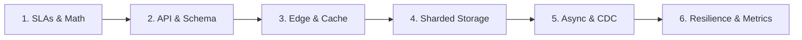

---
tags:
  - software-engineering
  - system-design
  - dashboard
created: 2026-01-02
updated: 2026-11-13
status: 🟢
level: mid-to-senior
---
# System Design Overview

> [!abstract] Hub Scope
> Canonical index and quick-reference cheat sheet for distributed systems architecture inside [[Programming/Software Engineering/Software Engineering Roadmap|Software Engineering Roadmap]]. Start with the [[Programming/Software Engineering/System Design/System Design Complete Guide|System Design Complete Guide]] for the end-to-end 45-minute execution protocol, then drill into specialized module notes and full production case studies below.

---

## 1. Execution Flow Overview



---

## 2. Core Modules & Case Studies Matrix

### Core System Design Modules

| Topic | Primary Coverage | Status |
| :--- | :--- | :--- |
| [[Programming/Software Engineering/System Design/System Design Complete Guide|System Design Complete Guide]] | 45-min playbook, hardware ceilings, Load Balancing, CAP/PACELC, Queues, Rate Limiting, Failure cascades | 🟢 |
| [[Programming/Software Engineering/System Design/Scalability|Scalability]] | Horizontal vs vertical scaling, stateless tiers, sharding & read replicas, K8s HPA, bottleneck tree | 🟢 |
| [[Programming/Software Engineering/System Design/Caching|Caching]] | Cache-aside, write-through/behind, LRU/LFU, stampede locking, `stale-while-revalidate` | 🟢 |
| [[Programming/Software Engineering/System Design/API Design|API Design]] | Idempotency state machines, keyset pagination, `ETag` OCC, RFC 9457, GraphQL DataLoader, gRPC varints, HMAC webhooks | 🟢 |
| [[Programming/Software Engineering/System Design/CDN|CDN]] | Anycast BGP, Edge TLS, `s-maxage`/`Vary` traps, Surrogate-Key purge, Origin Shield & collapsing, Edge Workers | 🟢 |
| [[Programming/Software Engineering/System Design/ETL|ETL]] | ELT warehouse pushdown, Flink watermarks & late data, Debezium WAL CDC + Outbox, Parquet pruning, SCD Type 2 | 🟢 |

### Integrated Distributed Primitives (in Complete Guide)

| Primitive | Key Mechanics Covered | Reference Link |
| :--- | :--- | :--- |
| **Load Balancing & Hashing** | L4 DSR vs L7 Envoy, HTTP/2 pinning, health vs readiness probes, consistent hashing w/ virtual nodes | [[Programming/Software Engineering/System Design/System Design Complete Guide#3.1 Load Balancing & Consistent Hashing|Load Balancing & Hashing]] |
| **CAP, PACELC & Quorums** | `PC/EC` vs `PA/EL`, Dynamo $W+R>N$ quorum math, read-your-writes LSN pinning | [[Programming/Software Engineering/System Design/System Design Complete Guide#3.2 CAP, PACELC & Replication Consistency|CAP, PACELC & Quorums]] |
| **Message Queues & Outbox** | Kafka partitioned logs vs RabbitMQ/SQS, effectively-once consumer idempotency, poison-pill DLQs | [[Programming/Software Engineering/System Design/System Design Complete Guide#3.3 Message Queues, Transactional Outbox & Delivery Guarantees|Queues & Outbox]] |
| **Distributed Rate Limiting** | Token bucket vs sliding window counter, atomic Redis Lua scripts, fail-open vs fail-closed | [[Programming/Software Engineering/System Design/System Design Complete Guide#3.4 Distributed Rate Limiting|Rate Limiting & Lua]] |

### Production Case Studies

| Case Study | Architecture & Core Trade-Offs | Status |
| :--- | :--- | :--- |
| [[Programming/Software Engineering/System Design/Cases/URL Shortener|URL Shortener]] | Base62 Feistel/KGS vs hash collisions, `301` vs `302` analytics, 404 Bloom filters, ClickHouse async clicks | 🟢 |
| [[Programming/Software Engineering/System Design/Cases/Twitter Timeline|Twitter Timeline]] | Hybrid fan-out-on-write vs celebrity pull merge, Redis `ZSET` ID-only caching, hydration stampede defense | 🟢 |
| [[Programming/Software Engineering/System Design/Cases/Chat Application|Chat Application]] | Stateful WS Gateways + Redis registry, monotonic `seq_id`, presence heartbeat suppression, S3 E2EE media | 🟢 |

### Cross-Domain Foundations

| Domain | Verified Vault References |
| :--- | :--- |
| **Database Engineering** | [[Programming/Software Engineering/Database Design/Database Design Complete Guide|Database Design Complete Guide]] · [[Programming/Software Engineering/Database Design/Relational Databases|Relational Databases]] · [[Programming/Software Engineering/Database Design/NoSQL|NoSQL]] · [[Programming/Software Engineering/Database Design/Normalization|Normalization]] |
| **Architectural Patterns** | [[Programming/Software Engineering/Architectural Patterns/Event-Driven Architecture|Event-Driven Architecture]] · [[Programming/Software Engineering/Architectural Patterns/CQRS|CQRS]] · [[Programming/Software Engineering/Architectural Patterns/Microservices|Microservices]] |
| **Infrastructure & Operations** | [[Programming/Software Engineering/SDLC/Release Engineering & Migrations|Release Engineering & Migrations]] · [[Programming/Software Engineering/DevOps/Cloud Fundamentals|Cloud Fundamentals]] · [[Programming/Software Engineering/DevOps/Kubernetes|Kubernetes]] · [[Programming/Software Engineering/DevOps/Monitoring|Monitoring]] · [[Programming/Software Engineering/DevOps/Logging|Logging]] |

---

## 3. Back-of-the-Envelope Reference Cheat Sheet

### Latency Ladder

| Operation | Latency | Order of Magnitude |
| :--- | :--- | :--- |
| L1 / L2 CPU Cache | `0.5 ns` / `7 ns` | Sub-10 ns |
| Main Memory (RAM) | `100 ns` | $0.1\ \mu\text{s}$ |
| NVMe SSD Random Read (4 KB) | `20–150 us` | $\sim 0.1\text{ ms}$ |
| Intra-AZ Network / Redis Hop | `0.5 ms` | $500\ \mu\text{s}$ |
| Indexed DB Lookup (Buffer Pool) | `1–3 ms` | Low single-digit ms |
| Cross-Region / Cross-Continent RTT | `40–150 ms` | Speed of light |

### Powers of 2 & Scale Constants

| Power of 2 | Exact / Approx Value | Storage / Keyspace Context |
| :--- | :--- | :--- |
| $2^{10}$ | `1,024` (~$10^3$) | `1 KB` |
| $2^{20}$ | `1,048,576` (~$10^6$) | `1 MB` |
| $2^{30}$ | ~$1.07 \times 10^9$ | `1 GB` |
| $2^{40}$ | ~$1.10 \times 10^{12}$ | `1 TB` |
| `1 day` | `86,400 s` ($\approx 10^5\text{ s}$) | `100M req/day` $\approx 1{,}157\text{ RPS avg}$ ($\sim 3{,}500\text{ peak}$) |
| `1 month` / `1 year` | `2.59M s` / `31.5M s` | `5 years` $\approx 1.825\text{ days} \times 10^3$ |

### Availability & Single-Node Ceilings

| Availability | Downtime / Year | Downtime / Month | Component Ceiling (1 Tuned Node) |
| :--- | :--- | :--- | :--- |
| `99.9%` | `8.76 hr` | `43.8 min` | Stateless API: `~2k–10k RPS` |
| `99.95%` | `4.38 hr` | `21.9 min` | Redis Shard: `~100k ops/s` |
| `99.99%` | `52.6 min` | `4.38 min` | PostgreSQL Primary: `~10k–25k QPS` |
| `99.999%` | `5.26 min` | `26.3 sec` | WS Gateway: `~50k–100k sockets` |

---

## 4. Vault Index

```dataview
TABLE WITHOUT ID
	file.link as "Topic",
	level as "Level",
	status as "Status",
	updated as "Updated"
FROM "Programming/Software Engineering/System Design"
WHERE file.name != "System Design Overview"
SORT file.folder asc, file.name asc
```

---

← [[Programming/Software Engineering/Software Engineering Roadmap|Back to Software Engineering Roadmap]]
